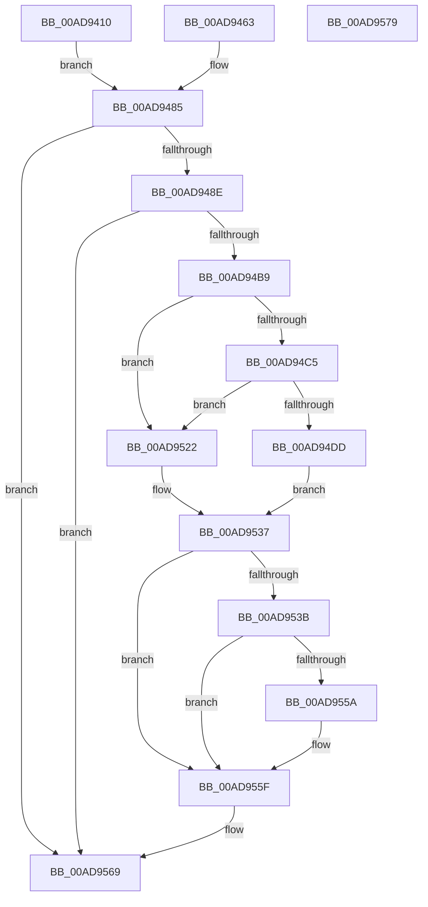

# MiCacheImageSymbols

- RVA: `0x00AD9410`–`0x00AD957A` (길이 `362` bytes)
- VA: `0x0000000140AD9410`
- 실행 섹션: `PAGE`
- PDB 이름 있음: `예`; PDB Function 태그: `아니요`
- unwind 정보 RVA: `0x000BF23C`
- 디코드: `96`개 명령, `362/362` bytes 표시
- 미해석 바이트: `0` (있으면 어셈블리에 `.byte`로 보존)

> 이 문서는 커널 이미지의 기계어와 PDB 기호를 분석해 생성했습니다. 4번과 5번은 함수 원형과 자료형을 바이너리 사용 방식에서 추정한 C 해석이며 원본 소스 복구 결과는 아닙니다.

## 1. Dependencies

- 직접 호출 지점: **9**; 고유 호출 대상: **8**
- 직접 호출자로 확인된 함수: **2**
- RIP 상대 이미지 참조: **3**

### Outgoing calls
- `0x00AD9457` → [RtlImageDirectoryEntryToData](../../text/43/RtlImageDirectoryEntryToData_function_004328D0.md) (function, `0x004328D0`)
- `0x00AD94A8` → [MiAllocatePool](../../text/35/MiAllocatePool_function_0035B540.md) (function, `0x0035B540`)
- `0x00AD94D4` → [wcsnicmp](../../text/50/wcsnicmp_function_005001C0.md) (function, `0x005001C0`)
- `0x00AD94FB` → [RtlGetNtSystemRoot](../A1/RtlGetNtSystemRoot_function_00A1DCD0.md) (function, `0x00A1DCD0`)
- `0x00AD951B` → [RtlStringCbPrintfW](../../text/40/RtlStringCbPrintfW_function_0040FB40.md) (function, `0x0040FB40`)
- `0x00AD9532` → [RtlStringCbPrintfW](../../text/40/RtlStringCbPrintfW_function_0040FB40.md) (function, `0x0040FB40`)
- `0x00AD9543` → [RtlInitUnicodeString](../../text/42/RtlInitUnicodeString_function_0042A780.md) (function, `0x0042A780`)
- `0x00AD9550` → [DbgLoadImageSymbolsUnicode](../../text/4A/DbgLoadImageSymbolsUnicode_function_004AE0BC.md) (function, `0x004AE0BC`)
- `0x00AD9564` → [ExFreePoolWithTag](../../poolcode/B8/ExFreePoolWithTag_function_00B82870.md) (function, `0x00B82870`)

### Direct callers
- [MiDriverLoadSucceeded](../70/MiDriverLoadSucceeded_function_00702F08.md) at `0x00702F41`
- [MmLoadSystemImageEx](../99/MmLoadSystemImageEx_function_00999B8C.md) at `0x0099A138`

### Static image references
- `0x00AD94C9` → RVA `0x00B00620` (` ?? ::NNGAKEGL::`string'`; read)
- `0x00AD950E` → RVA `0x00B09E30` (` ?? ::NNGAKEGL::`string'`; read)
- `0x00AD9525` → RVA `0x00B09E20` (` ?? ::NNGAKEGL::`string'`; read)

## 2. Other-region calls and transfers

- 다른 실행 섹션으로 향하는 call: **8**
  - `0x00AD9457` → [RtlImageDirectoryEntryToData](../../text/43/RtlImageDirectoryEntryToData_function_004328D0.md) (`PAGE` → `.text`)
  - `0x00AD94A8` → [MiAllocatePool](../../text/35/MiAllocatePool_function_0035B540.md) (`PAGE` → `.text`)
  - `0x00AD94D4` → [wcsnicmp](../../text/50/wcsnicmp_function_005001C0.md) (`PAGE` → `.text`)
  - `0x00AD951B` → [RtlStringCbPrintfW](../../text/40/RtlStringCbPrintfW_function_0040FB40.md) (`PAGE` → `.text`)
  - `0x00AD9532` → [RtlStringCbPrintfW](../../text/40/RtlStringCbPrintfW_function_0040FB40.md) (`PAGE` → `.text`)
  - `0x00AD9543` → [RtlInitUnicodeString](../../text/42/RtlInitUnicodeString_function_0042A780.md) (`PAGE` → `.text`)
  - `0x00AD9550` → [DbgLoadImageSymbolsUnicode](../../text/4A/DbgLoadImageSymbolsUnicode_function_004AE0BC.md) (`PAGE` → `.text`)
  - `0x00AD9564` → [ExFreePoolWithTag](../../poolcode/B8/ExFreePoolWithTag_function_00B82870.md) (`PAGE` → `POOLCODE`)
- 별도 외부 분기/꼬리 이동을 확인하지 못했습니다.

## 3. Assembly (complete function range)

```asm
00AD9410  48 8B C4                        mov rax, rsp
00AD9413  4C 89 40 18                     mov qword ptr [rax + 0x18], r8
00AD9417  48 89 50 10                     mov qword ptr [rax + 0x10], rdx
00AD941B  48 89 48 08                     mov qword ptr [rax + 8], rcx
00AD941F  53                              push rbx
00AD9420  56                              push rsi
00AD9421  57                              push rdi
00AD9422  41 54                           push r12
00AD9424  41 55                           push r13
00AD9426  41 56                           push r14
00AD9428  41 57                           push r15
00AD942A  48 83 EC 50                     sub rsp, 0x50
00AD942E  4D 8B F8                        mov r15, r8
00AD9431  48 8B F2                        mov rsi, rdx
00AD9434  48 8B D9                        mov rbx, rcx
00AD9437  4C 8D 71 30                     lea r14, [rcx + 0x30]
00AD943B  4C 89 74 24 38                  mov qword ptr [rsp + 0x38], r14
00AD9440  49 8B 0E                        mov rcx, qword ptr [r14]
00AD9443  48 C7 40 A8 00 00 00 00         mov qword ptr [rax - 0x58], 0
00AD944B  41 B8 06 00 00 00               mov r8d, 6
00AD9451  4C 8D 48 20                     lea r9, [rax + 0x20]
00AD9455  B2 01                           mov dl, 1
00AD9457  E8 74 94 95 FF                  call 0x1404328d0
00AD945C  48 89 44 24 30                  mov qword ptr [rsp + 0x30], rax
00AD9461  EB 22                           jmp 0x140ad9485
00AD9463  4C 8B BC 24 A0 00 00 00         mov r15, qword ptr [rsp + 0xa0]
00AD946B  48 8B B4 24 98 00 00 00         mov rsi, qword ptr [rsp + 0x98]
00AD9473  48 8B 9C 24 90 00 00 00         mov rbx, qword ptr [rsp + 0x90]
00AD947B  48 8B 44 24 30                  mov rax, qword ptr [rsp + 0x30]
00AD9480  4C 8B 74 24 38                  mov r14, qword ptr [rsp + 0x38]
00AD9485  48 85 C0                        test rax, rax
00AD9488  0F 84 DB 00 00 00               je 0x140ad9569
00AD948E  0F 57 C0                        xorps xmm0, xmm0
00AD9491  0F 11 44 24 38                  movups xmmword ptr [rsp + 0x38], xmm0
00AD9496  41 B8 4D 6D 4C 6E               mov r8d, 0x6e4c6d4d
00AD949C  41 BC 00 01 00 00               mov r12d, 0x100
00AD94A2  41 8B D4                        mov edx, r12d
00AD94A5  41 8B CC                        mov ecx, r12d
00AD94A8  E8 93 20 88 FF                  call 0x14035b540
00AD94AD  48 8B F8                        mov rdi, rax
00AD94B0  48 85 C0                        test rax, rax
00AD94B3  0F 84 B0 00 00 00               je 0x140ad9569
00AD94B9  41 BD 16 00 00 00               mov r13d, 0x16
00AD94BF  66 44 39 2E                     cmp word ptr [rsi], r13w
00AD94C3  76 5D                           jbe 0x140ad9522
00AD94C5  45 8D 45 F5                     lea r8d, [r13 - 0xb]
00AD94C9  48 8D 15 50 71 02 00            lea rdx, [rip + 0x27150]
00AD94D0  48 8B 4E 08                     mov rcx, qword ptr [rsi + 8]
00AD94D4  E8 E7 6C A2 FF                  call 0x1405001c0
00AD94D9  85 C0                           test eax, eax
00AD94DB  75 45                           jne 0x140ad9522
00AD94DD  0F 10 06                        movups xmm0, xmmword ptr [rsi]
00AD94E0  0F 11 44 24 38                  movups xmmword ptr [rsp + 0x38], xmm0
00AD94E5  48 8B 46 08                     mov rax, qword ptr [rsi + 8]
00AD94E9  49 03 C5                        add rax, r13
00AD94EC  48 89 44 24 40                  mov qword ptr [rsp + 0x40], rax
00AD94F1  B8 EA FF 00 00                  mov eax, 0xffea
00AD94F6  66 01 44 24 38                  add word ptr [rsp + 0x38], ax
00AD94FB  E8 D0 47 F4 FF                  call 0x140a1dcd0
00AD9500  4C 8D 48 04                     lea r9, [rax + 4]
00AD9504  48 8D 4C 24 38                  lea rcx, [rsp + 0x38]
00AD9509  48 89 4C 24 20                  mov qword ptr [rsp + 0x20], rcx
00AD950E  4C 8D 05 1B 09 03 00            lea r8, [rip + 0x3091b]
00AD9515  41 8B D4                        mov edx, r12d
00AD9518  48 8B CF                        mov rcx, rdi
00AD951B  E8 20 66 93 FF                  call 0x14040fb40
00AD9520  EB 15                           jmp 0x140ad9537
00AD9522  4D 8B CF                        mov r9, r15
00AD9525  4C 8D 05 F4 08 03 00            lea r8, [rip + 0x308f4]
00AD952C  49 8B D4                        mov rdx, r12
00AD952F  48 8B CF                        mov rcx, rdi
00AD9532  E8 09 66 93 FF                  call 0x14040fb40
00AD9537  85 C0                           test eax, eax
00AD9539  78 24                           js 0x140ad955f
00AD953B  48 8B D7                        mov rdx, rdi
00AD953E  48 8D 4C 24 38                  lea rcx, [rsp + 0x38]
00AD9543  E8 38 12 95 FF                  call 0x14042a780
00AD9548  49 8B 16                        mov rdx, qword ptr [r14]
00AD954B  48 8D 4C 24 38                  lea rcx, [rsp + 0x38]
00AD9550  E8 67 4B 9D FF                  call 0x1404ae0bc
00AD9555  83 F8 01                        cmp eax, 1
00AD9558  75 05                           jne 0x140ad955f
00AD955A  0F BA 6B 68 14                  bts dword ptr [rbx + 0x68], 0x14
00AD955F  33 D2                           xor edx, edx
00AD9561  48 8B CF                        mov rcx, rdi
00AD9564  E8 07 93 0A 00                  call 0x140b82870
00AD9569  48 83 C4 50                     add rsp, 0x50
00AD956D  41 5F                           pop r15
00AD956F  41 5E                           pop r14
00AD9571  41 5D                           pop r13
00AD9573  41 5C                           pop r12
00AD9575  5F                              pop rdi
00AD9576  5E                              pop rsi
00AD9577  5B                              pop rbx
00AD9578  C3                              ret
00AD9579  CC                              int3
```

## 4. C-style interpretation (structured pseudocode)

```c
__int64 __fastcall MiCacheImageSymbols(__int64 a1, __int64 a2, __int64 a3)
{
    __int64 result;
    __int64 v_rsp;
    unsigned __int64 v_stack_m48;
    unsigned __int64 v_stack_m50;
    unsigned __int64 v_stack_m58;
    unsigned __int64 v_stack_m68;
    unsigned __int64 v_stack_p10;
    unsigned __int64 v_stack_p18;
    unsigned __int64 v_stack_p8;

    *(unsigned __int64 *)(v_rsp + 24) = a3;
    *(unsigned __int64 *)(v_rsp + 16) = a2;
    *(unsigned __int64 *)(v_rsp + 8) = a1;
    v_rsp = (v_rsp) - (80);
    v_stack_m50 = a1 + 48;
    *(unsigned __int64 *)(v_rsp - 88) = 0;
    result = RtlImageDirectoryEntryToData(*(unsigned __int64 *)(a1 + 48), 1, 6, v_rsp + 32);
    v_stack_m58 = result;
    goto loc_00AD9485;
loc_00AD9485:
    if (result == 0) goto loc_00AD9569;
    v_stack_m50 = v_xmm0;
    result = MiAllocatePool(256, 256, (unsigned int)(0x6E4C6D4DULL), v_rsp + 32);
    if (result == 0) goto loc_00AD9569;
    if ((*(unsigned __int16 *)(a2)) <= 22) goto loc_00AD9522;
    result = wcsnicmp(*(unsigned __int64 *)(a2 + 8), v_rip + 160080, 22 - 11, v_rsp + 32);
    if ((unsigned int)(result) != 0) goto loc_00AD9522;
    v_stack_m50 = v_xmm0;
    result = (*(unsigned __int64 *)(a2 + 8)) + (22);
    v_stack_m48 = result;
    result = RtlGetNtSystemRoot(*(unsigned __int64 *)(a2 + 8), v_rip + 160080, 22 - 11, v_rsp + 32);
    v_stack_m68 = v_stack_m50;
    result = RtlStringCbPrintfW(result, 256, v_rip + 198939, result + 4);
    goto loc_00AD9537;
loc_00AD9522:
    result = RtlStringCbPrintfW(result, 256, v_rip + 198900, a3);
loc_00AD9537:
    if (sign_flag) goto loc_00AD955F;
    result = RtlInitUnicodeString(v_stack_m50, result, v_rip + 198900, a3);
    result = DbgLoadImageSymbolsUnicode(v_stack_m50, *(unsigned __int64 *)(a1 + 48), v_rip + 198900, a3);
    if (((unsigned int)(result)) == 1) {
    }
    a2 = 0;
    result = ExFreePoolWithTag(result, a2, v_rip + 198900, a3);
loc_00AD9569:
    v_rsp = (v_rsp) + (80);
    return result;
}
```

## 5. (Beta) C Style

```c
int64_t MiCacheImageSymbols(void *Arg1, void *Arg2, int64_t Arg3)
{
    uint8_t *arg1 = (uint8_t *)Arg1;
    uint8_t *arg2 = (uint8_t *)Arg2;

    int64_t result;
    int64_t local_rsp;
    uint64_t v_stack_m48;
    uint64_t v_stack_m50;
    uint64_t v_stack_m58;
    uint64_t v_stack_m68;
    uint64_t v_stack_p10;
    uint64_t v_stack_p18;
    uint64_t v_stack_p8;

    *(uint64_t *)(local_rsp + 0x18) = Arg3;
    *(void **)(local_rsp + 0x10) = Arg2;
    *(void **)(local_rsp + 0x8) = Arg1;
    local_rsp = (local_rsp) - (80);
    v_stack_m50 = Arg1 + 48;
    *(uint64_t *)(local_rsp - 0x58) = 0;
    result = RtlImageDirectoryEntryToData(*(uint64_t *)(arg1 + 0x30), 1, 6, local_rsp + 32);
    v_stack_m58 = result;
    goto loc_00AD9485;
loc_00AD9485:
    if (result == 0) goto loc_00AD9569;
    v_stack_m50 = v_xmm0;
    result = MiAllocatePool(256, 256, (uint32_t)(0x6E4C6D4DULL), local_rsp + 32);
    if (result == 0) goto loc_00AD9569;
    if ((*(uint16_t *)(arg2)) <= 22) goto loc_00AD9522;
    result = wcsnicmp(*(uint64_t *)(arg2 + 0x8), v_rip + 160080, 22 - 11, local_rsp + 32);
    if ((uint32_t)(result) != 0) goto loc_00AD9522;
    v_stack_m50 = v_xmm0;
    result = (*(uint64_t *)(arg2 + 0x8)) + (22);
    v_stack_m48 = result;
    result = RtlGetNtSystemRoot(*(uint64_t *)(arg2 + 0x8), v_rip + 160080, 22 - 11, local_rsp + 32);
    v_stack_m68 = v_stack_m50;
    result = RtlStringCbPrintfW(result, 256, v_rip + 198939, result + 4);
    goto loc_00AD9537;
loc_00AD9522:
    result = RtlStringCbPrintfW(result, 256, v_rip + 198900, Arg3);
loc_00AD9537:
    if (sign_flag) goto loc_00AD955F;
    result = RtlInitUnicodeString(v_stack_m50, result, v_rip + 198900, Arg3);
    result = DbgLoadImageSymbolsUnicode(v_stack_m50, *(uint64_t *)(arg1 + 0x30), v_rip + 198900, Arg3);
    if (((uint32_t)(result)) == 1) {
    }
    Arg2 = 0;
    result = ExFreePoolWithTag(result, Arg2, v_rip + 198900, Arg3);
loc_00AD9569:
    local_rsp = (local_rsp) + (80);
    return result;
}
```

### 관측된 메모리 오프셋

구조체 형식이 확인되지 않은 접근은 인자 기준의 오프셋으로만 기록했습니다.

| 기준 인자 | 오프셋 표현 | 폭 (bit) | 접근 |
|---|---:|---:|---|
| `Arg1` | `+ 0x0` | `64` | `R` |
| `Arg1` | `+ 0x30` | `64` | `R` |
| `Arg1` | `+ 0x68` | `32` | `R/W` |
| `Arg2` | `+ 0x0` | `16` | `R` |
| `Arg2` | `+ 0x0` | `128` | `R` |
| `Arg2` | `+ 0x8` | `64` | `R` |

## 6. Execution-region graph

[열기: 2D/3D 그래프와 함수 탐색 컨트롤 패널](../../../control-panel.html?section=page&rva=0x00AD9410&view=graph)

- 2D 그래프는 위에서 아래로 흐르고, 3D 그래프는 빈 공간을 드래그해 회전합니다. Shift+드래그는 이동, 휠은 확대·축소, 함수 노드 선택은 대상 보고서 이동입니다.

### Static fallback


