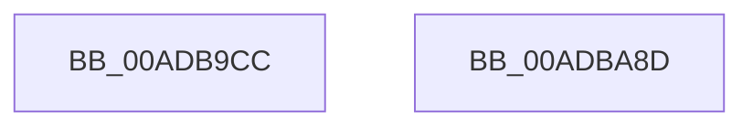

# MiCallImageNotify

- RVA: `0x00ADB9CC`–`0x00ADBA8E` (길이 `194` bytes)
- VA: `0x0000000140ADB9CC`
- 실행 섹션: `PAGE`
- PDB 이름 있음: `예`; PDB Function 태그: `아니요`
- unwind 정보 RVA: `0x000BF5C8`
- 디코드: `56`개 명령, `194/194` bytes 표시
- 미해석 바이트: `0` (있으면 어셈블리에 `.byte`로 보존)

> 이 문서는 커널 이미지의 기계어와 PDB 기호를 분석해 생성했습니다. 4번과 5번은 함수 원형과 자료형을 바이너리 사용 방식에서 추정한 C 해석이며 원본 소스 복구 결과는 아닙니다.

## 1. Dependencies

- 직접 호출 지점: **4**; 고유 호출 대상: **4**
- 직접 호출자로 확인된 함수: **2**
- RIP 상대 이미지 참조: **0**

### Outgoing calls
- `0x00ADBA02` → [MiSectionControlArea](../../text/29/MiSectionControlArea_function_00294CB0.md) (function, `0x00294CB0`)
- `0x00ADBA53` → [MiReferenceControlAreaFile](../../text/43/MiReferenceControlAreaFile_function_00431554.md) (function, `0x00431554`)
- `0x00ADBA67` → [PsCallImageNotifyRoutines](../8D/PsCallImageNotifyRoutines_function_008D6C20.md) (function, `0x008D6C20`)
- `0x00ADBA72` → [MiDereferenceControlAreaFile](../../text/43/MiDereferenceControlAreaFile_function_004345E0.md) (function, `0x004345E0`)

### Direct callers
- [MiDriverLoadSucceeded](../70/MiDriverLoadSucceeded_function_00702F08.md) at `0x00702F33`
- [MmLoadSystemImageEx](../99/MmLoadSystemImageEx_function_00999B8C.md) at `0x0099A128`

### Static image references
- 디코드된 RIP-relative 메모리 참조가 없습니다.

## 2. Other-region calls and transfers

- 다른 실행 섹션으로 향하는 call: **3**
  - `0x00ADBA02` → [MiSectionControlArea](../../text/29/MiSectionControlArea_function_00294CB0.md) (`PAGE` → `.text`)
  - `0x00ADBA53` → [MiReferenceControlAreaFile](../../text/43/MiReferenceControlAreaFile_function_00431554.md) (`PAGE` → `.text`)
  - `0x00ADBA72` → [MiDereferenceControlAreaFile](../../text/43/MiDereferenceControlAreaFile_function_004345E0.md) (`PAGE` → `.text`)
- 별도 외부 분기/꼬리 이동을 확인하지 못했습니다.

## 3. Assembly (complete function range)

```asm
00ADB9CC  48 89 5C 24 08                  mov qword ptr [rsp + 8], rbx
00ADB9D1  48 89 74 24 10                  mov qword ptr [rsp + 0x10], rsi
00ADB9D6  48 89 7C 24 18                  mov qword ptr [rsp + 0x18], rdi
00ADB9DB  55                              push rbp
00ADB9DC  48 8B EC                        mov rbp, rsp
00ADB9DF  48 83 EC 60                     sub rsp, 0x60
00ADB9E3  0F 57 C0                        xorps xmm0, xmm0
00ADB9E6  33 C0                           xor eax, eax
00ADB9E8  4C 8B C1                        mov r8, rcx
00ADB9EB  48 89 45 F0                     mov qword ptr [rbp - 0x10], rax
00ADB9EF  48 8B 49 70                     mov rcx, qword ptr [rcx + 0x70]
00ADB9F3  48 8B F2                        mov rsi, rdx
00ADB9F6  0F 11 45 C0                     movups xmmword ptr [rbp - 0x40], xmm0
00ADB9FA  0F 11 45 D0                     movups xmmword ptr [rbp - 0x30], xmm0
00ADB9FE  0F 11 45 E0                     movups xmmword ptr [rbp - 0x20], xmm0
00ADBA02  E8 A9 92 7B FF                  call 0x140294cb0
00ADBA07  48 8B F8                        mov rdi, rax
00ADBA0A  48 8B 08                        mov rcx, qword ptr [rax]
00ADBA0D  C6 45 C8 03                     mov byte ptr [rbp - 0x38], 3
00ADBA11  0F B6 51 0F                     movzx edx, byte ptr [rcx + 0xf]
00ADBA15  83 65 D8 00                     and dword ptr [rbp - 0x28], 0
00ADBA19  83 65 E8 00                     and dword ptr [rbp - 0x18], 0
00ADBA1D  C1 E2 0C                        shl edx, 0xc
00ADBA20  8B CA                           mov ecx, edx
00ADBA22  33 4D C8                        xor ecx, dword ptr [rbp - 0x38]
00ADBA25  81 E1 00 F0 00 00               and ecx, 0xf000
00ADBA2B  33 4D C8                        xor ecx, dword ptr [rbp - 0x38]
00ADBA2E  8B C1                           mov eax, ecx
00ADBA30  33 C2                           xor eax, edx
00ADBA32  25 00 00 07 00                  and eax, 0x70000
00ADBA37  33 C1                           xor eax, ecx
00ADBA39  48 8B CF                        mov rcx, rdi
00ADBA3C  0F BA E8 08                     bts eax, 8
00ADBA40  89 45 C8                        mov dword ptr [rbp - 0x38], eax
00ADBA43  41 8B 40 40                     mov eax, dword ptr [r8 + 0x40]
00ADBA47  48 89 45 E0                     mov qword ptr [rbp - 0x20], rax
00ADBA4B  49 8B 40 30                     mov rax, qword ptr [r8 + 0x30]
00ADBA4F  48 89 45 D0                     mov qword ptr [rbp - 0x30], rax
00ADBA53  E8 FC 5A 95 FF                  call 0x140431554
00ADBA58  4C 8B C8                        mov r9, rax
00ADBA5B  4C 8D 45 C0                     lea r8, [rbp - 0x40]
00ADBA5F  33 D2                           xor edx, edx
00ADBA61  48 8B CE                        mov rcx, rsi
00ADBA64  48 8B D8                        mov rbx, rax
00ADBA67  E8 B4 B1 DF FF                  call 0x1408d6c20
00ADBA6C  48 8B D3                        mov rdx, rbx
00ADBA6F  48 8B CF                        mov rcx, rdi
00ADBA72  E8 69 8B 95 FF                  call 0x1404345e0
00ADBA77  4C 8D 5C 24 60                  lea r11, [rsp + 0x60]
00ADBA7C  49 8B 5B 10                     mov rbx, qword ptr [r11 + 0x10]
00ADBA80  49 8B 73 18                     mov rsi, qword ptr [r11 + 0x18]
00ADBA84  49 8B 7B 20                     mov rdi, qword ptr [r11 + 0x20]
00ADBA88  49 8B E3                        mov rsp, r11
00ADBA8B  5D                              pop rbp
00ADBA8C  C3                              ret
00ADBA8D  CC                              int3
```

## 4. C-style interpretation (structured pseudocode)

```c
__int64 __fastcall MiCallImageNotify(__int64 a1, __int64 a2)
{
    __int64 result;
    __int64 v_rsp;
    unsigned __int64 v_stack_m18;
    unsigned int v_stack_m20;
    unsigned __int64 v_stack_m28;
    unsigned int v_stack_m30;
    unsigned __int64 v_stack_m38;
    unsigned __int8 v_stack_m40;
    unsigned __int64 v_stack_m48;
    unsigned __int64 v_stack_m8;
    unsigned __int64 v_stack_p10;
    unsigned __int64 v_stack_p18;
    unsigned __int64 v_stack_p8;

    v_stack_p8 = v_rbx;
    v_stack_p10 = v_rsi;
    v_stack_p18 = v_rdi;
    v_rsp = (v_rsp) - (96);
    result = 0;
    v_stack_m18 = 0;
    v_stack_m48 = v_xmm0;
    v_stack_m38 = v_xmm0;
    v_stack_m28 = v_xmm0;
    result = MiSectionControlArea(*(unsigned __int64 *)(a1 + 112), a2, a1, a4);
    v_stack_m40 = 3;
    a2 = (unsigned int)((*(unsigned __int8 *)(*(unsigned __int64 *)(result) + 15)) << (12));
    a1 = (unsigned int)(((unsigned int)((unsigned int)(a2))) ^ (v_stack_m40));
    a1 = (unsigned int)((a1) & (0xF000ULL));
    a1 = (unsigned int)((a1) ^ (v_stack_m40));
    result = (unsigned int)(((unsigned int)((unsigned int)(a1))) ^ ((unsigned int)(a2)));
    result = (unsigned int)((result) & (0x70000ULL));
    result = (unsigned int)((result) ^ ((unsigned int)(a1)));
    v_stack_m40 = (unsigned int)(result);
    v_stack_m28 = (unsigned int)(*(unsigned int *)(a1 + 64));
    v_stack_m38 = *(unsigned __int64 *)(a1 + 48);
    result = MiReferenceControlAreaFile(result, a2, a1, a4);
    a2 = 0;
    result = PsCallImageNotifyRoutines(0, a2, v_stack_m48, result);
    result = MiDereferenceControlAreaFile(result, result, v_stack_m48, result);
    return result;
}
```

## 5. (Beta) C Style

```c
int64_t MiCallImageNotify(void *Arg1, int64_t Arg2)
{
    uint8_t *arg1 = (uint8_t *)Arg1;

    int64_t result;
    int64_t local_rsp;
    uint64_t v_stack_m18;
    uint32_t v_stack_m20;
    uint64_t v_stack_m28;
    uint32_t v_stack_m30;
    uint64_t v_stack_m38;
    uint8_t v_stack_m40;
    uint64_t v_stack_m48;
    uint64_t v_stack_m8;
    uint64_t v_stack_p10;
    uint64_t v_stack_p18;
    uint64_t v_stack_p8;

    v_stack_p8 = local_rbx;
    v_stack_p10 = local_rsi;
    v_stack_p18 = local_rdi;
    local_rsp = (local_rsp) - (96);
    result = 0;
    v_stack_m18 = 0;
    v_stack_m48 = v_xmm0;
    v_stack_m38 = v_xmm0;
    v_stack_m28 = v_xmm0;
    result = MiSectionControlArea(*(uint64_t *)(arg1 + 0x70), Arg2, Arg1, a4);
    v_stack_m40 = 3;
    Arg2 = (uint32_t)((*(uint8_t *)(*(uint64_t *)(result) + 0xF)) << (12));
    Arg1 = (uint32_t)(((uint32_t)((uint32_t)(Arg2))) ^ (v_stack_m40));
    Arg1 = (uint32_t)((Arg1) & (0xF000ULL));
    Arg1 = (uint32_t)((Arg1) ^ (v_stack_m40));
    result = (uint32_t)(((uint32_t)((uint32_t)(Arg1))) ^ ((uint32_t)(Arg2)));
    result = (uint32_t)((result) & (0x70000ULL));
    result = (uint32_t)((result) ^ ((uint32_t)(Arg1)));
    v_stack_m40 = (uint32_t)(result);
    v_stack_m28 = (uint32_t)(*(uint32_t *)(arg1 + 0x40));
    v_stack_m38 = *(uint64_t *)(arg1 + 0x30);
    result = MiReferenceControlAreaFile(result, Arg2, Arg1, a4);
    Arg2 = 0;
    result = PsCallImageNotifyRoutines(0, Arg2, v_stack_m48, result);
    result = MiDereferenceControlAreaFile(result, result, v_stack_m48, result);
    return result;
}
```

### 관측된 메모리 오프셋

구조체 형식이 확인되지 않은 접근은 인자 기준의 오프셋으로만 기록했습니다.

| 기준 인자 | 오프셋 표현 | 폭 (bit) | 접근 |
|---|---:|---:|---|
| `Arg1` | `+ 0x70` | `64` | `R` |

## 6. Execution-region graph

[열기: 2D/3D 그래프와 함수 탐색 컨트롤 패널](../../../control-panel.html?section=page&rva=0x00ADB9CC&view=graph)

- 2D 그래프는 위에서 아래로 흐르고, 3D 그래프는 빈 공간을 드래그해 회전합니다. Shift+드래그는 이동, 휠은 확대·축소, 함수 노드 선택은 대상 보고서 이동입니다.

### Static fallback


