# MiCloneProcessAddressSpace

- RVA: `0x00AD6F7C`–`0x00AD72A2` (길이 `806` bytes)
- VA: `0x0000000140AD6F7C`
- 실행 섹션: `PAGE`
- PDB 이름 있음: `예`; PDB Function 태그: `아니요`
- unwind 정보 RVA: `0x000BF09C`
- 디코드: `229`개 명령, `806/806` bytes 표시
- 미해석 바이트: `0` (있으면 어셈블리에 `.byte`로 보존)

> 이 문서는 커널 이미지의 기계어와 PDB 기호를 분석해 생성했습니다. 4번과 5번은 함수 원형과 자료형을 바이너리 사용 방식에서 추정한 C 해석이며 원본 소스 복구 결과는 아닙니다.

## 1. Dependencies

- 직접 호출 지점: **27**; 고유 호출 대상: **19**
- 직접 호출자로 확인된 함수: **1**
- RIP 상대 이미지 참조: **1**

### Outgoing calls
- `0x00AD6FEF` → [MiIsStoreProcess](../../text/2B/MiIsStoreProcess_function_002B62E0.md) (function, `0x002B62E0`)
- `0x00AD7007` → [MiLockDownWorkingSet](../../text/4D/MiLockDownWorkingSet_function_004D4950.md) (function, `0x004D4950`)
- `0x00AD701D` → [KiStackAttachProcess](../../text/21/KiStackAttachProcess_function_00216820.md) (function, `0x00216820`)
- `0x00AD7055` → [MiLockVadRange](../87/MiLockVadRange_function_0087F670.md) (function, `0x0087F670`)
- `0x00AD707A` → [MiUnlockVadRange](../87/MiUnlockVadRange_function_0087F590.md) (function, `0x0087F590`)
- `0x00AD7094` → [PsReturnProcessNonPagedPoolQuota](../../text/41/PsReturnProcessNonPagedPoolQuota_function_0041C200.md) (function, `0x0041C200`)
- `0x00AD709E` → [ExFreePoolWithTag](../../poolcode/B8/ExFreePoolWithTag_function_00B82870.md) (function, `0x00B82870`)
- `0x00AD70B6` → [MiFreeCloneDescriptor](../A8/MiFreeCloneDescriptor_function_00A89F0C.md) (function, `0x00A89F0C`)
- `0x00AD70C6` → [KiUnstackDetachProcess](../../text/21/KiUnstackDetachProcess_function_00217D30.md) (function, `0x00217D30`)
- `0x00AD70D4` → [MiLockDownWorkingSet](../../text/4D/MiLockDownWorkingSet_function_004D4950.md) (function, `0x004D4950`)
- `0x00AD70DC` → [MiDeleteInsertedCloneVads](../81/MiDeleteInsertedCloneVads_function_00811564.md) (function, `0x00811564`)
- `0x00AD70EA` → [_security_check_cookie](../../text/6A/_security_check_cookie_function_006AC640.md) (function, `0x006AC640`)
- `0x00AD7112` → [MiCreateCloneChain](../../text/2A/MiCreateCloneChain_function_002A8EE0.md) (function, `0x002A8EE0`)
- `0x00AD7128` → [MiAllocateChildVads](../97/MiAllocateChildVads_function_0097E380.md) (function, `0x0097E380`)
- `0x00AD714F` → [MiBuildNewCloneDescriptor](../A6/MiBuildNewCloneDescriptor_function_00A6C744.md) (function, `0x00A6C744`)
- `0x00AD7174` → [memset](../../text/6C/memset_function_006C6C40.md) (function, `0x006C6C40`)
- `0x00AD7182` → [MiWriteCloneFlags](../../text/48/MiWriteCloneFlags_function_0048AD78.md) (function, `0x0048AD78`)
- `0x00AD7192` → [MiWriteCloneFlags](../../text/48/MiWriteCloneFlags_function_0048AD78.md) (function, `0x0048AD78`)
- `0x00AD71B4` → [MiCloneVads](../../text/22/MiCloneVads_function_0022DC1C.md) (function, `0x0022DC1C`)
- `0x00AD71CF` → [MiMapChildLargePageVads](../AC/MiMapChildLargePageVads_function_00ACDE80.md) (function, `0x00ACDE80`)
- `0x00AD71E4` → [MiUnlockVadRange](../87/MiUnlockVadRange_function_0087F590.md) (function, `0x0087F590`)
- `0x00AD71F4` → [KiUnstackDetachProcess](../../text/21/KiUnstackDetachProcess_function_00217D30.md) (function, `0x00217D30`)
- `0x00AD720E` → [KiStackAttachProcess](../../text/21/KiStackAttachProcess_function_00216820.md) (function, `0x00216820`)
- `0x00AD7253` → [MiInsertClone](../../text/4D/MiInsertClone_function_004D4A7C.md) (function, `0x004D4A7C`)
- `0x00AD7260` → [MiFreeCloneDescriptor](../A8/MiFreeCloneDescriptor_function_00A89F0C.md) (function, `0x00A89F0C`)
- `0x00AD7275` → [MiLockDownWorkingSet](../../text/4D/MiLockDownWorkingSet_function_004D4950.md) (function, `0x004D4950`)
- `0x00AD7287` → [KiUnstackDetachProcess](../../text/21/KiUnstackDetachProcess_function_00217D30.md) (function, `0x00217D30`)

### Direct callers
- [MmInitializeProcessAddressSpace](../8C/MmInitializeProcessAddressSpace_function_008CF6B0.md) at `0x008CFA9E`

### Static image references
- `0x00AD6F98` → RVA `0x00E0A740` (`.data`; read)

## 2. Other-region calls and transfers

- 다른 실행 섹션으로 향하는 call: **18**
  - `0x00AD6FEF` → [MiIsStoreProcess](../../text/2B/MiIsStoreProcess_function_002B62E0.md) (`PAGE` → `.text`)
  - `0x00AD7007` → [MiLockDownWorkingSet](../../text/4D/MiLockDownWorkingSet_function_004D4950.md) (`PAGE` → `.text`)
  - `0x00AD701D` → [KiStackAttachProcess](../../text/21/KiStackAttachProcess_function_00216820.md) (`PAGE` → `.text`)
  - `0x00AD7094` → [PsReturnProcessNonPagedPoolQuota](../../text/41/PsReturnProcessNonPagedPoolQuota_function_0041C200.md) (`PAGE` → `.text`)
  - `0x00AD709E` → [ExFreePoolWithTag](../../poolcode/B8/ExFreePoolWithTag_function_00B82870.md) (`PAGE` → `POOLCODE`)
  - `0x00AD70C6` → [KiUnstackDetachProcess](../../text/21/KiUnstackDetachProcess_function_00217D30.md) (`PAGE` → `.text`)
  - `0x00AD70D4` → [MiLockDownWorkingSet](../../text/4D/MiLockDownWorkingSet_function_004D4950.md) (`PAGE` → `.text`)
  - `0x00AD70EA` → [_security_check_cookie](../../text/6A/_security_check_cookie_function_006AC640.md) (`PAGE` → `.text`)
  - `0x00AD7112` → [MiCreateCloneChain](../../text/2A/MiCreateCloneChain_function_002A8EE0.md) (`PAGE` → `.text`)
  - `0x00AD7174` → [memset](../../text/6C/memset_function_006C6C40.md) (`PAGE` → `.text`)
  - `0x00AD7182` → [MiWriteCloneFlags](../../text/48/MiWriteCloneFlags_function_0048AD78.md) (`PAGE` → `.text`)
  - `0x00AD7192` → [MiWriteCloneFlags](../../text/48/MiWriteCloneFlags_function_0048AD78.md) (`PAGE` → `.text`)
  - `0x00AD71B4` → [MiCloneVads](../../text/22/MiCloneVads_function_0022DC1C.md) (`PAGE` → `.text`)
  - `0x00AD71F4` → [KiUnstackDetachProcess](../../text/21/KiUnstackDetachProcess_function_00217D30.md) (`PAGE` → `.text`)
  - `0x00AD720E` → [KiStackAttachProcess](../../text/21/KiStackAttachProcess_function_00216820.md) (`PAGE` → `.text`)
  - `0x00AD7253` → [MiInsertClone](../../text/4D/MiInsertClone_function_004D4A7C.md) (`PAGE` → `.text`)
  - `0x00AD7275` → [MiLockDownWorkingSet](../../text/4D/MiLockDownWorkingSet_function_004D4950.md) (`PAGE` → `.text`)
  - `0x00AD7287` → [KiUnstackDetachProcess](../../text/21/KiUnstackDetachProcess_function_00217D30.md) (`PAGE` → `.text`)
- 별도 외부 분기/꼬리 이동을 확인하지 못했습니다.

## 3. Assembly (complete function range)

```asm
00AD6F7C  48 89 5C 24 18                  mov qword ptr [rsp + 0x18], rbx
00AD6F81  55                              push rbp
00AD6F82  56                              push rsi
00AD6F83  57                              push rdi
00AD6F84  41 54                           push r12
00AD6F86  41 55                           push r13
00AD6F88  41 56                           push r14
00AD6F8A  41 57                           push r15
00AD6F8C  48 8D 6C 24 D9                  lea rbp, [rsp - 0x27]
00AD6F91  48 81 EC A0 00 00 00            sub rsp, 0xa0
00AD6F98  48 8B 05 A1 37 33 00            mov rax, qword ptr [rip + 0x3337a1]
00AD6F9F  48 33 C4                        xor rax, rsp
00AD6FA2  48 89 45 1F                     mov qword ptr [rbp + 0x1f], rax
00AD6FA6  0F 57 C0                        xorps xmm0, xmm0
00AD6FA9  44 89 45 C7                     mov dword ptr [rbp - 0x39], r8d
00AD6FAD  0F 11 45 EF                     movups xmmword ptr [rbp - 0x11], xmm0
00AD6FB1  45 8B E0                        mov r12d, r8d
00AD6FB4  45 33 C0                        xor r8d, r8d
00AD6FB7  0F 11 45 FF                     movups xmmword ptr [rbp - 1], xmm0
00AD6FBB  4C 8B F2                        mov r14, rdx
00AD6FBE  48 8B F9                        mov rdi, rcx
00AD6FC1  0F 11 45 0F                     movups xmmword ptr [rbp + 0xf], xmm0
00AD6FC5  65 48 8B 04 25 88 01 00 00      mov rax, qword ptr gs:[0x188]
00AD6FCE  41 8D 58 01                     lea ebx, [r8 + 1]
00AD6FD2  45 8B E8                        mov r13d, r8d
00AD6FD5  4C 89 45 CF                     mov qword ptr [rbp - 0x31], r8
00AD6FD9  4C 89 45 BF                     mov qword ptr [rbp - 0x41], r8
00AD6FDD  45 8B F8                        mov r15d, r8d
00AD6FE0  44 89 45 B7                     mov dword ptr [rbp - 0x49], r8d
00AD6FE4  48 8B B0 B8 00 00 00            mov rsi, qword ptr [rax + 0xb8]
00AD6FEB  48 89 75 E7                     mov qword ptr [rbp - 0x19], rsi
00AD6FEF  E8 EC F2 7D FF                  call 0x1402b62e0
00AD6FF4  85 C0                           test eax, eax
00AD6FF6  74 0A                           je 0x140ad7002
00AD6FF8  B8 BB 00 00 C0                  mov eax, 0xc00000bb
00AD6FFD  E9 E1 00 00 00                  jmp 0x140ad70e3
00AD7002  8B D3                           mov edx, ebx
00AD7004  49 8B CE                        mov rcx, r14
00AD7007  E8 44 D9 9F FF                  call 0x1404d4950
00AD700C  48 3B F7                        cmp rsi, rdi
00AD700F  74 11                           je 0x140ad7022
00AD7011  4C 8D 45 EF                     lea r8, [rbp - 0x11]
00AD7015  33 D2                           xor edx, edx
00AD7017  48 8B CF                        mov rcx, rdi
00AD701A  44 8B EB                        mov r13d, ebx
00AD701D  E8 FE F7 73 FF                  call 0x140216820
00AD7022  48 8B 87 10 04 00 00            mov rax, qword ptr [rdi + 0x410]
00AD7029  44 23 E3                        and r12d, ebx
00AD702C  48 89 45 DF                     mov qword ptr [rbp - 0x21], rax
00AD7030  4C 39 B8 28 04 00 00            cmp qword ptr [rax + 0x428], r15
00AD7037  74 0C                           je 0x140ad7045
00AD7039  45 85 E4                        test r12d, r12d
00AD703C  75 07                           jne 0x140ad7045
00AD703E  BE BB 00 00 C0                  mov esi, 0xc00000bb
00AD7043  EB 3A                           jmp 0x140ad707f
00AD7045  48 83 C8 FF                     or rax, 0xffffffffffffffff
00AD7049  44 8B CB                        mov r9d, ebx
00AD704C  4C 8B C0                        mov r8, rax
00AD704F  48 8B D0                        mov rdx, rax
00AD7052  48 8B CF                        mov rcx, rdi
00AD7055  E8 16 86 DA FF                  call 0x14087f670
00AD705A  48 89 45 D7                     mov qword ptr [rbp - 0x29], rax
00AD705E  48 85 C0                        test rax, rax
00AD7061  0F 85 A4 00 00 00               jne 0x140ad710b
00AD7067  BE 0A 01 00 C0                  mov esi, 0xc000010a
00AD706C  4C 8B 45 D7                     mov r8, qword ptr [rbp - 0x29]
00AD7070  44 8B CB                        mov r9d, ebx
00AD7073  48 83 CA FF                     or rdx, 0xffffffffffffffff
00AD7077  48 8B CF                        mov rcx, rdi
00AD707A  E8 11 85 DA FF                  call 0x14087f590
00AD707F  4C 8B 65 BF                     mov r12, qword ptr [rbp - 0x41]
00AD7083  4D 85 E4                        test r12, r12
00AD7086  74 23                           je 0x140ad70ab
00AD7088  49 8B 54 24 40                  mov rdx, qword ptr [r12 + 0x40]
00AD708D  49 8B CE                        mov rcx, r14
00AD7090  49 8B 3C 24                     mov rdi, qword ptr [r12]
00AD7094  E8 67 51 94 FF                  call 0x14041c200
00AD7099  33 D2                           xor edx, edx
00AD709B  49 8B CC                        mov rcx, r12
00AD709E  E8 CD B7 0A 00                  call 0x140b82870
00AD70A3  4C 8B E7                        mov r12, rdi
00AD70A6  48 85 FF                        test rdi, rdi
00AD70A9  75 DD                           jne 0x140ad7088
00AD70AB  4D 85 FF                        test r15, r15
00AD70AE  74 0B                           je 0x140ad70bb
00AD70B0  49 8B D7                        mov rdx, r15
00AD70B3  49 8B CE                        mov rcx, r14
00AD70B6  E8 51 2E FB FF                  call 0x140a89f0c
00AD70BB  45 85 ED                        test r13d, r13d
00AD70BE  74 0B                           je 0x140ad70cb
00AD70C0  33 D2                           xor edx, edx
00AD70C2  48 8D 4D EF                     lea rcx, [rbp - 0x11]
00AD70C6  E8 65 0C 74 FF                  call 0x140217d30
00AD70CB  85 DB                           test ebx, ebx
00AD70CD  74 0A                           je 0x140ad70d9
00AD70CF  33 D2                           xor edx, edx
00AD70D1  49 8B CE                        mov rcx, r14
00AD70D4  E8 77 D8 9F FF                  call 0x1404d4950
00AD70D9  49 8B CE                        mov rcx, r14
00AD70DC  E8 83 A4 D3 FF                  call 0x140811564
00AD70E1  8B C6                           mov eax, esi
00AD70E3  48 8B 4D 1F                     mov rcx, qword ptr [rbp + 0x1f]
00AD70E7  48 33 CC                        xor rcx, rsp
00AD70EA  E8 51 55 BD FF                  call 0x1406ac640
00AD70EF  48 8B 9C 24 F0 00 00 00         mov rbx, qword ptr [rsp + 0xf0]
00AD70F7  48 81 C4 A0 00 00 00            add rsp, 0xa0
00AD70FE  41 5F                           pop r15
00AD7100  41 5E                           pop r14
00AD7102  41 5D                           pop r13
00AD7104  41 5C                           pop r12
00AD7106  5F                              pop rdi
00AD7107  5E                              pop rsi
00AD7108  5D                              pop rbp
00AD7109  C3                              ret
00AD710A  CC                              int3
00AD710B  48 8D 55 BF                     lea rdx, [rbp - 0x41]
00AD710F  49 8B CE                        mov rcx, r14
00AD7112  E8 C9 1D 7D FF                  call 0x1402a8ee0
00AD7117  8B F0                           mov esi, eax
00AD7119  85 C0                           test eax, eax
00AD711B  0F 88 4B FF FF FF               js 0x140ad706c
00AD7121  48 8D 55 CF                     lea rdx, [rbp - 0x31]
00AD7125  49 8B CE                        mov rcx, r14
00AD7128  E8 53 72 EA FF                  call 0x14097e380
00AD712D  8B F0                           mov esi, eax
00AD712F  85 C0                           test eax, eax
00AD7131  0F 88 35 FF FF FF               js 0x140ad706c
00AD7137  45 85 E4                        test r12d, r12d
00AD713A  74 5B                           je 0x140ad7197
00AD713C  4C 8B 45 DF                     mov r8, qword ptr [rbp - 0x21]
00AD7140  BA 02 00 00 00                  mov edx, 2
00AD7145  49 8B CE                        mov rcx, r14
00AD7148  4D 8B 80 28 04 00 00            mov r8, qword ptr [r8 + 0x428]
00AD714F  E8 F0 55 F9 FF                  call 0x140a6c744
00AD7154  4C 8B F8                        mov r15, rax
00AD7157  48 85 C0                        test rax, rax
00AD715A  75 0A                           jne 0x140ad7166
00AD715C  BE 9A 00 00 C0                  mov esi, 0xc000009a
00AD7161  E9 06 FF FF FF                  jmp 0x140ad706c
00AD7166  4C 8B 40 28                     mov r8, qword ptr [rax + 0x28]
00AD716A  33 D2                           xor edx, edx
00AD716C  48 8B 48 18                     mov rcx, qword ptr [rax + 0x18]
00AD7170  49 C1 E0 05                     shl r8, 5
00AD7174  E8 C7 FA BE FF                  call 0x1406c6c40
00AD7179  49 8B 4F 18                     mov rcx, qword ptr [r15 + 0x18]
00AD717D  BA 04 00 00 00                  mov edx, 4
00AD7182  E8 F1 3B 9B FF                  call 0x14048ad78
00AD7187  49 8B 4F 18                     mov rcx, qword ptr [r15 + 0x18]
00AD718B  48 8B D3                        mov rdx, rbx
00AD718E  48 83 C1 20                     add rcx, 0x20
00AD7192  E8 E1 3B 9B FF                  call 0x14048ad78
00AD7197  4C 8B 45 BF                     mov r8, qword ptr [rbp - 0x41]
00AD719B  48 8D 45 B7                     lea rax, [rbp - 0x49]
00AD719F  48 89 44 24 28                  mov qword ptr [rsp + 0x28], rax
00AD71A4  4D 8B CF                        mov r9, r15
00AD71A7  8B 45 C7                        mov eax, dword ptr [rbp - 0x39]
00AD71AA  49 8B D6                        mov rdx, r14
00AD71AD  48 8B CF                        mov rcx, rdi
00AD71B0  89 44 24 20                     mov dword ptr [rsp + 0x20], eax
00AD71B4  E8 63 6A 75 FF                  call 0x14022dc1c
00AD71B9  8B F0                           mov esi, eax
00AD71BB  85 C0                           test eax, eax
00AD71BD  0F 88 A9 FE FF FF               js 0x140ad706c
00AD71C3  48 8B 55 CF                     mov rdx, qword ptr [rbp - 0x31]
00AD71C7  49 8B CE                        mov rcx, r14
00AD71CA  48 83 65 BF 00                  and qword ptr [rbp - 0x41], 0
00AD71CF  E8 AC 6C FF FF                  call 0x140acde80
00AD71D4  4C 8B 45 D7                     mov r8, qword ptr [rbp - 0x29]
00AD71D8  44 8B CB                        mov r9d, ebx
00AD71DB  48 83 CA FF                     or rdx, 0xffffffffffffffff
00AD71DF  48 8B CF                        mov rcx, rdi
00AD71E2  8B F0                           mov esi, eax
00AD71E4  E8 A7 83 DA FF                  call 0x14087f590
00AD71E9  45 85 ED                        test r13d, r13d
00AD71EC  74 0E                           je 0x140ad71fc
00AD71EE  33 D2                           xor edx, edx
00AD71F0  48 8D 4D EF                     lea rcx, [rbp - 0x11]
00AD71F4  E8 37 0B 74 FF                  call 0x140217d30
00AD71F9  45 33 ED                        xor r13d, r13d
00AD71FC  4C 39 75 E7                     cmp qword ptr [rbp - 0x19], r14
00AD7200  74 11                           je 0x140ad7213
00AD7202  4C 8D 45 EF                     lea r8, [rbp - 0x11]
00AD7206  33 D2                           xor edx, edx
00AD7208  49 8B CE                        mov rcx, r14
00AD720B  44 8B EB                        mov r13d, ebx
00AD720E  E8 0D F6 73 FF                  call 0x140216820
00AD7213  4D 85 FF                        test r15, r15
00AD7216  74 50                           je 0x140ad7268
00AD7218  33 C9                           xor ecx, ecx
00AD721A  45 33 C0                        xor r8d, r8d
00AD721D  49 39 4F 28                     cmp qword ptr [r15 + 0x28], rcx
00AD7221  76 37                           jbe 0x140ad725a
00AD7223  33 D2                           xor edx, edx
00AD7225  49 8B 47 18                     mov rax, qword ptr [r15 + 0x18]
00AD7229  44 03 C3                        add r8d, ebx
00AD722C  48 C1 E2 05                     shl rdx, 5
00AD7230  48 8B 44 02 18                  mov rax, qword ptr [rdx + rax + 0x18]
00AD7235  48 03 C8                        add rcx, rax
00AD7238  41 8B D0                        mov edx, r8d
00AD723B  49 3B 57 28                     cmp rdx, qword ptr [r15 + 0x28]
00AD723F  72 E4                           jb 0x140ad7225
00AD7241  48 85 C9                        test rcx, rcx
00AD7244  74 14                           je 0x140ad725a
00AD7246  49 89 4F 30                     mov qword ptr [r15 + 0x30], rcx
00AD724A  45 33 C0                        xor r8d, r8d
00AD724D  49 8B CE                        mov rcx, r14
00AD7250  49 8B D7                        mov rdx, r15
00AD7253  E8 24 D8 9F FF                  call 0x1404d4a7c
00AD7258  EB 0B                           jmp 0x140ad7265
00AD725A  49 8B D7                        mov rdx, r15
00AD725D  49 8B CE                        mov rcx, r14
00AD7260  E8 A7 2C FB FF                  call 0x140a89f0c
00AD7265  45 33 FF                        xor r15d, r15d
00AD7268  85 F6                           test esi, esi
00AD726A  0F 88 0F FE FF FF               js 0x140ad707f
00AD7270  33 D2                           xor edx, edx
00AD7272  49 8B CE                        mov rcx, r14
00AD7275  E8 D6 D6 9F FF                  call 0x1404d4950
00AD727A  33 DB                           xor ebx, ebx
00AD727C  45 85 ED                        test r13d, r13d
00AD727F  74 0E                           je 0x140ad728f
00AD7281  33 D2                           xor edx, edx
00AD7283  48 8D 4D EF                     lea rcx, [rbp - 0x11]
00AD7287  E8 A4 0A 74 FF                  call 0x140217d30
00AD728C  45 33 ED                        xor r13d, r13d
00AD728F  39 5D B7                        cmp dword ptr [rbp - 0x49], ebx
00AD7292  0F 84 49 FE FF FF               je 0x140ad70e1
00AD7298  BE 9A 00 00 C0                  mov esi, 0xc000009a
00AD729D  E9 DD FD FF FF                  jmp 0x140ad707f
```

## 4. C-style interpretation (structured pseudocode)

```c
__int64 __fastcall MiCloneProcessAddressSpace(__int64 a1, __int64 a2, int a3)
{
    __int64 result;
    __int64 v_r12;
    __int64 v_r13;
    __int64 v_r15;
    __int64 v_rbx;
    __int64 v_rsp;
    unsigned __int64 v_stack_m40;
    unsigned __int64 v_stack_m50;
    unsigned __int64 v_stack_m5F;
    unsigned __int64 v_stack_m60;
    unsigned __int64 v_stack_m70;
    unsigned __int64 v_stack_m78;
    unsigned __int64 v_stack_m80;
    unsigned __int64 v_stack_m88;
    unsigned __int64 v_stack_m90;
    unsigned int v_stack_m98;
    unsigned __int64 v_stack_mA0;
    unsigned int v_stack_mA8;
    unsigned __int64 v_stack_p18;
    unsigned int v_stack_p20;
    unsigned __int64 v_stack_p28;

    v_stack_p18 = v_rbx;
    v_rsp = (v_rsp) - (160);
    result = (*(unsigned __int64 *)(v_rip + 3356577)) ^ (v_rsp);
    v_stack_m40 = result;
    v_stack_m98 = a3;
    v_stack_m70 = v_xmm0;
    a3 = 0;
    v_stack_m60 = v_xmm0;
    v_stack_m50 = v_xmm0;
    v_stack_m90 = 0;
    v_stack_mA0 = 0;
    v_stack_mA8 = 0;
    v_stack_m78 = *(unsigned __int64 *)(*(unsigned __int64 *)(gs_base + (0 + 392)) + 184);
    result = MiIsStoreProcess(a1, a2, a3, a4);
    if ((unsigned int)(result) == 0) goto loc_00AD7002;
    goto loc_00AD70E3;
loc_00AD7002:
    result = MiLockDownWorkingSet(a2, (unsigned int)((unsigned int)(a3 + 1)), a3, a4);
    v_r13 = 0;
    if ((*(unsigned __int64 *)(*(unsigned __int64 *)(gs_base + (0 + 392)) + 184)) != a1) {
        a3 = v_stack_m70;
        a2 = 0;
        a1 = a1;
        v_r13 = (unsigned int)(a3 + 1);
        result = KiStackAttachProcess(a1, a2, a3, a4);
    }
    v_r12 = (unsigned int)(((unsigned int)(a3)) & ((unsigned int)(a3 + 1)));
    v_stack_m80 = *(unsigned __int64 *)(a1 + 1040);
    if ((*(unsigned __int64 *)(*(unsigned __int64 *)(a1 + 1040) + 1064)) == 0) goto loc_00AD7045;
    if ((unsigned int)(v_r12) != 0) goto loc_00AD7045;
    goto loc_00AD707F;
loc_00AD7045:
    result = (*(unsigned __int64 *)(a1 + 1040)) | (-1);
    result = MiLockVadRange(a1, result, result, (unsigned int)((unsigned int)(a3 + 1)));
    v_stack_m88 = result;
    if (result != 0) goto loc_00AD710B;
loc_00AD706C:
    a2 = (result) | (-1);
    result = MiUnlockVadRange(a1, a2, v_stack_m88, (unsigned int)((unsigned int)(a3 + 1)));
loc_00AD707F:
    if (v_stack_mA0 == 0) goto loc_00AD70AB;
loc_00AD7088:
    result = PsReturnProcessNonPagedPoolQuota(a2, *(unsigned __int64 *)(v_stack_mA0 + 64), v_stack_m88, (unsigned int)((unsigned int)(a3 + 1)));
    a2 = 0;
    result = ExFreePoolWithTag(v_stack_mA0, a2, v_stack_m88, (unsigned int)((unsigned int)(a3 + 1)));
    if (*(unsigned __int64 *)(v_stack_mA0) != 0) goto loc_00AD7088;
loc_00AD70AB:
    if (0 != 0) {
        a2 = 0;
        a1 = a2;
        result = MiFreeCloneDescriptor(a1, a2, v_stack_m88, (unsigned int)((unsigned int)(a3 + 1)));
    }
    if ((unsigned int)(v_r13) != 0) {
        a2 = 0;
        a1 = v_stack_m70;
        result = KiUnstackDetachProcess(a1, a2, v_stack_m88, (unsigned int)((unsigned int)(a3 + 1)));
    }
    if ((unsigned int)(a3 + 1) != 0) {
        a2 = 0;
        a1 = 0;
        result = MiLockDownWorkingSet(a1, a2, v_stack_m88, (unsigned int)((unsigned int)(a3 + 1)));
    }
    result = MiDeleteInsertedCloneVads(0, a2, v_stack_m88, (unsigned int)((unsigned int)(a3 + 1)));
loc_00AD70E1:
loc_00AD70E3:
    a1 = (v_stack_m40) ^ (v_rsp);
    result = _security_check_cookie(a1, a2, v_stack_m88, (unsigned int)((unsigned int)(a3 + 1)));
    v_rsp = (v_rsp) + (160);
    return result;
loc_00AD710B:
    result = MiCreateCloneChain(0, v_stack_mA0, v_stack_m88, (unsigned int)((unsigned int)(a3 + 1)));
    if (sign_flag) goto loc_00AD706C;
    result = MiAllocateChildVads(0, v_stack_m90, v_stack_m88, (unsigned int)((unsigned int)(a3 + 1)));
    if (sign_flag) goto loc_00AD706C;
    if ((unsigned int)(*(unsigned __int64 *)(v_stack_mA0)) == 0) goto loc_00AD7197;
    result = MiBuildNewCloneDescriptor(0, 2, *(unsigned __int64 *)(v_stack_m80 + 1064), (unsigned int)((unsigned int)(a3 + 1)));
    if (result != 0) goto loc_00AD7166;
    goto loc_00AD706C;
loc_00AD7166:
    a2 = 0;
    a3 = (*(unsigned __int64 *)(result + 40)) << (5);
    result = memset(*(unsigned __int64 *)(result + 24), a2, a3, (unsigned int)((unsigned int)(a3 + 1)));
    result = MiWriteCloneFlags(*(unsigned __int64 *)(result + 24), 4, a3, (unsigned int)((unsigned int)(a3 + 1)));
    a1 = (*(unsigned __int64 *)(result + 24)) + (32);
    result = MiWriteCloneFlags(a1, v_stack_p18, a3, (unsigned int)((unsigned int)(a3 + 1)));
loc_00AD7197:
    v_stack_p28 = v_stack_mA8;
    v_stack_p20 = (unsigned int)((unsigned int)(v_stack_m98));
    result = MiCloneVads(*(unsigned __int64 *)(v_stack_mA0), 0, v_stack_mA0, result);
    if (sign_flag) goto loc_00AD706C;
    result = MiMapChildLargePageVads(0, v_stack_m90, v_stack_mA0, result);
    a2 = (v_stack_m90) | (-1);
    result = MiUnlockVadRange(*(unsigned __int64 *)(v_stack_mA0), a2, v_stack_m88, (unsigned int)((unsigned int)(v_stack_p18)));
    if ((unsigned int)(v_r13) != 0) {
        a2 = 0;
        a1 = v_stack_m70;
        result = KiUnstackDetachProcess(a1, a2, v_stack_m88, (unsigned int)((unsigned int)(v_stack_p18)));
        v_r13 = 0;
    }
    if (v_stack_m78 != 0) {
        a3 = v_stack_m70;
        a2 = 0;
        a1 = 0;
        v_r13 = (unsigned int)(v_stack_p18);
        result = KiStackAttachProcess(a1, a2, a3, (unsigned int)((unsigned int)(v_stack_p18)));
    }
    if (result == 0) goto loc_00AD7268;
    a1 = 0;
    a3 = 0;
    if ((*(unsigned __int64 *)(result + 40)) <= 0) goto loc_00AD725A;
    a2 = 0;
loc_00AD7225:
    a3 = (unsigned int)((a3) + ((unsigned int)(v_stack_p18)));
    a2 = (a2) << (5);
    a1 = (a1) + (*(unsigned __int64 *)(a2 + *(unsigned __int64 *)(result + 24) * 1 + 24));
    if (((unsigned int)(a3)) < (*(unsigned __int64 *)(result + 40))) goto loc_00AD7225;
    if (a1 == 0) goto loc_00AD725A;
    *(unsigned __int64 *)(result + 48) = a1;
    a3 = 0;
    result = MiInsertClone(a2, result, a3, (unsigned int)((unsigned int)(v_stack_p18)));
    goto loc_00AD7265;
loc_00AD725A:
    result = MiFreeCloneDescriptor(a2, result, a3, (unsigned int)((unsigned int)(v_stack_p18)));
loc_00AD7265:
    v_r15 = 0;
loc_00AD7268:
    if (sign_flag) goto loc_00AD707F;
    a2 = 0;
    result = MiLockDownWorkingSet(0, a2, a3, (unsigned int)((unsigned int)(v_stack_p18)));
    v_rbx = 0;
    if ((unsigned int)(v_r13) != 0) {
        a2 = 0;
        a1 = v_stack_m70;
        result = KiUnstackDetachProcess(a1, a2, a3, (unsigned int)((unsigned int)(v_stack_p18)));
        v_r13 = 0;
    }
    if (v_stack_mA8 == 0) goto loc_00AD70E1;
    goto loc_00AD707F;
}
```

## 5. (Beta) C Style

```c
int64_t MiCloneProcessAddressSpace(void *Arg1, int64_t Arg2, int32_t Arg3)
{
    uint8_t *arg1 = (uint8_t *)Arg1;

    int64_t result;
    int64_t local_r12;
    int64_t local_r13;
    int64_t local_r15;
    int64_t local_rbx;
    int64_t local_rsp;
    uint64_t v_stack_m40;
    uint64_t v_stack_m50;
    uint64_t v_stack_m5F;
    uint64_t v_stack_m60;
    uint64_t v_stack_m70;
    uint64_t v_stack_m78;
    uint64_t v_stack_m80;
    uint64_t v_stack_m88;
    uint64_t v_stack_m90;
    uint32_t v_stack_m98;
    uint64_t v_stack_mA0;
    uint32_t v_stack_mA8;
    uint64_t v_stack_p18;
    uint32_t v_stack_p20;
    uint64_t v_stack_p28;

    v_stack_p18 = local_rbx;
    local_rsp = (local_rsp) - (160);
    result = (*(uint64_t *)(v_rip + 0x3337A1)) ^ (local_rsp);
    v_stack_m40 = result;
    v_stack_m98 = Arg3;
    v_stack_m70 = v_xmm0;
    Arg3 = 0;
    v_stack_m60 = v_xmm0;
    v_stack_m50 = v_xmm0;
    v_stack_m90 = 0;
    v_stack_mA0 = 0;
    v_stack_mA8 = 0;
    v_stack_m78 = *(uint64_t *)(*(uint64_t *)(gs_base + (0 + 0x188)) + 0xB8);
    result = MiIsStoreProcess(Arg1, Arg2, Arg3, a4);
    if ((uint32_t)(result) == 0) goto loc_00AD7002;
    goto loc_00AD70E3;
loc_00AD7002:
    result = MiLockDownWorkingSet(Arg2, (uint32_t)((uint32_t)(Arg3 + 1)), Arg3, a4);
    local_r13 = 0;
    if ((*(uint64_t *)(*(uint64_t *)(gs_base + (0 + 0x188)) + 0xB8)) != Arg1) {
        Arg3 = v_stack_m70;
        Arg2 = 0;
        Arg1 = Arg1;
        local_r13 = (uint32_t)(Arg3 + 1);
        result = KiStackAttachProcess(Arg1, Arg2, Arg3, a4);
    }
    local_r12 = (uint32_t)(((uint32_t)(Arg3)) & ((uint32_t)(Arg3 + 1)));
    v_stack_m80 = *(uint64_t *)(arg1 + 0x410);
    if ((*(uint64_t *)(*(uint64_t *)(arg1 + 0x410) + 0x428)) == 0) goto loc_00AD7045;
    if ((uint32_t)(local_r12) != 0) goto loc_00AD7045;
    goto loc_00AD707F;
loc_00AD7045:
    result = (*(uint64_t *)(arg1 + 0x410)) | (-1);
    result = MiLockVadRange(Arg1, result, result, (uint32_t)((uint32_t)(Arg3 + 1)));
    v_stack_m88 = result;
    if (result != 0) goto loc_00AD710B;
loc_00AD706C:
    Arg2 = (result) | (-1);
    result = MiUnlockVadRange(Arg1, Arg2, v_stack_m88, (uint32_t)((uint32_t)(Arg3 + 1)));
loc_00AD707F:
    if (v_stack_mA0 == 0) goto loc_00AD70AB;
loc_00AD7088:
    result = PsReturnProcessNonPagedPoolQuota(Arg2, *(uint64_t *)(v_stack_mA0 + 0x40), v_stack_m88, (uint32_t)((uint32_t)(Arg3 + 1)));
    Arg2 = 0;
    result = ExFreePoolWithTag(v_stack_mA0, Arg2, v_stack_m88, (uint32_t)((uint32_t)(Arg3 + 1)));
    if (*(uint64_t *)(v_stack_mA0) != 0) goto loc_00AD7088;
loc_00AD70AB:
    if (0 != 0) {
        Arg2 = 0;
        Arg1 = Arg2;
        result = MiFreeCloneDescriptor(Arg1, Arg2, v_stack_m88, (uint32_t)((uint32_t)(Arg3 + 1)));
    }
    if ((uint32_t)(local_r13) != 0) {
        Arg2 = 0;
        Arg1 = v_stack_m70;
        result = KiUnstackDetachProcess(Arg1, Arg2, v_stack_m88, (uint32_t)((uint32_t)(Arg3 + 1)));
    }
    if ((uint32_t)(Arg3 + 1) != 0) {
        Arg2 = 0;
        Arg1 = 0;
        result = MiLockDownWorkingSet(Arg1, Arg2, v_stack_m88, (uint32_t)((uint32_t)(Arg3 + 1)));
    }
    result = MiDeleteInsertedCloneVads(0, Arg2, v_stack_m88, (uint32_t)((uint32_t)(Arg3 + 1)));
loc_00AD70E1:
loc_00AD70E3:
    Arg1 = (v_stack_m40) ^ (local_rsp);
    result = _security_check_cookie(Arg1, Arg2, v_stack_m88, (uint32_t)((uint32_t)(Arg3 + 1)));
    local_rsp = (local_rsp) + (160);
    return result;
loc_00AD710B:
    result = MiCreateCloneChain(0, v_stack_mA0, v_stack_m88, (uint32_t)((uint32_t)(Arg3 + 1)));
    if (sign_flag) goto loc_00AD706C;
    result = MiAllocateChildVads(0, v_stack_m90, v_stack_m88, (uint32_t)((uint32_t)(Arg3 + 1)));
    if (sign_flag) goto loc_00AD706C;
    if ((uint32_t)(*(uint64_t *)(v_stack_mA0)) == 0) goto loc_00AD7197;
    result = MiBuildNewCloneDescriptor(0, 2, *(uint64_t *)(v_stack_m80 + 0x428), (uint32_t)((uint32_t)(Arg3 + 1)));
    if (result != 0) goto loc_00AD7166;
    goto loc_00AD706C;
loc_00AD7166:
    Arg2 = 0;
    Arg3 = (*(uint64_t *)(result + 0x28)) << (5);
    result = memset(*(uint64_t *)(result + 0x18), Arg2, Arg3, (uint32_t)((uint32_t)(Arg3 + 1)));
    result = MiWriteCloneFlags(*(uint64_t *)(result + 0x18), 4, Arg3, (uint32_t)((uint32_t)(Arg3 + 1)));
    Arg1 = (*(uint64_t *)(result + 0x18)) + (32);
    result = MiWriteCloneFlags(Arg1, v_stack_p18, Arg3, (uint32_t)((uint32_t)(Arg3 + 1)));
loc_00AD7197:
    v_stack_p28 = v_stack_mA8;
    v_stack_p20 = (uint32_t)((uint32_t)(v_stack_m98));
    result = MiCloneVads(*(uint64_t *)(v_stack_mA0), 0, v_stack_mA0, result);
    if (sign_flag) goto loc_00AD706C;
    result = MiMapChildLargePageVads(0, v_stack_m90, v_stack_mA0, result);
    Arg2 = (v_stack_m90) | (-1);
    result = MiUnlockVadRange(*(uint64_t *)(v_stack_mA0), Arg2, v_stack_m88, (uint32_t)((uint32_t)(v_stack_p18)));
    if ((uint32_t)(local_r13) != 0) {
        Arg2 = 0;
        Arg1 = v_stack_m70;
        result = KiUnstackDetachProcess(Arg1, Arg2, v_stack_m88, (uint32_t)((uint32_t)(v_stack_p18)));
        local_r13 = 0;
    }
    if (v_stack_m78 != 0) {
        Arg3 = v_stack_m70;
        Arg2 = 0;
        Arg1 = 0;
        local_r13 = (uint32_t)(v_stack_p18);
        result = KiStackAttachProcess(Arg1, Arg2, Arg3, (uint32_t)((uint32_t)(v_stack_p18)));
    }
    if (result == 0) goto loc_00AD7268;
    Arg1 = 0;
    Arg3 = 0;
    if ((*(uint64_t *)(result + 0x28)) <= 0) goto loc_00AD725A;
    Arg2 = 0;
loc_00AD7225:
    Arg3 = (uint32_t)((Arg3) + ((uint32_t)(v_stack_p18)));
    Arg2 = (Arg2) << (5);
    Arg1 = (Arg1) + (*(uint64_t *)(Arg2 + *(uint64_t *)(result + 0x18) * 1 + 0x18));
    if (((uint32_t)(Arg3)) < (*(uint64_t *)(result + 0x28))) goto loc_00AD7225;
    if (Arg1 == NULL) goto loc_00AD725A;
    *(void **)(result + 0x30) = Arg1;
    Arg3 = 0;
    result = MiInsertClone(Arg2, result, Arg3, (uint32_t)((uint32_t)(v_stack_p18)));
    goto loc_00AD7265;
loc_00AD725A:
    result = MiFreeCloneDescriptor(Arg2, result, Arg3, (uint32_t)((uint32_t)(v_stack_p18)));
loc_00AD7265:
    local_r15 = 0;
loc_00AD7268:
    if (sign_flag) goto loc_00AD707F;
    Arg2 = 0;
    result = MiLockDownWorkingSet(0, Arg2, Arg3, (uint32_t)((uint32_t)(v_stack_p18)));
    local_rbx = 0;
    if ((uint32_t)(local_r13) != 0) {
        Arg2 = 0;
        Arg1 = v_stack_m70;
        result = KiUnstackDetachProcess(Arg1, Arg2, Arg3, (uint32_t)((uint32_t)(v_stack_p18)));
        local_r13 = 0;
    }
    if (v_stack_mA8 == 0) goto loc_00AD70E1;
    goto loc_00AD707F;
}
```

### 관측된 메모리 오프셋

구조체 형식이 확인되지 않은 접근은 인자 기준의 오프셋으로만 기록했습니다.

| 기준 인자 | 오프셋 표현 | 폭 (bit) | 접근 |
|---|---:|---:|---|
| `Arg1` | `+ 0x410` | `64` | `R` |

## 6. Execution-region graph

[열기: 2D/3D 그래프와 함수 탐색 컨트롤 패널](../../../control-panel.html?section=page&rva=0x00AD6F7C&view=graph)

- 2D 그래프는 위에서 아래로 흐르고, 3D 그래프는 빈 공간을 드래그해 회전합니다. Shift+드래그는 이동, 휠은 확대·축소, 함수 노드 선택은 대상 보고서 이동입니다.

### Static fallback

```mermaid
flowchart TD
  bb_00AD6F7C[BB_00AD6F7C]
  bb_00AD6FF8[BB_00AD6FF8]
  bb_00AD7002[BB_00AD7002]
  bb_00AD7011[BB_00AD7011]
  bb_00AD7022[BB_00AD7022]
  bb_00AD7039[BB_00AD7039]
  bb_00AD703E[BB_00AD703E]
  bb_00AD7045[BB_00AD7045]
  bb_00AD7067[BB_00AD7067]
  bb_00AD706C[BB_00AD706C]
  bb_00AD707F[BB_00AD707F]
  bb_00AD7088[BB_00AD7088]
  bb_00AD70AB[BB_00AD70AB]
  bb_00AD70B0[BB_00AD70B0]
  bb_00AD70BB[BB_00AD70BB]
  bb_00AD70C0[BB_00AD70C0]
  bb_00AD70CB[BB_00AD70CB]
  bb_00AD70CF[BB_00AD70CF]
  bb_00AD70D9[BB_00AD70D9]
  bb_00AD70E1[BB_00AD70E1]
  bb_00AD70E3[BB_00AD70E3]
  bb_00AD710A[BB_00AD710A]
  bb_00AD710B[BB_00AD710B]
  bb_00AD7121[BB_00AD7121]
  bb_00AD7137[BB_00AD7137]
  bb_00AD713C[BB_00AD713C]
  bb_00AD715C[BB_00AD715C]
  bb_00AD7166[BB_00AD7166]
  bb_00AD7197[BB_00AD7197]
  bb_00AD71C3[BB_00AD71C3]
  bb_00AD71EE[BB_00AD71EE]
  bb_00AD71FC[BB_00AD71FC]
  bb_00AD7202[BB_00AD7202]
  bb_00AD7213[BB_00AD7213]
  bb_00AD7218[BB_00AD7218]
  bb_00AD7223[BB_00AD7223]
  bb_00AD7225[BB_00AD7225]
  bb_00AD7241[BB_00AD7241]
  bb_00AD7246[BB_00AD7246]
  bb_00AD725A[BB_00AD725A]
  bb_00AD7265[BB_00AD7265]
  bb_00AD7268[BB_00AD7268]
  bb_00AD7270[BB_00AD7270]
  bb_00AD7281[BB_00AD7281]
  bb_00AD728F[BB_00AD728F]
  bb_00AD7298[BB_00AD7298]
  bb_00AD6F7C -->|branch| bb_00AD7002
  bb_00AD6F7C -->|fallthrough| bb_00AD6FF8
  bb_00AD6FF8 -->|branch| bb_00AD70E3
  bb_00AD7002 -->|branch| bb_00AD7022
  bb_00AD7002 -->|fallthrough| bb_00AD7011
  bb_00AD7011 -->|flow| bb_00AD7022
  bb_00AD7022 -->|branch| bb_00AD7045
  bb_00AD7022 -->|fallthrough| bb_00AD7039
  bb_00AD7039 -->|branch| bb_00AD7045
  bb_00AD7039 -->|fallthrough| bb_00AD703E
  bb_00AD703E -->|branch| bb_00AD707F
  bb_00AD7045 -->|branch| bb_00AD710B
  bb_00AD7045 -->|fallthrough| bb_00AD7067
  bb_00AD7067 -->|flow| bb_00AD706C
  bb_00AD706C -->|flow| bb_00AD707F
  bb_00AD707F -->|branch| bb_00AD70AB
  bb_00AD707F -->|fallthrough| bb_00AD7088
  bb_00AD7088 -->|branch| bb_00AD7088
  bb_00AD7088 -->|fallthrough| bb_00AD70AB
  bb_00AD70AB -->|branch| bb_00AD70BB
  bb_00AD70AB -->|fallthrough| bb_00AD70B0
  bb_00AD70B0 -->|flow| bb_00AD70BB
  bb_00AD70BB -->|branch| bb_00AD70CB
  bb_00AD70BB -->|fallthrough| bb_00AD70C0
  bb_00AD70C0 -->|flow| bb_00AD70CB
  bb_00AD70CB -->|branch| bb_00AD70D9
  bb_00AD70CB -->|fallthrough| bb_00AD70CF
  bb_00AD70CF -->|flow| bb_00AD70D9
  bb_00AD70D9 -->|flow| bb_00AD70E1
  bb_00AD70E1 -->|flow| bb_00AD70E3
  bb_00AD710A -->|flow| bb_00AD710B
  bb_00AD710B -->|branch| bb_00AD706C
  bb_00AD710B -->|fallthrough| bb_00AD7121
  bb_00AD7121 -->|branch| bb_00AD706C
  bb_00AD7121 -->|fallthrough| bb_00AD7137
  bb_00AD7137 -->|branch| bb_00AD7197
  bb_00AD7137 -->|fallthrough| bb_00AD713C
  bb_00AD713C -->|branch| bb_00AD7166
  bb_00AD713C -->|fallthrough| bb_00AD715C
  bb_00AD715C -->|branch| bb_00AD706C
  bb_00AD7166 -->|flow| bb_00AD7197
  bb_00AD7197 -->|branch| bb_00AD706C
  bb_00AD7197 -->|fallthrough| bb_00AD71C3
  bb_00AD71C3 -->|branch| bb_00AD71FC
  bb_00AD71C3 -->|fallthrough| bb_00AD71EE
  bb_00AD71EE -->|flow| bb_00AD71FC
  bb_00AD71FC -->|branch| bb_00AD7213
  bb_00AD71FC -->|fallthrough| bb_00AD7202
  bb_00AD7202 -->|flow| bb_00AD7213
  bb_00AD7213 -->|branch| bb_00AD7268
  bb_00AD7213 -->|fallthrough| bb_00AD7218
  bb_00AD7218 -->|branch| bb_00AD725A
  bb_00AD7218 -->|fallthrough| bb_00AD7223
  bb_00AD7223 -->|flow| bb_00AD7225
  bb_00AD7225 -->|branch| bb_00AD7225
  bb_00AD7225 -->|fallthrough| bb_00AD7241
  bb_00AD7241 -->|branch| bb_00AD725A
  bb_00AD7241 -->|fallthrough| bb_00AD7246
  bb_00AD7246 -->|branch| bb_00AD7265
  bb_00AD725A -->|flow| bb_00AD7265
  bb_00AD7265 -->|flow| bb_00AD7268
  bb_00AD7268 -->|branch| bb_00AD707F
  bb_00AD7268 -->|fallthrough| bb_00AD7270
  bb_00AD7270 -->|branch| bb_00AD728F
  bb_00AD7270 -->|fallthrough| bb_00AD7281
  bb_00AD7281 -->|flow| bb_00AD728F
  bb_00AD728F -->|branch| bb_00AD70E1
  bb_00AD728F -->|fallthrough| bb_00AD7298
  bb_00AD7298 -->|branch| bb_00AD707F
```


