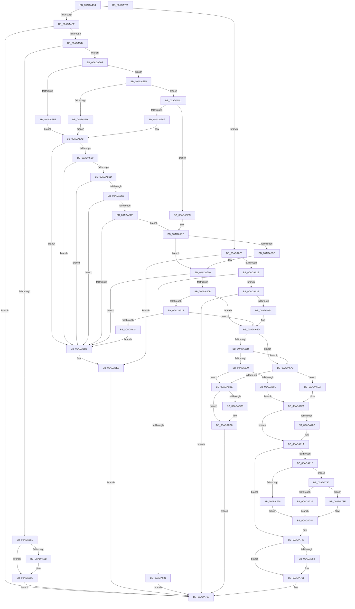

# MiCreateUserPhysicalView

- RVA: `0x00ADA4B4`–`0x00ADA782` (길이 `718` bytes)
- VA: `0x0000000140ADA4B4`
- 실행 섹션: `PAGE`
- PDB 이름 있음: `예`; PDB Function 태그: `아니요`
- unwind 정보 RVA: `0x000BF414`
- 디코드: `203`개 명령, `718/718` bytes 표시
- 미해석 바이트: `0` (있으면 어셈블리에 `.byte`로 보존)

> 이 문서는 커널 이미지의 기계어와 PDB 기호를 분석해 생성했습니다. 4번과 5번은 함수 원형과 자료형을 바이너리 사용 방식에서 추정한 C 해석이며 원본 소스 복구 결과는 아닙니다.

## 1. Dependencies

- 직접 호출 지점: **14**; 고유 호출 대상: **11**
- 직접 호출자로 확인된 함수: **1**
- RIP 상대 이미지 참조: **0**

### Outgoing calls
- `0x00ADA537` → [MiReferenceAweHandle](../../text/4E/MiReferenceAweHandle_function_004E00A4.md) (function, `0x004E00A4`)
- `0x00ADA560` → [ObfDereferenceObjectWithTag](../../text/2F/ObfDereferenceObjectWithTag_function_002F78E0.md) (function, `0x002F78E0`)
- `0x00ADA572` → [MiSectionControlArea](../../text/29/MiSectionControlArea_function_00294CB0.md) (function, `0x00294CB0`)
- `0x00ADA581` → [MiGetAwePageSize](../../text/46/MiGetAwePageSize_function_0046CFA8.md) (function, `0x0046CFA8`)
- `0x00ADA5DD` → [ObfDereferenceObjectWithTag](../../text/2F/ObfDereferenceObjectWithTag_function_002F78E0.md) (function, `0x002F78E0`)
- `0x00ADA644` → [MiCreateProcessDefaultAweInfo](../80/MiCreateProcessDefaultAweInfo_function_0080A8C0.md) (function, `0x0080A8C0`)
- `0x00ADA688` → [MiCreateVadEventBitmap](../98/MiCreateVadEventBitmap_function_009803FC.md) (function, `0x009803FC`)
- `0x00ADA699` → [MiLocateLockedVadEvent](../../text/2A/MiLocateLockedVadEvent_function_002A7A0C.md) (function, `0x002A7A0C`)
- `0x00ADA6B1` → [MiAllocatePool](../../text/35/MiAllocatePool_function_0035B540.md) (function, `0x0035B540`)
- `0x00ADA6CB` → [ObfDereferenceObjectWithTag](../../text/2F/ObfDereferenceObjectWithTag_function_002F78E0.md) (function, `0x002F78E0`)
- `0x00ADA6EC` → [MiGetAweInfoPartition](../../text/2A/MiGetAweInfoPartition_function_002AA2CC.md) (function, `0x002AA2CC`)
- `0x00ADA705` → [MiCheckPurgeAndUpMapCount](../../text/41/MiCheckPurgeAndUpMapCount_function_004186B0.md) (function, `0x004186B0`)
- `0x00ADA715` → [ObfDereferenceObjectWithTag](../../text/2F/ObfDereferenceObjectWithTag_function_002F78E0.md) (function, `0x002F78E0`)
- `0x00ADA75C` → [MiInsertVadEvent](../../text/43/MiInsertVadEvent_function_00430E74.md) (function, `0x00430E74`)

### Direct callers
- [MiReserveUserMemory](../88/MiReserveUserMemory_function_00884498.md) at `0x00884BB7`

### Static image references
- 디코드된 RIP-relative 메모리 참조가 없습니다.

## 2. Other-region calls and transfers

- 다른 실행 섹션으로 향하는 call: **12**
  - `0x00ADA537` → [MiReferenceAweHandle](../../text/4E/MiReferenceAweHandle_function_004E00A4.md) (`PAGE` → `.text`)
  - `0x00ADA560` → [ObfDereferenceObjectWithTag](../../text/2F/ObfDereferenceObjectWithTag_function_002F78E0.md) (`PAGE` → `.text`)
  - `0x00ADA572` → [MiSectionControlArea](../../text/29/MiSectionControlArea_function_00294CB0.md) (`PAGE` → `.text`)
  - `0x00ADA581` → [MiGetAwePageSize](../../text/46/MiGetAwePageSize_function_0046CFA8.md) (`PAGE` → `.text`)
  - `0x00ADA5DD` → [ObfDereferenceObjectWithTag](../../text/2F/ObfDereferenceObjectWithTag_function_002F78E0.md) (`PAGE` → `.text`)
  - `0x00ADA699` → [MiLocateLockedVadEvent](../../text/2A/MiLocateLockedVadEvent_function_002A7A0C.md) (`PAGE` → `.text`)
  - `0x00ADA6B1` → [MiAllocatePool](../../text/35/MiAllocatePool_function_0035B540.md) (`PAGE` → `.text`)
  - `0x00ADA6CB` → [ObfDereferenceObjectWithTag](../../text/2F/ObfDereferenceObjectWithTag_function_002F78E0.md) (`PAGE` → `.text`)
  - `0x00ADA6EC` → [MiGetAweInfoPartition](../../text/2A/MiGetAweInfoPartition_function_002AA2CC.md) (`PAGE` → `.text`)
  - `0x00ADA705` → [MiCheckPurgeAndUpMapCount](../../text/41/MiCheckPurgeAndUpMapCount_function_004186B0.md) (`PAGE` → `.text`)
  - `0x00ADA715` → [ObfDereferenceObjectWithTag](../../text/2F/ObfDereferenceObjectWithTag_function_002F78E0.md) (`PAGE` → `.text`)
  - `0x00ADA75C` → [MiInsertVadEvent](../../text/43/MiInsertVadEvent_function_00430E74.md) (`PAGE` → `.text`)
- 별도 외부 분기/꼬리 이동을 확인하지 못했습니다.

## 3. Assembly (complete function range)

```asm
00ADA4B4  4C 8B DC                        mov r11, rsp
00ADA4B7  49 89 5B 08                     mov qword ptr [r11 + 8], rbx
00ADA4BB  49 89 6B 10                     mov qword ptr [r11 + 0x10], rbp
00ADA4BF  49 89 73 20                     mov qword ptr [r11 + 0x20], rsi
00ADA4C3  57                              push rdi
00ADA4C4  41 54                           push r12
00ADA4C6  41 55                           push r13
00ADA4C8  41 56                           push r14
00ADA4CA  41 57                           push r15
00ADA4CC  48 83 EC 40                     sub rsp, 0x40
00ADA4D0  49 83 63 C8 00                  and qword ptr [r11 - 0x38], 0
00ADA4D5  33 FF                           xor edi, edi
00ADA4D7  49 21 7B D0                     and qword ptr [r11 - 0x30], rdi
00ADA4DB  4C 8B F9                        mov r15, rcx
00ADA4DE  49 8B 48 68                     mov rcx, qword ptr [r8 + 0x68]
00ADA4E2  45 33 ED                        xor r13d, r13d
00ADA4E5  49 8B 58 70                     mov rbx, qword ptr [r8 + 0x70]
00ADA4E9  4D 8B E1                        mov r12, r9
00ADA4EC  49 89 7B 18                     mov qword ptr [r11 + 0x18], rdi
00ADA4F0  49 8B F0                        mov rsi, r8
00ADA4F3  44 8B D2                        mov r10d, edx
00ADA4F6  48 85 C9                        test rcx, rcx
00ADA4F9  0F 84 27 01 00 00               je 0x140ada626
00ADA4FF  65 48 8B 04 25 88 01 00 00      mov rax, qword ptr gs:[0x188]
00ADA508  44 8B CA                        mov r9d, edx
00ADA50B  41 83 E1 04                     and r9d, 4
00ADA50F  41 83 C9 08                     or r9d, 8
00ADA513  41 D1 E9                        shr r9d, 1
00ADA516  44 8A 80 32 02 00 00            mov r8b, byte ptr [rax + 0x232]
00ADA51D  41 8B D1                        mov edx, r9d
00ADA520  83 CA 08                        or edx, 8
00ADA523  49 8D 43 18                     lea rax, [r11 + 0x18]
00ADA527  41 F6 C2 02                     test r10b, 2
00ADA52B  49 89 43 B8                     mov qword ptr [r11 - 0x48], rax
00ADA52F  41 0F 44 D1                     cmove edx, r9d
00ADA533  4D 8D 4B C8                     lea r9, [r11 - 0x38]
00ADA537  E8 68 5B A0 FF                  call 0x1404e00a4
00ADA53C  85 C0                           test eax, eax
00ADA53E  0F 88 1F 02 00 00               js 0x140ada763
00ADA544  48 8B BC 24 80 00 00 00         mov rdi, qword ptr [rsp + 0x80]
00ADA54C  48 85 FF                        test rdi, rdi
00ADA54F  75 1E                           jne 0x140ada56f
00ADA551  48 8B 4C 24 30                  mov rcx, qword ptr [rsp + 0x30]
00ADA556  48 85 C9                        test rcx, rcx
00ADA559  74 0A                           je 0x140ada565
00ADA55B  BA 4D 6D 50 68                  mov edx, 0x68506d4d
00ADA560  E8 7B D3 81 FF                  call 0x1402f78e0
00ADA565  B8 08 00 00 C0                  mov eax, 0xc0000008
00ADA56A  E9 F4 01 00 00                  jmp 0x140ada763
00ADA56F  48 8B CF                        mov rcx, rdi
00ADA572  E8 39 A7 7B FF                  call 0x140294cb0
00ADA577  4C 8B E8                        mov r13, rax
00ADA57A  4C 8B 70 08                     mov r14, qword ptr [rax + 8]
00ADA57E  49 8B CE                        mov rcx, r14
00ADA581  E8 22 2A 99 FF                  call 0x14046cfa8
00ADA586  48 8B E8                        mov rbp, rax
00ADA589  F6 C3 02                        test bl, 2
00ADA58C  74 07                           je 0x140ada595
00ADA58E  BB 10 00 00 00                  mov ebx, 0x10
00ADA593  EB 16                           jmp 0x140ada5ab
00ADA595  F6 C3 08                        test bl, 8
00ADA598  74 07                           je 0x140ada5a1
00ADA59A  BB 00 02 00 00                  mov ebx, 0x200
00ADA59F  EB 0A                           jmp 0x140ada5ab
00ADA5A1  F6 C3 10                        test bl, 0x10
00ADA5A4  74 46                           je 0x140ada5ec
00ADA5A6  BB 00 00 04 00                  mov ebx, 0x40000
00ADA5AB  48 3B DD                        cmp rbx, rbp
00ADA5AE  76 25                           jbe 0x140ada5d5
00ADA5B0  33 D2                           xor edx, edx
00ADA5B2  48 8B C3                        mov rax, rbx
00ADA5B5  48 F7 F5                        div rbp
00ADA5B8  48 85 D2                        test rdx, rdx
00ADA5BB  75 18                           jne 0x140ada5d5
00ADA5BD  48 8D 43 FF                     lea rax, [rbx - 1]
00ADA5C1  48 85 C3                        test rbx, rax
00ADA5C4  75 0F                           jne 0x140ada5d5
00ADA5C6  48 81 FB 00 02 00 00            cmp rbx, 0x200
00ADA5CD  75 06                           jne 0x140ada5d5
00ADA5CF  48 83 FD 10                     cmp rbp, 0x10
00ADA5D3  74 1A                           je 0x140ada5ef
00ADA5D5  BA 4D 6D 50 68                  mov edx, 0x68506d4d
00ADA5DA  48 8B CF                        mov rcx, rdi
00ADA5DD  E8 FE D2 81 FF                  call 0x1402f78e0
00ADA5E2  B8 0D 00 00 C0                  mov eax, 0xc000000d
00ADA5E7  E9 77 01 00 00                  jmp 0x140ada763
00ADA5EC  48 8B DD                        mov rbx, rbp
00ADA5EF  48 8B C3                        mov rax, rbx
00ADA5F2  48 C1 E0 0C                     shl rax, 0xc
00ADA5F6  48 39 46 10                     cmp qword ptr [rsi + 0x10], rax
00ADA5FA  73 04                           jae 0x140ada600
00ADA5FC  48 89 46 10                     mov qword ptr [rsi + 0x10], rax
00ADA600  48 8B 4E 18                     mov rcx, qword ptr [rsi + 0x18]
00ADA604  4C 8D 40 FF                     lea r8, [rax - 1]
00ADA608  49 85 C8                        test r8, rcx
00ADA60B  75 C8                           jne 0x140ada5d5
00ADA60D  48 8B 16                        mov rdx, qword ptr [rsi]
00ADA610  48 8B 46 08                     mov rax, qword ptr [rsi + 8]
00ADA614  48 2B C2                        sub rax, rdx
00ADA617  48 FF C0                        inc rax
00ADA61A  48 3B C1                        cmp rax, rcx
00ADA61D  75 3E                           jne 0x140ada65d
00ADA61F  49 85 D0                        test r8, rdx
00ADA622  74 39                           je 0x140ada65d
00ADA624  EB AF                           jmp 0x140ada5d5
00ADA626  F6 C3 1A                        test bl, 0x1a
00ADA629  75 B7                           jne 0x140ada5e2
00ADA62B  41 83 FA 04                     cmp r10d, 4
00ADA62F  74 0A                           je 0x140ada63b
00ADA631  B8 45 00 00 C0                  mov eax, 0xc0000045
00ADA636  E9 28 01 00 00                  jmp 0x140ada763
00ADA63B  41 8A 48 39                     mov cl, byte ptr [r8 + 0x39]
00ADA63F  48 8D 54 24 38                  lea rdx, [rsp + 0x38]
00ADA644  E8 77 02 D3 FF                  call 0x14080a8c0
00ADA649  85 C0                           test eax, eax
00ADA64B  0F 88 12 01 00 00               js 0x140ada763
00ADA651  4C 8B 74 24 38                  mov r14, qword ptr [rsp + 0x38]
00ADA656  BD 01 00 00 00                  mov ebp, 1
00ADA65B  8B DD                           mov ebx, ebp
00ADA65D  4C 8B 46 18                     mov r8, qword ptr [rsi + 0x18]
00ADA661  B8 00 02 00 00                  mov eax, 0x200
00ADA666  4C 3B C0                        cmp r8, rax
00ADA669  72 38                           jb 0x140ada6a3
00ADA66B  48 3B D8                        cmp rbx, rax
00ADA66E  73 33                           jae 0x140ada6a3
00ADA670  48 8B 4E 58                     mov rcx, qword ptr [rsi + 0x58]
00ADA674  49 81 C0 FF FF 1F 00            add r8, 0x1fffff
00ADA67B  49 C1 E8 15                     shr r8, 0x15
00ADA67F  41 B9 00 01 00 00               mov r9d, 0x100
00ADA685  49 8B D7                        mov rdx, r15
00ADA688  E8 6F 5D EA FF                  call 0x1409803fc
00ADA68D  85 C0                           test eax, eax
00ADA68F  78 2D                           js 0x140ada6be
00ADA691  BA 00 01 00 00                  mov edx, 0x100
00ADA696  49 8B CF                        mov rcx, r15
00ADA699  E8 6E D3 7C FF                  call 0x1402a7a0c
00ADA69E  48 8B F0                        mov rsi, rax
00ADA6A1  EB 3E                           jmp 0x140ada6e1
00ADA6A3  BA 58 00 00 00                  mov edx, 0x58
00ADA6A8  41 B8 4D 6D 70 76               mov r8d, 0x76706d4d
00ADA6AE  8D 4A E8                        lea ecx, [rdx - 0x18]
00ADA6B1  E8 8A 0E 88 FF                  call 0x14035b540
00ADA6B6  48 8B F0                        mov rsi, rax
00ADA6B9  48 85 C0                        test rax, rax
00ADA6BC  75 1C                           jne 0x140ada6da
00ADA6BE  48 85 FF                        test rdi, rdi
00ADA6C1  74 0D                           je 0x140ada6d0
00ADA6C3  BA 4D 6D 50 68                  mov edx, 0x68506d4d
00ADA6C8  48 8B CF                        mov rcx, rdi
00ADA6CB  E8 10 D2 81 FF                  call 0x1402f78e0
00ADA6D0  B8 9A 00 00 C0                  mov eax, 0xc000009a
00ADA6D5  E9 89 00 00 00                  jmp 0x140ada763
00ADA6DA  C7 40 50 00 01 00 00            mov dword ptr [rax + 0x50], 0x100
00ADA6E1  49 8B CE                        mov rcx, r14
00ADA6E4  4C 89 7E 20                     mov qword ptr [rsi + 0x20], r15
00ADA6E8  4C 89 76 28                     mov qword ptr [rsi + 0x28], r14
00ADA6EC  E8 DB FB 7C FF                  call 0x1402aa2cc
00ADA6F1  4C 8D 76 30                     lea r14, [rsi + 0x30]
00ADA6F5  0F B7 08                        movzx ecx, word ptr [rax]
00ADA6F8  66 41 89 0C 24                  mov word ptr [r12], cx
00ADA6FD  48 85 FF                        test rdi, rdi
00ADA700  74 18                           je 0x140ada71a
00ADA702  49 8B CD                        mov rcx, r13
00ADA705  E8 A6 DF 93 FF                  call 0x1404186b0
00ADA70A  BA 4D 6D 50 68                  mov edx, 0x68506d4d
00ADA70F  4D 89 2E                        mov qword ptr [r14], r13
00ADA712  48 8B CF                        mov rcx, rdi
00ADA715  E8 C6 D1 81 FF                  call 0x1402f78e0
00ADA71A  48 3B DD                        cmp rbx, rbp
00ADA71D  74 28                           je 0x140ada747
00ADA71F  41 8B 06                        mov eax, dword ptr [r14]
00ADA722  48 83 FB 10                     cmp rbx, 0x10
00ADA726  75 08                           jne 0x140ada730
00ADA728  83 E0 FD                        and eax, 0xfffffffd
00ADA72B  83 C8 01                        or eax, 1
00ADA72E  EB 14                           jmp 0x140ada744
00ADA730  48 81 FB 00 00 04 00            cmp rbx, 0x40000
00ADA737  75 05                           jne 0x140ada73e
00ADA739  83 C8 03                        or eax, 3
00ADA73C  EB 06                           jmp 0x140ada744
00ADA73E  83 E0 FE                        and eax, 0xfffffffe
00ADA741  83 C8 02                        or eax, 2
00ADA744  41 89 06                        mov dword ptr [r14], eax
00ADA747  48 83 66 18 00                  and qword ptr [rsi + 0x18], 0
00ADA74C  48 83 7E 38 00                  cmp qword ptr [rsi + 0x38], 0
00ADA751  75 0E                           jne 0x140ada761
00ADA753  45 33 C0                        xor r8d, r8d
00ADA756  48 8B D6                        mov rdx, rsi
00ADA759  49 8B CF                        mov rcx, r15
00ADA75C  E8 13 67 95 FF                  call 0x140430e74
00ADA761  33 C0                           xor eax, eax
00ADA763  4C 8D 5C 24 40                  lea r11, [rsp + 0x40]
00ADA768  49 8B 5B 30                     mov rbx, qword ptr [r11 + 0x30]
00ADA76C  49 8B 6B 38                     mov rbp, qword ptr [r11 + 0x38]
00ADA770  49 8B 73 48                     mov rsi, qword ptr [r11 + 0x48]
00ADA774  49 8B E3                        mov rsp, r11
00ADA777  41 5F                           pop r15
00ADA779  41 5E                           pop r14
00ADA77B  41 5D                           pop r13
00ADA77D  41 5C                           pop r12
00ADA77F  5F                              pop rdi
00ADA780  C3                              ret
00ADA781  CC                              int3
```

## 4. C-style interpretation (structured pseudocode)

```c
__int64 __fastcall MiCreateUserPhysicalView(__int64 a1, int a2, __int64 a3, __int64 a4)
{
    __int64 result;
    __int64 v_r13;
    __int64 v_rdi;
    __int64 v_rsp;
    unsigned __int64 v_stack_m28;
    unsigned __int64 v_stack_m30;
    unsigned __int64 v_stack_m38;
    unsigned __int64 v_stack_p18;

    *(unsigned __int64 *)(v_rsp + 8) = v_rbx;
    *(unsigned __int64 *)(v_rsp + 16) = v_rbp;
    *(unsigned __int64 *)(v_rsp + 32) = v_rsi;
    v_rsp = (v_rsp) - (64);
    v_rdi = 0;
    v_r13 = 0;
    *(unsigned __int64 *)(v_rsp + 24) = 0;
    if (*(unsigned __int64 *)(a3 + 104) == 0) goto loc_00ADA626;
    a4 = (unsigned int)(((unsigned int)(a2)) & (4));
    a4 = (unsigned int)((a4) | (8));
    a4 = (unsigned int)((a4) >> (1));
    a2 = (unsigned int)(((unsigned int)((unsigned int)(a4))) | (8));
    *(unsigned __int64 *)(v_rsp - 72) = v_rsp + 24;
    if ((((unsigned __int8)((unsigned int)(a2))) & (2)) == 0) { a2 = (unsigned int)(a4); }
    result = MiReferenceAweHandle(*(unsigned __int64 *)(a3 + 104), a2, *(unsigned __int8 *)(*(unsigned __int64 *)(gs_base + (0 + 392)) + 562), v_rsp - 56);
    if (sign_flag) goto loc_00ADA763;
    if (v_stack_p18 != 0) goto loc_00ADA56F;
    if (v_stack_m38 != 0) {
        a2 = 0x68506D4DULL;
        result = ObfDereferenceObjectWithTag(v_stack_m38, a2, *(unsigned __int8 *)(*(unsigned __int64 *)(gs_base + (0 + 392)) + 562), v_rsp - 56);
    }
    goto loc_00ADA763;
loc_00ADA56F:
    result = MiSectionControlArea(v_stack_p18, a2, *(unsigned __int8 *)(*(unsigned __int64 *)(gs_base + (0 + 392)) + 562), v_rsp - 56);
    result = MiGetAwePageSize(*(unsigned __int64 *)(result + 8), a2, *(unsigned __int8 *)(*(unsigned __int64 *)(gs_base + (0 + 392)) + 562), v_rsp - 56);
    if ((((unsigned __int8)(*(unsigned __int64 *)(a3 + 112))) & (2)) == 0) goto loc_00ADA595;
    goto loc_00ADA5AB;
loc_00ADA595:
    if (((16) & (8)) == 0) goto loc_00ADA5A1;
    goto loc_00ADA5AB;
loc_00ADA5A1:
    if (((512) & (16)) == 0) goto loc_00ADA5EC;
loc_00ADA5AB:
    if (((unsigned int)(0x40000ULL)) <= result) goto loc_00ADA5D5;
    a2 = 0;
    if (0 != 0) goto loc_00ADA5D5;
    if ((((unsigned int)(0x40000ULL)) & ((unsigned int)(0x40000ULL) - 1)) != 0) goto loc_00ADA5D5;
    if (((unsigned int)(0x40000ULL)) != 512) goto loc_00ADA5D5;
    if (result == 16) goto loc_00ADA5EF;
loc_00ADA5D5:
    result = ObfDereferenceObjectWithTag(v_stack_p18, (unsigned int)(0x68506D4DULL), *(unsigned __int8 *)(*(unsigned __int64 *)(gs_base + (0 + 392)) + 562), v_rsp - 56);
loc_00ADA5E2:
    goto loc_00ADA763;
loc_00ADA5EC:
loc_00ADA5EF:
    result = (result) << (12);
    if ((*(unsigned __int64 *)(a3 + 16)) < result) {
        *(unsigned __int64 *)(a3 + 16) = result;
    }
    if (((result - 1) & (*(unsigned __int64 *)(a3 + 24))) != 0) goto loc_00ADA5D5;
    result = (*(unsigned __int64 *)(a3 + 8)) - (*(unsigned __int64 *)(a3));
    result = (result) + 1;
    if (result != (*(unsigned __int64 *)(a3 + 24))) goto loc_00ADA65D;
    if (((result - 1) & (*(unsigned __int64 *)(a3))) == 0) goto loc_00ADA65D;
    goto loc_00ADA5D5;
loc_00ADA626:
    if ((((unsigned __int8)(result)) & (26)) != 0) goto loc_00ADA5E2;
    if (((unsigned int)((unsigned int)(a2))) == 4) goto loc_00ADA63B;
    goto loc_00ADA763;
loc_00ADA63B:
    result = MiCreateProcessDefaultAweInfo(*(unsigned __int8 *)(result - 1 + 57), v_stack_m30, result - 1, v_rsp - 56);
    if (sign_flag) goto loc_00ADA763;
loc_00ADA65D:
    if ((*(unsigned __int64 *)(a3 + 24)) < 512) goto loc_00ADA6A3;
    if (1 >= 512) goto loc_00ADA6A3;
    a3 = (*(unsigned __int64 *)(a3 + 24)) + (0x1FFFFFULL);
    a3 = (a3) >> (21);
    result = MiCreateVadEventBitmap(*(unsigned __int64 *)(a3 + 88), a1, a3, 256);
    if (sign_flag) goto loc_00ADA6BE;
    result = MiLocateLockedVadEvent(a1, 256, a3, 256);
    goto loc_00ADA6E1;
loc_00ADA6A3:
    result = MiAllocatePool(88 - 24, 88, (unsigned int)(0x76706D4DULL), 256);
    if (result != 0) goto loc_00ADA6DA;
loc_00ADA6BE:
    if (v_stack_p18 != 0) {
        a2 = 0x68506D4DULL;
        a1 = v_stack_p18;
        result = ObfDereferenceObjectWithTag(a1, a2, (unsigned int)(0x76706D4DULL), 256);
    }
    goto loc_00ADA763;
loc_00ADA6DA:
    *(unsigned int *)((unsigned int)(0xC000009AULL) + 80) = 256;
loc_00ADA6E1:
    *(unsigned __int64 *)(result + 32) = a1;
    *(unsigned __int64 *)(result + 40) = v_stack_m30;
    result = MiGetAweInfoPartition(v_stack_m30, a2, (unsigned int)(0x76706D4DULL), 256);
    *(unsigned __int16 *)(a4) = (unsigned __int16)(*(unsigned __int16 *)(result));
    if (v_stack_p18 != 0) {
        a1 = result;
        result = MiCheckPurgeAndUpMapCount(a1, a2, (unsigned int)(0x76706D4DULL), 256);
        a2 = 0x68506D4DULL;
        *(unsigned __int64 *)(result + 48) = result;
        a1 = v_stack_p18;
        result = ObfDereferenceObjectWithTag(a1, a2, (unsigned int)(0x76706D4DULL), 256);
    }
    if (1 == 1) goto loc_00ADA747;
    if (1 != 16) goto loc_00ADA730;
    result = (unsigned int)(((unsigned int)(*(unsigned int *)(result + 48))) & (0xFFFFFFFDULL));
    result = (unsigned int)((result) | (1));
    goto loc_00ADA744;
loc_00ADA730:
    if (1 != 0x40000ULL) goto loc_00ADA73E;
    result = (unsigned int)((result) | (3));
    goto loc_00ADA744;
loc_00ADA73E:
    result = (unsigned int)((result) & (0xFFFFFFFEULL));
    result = (unsigned int)((result) | (2));
loc_00ADA744:
    *(unsigned int *)(result + 48) = (unsigned int)(result);
loc_00ADA747:
    if ((*(unsigned __int64 *)(result + 56)) == 0) {
        a3 = 0;
        a2 = result;
        a1 = a1;
        result = MiInsertVadEvent(a1, a2, a3, 256);
    }
    result = 0;
loc_00ADA763:
    return result;
}
```

## 5. (Beta) C Style

```c
int64_t MiCreateUserPhysicalView(int64_t Arg1, int32_t Arg2, void *Arg3, void *Arg4)
{
    uint8_t *arg3 = (uint8_t *)Arg3;
    uint8_t *arg4 = (uint8_t *)Arg4;

    int64_t result;
    int64_t local_r13;
    int64_t local_rdi;
    int64_t local_rsp;
    uint64_t v_stack_m28;
    uint64_t v_stack_m30;
    uint64_t v_stack_m38;
    uint64_t v_stack_p18;

    *(uint64_t *)(local_rsp + 0x8) = local_rbx;
    *(uint64_t *)(local_rsp + 0x10) = local_rbp;
    *(uint64_t *)(local_rsp + 0x20) = local_rsi;
    local_rsp = (local_rsp) - (64);
    local_rdi = 0;
    local_r13 = 0;
    *(uint64_t *)(local_rsp + 0x18) = 0;
    if (*(uint64_t *)(arg3 + 0x68) == 0) goto loc_00ADA626;
    Arg4 = (uint32_t)(((uint32_t)(Arg2)) & (4));
    Arg4 = (uint32_t)((Arg4) | (8));
    Arg4 = (uint32_t)((Arg4) >> (1));
    Arg2 = (uint32_t)(((uint32_t)((uint32_t)(Arg4))) | (8));
    *(uint64_t *)(local_rsp - 0x48) = local_rsp + 24;
    if ((((uint8_t)((uint32_t)(Arg2))) & (2)) == 0) { Arg2 = (uint32_t)(Arg4); }
    result = MiReferenceAweHandle(*(uint64_t *)(arg3 + 0x68), Arg2, *(uint8_t *)(*(uint64_t *)(gs_base + (0 + 0x188)) + 0x232), local_rsp - 56);
    if (sign_flag) goto loc_00ADA763;
    if (v_stack_p18 != 0) goto loc_00ADA56F;
    if (v_stack_m38 != 0) {
        Arg2 = 0x68506D4DULL;
        result = ObfDereferenceObjectWithTag(v_stack_m38, Arg2, *(uint8_t *)(*(uint64_t *)(gs_base + (0 + 0x188)) + 0x232), local_rsp - 56);
    }
    goto loc_00ADA763;
loc_00ADA56F:
    result = MiSectionControlArea(v_stack_p18, Arg2, *(uint8_t *)(*(uint64_t *)(gs_base + (0 + 0x188)) + 0x232), local_rsp - 56);
    result = MiGetAwePageSize(*(uint64_t *)(result + 0x8), Arg2, *(uint8_t *)(*(uint64_t *)(gs_base + (0 + 0x188)) + 0x232), local_rsp - 56);
    if ((((uint8_t)(*(uint64_t *)(arg3 + 0x70))) & (2)) == 0) goto loc_00ADA595;
    goto loc_00ADA5AB;
loc_00ADA595:
    if (((16) & (8)) == 0) goto loc_00ADA5A1;
    goto loc_00ADA5AB;
loc_00ADA5A1:
    if (((512) & (16)) == 0) goto loc_00ADA5EC;
loc_00ADA5AB:
    if (((uint32_t)(0x40000ULL)) <= result) goto loc_00ADA5D5;
    Arg2 = 0;
    if (0 != 0) goto loc_00ADA5D5;
    if ((((uint32_t)(0x40000ULL)) & ((uint32_t)(0x40000ULL) - 1)) != 0) goto loc_00ADA5D5;
    if (((uint32_t)(0x40000ULL)) != 512) goto loc_00ADA5D5;
    if (result == 16) goto loc_00ADA5EF;
loc_00ADA5D5:
    result = ObfDereferenceObjectWithTag(v_stack_p18, (uint32_t)(0x68506D4DULL), *(uint8_t *)(*(uint64_t *)(gs_base + (0 + 0x188)) + 0x232), local_rsp - 56);
loc_00ADA5E2:
    goto loc_00ADA763;
loc_00ADA5EC:
loc_00ADA5EF:
    result = (result) << (12);
    if ((*(uint64_t *)(arg3 + 0x10)) < result) {
        *(uint64_t *)(arg3 + 0x10) = result;
    }
    if (((result - 1) & (*(uint64_t *)(arg3 + 0x18))) != 0) goto loc_00ADA5D5;
    result = (*(uint64_t *)(arg3 + 0x8)) - (*(uint64_t *)(arg3));
    result = (result) + 1;
    if (result != (*(uint64_t *)(arg3 + 0x18))) goto loc_00ADA65D;
    if (((result - 1) & (*(uint64_t *)(arg3))) == 0) goto loc_00ADA65D;
    goto loc_00ADA5D5;
loc_00ADA626:
    if ((((uint8_t)(result)) & (26)) != 0) goto loc_00ADA5E2;
    if (((uint32_t)((uint32_t)(Arg2))) == 4) goto loc_00ADA63B;
    goto loc_00ADA763;
loc_00ADA63B:
    result = MiCreateProcessDefaultAweInfo(*(uint8_t *)(result - 0x1 + 0x39), v_stack_m30, result - 1, local_rsp - 56);
    if (sign_flag) goto loc_00ADA763;
loc_00ADA65D:
    if ((*(uint64_t *)(arg3 + 0x18)) < 512) goto loc_00ADA6A3;
    if (1 >= 512) goto loc_00ADA6A3;
    Arg3 = (*(uint64_t *)(arg3 + 0x18)) + (0x1FFFFFULL);
    Arg3 = (Arg3) >> (21);
    result = MiCreateVadEventBitmap(*(uint64_t *)(arg3 + 0x58), Arg1, Arg3, 256);
    if (sign_flag) goto loc_00ADA6BE;
    result = MiLocateLockedVadEvent(Arg1, 256, Arg3, 256);
    goto loc_00ADA6E1;
loc_00ADA6A3:
    result = MiAllocatePool(88 - 24, 88, (uint32_t)(0x76706D4DULL), 256);
    if (result != 0) goto loc_00ADA6DA;
loc_00ADA6BE:
    if (v_stack_p18 != 0) {
        Arg2 = 0x68506D4DULL;
        Arg1 = v_stack_p18;
        result = ObfDereferenceObjectWithTag(Arg1, Arg2, (uint32_t)(0x76706D4DULL), 256);
    }
    goto loc_00ADA763;
loc_00ADA6DA:
    *(uint32_t *)((uint32_t)(0xC000009AULL) + 0x50) = 256;
loc_00ADA6E1:
    *(uint64_t *)(result + 0x20) = Arg1;
    *(uint64_t *)(result + 0x28) = v_stack_m30;
    result = MiGetAweInfoPartition(v_stack_m30, Arg2, (uint32_t)(0x76706D4DULL), 256);
    *(uint16_t *)(arg4) = (uint16_t)(*(uint16_t *)(result));
    if (v_stack_p18 != 0) {
        Arg1 = result;
        result = MiCheckPurgeAndUpMapCount(Arg1, Arg2, (uint32_t)(0x76706D4DULL), 256);
        Arg2 = 0x68506D4DULL;
        *(uint64_t *)(result + 0x30) = result;
        Arg1 = v_stack_p18;
        result = ObfDereferenceObjectWithTag(Arg1, Arg2, (uint32_t)(0x76706D4DULL), 256);
    }
    if (1 == 1) goto loc_00ADA747;
    if (1 != 16) goto loc_00ADA730;
    result = (uint32_t)(((uint32_t)(*(uint32_t *)(result + 0x30))) & (0xFFFFFFFDULL));
    result = (uint32_t)((result) | (1));
    goto loc_00ADA744;
loc_00ADA730:
    if (1 != 0x40000ULL) goto loc_00ADA73E;
    result = (uint32_t)((result) | (3));
    goto loc_00ADA744;
loc_00ADA73E:
    result = (uint32_t)((result) & (0xFFFFFFFEULL));
    result = (uint32_t)((result) | (2));
loc_00ADA744:
    *(uint32_t *)(result + 0x30) = (uint32_t)(result);
loc_00ADA747:
    if ((*(uint64_t *)(result + 0x38)) == 0) {
        Arg3 = 0;
        Arg2 = result;
        Arg1 = Arg1;
        result = MiInsertVadEvent(Arg1, Arg2, Arg3, 256);
    }
    result = 0;
loc_00ADA763:
    return result;
}
```

### 관측된 메모리 오프셋

구조체 형식이 확인되지 않은 접근은 인자 기준의 오프셋으로만 기록했습니다.

| 기준 인자 | 오프셋 표현 | 폭 (bit) | 접근 |
|---|---:|---:|---|
| `Arg3` | `+ 0x0` | `64` | `R` |
| `Arg3` | `+ 0x8` | `64` | `R` |
| `Arg3` | `+ 0x10` | `64` | `R` |
| `Arg3` | `+ 0x10` | `64` | `W` |
| `Arg3` | `+ 0x18` | `64` | `R` |
| `Arg3` | `+ 0x39` | `8` | `R` |
| `Arg3` | `+ 0x58` | `64` | `R` |
| `Arg3` | `+ 0x68` | `64` | `R` |
| `Arg3` | `+ 0x70` | `64` | `R` |
| `Arg4` | `+ 0x0` | `16` | `W` |

## 6. Execution-region graph

[열기: 2D/3D 그래프와 함수 탐색 컨트롤 패널](../../../control-panel.html?section=page&rva=0x00ADA4B4&view=graph)

- 2D 그래프는 위에서 아래로 흐르고, 3D 그래프는 빈 공간을 드래그해 회전합니다. Shift+드래그는 이동, 휠은 확대·축소, 함수 노드 선택은 대상 보고서 이동입니다.

### Static fallback


