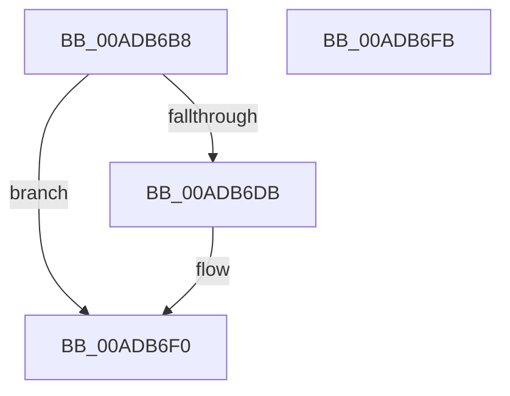

# MiFreeVadEventBitmap

- RVA: `0x00ADB6B8`–`0x00ADB6FC` (길이 `68` bytes)
- VA: `0x0000000140ADB6B8`
- 실행 섹션: `PAGE`
- PDB 이름 있음: `예`; PDB Function 태그: `아니요`
- unwind 정보 RVA: `0x0005CAAC`
- 디코드: `22`개 명령, `68/68` bytes 표시
- 미해석 바이트: `0` (있으면 어셈블리에 `.byte`로 보존)

> 이 문서는 커널 이미지의 기계어와 PDB 기호를 분석해 생성했습니다. 4번과 5번은 함수 원형과 자료형을 바이너리 사용 방식에서 추정한 C 해석이며 원본 소스 복구 결과는 아닙니다.

## 1. Dependencies

- 직접 호출 지점: **3**; 고유 호출 대상: **3**
- 직접 호출자로 확인된 함수: **3**
- RIP 상대 이미지 참조: **0**

### Outgoing calls
- `0x00ADB6CE` → [MiGetVadWakeList](../../text/43/MiGetVadWakeList_function_00431134.md) (function, `0x00431134`)
- `0x00ADB6E1` → [MiFreeVadEventBitmapCharges](../70/MiFreeVadEventBitmapCharges_function_00704944.md) (function, `0x00704944`)
- `0x00ADB6EB` → [ExFreePoolWithTag](../../poolcode/B8/ExFreePoolWithTag_function_00B82870.md) (function, `0x00B82870`)

### Direct callers
- [MiDeletePartialCloneVads](../81/MiDeletePartialCloneVads_function_008116E4.md) at `0x0081171E`
- [MiAllocateNewSubAllocatedRegion](../98/MiAllocateNewSubAllocatedRegion_function_00981EC0.md) at `0x009820C7`
- [sub_00B2A0A2](../B2/Unknown_function_00B2A0A2.md) at `0x00B2A119`

### Static image references
- 디코드된 RIP-relative 메모리 참조가 없습니다.

## 2. Other-region calls and transfers

- 다른 실행 섹션으로 향하는 call: **2**
  - `0x00ADB6CE` → [MiGetVadWakeList](../../text/43/MiGetVadWakeList_function_00431134.md) (`PAGE` → `.text`)
  - `0x00ADB6EB` → [ExFreePoolWithTag](../../poolcode/B8/ExFreePoolWithTag_function_00B82870.md) (`PAGE` → `POOLCODE`)
- 별도 외부 분기/꼬리 이동을 확인하지 못했습니다.

## 3. Assembly (complete function range)

```asm
00ADB6B8  48 89 5C 24 08                  mov qword ptr [rsp + 8], rbx
00ADB6BD  57                              push rdi
00ADB6BE  48 83 EC 20                     sub rsp, 0x20
00ADB6C2  48 8B C2                        mov rax, rdx
00ADB6C5  48 8B F9                        mov rdi, rcx
00ADB6C8  48 8B C8                        mov rcx, rax
00ADB6CB  41 8B D0                        mov edx, r8d
00ADB6CE  E8 61 5A 95 FF                  call 0x140431134
00ADB6D3  48 8B D8                        mov rbx, rax
00ADB6D6  48 85 C0                        test rax, rax
00ADB6D9  74 15                           je 0x140adb6f0
00ADB6DB  48 8B D0                        mov rdx, rax
00ADB6DE  48 8B CF                        mov rcx, rdi
00ADB6E1  E8 5E 92 C2 FF                  call 0x140704944
00ADB6E6  33 D2                           xor edx, edx
00ADB6E8  48 8B CB                        mov rcx, rbx
00ADB6EB  E8 80 71 0A 00                  call 0x140b82870
00ADB6F0  48 8B 5C 24 30                  mov rbx, qword ptr [rsp + 0x30]
00ADB6F5  48 83 C4 20                     add rsp, 0x20
00ADB6F9  5F                              pop rdi
00ADB6FA  C3                              ret
00ADB6FB  CC                              int3
```

## 4. C-style interpretation (structured pseudocode)

```c
__int64 __fastcall MiFreeVadEventBitmap(__int64 a1, __int64 a2, int a3)
{
    __int64 result;
    __int64 v_rsp;
    unsigned __int64 v_stack_p8;

    v_stack_p8 = v_rbx;
    v_rsp = (v_rsp) - (32);
    result = MiGetVadWakeList(a2, (unsigned int)(a3), a3, a4);
    if (result != 0) {
        a2 = result;
        a1 = a1;
        result = MiFreeVadEventBitmapCharges(a1, a2, a3, a4);
        a2 = 0;
        a1 = result;
        result = ExFreePoolWithTag(a1, a2, a3, a4);
    }
    v_rsp = (v_rsp) + (32);
    return result;
}
```

## 5. (Beta) C Style

```c
int64_t MiFreeVadEventBitmap(int64_t Arg1, int64_t Arg2, int32_t Arg3)
{
    int64_t result;
    int64_t local_rsp;
    uint64_t v_stack_p8;

    v_stack_p8 = local_rbx;
    local_rsp = (local_rsp) - (32);
    result = MiGetVadWakeList(Arg2, (uint32_t)(Arg3), Arg3, a4);
    if (result != 0) {
        Arg2 = result;
        Arg1 = Arg1;
        result = MiFreeVadEventBitmapCharges(Arg1, Arg2, Arg3, a4);
        Arg2 = 0;
        Arg1 = result;
        result = ExFreePoolWithTag(Arg1, Arg2, Arg3, a4);
    }
    local_rsp = (local_rsp) + (32);
    return result;
}
```

## 6. Execution-region graph

[열기: 2D/3D 그래프와 함수 탐색 컨트롤 패널](../../../control-panel.html?section=page&rva=0x00ADB6B8&view=graph)

- 2D 그래프는 위에서 아래로 흐르고, 3D 그래프는 빈 공간을 드래그해 회전합니다. Shift+드래그는 이동, 휠은 확대·축소, 함수 노드 선택은 대상 보고서 이동입니다.

### Static fallback


