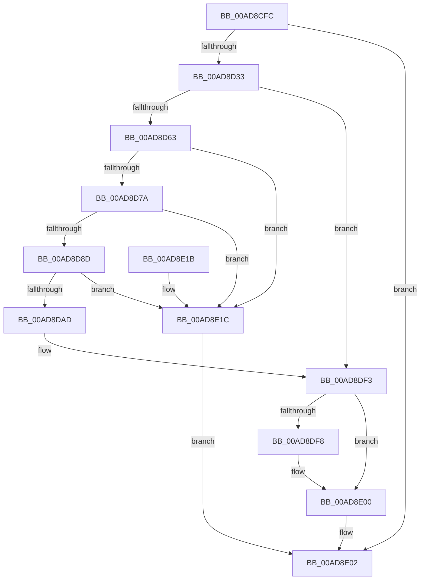

# MiGenerateSystemImageNames

- RVA: `0x00AD8CFC`–`0x00AD8E23` (길이 `295` bytes)
- VA: `0x0000000140AD8CFC`
- 실행 섹션: `PAGE`
- PDB 이름 있음: `예`; PDB Function 태그: `아니요`
- unwind 정보 RVA: `0x00075210`
- 디코드: `82`개 명령, `295/295` bytes 표시
- 미해석 바이트: `0` (있으면 어셈블리에 `.byte`로 보존)

> 이 문서는 커널 이미지의 기계어와 PDB 기호를 분석해 생성했습니다. 4번과 5번은 함수 원형과 자료형을 바이너리 사용 방식에서 추정한 C 해석이며 원본 소스 복구 결과는 아닙니다.

## 1. Dependencies

- 직접 호출 지점: **5**; 고유 호출 대상: **3**
- 직접 호출자로 확인된 함수: **2**
- RIP 상대 이미지 참조: **0**

### Outgoing calls
- `0x00AD8D23` → [MiGetBaseNameFromImageFileName](../../text/4D/MiGetBaseNameFromImageFileName_function_004D75E8.md) (function, `0x004D75E8`)
- `0x00AD8D9F` → [MiAllocatePool](../../text/35/MiAllocatePool_function_0035B540.md) (function, `0x0035B540`)
- `0x00AD8DB7` → [RtlAppendUnicodeStringToString](../../text/40/RtlAppendUnicodeStringToString_function_0040FA50.md) (function, `0x0040FA50`)
- `0x00AD8DC2` → [RtlAppendUnicodeStringToString](../../text/40/RtlAppendUnicodeStringToString_function_0040FA50.md) (function, `0x0040FA50`)
- `0x00AD8DCD` → [RtlAppendUnicodeStringToString](../../text/40/RtlAppendUnicodeStringToString_function_0040FA50.md) (function, `0x0040FA50`)

### Direct callers
- [MiApplyHotPatchToLoadedDriver](../80/MiApplyHotPatchToLoadedDriver_function_00802078.md) at `0x00802178`
- [MmLoadSystemImageEx](../99/MmLoadSystemImageEx_function_00999B8C.md) at `0x00999C5A`

### Static image references
- 디코드된 RIP-relative 메모리 참조가 없습니다.

## 2. Other-region calls and transfers

- 다른 실행 섹션으로 향하는 call: **5**
  - `0x00AD8D23` → [MiGetBaseNameFromImageFileName](../../text/4D/MiGetBaseNameFromImageFileName_function_004D75E8.md) (`PAGE` → `.text`)
  - `0x00AD8D9F` → [MiAllocatePool](../../text/35/MiAllocatePool_function_0035B540.md) (`PAGE` → `.text`)
  - `0x00AD8DB7` → [RtlAppendUnicodeStringToString](../../text/40/RtlAppendUnicodeStringToString_function_0040FA50.md) (`PAGE` → `.text`)
  - `0x00AD8DC2` → [RtlAppendUnicodeStringToString](../../text/40/RtlAppendUnicodeStringToString_function_0040FA50.md) (`PAGE` → `.text`)
  - `0x00AD8DCD` → [RtlAppendUnicodeStringToString](../../text/40/RtlAppendUnicodeStringToString_function_0040FA50.md) (`PAGE` → `.text`)
- 별도 외부 분기/꼬리 이동을 확인하지 못했습니다.

## 3. Assembly (complete function range)

```asm
00AD8CFC  48 89 5C 24 08                  mov qword ptr [rsp + 8], rbx
00AD8D01  48 89 6C 24 10                  mov qword ptr [rsp + 0x10], rbp
00AD8D06  48 89 74 24 18                  mov qword ptr [rsp + 0x18], rsi
00AD8D0B  57                              push rdi
00AD8D0C  41 56                           push r14
00AD8D0E  41 57                           push r15
00AD8D10  48 83 EC 20                     sub rsp, 0x20
00AD8D14  4C 8B F2                        mov r14, rdx
00AD8D17  49 8B F9                        mov rdi, r9
00AD8D1A  49 8B D1                        mov rdx, r9
00AD8D1D  49 8B E8                        mov rbp, r8
00AD8D20  4C 8B D1                        mov r10, rcx
00AD8D23  E8 C0 E8 9F FF                  call 0x1404d75e8
00AD8D28  45 33 FF                        xor r15d, r15d
00AD8D2B  85 C0                           test eax, eax
00AD8D2D  0F 88 CF 00 00 00               js 0x140ad8e02
00AD8D33  41 0F 10 02                     movups xmm0, xmmword ptr [r10]
00AD8D37  48 8B 5C 24 60                  mov rbx, qword ptr [rsp + 0x60]
00AD8D3C  48 8B 74 24 68                  mov rsi, qword ptr [rsp + 0x68]
00AD8D41  F3 0F 7F 03                     movdqu xmmword ptr [rbx], xmm0
00AD8D45  0F B7 02                        movzx eax, word ptr [rdx]
00AD8D48  66 29 03                        sub word ptr [rbx], ax
00AD8D4B  0F B7 03                        movzx eax, word ptr [rbx]
00AD8D4E  66 89 43 02                     mov word ptr [rbx + 2], ax
00AD8D52  41 0F 10 02                     movups xmm0, xmmword ptr [r10]
00AD8D56  F3 0F 7F 06                     movdqu xmmword ptr [rsi], xmm0
00AD8D5A  4D 85 F6                        test r14, r14
00AD8D5D  0F 84 90 00 00 00               je 0x140ad8df3
00AD8D63  0F B7 03                        movzx eax, word ptr [rbx]
00AD8D66  0F B7 C8                        movzx ecx, ax
00AD8D69  66 89 46 02                     mov word ptr [rsi + 2], ax
00AD8D6D  66 41 03 0E                     add cx, word ptr [r14]
00AD8D71  66 3B C8                        cmp cx, ax
00AD8D74  0F 82 A2 00 00 00               jb 0x140ad8e1c
00AD8D7A  0F B7 C1                        movzx eax, cx
00AD8D7D  66 89 4E 02                     mov word ptr [rsi + 2], cx
00AD8D81  66 03 0A                        add cx, word ptr [rdx]
00AD8D84  66 3B C8                        cmp cx, ax
00AD8D87  0F 82 8F 00 00 00               jb 0x140ad8e1c
00AD8D8D  0F B7 D1                        movzx edx, cx
00AD8D90  41 B8 4D 6D 4C 64               mov r8d, 0x644c6d4d
00AD8D96  B9 00 01 00 00                  mov ecx, 0x100
00AD8D9B  66 89 56 02                     mov word ptr [rsi + 2], dx
00AD8D9F  E8 9C 27 88 FF                  call 0x14035b540
00AD8DA4  48 89 46 08                     mov qword ptr [rsi + 8], rax
00AD8DA8  48 85 C0                        test rax, rax
00AD8DAB  74 6F                           je 0x140ad8e1c
00AD8DAD  48 8B D3                        mov rdx, rbx
00AD8DB0  66 44 89 3E                     mov word ptr [rsi], r15w
00AD8DB4  48 8B CE                        mov rcx, rsi
00AD8DB7  E8 94 6C 93 FF                  call 0x14040fa50
00AD8DBC  49 8B D6                        mov rdx, r14
00AD8DBF  48 8B CE                        mov rcx, rsi
00AD8DC2  E8 89 6C 93 FF                  call 0x14040fa50
00AD8DC7  48 8B D7                        mov rdx, rdi
00AD8DCA  48 8B CE                        mov rcx, rsi
00AD8DCD  E8 7E 6C 93 FF                  call 0x14040fa50
00AD8DD2  48 8B 46 08                     mov rax, qword ptr [rsi + 8]
00AD8DD6  0F B7 0B                        movzx ecx, word ptr [rbx]
00AD8DD9  48 D1 E9                        shr rcx, 1
00AD8DDC  48 8D 0C 48                     lea rcx, [rax + rcx*2]
00AD8DE0  48 89 4F 08                     mov qword ptr [rdi + 8], rcx
00AD8DE4  41 0F B7 06                     movzx eax, word ptr [r14]
00AD8DE8  66 01 07                        add word ptr [rdi], ax
00AD8DEB  41 0F B7 06                     movzx eax, word ptr [r14]
00AD8DEF  66 01 47 02                     add word ptr [rdi + 2], ax
00AD8DF3  48 85 ED                        test rbp, rbp
00AD8DF6  74 08                           je 0x140ad8e00
00AD8DF8  0F 10 45 00                     movups xmm0, xmmword ptr [rbp]
00AD8DFC  F3 0F 7F 07                     movdqu xmmword ptr [rdi], xmm0
00AD8E00  33 C0                           xor eax, eax
00AD8E02  48 8B 5C 24 40                  mov rbx, qword ptr [rsp + 0x40]
00AD8E07  48 8B 6C 24 48                  mov rbp, qword ptr [rsp + 0x48]
00AD8E0C  48 8B 74 24 50                  mov rsi, qword ptr [rsp + 0x50]
00AD8E11  48 83 C4 20                     add rsp, 0x20
00AD8E15  41 5F                           pop r15
00AD8E17  41 5E                           pop r14
00AD8E19  5F                              pop rdi
00AD8E1A  C3                              ret
00AD8E1B  CC                              int3
00AD8E1C  B8 9A 00 00 C0                  mov eax, 0xc000009a
00AD8E21  EB DF                           jmp 0x140ad8e02
```

## 4. C-style interpretation (structured pseudocode)

```c
__int64 __fastcall MiGenerateSystemImageNames(__int64 a1, __int64 a2, __int64 a3, __int64 a4, __int64 a5, __int64 a6)
{
    __int64 result;
    __int64 v_r15;
    __int64 v_rsp;
    unsigned __int64 v_stack_p10;
    unsigned __int64 v_stack_p18;
    unsigned __int64 v_stack_p8;

    v_stack_p8 = v_rbx;
    v_stack_p10 = v_rbp;
    v_stack_p18 = v_rsi;
    v_rsp = (v_rsp) - (32);
    result = MiGetBaseNameFromImageFileName(a1, a4, a3, a4);
    v_r15 = 0;
    if (sign_flag) goto loc_00AD8E02;
    *(unsigned __int64 *)(a5) = v_xmm0;
    *(unsigned __int16 *)(a5 + 2) = (unsigned __int16)(*(unsigned __int16 *)(a5));
    *(unsigned __int64 *)(a6) = v_xmm0;
    if (a2 == 0) goto loc_00AD8DF3;
    *(unsigned __int16 *)(a6 + 2) = (unsigned __int16)(*(unsigned __int16 *)(a5));
    a1 = (unsigned __int16)(((unsigned __int16)(*(unsigned __int16 *)(a5))) + (*(unsigned __int16 *)(a2)));
    if (((unsigned __int16)(a1)) < ((unsigned __int16)(*(unsigned __int16 *)(a5)))) goto loc_00AD8E1C;
    *(unsigned __int16 *)(a6 + 2) = (unsigned __int16)(a1);
    a1 = (unsigned __int16)((a1) + (*(unsigned __int16 *)(a4)));
    if (((unsigned __int16)(a1)) < ((unsigned __int16)((unsigned __int16)(a1)))) goto loc_00AD8E1C;
    *(unsigned __int16 *)(a6 + 2) = (unsigned __int16)((unsigned __int16)(a1));
    result = MiAllocatePool(256, (unsigned __int16)(a1), (unsigned int)(0x644C6D4DULL), a4);
    *(unsigned __int64 *)(a6 + 8) = result;
    if (result == 0) goto loc_00AD8E1C;
    *(unsigned __int16 *)(a6) = 0;
    result = RtlAppendUnicodeStringToString(a6, a5, (unsigned int)(0x644C6D4DULL), a4);
    result = RtlAppendUnicodeStringToString(a6, a2, (unsigned int)(0x644C6D4DULL), a4);
    result = RtlAppendUnicodeStringToString(a6, a4, (unsigned int)(0x644C6D4DULL), a4);
    a1 = (*(unsigned __int16 *)(a5)) >> (1);
    *(unsigned __int64 *)(a4 + 8) = *(unsigned __int64 *)(a6 + 8) + a1 * 2;
loc_00AD8DF3:
    if (a3 != 0) {
        *(unsigned __int64 *)(a4) = v_xmm0;
    }
    result = 0;
loc_00AD8E02:
    v_rsp = (v_rsp) + (32);
    return result;
loc_00AD8E1C:
    goto loc_00AD8E02;
}
```

## 5. (Beta) C Style

```c
int64_t MiGenerateSystemImageNames(int64_t Arg1, int64_t Arg2, int64_t Arg3, void *Arg4, void *Arg5, void *Arg6)
{
    uint8_t *arg4 = (uint8_t *)Arg4;
    uint8_t *arg5 = (uint8_t *)Arg5;
    uint8_t *arg6 = (uint8_t *)Arg6;

    int64_t result;
    int64_t local_r15;
    int64_t local_rsp;
    uint64_t v_stack_p10;
    uint64_t v_stack_p18;
    uint64_t v_stack_p8;

    v_stack_p8 = local_rbx;
    v_stack_p10 = local_rbp;
    v_stack_p18 = local_rsi;
    local_rsp = (local_rsp) - (32);
    result = MiGetBaseNameFromImageFileName(Arg1, Arg4, Arg3, Arg4);
    local_r15 = 0;
    if (sign_flag) goto loc_00AD8E02;
    *(uint64_t *)(arg5) = v_xmm0;
    *(uint16_t *)(arg5 + 0x2) = (uint16_t)(*(uint16_t *)(arg5));
    *(uint64_t *)(arg6) = v_xmm0;
    if (Arg2 == 0) goto loc_00AD8DF3;
    *(uint16_t *)(arg6 + 0x2) = (uint16_t)(*(uint16_t *)(arg5));
    Arg1 = (uint16_t)(((uint16_t)(*(uint16_t *)(arg5))) + (*(uint16_t *)(Arg2)));
    if (((uint16_t)(Arg1)) < ((uint16_t)(*(uint16_t *)(arg5)))) goto loc_00AD8E1C;
    *(uint16_t *)(arg6 + 0x2) = (uint16_t)(Arg1);
    Arg1 = (uint16_t)((Arg1) + (*(uint16_t *)(arg4)));
    if (((uint16_t)(Arg1)) < ((uint16_t)((uint16_t)(Arg1)))) goto loc_00AD8E1C;
    *(uint16_t *)(arg6 + 0x2) = (uint16_t)((uint16_t)(Arg1));
    result = MiAllocatePool(256, (uint16_t)(Arg1), (uint32_t)(0x644C6D4DULL), Arg4);
    *(uint64_t *)(arg6 + 0x8) = result;
    if (result == 0) goto loc_00AD8E1C;
    *(uint16_t *)(arg6) = 0;
    result = RtlAppendUnicodeStringToString(Arg6, Arg5, (uint32_t)(0x644C6D4DULL), Arg4);
    result = RtlAppendUnicodeStringToString(Arg6, Arg2, (uint32_t)(0x644C6D4DULL), Arg4);
    result = RtlAppendUnicodeStringToString(Arg6, Arg4, (uint32_t)(0x644C6D4DULL), Arg4);
    Arg1 = (*(uint16_t *)(arg5)) >> (1);
    *(uint64_t *)(arg4 + 0x8) = *(uint64_t *)(arg6 + 0x8) + Arg1 * 2;
loc_00AD8DF3:
    if (Arg3 != 0) {
        *(uint64_t *)(arg4) = v_xmm0;
    }
    result = 0;
loc_00AD8E02:
    local_rsp = (local_rsp) + (32);
    return result;
loc_00AD8E1C:
    goto loc_00AD8E02;
}
```

### 관측된 메모리 오프셋

구조체 형식이 확인되지 않은 접근은 인자 기준의 오프셋으로만 기록했습니다.

| 기준 인자 | 오프셋 표현 | 폭 (bit) | 접근 |
|---|---:|---:|---|
| `Arg4` | `+ 0x0` | `16` | `R/W` |
| `Arg4` | `+ 0x0` | `128` | `W` |
| `Arg4` | `+ 0x2` | `16` | `R/W` |
| `Arg4` | `+ 0x8` | `64` | `W` |
| `Arg5` | `+ 0x0` | `16` | `R` |
| `Arg5` | `+ 0x0` | `16` | `R/W` |
| `Arg5` | `+ 0x0` | `128` | `W` |
| `Arg5` | `+ 0x2` | `16` | `W` |
| `Arg6` | `+ 0x0` | `16` | `W` |
| `Arg6` | `+ 0x0` | `128` | `W` |
| `Arg6` | `+ 0x2` | `16` | `W` |
| `Arg6` | `+ 0x8` | `64` | `R` |
| `Arg6` | `+ 0x8` | `64` | `W` |

## 6. Execution-region graph

[열기: 2D/3D 그래프와 함수 탐색 컨트롤 패널](../../../control-panel.html?section=page&rva=0x00AD8CFC&view=graph)

- 2D 그래프는 위에서 아래로 흐르고, 3D 그래프는 빈 공간을 드래그해 회전합니다. Shift+드래그는 이동, 휠은 확대·축소, 함수 노드 선택은 대상 보고서 이동입니다.

### Static fallback


