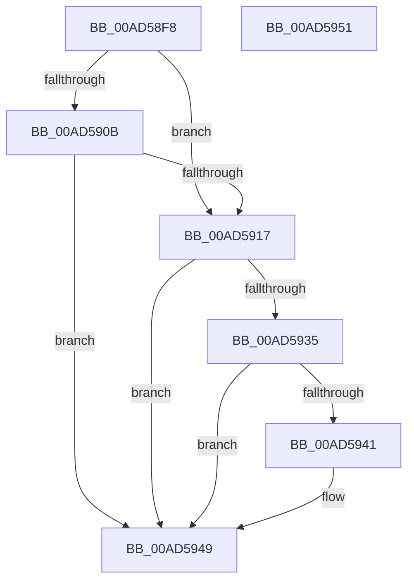

# MiGetAweVadPageSize

- RVA: `0x00AD58F8`–`0x00AD5952` (길이 `90` bytes)
- VA: `0x0000000140AD58F8`
- 실행 섹션: `PAGE`
- PDB 이름 있음: `예`; PDB Function 태그: `아니요`
- unwind 정보 RVA: `0x0005C788`
- 디코드: `26`개 명령, `90/90` bytes 표시
- 미해석 바이트: `0` (있으면 어셈블리에 `.byte`로 보존)

> 이 문서는 커널 이미지의 기계어와 PDB 기호를 분석해 생성했습니다. 4번과 5번은 함수 원형과 자료형을 바이너리 사용 방식에서 추정한 C 해석이며 원본 소스 복구 결과는 아닙니다.

## 1. Dependencies

- 직접 호출 지점: **3**; 고유 호출 대상: **3**
- 직접 호출자로 확인된 함수: **3**
- RIP 상대 이미지 참조: **0**

### Outgoing calls
- `0x00AD591C` → [MiLocateLockedVadEvent](../../text/2A/MiLocateLockedVadEvent_function_002A7A0C.md) (function, `0x002A7A0C`)
- `0x00AD5928` → [MiGetAweViewPageSize](../../text/4C/MiGetAweViewPageSize_function_004C51AC.md) (function, `0x004C51AC`)
- `0x00AD5941` → [MiGetAwePageSize](../../text/46/MiGetAwePageSize_function_0046CFA8.md) (function, `0x0046CFA8`)

### Direct callers
- [MiGetWorkingSetInfoList](../../text/2A/MiGetWorkingSetInfoList_function_002AF770.md) at `0x002B0AD6`
- [MiVadPageTableChargeLevel](../../text/41/MiVadPageTableChargeLevel_function_0041F500.md) at `0x0041F561`
- [MmQueryVirtualMemory](../9D/MmQueryVirtualMemory_function_009D9280.md) at `0x009D9FB7`

### Static image references
- 디코드된 RIP-relative 메모리 참조가 없습니다.

## 2. Other-region calls and transfers

- 다른 실행 섹션으로 향하는 call: **3**
  - `0x00AD591C` → [MiLocateLockedVadEvent](../../text/2A/MiLocateLockedVadEvent_function_002A7A0C.md) (`PAGE` → `.text`)
  - `0x00AD5928` → [MiGetAweViewPageSize](../../text/4C/MiGetAweViewPageSize_function_004C51AC.md) (`PAGE` → `.text`)
  - `0x00AD5941` → [MiGetAwePageSize](../../text/46/MiGetAwePageSize_function_0046CFA8.md) (`PAGE` → `.text`)
- 별도 외부 분기/꼬리 이동을 확인하지 못했습니다.

## 3. Assembly (complete function range)

```asm
00AD58F8  48 83 EC 28                     sub rsp, 0x28
00AD58FC  8B 41 30                        mov eax, dword ptr [rcx + 0x30]
00AD58FF  41 B8 01 00 00 00               mov r8d, 1
00AD5905  0F BA E0 15                     bt eax, 0x15
00AD5909  73 0C                           jae 0x140ad5917
00AD590B  25 00 00 00 0C                  and eax, 0xc000000
00AD5910  3D 00 00 00 08                  cmp eax, 0x8000000
00AD5915  74 32                           je 0x140ad5949
00AD5917  BA 00 01 00 00                  mov edx, 0x100
00AD591C  E8 EB 20 7D FF                  call 0x1402a7a0c
00AD5921  4C 8B C8                        mov r9, rax
00AD5924  48 8D 48 08                     lea rcx, [rax + 8]
00AD5928  E8 7F F8 9E FF                  call 0x1404c51ac
00AD592D  4C 8B C0                        mov r8, rax
00AD5930  48 85 C0                        test rax, rax
00AD5933  75 14                           jne 0x140ad5949
00AD5935  49 8B 49 28                     mov rcx, qword ptr [r9 + 0x28]
00AD5939  8B 51 08                        mov edx, dword ptr [rcx + 8]
00AD593C  F6 C2 01                        test dl, 1
00AD593F  75 08                           jne 0x140ad5949
00AD5941  E8 62 76 99 FF                  call 0x14046cfa8
00AD5946  4C 8B C0                        mov r8, rax
00AD5949  49 8B C0                        mov rax, r8
00AD594C  48 83 C4 28                     add rsp, 0x28
00AD5950  C3                              ret
00AD5951  CC                              int3
```

## 4. C-style interpretation (structured pseudocode)

```c
__int64 __fastcall MiGetAweVadPageSize(__int64 a1)
{
    __int64 result;
    __int64 v_rsp;

    v_rsp = (v_rsp) - (40);
    if (condition_is_above_or_equal) goto loc_00AD5917;
    result = (unsigned int)(((unsigned int)(*(unsigned int *)(a1 + 48))) & (0xC000000ULL));
    if (((unsigned int)(result)) == 0x8000000ULL) goto loc_00AD5949;
loc_00AD5917:
    result = MiLocateLockedVadEvent(a1, 256, 1, a4);
    result = MiGetAweViewPageSize(result + 8, 256, 1, result);
    if (result != 0) goto loc_00AD5949;
    if ((((unsigned __int8)((unsigned int)(*(unsigned int *)(*(unsigned __int64 *)(result + 40) + 8)))) & (1)) == 0) {
        result = MiGetAwePageSize(*(unsigned __int64 *)(result + 40), (unsigned int)(*(unsigned int *)(*(unsigned __int64 *)(result + 40) + 8)), result, result);
        a3 = result;
    }
    v_rsp = (v_rsp) + (40);
    return a3;
}
```

## 5. (Beta) C Style

```c
int64_t MiGetAweVadPageSize(void *Arg1)
{
    uint8_t *arg1 = (uint8_t *)Arg1;

    int64_t result;
    int64_t local_rsp;

    local_rsp = (local_rsp) - (40);
    if (condition_is_above_or_equal) goto loc_00AD5917;
    result = (uint32_t)(((uint32_t)(*(uint32_t *)(arg1 + 0x30))) & (0xC000000ULL));
    if (((uint32_t)(result)) == 0x8000000ULL) goto loc_00AD5949;
loc_00AD5917:
    result = MiLocateLockedVadEvent(Arg1, 256, 1, a4);
    result = MiGetAweViewPageSize(result + 8, 256, 1, result);
    if (result != 0) goto loc_00AD5949;
    if ((((uint8_t)((uint32_t)(*(uint32_t *)(*(uint64_t *)(result + 0x28) + 0x8)))) & (1)) == 0) {
        result = MiGetAwePageSize(*(uint64_t *)(result + 0x28), (uint32_t)(*(uint32_t *)(*(uint64_t *)(result + 0x28) + 0x8)), result, result);
        a3 = result;
    }
    local_rsp = (local_rsp) + (40);
    return a3;
}
```

### 관측된 메모리 오프셋

구조체 형식이 확인되지 않은 접근은 인자 기준의 오프셋으로만 기록했습니다.

| 기준 인자 | 오프셋 표현 | 폭 (bit) | 접근 |
|---|---:|---:|---|
| `Arg1` | `+ 0x30` | `32` | `R` |

## 6. Execution-region graph

[열기: 2D/3D 그래프와 함수 탐색 컨트롤 패널](../../../control-panel.html?section=page&rva=0x00AD58F8&view=graph)

- 2D 그래프는 위에서 아래로 흐르고, 3D 그래프는 빈 공간을 드래그해 회전합니다. Shift+드래그는 이동, 휠은 확대·축소, 함수 노드 선택은 대상 보고서 이동입니다.

### Static fallback


