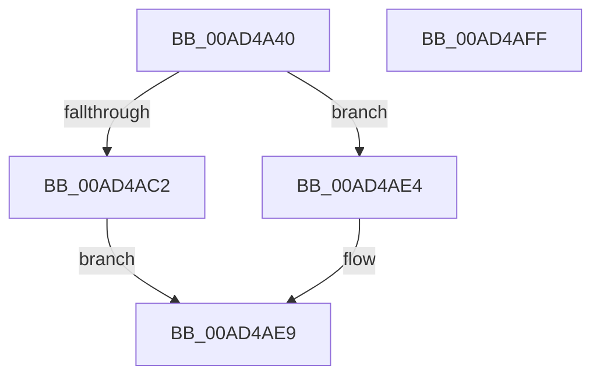

# MiInitializeForkMaps

- RVA: `0x00AD4A40`–`0x00AD4B00` (길이 `192` bytes)
- VA: `0x0000000140AD4A40`
- 실행 섹션: `PAGE`
- PDB 이름 있음: `예`; PDB Function 태그: `아니요`
- unwind 정보 RVA: `0x0009B270`
- 디코드: `50`개 명령, `192/192` bytes 표시
- 미해석 바이트: `0` (있으면 어셈블리에 `.byte`로 보존)

> 이 문서는 커널 이미지의 기계어와 PDB 기호를 분석해 생성했습니다. 4번과 5번은 함수 원형과 자료형을 바이너리 사용 방식에서 추정한 C 해석이며 원본 소스 복구 결과는 아닙니다.

## 1. Dependencies

- 직접 호출 지점: **4**; 고유 호출 대상: **4**
- 직접 호출자로 확인된 함수: **1**
- RIP 상대 이미지 참조: **1**

### Outgoing calls
- `0x00AD4A72` → [memset](../../text/6C/memset_function_006C6C40.md) (function, `0x006C6C40`)
- `0x00AD4A9F` → [MiInitializePageColorBase](../../text/32/MiInitializePageColorBase_function_00320410.md) (function, `0x00320410`)
- `0x00AD4AB4` → [MiCreateUltraThreadContext](../../text/28/MiCreateUltraThreadContext_function_00288200.md) (function, `0x00288200`)
- `0x00AD4AD0` → [MiMapSinglePage](../../text/22/MiMapSinglePage_function_00229D00.md) (function, `0x00229D00`)

### Direct callers
- [MiCloneVads](../../text/22/MiCloneVads_function_0022DC1C.md) at `0x0022DDAC`

### Static image references
- `0x00AD4A77` → RVA `0x00010850` (`.rdata`; read)

## 2. Other-region calls and transfers

- 다른 실행 섹션으로 향하는 call: **4**
  - `0x00AD4A72` → [memset](../../text/6C/memset_function_006C6C40.md) (`PAGE` → `.text`)
  - `0x00AD4A9F` → [MiInitializePageColorBase](../../text/32/MiInitializePageColorBase_function_00320410.md) (`PAGE` → `.text`)
  - `0x00AD4AB4` → [MiCreateUltraThreadContext](../../text/28/MiCreateUltraThreadContext_function_00288200.md) (`PAGE` → `.text`)
  - `0x00AD4AD0` → [MiMapSinglePage](../../text/22/MiMapSinglePage_function_00229D00.md) (`PAGE` → `.text`)
- 별도 외부 분기/꼬리 이동을 확인하지 못했습니다.

## 3. Assembly (complete function range)

```asm
00AD4A40  48 8B C4                        mov rax, rsp
00AD4A43  48 89 58 08                     mov qword ptr [rax + 8], rbx
00AD4A47  48 89 70 10                     mov qword ptr [rax + 0x10], rsi
00AD4A4B  48 89 78 18                     mov qword ptr [rax + 0x18], rdi
00AD4A4F  41 56                           push r14
00AD4A51  48 83 EC 30                     sub rsp, 0x30
00AD4A55  4D 8B F0                        mov r14, r8
00AD4A58  48 8B DA                        mov rbx, rdx
00AD4A5B  48 8B F9                        mov rdi, rcx
00AD4A5E  0F 57 C0                        xorps xmm0, xmm0
00AD4A61  49 8B CE                        mov rcx, r14
00AD4A64  33 D2                           xor edx, edx
00AD4A66  41 B8 C8 00 00 00               mov r8d, 0xc8
00AD4A6C  33 F6                           xor esi, esi
00AD4A6E  0F 11 40 E8                     movups xmmword ptr [rax - 0x18], xmm0
00AD4A72  E8 C9 21 BF FF                  call 0x1406c6c40
00AD4A77  66 0F 6F 05 D1 BD 53 FF         movdqa xmm0, xmmword ptr [rip - 0xac422f]
00AD4A7F  48 8D 8F 00 04 00 00            lea rcx, [rdi + 0x400]
00AD4A86  41 0F 11 46 08                  movups xmmword ptr [r14 + 8], xmm0
00AD4A8B  4C 8D 4C 24 20                  lea r9, [rsp + 0x20]
00AD4A90  44 8B C6                        mov r8d, esi
00AD4A93  66 49 0F D6 46 18               movq qword ptr [r14 + 0x18], xmm0
00AD4A99  8D 56 03                        lea edx, [rsi + 3]
00AD4A9C  49 89 1E                        mov qword ptr [r14], rbx
00AD4A9F  E8 6C B9 84 FF                  call 0x140320410
00AD4AA4  49 8D 4E 48                     lea rcx, [r14 + 0x48]
00AD4AA8  45 33 C9                        xor r9d, r9d
00AD4AAB  44 8D 46 08                     lea r8d, [rsi + 8]
00AD4AAF  48 8D 54 24 20                  lea rdx, [rsp + 0x20]
00AD4AB4  E8 47 37 7B FF                  call 0x140288200
00AD4AB9  41 38 B6 C0 00 00 00            cmp byte ptr [r14 + 0xc0], sil
00AD4AC0  75 22                           jne 0x140ad4ae4
00AD4AC2  33 D2                           xor edx, edx
00AD4AC4  44 8D 4E 02                     lea r9d, [rsi + 2]
00AD4AC8  33 C9                           xor ecx, ecx
00AD4ACA  41 B8 20 00 00 40               mov r8d, 0x40000020
00AD4AD0  E8 2B 52 75 FF                  call 0x140229d00
00AD4AD5  48 85 C0                        test rax, rax
00AD4AD8  49 89 46 38                     mov qword ptr [r14 + 0x38], rax
00AD4ADC  40 0F 95 C6                     setne sil
00AD4AE0  8B C6                           mov eax, esi
00AD4AE2  EB 05                           jmp 0x140ad4ae9
00AD4AE4  B8 01 00 00 00                  mov eax, 1
00AD4AE9  48 8B 5C 24 40                  mov rbx, qword ptr [rsp + 0x40]
00AD4AEE  48 8B 74 24 48                  mov rsi, qword ptr [rsp + 0x48]
00AD4AF3  48 8B 7C 24 50                  mov rdi, qword ptr [rsp + 0x50]
00AD4AF8  48 83 C4 30                     add rsp, 0x30
00AD4AFC  41 5E                           pop r14
00AD4AFE  C3                              ret
00AD4AFF  CC                              int3
```

## 4. C-style interpretation (structured pseudocode)

```c
__int64 __fastcall MiInitializeForkMaps(__int64 a1, __int64 a2, __int64 a3)
{
    __int64 result;
    __int64 v_rsi;
    __int64 v_rsp;
    unsigned __int64 v_stack_m18;
    unsigned __int64 v_stack_p10;
    unsigned __int64 v_stack_p18;
    unsigned __int64 v_stack_p8;

    *(unsigned __int64 *)(v_rsp + 8) = v_rbx;
    *(unsigned __int64 *)(v_rsp + 16) = v_rsi;
    *(unsigned __int64 *)(v_rsp + 24) = v_rdi;
    v_rsp = (v_rsp) - (48);
    a2 = 0;
    v_rsi = 0;
    *(unsigned __int64 *)(v_rsp - 24) = v_xmm0;
    result = memset(a3, a2, 200, a4);
    *(unsigned __int64 *)(a3 + 8) = v_xmm0;
    *(unsigned __int64 *)(a3 + 24) = v_xmm0;
    *(unsigned __int64 *)(a3) = 0;
    result = MiInitializePageColorBase(a1 + 1024, v_rsi + 3, 0, v_stack_m18);
    a4 = 0;
    result = MiCreateUltraThreadContext(a3 + 72, v_stack_m18, v_rsi + 8, a4);
    if ((*(unsigned __int8 *)(a3 + 192)) != 0) goto loc_00AD4AE4;
    a2 = 0;
    a1 = 0;
    result = MiMapSinglePage(a1, a2, (unsigned int)(0x40000020ULL), v_rsi + 2);
    *(unsigned __int64 *)(a3 + 56) = result;
    v_rsi = (result != 0) ? 1 : 0;
    goto loc_00AD4AE9;
loc_00AD4AE4:
loc_00AD4AE9:
    v_rsp = (v_rsp) + (48);
    return 1;
}
```

## 5. (Beta) C Style

```c
int64_t MiInitializeForkMaps(void *Arg1, int64_t Arg2, void *Arg3)
{
    uint8_t *arg1 = (uint8_t *)Arg1;
    uint8_t *arg3 = (uint8_t *)Arg3;

    int64_t result;
    int64_t local_rsi;
    int64_t local_rsp;
    uint64_t v_stack_m18;
    uint64_t v_stack_p10;
    uint64_t v_stack_p18;
    uint64_t v_stack_p8;

    *(uint64_t *)(local_rsp + 0x8) = local_rbx;
    *(uint64_t *)(local_rsp + 0x10) = local_rsi;
    *(uint64_t *)(local_rsp + 0x18) = local_rdi;
    local_rsp = (local_rsp) - (48);
    Arg2 = 0;
    local_rsi = 0;
    *(uint64_t *)(local_rsp - 0x18) = v_xmm0;
    result = memset(Arg3, Arg2, 200, a4);
    *(uint64_t *)(arg3 + 0x8) = v_xmm0;
    *(uint64_t *)(arg3 + 0x18) = v_xmm0;
    *(uint64_t *)(arg3) = 0;
    result = MiInitializePageColorBase(Arg1 + 1024, local_rsi + 3, 0, v_stack_m18);
    a4 = 0;
    result = MiCreateUltraThreadContext(Arg3 + 72, v_stack_m18, local_rsi + 8, a4);
    if ((*(uint8_t *)(arg3 + 0xC0)) != 0) goto loc_00AD4AE4;
    Arg2 = 0;
    Arg1 = 0;
    result = MiMapSinglePage(Arg1, Arg2, (uint32_t)(0x40000020ULL), local_rsi + 2);
    *(uint64_t *)(arg3 + 0x38) = result;
    local_rsi = (result != 0) ? 1 : 0;
    goto loc_00AD4AE9;
loc_00AD4AE4:
loc_00AD4AE9:
    local_rsp = (local_rsp) + (48);
    return 1;
}
```

### 관측된 메모리 오프셋

구조체 형식이 확인되지 않은 접근은 인자 기준의 오프셋으로만 기록했습니다.

| 기준 인자 | 오프셋 표현 | 폭 (bit) | 접근 |
|---|---:|---:|---|
| `Arg1` | `+ 0x400` | `64` | `R` |
| `Arg3` | `+ 0x0` | `64` | `W` |
| `Arg3` | `+ 0x8` | `128` | `R` |
| `Arg3` | `+ 0x18` | `64` | `R` |
| `Arg3` | `+ 0x38` | `64` | `W` |
| `Arg3` | `+ 0x48` | `64` | `R` |
| `Arg3` | `+ 0xC0` | `8` | `R` |

## 6. Execution-region graph

[열기: 2D/3D 그래프와 함수 탐색 컨트롤 패널](../../../control-panel.html?section=page&rva=0x00AD4A40&view=graph)

- 2D 그래프는 위에서 아래로 흐르고, 3D 그래프는 빈 공간을 드래그해 회전합니다. Shift+드래그는 이동, 휠은 확대·축소, 함수 노드 선택은 대상 보고서 이동입니다.

### Static fallback


