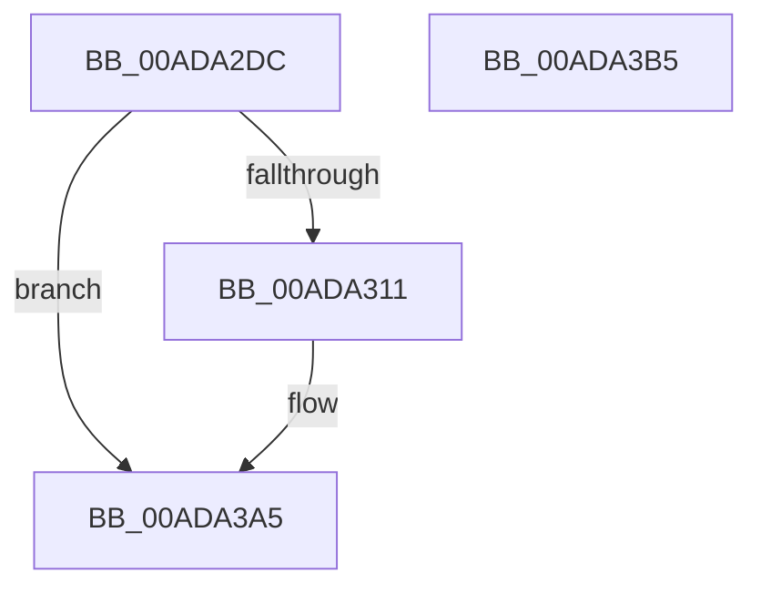

# MiInitializeImageHotPatchContext

- RVA: `0x00ADA2DC`–`0x00ADA3B6` (길이 `218` bytes)
- VA: `0x0000000140ADA2DC`
- 실행 섹션: `PAGE`
- PDB 이름 있음: `예`; PDB Function 태그: `아니요`
- unwind 정보 RVA: `0x00060BC4`
- 디코드: `59`개 명령, `218/218` bytes 표시
- 미해석 바이트: `0` (있으면 어셈블리에 `.byte`로 보존)

> 이 문서는 커널 이미지의 기계어와 PDB 기호를 분석해 생성했습니다. 4번과 5번은 함수 원형과 자료형을 바이너리 사용 방식에서 추정한 C 해석이며 원본 소스 복구 결과는 아닙니다.

## 1. Dependencies

- 직접 호출 지점: **1**; 고유 호출 대상: **1**
- 직접 호출자로 확인된 함수: **3**
- RIP 상대 이미지 참조: **1**

### Outgoing calls
- `0x00ADA2FC` → [memset](../../text/6C/memset_function_006C6C40.md) (function, `0x006C6C40`)

### Direct callers
- [MiApplyImageHotPatchRequest](../80/MiApplyImageHotPatchRequest_function_008025AC.md) at `0x0080264A`
- [MiApplyImageHotPatchRequest](../80/MiApplyImageHotPatchRequest_function_008025AC.md) at `0x00802658`
- [MiPrepareToHotPatchVad](../80/MiPrepareToHotPatchVad_function_00806E70.md) at `0x00806EBC`
- [MmPrepareImagePagesForHotPatch](../80/MmPrepareImagePagesForHotPatch_function_008074E8.md) at `0x0080752D`
- [MmPrepareImagePagesForHotPatch](../80/MmPrepareImagePagesForHotPatch_function_008074E8.md) at `0x008075A3`

### Static image references
- `0x00ADA372` → RVA `0x00E2D8A8` (`.data`; read)

## 2. Other-region calls and transfers

- 다른 실행 섹션으로 향하는 call: **1**
  - `0x00ADA2FC` → [memset](../../text/6C/memset_function_006C6C40.md) (`PAGE` → `.text`)
- 별도 외부 분기/꼬리 이동을 확인하지 못했습니다.

## 3. Assembly (complete function range)

```asm
00ADA2DC  48 89 5C 24 08                  mov qword ptr [rsp + 8], rbx
00ADA2E1  48 89 74 24 10                  mov qword ptr [rsp + 0x10], rsi
00ADA2E6  57                              push rdi
00ADA2E7  48 83 EC 20                     sub rsp, 0x20
00ADA2EB  49 8B F0                        mov rsi, r8
00ADA2EE  0F B7 DA                        movzx ebx, dx
00ADA2F1  33 D2                           xor edx, edx
00ADA2F3  41 B8 A0 00 00 00               mov r8d, 0xa0
00ADA2F9  48 8B F9                        mov rdi, rcx
00ADA2FC  E8 3F C9 BE FF                  call 0x1406c6c40
00ADA301  66 89 9F 88 00 00 00            mov word ptr [rdi + 0x88], bx
00ADA308  48 85 F6                        test rsi, rsi
00ADA30B  0F 84 94 00 00 00               je 0x140ada3a5
00ADA311  48 89 37                        mov qword ptr [rdi], rsi
00ADA314  8B 46 18                        mov eax, dword ptr [rsi + 0x18]
00ADA317  44 0F B6 4E 20                  movzx r9d, byte ptr [rsi + 0x20]
00ADA31C  49 C1 E1 20                     shl r9, 0x20
00ADA320  4C 0B C8                        or r9, rax
00ADA323  49 C1 E1 0C                     shl r9, 0xc
00ADA327  4C 89 4F 08                     mov qword ptr [rdi + 8], r9
00ADA32B  8B 46 1C                        mov eax, dword ptr [rsi + 0x1c]
00ADA32E  44 0F B6 46 21                  movzx r8d, byte ptr [rsi + 0x21]
00ADA333  49 C1 E0 20                     shl r8, 0x20
00ADA337  4C 0B C0                        or r8, rax
00ADA33A  49 C1 E0 0C                     shl r8, 0xc
00ADA33E  49 81 C8 FF 0F 00 00            or r8, 0xfff
00ADA345  49 8D 40 01                     lea rax, [r8 + 1]
00ADA349  48 89 47 10                     mov qword ptr [rdi + 0x10], rax
00ADA34D  8B 46 18                        mov eax, dword ptr [rsi + 0x18]
00ADA350  0F B6 56 20                     movzx edx, byte ptr [rsi + 0x20]
00ADA354  48 C1 E2 20                     shl rdx, 0x20
00ADA358  48 0B D0                        or rdx, rax
00ADA35B  48 8B 46 48                     mov rax, qword ptr [rsi + 0x48]
00ADA35F  48 C1 E2 0C                     shl rdx, 0xc
00ADA363  48 8B 08                        mov rcx, qword ptr [rax]
00ADA366  48 8B 01                        mov rax, qword ptr [rcx]
00ADA369  8B 40 08                        mov eax, dword ptr [rax + 8]
00ADA36C  C1 E0 0C                        shl eax, 0xc
00ADA36F  48 03 D0                        add rdx, rax
00ADA372  8B 05 30 35 35 00               mov eax, dword ptr [rip + 0x353530]
00ADA378  48 03 D0                        add rdx, rax
00ADA37B  48 89 57 18                     mov qword ptr [rdi + 0x18], rdx
00ADA37F  48 8B 46 48                     mov rax, qword ptr [rsi + 0x48]
00ADA383  48 8B 08                        mov rcx, qword ptr [rax]
00ADA386  48 8B 01                        mov rax, qword ptr [rcx]
00ADA389  8B 48 08                        mov ecx, dword ptr [rax + 8]
00ADA38C  48 8D 47 78                     lea rax, [rdi + 0x78]
00ADA390  4C 89 4F 68                     mov qword ptr [rdi + 0x68], r9
00ADA394  4C 89 47 70                     mov qword ptr [rdi + 0x70], r8
00ADA398  C1 E1 0C                        shl ecx, 0xc
00ADA39B  89 4F 20                        mov dword ptr [rdi + 0x20], ecx
00ADA39E  48 89 40 08                     mov qword ptr [rax + 8], rax
00ADA3A2  48 89 00                        mov qword ptr [rax], rax
00ADA3A5  48 8B 5C 24 30                  mov rbx, qword ptr [rsp + 0x30]
00ADA3AA  48 8B 74 24 38                  mov rsi, qword ptr [rsp + 0x38]
00ADA3AF  48 83 C4 20                     add rsp, 0x20
00ADA3B3  5F                              pop rdi
00ADA3B4  C3                              ret
00ADA3B5  CC                              int3
```

## 4. C-style interpretation (structured pseudocode)

```c
__int64 __fastcall MiInitializeImageHotPatchContext(__int64 a1, int a2, __int64 a3)
{
    __int64 result;
    __int64 v_rsp;
    unsigned __int64 v_stack_p10;
    unsigned __int64 v_stack_p8;

    v_stack_p8 = v_rbx;
    v_stack_p10 = v_rsi;
    v_rsp = (v_rsp) - (32);
    a2 = 0;
    result = memset(a1, a2, 160, a4);
    *(unsigned __int16 *)(a1 + 136) = (unsigned __int16)((unsigned __int16)(a2));
    if (a3 != 0) {
        *(unsigned __int64 *)(a1) = a3;
        result = *(unsigned int *)(a3 + 24);
        a4 = *(unsigned __int8 *)(a3 + 32);
        a4 = (a4) << (32);
        a4 = (a4) | (result);
        a4 = (a4) << (12);
        *(unsigned __int64 *)(a1 + 8) = a4;
        result = *(unsigned int *)(a3 + 28);
        a3 = *(unsigned __int8 *)(a3 + 33);
        a3 = (a3) << (32);
        a3 = (a3) | (result);
        a3 = (a3) << (12);
        a3 = (a3) | (0xFFFULL);
        result = a3 + 1;
        *(unsigned __int64 *)(a1 + 16) = result;
        result = *(unsigned int *)(a3 + 24);
        a2 = *(unsigned __int8 *)(a3 + 32);
        a2 = (a2) << (32);
        a2 = (a2) | (result);
        result = *(unsigned __int64 *)(a3 + 72);
        a2 = (a2) << (12);
        a1 = *(unsigned __int64 *)(result);
        result = *(unsigned __int64 *)(a1);
        result = *(unsigned int *)(result + 8);
        result = (unsigned int)((result) << (12));
        a2 = (a2) + (result);
        result = *(unsigned int *)(v_rip + 3487024);
        a2 = (a2) + (result);
        *(unsigned __int64 *)(a1 + 24) = a2;
        result = *(unsigned __int64 *)(a3 + 72);
        a1 = *(unsigned __int64 *)(result);
        result = *(unsigned __int64 *)(a1);
        a1 = *(unsigned int *)(result + 8);
        result = a1 + 120;
        *(unsigned __int64 *)(a1 + 104) = a4;
        *(unsigned __int64 *)(a1 + 112) = a3;
        a1 = (unsigned int)((a1) << (12));
        *(unsigned int *)(a1 + 32) = (unsigned int)(a1);
        *(unsigned __int64 *)(result + 8) = result;
        *(unsigned __int64 *)(result) = result;
    }
    v_rsp = (v_rsp) + (32);
    return result;
}
```

## 5. (Beta) C Style

```c
int64_t MiInitializeImageHotPatchContext(void *Arg1, int32_t Arg2, int64_t Arg3)
{
    uint8_t *arg1 = (uint8_t *)Arg1;

    int64_t result;
    int64_t local_rsp;
    uint64_t v_stack_p10;
    uint64_t v_stack_p8;

    v_stack_p8 = local_rbx;
    v_stack_p10 = local_rsi;
    local_rsp = (local_rsp) - (32);
    Arg2 = 0;
    result = memset(Arg1, Arg2, 160, a4);
    *(uint16_t *)(arg1 + 0x88) = (uint16_t)((uint16_t)(Arg2));
    if (Arg3 != 0) {
        *(uint64_t *)(arg1) = Arg3;
        result = *(uint32_t *)(Arg3 + 0x18);
        a4 = *(uint8_t *)(Arg3 + 0x20);
        a4 = (a4) << (32);
        a4 = (a4) | (result);
        a4 = (a4) << (12);
        *(uint64_t *)(arg1 + 0x8) = a4;
        result = *(uint32_t *)(Arg3 + 0x1C);
        Arg3 = *(uint8_t *)(Arg3 + 0x21);
        Arg3 = (Arg3) << (32);
        Arg3 = (Arg3) | (result);
        Arg3 = (Arg3) << (12);
        Arg3 = (Arg3) | (0xFFFULL);
        result = Arg3 + 1;
        *(uint64_t *)(arg1 + 0x10) = result;
        result = *(uint32_t *)(Arg3 + 0x18);
        Arg2 = *(uint8_t *)(Arg3 + 0x20);
        Arg2 = (Arg2) << (32);
        Arg2 = (Arg2) | (result);
        result = *(uint64_t *)(Arg3 + 0x48);
        Arg2 = (Arg2) << (12);
        Arg1 = *(uint64_t *)(result);
        result = *(uint64_t *)(arg1);
        result = *(uint32_t *)(result + 0x8);
        result = (uint32_t)((result) << (12));
        Arg2 = (Arg2) + (result);
        result = *(uint32_t *)(v_rip + 0x353530);
        Arg2 = (Arg2) + (result);
        *(uint64_t *)(arg1 + 0x18) = Arg2;
        result = *(uint64_t *)(Arg3 + 0x48);
        Arg1 = *(uint64_t *)(result);
        result = *(uint64_t *)(arg1);
        Arg1 = *(uint32_t *)(result + 0x8);
        result = Arg1 + 120;
        *(uint64_t *)(arg1 + 0x68) = a4;
        *(uint64_t *)(arg1 + 0x70) = Arg3;
        Arg1 = (uint32_t)((Arg1) << (12));
        *(uint32_t *)(arg1 + 0x20) = (uint32_t)(Arg1);
        *(uint64_t *)(result + 0x8) = result;
        *(uint64_t *)(result) = result;
    }
    local_rsp = (local_rsp) + (32);
    return result;
}
```

### 관측된 메모리 오프셋

구조체 형식이 확인되지 않은 접근은 인자 기준의 오프셋으로만 기록했습니다.

| 기준 인자 | 오프셋 표현 | 폭 (bit) | 접근 |
|---|---:|---:|---|
| `Arg1` | `+ 0x0` | `64` | `W` |
| `Arg1` | `+ 0x8` | `64` | `W` |
| `Arg1` | `+ 0x10` | `64` | `W` |
| `Arg1` | `+ 0x18` | `64` | `W` |
| `Arg1` | `+ 0x20` | `32` | `W` |
| `Arg1` | `+ 0x68` | `64` | `W` |
| `Arg1` | `+ 0x70` | `64` | `W` |
| `Arg1` | `+ 0x78` | `64` | `R` |
| `Arg1` | `+ 0x88` | `16` | `W` |

## 6. Execution-region graph

[열기: 2D/3D 그래프와 함수 탐색 컨트롤 패널](../../../control-panel.html?section=page&rva=0x00ADA2DC&view=graph)

- 2D 그래프는 위에서 아래로 흐르고, 3D 그래프는 빈 공간을 드래그해 회전합니다. Shift+드래그는 이동, 휠은 확대·축소, 함수 노드 선택은 대상 보고서 이동입니다.

### Static fallback


