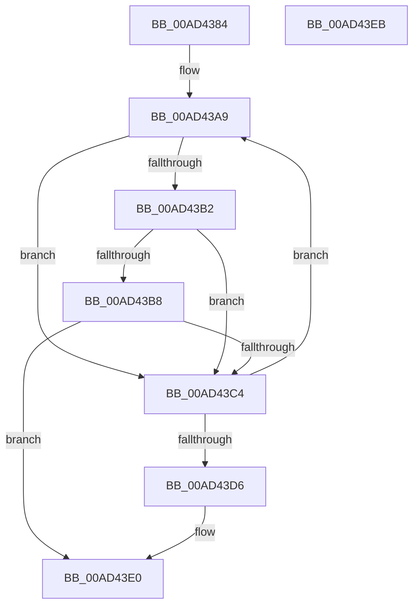

# MiProcessKernelCfgAddressTakenImports

- RVA: `0x00AD4384`–`0x00AD43EC` (길이 `104` bytes)
- VA: `0x0000000140AD4384`
- 실행 섹션: `PAGE`
- PDB 이름 있음: `예`; PDB Function 태그: `아니요`
- unwind 정보 RVA: `0x0005CAAC`
- 디코드: `31`개 명령, `104/104` bytes 표시
- 미해석 바이트: `0` (있으면 어셈블리에 `.byte`로 보존)

> 이 문서는 커널 이미지의 기계어와 PDB 기호를 분석해 생성했습니다. 4번과 5번은 함수 원형과 자료형을 바이너리 사용 방식에서 추정한 C 해석이며 원본 소스 복구 결과는 아닙니다.

## 1. Dependencies

- 직접 호출 지점: **3**; 고유 호출 대상: **3**
- 직접 호출자로 확인된 함수: **2**
- RIP 상대 이미지 참조: **1**

### Outgoing calls
- `0x00AD4396` → [MiAcquireLoadLock](../../text/2A/MiAcquireLoadLock_function_002A3950.md) (function, `0x002A3950`)
- `0x00AD43BB` → [MiMarkKernelCfgAddressTakenImports](../AA/MiMarkKernelCfgAddressTakenImports_function_00AA262C.md) (function, `0x00AA262C`)
- `0x00AD43D9` → [MmReleaseLoadLock](../../text/4D/MmReleaseLoadLock_function_004D36D0.md) (function, `0x004D36D0`)

### Direct callers
- [MiProcessKernelCfgImage](../../text/4D/MiProcessKernelCfgImage_function_004D0744.md) at `0x004D07B5`
- [MiInitializeKernelCfg](../../init/C6/MiInitializeKernelCfg_function_00C6A2FC.md) at `0x00C6A3F3`

### Static image references
- `0x00AD43A1` → RVA `0x00EF54C0` (`.data`; read)

## 2. Other-region calls and transfers

- 다른 실행 섹션으로 향하는 call: **2**
  - `0x00AD4396` → [MiAcquireLoadLock](../../text/2A/MiAcquireLoadLock_function_002A3950.md) (`PAGE` → `.text`)
  - `0x00AD43D9` → [MmReleaseLoadLock](../../text/4D/MmReleaseLoadLock_function_004D36D0.md) (`PAGE` → `.text`)
- 별도 외부 분기/꼬리 이동을 확인하지 못했습니다.

## 3. Assembly (complete function range)

```asm
00AD4384  48 89 5C 24 08                  mov qword ptr [rsp + 8], rbx
00AD4389  57                              push rdi
00AD438A  48 83 EC 20                     sub rsp, 0x20
00AD438E  48 8B D9                        mov rbx, rcx
00AD4391  B9 01 00 00 00                  mov ecx, 1
00AD4396  E8 B5 F5 7C FF                  call 0x1402a3950
00AD439B  48 85 DB                        test rbx, rbx
00AD439E  48 8B F8                        mov rdi, rax
00AD43A1  48 0F 44 1D 17 11 42 00         cmove rbx, qword ptr [rip + 0x421117]
00AD43A9  8B 4B 68                        mov ecx, dword ptr [rbx + 0x68]
00AD43AC  0F BA E1 0D                     bt ecx, 0xd
00AD43B0  73 12                           jae 0x140ad43c4
00AD43B2  0F BA E1 08                     bt ecx, 8
00AD43B6  72 0C                           jb 0x140ad43c4
00AD43B8  48 8B CB                        mov rcx, rbx
00AD43BB  E8 6C E2 FC FF                  call 0x140aa262c
00AD43C0  85 C0                           test eax, eax
00AD43C2  78 1C                           js 0x140ad43e0
00AD43C4  48 8B 03                        mov rax, qword ptr [rbx]
00AD43C7  48 8D 0D F2 10 42 00            lea rcx, [rip + 0x4210f2]
00AD43CE  48 8B D8                        mov rbx, rax
00AD43D1  48 3B C1                        cmp rax, rcx
00AD43D4  75 D3                           jne 0x140ad43a9
00AD43D6  48 8B CF                        mov rcx, rdi
00AD43D9  E8 F2 F2 9F FF                  call 0x1404d36d0
00AD43DE  33 C0                           xor eax, eax
00AD43E0  48 8B 5C 24 30                  mov rbx, qword ptr [rsp + 0x30]
00AD43E5  48 83 C4 20                     add rsp, 0x20
00AD43E9  5F                              pop rdi
00AD43EA  C3                              ret
00AD43EB  CC                              int3
```

## 4. C-style interpretation (structured pseudocode)

```c
__int64 __fastcall MiProcessKernelCfgAddressTakenImports(__int64 a1)
{
    __int64 result;
    __int64 v_rsp;
    unsigned __int64 v_stack_p8;

    v_stack_p8 = v_rbx;
    v_rsp = (v_rsp) - (32);
    result = MiAcquireLoadLock(1, a2, a3, a4);
    if (a1 == 0) { a1 = *(unsigned __int64 *)(v_rip + 4329751); }
loc_00AD43A9:
    if (condition_is_above_or_equal) goto loc_00AD43C4;
    if (condition_is_below) goto loc_00AD43C4;
    result = MiMarkKernelCfgAddressTakenImports(a1, a2, a3, a4);
    if (sign_flag) goto loc_00AD43E0;
loc_00AD43C4:
    if ((*(unsigned __int64 *)(a1)) != (v_rip + 4329714)) goto loc_00AD43A9;
    result = MmReleaseLoadLock(result, a2, a3, a4);
    result = 0;
loc_00AD43E0:
    v_rsp = (v_rsp) + (32);
    return result;
}
```

## 5. (Beta) C Style

```c
int64_t MiProcessKernelCfgAddressTakenImports(int64_t Arg1)
{
    int64_t result;
    int64_t local_rsp;
    uint64_t v_stack_p8;

    v_stack_p8 = local_rbx;
    local_rsp = (local_rsp) - (32);
    result = MiAcquireLoadLock(1, a2, a3, a4);
    if (Arg1 == 0) { Arg1 = *(uint64_t *)(v_rip + 0x421117); }
loc_00AD43A9:
    if (condition_is_above_or_equal) goto loc_00AD43C4;
    if (condition_is_below) goto loc_00AD43C4;
    result = MiMarkKernelCfgAddressTakenImports(Arg1, a2, a3, a4);
    if (sign_flag) goto loc_00AD43E0;
loc_00AD43C4:
    if ((*(uint64_t *)(Arg1)) != (v_rip + 4329714)) goto loc_00AD43A9;
    result = MmReleaseLoadLock(result, a2, a3, a4);
    result = 0;
loc_00AD43E0:
    local_rsp = (local_rsp) + (32);
    return result;
}
```

## 6. Execution-region graph

[열기: 2D/3D 그래프와 함수 탐색 컨트롤 패널](../../../control-panel.html?section=page&rva=0x00AD4384&view=graph)

- 2D 그래프는 위에서 아래로 흐르고, 3D 그래프는 빈 공간을 드래그해 회전합니다. Shift+드래그는 이동, 휠은 확대·축소, 함수 노드 선택은 대상 보고서 이동입니다.

### Static fallback


