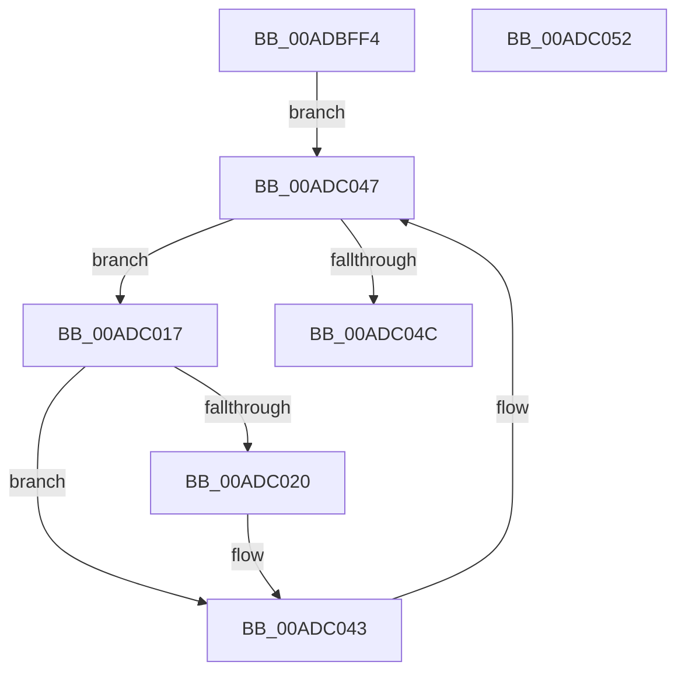

# MiPurgeImageSection

- RVA: `0x00ADBFF4`–`0x00ADC053` (길이 `95` bytes)
- VA: `0x0000000140ADBFF4`
- 실행 섹션: `PAGE`
- PDB 이름 있음: `예`; PDB Function 태그: `아니요`
- unwind 정보 RVA: `0x0006E5B4`
- 디코드: `27`개 명령, `95/95` bytes 표시
- 미해석 바이트: `0` (있으면 어셈블리에 `.byte`로 보존)

> 이 문서는 커널 이미지의 기계어와 PDB 기호를 분석해 생성했습니다. 4번과 5번은 함수 원형과 자료형을 바이너리 사용 방식에서 추정한 C 해석이며 원본 소스 복구 결과는 아닙니다.

## 1. Dependencies

- 직접 호출 지점: **1**; 고유 호출 대상: **1**
- 직접 호출자로 확인된 함수: **1**
- RIP 상대 이미지 참조: **0**

### Outgoing calls
- `0x00ADC03E` → [MiPurgeSubsection](../../text/37/MiPurgeSubsection_function_003712F0.md) (function, `0x003712F0`)

### Direct callers
- [MiCheckControlArea](../../text/28/MiCheckControlArea_function_002861B0.md) at `0x002865A2`

### Static image references
- 디코드된 RIP-relative 메모리 참조가 없습니다.

## 2. Other-region calls and transfers

- 다른 실행 섹션으로 향하는 call: **1**
  - `0x00ADC03E` → [MiPurgeSubsection](../../text/37/MiPurgeSubsection_function_003712F0.md) (`PAGE` → `.text`)
- 별도 외부 분기/꼬리 이동을 확인하지 못했습니다.

## 3. Assembly (complete function range)

```asm
00ADBFF4  40 53                           push rbx
00ADBFF6  48 83 EC 60                     sub rsp, 0x60
00ADBFFA  0F 57 C0                        xorps xmm0, xmm0
00ADBFFD  48 8D 99 80 00 00 00            lea rbx, [rcx + 0x80]
00ADC004  33 C0                           xor eax, eax
00ADC006  0F 11 44 24 30                  movups xmmword ptr [rsp + 0x30], xmm0
00ADC00B  48 89 44 24 50                  mov qword ptr [rsp + 0x50], rax
00ADC010  0F 11 44 24 40                  movups xmmword ptr [rsp + 0x40], xmm0
00ADC015  EB 30                           jmp 0x140adc047
00ADC017  8B 43 20                        mov eax, dword ptr [rbx + 0x20]
00ADC01A  0F BA E0 11                     bt eax, 0x11
00ADC01E  73 23                           jae 0x140adc043
00ADC020  8B 43 2C                        mov eax, dword ptr [rbx + 0x2c]
00ADC023  41 B9 05 00 00 00               mov r9d, 5
00ADC029  48 8B 53 08                     mov rdx, qword ptr [rbx + 8]
00ADC02D  48 8B CB                        mov rcx, rbx
00ADC030  4C 8D 04 C2                     lea r8, [rdx + rax*8]
00ADC034  48 8D 44 24 30                  lea rax, [rsp + 0x30]
00ADC039  48 89 44 24 20                  mov qword ptr [rsp + 0x20], rax
00ADC03E  E8 AD 52 89 FF                  call 0x1403712f0
00ADC043  48 8B 5B 10                     mov rbx, qword ptr [rbx + 0x10]
00ADC047  48 85 DB                        test rbx, rbx
00ADC04A  75 CB                           jne 0x140adc017
00ADC04C  48 83 C4 60                     add rsp, 0x60
00ADC050  5B                              pop rbx
00ADC051  C3                              ret
00ADC052  CC                              int3
```

## 4. C-style interpretation (structured pseudocode)

```c
__int64 __fastcall MiPurgeImageSection(__int64 a1)
{
    __int64 result;
    __int64 v_rsp;
    unsigned __int64 v_stack_m18;
    unsigned __int64 v_stack_m28;
    unsigned __int64 v_stack_m38;
    unsigned __int64 v_stack_m48;

    v_rsp = (v_rsp) - (96);
    result = 0;
    v_stack_m38 = v_xmm0;
    v_stack_m18 = 0;
    v_stack_m28 = v_xmm0;
    goto loc_00ADC047;
loc_00ADC017:
    result = (unsigned int)(*(unsigned int *)(a1 + 128 + 32));
    if (!(condition_is_above_or_equal)) {
        result = *(unsigned int *)(a1 + 128 + 44);
        a4 = 5;
        a2 = *(unsigned __int64 *)(a1 + 128 + 8);
        a1 = a1 + 128;
        a3 = a2 + result * 8;
        result = v_stack_m38;
        v_stack_m48 = result;
        result = MiPurgeSubsection(a1, a2, a3, a4);
    }
loc_00ADC047:
    if (*(unsigned __int64 *)(a1 + 128 + 16) != 0) goto loc_00ADC017;
    v_rsp = (v_rsp) + (96);
    return result;
}
```

## 5. (Beta) C Style

```c
int64_t MiPurgeImageSection(void *Arg1)
{
    uint8_t *arg1 = (uint8_t *)Arg1;

    int64_t result;
    int64_t local_rsp;
    uint64_t v_stack_m18;
    uint64_t v_stack_m28;
    uint64_t v_stack_m38;
    uint64_t v_stack_m48;

    local_rsp = (local_rsp) - (96);
    result = 0;
    v_stack_m38 = v_xmm0;
    v_stack_m18 = 0;
    v_stack_m28 = v_xmm0;
    goto loc_00ADC047;
loc_00ADC017:
    result = (uint32_t)(*(uint32_t *)(arg1 + 0x80 + 0x20));
    if (!(condition_is_above_or_equal)) {
        result = *(uint32_t *)(arg1 + 0x80 + 0x2C);
        a4 = 5;
        a2 = *(uint64_t *)(arg1 + 0x80 + 0x8);
        Arg1 = Arg1 + 128;
        a3 = a2 + result * 8;
        result = v_stack_m38;
        v_stack_m48 = result;
        result = MiPurgeSubsection(Arg1, a2, a3, a4);
    }
loc_00ADC047:
    if (*(uint64_t *)(arg1 + 0x80 + 0x10) != 0) goto loc_00ADC017;
    local_rsp = (local_rsp) + (96);
    return result;
}
```

### 관측된 메모리 오프셋

구조체 형식이 확인되지 않은 접근은 인자 기준의 오프셋으로만 기록했습니다.

| 기준 인자 | 오프셋 표현 | 폭 (bit) | 접근 |
|---|---:|---:|---|
| `Arg1` | `+ 0x80` | `64` | `R` |

## 6. Execution-region graph

[열기: 2D/3D 그래프와 함수 탐색 컨트롤 패널](../../../control-panel.html?section=page&rva=0x00ADBFF4&view=graph)

- 2D 그래프는 위에서 아래로 흐르고, 3D 그래프는 빈 공간을 드래그해 회전합니다. Shift+드래그는 이동, 휠은 확대·축소, 함수 노드 선택은 대상 보고서 이동입니다.

### Static fallback


