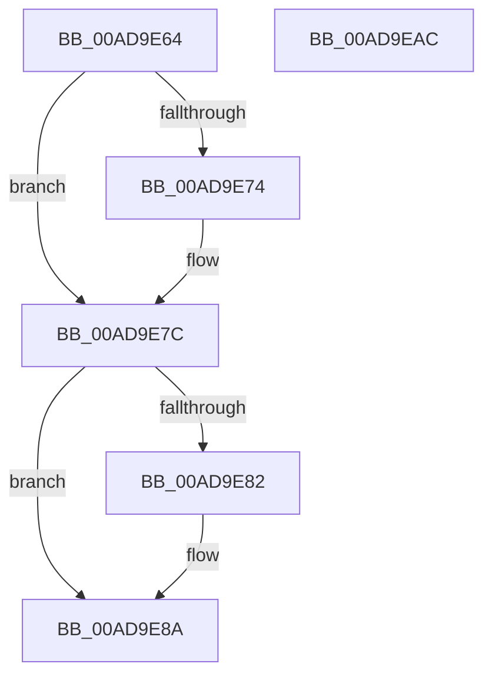

# MiStoreGraphicsProtectionInVad

- RVA: `0x00AD9E64`–`0x00AD9EAD` (길이 `73` bytes)
- VA: `0x0000000140AD9E64`
- 실행 섹션: `PAGE`
- PDB 이름 있음: `예`; PDB Function 태그: `아니요`
- unwind 정보 RVA: `0x0005CF00`
- 디코드: `24`개 명령, `73/73` bytes 표시
- 미해석 바이트: `0` (있으면 어셈블리에 `.byte`로 보존)

> 이 문서는 커널 이미지의 기계어와 PDB 기호를 분석해 생성했습니다. 4번과 5번은 함수 원형과 자료형을 바이너리 사용 방식에서 추정한 C 해석이며 원본 소스 복구 결과는 아닙니다.

## 1. Dependencies

- 직접 호출 지점: **1**; 고유 호출 대상: **1**
- 직접 호출자로 확인된 함수: **1**
- RIP 상대 이미지 참조: **0**

### Outgoing calls
- `0x00AD9E90` → [RtlFindMostSignificantBit](../../text/45/RtlFindMostSignificantBit_function_00450270.md) (function, `0x00450270`)

### Direct callers
- [MiReserveUserMemory](../88/MiReserveUserMemory_function_00884498.md) at `0x00884D7E`

### Static image references
- 디코드된 RIP-relative 메모리 참조가 없습니다.

## 2. Other-region calls and transfers

- 다른 실행 섹션으로 향하는 call: **1**
  - `0x00AD9E90` → [RtlFindMostSignificantBit](../../text/45/RtlFindMostSignificantBit_function_00450270.md) (`PAGE` → `.text`)
- 별도 외부 분기/꼬리 이동을 확인하지 못했습니다.

## 3. Assembly (complete function range)

```asm
00AD9E64  40 53                           push rbx
00AD9E66  48 83 EC 20                     sub rsp, 0x20
00AD9E6A  48 8D 59 30                     lea rbx, [rcx + 0x30]
00AD9E6E  0F BA E2 11                     bt edx, 0x11
00AD9E72  73 08                           jae 0x140ad9e7c
00AD9E74  0F BA 2B 1B                     bts dword ptr [rbx], 0x1b
00AD9E78  0F BA F2 11                     btr edx, 0x11
00AD9E7C  0F BA E2 12                     bt edx, 0x12
00AD9E80  73 08                           jae 0x140ad9e8a
00AD9E82  0F BA 2B 1C                     bts dword ptr [rbx], 0x1c
00AD9E86  0F BA F2 12                     btr edx, 0x12
00AD9E8A  8B CA                           mov ecx, edx
00AD9E8C  48 C1 E9 0B                     shr rcx, 0xb
00AD9E90  E8 DB 63 97 FF                  call 0x140450270
00AD9E95  0F BE C8                        movsx ecx, al
00AD9E98  8B 03                           mov eax, dword ptr [rbx]
00AD9E9A  25 FF FF FF 1F                  and eax, 0x1fffffff
00AD9E9F  C1 E1 1D                        shl ecx, 0x1d
00AD9EA2  0B C8                           or ecx, eax
00AD9EA4  89 0B                           mov dword ptr [rbx], ecx
00AD9EA6  48 83 C4 20                     add rsp, 0x20
00AD9EAA  5B                              pop rbx
00AD9EAB  C3                              ret
00AD9EAC  CC                              int3
```

## 4. C-style interpretation (structured pseudocode)

```c
__int64 __fastcall MiStoreGraphicsProtectionInVad(__int64 a1, int a2)
{
    __int64 result;
    __int64 v_rsp;

    v_rsp = (v_rsp) - (32);
    if (!(condition_is_above_or_equal)) {
    }
    if (!(condition_is_above_or_equal)) {
    }
    a1 = ((unsigned int)(a2)) >> (11);
    result = RtlFindMostSignificantBit(a1, a2, a3, a4);
    result = (unsigned int)(((unsigned int)(*(unsigned int *)(a1 + 48))) & (0x1FFFFFFFULL));
    a1 = (unsigned int)(((__int8)((unsigned __int8)(result))) << (29));
    a1 = (unsigned int)((a1) | ((unsigned int)(result)));
    *(unsigned int *)(a1 + 48) = (unsigned int)(a1);
    v_rsp = (v_rsp) + (32);
    return result;
}
```

## 5. (Beta) C Style

```c
int64_t MiStoreGraphicsProtectionInVad(void *Arg1, int32_t Arg2)
{
    uint8_t *arg1 = (uint8_t *)Arg1;

    int64_t result;
    int64_t local_rsp;

    local_rsp = (local_rsp) - (32);
    if (!(condition_is_above_or_equal)) {
    }
    if (!(condition_is_above_or_equal)) {
    }
    Arg1 = ((uint32_t)(Arg2)) >> (11);
    result = RtlFindMostSignificantBit(Arg1, Arg2, a3, a4);
    result = (uint32_t)(((uint32_t)(*(uint32_t *)(arg1 + 0x30))) & (0x1FFFFFFFULL));
    Arg1 = (uint32_t)(((int8_t)((uint8_t)(result))) << (29));
    Arg1 = (uint32_t)((Arg1) | ((uint32_t)(result)));
    *(uint32_t *)(arg1 + 0x30) = (uint32_t)(Arg1);
    local_rsp = (local_rsp) + (32);
    return result;
}
```

### 관측된 메모리 오프셋

구조체 형식이 확인되지 않은 접근은 인자 기준의 오프셋으로만 기록했습니다.

| 기준 인자 | 오프셋 표현 | 폭 (bit) | 접근 |
|---|---:|---:|---|
| `Arg1` | `+ 0x0` | `32` | `R` |
| `Arg1` | `+ 0x0` | `32` | `R/W` |
| `Arg1` | `+ 0x0` | `32` | `W` |
| `Arg1` | `+ 0x30` | `64` | `R` |

## 6. Execution-region graph

[열기: 2D/3D 그래프와 함수 탐색 컨트롤 패널](../../../control-panel.html?section=page&rva=0x00AD9E64&view=graph)

- 2D 그래프는 위에서 아래로 흐르고, 3D 그래프는 빈 공간을 드래그해 회전합니다. Shift+드래그는 이동, 휠은 확대·축소, 함수 노드 선택은 대상 보고서 이동입니다.

### Static fallback


