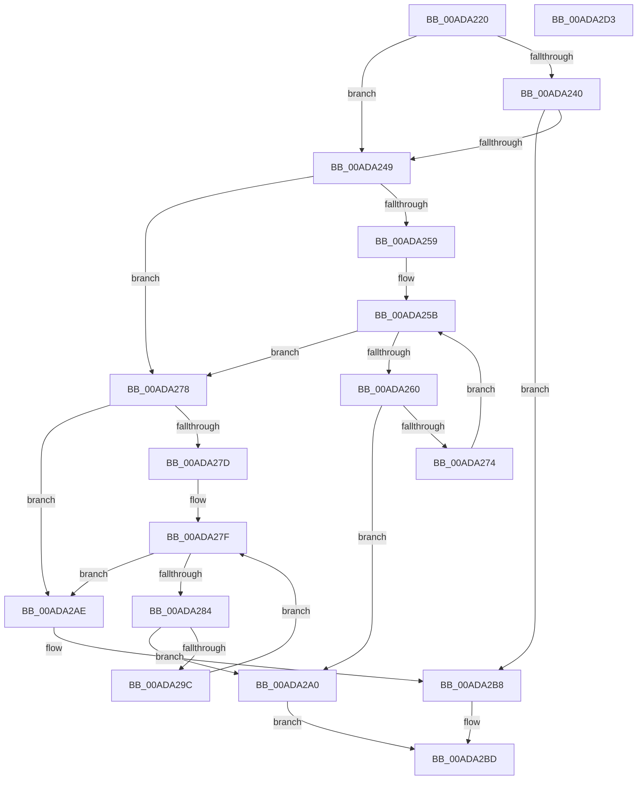

# MiUpdateMirrorBitmaps

- RVA: `0x00ADA220`–`0x00ADA2D4` (길이 `180` bytes)
- VA: `0x0000000140ADA220`
- 실행 섹션: `PAGE`
- PDB 이름 있음: `예`; PDB Function 태그: `아니요`
- unwind 정보 RVA: `0x000BF3BC`
- 디코드: `53`개 명령, `180/180` bytes 표시
- 미해석 바이트: `0` (있으면 어셈블리에 `.byte`로 보존)

> 이 문서는 커널 이미지의 기계어와 PDB 기호를 분석해 생성했습니다. 4번과 5번은 함수 원형과 자료형을 바이너리 사용 방식에서 추정한 C 해석이며 원본 소스 복구 결과는 아닙니다.

## 1. Dependencies

- 직접 호출 지점: **2**; 고유 호출 대상: **2**
- 직접 호출자로 확인된 함수: **3**
- RIP 상대 이미지 참조: **3**

### Outgoing calls
- `0x00ADA26B` → [MiActOnMirrorBitmap](../AC/MiActOnMirrorBitmap_function_00AC21D0.md) (function, `0x00AC21D0`)
- `0x00ADA293` → [MiSplitMirrorBitMap](../7F/MiSplitMirrorBitMap_function_007FCAE8.md) (function, `0x007FCAE8`)

### Direct callers
- [MiAcquireAddMemoryResources](../7F/MiAcquireAddMemoryResources_function_007F9538.md) at `0x007F95D3`
- [MmDuplicateMemory](../../pagelk/B7/MmDuplicateMemory_function_00B74158.md) at `0x00B742DA`
- [MiInitializeMirroring](../../init/C6/MiInitializeMirroring_function_00C64730.md) at `0x00C64854`

### Static image references
- `0x00ADA240` → RVA `0x00E301B0` (`.data`; read)
- `0x00ADA250` → RVA `0x00E30190` (`.data`; read)
- `0x00ADA2A0` → RVA `0x00E301B0` (`.data`; write)

## 2. Other-region calls and transfers

- 다른 실행 섹션으로 향하는 call: **0**
- 별도 외부 분기/꼬리 이동을 확인하지 못했습니다.

## 3. Assembly (complete function range)

```asm
00ADA220  48 89 6C 24 08                  mov qword ptr [rsp + 8], rbp
00ADA225  48 89 74 24 10                  mov qword ptr [rsp + 0x10], rsi
00ADA22A  48 89 7C 24 18                  mov qword ptr [rsp + 0x18], rdi
00ADA22F  41 57                           push r15
00ADA231  48 83 EC 20                     sub rsp, 0x20
00ADA235  48 8B F2                        mov rsi, rdx
00ADA238  48 8B E9                        mov rbp, rcx
00ADA23B  48 85 D2                        test rdx, rdx
00ADA23E  74 09                           je 0x140ada249
00ADA240  83 3D 69 5F 35 00 00            cmp dword ptr [rip + 0x355f69], 0
00ADA247  74 6F                           je 0x140ada2b8
00ADA249  83 3D 60 5F 35 00 02            cmp dword ptr [rip + 0x355f60], 2
00ADA250  4C 8D 3D 39 5F 35 00            lea r15, [rip + 0x355f39]
00ADA257  74 1F                           je 0x140ada278
00ADA259  33 FF                           xor edi, edi
00ADA25B  83 FF 02                        cmp edi, 2
00ADA25E  73 18                           jae 0x140ada278
00ADA260  8B CF                           mov ecx, edi
00ADA262  33 D2                           xor edx, edx
00ADA264  48 C1 E1 04                     shl rcx, 4
00ADA268  49 03 CF                        add rcx, r15
00ADA26B  E8 60 7F FE FF                  call 0x140ac21d0
00ADA270  85 C0                           test eax, eax
00ADA272  74 2C                           je 0x140ada2a0
00ADA274  FF C7                           inc edi
00ADA276  EB E3                           jmp 0x140ada25b
00ADA278  48 85 F6                        test rsi, rsi
00ADA27B  74 31                           je 0x140ada2ae
00ADA27D  33 FF                           xor edi, edi
00ADA27F  83 FF 02                        cmp edi, 2
00ADA282  73 2A                           jae 0x140ada2ae
00ADA284  8B CF                           mov ecx, edi
00ADA286  4C 8B C6                        mov r8, rsi
00ADA289  48 C1 E1 04                     shl rcx, 4
00ADA28D  48 8B D5                        mov rdx, rbp
00ADA290  49 03 CF                        add rcx, r15
00ADA293  E8 50 28 D2 FF                  call 0x1407fcae8
00ADA298  85 C0                           test eax, eax
00ADA29A  74 04                           je 0x140ada2a0
00ADA29C  FF C7                           inc edi
00ADA29E  EB DF                           jmp 0x140ada27f
00ADA2A0  C7 05 06 5F 35 00 01 00 00 00   mov dword ptr [rip + 0x355f06], 1
00ADA2AA  33 C0                           xor eax, eax
00ADA2AC  EB 0F                           jmp 0x140ada2bd
00ADA2AE  C7 05 F8 5E 35 00 02 00 00 00   mov dword ptr [rip + 0x355ef8], 2
00ADA2B8  B8 01 00 00 00                  mov eax, 1
00ADA2BD  48 8B 6C 24 30                  mov rbp, qword ptr [rsp + 0x30]
00ADA2C2  48 8B 74 24 38                  mov rsi, qword ptr [rsp + 0x38]
00ADA2C7  48 8B 7C 24 40                  mov rdi, qword ptr [rsp + 0x40]
00ADA2CC  48 83 C4 20                     add rsp, 0x20
00ADA2D0  41 5F                           pop r15
00ADA2D2  C3                              ret
00ADA2D3  CC                              int3
```

## 4. C-style interpretation (structured pseudocode)

```c
__int64 __fastcall MiUpdateMirrorBitmaps(__int64 a1, __int64 a2)
{
    __int64 result;
    __int64 v_rdi;
    __int64 v_rsp;
    unsigned __int64 v_stack_p10;
    unsigned __int64 v_stack_p18;
    unsigned __int64 v_stack_p8;

    v_stack_p8 = v_rbp;
    v_stack_p10 = v_rsi;
    v_stack_p18 = v_rdi;
    v_rsp = (v_rsp) - (32);
    if (a2 == 0) goto loc_00ADA249;
    if ((*(unsigned int *)(v_rip + 3497833)) == 0) goto loc_00ADA2B8;
loc_00ADA249:
    if ((*(unsigned int *)(v_rip + 3497824)) == 2) goto loc_00ADA278;
    v_rdi = 0;
loc_00ADA25B:
    if (0 >= 2) goto loc_00ADA278;
    a2 = 0;
    a1 = (0) << (4);
    a1 = (a1) + (v_rip + 3497785);
    result = MiActOnMirrorBitmap(a1, a2, a3, a4);
    if ((unsigned int)(result) == 0) goto loc_00ADA2A0;
    v_rdi = (unsigned int)((v_rdi) + 1);
    goto loc_00ADA25B;
loc_00ADA278:
    if (0 == 0) goto loc_00ADA2AE;
    v_rdi = 0;
loc_00ADA27F:
    if (0 >= 2) goto loc_00ADA2AE;
    a1 = (0) << (4);
    a1 = (a1) + (v_rip + 3497785);
    result = MiSplitMirrorBitMap(a1, a1, 0, a4);
    if ((unsigned int)(result) == 0) goto loc_00ADA2A0;
    v_rdi = (unsigned int)((v_rdi) + 1);
    goto loc_00ADA27F;
loc_00ADA2A0:
    *(unsigned int *)(v_rip + 3497734) = 1;
    result = 0;
    goto loc_00ADA2BD;
loc_00ADA2AE:
    *(unsigned int *)(v_rip + 3497720) = 2;
loc_00ADA2B8:
loc_00ADA2BD:
    v_rsp = (v_rsp) + (32);
    return 1;
}
```

## 5. (Beta) C Style

```c
int64_t MiUpdateMirrorBitmaps(int64_t Arg1, int64_t Arg2)
{
    int64_t result;
    int64_t local_rdi;
    int64_t local_rsp;
    uint64_t v_stack_p10;
    uint64_t v_stack_p18;
    uint64_t v_stack_p8;

    v_stack_p8 = local_rbp;
    v_stack_p10 = local_rsi;
    v_stack_p18 = local_rdi;
    local_rsp = (local_rsp) - (32);
    if (Arg2 == 0) goto loc_00ADA249;
    if ((*(uint32_t *)(v_rip + 0x355F69)) == 0) goto loc_00ADA2B8;
loc_00ADA249:
    if ((*(uint32_t *)(v_rip + 0x355F60)) == 2) goto loc_00ADA278;
    local_rdi = 0;
loc_00ADA25B:
    if (0 >= 2) goto loc_00ADA278;
    Arg2 = 0;
    Arg1 = (0) << (4);
    Arg1 = (Arg1) + (v_rip + 3497785);
    result = MiActOnMirrorBitmap(Arg1, Arg2, a3, a4);
    if ((uint32_t)(result) == 0) goto loc_00ADA2A0;
    local_rdi = (uint32_t)((local_rdi) + 1);
    goto loc_00ADA25B;
loc_00ADA278:
    if (0 == 0) goto loc_00ADA2AE;
    local_rdi = 0;
loc_00ADA27F:
    if (0 >= 2) goto loc_00ADA2AE;
    Arg1 = (0) << (4);
    Arg1 = (Arg1) + (v_rip + 3497785);
    result = MiSplitMirrorBitMap(Arg1, Arg1, 0, a4);
    if ((uint32_t)(result) == 0) goto loc_00ADA2A0;
    local_rdi = (uint32_t)((local_rdi) + 1);
    goto loc_00ADA27F;
loc_00ADA2A0:
    *(uint32_t *)(v_rip + 0x355F06) = 1;
    result = 0;
    goto loc_00ADA2BD;
loc_00ADA2AE:
    *(uint32_t *)(v_rip + 0x355EF8) = 2;
loc_00ADA2B8:
loc_00ADA2BD:
    local_rsp = (local_rsp) + (32);
    return 1;
}
```

## 6. Execution-region graph

[열기: 2D/3D 그래프와 함수 탐색 컨트롤 패널](../../../control-panel.html?section=page&rva=0x00ADA220&view=graph)

- 2D 그래프는 위에서 아래로 흐르고, 3D 그래프는 빈 공간을 드래그해 회전합니다. Shift+드래그는 이동, 휠은 확대·축소, 함수 노드 선택은 대상 보고서 이동입니다.

### Static fallback


