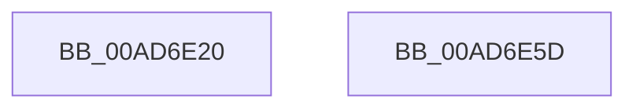

# MmLockPreChargedPagedPool

- RVA: `0x00AD6E20`–`0x00AD6E5E` (길이 `62` bytes)
- VA: `0x0000000140AD6E20`
- 실행 섹션: `PAGE`
- PDB 이름 있음: `예`; PDB Function 태그: `아니요`
- unwind 정보 RVA: `0x0005C788`
- 디코드: `16`개 명령, `62/62` bytes 표시
- 미해석 바이트: `0` (있으면 어셈블리에 `.byte`로 보존)

> 이 문서는 커널 이미지의 기계어와 PDB 기호를 분석해 생성했습니다. 4번과 5번은 함수 원형과 자료형을 바이너리 사용 방식에서 추정한 C 해석이며 원본 소스 복구 결과는 아닙니다.

## 1. Dependencies

- 직접 호출 지점: **2**; 고유 호출 대상: **2**
- 직접 호출자로 확인된 함수: **3**
- RIP 상대 이미지 참조: **0**

### Outgoing calls
- `0x00AD6E27` → [MiGetPteAddress](../../text/43/MiGetPteAddress_function_0043E130.md) (function, `0x0043E130`)
- `0x00AD6E53` → [MiLockCode](../../text/36/MiLockCode_function_0036F91C.md) (function, `0x0036F91C`)

### Direct callers
- [HalpMcUpdateLock](../../text/4C/HalpMcUpdateLock_function_004C6214.md) at `0x004C623B`
- [MiCreatePagingFileMap](../98/MiCreatePagingFileMap_function_009852F8.md) at `0x00985912`
- [PopAllocateHiberContext](PopAllocateHiberContext_function_00ADC05C.md) at `0x00ADC0E3`

### Static image references
- 디코드된 RIP-relative 메모리 참조가 없습니다.

## 2. Other-region calls and transfers

- 다른 실행 섹션으로 향하는 call: **2**
  - `0x00AD6E27` → [MiGetPteAddress](../../text/43/MiGetPteAddress_function_0043E130.md) (`PAGE` → `.text`)
  - `0x00AD6E53` → [MiLockCode](../../text/36/MiLockCode_function_0036F91C.md) (`PAGE` → `.text`)
- 별도 외부 분기/꼬리 이동을 확인하지 못했습니다.

## 3. Assembly (complete function range)

```asm
00AD6E20  48 83 EC 28                     sub rsp, 0x28
00AD6E24  4C 8B C1                        mov r8, rcx
00AD6E27  E8 04 73 96 FF                  call 0x14043e130
00AD6E2C  48 8D 8A FF 0F 00 00            lea rcx, [rdx + 0xfff]
00AD6E33  41 81 E0 FF 0F 00 00            and r8d, 0xfff
00AD6E3A  49 03 C8                        add rcx, r8
00AD6E3D  41 B9 01 00 00 00               mov r9d, 1
00AD6E43  48 C1 E9 0C                     shr rcx, 0xc
00AD6E47  48 8B D0                        mov rdx, rax
00AD6E4A  48 FF C9                        dec rcx
00AD6E4D  4C 8D 04 C8                     lea r8, [rax + rcx*8]
00AD6E51  33 C9                           xor ecx, ecx
00AD6E53  E8 C4 8A 89 FF                  call 0x14036f91c
00AD6E58  48 83 C4 28                     add rsp, 0x28
00AD6E5C  C3                              ret
00AD6E5D  CC                              int3
```

## 4. C-style interpretation (structured pseudocode)

```c
__int64 __fastcall MmLockPreChargedPagedPool(__int64 a1, __int64 a2)
{
    __int64 result;
    __int64 v_rsp;

    v_rsp = (v_rsp) - (40);
    result = MiGetPteAddress(a1, a2, a1, a4);
    a3 = (unsigned int)((a1) & (0xFFFULL));
    a1 = (a2 + 4095) + (a3);
    a1 = (a1) >> (12);
    a1 = (a1) - 1;
    a1 = 0;
    result = MiLockCode(a1, result, result + a1 * 8, 1);
    v_rsp = (v_rsp) + (40);
    return result;
}
```

## 5. (Beta) C Style

```c
int64_t MmLockPreChargedPagedPool(int64_t Arg1, int64_t Arg2)
{
    int64_t result;
    int64_t local_rsp;

    local_rsp = (local_rsp) - (40);
    result = MiGetPteAddress(Arg1, Arg2, Arg1, a4);
    a3 = (uint32_t)((Arg1) & (0xFFFULL));
    Arg1 = (Arg2 + 4095) + (a3);
    Arg1 = (Arg1) >> (12);
    Arg1 = (Arg1) - 1;
    Arg1 = 0;
    result = MiLockCode(Arg1, result, result + Arg1 * 8, 1);
    local_rsp = (local_rsp) + (40);
    return result;
}
```

## 6. Execution-region graph

[열기: 2D/3D 그래프와 함수 탐색 컨트롤 패널](../../../control-panel.html?section=page&rva=0x00AD6E20&view=graph)

- 2D 그래프는 위에서 아래로 흐르고, 3D 그래프는 빈 공간을 드래그해 회전합니다. Shift+드래그는 이동, 휠은 확대·축소, 함수 노드 선택은 대상 보고서 이동입니다.

### Static fallback


