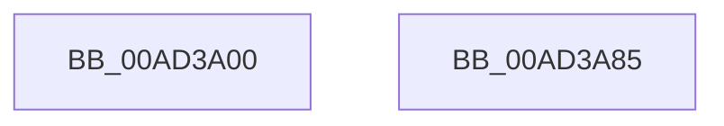

# MmReturnChargesToLockPagedPool

- RVA: `0x00AD3A00`–`0x00AD3A86` (길이 `134` bytes)
- VA: `0x0000000140AD3A00`
- 실행 섹션: `PAGE`
- PDB 이름 있음: `예`; PDB Function 태그: `아니요`
- unwind 정보 RVA: `0x000BA960`
- 디코드: `31`개 명령, `134/134` bytes 표시
- 미해석 바이트: `0` (있으면 어셈블리에 `.byte`로 보존)

> 이 문서는 커널 이미지의 기계어와 PDB 기호를 분석해 생성했습니다. 4번과 5번은 함수 원형과 자료형을 바이너리 사용 방식에서 추정한 C 해석이며 원본 소스 복구 결과는 아닙니다.

## 1. Dependencies

- 직접 호출 지점: **3**; 고유 호출 대상: **3**
- 직접 호출자로 확인된 함수: **3**
- RIP 상대 이미지 참조: **1**

### Outgoing calls
- `0x00AD3A39` → [MiGetPteAddress](../../text/43/MiGetPteAddress_function_0043E130.md) (function, `0x0043E130`)
- `0x00AD3A68` → [MiDecommitPages](../../text/24/MiDecommitPages_function_00241BD0.md) (function, `0x00241BD0`)
- `0x00AD3A77` → [MiReturnResident](../../text/28/MiReturnResident_function_00286890.md) (function, `0x00286890`)

### Direct callers
- [MiDeleteSubsectionLargePages](../../text/4D/MiDeleteSubsectionLargePages_function_004D51E0.md) at `0x004D54A2`
- [PopEnableHiberFile](../90/PopEnableHiberFile_function_0090F850.md) at `0x0090FD43`
- [sub_00B2AD32](../B2/Unknown_function_00B2AD32.md) at `0x00B2AF3F`

### Static image references
- `0x00AD3A70` → RVA `0x00E38D00` (`.data`; read)

## 2. Other-region calls and transfers

- 다른 실행 섹션으로 향하는 call: **3**
  - `0x00AD3A39` → [MiGetPteAddress](../../text/43/MiGetPteAddress_function_0043E130.md) (`PAGE` → `.text`)
  - `0x00AD3A68` → [MiDecommitPages](../../text/24/MiDecommitPages_function_00241BD0.md) (`PAGE` → `.text`)
  - `0x00AD3A77` → [MiReturnResident](../../text/28/MiReturnResident_function_00286890.md) (`PAGE` → `.text`)
- 별도 외부 분기/꼬리 이동을 확인하지 못했습니다.

## 3. Assembly (complete function range)

```asm
00AD3A00  40 53                           push rbx
00AD3A02  48 81 EC 80 00 00 00            sub rsp, 0x80
00AD3A09  48 8B D9                        mov rbx, rcx
00AD3A0C  0F 57 C0                        xorps xmm0, xmm0
00AD3A0F  81 E3 FF 0F 00 00               and ebx, 0xfff
00AD3A15  33 C0                           xor eax, eax
00AD3A17  48 81 C2 FF 0F 00 00            add rdx, 0xfff
00AD3A1E  48 89 44 24 70                  mov qword ptr [rsp + 0x70], rax
00AD3A23  48 03 DA                        add rbx, rdx
00AD3A26  48 C1 EB 0C                     shr rbx, 0xc
00AD3A2A  0F 11 44 24 40                  movups xmmword ptr [rsp + 0x40], xmm0
00AD3A2F  0F 11 44 24 50                  movups xmmword ptr [rsp + 0x50], xmm0
00AD3A34  0F 11 44 24 60                  movups xmmword ptr [rsp + 0x60], xmm0
00AD3A39  E8 F2 A6 96 FF                  call 0x14043e130
00AD3A3E  48 8B C8                        mov rcx, rax
00AD3A41  45 33 C9                        xor r9d, r9d
00AD3A44  48 8D 44 24 40                  lea rax, [rsp + 0x40]
00AD3A49  45 33 C0                        xor r8d, r8d
00AD3A4C  48 89 44 24 38                  mov qword ptr [rsp + 0x38], rax
00AD3A51  48 8B D3                        mov rdx, rbx
00AD3A54  48 83 64 24 30 00               and qword ptr [rsp + 0x30], 0
00AD3A5A  C7 44 24 28 18 00 00 00         mov dword ptr [rsp + 0x28], 0x18
00AD3A62  48 83 64 24 20 00               and qword ptr [rsp + 0x20], 0
00AD3A68  E8 63 E1 76 FF                  call 0x140241bd0
00AD3A6D  48 8B D3                        mov rdx, rbx
00AD3A70  48 8D 0D 89 52 36 00            lea rcx, [rip + 0x365289]
00AD3A77  E8 14 2E 7B FF                  call 0x140286890
00AD3A7C  48 81 C4 80 00 00 00            add rsp, 0x80
00AD3A83  5B                              pop rbx
00AD3A84  C3                              ret
00AD3A85  CC                              int3
```

## 4. C-style interpretation (structured pseudocode)

```c
__int64 __fastcall MmReturnChargesToLockPagedPool(__int64 a1, __int64 a2, int a3, int a4)
{
    __int64 result;
    __int64 v_rbx;
    __int64 v_rsp;
    unsigned __int64 v_stack_m18;
    unsigned __int64 v_stack_m28;
    unsigned __int64 v_stack_m38;
    unsigned __int64 v_stack_m48;
    unsigned __int64 v_stack_m50;
    unsigned __int64 v_stack_m58;
    unsigned int v_stack_m60;
    unsigned __int64 v_stack_m68;

    v_rsp = (v_rsp) - (128);
    v_rbx = (unsigned int)((a1) & (0xFFFULL));
    result = 0;
    a2 = (a2) + (0xFFFULL);
    v_stack_m18 = 0;
    v_rbx = (v_rbx) + (a2);
    v_rbx = (v_rbx) >> (12);
    v_stack_m48 = v_xmm0;
    v_stack_m38 = v_xmm0;
    v_stack_m28 = v_xmm0;
    result = MiGetPteAddress(a1, a2, a3, a4);
    a4 = 0;
    a3 = 0;
    v_stack_m50 = v_stack_m48;
    v_stack_m60 = 24;
    result = MiDecommitPages(result, v_rbx, a3, a4);
    result = MiReturnResident(v_rip + 3560073, v_rbx, a3, a4);
    v_rsp = (v_rsp) + (128);
    return result;
}
```

## 5. (Beta) C Style

```c
int64_t MmReturnChargesToLockPagedPool(int64_t Arg1, int64_t Arg2, int32_t Arg3, int32_t Arg4)
{
    int64_t result;
    int64_t local_rbx;
    int64_t local_rsp;
    uint64_t v_stack_m18;
    uint64_t v_stack_m28;
    uint64_t v_stack_m38;
    uint64_t v_stack_m48;
    uint64_t v_stack_m50;
    uint64_t v_stack_m58;
    uint32_t v_stack_m60;
    uint64_t v_stack_m68;

    local_rsp = (local_rsp) - (128);
    local_rbx = (uint32_t)((Arg1) & (0xFFFULL));
    result = 0;
    Arg2 = (Arg2) + (0xFFFULL);
    v_stack_m18 = 0;
    local_rbx = (local_rbx) + (Arg2);
    local_rbx = (local_rbx) >> (12);
    v_stack_m48 = v_xmm0;
    v_stack_m38 = v_xmm0;
    v_stack_m28 = v_xmm0;
    result = MiGetPteAddress(Arg1, Arg2, Arg3, Arg4);
    Arg4 = 0;
    Arg3 = 0;
    v_stack_m50 = v_stack_m48;
    v_stack_m60 = 24;
    result = MiDecommitPages(result, local_rbx, Arg3, Arg4);
    result = MiReturnResident(v_rip + 3560073, local_rbx, Arg3, Arg4);
    local_rsp = (local_rsp) + (128);
    return result;
}
```

## 6. Execution-region graph

[열기: 2D/3D 그래프와 함수 탐색 컨트롤 패널](../../../control-panel.html?section=page&rva=0x00AD3A00&view=graph)

- 2D 그래프는 위에서 아래로 흐르고, 3D 그래프는 빈 공간을 드래그해 회전합니다. Shift+드래그는 이동, 휠은 확대·축소, 함수 노드 선택은 대상 보고서 이동입니다.

### Static fallback


