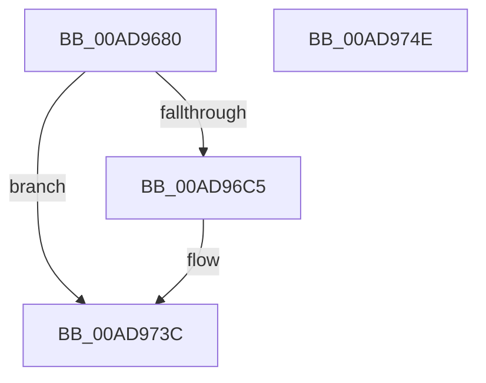

# NtReadFileScatter

- RVA: `0x00AD9680`–`0x00AD974F` (길이 `207` bytes)
- VA: `0x0000000140AD9680`
- 실행 섹션: `PAGE`
- PDB 이름 있음: `예`; PDB Function 태그: `아니요`
- unwind 정보 RVA: `0x000689A0`
- 디코드: `48`개 명령, `207/207` bytes 표시
- 미해석 바이트: `0` (있으면 어셈블리에 `.byte`로 보존)

> 이 문서는 커널 이미지의 기계어와 PDB 기호를 분석해 생성했습니다. 4번과 5번은 함수 원형과 자료형을 바이너리 사용 방식에서 추정한 C 해석이며 원본 소스 복구 결과는 아닙니다.

## 1. Dependencies

- 직접 호출 지점: **2**; 고유 호출 대상: **2**
- 직접 호출자로 확인된 함수: **0**
- RIP 상대 이미지 참조: **0**

### Outgoing calls
- `0x00AD96BC` → [IopReferenceFileObject](../../text/29/IopReferenceFileObject_function_0029D530.md) (function, `0x0029D530`)
- `0x00AD9737` → [IopReadFileScatter](../AA/IopReadFileScatter_function_00AA5D78.md) (function, `0x00AA5D78`)

### Direct callers
- 이 함수 시작 RVA로 연결되는 직접 call은 확인되지 않았습니다. 간접 호출은 완전히 역산할 수 없습니다.

### Static image references
- 디코드된 RIP-relative 메모리 참조가 없습니다.

## 2. Other-region calls and transfers

- 다른 실행 섹션으로 향하는 call: **1**
  - `0x00AD96BC` → [IopReferenceFileObject](../../text/29/IopReferenceFileObject_function_0029D530.md) (`PAGE` → `.text`)
- 별도 외부 분기/꼬리 이동을 확인하지 못했습니다.

## 3. Assembly (complete function range)

```asm
00AD9680  4C 8B DC                        mov r11, rsp
00AD9683  49 89 5B 08                     mov qword ptr [r11 + 8], rbx
00AD9687  49 89 73 10                     mov qword ptr [r11 + 0x10], rsi
00AD968B  57                              push rdi
00AD968C  48 83 EC 70                     sub rsp, 0x70
00AD9690  65 48 8B 04 25 88 01 00 00      mov rax, qword ptr gs:[0x188]
00AD9699  49 8B D9                        mov rbx, r9
00AD969C  49 83 63 E8 00                  and qword ptr [r11 - 0x18], 0
00AD96A1  4D 8D 4B E8                     lea r9, [r11 - 0x18]
00AD96A5  49 83 63 A8 00                  and qword ptr [r11 - 0x58], 0
00AD96AA  49 8B F8                        mov rdi, r8
00AD96AD  48 8B F2                        mov rsi, rdx
00AD96B0  BA 01 00 00 00                  mov edx, 1
00AD96B5  44 8A 80 32 02 00 00            mov r8b, byte ptr [rax + 0x232]
00AD96BC  E8 6F 3E 7C FF                  call 0x14029d530
00AD96C1  85 C0                           test eax, eax
00AD96C3  78 77                           js 0x140ad973c
00AD96C5  8B 8C 24 B0 00 00 00            mov ecx, dword ptr [rsp + 0xb0]
00AD96CC  BA 00 00 00 00                  mov edx, 0
00AD96D1  8B C1                           mov eax, ecx
00AD96D3  F7 C1 FF 0F 00 00               test ecx, 0xfff
00AD96D9  4C 8B CB                        mov r9, rbx
00AD96DC  4C 8B C7                        mov r8, rdi
00AD96DF  0F 95 C2                        setne dl
00AD96E2  48 83 64 24 58 00               and qword ptr [rsp + 0x58], 0
00AD96E8  48 83 64 24 50 00               and qword ptr [rsp + 0x50], 0
00AD96EE  C1 E8 0C                        shr eax, 0xc
00AD96F1  03 D0                           add edx, eax
00AD96F3  48 8B 84 24 C0 00 00 00         mov rax, qword ptr [rsp + 0xc0]
00AD96FB  48 89 44 24 48                  mov qword ptr [rsp + 0x48], rax
00AD9700  48 8B 84 24 B8 00 00 00         mov rax, qword ptr [rsp + 0xb8]
00AD9708  48 89 44 24 40                  mov qword ptr [rsp + 0x40], rax
00AD970D  48 8B 84 24 A8 00 00 00         mov rax, qword ptr [rsp + 0xa8]
00AD9715  89 4C 24 38                     mov dword ptr [rsp + 0x38], ecx
00AD9719  48 8B 4C 24 60                  mov rcx, qword ptr [rsp + 0x60]
00AD971E  48 89 44 24 30                  mov qword ptr [rsp + 0x30], rax
00AD9723  48 8B 84 24 A0 00 00 00         mov rax, qword ptr [rsp + 0xa0]
00AD972B  89 54 24 28                     mov dword ptr [rsp + 0x28], edx
00AD972F  48 8B D6                        mov rdx, rsi
00AD9732  48 89 44 24 20                  mov qword ptr [rsp + 0x20], rax
00AD9737  E8 3C C6 FC FF                  call 0x140aa5d78
00AD973C  4C 8D 5C 24 70                  lea r11, [rsp + 0x70]
00AD9741  49 8B 5B 10                     mov rbx, qword ptr [r11 + 0x10]
00AD9745  49 8B 73 18                     mov rsi, qword ptr [r11 + 0x18]
00AD9749  49 8B E3                        mov rsp, r11
00AD974C  5F                              pop rdi
00AD974D  C3                              ret
00AD974E  CC                              int3
```

## 4. C-style interpretation (structured pseudocode)

```c
__int64 __fastcall NtReadFileScatter(__int64 a1, __int64 a2, __int64 a3, __int64 a4, __int64 a5, __int64 a6, unsigned int a7, __int64 a8, __int64 a9)
{
    __int64 result;
    __int64 v_rsp;
    unsigned __int64 v_stack_m18;
    unsigned __int64 v_stack_m20;
    unsigned __int64 v_stack_m28;
    unsigned __int64 v_stack_m30;
    unsigned __int64 v_stack_m38;
    unsigned int v_stack_m40;
    unsigned __int64 v_stack_m48;
    unsigned int v_stack_m50;
    unsigned __int64 v_stack_m58;
    unsigned __int64 v_stack_m8;

    *(unsigned __int64 *)(v_rsp + 8) = v_rbx;
    *(unsigned __int64 *)(v_rsp + 16) = v_rsi;
    v_rsp = (v_rsp) - (112);
    result = IopReferenceFileObject(a1, 1, *(unsigned __int8 *)(*(unsigned __int64 *)(gs_base + (0 + 392)) + 562), v_rsp - 24);
    if (!(sign_flag)) {
        a1 = a7;
        a2 = 0;
        result = (unsigned int)(a1);
        a4 = a4;
        a3 = a3;
        a2 = ((((unsigned int)(a1)) & (0xFFFULL)) != 0) ? 1 : 0;
        result = (unsigned int)((result) >> (12));
        a2 = (unsigned int)((a2) + ((unsigned int)(result)));
        result = a9;
        v_stack_m30 = result;
        result = a8;
        v_stack_m38 = result;
        result = a6;
        v_stack_m40 = (unsigned int)(a1);
        a1 = v_stack_m18;
        v_stack_m48 = result;
        result = a5;
        v_stack_m50 = (unsigned int)(a2);
        a2 = a2;
        v_stack_m58 = result;
        result = IopReadFileScatter(a1, a2, a3, a4);
    }
    return result;
}
```

## 5. (Beta) C Style

```c
int64_t NtReadFileScatter(int64_t Arg1, int64_t Arg2, int64_t Arg3, int64_t Arg4, int64_t Arg5, int64_t Arg6, uint32_t Arg7, int64_t Arg8, int64_t Arg9)
{
    int64_t result;
    int64_t local_rsp;
    uint64_t v_stack_m18;
    uint64_t v_stack_m20;
    uint64_t v_stack_m28;
    uint64_t v_stack_m30;
    uint64_t v_stack_m38;
    uint32_t v_stack_m40;
    uint64_t v_stack_m48;
    uint32_t v_stack_m50;
    uint64_t v_stack_m58;
    uint64_t v_stack_m8;

    *(uint64_t *)(local_rsp + 0x8) = local_rbx;
    *(uint64_t *)(local_rsp + 0x10) = local_rsi;
    local_rsp = (local_rsp) - (112);
    result = IopReferenceFileObject(Arg1, 1, *(uint8_t *)(*(uint64_t *)(gs_base + (0 + 0x188)) + 0x232), local_rsp - 24);
    if (!(sign_flag)) {
        Arg1 = Arg7;
        Arg2 = 0;
        result = (uint32_t)(Arg1);
        Arg4 = Arg4;
        Arg3 = Arg3;
        Arg2 = ((((uint32_t)(Arg1)) & (0xFFFULL)) != 0) ? 1 : 0;
        result = (uint32_t)((result) >> (12));
        Arg2 = (uint32_t)((Arg2) + ((uint32_t)(result)));
        result = Arg9;
        v_stack_m30 = result;
        result = Arg8;
        v_stack_m38 = result;
        result = Arg6;
        v_stack_m40 = (uint32_t)(Arg1);
        Arg1 = v_stack_m18;
        v_stack_m48 = result;
        result = Arg5;
        v_stack_m50 = (uint32_t)(Arg2);
        Arg2 = Arg2;
        v_stack_m58 = result;
        result = IopReadFileScatter(Arg1, Arg2, Arg3, Arg4);
    }
    return result;
}
```

## 6. Execution-region graph

[열기: 2D/3D 그래프와 함수 탐색 컨트롤 패널](../../../control-panel.html?section=page&rva=0x00AD9680&view=graph)

- 2D 그래프는 위에서 아래로 흐르고, 3D 그래프는 빈 공간을 드래그해 회전합니다. Shift+드래그는 이동, 휠은 확대·축소, 함수 노드 선택은 대상 보고서 이동입니다.

### Static fallback


