# NtSetSecurityObject

- RVA: `0x00ADE2B0`–`0x00ADE6E2` (길이 `1,074` bytes)
- VA: `0x0000000140ADE2B0`
- 실행 섹션: `PAGE`
- PDB 이름 있음: `예`; PDB Function 태그: `아니요`
- unwind 정보 RVA: `0x0008F610`
- 디코드: `293`개 명령, `1,074/1,074` bytes 표시
- 미해석 바이트: `0` (있으면 어셈블리에 `.byte`로 보존)

> 이 문서는 커널 이미지의 기계어와 PDB 기호를 분석해 생성했습니다. 4번과 5번은 함수 원형과 자료형을 바이너리 사용 방식에서 추정한 C 해석이며 원본 소스 복구 결과는 아닙니다.

## 1. Dependencies

- 직접 호출 지점: **20**; 고유 호출 대상: **12**
- 직접 호출자로 확인된 함수: **2**
- RIP 상대 이미지 참조: **3**

### Outgoing calls
- `0x00ADE307` → [Feature_OutsideInProtection__private_IsEnabledDeviceUsageNoInline](../../text/5C/Feature_OutsideInProtection__private_IsEnabledDeviceUsageNoInline_function_005CD968.md) (function, `0x005CD968`)
- `0x00ADE367` → [SeSetSecurityAccessMask](../A2/SeSetSecurityAccessMask_function_00A25E0C.md) (function, `0x00A25E0C`)
- `0x00ADE3A4` → [ObReferenceObjectByHandle](../86/ObReferenceObjectByHandle_function_00868DB0.md) (function, `0x00868DB0`)
- `0x00ADE3CB` → [SeCaptureSecurityDescriptor](../92/SeCaptureSecurityDescriptor_function_00929F40.md) (function, `0x00929F40`)
- `0x00ADE414` → [SeReleaseSecurityDescriptor](../97/SeReleaseSecurityDescriptor_function_00975190.md) (function, `0x00975190`)
- `0x00ADE41D` → [ObfDereferenceObject](../../text/2F/ObfDereferenceObject_function_002F9350.md) (function, `0x002F9350`)
- `0x00ADE44E` → [ObpAllocateAndQuerySecurityDescriptorInfo](../87/ObpAllocateAndQuerySecurityDescriptorInfo_function_0087421C.md) (function, `0x0087421C`)
- `0x00ADE47D` → [RtlGetSaclSecurityDescriptor](../A3/RtlGetSaclSecurityDescriptor_function_00A36710.md) (function, `0x00A36710`)
- `0x00ADE4C5` → [SepRmGlobalSaclFind](../97/SepRmGlobalSaclFind_function_00973DD4.md) (function, `0x00973DD4`)
- `0x00ADE507` → [ObpAllocateAndQuerySecurityDescriptorInfo](../87/ObpAllocateAndQuerySecurityDescriptorInfo_function_0087421C.md) (function, `0x0087421C`)
- `0x00ADE557` → [ObpAllocateAndQuerySecurityDescriptorInfo](../87/ObpAllocateAndQuerySecurityDescriptorInfo_function_0087421C.md) (function, `0x0087421C`)
- `0x00ADE5A7` → [ObpAllocateAndQuerySecurityDescriptorInfo](../87/ObpAllocateAndQuerySecurityDescriptorInfo_function_0087421C.md) (function, `0x0087421C`)
- `0x00ADE5BE` → [ObSetSecurityObjectByPointer](../8B/ObSetSecurityObjectByPointer_function_008BAD20.md) (function, `0x008BAD20`)
- `0x00ADE64A` → [SeSecurityDescriptorChangedAuditAlarm](../91/SeSecurityDescriptorChangedAuditAlarm_function_0091FC5C.md) (function, `0x0091FC5C`)
- `0x00ADE670` → [ExFreePoolWithTag](../../poolcode/B8/ExFreePoolWithTag_function_00B82870.md) (function, `0x00B82870`)
- `0x00ADE683` → [ExFreePoolWithTag](../../poolcode/B8/ExFreePoolWithTag_function_00B82870.md) (function, `0x00B82870`)
- `0x00ADE69A` → [ExFreePoolWithTag](../../poolcode/B8/ExFreePoolWithTag_function_00B82870.md) (function, `0x00B82870`)
- `0x00ADE6A9` → [ExFreePoolWithTag](../../poolcode/B8/ExFreePoolWithTag_function_00B82870.md) (function, `0x00B82870`)
- `0x00ADE6B7` → [SeReleaseSecurityDescriptor](../97/SeReleaseSecurityDescriptor_function_00975190.md) (function, `0x00975190`)
- `0x00ADE6BF` → [ObfDereferenceObject](../../text/2F/ObfDereferenceObject_function_002F9350.md) (function, `0x002F9350`)

### Direct callers
- [RtlpSysVolCheckOwnerAndSecurity](../79/RtlpSysVolCheckOwnerAndSecurity_function_00791324.md) at `0x007914E4`
- [RtlpSysVolCheckOwnerAndSecurity](../79/RtlpSysVolCheckOwnerAndSecurity_function_00791324.md) at `0x0079160A`
- [RtlpSysVolTakeOwnership](../79/RtlpSysVolTakeOwnership_function_007917C8.md) at `0x00791943`

### Static image references
- `0x00ADE4AC` → RVA `0x00FC6E4C` (`ALMOSTRO`; read)
- `0x00ADE4B6` → RVA `0x00FC7800` (`ALMOSTRO`; read)
- `0x00ADE523` → RVA `0x00FC6AE0` (`ALMOSTRO`; read)

## 2. Other-region calls and transfers

- 다른 실행 섹션으로 향하는 call: **7**
  - `0x00ADE307` → [Feature_OutsideInProtection__private_IsEnabledDeviceUsageNoInline](../../text/5C/Feature_OutsideInProtection__private_IsEnabledDeviceUsageNoInline_function_005CD968.md) (`PAGE` → `.text`)
  - `0x00ADE41D` → [ObfDereferenceObject](../../text/2F/ObfDereferenceObject_function_002F9350.md) (`PAGE` → `.text`)
  - `0x00ADE670` → [ExFreePoolWithTag](../../poolcode/B8/ExFreePoolWithTag_function_00B82870.md) (`PAGE` → `POOLCODE`)
  - `0x00ADE683` → [ExFreePoolWithTag](../../poolcode/B8/ExFreePoolWithTag_function_00B82870.md) (`PAGE` → `POOLCODE`)
  - `0x00ADE69A` → [ExFreePoolWithTag](../../poolcode/B8/ExFreePoolWithTag_function_00B82870.md) (`PAGE` → `POOLCODE`)
  - `0x00ADE6A9` → [ExFreePoolWithTag](../../poolcode/B8/ExFreePoolWithTag_function_00B82870.md) (`PAGE` → `POOLCODE`)
  - `0x00ADE6BF` → [ObfDereferenceObject](../../text/2F/ObfDereferenceObject_function_002F9350.md) (`PAGE` → `.text`)
- 별도 외부 분기/꼬리 이동을 확인하지 못했습니다.

## 3. Assembly (complete function range)

```asm
00ADE2B0  48 89 5C 24 10                  mov qword ptr [rsp + 0x10], rbx
00ADE2B5  48 89 4C 24 08                  mov qword ptr [rsp + 8], rcx
00ADE2BA  55                              push rbp
00ADE2BB  56                              push rsi
00ADE2BC  57                              push rdi
00ADE2BD  41 54                           push r12
00ADE2BF  41 55                           push r13
00ADE2C1  41 56                           push r14
00ADE2C3  41 57                           push r15
00ADE2C5  48 8D 6C 24 D9                  lea rbp, [rsp - 0x27]
00ADE2CA  48 81 EC B0 00 00 00            sub rsp, 0xb0
00ADE2D1  45 33 E4                        xor r12d, r12d
00ADE2D4  4D 8B F0                        mov r14, r8
00ADE2D7  4C 89 65 17                     mov qword ptr [rbp + 0x17], r12
00ADE2DB  8B DA                           mov ebx, edx
00ADE2DD  44 89 65 77                     mov dword ptr [rbp + 0x77], r12d
00ADE2E1  48 8B F9                        mov rdi, rcx
00ADE2E4  4C 89 65 1F                     mov qword ptr [rbp + 0x1f], r12
00ADE2E8  4C 89 65 EF                     mov qword ptr [rbp - 0x11], r12
00ADE2EC  4C 89 65 F7                     mov qword ptr [rbp - 9], r12
00ADE2F0  4C 89 65 0F                     mov qword ptr [rbp + 0xf], r12
00ADE2F4  4C 89 65 07                     mov qword ptr [rbp + 7], r12
00ADE2F8  4D 85 C0                        test r8, r8
00ADE2FB  75 0A                           jne 0x140ade307
00ADE2FD  B8 05 00 00 C0                  mov eax, 0xc0000005
00ADE302  E9 BF 03 00 00                  jmp 0x140ade6c6
00ADE307  E8 5C F6 AE FF                  call 0x1405cd968
00ADE30C  85 C0                           test eax, eax
00ADE30E  74 22                           je 0x140ade332
00ADE310  0F BA E3 09                     bt ebx, 9
00ADE314  73 1C                           jae 0x140ade332
00ADE316  65 48 8B 04 25 88 01 00 00      mov rax, qword ptr gs:[0x188]
00ADE31F  44 38 A0 32 02 00 00            cmp byte ptr [rax + 0x232], r12b
00ADE326  74 0A                           je 0x140ade332
00ADE328  B8 22 00 00 C0                  mov eax, 0xc0000022
00ADE32D  E9 94 03 00 00                  jmp 0x140ade6c6
00ADE332  8B D3                           mov edx, ebx
00ADE334  8B CB                           mov ecx, ebx
00ADE336  81 E2 80 00 00 00               and edx, 0x80
00ADE33C  81 E1 00 01 00 00               and ecx, 0x100
00ADE342  0F BA E3 10                     bt ebx, 0x10
00ADE346  73 19                           jae 0x140ade361
00ADE348  81 CB FF 01 00 00               or ebx, 0x1ff
00ADE34E  8B C3                           mov eax, ebx
00ADE350  0F BA F3 07                     btr ebx, 7
00ADE354  85 D2                           test edx, edx
00ADE356  0F 45 D8                        cmovne ebx, eax
00ADE359  85 C9                           test ecx, ecx
00ADE35B  75 04                           jne 0x140ade361
00ADE35D  0F BA F3 08                     btr ebx, 8
00ADE361  48 8D 55 77                     lea rdx, [rbp + 0x77]
00ADE365  8B CB                           mov ecx, ebx
00ADE367  E8 A0 7A F4 FF                  call 0x140a25e0c
00ADE36C  65 48 8B 0C 25 88 01 00 00      mov rcx, qword ptr gs:[0x188]
00ADE375  48 8D 45 1F                     lea rax, [rbp + 0x1f]
00ADE379  8B 75 77                        mov esi, dword ptr [rbp + 0x77]
00ADE37C  45 33 C0                        xor r8d, r8d
00ADE37F  48 89 44 24 28                  mov qword ptr [rsp + 0x28], rax
00ADE384  8B D6                           mov edx, esi
00ADE386  48 8D 45 FF                     lea rax, [rbp - 1]
00ADE38A  4C 89 65 FF                     mov qword ptr [rbp - 1], r12
00ADE38E  44 8A A9 32 02 00 00            mov r13b, byte ptr [rcx + 0x232]
00ADE395  48 8B CF                        mov rcx, rdi
00ADE398  45 8A CD                        mov r9b, r13b
00ADE39B  44 88 6D 7F                     mov byte ptr [rbp + 0x7f], r13b
00ADE39F  48 89 44 24 20                  mov qword ptr [rsp + 0x20], rax
00ADE3A4  E8 07 AA D8 FF                  call 0x140868db0
00ADE3A9  8B F8                           mov edi, eax
00ADE3AB  85 C0                           test eax, eax
00ADE3AD  0F 88 11 03 00 00               js 0x140ade6c4
00ADE3B3  48 8D 45 17                     lea rax, [rbp + 0x17]
00ADE3B7  41 B1 01                        mov r9b, 1
00ADE3BA  41 B8 01 00 00 00               mov r8d, 1
00ADE3C0  48 89 44 24 20                  mov qword ptr [rsp + 0x20], rax
00ADE3C5  41 8A D5                        mov dl, r13b
00ADE3C8  49 8B CE                        mov rcx, r14
00ADE3CB  E8 70 BB E4 FF                  call 0x140929f40
00ADE3D0  4C 8B 75 FF                     mov r14, qword ptr [rbp - 1]
00ADE3D4  8B F8                           mov edi, eax
00ADE3D6  85 C0                           test eax, eax
00ADE3D8  0F 88 DE 02 00 00               js 0x140ade6bc
00ADE3DE  4C 8B 7D 17                     mov r15, qword ptr [rbp + 0x17]
00ADE3E2  41 F6 47 02 10                  test byte ptr [r15 + 2], 0x10
00ADE3E7  75 0C                           jne 0x140ade3f5
00ADE3E9  0F BA E3 10                     bt ebx, 0x10
00ADE3ED  73 06                           jae 0x140ade3f5
00ADE3EF  81 E3 07 FE FF FF               and ebx, 0xfffffe07
00ADE3F5  F6 C3 01                        test bl, 1
00ADE3F8  74 06                           je 0x140ade400
00ADE3FA  45 39 67 04                     cmp dword ptr [r15 + 4], r12d
00ADE3FE  74 0B                           je 0x140ade40b
00ADE400  F6 C3 02                        test bl, 2
00ADE403  74 27                           je 0x140ade42c
00ADE405  45 39 67 08                     cmp dword ptr [r15 + 8], r12d
00ADE409  75 21                           jne 0x140ade42c
00ADE40B  41 B0 01                        mov r8b, 1
00ADE40E  41 8A D5                        mov dl, r13b
00ADE411  49 8B CF                        mov rcx, r15
00ADE414  E8 77 6D E9 FF                  call 0x140975190
00ADE419  48 8B 4D FF                     mov rcx, qword ptr [rbp - 1]
00ADE41D  E8 2E AF 81 FF                  call 0x1402f9350
00ADE422  B8 79 00 00 C0                  mov eax, 0xc0000079
00ADE427  E9 9A 02 00 00                  jmp 0x140ade6c6
00ADE42C  F6 45 1F 04                     test byte ptr [rbp + 0x1f], 4
00ADE430  75 06                           jne 0x140ade438
00ADE432  81 E6 FF FF F3 FF               and esi, 0xfff3ffff
00ADE438  85 F6                           test esi, esi
00ADE43A  0F 84 D6 00 00 00               je 0x140ade516
00ADE440  45 33 C0                        xor r8d, r8d
00ADE443  4C 8D 4D F7                     lea r9, [rbp - 9]
00ADE447  49 8B CE                        mov rcx, r14
00ADE44A  41 8D 50 08                     lea edx, [r8 + 8]
00ADE44E  E8 C9 5D D9 FF                  call 0x14087421c
00ADE453  8B F8                           mov edi, eax
00ADE455  85 C0                           test eax, eax
00ADE457  0F 88 FF 01 00 00               js 0x140ade65c
00ADE45D  F7 C6 FF FF FF FE               test esi, 0xfeffffff
00ADE463  0F 84 AD 00 00 00               je 0x140ade516
00ADE469  48 8B 4D F7                     mov rcx, qword ptr [rbp - 9]
00ADE46D  4C 8D 4D E7                     lea r9, [rbp - 0x19]
00ADE471  4C 8D 45 1F                     lea r8, [rbp + 0x1f]
00ADE475  44 88 65 77                     mov byte ptr [rbp + 0x77], r12b
00ADE479  48 8D 55 77                     lea rdx, [rbp + 0x77]
00ADE47D  E8 8E 82 F5 FF                  call 0x140a36710
00ADE482  8B F8                           mov edi, eax
00ADE484  8A 45 77                        mov al, byte ptr [rbp + 0x77]
00ADE487  84 C0                           test al, al
00ADE489  75 47                           jne 0x140ade4d2
00ADE48B  4C 21 65 77                     and qword ptr [rbp + 0x77], r12
00ADE48F  49 8D 46 D0                     lea rax, [r14 - 0x30]
00ADE493  48 C1 E8 08                     shr rax, 8
00ADE497  48 8D 4D 77                     lea rcx, [rbp + 0x77]
00ADE49B  44 0F B6 C0                     movzx r8d, al
00ADE49F  41 B1 01                        mov r9b, 1
00ADE4A2  41 0F B6 46 E8                  movzx eax, byte ptr [r14 - 0x18]
00ADE4A7  33 D2                           xor edx, edx
00ADE4A9  4C 33 C0                        xor r8, rax
00ADE4AC  0F B6 05 99 89 4E 00            movzx eax, byte ptr [rip + 0x4e8999]
00ADE4B3  4C 33 C0                        xor r8, rax
00ADE4B6  48 8D 05 43 93 4E 00            lea rax, [rip + 0x4e9343]
00ADE4BD  4E 8B 04 C0                     mov r8, qword ptr [rax + r8*8]
00ADE4C1  49 83 C0 10                     add r8, 0x10
00ADE4C5  E8 0A 59 E9 FF                  call 0x140973dd4
00ADE4CA  3D 34 00 00 C0                  cmp eax, 0xc0000034
00ADE4CF  0F 95 C0                        setne al
00ADE4D2  85 FF                           test edi, edi
00ADE4D4  0F 88 82 01 00 00               js 0x140ade65c
00ADE4DA  84 C0                           test al, al
00ADE4DC  0F 84 6F 01 00 00               je 0x140ade651
00ADE4E2  0F BA E6 13                     bt esi, 0x13
00ADE4E6  73 07                           jae 0x140ade4ef
00ADE4E8  44 8B E3                        mov r12d, ebx
00ADE4EB  41 83 E4 13                     and r12d, 0x13
00ADE4EF  41 8B D4                        mov edx, r12d
00ADE4F2  4C 8D 4D EF                     lea r9, [rbp - 0x11]
00ADE4F6  83 CA 04                        or edx, 4
00ADE4F9  49 8B CE                        mov rcx, r14
00ADE4FC  0F BA E6 12                     bt esi, 0x12
00ADE500  41 0F 43 D4                     cmovae edx, r12d
00ADE504  45 33 C0                        xor r8d, r8d
00ADE507  E8 10 5D D9 FF                  call 0x14087421c
00ADE50C  8B F8                           mov edi, eax
00ADE50E  85 C0                           test eax, eax
00ADE510  0F 88 46 01 00 00               js 0x140ade65c
00ADE516  4C 8B 65 EF                     mov r12, qword ptr [rbp - 0x11]
00ADE51A  BA 40 00 00 00                  mov edx, 0x40
00ADE51F  84 DA                           test dl, bl
00ADE521  74 43                           je 0x140ade566
00ADE523  48 8B 05 B6 85 4E 00            mov rax, qword ptr [rip + 0x4e85b6]
00ADE52A  49 8D 4E D0                     lea rcx, [r14 - 0x30]
00ADE52E  48 C1 E9 08                     shr rcx, 8
00ADE532  41 32 4E E8                     xor cl, byte ptr [r14 - 0x18]
00ADE536  32 0D 10 89 4E 00               xor cl, byte ptr [rip + 0x4e8910]
00ADE53C  3A 48 28                        cmp cl, byte ptr [rax + 0x28]
00ADE53F  75 0C                           jne 0x140ade54d
00ADE541  49 8B 46 08                     mov rax, qword ptr [r14 + 8]
00ADE545  8B 48 34                        mov ecx, dword ptr [rax + 0x34]
00ADE548  F6 C1 10                        test cl, 0x10
00ADE54B  75 19                           jne 0x140ade566
00ADE54D  4C 8D 4D 07                     lea r9, [rbp + 7]
00ADE551  45 33 C0                        xor r8d, r8d
00ADE554  49 8B CE                        mov rcx, r14
00ADE557  E8 C0 5C D9 FF                  call 0x14087421c
00ADE55C  8B F8                           mov edi, eax
00ADE55E  85 C0                           test eax, eax
00ADE560  0F 88 FC 00 00 00               js 0x140ade662
00ADE566  44 8B EB                        mov r13d, ebx
00ADE569  BA 20 00 00 00                  mov edx, 0x20
00ADE56E  44 23 EA                        and r13d, edx
00ADE571  74 43                           je 0x140ade5b6
00ADE573  48 8B 05 66 85 4E 00            mov rax, qword ptr [rip + 0x4e8566]
00ADE57A  49 8D 4E D0                     lea rcx, [r14 - 0x30]
00ADE57E  48 C1 E9 08                     shr rcx, 8
00ADE582  41 32 4E E8                     xor cl, byte ptr [r14 - 0x18]
00ADE586  32 0D C0 88 4E 00               xor cl, byte ptr [rip + 0x4e88c0]
00ADE58C  3A 48 28                        cmp cl, byte ptr [rax + 0x28]
00ADE58F  75 0C                           jne 0x140ade59d
00ADE591  49 8B 46 08                     mov rax, qword ptr [r14 + 8]
00ADE595  8B 48 34                        mov ecx, dword ptr [rax + 0x34]
00ADE598  F6 C1 10                        test cl, 0x10
00ADE59B  75 19                           jne 0x140ade5b6
00ADE59D  4C 8D 4D 0F                     lea r9, [rbp + 0xf]
00ADE5A1  45 33 C0                        xor r8d, r8d
00ADE5A4  49 8B CE                        mov rcx, r14
00ADE5A7  E8 70 5C D9 FF                  call 0x14087421c
00ADE5AC  8B F8                           mov edi, eax
00ADE5AE  85 C0                           test eax, eax
00ADE5B0  0F 88 AC 00 00 00               js 0x140ade662
00ADE5B6  4D 8B C7                        mov r8, r15
00ADE5B9  8B D3                           mov edx, ebx
00ADE5BB  49 8B CE                        mov rcx, r14
00ADE5BE  E8 5D C7 DD FF                  call 0x1408bad20
00ADE5C3  8B F8                           mov edi, eax
00ADE5C5  85 C0                           test eax, eax
00ADE5C7  0F 88 95 00 00 00               js 0x140ade662
00ADE5CD  85 F6                           test esi, esi
00ADE5CF  75 09                           jne 0x140ade5da
00ADE5D1  45 85 ED                        test r13d, r13d
00ADE5D4  0F 84 88 00 00 00               je 0x140ade662
00ADE5DA  4C 8B 6D 07                     mov r13, qword ptr [rbp + 7]
00ADE5DE  49 8D 46 D0                     lea rax, [r14 - 0x30]
00ADE5E2  48 C1 E8 08                     shr rax, 8
00ADE5E6  45 33 C9                        xor r9d, r9d
00ADE5E9  0F B6 D0                        movzx edx, al
00ADE5EC  33 C9                           xor ecx, ecx
00ADE5EE  41 0F B6 46 E8                  movzx eax, byte ptr [r14 - 0x18]
00ADE5F3  48 33 D0                        xor rdx, rax
00ADE5F6  4C 89 7C 24 60                  mov qword ptr [rsp + 0x60], r15
00ADE5FB  0F B6 05 4A 88 4E 00            movzx eax, byte ptr [rip + 0x4e884a]
00ADE602  48 33 D0                        xor rdx, rax
00ADE605  4C 89 6C 24 58                  mov qword ptr [rsp + 0x58], r13
00ADE60A  48 8D 05 EF 91 4E 00            lea rax, [rip + 0x4e91ef]
00ADE611  4C 8B 04 D0                     mov r8, qword ptr [rax + rdx*8]
00ADE615  49 8B D6                        mov rdx, r14
00ADE618  48 8B 45 0F                     mov rax, qword ptr [rbp + 0xf]
00ADE61C  49 83 C0 10                     add r8, 0x10
00ADE620  48 89 44 24 50                  mov qword ptr [rsp + 0x50], rax
00ADE625  48 8B 45 F7                     mov rax, qword ptr [rbp - 9]
00ADE629  48 89 44 24 48                  mov qword ptr [rsp + 0x48], rax
00ADE62E  48 8B 45 67                     mov rax, qword ptr [rbp + 0x67]
00ADE632  4C 89 64 24 40                  mov qword ptr [rsp + 0x40], r12
00ADE637  89 5C 24 38                     mov dword ptr [rsp + 0x38], ebx
00ADE63B  89 74 24 30                     mov dword ptr [rsp + 0x30], esi
00ADE63F  48 83 64 24 28 00               and qword ptr [rsp + 0x28], 0
00ADE645  48 89 44 24 20                  mov qword ptr [rsp + 0x20], rax
00ADE64A  E8 0D 16 E4 FF                  call 0x14091fc5c
00ADE64F  EB 15                           jmp 0x140ade666
00ADE651  81 E6 FF FF F3 FF               and esi, 0xfff3ffff
00ADE657  E9 BA FE FF FF                  jmp 0x140ade516
00ADE65C  4C 8B 65 EF                     mov r12, qword ptr [rbp - 0x11]
00ADE660  EB 2A                           jmp 0x140ade68c
00ADE662  4C 8B 6D 07                     mov r13, qword ptr [rbp + 7]
00ADE666  4D 85 ED                        test r13, r13
00ADE669  74 0A                           je 0x140ade675
00ADE66B  33 D2                           xor edx, edx
00ADE66D  49 8B CD                        mov rcx, r13
00ADE670  E8 FB 41 0A 00                  call 0x140b82870
00ADE675  48 8B 45 0F                     mov rax, qword ptr [rbp + 0xf]
00ADE679  48 85 C0                        test rax, rax
00ADE67C  74 0A                           je 0x140ade688
00ADE67E  33 D2                           xor edx, edx
00ADE680  48 8B C8                        mov rcx, rax
00ADE683  E8 E8 41 0A 00                  call 0x140b82870
00ADE688  44 8A 6D 7F                     mov r13b, byte ptr [rbp + 0x7f]
00ADE68C  48 8B 45 F7                     mov rax, qword ptr [rbp - 9]
00ADE690  48 85 C0                        test rax, rax
00ADE693  74 0A                           je 0x140ade69f
00ADE695  33 D2                           xor edx, edx
00ADE697  48 8B C8                        mov rcx, rax
00ADE69A  E8 D1 41 0A 00                  call 0x140b82870
00ADE69F  4D 85 E4                        test r12, r12
00ADE6A2  74 0A                           je 0x140ade6ae
00ADE6A4  33 D2                           xor edx, edx
00ADE6A6  49 8B CC                        mov rcx, r12
00ADE6A9  E8 C2 41 0A 00                  call 0x140b82870
00ADE6AE  41 B0 01                        mov r8b, 1
00ADE6B1  41 8A D5                        mov dl, r13b
00ADE6B4  49 8B CF                        mov rcx, r15
00ADE6B7  E8 D4 6A E9 FF                  call 0x140975190
00ADE6BC  49 8B CE                        mov rcx, r14
00ADE6BF  E8 8C AC 81 FF                  call 0x1402f9350
00ADE6C4  8B C7                           mov eax, edi
00ADE6C6  48 8B 9C 24 F8 00 00 00         mov rbx, qword ptr [rsp + 0xf8]
00ADE6CE  48 81 C4 B0 00 00 00            add rsp, 0xb0
00ADE6D5  41 5F                           pop r15
00ADE6D7  41 5E                           pop r14
00ADE6D9  41 5D                           pop r13
00ADE6DB  41 5C                           pop r12
00ADE6DD  5F                              pop rdi
00ADE6DE  5E                              pop rsi
00ADE6DF  5D                              pop rbp
00ADE6E0  C3                              ret
00ADE6E1  CC                              int3
```

## 4. C-style interpretation (structured pseudocode)

```c
__int64 __fastcall NtSetSecurityObject(__int64 a1, int a2, __int64 a3)
{
    __int64 result;
    __int64 v_r12;
    __int64 v_r13;
    __int64 v_rbx;
    __int64 v_rsi;
    __int64 v_rsp;
    unsigned __int64 v_stack_m40;
    unsigned __int64 v_stack_m48;
    unsigned __int64 v_stack_m50;
    unsigned __int64 v_stack_m58;
    unsigned __int64 v_stack_m5F;
    unsigned __int64 v_stack_m60;
    unsigned __int64 v_stack_m68;
    unsigned __int64 v_stack_m70;
    unsigned __int64 v_stack_m78;
    unsigned __int64 v_stack_m88;
    unsigned __int64 v_stack_m90;
    unsigned __int64 v_stack_m98;
    unsigned __int64 v_stack_mA0;
    unsigned __int64 v_stack_mA8;
    unsigned int v_stack_mB0;
    unsigned int v_stack_mB8;
    unsigned __int64 v_stack_mC0;
    unsigned __int64 v_stack_mC8;
    unsigned __int64 v_stack_p10;
    unsigned int v_stack_p18;
    unsigned __int8 v_stack_p20;
    unsigned __int64 v_stack_p8;

    v_stack_p10 = v_rbx;
    v_stack_p8 = a1;
    v_rsp = (v_rsp) - (176);
    v_r12 = 0;
    v_stack_m48 = 0;
    v_stack_p18 = 0;
    v_stack_m40 = 0;
    v_stack_m70 = 0;
    v_stack_m68 = 0;
    v_stack_m50 = 0;
    v_stack_m58 = 0;
    if (a3 != 0) goto loc_00ADE307;
    goto loc_00ADE6C6;
loc_00ADE307:
    result = Feature_OutsideInProtection__private_IsEnabledDeviceUsageNoInline(a1, a2, a3, a4);
    if ((unsigned int)(result) == 0) goto loc_00ADE332;
    if (condition_is_above_or_equal) goto loc_00ADE332;
    if ((*(unsigned __int8 *)(*(unsigned __int64 *)(gs_base + (0 + 392)) + 562)) == 0) goto loc_00ADE332;
    goto loc_00ADE6C6;
loc_00ADE332:
    a2 = (unsigned int)(((unsigned int)((unsigned int)((unsigned int)(a2)))) & (128));
    a1 = (unsigned int)(((unsigned int)((unsigned int)((unsigned int)(a2)))) & (256));
    if (condition_is_above_or_equal) goto loc_00ADE361;
    v_rbx = (unsigned int)(((unsigned int)(a2)) | (511));
    if (a2 != 0) { v_rbx = (unsigned int)((unsigned int)((unsigned int)(v_rbx))); }
    if ((unsigned int)(a1) == 0) {
    }
    result = SeSetSecurityAccessMask((unsigned int)((unsigned int)(v_rbx)), v_stack_p18, a3, a4);
    a3 = 0;
    v_stack_mC0 = v_stack_m40;
    v_stack_m60 = 0;
    v_stack_p20 = (unsigned __int8)(*(unsigned __int8 *)(*(unsigned __int64 *)(gs_base + (0 + 392)) + 562));
    v_stack_mC8 = v_stack_m60;
    result = ObReferenceObjectByHandle(a1, (unsigned int)((unsigned int)((unsigned int)(v_stack_p18))), a3, (unsigned __int8)(*(unsigned __int8 *)(*(unsigned __int64 *)(gs_base + (0 + 392)) + 562)));
    if (sign_flag) goto loc_00ADE6C4;
    v_stack_mC8 = v_stack_m48;
    result = SeCaptureSecurityDescriptor(0, (unsigned __int8)(*(unsigned __int8 *)(*(unsigned __int64 *)(gs_base + (0 + 392)) + 562)), 1, 1);
    if (sign_flag) goto loc_00ADE6BC;
    if (((*(unsigned __int8 *)(v_stack_m48 + 2)) & (16)) != 0) goto loc_00ADE3F5;
    if (!(condition_is_above_or_equal)) {
        v_rbx = (unsigned int)((v_rbx) & (0xFFFFFE07ULL));
    }
    if ((((unsigned __int8)(v_rbx)) & (1)) == 0) goto loc_00ADE400;
    if ((*(unsigned int *)(v_stack_m48 + 4)) == 0) goto loc_00ADE40B;
loc_00ADE400:
    if ((((unsigned __int8)(v_rbx)) & (2)) == 0) goto loc_00ADE42C;
    if ((*(unsigned int *)(v_stack_m48 + 8)) != 0) goto loc_00ADE42C;
loc_00ADE40B:
    result = SeReleaseSecurityDescriptor(v_stack_m48, (unsigned __int8)(*(unsigned __int8 *)(*(unsigned __int64 *)(gs_base + (0 + 392)) + 562)), 1, 1);
    result = ObfDereferenceObject(v_stack_m60, (unsigned __int8)(*(unsigned __int8 *)(*(unsigned __int64 *)(gs_base + (0 + 392)) + 562)), 1, 1);
    goto loc_00ADE6C6;
loc_00ADE42C:
    v_rsi = (unsigned int)(v_stack_p18);
    if (((v_stack_m40) & (4)) == 0) {
        v_rsi = (unsigned int)(((unsigned int)(v_stack_p18)) & (0xFFF3FFFFULL));
    }
    if ((unsigned int)(v_rsi) == 0) goto loc_00ADE516;
    a3 = 0;
    result = ObpAllocateAndQuerySecurityDescriptorInfo(v_stack_m60, a3 + 8, a3, v_stack_m68);
    if (sign_flag) goto loc_00ADE65C;
    if ((((unsigned int)(v_rsi)) & (0xFEFFFFFFULL)) == 0) goto loc_00ADE516;
    v_stack_p18 = 0;
    result = RtlGetSaclSecurityDescriptor(v_stack_m68, v_stack_p18, v_stack_m40, v_stack_m78);
    result = v_stack_p18;
    if ((unsigned __int8)(v_stack_p18) == 0) {
        result = v_stack_m60 - 48;
        result = (result) >> (8);
        a1 = v_stack_p18;
        a3 = (unsigned __int8)(result);
        a4 = 1;
        result = *(unsigned __int8 *)(v_stack_m60 - 24);
        a2 = 0;
        a3 = (a3) ^ (result);
        result = *(unsigned __int8 *)(v_rip + 5147033);
        a3 = (a3) ^ (result);
        result = v_rip + 5149507;
        a3 = *(unsigned __int64 *)(result + a3 * 8);
        a3 = (a3) + (16);
        result = SepRmGlobalSaclFind(a1, a2, a3, a4);
        result = (((unsigned int)(result)) != 0xC0000034ULL) ? 1 : 0;
    }
    if (sign_flag) goto loc_00ADE65C;
    if ((unsigned __int8)(result) == 0) goto loc_00ADE651;
    if (!(condition_is_above_or_equal)) {
        v_r12 = (unsigned int)(v_rbx);
        v_r12 = (unsigned int)((v_r12) & (19));
    }
    a2 = (unsigned int)(((unsigned int)((unsigned int)(v_r12))) | (4));
    if (condition_is_above_or_equal) { a2 = (unsigned int)(v_r12); }
    a3 = 0;
    result = ObpAllocateAndQuerySecurityDescriptorInfo(v_stack_m60, a2, a3, v_stack_m70);
    if (sign_flag) goto loc_00ADE65C;
loc_00ADE516:
    if (((64) & ((unsigned __int8)(v_rbx))) == 0) goto loc_00ADE566;
    a1 = (v_stack_m60 - 48) >> (8);
    a1 = (unsigned __int8)((a1) ^ (*(unsigned __int8 *)(v_stack_m60 - 24)));
    a1 = (unsigned __int8)((a1) ^ (*(unsigned __int8 *)(v_rip + 5146896)));
    if (((unsigned __int8)(a1)) != (*(unsigned __int8 *)(*(unsigned __int64 *)(v_rip + 5146038) + 40))) goto loc_00ADE54D;
    if ((((unsigned __int8)((unsigned int)(*(unsigned int *)(*(unsigned __int64 *)(v_stack_m60 + 8) + 52)))) & (16)) != 0) goto loc_00ADE566;
loc_00ADE54D:
    a3 = 0;
    result = ObpAllocateAndQuerySecurityDescriptorInfo(v_stack_m60, 64, a3, v_stack_m58);
    if (sign_flag) goto loc_00ADE662;
loc_00ADE566:
    v_r13 = (unsigned int)(((unsigned int)((unsigned int)(v_rbx))) & (32));
    if (condition_is_equal) goto loc_00ADE5B6;
    a1 = (v_stack_m60 - 48) >> (8);
    a1 = (unsigned __int8)((a1) ^ (*(unsigned __int8 *)(v_stack_m60 - 24)));
    a1 = (unsigned __int8)((a1) ^ (*(unsigned __int8 *)(v_rip + 5146816)));
    if (((unsigned __int8)(a1)) != (*(unsigned __int8 *)(*(unsigned __int64 *)(v_rip + 5145958) + 40))) goto loc_00ADE59D;
    if ((((unsigned __int8)((unsigned int)(*(unsigned int *)(*(unsigned __int64 *)(v_stack_m60 + 8) + 52)))) & (16)) != 0) goto loc_00ADE5B6;
loc_00ADE59D:
    a3 = 0;
    result = ObpAllocateAndQuerySecurityDescriptorInfo(v_stack_m60, 32, a3, v_stack_m50);
    if (sign_flag) goto loc_00ADE662;
loc_00ADE5B6:
    result = ObSetSecurityObjectByPointer(v_stack_m60, (unsigned int)((unsigned int)(v_rbx)), v_stack_m48, v_stack_m50);
    if (sign_flag) goto loc_00ADE662;
    if ((unsigned int)(v_rsi) != 0) goto loc_00ADE5DA;
    if ((unsigned int)(v_r13) == 0) goto loc_00ADE662;
loc_00ADE5DA:
    result = (v_stack_m60 - 48) >> (8);
    a4 = 0;
    a1 = 0;
    a2 = ((unsigned __int8)(result)) ^ (*(unsigned __int8 *)(v_stack_m60 - 24));
    v_stack_m88 = v_stack_m48;
    a2 = (a2) ^ (*(unsigned __int8 *)(v_rip + 5146698));
    v_stack_m90 = v_stack_m58;
    a3 = (*(unsigned __int64 *)(v_rip + 5149167 + a2 * 8)) + (16);
    v_stack_m98 = v_stack_m50;
    v_stack_mA0 = v_stack_m68;
    v_stack_mA8 = v_stack_m70;
    v_stack_mB0 = (unsigned int)(v_rbx);
    v_stack_mB8 = (unsigned int)(v_rsi);
    v_stack_mC8 = v_stack_p8;
    result = SeSecurityDescriptorChangedAuditAlarm(a1, v_stack_m60, a3, a4);
    goto loc_00ADE666;
loc_00ADE651:
    v_rsi = (unsigned int)((v_rsi) & (0xFFF3FFFFULL));
    goto loc_00ADE516;
loc_00ADE65C:
    goto loc_00ADE68C;
loc_00ADE662:
loc_00ADE666:
    if (v_stack_m58 != 0) {
        a2 = 0;
        a1 = v_stack_m58;
        result = ExFreePoolWithTag(a1, a2, a3, a4);
    }
    result = v_stack_m50;
    if (v_stack_m50 != 0) {
        a2 = 0;
        a1 = v_stack_m50;
        result = ExFreePoolWithTag(a1, a2, a3, a4);
    }
loc_00ADE68C:
    result = v_stack_m68;
    if (v_stack_m68 != 0) {
        a2 = 0;
        a1 = v_stack_m68;
        result = ExFreePoolWithTag(a1, a2, a3, a4);
    }
    if (v_stack_m70 != 0) {
        a2 = 0;
        a1 = v_stack_m70;
        result = ExFreePoolWithTag(a1, a2, a3, a4);
    }
    result = SeReleaseSecurityDescriptor(v_stack_m48, (unsigned __int8)(v_stack_p20), 1, a4);
loc_00ADE6BC:
    result = ObfDereferenceObject(v_stack_m60, (unsigned __int8)(v_stack_p20), 1, a4);
loc_00ADE6C4:
loc_00ADE6C6:
    v_rsp = (v_rsp) + (176);
    return (unsigned int)((unsigned int)((unsigned int)((unsigned int)(result))));
}
```

## 5. (Beta) C Style

```c
int64_t NtSetSecurityObject(int64_t Arg1, int32_t Arg2, int64_t Arg3)
{
    int64_t result;
    int64_t local_r12;
    int64_t local_r13;
    int64_t local_rbx;
    int64_t local_rsi;
    int64_t local_rsp;
    uint64_t v_stack_m40;
    uint64_t v_stack_m48;
    uint64_t v_stack_m50;
    uint64_t v_stack_m58;
    uint64_t v_stack_m5F;
    uint64_t v_stack_m60;
    uint64_t v_stack_m68;
    uint64_t v_stack_m70;
    uint64_t v_stack_m78;
    uint64_t v_stack_m88;
    uint64_t v_stack_m90;
    uint64_t v_stack_m98;
    uint64_t v_stack_mA0;
    uint64_t v_stack_mA8;
    uint32_t v_stack_mB0;
    uint32_t v_stack_mB8;
    uint64_t v_stack_mC0;
    uint64_t v_stack_mC8;
    uint64_t v_stack_p10;
    uint32_t v_stack_p18;
    uint8_t v_stack_p20;
    uint64_t v_stack_p8;

    v_stack_p10 = local_rbx;
    v_stack_p8 = Arg1;
    local_rsp = (local_rsp) - (176);
    local_r12 = 0;
    v_stack_m48 = 0;
    v_stack_p18 = 0;
    v_stack_m40 = 0;
    v_stack_m70 = 0;
    v_stack_m68 = 0;
    v_stack_m50 = 0;
    v_stack_m58 = 0;
    if (Arg3 != 0) goto loc_00ADE307;
    goto loc_00ADE6C6;
loc_00ADE307:
    result = Feature_OutsideInProtection__private_IsEnabledDeviceUsageNoInline(Arg1, Arg2, Arg3, a4);
    if ((uint32_t)(result) == 0) goto loc_00ADE332;
    if (condition_is_above_or_equal) goto loc_00ADE332;
    if ((*(uint8_t *)(*(uint64_t *)(gs_base + (0 + 0x188)) + 0x232)) == 0) goto loc_00ADE332;
    goto loc_00ADE6C6;
loc_00ADE332:
    Arg2 = (uint32_t)(((uint32_t)((uint32_t)((uint32_t)(Arg2)))) & (128));
    Arg1 = (uint32_t)(((uint32_t)((uint32_t)((uint32_t)(Arg2)))) & (256));
    if (condition_is_above_or_equal) goto loc_00ADE361;
    local_rbx = (uint32_t)(((uint32_t)(Arg2)) | (511));
    if (Arg2 != 0) { local_rbx = (uint32_t)((uint32_t)((uint32_t)(local_rbx))); }
    if ((uint32_t)(Arg1) == 0) {
    }
    result = SeSetSecurityAccessMask((uint32_t)((uint32_t)(local_rbx)), v_stack_p18, Arg3, a4);
    Arg3 = 0;
    v_stack_mC0 = v_stack_m40;
    v_stack_m60 = 0;
    v_stack_p20 = (uint8_t)(*(uint8_t *)(*(uint64_t *)(gs_base + (0 + 0x188)) + 0x232));
    v_stack_mC8 = v_stack_m60;
    result = ObReferenceObjectByHandle(Arg1, (uint32_t)((uint32_t)((uint32_t)(v_stack_p18))), Arg3, (uint8_t)(*(uint8_t *)(*(uint64_t *)(gs_base + (0 + 0x188)) + 0x232)));
    if (sign_flag) goto loc_00ADE6C4;
    v_stack_mC8 = v_stack_m48;
    result = SeCaptureSecurityDescriptor(0, (uint8_t)(*(uint8_t *)(*(uint64_t *)(gs_base + (0 + 0x188)) + 0x232)), 1, 1);
    if (sign_flag) goto loc_00ADE6BC;
    if (((*(uint8_t *)(v_stack_m48 + 0x2)) & (16)) != 0) goto loc_00ADE3F5;
    if (!(condition_is_above_or_equal)) {
        local_rbx = (uint32_t)((local_rbx) & (0xFFFFFE07ULL));
    }
    if ((((uint8_t)(local_rbx)) & (1)) == 0) goto loc_00ADE400;
    if ((*(uint32_t *)(v_stack_m48 + 0x4)) == 0) goto loc_00ADE40B;
loc_00ADE400:
    if ((((uint8_t)(local_rbx)) & (2)) == 0) goto loc_00ADE42C;
    if ((*(uint32_t *)(v_stack_m48 + 0x8)) != 0) goto loc_00ADE42C;
loc_00ADE40B:
    result = SeReleaseSecurityDescriptor(v_stack_m48, (uint8_t)(*(uint8_t *)(*(uint64_t *)(gs_base + (0 + 0x188)) + 0x232)), 1, 1);
    result = ObfDereferenceObject(v_stack_m60, (uint8_t)(*(uint8_t *)(*(uint64_t *)(gs_base + (0 + 0x188)) + 0x232)), 1, 1);
    goto loc_00ADE6C6;
loc_00ADE42C:
    local_rsi = (uint32_t)(v_stack_p18);
    if (((v_stack_m40) & (4)) == 0) {
        local_rsi = (uint32_t)(((uint32_t)(v_stack_p18)) & (0xFFF3FFFFULL));
    }
    if ((uint32_t)(local_rsi) == 0) goto loc_00ADE516;
    Arg3 = 0;
    result = ObpAllocateAndQuerySecurityDescriptorInfo(v_stack_m60, Arg3 + 8, Arg3, v_stack_m68);
    if (sign_flag) goto loc_00ADE65C;
    if ((((uint32_t)(local_rsi)) & (0xFEFFFFFFULL)) == 0) goto loc_00ADE516;
    v_stack_p18 = 0;
    result = RtlGetSaclSecurityDescriptor(v_stack_m68, v_stack_p18, v_stack_m40, v_stack_m78);
    result = v_stack_p18;
    if ((uint8_t)(v_stack_p18) == 0) {
        result = v_stack_m60 - 48;
        result = (result) >> (8);
        Arg1 = v_stack_p18;
        Arg3 = (uint8_t)(result);
        a4 = 1;
        result = *(uint8_t *)(v_stack_m60 - 0x18);
        Arg2 = 0;
        Arg3 = (Arg3) ^ (result);
        result = *(uint8_t *)(v_rip + 0x4E8999);
        Arg3 = (Arg3) ^ (result);
        result = v_rip + 5149507;
        Arg3 = *(uint64_t *)(result + Arg3 * 8);
        Arg3 = (Arg3) + (16);
        result = SepRmGlobalSaclFind(Arg1, Arg2, Arg3, a4);
        result = (((uint32_t)(result)) != 0xC0000034ULL) ? 1 : 0;
    }
    if (sign_flag) goto loc_00ADE65C;
    if ((uint8_t)(result) == 0) goto loc_00ADE651;
    if (!(condition_is_above_or_equal)) {
        local_r12 = (uint32_t)(local_rbx);
        local_r12 = (uint32_t)((local_r12) & (19));
    }
    Arg2 = (uint32_t)(((uint32_t)((uint32_t)(local_r12))) | (4));
    if (condition_is_above_or_equal) { Arg2 = (uint32_t)(local_r12); }
    Arg3 = 0;
    result = ObpAllocateAndQuerySecurityDescriptorInfo(v_stack_m60, Arg2, Arg3, v_stack_m70);
    if (sign_flag) goto loc_00ADE65C;
loc_00ADE516:
    if (((64) & ((uint8_t)(local_rbx))) == 0) goto loc_00ADE566;
    Arg1 = (v_stack_m60 - 48) >> (8);
    Arg1 = (uint8_t)((Arg1) ^ (*(uint8_t *)(v_stack_m60 - 0x18)));
    Arg1 = (uint8_t)((Arg1) ^ (*(uint8_t *)(v_rip + 0x4E8910)));
    if (((uint8_t)(Arg1)) != (*(uint8_t *)(*(uint64_t *)(v_rip + 0x4E85B6) + 0x28))) goto loc_00ADE54D;
    if ((((uint8_t)((uint32_t)(*(uint32_t *)(*(uint64_t *)(v_stack_m60 + 0x8) + 0x34)))) & (16)) != 0) goto loc_00ADE566;
loc_00ADE54D:
    Arg3 = 0;
    result = ObpAllocateAndQuerySecurityDescriptorInfo(v_stack_m60, 64, Arg3, v_stack_m58);
    if (sign_flag) goto loc_00ADE662;
loc_00ADE566:
    local_r13 = (uint32_t)(((uint32_t)((uint32_t)(local_rbx))) & (32));
    if (condition_is_equal) goto loc_00ADE5B6;
    Arg1 = (v_stack_m60 - 48) >> (8);
    Arg1 = (uint8_t)((Arg1) ^ (*(uint8_t *)(v_stack_m60 - 0x18)));
    Arg1 = (uint8_t)((Arg1) ^ (*(uint8_t *)(v_rip + 0x4E88C0)));
    if (((uint8_t)(Arg1)) != (*(uint8_t *)(*(uint64_t *)(v_rip + 0x4E8566) + 0x28))) goto loc_00ADE59D;
    if ((((uint8_t)((uint32_t)(*(uint32_t *)(*(uint64_t *)(v_stack_m60 + 0x8) + 0x34)))) & (16)) != 0) goto loc_00ADE5B6;
loc_00ADE59D:
    Arg3 = 0;
    result = ObpAllocateAndQuerySecurityDescriptorInfo(v_stack_m60, 32, Arg3, v_stack_m50);
    if (sign_flag) goto loc_00ADE662;
loc_00ADE5B6:
    result = ObSetSecurityObjectByPointer(v_stack_m60, (uint32_t)((uint32_t)(local_rbx)), v_stack_m48, v_stack_m50);
    if (sign_flag) goto loc_00ADE662;
    if ((uint32_t)(local_rsi) != 0) goto loc_00ADE5DA;
    if ((uint32_t)(local_r13) == 0) goto loc_00ADE662;
loc_00ADE5DA:
    result = (v_stack_m60 - 48) >> (8);
    a4 = 0;
    Arg1 = 0;
    Arg2 = ((uint8_t)(result)) ^ (*(uint8_t *)(v_stack_m60 - 0x18));
    v_stack_m88 = v_stack_m48;
    Arg2 = (Arg2) ^ (*(uint8_t *)(v_rip + 0x4E884A));
    v_stack_m90 = v_stack_m58;
    Arg3 = (*(uint64_t *)(v_rip + 0x4E91EF + Arg2 * 8)) + (16);
    v_stack_m98 = v_stack_m50;
    v_stack_mA0 = v_stack_m68;
    v_stack_mA8 = v_stack_m70;
    v_stack_mB0 = (uint32_t)(local_rbx);
    v_stack_mB8 = (uint32_t)(local_rsi);
    v_stack_mC8 = v_stack_p8;
    result = SeSecurityDescriptorChangedAuditAlarm(Arg1, v_stack_m60, Arg3, a4);
    goto loc_00ADE666;
loc_00ADE651:
    local_rsi = (uint32_t)((local_rsi) & (0xFFF3FFFFULL));
    goto loc_00ADE516;
loc_00ADE65C:
    goto loc_00ADE68C;
loc_00ADE662:
loc_00ADE666:
    if (v_stack_m58 != 0) {
        Arg2 = 0;
        Arg1 = v_stack_m58;
        result = ExFreePoolWithTag(Arg1, Arg2, Arg3, a4);
    }
    result = v_stack_m50;
    if (v_stack_m50 != 0) {
        Arg2 = 0;
        Arg1 = v_stack_m50;
        result = ExFreePoolWithTag(Arg1, Arg2, Arg3, a4);
    }
loc_00ADE68C:
    result = v_stack_m68;
    if (v_stack_m68 != 0) {
        Arg2 = 0;
        Arg1 = v_stack_m68;
        result = ExFreePoolWithTag(Arg1, Arg2, Arg3, a4);
    }
    if (v_stack_m70 != 0) {
        Arg2 = 0;
        Arg1 = v_stack_m70;
        result = ExFreePoolWithTag(Arg1, Arg2, Arg3, a4);
    }
    result = SeReleaseSecurityDescriptor(v_stack_m48, (uint8_t)(v_stack_p20), 1, a4);
loc_00ADE6BC:
    result = ObfDereferenceObject(v_stack_m60, (uint8_t)(v_stack_p20), 1, a4);
loc_00ADE6C4:
loc_00ADE6C6:
    local_rsp = (local_rsp) + (176);
    return (uint32_t)((uint32_t)((uint32_t)((uint32_t)(result))));
}
```

## 6. Execution-region graph

[열기: 2D/3D 그래프와 함수 탐색 컨트롤 패널](../../../control-panel.html?section=page&rva=0x00ADE2B0&view=graph)

- 2D 그래프는 위에서 아래로 흐르고, 3D 그래프는 빈 공간을 드래그해 회전합니다. Shift+드래그는 이동, 휠은 확대·축소, 함수 노드 선택은 대상 보고서 이동입니다.

### Static fallback

```mermaid
flowchart TD
  bb_00ADE2B0[BB_00ADE2B0]
  bb_00ADE2FD[BB_00ADE2FD]
  bb_00ADE307[BB_00ADE307]
  bb_00ADE310[BB_00ADE310]
  bb_00ADE316[BB_00ADE316]
  bb_00ADE328[BB_00ADE328]
  bb_00ADE332[BB_00ADE332]
  bb_00ADE348[BB_00ADE348]
  bb_00ADE35D[BB_00ADE35D]
  bb_00ADE361[BB_00ADE361]
  bb_00ADE3B3[BB_00ADE3B3]
  bb_00ADE3DE[BB_00ADE3DE]
  bb_00ADE3E9[BB_00ADE3E9]
  bb_00ADE3EF[BB_00ADE3EF]
  bb_00ADE3F5[BB_00ADE3F5]
  bb_00ADE3FA[BB_00ADE3FA]
  bb_00ADE400[BB_00ADE400]
  bb_00ADE405[BB_00ADE405]
  bb_00ADE40B[BB_00ADE40B]
  bb_00ADE42C[BB_00ADE42C]
  bb_00ADE432[BB_00ADE432]
  bb_00ADE438[BB_00ADE438]
  bb_00ADE440[BB_00ADE440]
  bb_00ADE45D[BB_00ADE45D]
  bb_00ADE469[BB_00ADE469]
  bb_00ADE48B[BB_00ADE48B]
  bb_00ADE4D2[BB_00ADE4D2]
  bb_00ADE4DA[BB_00ADE4DA]
  bb_00ADE4E2[BB_00ADE4E2]
  bb_00ADE4E8[BB_00ADE4E8]
  bb_00ADE4EF[BB_00ADE4EF]
  bb_00ADE516[BB_00ADE516]
  bb_00ADE523[BB_00ADE523]
  bb_00ADE541[BB_00ADE541]
  bb_00ADE54D[BB_00ADE54D]
  bb_00ADE566[BB_00ADE566]
  bb_00ADE573[BB_00ADE573]
  bb_00ADE591[BB_00ADE591]
  bb_00ADE59D[BB_00ADE59D]
  bb_00ADE5B6[BB_00ADE5B6]
  bb_00ADE5CD[BB_00ADE5CD]
  bb_00ADE5D1[BB_00ADE5D1]
  bb_00ADE5DA[BB_00ADE5DA]
  bb_00ADE651[BB_00ADE651]
  bb_00ADE65C[BB_00ADE65C]
  bb_00ADE662[BB_00ADE662]
  bb_00ADE666[BB_00ADE666]
  bb_00ADE66B[BB_00ADE66B]
  bb_00ADE675[BB_00ADE675]
  bb_00ADE67E[BB_00ADE67E]
  bb_00ADE688[BB_00ADE688]
  bb_00ADE68C[BB_00ADE68C]
  bb_00ADE695[BB_00ADE695]
  bb_00ADE69F[BB_00ADE69F]
  bb_00ADE6A4[BB_00ADE6A4]
  bb_00ADE6AE[BB_00ADE6AE]
  bb_00ADE6BC[BB_00ADE6BC]
  bb_00ADE6C4[BB_00ADE6C4]
  bb_00ADE6C6[BB_00ADE6C6]
  bb_00ADE6E1[BB_00ADE6E1]
  bb_00ADE2B0 -->|branch| bb_00ADE307
  bb_00ADE2B0 -->|fallthrough| bb_00ADE2FD
  bb_00ADE2FD -->|branch| bb_00ADE6C6
  bb_00ADE307 -->|branch| bb_00ADE332
  bb_00ADE307 -->|fallthrough| bb_00ADE310
  bb_00ADE310 -->|branch| bb_00ADE332
  bb_00ADE310 -->|fallthrough| bb_00ADE316
  bb_00ADE316 -->|branch| bb_00ADE332
  bb_00ADE316 -->|fallthrough| bb_00ADE328
  bb_00ADE328 -->|branch| bb_00ADE6C6
  bb_00ADE332 -->|branch| bb_00ADE361
  bb_00ADE332 -->|fallthrough| bb_00ADE348
  bb_00ADE348 -->|branch| bb_00ADE361
  bb_00ADE348 -->|fallthrough| bb_00ADE35D
  bb_00ADE35D -->|flow| bb_00ADE361
  bb_00ADE361 -->|branch| bb_00ADE6C4
  bb_00ADE361 -->|fallthrough| bb_00ADE3B3
  bb_00ADE3B3 -->|branch| bb_00ADE6BC
  bb_00ADE3B3 -->|fallthrough| bb_00ADE3DE
  bb_00ADE3DE -->|branch| bb_00ADE3F5
  bb_00ADE3DE -->|fallthrough| bb_00ADE3E9
  bb_00ADE3E9 -->|branch| bb_00ADE3F5
  bb_00ADE3E9 -->|fallthrough| bb_00ADE3EF
  bb_00ADE3EF -->|flow| bb_00ADE3F5
  bb_00ADE3F5 -->|branch| bb_00ADE400
  bb_00ADE3F5 -->|fallthrough| bb_00ADE3FA
  bb_00ADE3FA -->|branch| bb_00ADE40B
  bb_00ADE3FA -->|fallthrough| bb_00ADE400
  bb_00ADE400 -->|branch| bb_00ADE42C
  bb_00ADE400 -->|fallthrough| bb_00ADE405
  bb_00ADE405 -->|branch| bb_00ADE42C
  bb_00ADE405 -->|fallthrough| bb_00ADE40B
  bb_00ADE40B -->|branch| bb_00ADE6C6
  bb_00ADE42C -->|branch| bb_00ADE438
  bb_00ADE42C -->|fallthrough| bb_00ADE432
  bb_00ADE432 -->|flow| bb_00ADE438
  bb_00ADE438 -->|branch| bb_00ADE516
  bb_00ADE438 -->|fallthrough| bb_00ADE440
  bb_00ADE440 -->|branch| bb_00ADE65C
  bb_00ADE440 -->|fallthrough| bb_00ADE45D
  bb_00ADE45D -->|branch| bb_00ADE516
  bb_00ADE45D -->|fallthrough| bb_00ADE469
  bb_00ADE469 -->|branch| bb_00ADE4D2
  bb_00ADE469 -->|fallthrough| bb_00ADE48B
  bb_00ADE48B -->|flow| bb_00ADE4D2
  bb_00ADE4D2 -->|branch| bb_00ADE65C
  bb_00ADE4D2 -->|fallthrough| bb_00ADE4DA
  bb_00ADE4DA -->|branch| bb_00ADE651
  bb_00ADE4DA -->|fallthrough| bb_00ADE4E2
  bb_00ADE4E2 -->|branch| bb_00ADE4EF
  bb_00ADE4E2 -->|fallthrough| bb_00ADE4E8
  bb_00ADE4E8 -->|flow| bb_00ADE4EF
  bb_00ADE4EF -->|branch| bb_00ADE65C
  bb_00ADE4EF -->|fallthrough| bb_00ADE516
  bb_00ADE516 -->|branch| bb_00ADE566
  bb_00ADE516 -->|fallthrough| bb_00ADE523
  bb_00ADE523 -->|branch| bb_00ADE54D
  bb_00ADE523 -->|fallthrough| bb_00ADE541
  bb_00ADE541 -->|branch| bb_00ADE566
  bb_00ADE541 -->|fallthrough| bb_00ADE54D
  bb_00ADE54D -->|branch| bb_00ADE662
  bb_00ADE54D -->|fallthrough| bb_00ADE566
  bb_00ADE566 -->|branch| bb_00ADE5B6
  bb_00ADE566 -->|fallthrough| bb_00ADE573
  bb_00ADE573 -->|branch| bb_00ADE59D
  bb_00ADE573 -->|fallthrough| bb_00ADE591
  bb_00ADE591 -->|branch| bb_00ADE5B6
  bb_00ADE591 -->|fallthrough| bb_00ADE59D
  bb_00ADE59D -->|branch| bb_00ADE662
  bb_00ADE59D -->|fallthrough| bb_00ADE5B6
  bb_00ADE5B6 -->|branch| bb_00ADE662
  bb_00ADE5B6 -->|fallthrough| bb_00ADE5CD
  bb_00ADE5CD -->|branch| bb_00ADE5DA
  bb_00ADE5CD -->|fallthrough| bb_00ADE5D1
  bb_00ADE5D1 -->|branch| bb_00ADE662
  bb_00ADE5D1 -->|fallthrough| bb_00ADE5DA
  bb_00ADE5DA -->|branch| bb_00ADE666
  bb_00ADE651 -->|branch| bb_00ADE516
  bb_00ADE65C -->|branch| bb_00ADE68C
  bb_00ADE662 -->|flow| bb_00ADE666
  bb_00ADE666 -->|branch| bb_00ADE675
  bb_00ADE666 -->|fallthrough| bb_00ADE66B
  bb_00ADE66B -->|flow| bb_00ADE675
  bb_00ADE675 -->|branch| bb_00ADE688
  bb_00ADE675 -->|fallthrough| bb_00ADE67E
  bb_00ADE67E -->|flow| bb_00ADE688
  bb_00ADE688 -->|flow| bb_00ADE68C
  bb_00ADE68C -->|branch| bb_00ADE69F
  bb_00ADE68C -->|fallthrough| bb_00ADE695
  bb_00ADE695 -->|flow| bb_00ADE69F
  bb_00ADE69F -->|branch| bb_00ADE6AE
  bb_00ADE69F -->|fallthrough| bb_00ADE6A4
  bb_00ADE6A4 -->|flow| bb_00ADE6AE
  bb_00ADE6AE -->|flow| bb_00ADE6BC
  bb_00ADE6BC -->|flow| bb_00ADE6C4
  bb_00ADE6C4 -->|flow| bb_00ADE6C6
```


