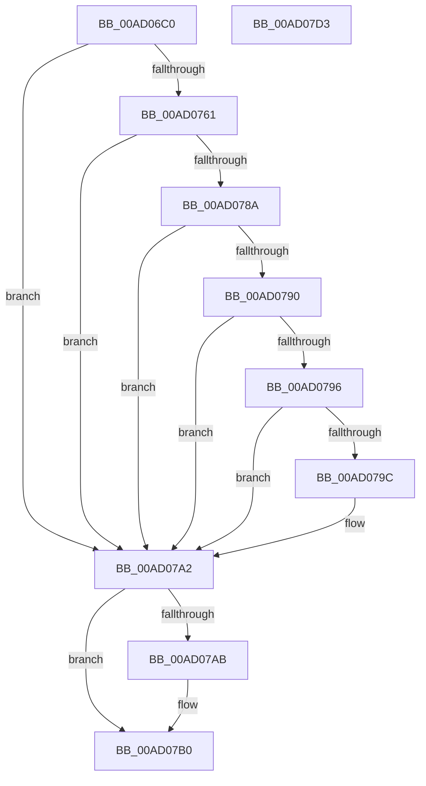

# PerfDiagpIsTracingAllowed

- RVA: `0x00AD06C0`–`0x00AD07D4` (길이 `276` bytes)
- VA: `0x0000000140AD06C0`
- 실행 섹션: `PAGE`
- PDB 이름 있음: `예`; PDB Function 태그: `아니요`
- unwind 정보 RVA: `0x000BE908`
- 디코드: `71`개 명령, `276/276` bytes 표시
- 미해석 바이트: `0` (있으면 어셈블리에 `.byte`로 보존)

> 이 문서는 커널 이미지의 기계어와 PDB 기호를 분석해 생성했습니다. 4번과 5번은 함수 원형과 자료형을 바이너리 사용 방식에서 추정한 C 해석이며 원본 소스 복구 결과는 아닙니다.

## 1. Dependencies

- 직접 호출 지점: **6**; 고유 호출 대상: **5**
- 직접 호출자로 확인된 함수: **2**
- RIP 상대 이미지 참조: **3**

### Outgoing calls
- `0x00AD070D` → [RtlInitUnicodeString](../../text/42/RtlInitUnicodeString_function_0042A780.md) (function, `0x0042A780`)
- `0x00AD071D` → [RtlInitUnicodeString](../../text/42/RtlInitUnicodeString_function_0042A780.md) (function, `0x0042A780`)
- `0x00AD0758` → [ZwOpenKey](../../text/6A/ZwOpenKey_function_006AD310.md) (function, `0x006AD310`)
- `0x00AD0781` → [ZwQueryValueKey](../../text/6A/ZwQueryValueKey_function_006AD3B0.md) (function, `0x006AD3B0`)
- `0x00AD07AB` → [ZwClose](../../text/6A/ZwClose_function_006AD2B0.md) (function, `0x006AD2B0`)
- `0x00AD07B9` → [_security_check_cookie](../../text/6A/_security_check_cookie_function_006AC640.md) (function, `0x006AC640`)

### Direct callers
- [PerfDiagpProxyWorker](../7A/PerfDiagpProxyWorker_function_007AEF20.md) at `0x007AEF97`
- [PerfDiagpStartPerfDiagLogger](../7A/PerfDiagpStartPerfDiagLogger_function_007AF144.md) at `0x007AF1B4`

### Static image references
- `0x00AD06D7` → RVA `0x00E0A740` (`.data`; read)
- `0x00AD06E7` → RVA `0x00B068D0` (` ?? ::NNGAKEGL::`string'`; read)
- `0x00AD0712` → RVA `0x00B06890` (` ?? ::NNGAKEGL::`string'`; read)

## 2. Other-region calls and transfers

- 다른 실행 섹션으로 향하는 call: **6**
  - `0x00AD070D` → [RtlInitUnicodeString](../../text/42/RtlInitUnicodeString_function_0042A780.md) (`PAGE` → `.text`)
  - `0x00AD071D` → [RtlInitUnicodeString](../../text/42/RtlInitUnicodeString_function_0042A780.md) (`PAGE` → `.text`)
  - `0x00AD0758` → [ZwOpenKey](../../text/6A/ZwOpenKey_function_006AD310.md) (`PAGE` → `.text`)
  - `0x00AD0781` → [ZwQueryValueKey](../../text/6A/ZwQueryValueKey_function_006AD3B0.md) (`PAGE` → `.text`)
  - `0x00AD07AB` → [ZwClose](../../text/6A/ZwClose_function_006AD2B0.md) (`PAGE` → `.text`)
  - `0x00AD07B9` → [_security_check_cookie](../../text/6A/_security_check_cookie_function_006AC640.md) (`PAGE` → `.text`)
- 별도 외부 분기/꼬리 이동을 확인하지 못했습니다.

## 3. Assembly (complete function range)

```asm
00AD06C0  48 89 5C 24 08                  mov qword ptr [rsp + 8], rbx
00AD06C5  48 89 7C 24 10                  mov qword ptr [rsp + 0x10], rdi
00AD06CA  55                              push rbp
00AD06CB  48 8D 6C 24 A9                  lea rbp, [rsp - 0x57]
00AD06D0  48 81 EC B0 00 00 00            sub rsp, 0xb0
00AD06D7  48 8B 05 62 A0 33 00            mov rax, qword ptr [rip + 0x33a062]
00AD06DE  48 33 C4                        xor rax, rsp
00AD06E1  48 89 45 4F                     mov qword ptr [rbp + 0x4f], rax
00AD06E5  33 FF                           xor edi, edi
00AD06E7  48 8D 15 E2 61 03 00            lea rdx, [rip + 0x361e2]
00AD06EE  0F 57 C0                        xorps xmm0, xmm0
00AD06F1  89 7D 0B                        mov dword ptr [rbp + 0xb], edi
00AD06F4  0F 57 C9                        xorps xmm1, xmm1
00AD06F7  89 7D 23                        mov dword ptr [rbp + 0x23], edi
00AD06FA  48 8D 4D E7                     lea rcx, [rbp - 0x19]
00AD06FE  48 89 7D DF                     mov qword ptr [rbp - 0x21], rdi
00AD0702  8D 5F 01                        lea ebx, [rdi + 1]
00AD0705  0F 11 45 E7                     movups xmmword ptr [rbp - 0x19], xmm0
00AD0709  0F 11 4D F7                     movups xmmword ptr [rbp - 9], xmm1
00AD070D  E8 6E A0 95 FF                  call 0x14042a780
00AD0712  48 8D 15 77 61 03 00            lea rdx, [rip + 0x36177]
00AD0719  48 8D 4D F7                     lea rcx, [rbp - 9]
00AD071D  E8 5E A0 95 FF                  call 0x14042a780
00AD0722  48 8D 45 E7                     lea rax, [rbp - 0x19]
00AD0726  C7 45 D7 18 00 00 00            mov dword ptr [rbp - 0x29], 0x18
00AD072D  0F 57 C0                        xorps xmm0, xmm0
00AD0730  48 89 45 17                     mov qword ptr [rbp + 0x17], rax
00AD0734  4C 8D 45 07                     lea r8, [rbp + 7]
00AD0738  C7 45 07 30 00 00 00            mov dword ptr [rbp + 7], 0x30
00AD073F  BA 19 00 02 00                  mov edx, 0x20019
00AD0744  48 89 7D 0F                     mov qword ptr [rbp + 0xf], rdi
00AD0748  48 8D 4D DF                     lea rcx, [rbp - 0x21]
00AD074C  C7 45 1F 40 02 00 00            mov dword ptr [rbp + 0x1f], 0x240
00AD0753  F3 0F 7F 45 27                  movdqu xmmword ptr [rbp + 0x27], xmm0
00AD0758  E8 B3 CB BD FF                  call 0x1406ad310
00AD075D  85 C0                           test eax, eax
00AD075F  78 41                           js 0x140ad07a2
00AD0761  48 8B 4D DF                     mov rcx, qword ptr [rbp - 0x21]
00AD0765  48 8D 45 D7                     lea rax, [rbp - 0x29]
00AD0769  48 89 44 24 28                  mov qword ptr [rsp + 0x28], rax
00AD076E  4C 8D 4D 37                     lea r9, [rbp + 0x37]
00AD0772  8B 45 D7                        mov eax, dword ptr [rbp - 0x29]
00AD0775  44 8D 47 02                     lea r8d, [rdi + 2]
00AD0779  48 8D 55 F7                     lea rdx, [rbp - 9]
00AD077D  89 44 24 20                     mov dword ptr [rsp + 0x20], eax
00AD0781  E8 2A CC BD FF                  call 0x1406ad3b0
00AD0786  85 C0                           test eax, eax
00AD0788  78 18                           js 0x140ad07a2
00AD078A  83 7D D7 10                     cmp dword ptr [rbp - 0x29], 0x10
00AD078E  72 12                           jb 0x140ad07a2
00AD0790  83 7D 3B 04                     cmp dword ptr [rbp + 0x3b], 4
00AD0794  75 0C                           jne 0x140ad07a2
00AD0796  83 7D 3F 04                     cmp dword ptr [rbp + 0x3f], 4
00AD079A  75 06                           jne 0x140ad07a2
00AD079C  39 7D 43                        cmp dword ptr [rbp + 0x43], edi
00AD079F  0F 45 DF                        cmovne ebx, edi
00AD07A2  48 8B 4D DF                     mov rcx, qword ptr [rbp - 0x21]
00AD07A6  48 85 C9                        test rcx, rcx
00AD07A9  74 05                           je 0x140ad07b0
00AD07AB  E8 00 CB BD FF                  call 0x1406ad2b0
00AD07B0  8B C3                           mov eax, ebx
00AD07B2  48 8B 4D 4F                     mov rcx, qword ptr [rbp + 0x4f]
00AD07B6  48 33 CC                        xor rcx, rsp
00AD07B9  E8 82 BE BD FF                  call 0x1406ac640
00AD07BE  4C 8D 9C 24 B0 00 00 00         lea r11, [rsp + 0xb0]
00AD07C6  49 8B 5B 10                     mov rbx, qword ptr [r11 + 0x10]
00AD07CA  49 8B 7B 18                     mov rdi, qword ptr [r11 + 0x18]
00AD07CE  49 8B E3                        mov rsp, r11
00AD07D1  5D                              pop rbp
00AD07D2  C3                              ret
00AD07D3  CC                              int3
```

## 4. C-style interpretation (structured pseudocode)

```c
__int64 __fastcall PerfDiagpIsTracingAllowed(void)
{
    __int64 result;
    __int64 v_rbx;
    __int64 v_rdi;
    __int64 v_rsp;
    unsigned __int64 v_stack_m10;
    unsigned int v_stack_m1C;
    unsigned int v_stack_m20;
    unsigned int v_stack_m24;
    unsigned __int64 v_stack_m28;
    unsigned __int64 v_stack_m38;
    unsigned int v_stack_m3C;
    unsigned int v_stack_m40;
    unsigned __int64 v_stack_m48;
    unsigned __int64 v_stack_m50;
    unsigned int v_stack_m54;
    unsigned __int64 v_stack_m58;
    unsigned __int64 v_stack_m5F;
    unsigned __int64 v_stack_m68;
    unsigned __int64 v_stack_m78;
    unsigned __int64 v_stack_m8;
    unsigned __int64 v_stack_m80;
    unsigned int v_stack_m88;
    unsigned __int64 v_stack_m90;
    unsigned int v_stack_m98;
    unsigned __int64 v_stack_p10;
    unsigned __int64 v_stack_p8;

    v_stack_p8 = v_rbx;
    v_stack_p10 = v_rdi;
    v_rsp = (v_rsp) - (176);
    result = (*(unsigned __int64 *)(v_rip + 3383394)) ^ (v_rsp);
    v_stack_m10 = result;
    v_rdi = 0;
    v_stack_m54 = 0;
    v_stack_m3C = 0;
    v_stack_m80 = 0;
    v_stack_m78 = v_xmm0;
    v_stack_m68 = v_xmm1;
    result = RtlInitUnicodeString(v_stack_m78, v_rip + 221666, a3, a4);
    result = RtlInitUnicodeString(v_stack_m68, v_rip + 221559, a3, a4);
    v_stack_m88 = 24;
    v_stack_m48 = v_stack_m78;
    v_stack_m58 = 48;
    v_stack_m50 = 0;
    v_stack_m40 = 576;
    v_stack_m38 = v_xmm0;
    result = ZwOpenKey(v_stack_m80, (unsigned int)(0x20019ULL), v_stack_m58, a4);
    if (sign_flag) goto loc_00AD07A2;
    v_stack_m90 = v_stack_m88;
    v_stack_m98 = (unsigned int)((unsigned int)(v_stack_m88));
    result = ZwQueryValueKey(v_stack_m80, v_stack_m68, v_rdi + 2, v_stack_m28);
    if (sign_flag) goto loc_00AD07A2;
    if (v_stack_m88 < 16) goto loc_00AD07A2;
    if (v_stack_m24 != 4) goto loc_00AD07A2;
    v_rbx = v_rdi + 1;
    if (v_stack_m20 == 4) {
        v_rbx = v_rdi + 1;
        if (v_stack_m1C != 0) { v_rbx = 0; }
    }
    if (v_stack_m80 != 0) {
        result = ZwClose(v_stack_m80, v_stack_m68, v_rdi + 2, v_stack_m28);
    }
    a1 = (v_stack_m10) ^ (v_rsp);
    result = _security_check_cookie(a1, v_stack_m68, v_rdi + 2, v_stack_m28);
    return result;
}
```

## 5. (Beta) C Style

```c
void PerfDiagpIsTracingAllowed(void)
{
    int64_t result;
    int64_t local_rbx;
    int64_t local_rdi;
    int64_t local_rsp;
    uint64_t v_stack_m10;
    uint32_t v_stack_m1C;
    uint32_t v_stack_m20;
    uint32_t v_stack_m24;
    uint64_t v_stack_m28;
    uint64_t v_stack_m38;
    uint32_t v_stack_m3C;
    uint32_t v_stack_m40;
    uint64_t v_stack_m48;
    uint64_t v_stack_m50;
    uint32_t v_stack_m54;
    uint64_t v_stack_m58;
    uint64_t v_stack_m5F;
    uint64_t v_stack_m68;
    uint64_t v_stack_m78;
    uint64_t v_stack_m8;
    uint64_t v_stack_m80;
    uint32_t v_stack_m88;
    uint64_t v_stack_m90;
    uint32_t v_stack_m98;
    uint64_t v_stack_p10;
    uint64_t v_stack_p8;

    v_stack_p8 = local_rbx;
    v_stack_p10 = local_rdi;
    local_rsp = (local_rsp) - (176);
    result = (*(uint64_t *)(v_rip + 0x33A062)) ^ (local_rsp);
    v_stack_m10 = result;
    local_rdi = 0;
    v_stack_m54 = 0;
    v_stack_m3C = 0;
    v_stack_m80 = 0;
    v_stack_m78 = v_xmm0;
    v_stack_m68 = v_xmm1;
    result = RtlInitUnicodeString(v_stack_m78, v_rip + 221666, a3, a4);
    result = RtlInitUnicodeString(v_stack_m68, v_rip + 221559, a3, a4);
    v_stack_m88 = 24;
    v_stack_m48 = v_stack_m78;
    v_stack_m58 = 48;
    v_stack_m50 = 0;
    v_stack_m40 = 576;
    v_stack_m38 = v_xmm0;
    result = ZwOpenKey(v_stack_m80, (uint32_t)(0x20019ULL), v_stack_m58, a4);
    if (sign_flag) goto loc_00AD07A2;
    v_stack_m90 = v_stack_m88;
    v_stack_m98 = (uint32_t)((uint32_t)(v_stack_m88));
    result = ZwQueryValueKey(v_stack_m80, v_stack_m68, local_rdi + 2, v_stack_m28);
    if (sign_flag) goto loc_00AD07A2;
    if (v_stack_m88 < 16) goto loc_00AD07A2;
    if (v_stack_m24 != 4) goto loc_00AD07A2;
    local_rbx = local_rdi + 1;
    if (v_stack_m20 == 4) {
        local_rbx = local_rdi + 1;
        if (v_stack_m1C != 0) { local_rbx = 0; }
    }
    if (v_stack_m80 != 0) {
        result = ZwClose(v_stack_m80, v_stack_m68, local_rdi + 2, v_stack_m28);
    }
    a1 = (v_stack_m10) ^ (local_rsp);
    result = _security_check_cookie(a1, v_stack_m68, local_rdi + 2, v_stack_m28);
    return result;
}
```

## 6. Execution-region graph

[열기: 2D/3D 그래프와 함수 탐색 컨트롤 패널](../../../control-panel.html?section=page&rva=0x00AD06C0&view=graph)

- 2D 그래프는 위에서 아래로 흐르고, 3D 그래프는 빈 공간을 드래그해 회전합니다. Shift+드래그는 이동, 휠은 확대·축소, 함수 노드 선택은 대상 보고서 이동입니다.

### Static fallback


