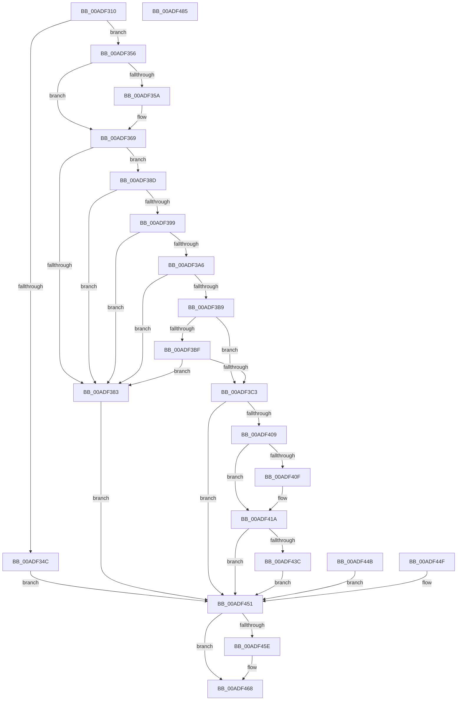

# PfpDeprioritizeOldPagesInWs

- RVA: `0x00ADF310`–`0x00ADF486` (길이 `374` bytes)
- VA: `0x0000000140ADF310`
- 실행 섹션: `PAGE`
- PDB 이름 있음: `예`; PDB Function 태그: `아니요`
- unwind 정보 RVA: `0x000CB978`
- 디코드: `105`개 명령, `374/374` bytes 표시
- 미해석 바이트: `0` (있으면 어셈블리에 `.byte`로 보존)

> 이 문서는 커널 이미지의 기계어와 PDB 기호를 분석해 생성했습니다. 4번과 5번은 함수 원형과 자료형을 바이너리 사용 방식에서 추정한 C 해석이며 원본 소스 복구 결과는 아닙니다.

## 1. Dependencies

- 직접 호출 지점: **5**; 고유 호출 대상: **5**
- 직접 호출자로 확인된 함수: **1**
- RIP 상대 이미지 참조: **1**

### Outgoing calls
- `0x00ADF364` → [ProbeForWrite](../8E/ProbeForWrite_function_008E91C0.md) (function, `0x008E91C0`)
- `0x00ADF376` → [memcpy](../../text/6C/memcpy_function_006C6840.md) (function, `0x006C6840`)
- `0x00ADF3FE` → [ObpReferenceObjectByHandleWithTag](../86/ObpReferenceObjectByHandleWithTag_function_00869650.md) (function, `0x00869650`)
- `0x00ADF431` → [MmUpdateOldWorkingSetPages](../../text/4E/MmUpdateOldWorkingSetPages_function_004EDF18.md) (function, `0x004EDF18`)
- `0x00ADF463` → [ObfDereferenceObjectWithTag](../../text/2F/ObfDereferenceObjectWithTag_function_002F78E0.md) (function, `0x002F78E0`)

### Direct callers
- [PfSetSuperfetchInformation](PfSetSuperfetchInformation_function_00ADE6E8.md) at `0x00ADED11`

### Static image references
- `0x00ADF3C9` → RVA `0x00FC6A98` (`ALMOSTRO`; read)

## 2. Other-region calls and transfers

- 다른 실행 섹션으로 향하는 call: **3**
  - `0x00ADF376` → [memcpy](../../text/6C/memcpy_function_006C6840.md) (`PAGE` → `.text`)
  - `0x00ADF431` → [MmUpdateOldWorkingSetPages](../../text/4E/MmUpdateOldWorkingSetPages_function_004EDF18.md) (`PAGE` → `.text`)
  - `0x00ADF463` → [ObfDereferenceObjectWithTag](../../text/2F/ObfDereferenceObjectWithTag_function_002F78E0.md) (`PAGE` → `.text`)
- 별도 외부 분기/꼬리 이동을 확인하지 못했습니다.

## 3. Assembly (complete function range)

```asm
00ADF310  4C 8B DC                        mov r11, rsp
00ADF313  49 89 5B 10                     mov qword ptr [r11 + 0x10], rbx
00ADF317  49 89 73 18                     mov qword ptr [r11 + 0x18], rsi
00ADF31B  49 89 7B 20                     mov qword ptr [r11 + 0x20], rdi
00ADF31F  41 54                           push r12
00ADF321  41 56                           push r14
00ADF323  41 57                           push r15
00ADF325  48 83 EC 60                     sub rsp, 0x60
00ADF329  8A DA                           mov bl, dl
00ADF32B  4C 8B F9                        mov r15, rcx
00ADF32E  33 C0                           xor eax, eax
00ADF330  0F 57 C0                        xorps xmm0, xmm0
00ADF333  0F 11 44 24 40                  movups xmmword ptr [rsp + 0x40], xmm0
00ADF338  49 89 43 D8                     mov qword ptr [r11 - 0x28], rax
00ADF33C  89 44 24 58                     mov dword ptr [rsp + 0x58], eax
00ADF340  49 21 43 08                     and qword ptr [r11 + 8], rax
00ADF344  8D 50 20                        lea edx, [rax + 0x20]
00ADF347  39 51 18                        cmp dword ptr [rcx + 0x18], edx
00ADF34A  74 0A                           je 0x140adf356
00ADF34C  BB 06 02 00 C0                  mov ebx, 0xc0000206
00ADF351  E9 FB 00 00 00                  jmp 0x140adf451
00ADF356  84 DB                           test bl, bl
00ADF358  74 0F                           je 0x140adf369
00ADF35A  41 B8 08 00 00 00               mov r8d, 8
00ADF360  48 8B 49 10                     mov rcx, qword ptr [rcx + 0x10]
00ADF364  E8 57 9E E0 FF                  call 0x1408e91c0
00ADF369  45 8B 47 18                     mov r8d, dword ptr [r15 + 0x18]
00ADF36D  49 8B 57 10                     mov rdx, qword ptr [r15 + 0x10]
00ADF371  48 8D 4C 24 40                  lea rcx, [rsp + 0x40]
00ADF376  E8 C5 74 BE FF                  call 0x1406c6840
00ADF37B  90                              nop
00ADF37C  83 7C 24 40 04                  cmp dword ptr [rsp + 0x40], 4
00ADF381  74 0A                           je 0x140adf38d
00ADF383  BB 0D 00 00 C0                  mov ebx, 0xc000000d
00ADF388  E9 C4 00 00 00                  jmp 0x140adf451
00ADF38D  8B 74 24 50                     mov esi, dword ptr [rsp + 0x50]
00ADF391  F7 C6 00 FE FF FF               test esi, 0xfffffe00
00ADF397  75 EA                           jne 0x140adf383
00ADF399  44 8B F6                        mov r14d, esi
00ADF39C  41 83 E6 0F                     and r14d, 0xf
00ADF3A0  41 83 FE 08                     cmp r14d, 8
00ADF3A4  77 DD                           ja 0x140adf383
00ADF3A6  8B FE                           mov edi, esi
00ADF3A8  C1 EF 04                        shr edi, 4
00ADF3AB  41 BC 03 00 00 00               mov r12d, 3
00ADF3B1  41 23 FC                        and edi, r12d
00ADF3B4  41 3B FC                        cmp edi, r12d
00ADF3B7  73 CA                           jae 0x140adf383
00ADF3B9  41 83 FE 08                     cmp r14d, 8
00ADF3BD  75 04                           jne 0x140adf3c3
00ADF3BF  85 FF                           test edi, edi
00ADF3C1  74 C0                           je 0x140adf383
00ADF3C3  C1 EE 06                        shr esi, 6
00ADF3C6  83 E6 07                        and esi, 7
00ADF3C9  4C 8B 05 C8 76 4E 00            mov r8, qword ptr [rip + 0x4e76c8]
00ADF3D0  48 83 64 24 38 00               and qword ptr [rsp + 0x38], 0
00ADF3D6  48 83 64 24 30 00               and qword ptr [rsp + 0x30], 0
00ADF3DC  48 8D 84 24 80 00 00 00         lea rax, [rsp + 0x80]
00ADF3E4  48 89 44 24 28                  mov qword ptr [rsp + 0x28], rax
00ADF3E9  C7 44 24 20 50 66 57 73         mov dword ptr [rsp + 0x20], 0x73576650
00ADF3F1  44 8A CB                        mov r9b, bl
00ADF3F4  BA 00 20 00 00                  mov edx, 0x2000
00ADF3F9  48 8B 4C 24 48                  mov rcx, qword ptr [rsp + 0x48]
00ADF3FE  E8 4D A2 D8 FF                  call 0x140869650
00ADF403  8B D8                           mov ebx, eax
00ADF405  85 C0                           test eax, eax
00ADF407  78 48                           js 0x140adf451
00ADF409  33 C0                           xor eax, eax
00ADF40B  85 FF                           test edi, edi
00ADF40D  74 0B                           je 0x140adf41a
00ADF40F  B8 01 00 00 00                  mov eax, 1
00ADF414  3B F8                           cmp edi, eax
00ADF416  41 0F 44 C4                     cmove eax, r12d
00ADF41A  89 44 24 20                     mov dword ptr [rsp + 0x20], eax
00ADF41E  4C 8D 4C 24 58                  lea r9, [rsp + 0x58]
00ADF423  44 8B C6                        mov r8d, esi
00ADF426  41 8B D6                        mov edx, r14d
00ADF429  48 8B 8C 24 80 00 00 00         mov rcx, qword ptr [rsp + 0x80]
00ADF431  E8 E2 EA A0 FF                  call 0x1404edf18
00ADF436  8B D8                           mov ebx, eax
00ADF438  85 C0                           test eax, eax
00ADF43A  78 15                           js 0x140adf451
00ADF43C  49 8B 4F 10                     mov rcx, qword ptr [r15 + 0x10]
00ADF440  48 8B 44 24 58                  mov rax, qword ptr [rsp + 0x58]
00ADF445  48 89 41 18                     mov qword ptr [rcx + 0x18], rax
00ADF449  EB 06                           jmp 0x140adf451
00ADF44B  8B D8                           mov ebx, eax
00ADF44D  EB 02                           jmp 0x140adf451
00ADF44F  8B D8                           mov ebx, eax
00ADF451  48 8B 8C 24 80 00 00 00         mov rcx, qword ptr [rsp + 0x80]
00ADF459  48 85 C9                        test rcx, rcx
00ADF45C  74 0A                           je 0x140adf468
00ADF45E  BA 50 66 57 73                  mov edx, 0x73576650
00ADF463  E8 78 84 81 FF                  call 0x1402f78e0
00ADF468  8B C3                           mov eax, ebx
00ADF46A  4C 8D 5C 24 60                  lea r11, [rsp + 0x60]
00ADF46F  49 8B 5B 28                     mov rbx, qword ptr [r11 + 0x28]
00ADF473  49 8B 73 30                     mov rsi, qword ptr [r11 + 0x30]
00ADF477  49 8B 7B 38                     mov rdi, qword ptr [r11 + 0x38]
00ADF47B  49 8B E3                        mov rsp, r11
00ADF47E  41 5F                           pop r15
00ADF480  41 5E                           pop r14
00ADF482  41 5C                           pop r12
00ADF484  C3                              ret
00ADF485  CC                              int3
```

## 4. C-style interpretation (structured pseudocode)

```c
__int64 __fastcall PfpDeprioritizeOldPagesInWs(__int64 a1, unsigned __int8 a2)
{
    __int64 result;
    __int64 v_r14;
    __int64 v_rdi;
    __int64 v_rsi;
    __int64 v_rsp;
    unsigned __int64 v_stack_m18;
    unsigned int v_stack_m20;
    unsigned int v_stack_m28;
    unsigned __int64 v_stack_m30;
    unsigned __int64 v_stack_m38;
    unsigned __int64 v_stack_m40;
    unsigned __int64 v_stack_m48;
    unsigned __int64 v_stack_m50;
    unsigned int v_stack_m58;
    unsigned __int64 v_stack_p8;

    *(unsigned __int64 *)(v_rsp + 16) = v_rbx;
    *(unsigned __int64 *)(v_rsp + 24) = v_rsi;
    *(unsigned __int64 *)(v_rsp + 32) = v_rdi;
    v_rsp = (v_rsp) - (96);
    result = 0;
    v_stack_m38 = v_xmm0;
    *(unsigned __int64 *)(v_rsp - 40) = 0;
    v_stack_m20 = 0;
    if ((*(unsigned int *)(a1 + 24)) == ((unsigned int)(result + 32))) goto loc_00ADF356;
    goto loc_00ADF451;
loc_00ADF356:
    if ((unsigned __int8)((unsigned int)(0xC0000206ULL)) != 0) {
        a3 = 8;
        a1 = *(unsigned __int64 *)(a1 + 16);
        result = ProbeForWrite(a1, result + 32, a3, a4);
    }
    result = memcpy(v_stack_m38, *(unsigned __int64 *)(a1 + 16), (unsigned int)(*(unsigned int *)(a1 + 24)), a4);
    if (v_stack_m38 == 4) goto loc_00ADF38D;
loc_00ADF383:
    goto loc_00ADF451;
loc_00ADF38D:
    if ((((unsigned int)((unsigned int)(v_stack_m28))) & (0xFFFFFE00ULL)) != 0) goto loc_00ADF383;
    v_r14 = (unsigned int)(((unsigned int)((unsigned int)((unsigned int)(v_stack_m28)))) & (15));
    if (((unsigned int)(v_r14)) > 8) goto loc_00ADF383;
    v_rdi = (unsigned int)(((unsigned int)((unsigned int)((unsigned int)(v_stack_m28)))) >> (4));
    v_rdi = (unsigned int)((v_rdi) & (3));
    if (((unsigned int)(v_rdi)) >= 3) goto loc_00ADF383;
    if (((unsigned int)(v_r14)) != 8) goto loc_00ADF3C3;
    if ((unsigned int)(v_rdi) == 0) goto loc_00ADF383;
loc_00ADF3C3:
    v_rsi = (unsigned int)(((unsigned int)(v_stack_m28)) >> (6));
    v_rsi = (unsigned int)((v_rsi) & (7));
    v_stack_m50 = v_stack_p8;
    v_stack_m58 = 0x73576650ULL;
    result = ObpReferenceObjectByHandleWithTag(v_stack_m30, (unsigned int)(0x2000ULL), *(unsigned __int64 *)(v_rip + 5142216), (unsigned __int8)((unsigned int)(0xC000000DULL)));
    if (sign_flag) goto loc_00ADF451;
    result = 0;
    if ((unsigned int)(v_rdi) != 0) {
        result = 1;
        if (((unsigned int)(v_rdi)) == ((unsigned int)(result))) { result = 3; }
    }
    v_stack_m58 = (unsigned int)(result);
    result = MmUpdateOldWorkingSetPages(v_stack_p8, (unsigned int)((unsigned int)(v_r14)), (unsigned int)((unsigned int)(v_rsi)), v_stack_m20);
    if (sign_flag) goto loc_00ADF451;
    *(unsigned __int64 *)(*(unsigned __int64 *)(a1 + 16) + 24) = v_stack_m20;
    goto loc_00ADF451;
loc_00ADF451:
    result = v_stack_m20;
    if (v_stack_p8 != 0) {
        a2 = 0x73576650ULL;
        result = ObfDereferenceObjectWithTag(v_stack_p8, a2, (unsigned int)((unsigned int)(v_rsi)), v_stack_m20);
    }
    return (unsigned int)((unsigned int)((unsigned int)((unsigned int)(result))));
}
```

## 5. (Beta) C Style

```c
int64_t PfpDeprioritizeOldPagesInWs(void *Arg1, uint8_t Arg2)
{
    uint8_t *arg1 = (uint8_t *)Arg1;

    int64_t result;
    int64_t local_r14;
    int64_t local_rdi;
    int64_t local_rsi;
    int64_t local_rsp;
    uint64_t v_stack_m18;
    uint32_t v_stack_m20;
    uint32_t v_stack_m28;
    uint64_t v_stack_m30;
    uint64_t v_stack_m38;
    uint64_t v_stack_m40;
    uint64_t v_stack_m48;
    uint64_t v_stack_m50;
    uint32_t v_stack_m58;
    uint64_t v_stack_p8;

    *(uint64_t *)(local_rsp + 0x10) = local_rbx;
    *(uint64_t *)(local_rsp + 0x18) = local_rsi;
    *(uint64_t *)(local_rsp + 0x20) = local_rdi;
    local_rsp = (local_rsp) - (96);
    result = 0;
    v_stack_m38 = v_xmm0;
    *(uint64_t *)(local_rsp - 0x28) = 0;
    v_stack_m20 = 0;
    if ((*(uint32_t *)(arg1 + 0x18)) == ((uint32_t)(result + 32))) goto loc_00ADF356;
    goto loc_00ADF451;
loc_00ADF356:
    if ((uint8_t)((uint32_t)(0xC0000206ULL)) != 0) {
        a3 = 8;
        Arg1 = *(uint64_t *)(arg1 + 0x10);
        result = ProbeForWrite(Arg1, result + 32, a3, a4);
    }
    result = memcpy(v_stack_m38, *(uint64_t *)(arg1 + 0x10), (uint32_t)(*(uint32_t *)(arg1 + 0x18)), a4);
    if (v_stack_m38 == 4) goto loc_00ADF38D;
loc_00ADF383:
    goto loc_00ADF451;
loc_00ADF38D:
    if ((((uint32_t)((uint32_t)(v_stack_m28))) & (0xFFFFFE00ULL)) != 0) goto loc_00ADF383;
    local_r14 = (uint32_t)(((uint32_t)((uint32_t)((uint32_t)(v_stack_m28)))) & (15));
    if (((uint32_t)(local_r14)) > 8) goto loc_00ADF383;
    local_rdi = (uint32_t)(((uint32_t)((uint32_t)((uint32_t)(v_stack_m28)))) >> (4));
    local_rdi = (uint32_t)((local_rdi) & (3));
    if (((uint32_t)(local_rdi)) >= 3) goto loc_00ADF383;
    if (((uint32_t)(local_r14)) != 8) goto loc_00ADF3C3;
    if ((uint32_t)(local_rdi) == 0) goto loc_00ADF383;
loc_00ADF3C3:
    local_rsi = (uint32_t)(((uint32_t)(v_stack_m28)) >> (6));
    local_rsi = (uint32_t)((local_rsi) & (7));
    v_stack_m50 = v_stack_p8;
    v_stack_m58 = 0x73576650ULL;
    result = ObpReferenceObjectByHandleWithTag(v_stack_m30, (uint32_t)(0x2000ULL), *(uint64_t *)(v_rip + 0x4E76C8), (uint8_t)((uint32_t)(0xC000000DULL)));
    if (sign_flag) goto loc_00ADF451;
    result = 0;
    if ((uint32_t)(local_rdi) != 0) {
        result = 1;
        if (((uint32_t)(local_rdi)) == ((uint32_t)(result))) { result = 3; }
    }
    v_stack_m58 = (uint32_t)(result);
    result = MmUpdateOldWorkingSetPages(v_stack_p8, (uint32_t)((uint32_t)(local_r14)), (uint32_t)((uint32_t)(local_rsi)), v_stack_m20);
    if (sign_flag) goto loc_00ADF451;
    *(uint64_t *)(*(uint64_t *)(arg1 + 0x10) + 0x18) = v_stack_m20;
    goto loc_00ADF451;
loc_00ADF451:
    result = v_stack_m20;
    if (v_stack_p8 != 0) {
        Arg2 = 0x73576650ULL;
        result = ObfDereferenceObjectWithTag(v_stack_p8, Arg2, (uint32_t)((uint32_t)(local_rsi)), v_stack_m20);
    }
    return (uint32_t)((uint32_t)((uint32_t)((uint32_t)(result))));
}
```

### 관측된 메모리 오프셋

구조체 형식이 확인되지 않은 접근은 인자 기준의 오프셋으로만 기록했습니다.

| 기준 인자 | 오프셋 표현 | 폭 (bit) | 접근 |
|---|---:|---:|---|
| `Arg1` | `+ 0x10` | `64` | `R` |
| `Arg1` | `+ 0x18` | `32` | `R` |

## 6. Execution-region graph

[열기: 2D/3D 그래프와 함수 탐색 컨트롤 패널](../../../control-panel.html?section=page&rva=0x00ADF310&view=graph)

- 2D 그래프는 위에서 아래로 흐르고, 3D 그래프는 빈 공간을 드래그해 회전합니다. Shift+드래그는 이동, 휠은 확대·축소, 함수 노드 선택은 대상 보고서 이동입니다.

### Static fallback


