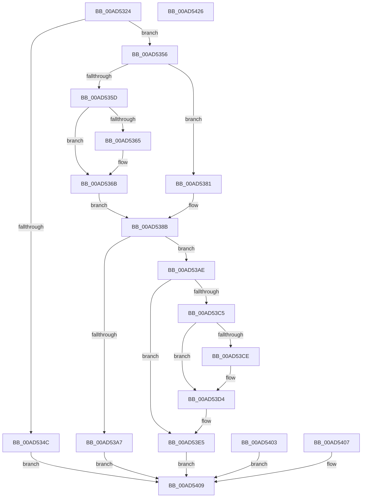

# PfpQueryScenarioInformation

- RVA: `0x00AD5324`–`0x00AD5427` (길이 `259` bytes)
- VA: `0x0000000140AD5324`
- 실행 섹션: `PAGE`
- PDB 이름 있음: `예`; PDB Function 태그: `아니요`
- unwind 정보 RVA: `0x000BED84`
- 디코드: `74`개 명령, `259/259` bytes 표시
- 미해석 바이트: `0` (있으면 어셈블리에 `.byte`로 보존)

> 이 문서는 커널 이미지의 기계어와 PDB 기호를 분석해 생성했습니다. 4번과 5번은 함수 원형과 자료형을 바이너리 사용 방식에서 추정한 C 해석이며 원본 소스 복구 결과는 아닙니다.

## 1. Dependencies

- 직접 호출 지점: **3**; 고유 호출 대상: **2**
- 직접 호출자로 확인된 함수: **1**
- RIP 상대 이미지 참조: **1**

### Outgoing calls
- `0x00AD5365` → [ExRaiseDatatypeMisalignment](../89/ExRaiseDatatypeMisalignment_function_00899FD0.md) (function, `0x00899FD0`)
- `0x00AD53BA` → [PfpScenCtxQueryScenarioInformation](../../pagelk/B7/PfpScenCtxQueryScenarioInformation_function_00B7D400.md) (function, `0x00B7D400`)
- `0x00AD53CE` → [ExRaiseDatatypeMisalignment](../89/ExRaiseDatatypeMisalignment_function_00899FD0.md) (function, `0x00899FD0`)

### Direct callers
- [PfQuerySuperfetchInformation](../90/PfQuerySuperfetchInformation_function_0090210C.md) at `0x0090242A`

### Static image references
- `0x00AD53B3` → RVA `0x00E670D0` (`.data`; read)

## 2. Other-region calls and transfers

- 다른 실행 섹션으로 향하는 call: **1**
  - `0x00AD53BA` → [PfpScenCtxQueryScenarioInformation](../../pagelk/B7/PfpScenCtxQueryScenarioInformation_function_00B7D400.md) (`PAGE` → `PAGELK`)
- 별도 외부 분기/꼬리 이동을 확인하지 못했습니다.

## 3. Assembly (complete function range)

```asm
00AD5324  48 8B C4                        mov rax, rsp
00AD5327  48 89 58 08                     mov qword ptr [rax + 8], rbx
00AD532B  48 89 70 10                     mov qword ptr [rax + 0x10], rsi
00AD532F  48 89 78 18                     mov qword ptr [rax + 0x18], rdi
00AD5333  4C 89 70 20                     mov qword ptr [rax + 0x20], r14
00AD5337  41 57                           push r15
00AD5339  48 83 EC 40                     sub rsp, 0x40
00AD533D  4D 8B F8                        mov r15, r8
00AD5340  44 8A F2                        mov r14b, dl
00AD5343  48 8B F9                        mov rdi, rcx
00AD5346  83 79 18 20                     cmp dword ptr [rcx + 0x18], 0x20
00AD534A  74 0A                           je 0x140ad5356
00AD534C  BB 06 02 00 C0                  mov ebx, 0xc0000206
00AD5351  E9 B3 00 00 00                  jmp 0x140ad5409
00AD5356  33 DB                           xor ebx, ebx
00AD5358  45 84 F6                        test r14b, r14b
00AD535B  74 24                           je 0x140ad5381
00AD535D  48 8B 41 10                     mov rax, qword ptr [rcx + 0x10]
00AD5361  A8 07                           test al, 7
00AD5363  74 06                           je 0x140ad536b
00AD5365  E8 66 4C DC FF                  call 0x140899fd0
00AD536A  CC                              int3
00AD536B  48 BE 00 00 FF FF FF 7F 00 00   movabs rsi, 0x7fffffff0000
00AD5375  48 3B C6                        cmp rax, rsi
00AD5378  48 0F 43 C6                     cmovae rax, rsi
00AD537C  90                              nop
00AD537D  8A 00                           mov al, byte ptr [rax]
00AD537F  EB 0A                           jmp 0x140ad538b
00AD5381  48 BE 00 00 FF FF FF 7F 00 00   movabs rsi, 0x7fffffff0000
00AD538B  48 8B 41 10                     mov rax, qword ptr [rcx + 0x10]
00AD538F  0F 10 00                        movups xmm0, xmmword ptr [rax]
00AD5392  0F 11 44 24 20                  movups xmmword ptr [rsp + 0x20], xmm0
00AD5397  0F 10 48 10                     movups xmm1, xmmword ptr [rax + 0x10]
00AD539B  0F 11 4C 24 30                  movups xmmword ptr [rsp + 0x30], xmm1
00AD53A0  83 7C 24 20 04                  cmp dword ptr [rsp + 0x20], 4
00AD53A5  74 07                           je 0x140ad53ae
00AD53A7  BB 0D 00 00 C0                  mov ebx, 0xc000000d
00AD53AC  EB 5B                           jmp 0x140ad5409
00AD53AE  48 8D 54 24 20                  lea rdx, [rsp + 0x20]
00AD53B3  48 8D 0D 16 1D 39 00            lea rcx, [rip + 0x391d16]
00AD53BA  E8 41 80 0A 00                  call 0x140b7d400
00AD53BF  90                              nop
00AD53C0  45 84 F6                        test r14b, r14b
00AD53C3  74 20                           je 0x140ad53e5
00AD53C5  48 8B 4F 10                     mov rcx, qword ptr [rdi + 0x10]
00AD53C9  F6 C1 07                        test cl, 7
00AD53CC  74 06                           je 0x140ad53d4
00AD53CE  E8 FD 4B DC FF                  call 0x140899fd0
00AD53D3  CC                              int3
00AD53D4  48 3B CE                        cmp rcx, rsi
00AD53D7  48 0F 43 CE                     cmovae rcx, rsi
00AD53DB  8A 01                           mov al, byte ptr [rcx]
00AD53DD  88 01                           mov byte ptr [rcx], al
00AD53DF  8A 41 1F                        mov al, byte ptr [rcx + 0x1f]
00AD53E2  88 41 1F                        mov byte ptr [rcx + 0x1f], al
00AD53E5  48 8B 47 10                     mov rax, qword ptr [rdi + 0x10]
00AD53E9  0F 10 44 24 20                  movups xmm0, xmmword ptr [rsp + 0x20]
00AD53EE  0F 11 00                        movups xmmword ptr [rax], xmm0
00AD53F1  0F 10 4C 24 30                  movups xmm1, xmmword ptr [rsp + 0x30]
00AD53F6  0F 11 48 10                     movups xmmword ptr [rax + 0x10], xmm1
00AD53FA  41 C7 07 20 00 00 00            mov dword ptr [r15], 0x20
00AD5401  EB 06                           jmp 0x140ad5409
00AD5403  8B D8                           mov ebx, eax
00AD5405  EB 02                           jmp 0x140ad5409
00AD5407  8B D8                           mov ebx, eax
00AD5409  8B C3                           mov eax, ebx
00AD540B  48 8B 5C 24 50                  mov rbx, qword ptr [rsp + 0x50]
00AD5410  48 8B 74 24 58                  mov rsi, qword ptr [rsp + 0x58]
00AD5415  48 8B 7C 24 60                  mov rdi, qword ptr [rsp + 0x60]
00AD541A  4C 8B 74 24 68                  mov r14, qword ptr [rsp + 0x68]
00AD541F  48 83 C4 40                     add rsp, 0x40
00AD5423  41 5F                           pop r15
00AD5425  C3                              ret
00AD5426  CC                              int3
```

## 4. C-style interpretation (structured pseudocode)

```c
__int64 __fastcall PfpQueryScenarioInformation(__int64 a1, unsigned __int8 a2, __int64 a3)
{
    __int64 result;
    __int64 v_rbx;
    __int64 v_rsp;
    unsigned __int64 v_stack_m18;
    unsigned __int64 v_stack_m28;
    unsigned __int64 v_stack_p10;
    unsigned __int64 v_stack_p18;
    unsigned __int64 v_stack_p20;
    unsigned __int64 v_stack_p8;

    *(unsigned __int64 *)(v_rsp + 8) = v_rbx;
    *(unsigned __int64 *)(v_rsp + 16) = v_rsi;
    *(unsigned __int64 *)(v_rsp + 24) = v_rdi;
    *(unsigned __int64 *)(v_rsp + 32) = v_r14;
    v_rsp = (v_rsp) - (64);
    if ((*(unsigned int *)(a1 + 24)) == 32) goto loc_00AD5356;
    goto loc_00AD5409;
loc_00AD5356:
    v_rbx = 0;
    if (a2 == 0) goto loc_00AD5381;
    result = *(unsigned __int64 *)(a1 + 16);
    if ((((unsigned __int8)(*(unsigned __int64 *)(a1 + 16))) & (7)) != 0) {
        result = ExRaiseDatatypeMisalignment(a1, a2, a3, a4);
    }
    if (result >= v_rsi) { result = v_rsi; }
    goto loc_00AD538B;
loc_00AD5381:
loc_00AD538B:
    v_stack_m28 = v_xmm0;
    v_stack_m18 = v_xmm1;
    if (v_stack_m28 == 4) goto loc_00AD53AE;
    goto loc_00AD5409;
loc_00AD53AE:
    result = PfpScenCtxQueryScenarioInformation(v_rip + 3742998, v_stack_m28, a3, a4);
    if (a2 == 0) goto loc_00AD53E5;
    if ((((unsigned __int8)(*(unsigned __int64 *)(a1 + 16))) & (7)) != 0) {
        result = ExRaiseDatatypeMisalignment(*(unsigned __int64 *)(a1 + 16), v_stack_m28, a3, a4);
    }
    a1 = *(unsigned __int64 *)(a1 + 16);
    if ((*(unsigned __int64 *)(a1 + 16)) >= v_rsi) { a1 = v_rsi; }
    *(unsigned __int8 *)(a1) = (unsigned __int8)(*(unsigned __int8 *)(a1));
    *(unsigned __int8 *)(a1 + 31) = (unsigned __int8)(*(unsigned __int8 *)(a1 + 31));
loc_00AD53E5:
    *(unsigned __int64 *)(*(unsigned __int64 *)(a1 + 16)) = v_xmm0;
    *(unsigned __int64 *)(*(unsigned __int64 *)(a1 + 16) + 16) = v_xmm1;
    *(unsigned int *)(a3) = 32;
    goto loc_00AD5409;
loc_00AD5409:
    v_rsp = (v_rsp) + (64);
    return (unsigned int)((unsigned int)((unsigned int)(0xC000000DULL)));
}
```

## 5. (Beta) C Style

```c
int64_t PfpQueryScenarioInformation(void *Arg1, uint8_t Arg2, void *Arg3)
{
    uint8_t *arg1 = (uint8_t *)Arg1;
    uint8_t *arg3 = (uint8_t *)Arg3;

    int64_t result;
    int64_t local_rbx;
    int64_t local_rsp;
    uint64_t v_stack_m18;
    uint64_t v_stack_m28;
    uint64_t v_stack_p10;
    uint64_t v_stack_p18;
    uint64_t v_stack_p20;
    uint64_t v_stack_p8;

    *(uint64_t *)(local_rsp + 0x8) = local_rbx;
    *(uint64_t *)(local_rsp + 0x10) = local_rsi;
    *(uint64_t *)(local_rsp + 0x18) = local_rdi;
    *(uint64_t *)(local_rsp + 0x20) = local_r14;
    local_rsp = (local_rsp) - (64);
    if ((*(uint32_t *)(arg1 + 0x18)) == 32) goto loc_00AD5356;
    goto loc_00AD5409;
loc_00AD5356:
    local_rbx = 0;
    if (Arg2 == 0) goto loc_00AD5381;
    result = *(uint64_t *)(arg1 + 0x10);
    if ((((uint8_t)(*(uint64_t *)(arg1 + 0x10))) & (7)) != 0) {
        result = ExRaiseDatatypeMisalignment(Arg1, Arg2, Arg3, a4);
    }
    if (result >= local_rsi) { result = local_rsi; }
    goto loc_00AD538B;
loc_00AD5381:
loc_00AD538B:
    v_stack_m28 = v_xmm0;
    v_stack_m18 = v_xmm1;
    if (v_stack_m28 == 4) goto loc_00AD53AE;
    goto loc_00AD5409;
loc_00AD53AE:
    result = PfpScenCtxQueryScenarioInformation(v_rip + 3742998, v_stack_m28, Arg3, a4);
    if (Arg2 == 0) goto loc_00AD53E5;
    if ((((uint8_t)(*(uint64_t *)(arg1 + 0x10))) & (7)) != 0) {
        result = ExRaiseDatatypeMisalignment(*(uint64_t *)(arg1 + 0x10), v_stack_m28, Arg3, a4);
    }
    Arg1 = *(uint64_t *)(arg1 + 0x10);
    if ((*(uint64_t *)(arg1 + 0x10)) >= local_rsi) { Arg1 = local_rsi; }
    *(uint8_t *)(arg1) = (uint8_t)(*(uint8_t *)(arg1));
    *(uint8_t *)(arg1 + 0x1F) = (uint8_t)(*(uint8_t *)(arg1 + 0x1F));
loc_00AD53E5:
    *(uint64_t *)(*(uint64_t *)(arg1 + 0x10)) = v_xmm0;
    *(uint64_t *)(*(uint64_t *)(arg1 + 0x10) + 0x10) = v_xmm1;
    *(uint32_t *)(arg3) = 32;
    goto loc_00AD5409;
loc_00AD5409:
    local_rsp = (local_rsp) + (64);
    return (uint32_t)((uint32_t)((uint32_t)(0xC000000DULL)));
}
```

### 관측된 메모리 오프셋

구조체 형식이 확인되지 않은 접근은 인자 기준의 오프셋으로만 기록했습니다.

| 기준 인자 | 오프셋 표현 | 폭 (bit) | 접근 |
|---|---:|---:|---|
| `Arg1` | `+ 0x10` | `64` | `R` |
| `Arg1` | `+ 0x18` | `32` | `R` |
| `Arg3` | `+ 0x0` | `32` | `W` |

## 6. Execution-region graph

[열기: 2D/3D 그래프와 함수 탐색 컨트롤 패널](../../../control-panel.html?section=page&rva=0x00AD5324&view=graph)

- 2D 그래프는 위에서 아래로 흐르고, 3D 그래프는 빈 공간을 드래그해 회전합니다. Shift+드래그는 이동, 휠은 확대·축소, 함수 노드 선택은 대상 보고서 이동입니다.

### Static fallback


