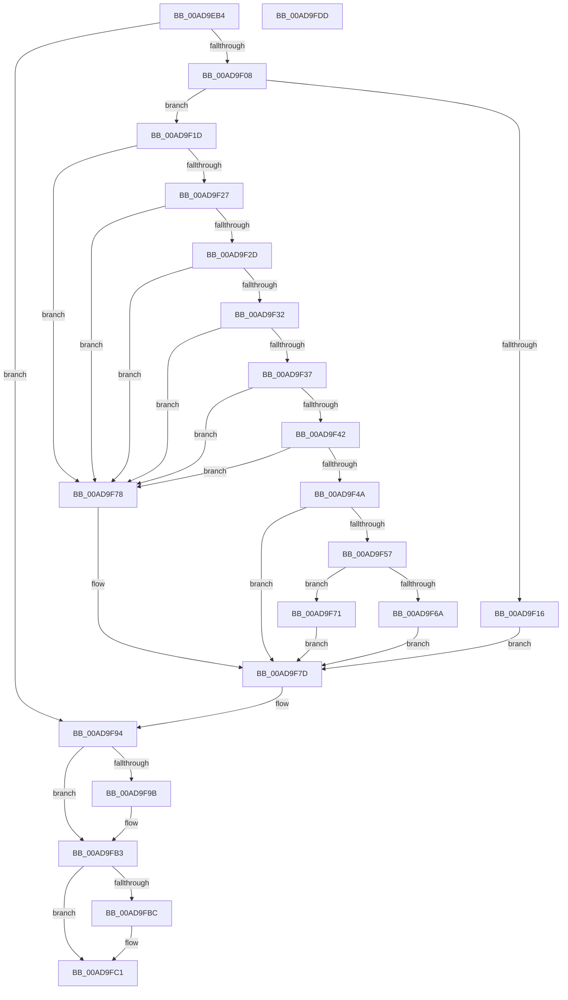

# PiCMDeleteClassKey

- RVA: `0x00AD9EB4`–`0x00AD9FDE` (길이 `298` bytes)
- VA: `0x0000000140AD9EB4`
- 실행 섹션: `PAGE`
- PDB 이름 있음: `예`; PDB Function 태그: `아니요`
- unwind 정보 RVA: `0x000BF36C`
- 디코드: `87`개 명령, `298/298` bytes 표시
- 미해석 바이트: `0` (있으면 어셈블리에 `.byte`로 보존)

> 이 문서는 커널 이미지의 기계어와 PDB 기호를 분석해 생성했습니다. 4번과 5번은 함수 원형과 자료형을 바이너리 사용 방식에서 추정한 C 해석이며 원본 소스 복구 결과는 아닙니다.

## 1. Dependencies

- 직접 호출 지점: **8**; 고유 호출 대상: **8**
- 직접 호출자로 확인된 함수: **1**
- RIP 상대 이미지 참조: **1**

### Outgoing calls
- `0x00AD9EF9` → [PiCMCaptureObjectInputData](../8E/PiCMCaptureObjectInputData_function_008E8220.md) (function, `0x008E8220`)
- `0x00AD9F0D` → [PiAuDoesClientHaveAccess](../96/PiAuDoesClientHaveAccess_function_00962940.md) (function, `0x00962940`)
- `0x00AD9F4E` → [PiPnpRtlBeginOperation](../8E/PiPnpRtlBeginOperation_function_008E033C.md) (function, `0x008E033C`)
- `0x00AD9F6A` → [CmDeleteInterfaceClass](../82/CmDeleteInterfaceClass_function_0082A6E0.md) (function, `0x0082A6E0`)
- `0x00AD9F71` → [CmDeleteInstallerClass](../82/CmDeleteInstallerClass_function_0082A338.md) (function, `0x0082A338`)
- `0x00AD9F8D` → [PiCMReturnBasicResultData](../8E/PiCMReturnBasicResultData_function_008E86E8.md) (function, `0x008E86E8`)
- `0x00AD9FAE` → [PiControlFreeUserModeCallersBuffer](../../text/44/PiControlFreeUserModeCallersBuffer_function_00448990.md) (function, `0x00448990`)
- `0x00AD9FBC` → [PiPnpRtlEndOperation](../8E/PiPnpRtlEndOperation_function_008E0518.md) (function, `0x008E0518`)

### Direct callers
- [PiCMHandleIoctl](../8E/PiCMHandleIoctl_function_008EB880.md) at `0x008EC307`

### Static image references
- `0x00AD9F5E` → RVA `0x00E66398` (`.data`; read)

## 2. Other-region calls and transfers

- 다른 실행 섹션으로 향하는 call: **1**
  - `0x00AD9FAE` → [PiControlFreeUserModeCallersBuffer](../../text/44/PiControlFreeUserModeCallersBuffer_function_00448990.md) (`PAGE` → `.text`)
- 별도 외부 분기/꼬리 이동을 확인하지 못했습니다.

## 3. Assembly (complete function range)

```asm
00AD9EB4  48 8B C4                        mov rax, rsp
00AD9EB7  48 89 70 08                     mov qword ptr [rax + 8], rsi
00AD9EBB  48 89 78 10                     mov qword ptr [rax + 0x10], rdi
00AD9EBF  4C 89 70 18                     mov qword ptr [rax + 0x18], r14
00AD9EC3  4C 89 78 20                     mov qword ptr [rax + 0x20], r15
00AD9EC7  55                              push rbp
00AD9EC8  48 8B EC                        mov rbp, rsp
00AD9ECB  48 83 EC 60                     sub rsp, 0x60
00AD9ECF  4C 8B 7D 38                     mov r15, qword ptr [rbp + 0x38]
00AD9ED3  33 C0                           xor eax, eax
00AD9ED5  48 21 45 38                     and qword ptr [rbp + 0x38], rax
00AD9ED9  0F 57 C0                        xorps xmm0, xmm0
00AD9EDC  41 8B F1                        mov esi, r9d
00AD9EDF  48 89 45 F0                     mov qword ptr [rbp - 0x10], rax
00AD9EE3  4D 8B F0                        mov r14, r8
00AD9EE6  4C 8D 4D D0                     lea r9, [rbp - 0x30]
00AD9EEA  44 8B 45 30                     mov r8d, dword ptr [rbp + 0x30]
00AD9EEE  41 21 07                        and dword ptr [r15], eax
00AD9EF1  0F 11 45 D0                     movups xmmword ptr [rbp - 0x30], xmm0
00AD9EF5  0F 11 45 E0                     movups xmmword ptr [rbp - 0x20], xmm0
00AD9EF9  E8 22 E3 E0 FF                  call 0x1408e8220
00AD9EFE  8B F8                           mov edi, eax
00AD9F00  85 C0                           test eax, eax
00AD9F02  0F 88 8C 00 00 00               js 0x140ad9f94
00AD9F08  B9 02 00 00 00                  mov ecx, 2
00AD9F0D  E8 2E 8A E8 FF                  call 0x140962940
00AD9F12  84 C0                           test al, al
00AD9F14  75 07                           jne 0x140ad9f1d
00AD9F16  B8 22 00 00 C0                  mov eax, 0xc0000022
00AD9F1B  EB 60                           jmp 0x140ad9f7d
00AD9F1D  48 83 7D E0 00                  cmp qword ptr [rbp - 0x20], 0
00AD9F22  8B 4D D4                        mov ecx, dword ptr [rbp - 0x2c]
00AD9F25  74 51                           je 0x140ad9f78
00AD9F27  83 7D EC 00                     cmp dword ptr [rbp - 0x14], 0
00AD9F2B  75 4B                           jne 0x140ad9f78
00AD9F2D  4D 85 F6                        test r14, r14
00AD9F30  74 46                           je 0x140ad9f78
00AD9F32  83 FE 08                        cmp esi, 8
00AD9F35  72 41                           jb 0x140ad9f78
00AD9F37  8B 7D D8                        mov edi, dword ptr [rbp - 0x28]
00AD9F3A  8D 47 FE                        lea eax, [rdi - 2]
00AD9F3D  83 F8 01                        cmp eax, 1
00AD9F40  77 36                           ja 0x140ad9f78
00AD9F42  8D 41 FF                        lea eax, [rcx - 1]
00AD9F45  83 F8 01                        cmp eax, 1
00AD9F48  77 2E                           ja 0x140ad9f78
00AD9F4A  48 8D 4D 38                     lea rcx, [rbp + 0x38]
00AD9F4E  E8 E9 63 E0 FF                  call 0x1408e033c
00AD9F53  85 C0                           test eax, eax
00AD9F55  78 26                           js 0x140ad9f7d
00AD9F57  48 8B 55 E0                     mov rdx, qword ptr [rbp - 0x20]
00AD9F5B  45 33 C0                        xor r8d, r8d
00AD9F5E  48 8B 0D 33 C4 38 00            mov rcx, qword ptr [rip + 0x38c433]
00AD9F65  83 FF 03                        cmp edi, 3
00AD9F68  75 07                           jne 0x140ad9f71
00AD9F6A  E8 71 07 D5 FF                  call 0x14082a6e0
00AD9F6F  EB 0C                           jmp 0x140ad9f7d
00AD9F71  E8 C2 03 D5 FF                  call 0x14082a338
00AD9F76  EB 05                           jmp 0x140ad9f7d
00AD9F78  B8 0D 00 00 C0                  mov eax, 0xc000000d
00AD9F7D  8B 55 F0                        mov edx, dword ptr [rbp - 0x10]
00AD9F80  44 8B CE                        mov r9d, esi
00AD9F83  4D 8B C6                        mov r8, r14
00AD9F86  4C 89 7C 24 20                  mov qword ptr [rsp + 0x20], r15
00AD9F8B  8B C8                           mov ecx, eax
00AD9F8D  E8 56 E7 E0 FF                  call 0x1408e86e8
00AD9F92  8B F8                           mov edi, eax
00AD9F94  48 83 7D E0 00                  cmp qword ptr [rbp - 0x20], 0
00AD9F99  74 18                           je 0x140ad9fb3
00AD9F9B  65 48 8B 0C 25 88 01 00 00      mov rcx, qword ptr gs:[0x188]
00AD9FA4  48 8B 55 E0                     mov rdx, qword ptr [rbp - 0x20]
00AD9FA8  8A 89 32 02 00 00               mov cl, byte ptr [rcx + 0x232]
00AD9FAE  E8 DD E9 96 FF                  call 0x140448990
00AD9FB3  48 8B 4D 38                     mov rcx, qword ptr [rbp + 0x38]
00AD9FB7  48 85 C9                        test rcx, rcx
00AD9FBA  74 05                           je 0x140ad9fc1
00AD9FBC  E8 57 65 E0 FF                  call 0x1408e0518
00AD9FC1  4C 8D 5C 24 60                  lea r11, [rsp + 0x60]
00AD9FC6  8B C7                           mov eax, edi
00AD9FC8  49 8B 73 10                     mov rsi, qword ptr [r11 + 0x10]
00AD9FCC  49 8B 7B 18                     mov rdi, qword ptr [r11 + 0x18]
00AD9FD0  4D 8B 73 20                     mov r14, qword ptr [r11 + 0x20]
00AD9FD4  4D 8B 7B 28                     mov r15, qword ptr [r11 + 0x28]
00AD9FD8  49 8B E3                        mov rsp, r11
00AD9FDB  5D                              pop rbp
00AD9FDC  C3                              ret
00AD9FDD  CC                              int3
```

## 4. C-style interpretation (structured pseudocode)

```c
__int64 __fastcall PiCMDeleteClassKey(__int64 a1, __int64 a2, __int64 a3, int a4, unsigned int a5, __int64 a6)
{
    __int64 result;
    __int64 v_rsp;
    unsigned __int64 v_stack_m18;
    unsigned int v_stack_m1C;
    unsigned __int64 v_stack_m28;
    unsigned int v_stack_m30;
    unsigned int v_stack_m34;
    unsigned __int64 v_stack_m38;
    unsigned __int64 v_stack_m48;
    unsigned __int64 v_stack_m8;

    *(unsigned __int64 *)(v_rsp + 8) = v_rsi;
    *(unsigned __int64 *)(v_rsp + 16) = v_rdi;
    *(unsigned __int64 *)(v_rsp + 24) = v_r14;
    *(unsigned __int64 *)(v_rsp + 32) = v_r15;
    v_rsp = (v_rsp) - (96);
    result = 0;
    v_stack_m18 = 0;
    v_stack_m38 = v_xmm0;
    v_stack_m28 = v_xmm0;
    result = PiCMCaptureObjectInputData(a1, a2, (unsigned int)(a5), v_stack_m38);
    if (sign_flag) goto loc_00AD9F94;
    result = PiAuDoesClientHaveAccess(2, a2, (unsigned int)(a5), v_stack_m38);
    if ((unsigned __int8)(result) != 0) goto loc_00AD9F1D;
    goto loc_00AD9F7D;
loc_00AD9F1D:
    if (v_stack_m28 == 0) goto loc_00AD9F78;
    if (v_stack_m1C != 0) goto loc_00AD9F78;
    if (a3 == 0) goto loc_00AD9F78;
    if (((unsigned int)((unsigned int)(a4))) < 8) goto loc_00AD9F78;
    if (((unsigned int)((unsigned int)(v_stack_m30) - 2)) > 1) goto loc_00AD9F78;
    if (((unsigned int)((unsigned int)(v_stack_m34) - 1)) > 1) goto loc_00AD9F78;
    result = PiPnpRtlBeginOperation(a6, a2, (unsigned int)(a5), v_stack_m38);
    if (sign_flag) goto loc_00AD9F7D;
    a3 = 0;
    if (((unsigned int)((unsigned int)(v_stack_m30))) != 3) goto loc_00AD9F71;
    result = CmDeleteInterfaceClass(*(unsigned __int64 *)(v_rip + 3720243), v_stack_m28, a3, v_stack_m38);
    goto loc_00AD9F7D;
loc_00AD9F71:
    result = CmDeleteInstallerClass(*(unsigned __int64 *)(v_rip + 3720243), v_stack_m28, a3, v_stack_m38);
    goto loc_00AD9F7D;
loc_00AD9F78:
loc_00AD9F7D:
    v_stack_m48 = a6;
    result = PiCMReturnBasicResultData((unsigned int)((unsigned int)((unsigned int)(0xC000000DULL))), (unsigned int)(v_stack_m18), 0, (unsigned int)((unsigned int)((unsigned int)(a4))));
loc_00AD9F94:
    if (v_stack_m28 != 0) {
        a1 = *(unsigned __int64 *)(gs_base + (0 + 392));
        a2 = v_stack_m28;
        a1 = *(unsigned __int8 *)(a1 + 562);
        result = PiControlFreeUserModeCallersBuffer(a1, a2, 0, (unsigned int)((unsigned int)((unsigned int)(a4))));
    }
    if (a6 != 0) {
        result = PiPnpRtlEndOperation(a6, a2, 0, (unsigned int)((unsigned int)((unsigned int)(a4))));
    }
    return (unsigned int)((unsigned int)((unsigned int)((unsigned int)(result))));
}
```

## 5. (Beta) C Style

```c
int64_t PiCMDeleteClassKey(int64_t Arg1, int64_t Arg2, int64_t Arg3, int32_t Arg4, uint32_t Arg5, void *Arg6)
{
    uint8_t *arg6 = (uint8_t *)Arg6;

    int64_t result;
    int64_t local_rsp;
    uint64_t v_stack_m18;
    uint32_t v_stack_m1C;
    uint64_t v_stack_m28;
    uint32_t v_stack_m30;
    uint32_t v_stack_m34;
    uint64_t v_stack_m38;
    uint64_t v_stack_m48;
    uint64_t v_stack_m8;

    *(uint64_t *)(local_rsp + 0x8) = local_rsi;
    *(uint64_t *)(local_rsp + 0x10) = local_rdi;
    *(uint64_t *)(local_rsp + 0x18) = local_r14;
    *(uint64_t *)(local_rsp + 0x20) = local_r15;
    local_rsp = (local_rsp) - (96);
    result = 0;
    v_stack_m18 = 0;
    v_stack_m38 = v_xmm0;
    v_stack_m28 = v_xmm0;
    result = PiCMCaptureObjectInputData(Arg1, Arg2, (uint32_t)(Arg5), v_stack_m38);
    if (sign_flag) goto loc_00AD9F94;
    result = PiAuDoesClientHaveAccess(2, Arg2, (uint32_t)(Arg5), v_stack_m38);
    if ((uint8_t)(result) != 0) goto loc_00AD9F1D;
    goto loc_00AD9F7D;
loc_00AD9F1D:
    if (v_stack_m28 == 0) goto loc_00AD9F78;
    if (v_stack_m1C != 0) goto loc_00AD9F78;
    if (Arg3 == 0) goto loc_00AD9F78;
    if (((uint32_t)((uint32_t)(Arg4))) < 8) goto loc_00AD9F78;
    if (((uint32_t)((uint32_t)(v_stack_m30) - 2)) > 1) goto loc_00AD9F78;
    if (((uint32_t)((uint32_t)(v_stack_m34) - 1)) > 1) goto loc_00AD9F78;
    result = PiPnpRtlBeginOperation(Arg6, Arg2, (uint32_t)(Arg5), v_stack_m38);
    if (sign_flag) goto loc_00AD9F7D;
    Arg3 = 0;
    if (((uint32_t)((uint32_t)(v_stack_m30))) != 3) goto loc_00AD9F71;
    result = CmDeleteInterfaceClass(*(uint64_t *)(v_rip + 0x38C433), v_stack_m28, Arg3, v_stack_m38);
    goto loc_00AD9F7D;
loc_00AD9F71:
    result = CmDeleteInstallerClass(*(uint64_t *)(v_rip + 0x38C433), v_stack_m28, Arg3, v_stack_m38);
    goto loc_00AD9F7D;
loc_00AD9F78:
loc_00AD9F7D:
    v_stack_m48 = Arg6;
    result = PiCMReturnBasicResultData((uint32_t)((uint32_t)((uint32_t)(0xC000000DULL))), (uint32_t)(v_stack_m18), 0, (uint32_t)((uint32_t)((uint32_t)(Arg4))));
loc_00AD9F94:
    if (v_stack_m28 != 0) {
        Arg1 = *(uint64_t *)(gs_base + (0 + 0x188));
        Arg2 = v_stack_m28;
        Arg1 = *(uint8_t *)(Arg1 + 0x232);
        result = PiControlFreeUserModeCallersBuffer(Arg1, Arg2, 0, (uint32_t)((uint32_t)((uint32_t)(Arg4))));
    }
    if (Arg6 != NULL) {
        result = PiPnpRtlEndOperation(Arg6, Arg2, 0, (uint32_t)((uint32_t)((uint32_t)(Arg4))));
    }
    return (uint32_t)((uint32_t)((uint32_t)((uint32_t)(result))));
}
```

### 관측된 메모리 오프셋

구조체 형식이 확인되지 않은 접근은 인자 기준의 오프셋으로만 기록했습니다.

| 기준 인자 | 오프셋 표현 | 폭 (bit) | 접근 |
|---|---:|---:|---|
| `Arg6` | `+ 0x0` | `32` | `R/W` |

## 6. Execution-region graph

[열기: 2D/3D 그래프와 함수 탐색 컨트롤 패널](../../../control-panel.html?section=page&rva=0x00AD9EB4&view=graph)

- 2D 그래프는 위에서 아래로 흐르고, 3D 그래프는 빈 공간을 드래그해 회전합니다. Shift+드래그는 이동, 휠은 확대·축소, 함수 노드 선택은 대상 보고서 이동입니다.

### Static fallback


