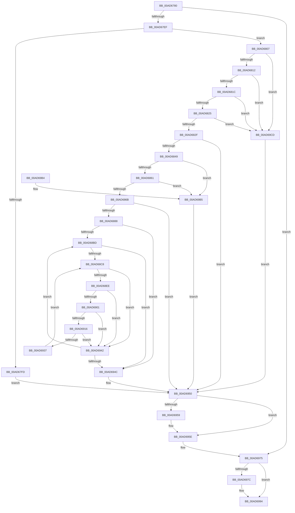

# PiCMDeleteDeviceKey

- RVA: `0x00AD6780`–`0x00AD69D7` (길이 `599` bytes)
- VA: `0x0000000140AD6780`
- 실행 섹션: `PAGE`
- PDB 이름 있음: `예`; PDB Function 태그: `아니요`
- unwind 정보 RVA: `0x000BEFA8`
- 디코드: `158`개 명령, `599/599` bytes 표시
- 미해석 바이트: `0` (있으면 어셈블리에 `.byte`로 보존)

> 이 문서는 커널 이미지의 기계어와 PDB 기호를 분석해 생성했습니다. 4번과 5번은 함수 원형과 자료형을 바이너리 사용 방식에서 추정한 C 해석이며 원본 소스 복구 결과는 아닙니다.

## 1. Dependencies

- 직접 호출 지점: **14**; 고유 호출 대상: **13**
- 직접 호출자로 확인된 함수: **1**
- RIP 상대 이미지 참조: **3**

### Outgoing calls
- `0x00AD67E0` → [PiCMCaptureObjectInputData](../8E/PiCMCaptureObjectInputData_function_008E8220.md) (function, `0x008E8220`)
- `0x00AD67F4` → [PiAuDoesClientHaveAccess](../96/PiAuDoesClientHaveAccess_function_00962940.md) (function, `0x00962940`)
- `0x00AD683A` → [PiCMConvertDeviceKeyType](../96/PiCMConvertDeviceKeyType_function_00962420.md) (function, `0x00962420`)
- `0x00AD687B` → [_PnpCtxGetCachedContextBaseKey](../8E/_PnpCtxGetCachedContextBaseKey_function_008EFB2C.md) (function, `0x008EFB2C`)
- `0x00AD68B0` → [PnpCtxRegOpenKey](../8E/PnpCtxRegOpenKey_function_008EF7B8.md) (function, `0x008EF7B8`)
- `0x00AD68E3` → [PnpCtxRegEnumKey](../99/PnpCtxRegEnumKey_function_009929C0.md) (function, `0x009929C0`)
- `0x00AD68F6` → [RtlInitUnicodeStringEx](../../text/46/RtlInitUnicodeStringEx_function_00463960.md) (function, `0x00463960`)
- `0x00AD690B` → [RtlUnicodeStringToInteger](../99/RtlUnicodeStringToInteger_function_00993480.md) (function, `0x00993480`)
- `0x00AD6929` → [_CmDeleteDeviceRegKey](../A0/_CmDeleteDeviceRegKey_function_00A09A2C.md) (function, `0x00A09A2C`)
- `0x00AD6959` → [ZwClose](../../text/6A/ZwClose_function_006AD2B0.md) (function, `0x006AD2B0`)
- `0x00AD696E` → [PiCMReturnBasicResultData](../8E/PiCMReturnBasicResultData_function_008E86E8.md) (function, `0x008E86E8`)
- `0x00AD698F` → [PiControlFreeUserModeCallersBuffer](../../text/44/PiControlFreeUserModeCallersBuffer_function_00448990.md) (function, `0x00448990`)
- `0x00AD699D` → [_security_check_cookie](../../text/6A/_security_check_cookie_function_006AC640.md) (function, `0x006AC640`)
- `0x00AD69C4` → [_CmDeleteDeviceRegKey](../A0/_CmDeleteDeviceRegKey_function_00A09A2C.md) (function, `0x00A09A2C`)

### Direct callers
- [PiCMHandleIoctl](../8E/PiCMHandleIoctl_function_008EB880.md) at `0x008EC2E9`

### Static image references
- `0x00AD6797` → RVA `0x00E0A740` (`.data`; read)
- `0x00AD686B` → RVA `0x00E66398` (`.data`; read)
- `0x00AD6897` → RVA `0x00AFFD30` (` ?? ::NNGAKEGL::`string'`; read)

## 2. Other-region calls and transfers

- 다른 실행 섹션으로 향하는 call: **4**
  - `0x00AD68F6` → [RtlInitUnicodeStringEx](../../text/46/RtlInitUnicodeStringEx_function_00463960.md) (`PAGE` → `.text`)
  - `0x00AD6959` → [ZwClose](../../text/6A/ZwClose_function_006AD2B0.md) (`PAGE` → `.text`)
  - `0x00AD698F` → [PiControlFreeUserModeCallersBuffer](../../text/44/PiControlFreeUserModeCallersBuffer_function_00448990.md) (`PAGE` → `.text`)
  - `0x00AD699D` → [_security_check_cookie](../../text/6A/_security_check_cookie_function_006AC640.md) (`PAGE` → `.text`)
- 별도 외부 분기/꼬리 이동을 확인하지 못했습니다.

## 3. Assembly (complete function range)

```asm
00AD6780  40 55                           push rbp
00AD6782  53                              push rbx
00AD6783  56                              push rsi
00AD6784  57                              push rdi
00AD6785  41 54                           push r12
00AD6787  41 55                           push r13
00AD6789  41 57                           push r15
00AD678B  48 8D 6C 24 E9                  lea rbp, [rsp - 0x17]
00AD6790  48 81 EC A0 00 00 00            sub rsp, 0xa0
00AD6797  48 8B 05 A2 3F 33 00            mov rax, qword ptr [rip + 0x333fa2]
00AD679E  48 33 C4                        xor rax, rsp
00AD67A1  48 89 45 0F                     mov qword ptr [rbp + 0xf], rax
00AD67A5  48 8B 7D 7F                     mov rdi, qword ptr [rbp + 0x7f]
00AD67A9  33 C0                           xor eax, eax
00AD67AB  48 21 45 AF                     and qword ptr [rbp - 0x51], rax
00AD67AF  0F 57 C0                        xorps xmm0, xmm0
00AD67B2  48 21 45 BF                     and qword ptr [rbp - 0x41], rax
00AD67B6  45 8B E9                        mov r13d, r9d
00AD67B9  21 45 AB                        and dword ptr [rbp - 0x55], eax
00AD67BC  4C 8D 4D C7                     lea r9, [rbp - 0x39]
00AD67C0  21 07                           and dword ptr [rdi], eax
00AD67C2  4D 8B E0                        mov r12, r8
00AD67C5  44 8B 45 77                     mov r8d, dword ptr [rbp + 0x77]
00AD67C9  21 45 A7                        and dword ptr [rbp - 0x59], eax
00AD67CC  48 89 7D B7                     mov qword ptr [rbp - 0x49], rdi
00AD67D0  0F 11 45 C7                     movups xmmword ptr [rbp - 0x39], xmm0
00AD67D4  48 89 45 E7                     mov qword ptr [rbp - 0x19], rax
00AD67D8  0F 11 45 D7                     movups xmmword ptr [rbp - 0x29], xmm0
00AD67DC  0F 11 45 EF                     movups xmmword ptr [rbp - 0x11], xmm0
00AD67E0  E8 3B 1A E1 FF                  call 0x1408e8220
00AD67E5  8B D8                           mov ebx, eax
00AD67E7  85 C0                           test eax, eax
00AD67E9  0F 88 86 01 00 00               js 0x140ad6975
00AD67EF  B9 02 00 00 00                  mov ecx, 2
00AD67F4  E8 47 C1 E8 FF                  call 0x140962940
00AD67F9  84 C0                           test al, al
00AD67FB  75 0A                           jne 0x140ad6807
00AD67FD  BB 22 00 00 C0                  mov ebx, 0xc0000022
00AD6802  E9 49 01 00 00                  jmp 0x140ad6950
00AD6807  48 83 7D D7 00                  cmp qword ptr [rbp - 0x29], 0
00AD680C  0F 84 BB 01 00 00               je 0x140ad69cd
00AD6812  83 7D CF 01                     cmp dword ptr [rbp - 0x31], 1
00AD6816  0F 85 B1 01 00 00               jne 0x140ad69cd
00AD681C  4D 85 E4                        test r12, r12
00AD681F  0F 84 A8 01 00 00               je 0x140ad69cd
00AD6825  41 83 FD 08                     cmp r13d, 8
00AD6829  0F 82 9E 01 00 00               jb 0x140ad69cd
00AD682F  44 8B 5D CB                     mov r11d, dword ptr [rbp - 0x35]
00AD6833  48 8D 55 A7                     lea rdx, [rbp - 0x59]
00AD6837  41 8B CB                        mov ecx, r11d
00AD683A  E8 E1 BB E8 FF                  call 0x140962420
00AD683F  8B D8                           mov ebx, eax
00AD6841  85 C0                           test eax, eax
00AD6843  0F 88 07 01 00 00               js 0x140ad6950
00AD6849  44 8B 4D E3                     mov r9d, dword ptr [rbp - 0x1d]
00AD684D  41 81 E3 00 FF 00 00            and r11d, 0xff00
00AD6854  41 81 FB 00 02 00 00            cmp r11d, 0x200
00AD685B  0F 85 54 01 00 00               jne 0x140ad69b5
00AD6861  41 83 F9 FF                     cmp r9d, -1
00AD6865  0F 85 4A 01 00 00               jne 0x140ad69b5
00AD686B  48 8B 0D 26 FB 38 00            mov rcx, qword ptr [rip + 0x38fb26]
00AD6872  4C 8D 45 AF                     lea r8, [rbp - 0x51]
00AD6876  BA 04 00 00 00                  mov edx, 4
00AD687B  E8 AC 92 E1 FF                  call 0x1408efb2c
00AD6880  85 C0                           test eax, eax
00AD6882  0F 88 C8 00 00 00               js 0x140ad6950
00AD6888  48 8B 55 AF                     mov rdx, qword ptr [rbp - 0x51]
00AD688C  48 8D 45 BF                     lea rax, [rbp - 0x41]
00AD6890  48 8B 0D 01 FB 38 00            mov rcx, qword ptr [rip + 0x38fb01]
00AD6897  4C 8D 05 92 94 02 00            lea r8, [rip + 0x29492]
00AD689E  48 89 44 24 28                  mov qword ptr [rsp + 0x28], rax
00AD68A3  45 33 C9                        xor r9d, r9d
00AD68A6  C7 44 24 20 08 00 00 00         mov dword ptr [rsp + 0x20], 8
00AD68AE  33 FF                           xor edi, edi
00AD68B0  E8 03 8F E1 FF                  call 0x1408ef7b8
00AD68B5  85 C0                           test eax, eax
00AD68B7  0F 88 8F 00 00 00               js 0x140ad694c
00AD68BD  44 8B FF                        mov r15d, edi
00AD68C0  85 DB                           test ebx, ebx
00AD68C2  0F 88 84 00 00 00               js 0x140ad694c
00AD68C8  48 8B 55 BF                     mov rdx, qword ptr [rbp - 0x41]
00AD68CC  48 8D 45 AF                     lea rax, [rbp - 0x51]
00AD68D0  4C 8D 4D FF                     lea r9, [rbp - 1]
00AD68D4  48 89 44 24 20                  mov qword ptr [rsp + 0x20], rax
00AD68D9  44 8B C7                        mov r8d, edi
00AD68DC  C7 45 AF 05 00 00 00            mov dword ptr [rbp - 0x51], 5
00AD68E3  E8 D8 C0 EB FF                  call 0x1409929c0
00AD68E8  8B F0                           mov esi, eax
00AD68EA  85 C0                           test eax, eax
00AD68EC  78 54                           js 0x140ad6942
00AD68EE  48 8D 55 FF                     lea rdx, [rbp - 1]
00AD68F2  48 8D 4D EF                     lea rcx, [rbp - 0x11]
00AD68F6  E8 65 D0 98 FF                  call 0x140463960
00AD68FB  8B F0                           mov esi, eax
00AD68FD  85 C0                           test eax, eax
00AD68FF  78 41                           js 0x140ad6942
00AD6901  4C 8D 45 AB                     lea r8, [rbp - 0x55]
00AD6905  33 D2                           xor edx, edx
00AD6907  48 8D 4D EF                     lea rcx, [rbp - 0x11]
00AD690B  E8 70 CB EB FF                  call 0x140993480
00AD6910  8B F0                           mov esi, eax
00AD6912  85 C0                           test eax, eax
00AD6914  78 2C                           js 0x140ad6942
00AD6916  44 8B 4D AB                     mov r9d, dword ptr [rbp - 0x55]
00AD691A  44 8B 45 A7                     mov r8d, dword ptr [rbp - 0x59]
00AD691E  48 8B 55 D7                     mov rdx, qword ptr [rbp - 0x29]
00AD6922  48 8B 0D 6F FA 38 00            mov rcx, qword ptr [rip + 0x38fa6f]
00AD6929  E8 FE 30 F3 FF                  call 0x140a09a2c
00AD692E  8B D8                           mov ebx, eax
00AD6930  3D 34 00 00 C0                  cmp eax, 0xc0000034
00AD6935  75 0B                           jne 0x140ad6942
00AD6937  41 8D 7F 01                     lea edi, [r15 + 1]
00AD693B  33 DB                           xor ebx, ebx
00AD693D  44 8B FF                        mov r15d, edi
00AD6940  EB 86                           jmp 0x140ad68c8
00AD6942  FF C7                           inc edi
00AD6944  85 F6                           test esi, esi
00AD6946  0F 89 71 FF FF FF               jns 0x140ad68bd
00AD694C  48 8B 7D B7                     mov rdi, qword ptr [rbp - 0x49]
00AD6950  48 8B 4D BF                     mov rcx, qword ptr [rbp - 0x41]
00AD6954  48 85 C9                        test rcx, rcx
00AD6957  74 05                           je 0x140ad695e
00AD6959  E8 52 69 BD FF                  call 0x1406ad2b0
00AD695E  8B 55 E7                        mov edx, dword ptr [rbp - 0x19]
00AD6961  45 8B CD                        mov r9d, r13d
00AD6964  4D 8B C4                        mov r8, r12
00AD6967  48 89 7C 24 20                  mov qword ptr [rsp + 0x20], rdi
00AD696C  8B CB                           mov ecx, ebx
00AD696E  E8 75 1D E1 FF                  call 0x1408e86e8
00AD6973  8B D8                           mov ebx, eax
00AD6975  48 83 7D D7 00                  cmp qword ptr [rbp - 0x29], 0
00AD697A  74 18                           je 0x140ad6994
00AD697C  65 48 8B 0C 25 88 01 00 00      mov rcx, qword ptr gs:[0x188]
00AD6985  48 8B 55 D7                     mov rdx, qword ptr [rbp - 0x29]
00AD6989  8A 89 32 02 00 00               mov cl, byte ptr [rcx + 0x232]
00AD698F  E8 FC 1F 97 FF                  call 0x140448990
00AD6994  8B C3                           mov eax, ebx
00AD6996  48 8B 4D 0F                     mov rcx, qword ptr [rbp + 0xf]
00AD699A  48 33 CC                        xor rcx, rsp
00AD699D  E8 9E 5C BD FF                  call 0x1406ac640
00AD69A2  48 81 C4 A0 00 00 00            add rsp, 0xa0
00AD69A9  41 5F                           pop r15
00AD69AB  41 5D                           pop r13
00AD69AD  41 5C                           pop r12
00AD69AF  5F                              pop rdi
00AD69B0  5E                              pop rsi
00AD69B1  5B                              pop rbx
00AD69B2  5D                              pop rbp
00AD69B3  C3                              ret
00AD69B4  CC                              int3
00AD69B5  44 8B 45 A7                     mov r8d, dword ptr [rbp - 0x59]
00AD69B9  48 8B 55 D7                     mov rdx, qword ptr [rbp - 0x29]
00AD69BD  48 8B 0D D4 F9 38 00            mov rcx, qword ptr [rip + 0x38f9d4]
00AD69C4  E8 63 30 F3 FF                  call 0x140a09a2c
00AD69C9  8B D8                           mov ebx, eax
00AD69CB  EB 83                           jmp 0x140ad6950
00AD69CD  BB 0D 00 00 C0                  mov ebx, 0xc000000d
00AD69D2  E9 79 FF FF FF                  jmp 0x140ad6950
```

## 4. C-style interpretation (structured pseudocode)

```c
__int64 __fastcall PiCMDeleteDeviceKey(__int64 a1, __int64 a2, __int64 a3, int a4, unsigned int a5, __int64 a6)
{
    __int64 result;
    __int64 v_r11;
    __int64 v_rbx;
    __int64 v_rdi;
    __int64 v_rsp;
    unsigned __int64 v_stack_m40;
    unsigned __int64 v_stack_m4F;
    unsigned __int64 v_stack_m50;
    unsigned __int64 v_stack_m60;
    unsigned __int64 v_stack_m68;
    unsigned int v_stack_m6C;
    unsigned __int64 v_stack_m78;
    unsigned int v_stack_m80;
    unsigned int v_stack_m84;
    unsigned __int64 v_stack_m88;
    unsigned __int64 v_stack_m90;
    unsigned __int64 v_stack_m98;
    unsigned __int64 v_stack_mA0;
    unsigned int v_stack_mA4;
    unsigned int v_stack_mA8;
    unsigned __int64 v_stack_mB0;
    unsigned int v_stack_mB8;

    v_rsp = (v_rsp) - (160);
    result = (*(unsigned __int64 *)(v_rip + 3358626)) ^ (v_rsp);
    v_stack_m40 = result;
    result = 0;
    v_stack_m98 = a6;
    v_stack_m88 = v_xmm0;
    v_stack_m68 = 0;
    v_stack_m78 = v_xmm0;
    v_stack_m60 = v_xmm0;
    result = PiCMCaptureObjectInputData(a1, a2, (unsigned int)(a5), v_stack_m88);
    if (sign_flag) goto loc_00AD6975;
    result = PiAuDoesClientHaveAccess(2, a2, (unsigned int)(a5), v_stack_m88);
    if ((unsigned __int8)(result) != 0) goto loc_00AD6807;
    goto loc_00AD6950;
loc_00AD6807:
    if (v_stack_m78 == 0) goto loc_00AD69CD;
    if (v_stack_m80 != 1) goto loc_00AD69CD;
    if (a3 == 0) goto loc_00AD69CD;
    if (((unsigned int)((unsigned int)(a4))) < 8) goto loc_00AD69CD;
    result = PiCMConvertDeviceKeyType((unsigned int)((unsigned int)((unsigned int)(v_stack_m84))), v_stack_mA8, (unsigned int)(a5), v_stack_m88);
    if (sign_flag) goto loc_00AD6950;
    v_r11 = (unsigned int)(((unsigned int)(v_stack_m84)) & (0xFF00ULL));
    if (((unsigned int)(v_r11)) != 512) goto loc_00AD69B5;
    if (((unsigned int)((unsigned int)(v_stack_m6C))) != -1) goto loc_00AD69B5;
    result = _PnpCtxGetCachedContextBaseKey(*(unsigned __int64 *)(v_rip + 3734310), 4, v_stack_mA0, (unsigned int)(v_stack_m6C));
    if (sign_flag) goto loc_00AD6950;
    v_stack_mB0 = v_stack_m90;
    a4 = 0;
    v_stack_mB8 = 8;
    v_rdi = 0;
    result = PnpCtxRegOpenKey(*(unsigned __int64 *)(v_rip + 3734273), v_stack_mA0, v_rip + 169106, a4);
    if (sign_flag) goto loc_00AD694C;
loc_00AD68BD:
    if (sign_flag) goto loc_00AD694C;
loc_00AD68C8:
    v_stack_mB8 = v_stack_mA0;
    v_stack_mA0 = 5;
    result = PnpCtxRegEnumKey(*(unsigned __int64 *)(v_rip + 3734273), v_stack_m90, 0, v_stack_m50);
    if (sign_flag) goto loc_00AD6942;
    result = RtlInitUnicodeStringEx(v_stack_m60, v_stack_m50, 0, v_stack_m50);
    if (sign_flag) goto loc_00AD6942;
    a2 = 0;
    result = RtlUnicodeStringToInteger(v_stack_m60, a2, v_stack_mA4, v_stack_m50);
    if (sign_flag) goto loc_00AD6942;
    result = _CmDeleteDeviceRegKey(*(unsigned __int64 *)(v_rip + 3734127), v_stack_m78, (unsigned int)(v_stack_mA8), (unsigned int)(v_stack_mA4));
    if (((unsigned int)(result)) != 0xC0000034ULL) goto loc_00AD6942;
    v_rbx = 0;
    goto loc_00AD68C8;
loc_00AD6942:
    v_rdi = (unsigned int)((0 + 1) + 1);
    if (!sign_flag) goto loc_00AD68BD;
loc_00AD694C:
loc_00AD6950:
    if (v_stack_m90 != 0) {
        result = ZwClose(v_stack_m90, v_stack_m78, (unsigned int)(v_stack_mA8), (unsigned int)(v_stack_mA4));
    }
    v_stack_mB8 = v_stack_m98;
    result = PiCMReturnBasicResultData(0, (unsigned int)(v_stack_m68), a3, (unsigned int)((unsigned int)((unsigned int)(a4))));
loc_00AD6975:
    if (v_stack_m78 != 0) {
        a1 = *(unsigned __int64 *)(gs_base + (0 + 392));
        a2 = v_stack_m78;
        a1 = *(unsigned __int8 *)(a1 + 562);
        result = PiControlFreeUserModeCallersBuffer(a1, a2, a3, (unsigned int)((unsigned int)((unsigned int)(a4))));
    }
    a1 = (v_stack_m40) ^ (v_rsp);
    result = _security_check_cookie(a1, a2, a3, (unsigned int)((unsigned int)((unsigned int)(a4))));
    v_rsp = (v_rsp) + (160);
    return result;
loc_00AD69B5:
    result = _CmDeleteDeviceRegKey(*(unsigned __int64 *)(v_rip + 3733972), v_stack_m78, (unsigned int)(v_stack_mA8), (unsigned int)((unsigned int)((unsigned int)(a4))));
    goto loc_00AD6950;
loc_00AD69CD:
    goto loc_00AD6950;
}
```

## 5. (Beta) C Style

```c
int64_t PiCMDeleteDeviceKey(int64_t Arg1, int64_t Arg2, int64_t Arg3, int32_t Arg4, uint32_t Arg5, void *Arg6)
{
    uint8_t *arg6 = (uint8_t *)Arg6;

    int64_t result;
    int64_t local_r11;
    int64_t local_rbx;
    int64_t local_rdi;
    int64_t local_rsp;
    uint64_t v_stack_m40;
    uint64_t v_stack_m4F;
    uint64_t v_stack_m50;
    uint64_t v_stack_m60;
    uint64_t v_stack_m68;
    uint32_t v_stack_m6C;
    uint64_t v_stack_m78;
    uint32_t v_stack_m80;
    uint32_t v_stack_m84;
    uint64_t v_stack_m88;
    uint64_t v_stack_m90;
    uint64_t v_stack_m98;
    uint64_t v_stack_mA0;
    uint32_t v_stack_mA4;
    uint32_t v_stack_mA8;
    uint64_t v_stack_mB0;
    uint32_t v_stack_mB8;

    local_rsp = (local_rsp) - (160);
    result = (*(uint64_t *)(v_rip + 0x333FA2)) ^ (local_rsp);
    v_stack_m40 = result;
    result = 0;
    v_stack_m98 = Arg6;
    v_stack_m88 = v_xmm0;
    v_stack_m68 = 0;
    v_stack_m78 = v_xmm0;
    v_stack_m60 = v_xmm0;
    result = PiCMCaptureObjectInputData(Arg1, Arg2, (uint32_t)(Arg5), v_stack_m88);
    if (sign_flag) goto loc_00AD6975;
    result = PiAuDoesClientHaveAccess(2, Arg2, (uint32_t)(Arg5), v_stack_m88);
    if ((uint8_t)(result) != 0) goto loc_00AD6807;
    goto loc_00AD6950;
loc_00AD6807:
    if (v_stack_m78 == 0) goto loc_00AD69CD;
    if (v_stack_m80 != 1) goto loc_00AD69CD;
    if (Arg3 == 0) goto loc_00AD69CD;
    if (((uint32_t)((uint32_t)(Arg4))) < 8) goto loc_00AD69CD;
    result = PiCMConvertDeviceKeyType((uint32_t)((uint32_t)((uint32_t)(v_stack_m84))), v_stack_mA8, (uint32_t)(Arg5), v_stack_m88);
    if (sign_flag) goto loc_00AD6950;
    local_r11 = (uint32_t)(((uint32_t)(v_stack_m84)) & (0xFF00ULL));
    if (((uint32_t)(local_r11)) != 512) goto loc_00AD69B5;
    if (((uint32_t)((uint32_t)(v_stack_m6C))) != -1) goto loc_00AD69B5;
    result = _PnpCtxGetCachedContextBaseKey(*(uint64_t *)(v_rip + 0x38FB26), 4, v_stack_mA0, (uint32_t)(v_stack_m6C));
    if (sign_flag) goto loc_00AD6950;
    v_stack_mB0 = v_stack_m90;
    Arg4 = 0;
    v_stack_mB8 = 8;
    local_rdi = 0;
    result = PnpCtxRegOpenKey(*(uint64_t *)(v_rip + 0x38FB01), v_stack_mA0, v_rip + 169106, Arg4);
    if (sign_flag) goto loc_00AD694C;
loc_00AD68BD:
    if (sign_flag) goto loc_00AD694C;
loc_00AD68C8:
    v_stack_mB8 = v_stack_mA0;
    v_stack_mA0 = 5;
    result = PnpCtxRegEnumKey(*(uint64_t *)(v_rip + 0x38FB01), v_stack_m90, 0, v_stack_m50);
    if (sign_flag) goto loc_00AD6942;
    result = RtlInitUnicodeStringEx(v_stack_m60, v_stack_m50, 0, v_stack_m50);
    if (sign_flag) goto loc_00AD6942;
    Arg2 = 0;
    result = RtlUnicodeStringToInteger(v_stack_m60, Arg2, v_stack_mA4, v_stack_m50);
    if (sign_flag) goto loc_00AD6942;
    result = _CmDeleteDeviceRegKey(*(uint64_t *)(v_rip + 0x38FA6F), v_stack_m78, (uint32_t)(v_stack_mA8), (uint32_t)(v_stack_mA4));
    if (((uint32_t)(result)) != 0xC0000034ULL) goto loc_00AD6942;
    local_rbx = 0;
    goto loc_00AD68C8;
loc_00AD6942:
    local_rdi = (uint32_t)((0 + 1) + 1);
    if (!sign_flag) goto loc_00AD68BD;
loc_00AD694C:
loc_00AD6950:
    if (v_stack_m90 != 0) {
        result = ZwClose(v_stack_m90, v_stack_m78, (uint32_t)(v_stack_mA8), (uint32_t)(v_stack_mA4));
    }
    v_stack_mB8 = v_stack_m98;
    result = PiCMReturnBasicResultData(0, (uint32_t)(v_stack_m68), Arg3, (uint32_t)((uint32_t)((uint32_t)(Arg4))));
loc_00AD6975:
    if (v_stack_m78 != 0) {
        Arg1 = *(uint64_t *)(gs_base + (0 + 0x188));
        Arg2 = v_stack_m78;
        Arg1 = *(uint8_t *)(Arg1 + 0x232);
        result = PiControlFreeUserModeCallersBuffer(Arg1, Arg2, Arg3, (uint32_t)((uint32_t)((uint32_t)(Arg4))));
    }
    Arg1 = (v_stack_m40) ^ (local_rsp);
    result = _security_check_cookie(Arg1, Arg2, Arg3, (uint32_t)((uint32_t)((uint32_t)(Arg4))));
    local_rsp = (local_rsp) + (160);
    return result;
loc_00AD69B5:
    result = _CmDeleteDeviceRegKey(*(uint64_t *)(v_rip + 0x38F9D4), v_stack_m78, (uint32_t)(v_stack_mA8), (uint32_t)((uint32_t)((uint32_t)(Arg4))));
    goto loc_00AD6950;
loc_00AD69CD:
    goto loc_00AD6950;
}
```

### 관측된 메모리 오프셋

구조체 형식이 확인되지 않은 접근은 인자 기준의 오프셋으로만 기록했습니다.

| 기준 인자 | 오프셋 표현 | 폭 (bit) | 접근 |
|---|---:|---:|---|
| `Arg6` | `+ 0x0` | `32` | `R/W` |

## 6. Execution-region graph

[열기: 2D/3D 그래프와 함수 탐색 컨트롤 패널](../../../control-panel.html?section=page&rva=0x00AD6780&view=graph)

- 2D 그래프는 위에서 아래로 흐르고, 3D 그래프는 빈 공간을 드래그해 회전합니다. Shift+드래그는 이동, 휠은 확대·축소, 함수 노드 선택은 대상 보고서 이동입니다.

### Static fallback


