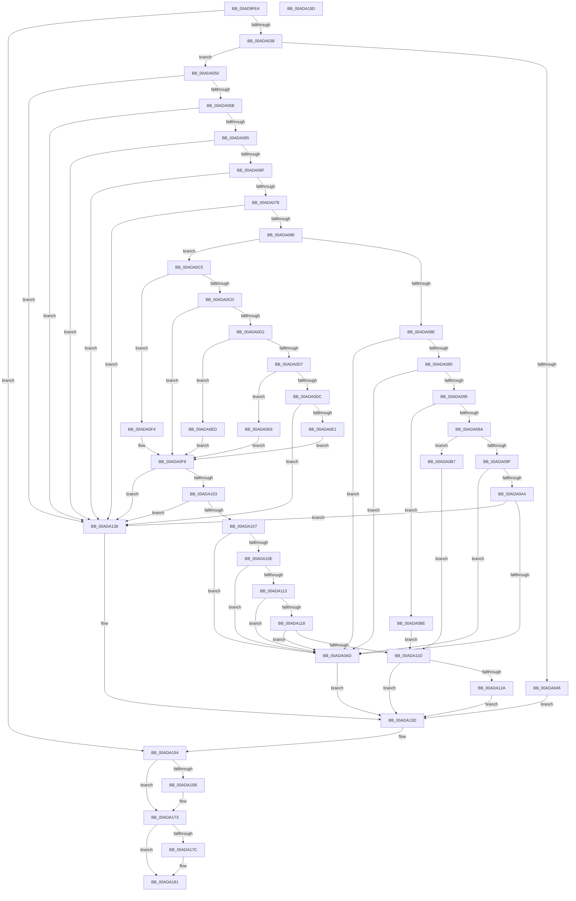

# PiCMDeleteObject

- RVA: `0x00AD9FE4`–`0x00ADA19E` (길이 `442` bytes)
- VA: `0x0000000140AD9FE4`
- 실행 섹션: `PAGE`
- PDB 이름 있음: `예`; PDB Function 태그: `아니요`
- unwind 정보 RVA: `0x000BF388`
- 디코드: `127`개 명령, `442/442` bytes 표시
- 미해석 바이트: `0` (있으면 어셈블리에 `.byte`로 보존)

> 이 문서는 커널 이미지의 기계어와 PDB 기호를 분석해 생성했습니다. 4번과 5번은 함수 원형과 자료형을 바이너리 사용 방식에서 추정한 C 해석이며 원본 소스 복구 결과는 아닙니다.

## 1. Dependencies

- 직접 호출 지점: **7**; 고유 호출 대상: **7**
- 직접 호출자로 확인된 함수: **1**
- RIP 상대 이미지 참조: **1**

### Outgoing calls
- `0x00ADA029` → [PiCMCaptureObjectInputData](../8E/PiCMCaptureObjectInputData_function_008E8220.md) (function, `0x008E8220`)
- `0x00ADA03D` → [PiAuDoesClientHaveAccess](../96/PiAuDoesClientHaveAccess_function_00962940.md) (function, `0x00962940`)
- `0x00ADA121` → [PiPnpRtlBeginOperation](../8E/PiPnpRtlBeginOperation_function_008E033C.md) (function, `0x008E033C`)
- `0x00ADA131` → [PnpDeleteObject](../82/PnpDeleteObject_function_0082C4F4.md) (function, `0x0082C4F4`)
- `0x00ADA14D` → [PiCMReturnBasicResultData](../8E/PiCMReturnBasicResultData_function_008E86E8.md) (function, `0x008E86E8`)
- `0x00ADA16E` → [PiControlFreeUserModeCallersBuffer](../../text/44/PiControlFreeUserModeCallersBuffer_function_00448990.md) (function, `0x00448990`)
- `0x00ADA17C` → [PiPnpRtlEndOperation](../8E/PiPnpRtlEndOperation_function_008E0518.md) (function, `0x008E0518`)

### Direct callers
- [PiCMHandleIoctl](../8E/PiCMHandleIoctl_function_008EB880.md) at `0x008EC1C7`

### Static image references
- `0x00ADA0F9` → RVA `0x00E663D0` (`.data`; read)

## 2. Other-region calls and transfers

- 다른 실행 섹션으로 향하는 call: **1**
  - `0x00ADA16E` → [PiControlFreeUserModeCallersBuffer](../../text/44/PiControlFreeUserModeCallersBuffer_function_00448990.md) (`PAGE` → `.text`)
- 별도 외부 분기/꼬리 이동을 확인하지 못했습니다.

## 3. Assembly (complete function range)

```asm
00AD9FE4  48 8B C4                        mov rax, rsp
00AD9FE7  48 89 58 08                     mov qword ptr [rax + 8], rbx
00AD9FEB  48 89 70 10                     mov qword ptr [rax + 0x10], rsi
00AD9FEF  4C 89 70 18                     mov qword ptr [rax + 0x18], r14
00AD9FF3  4C 89 78 20                     mov qword ptr [rax + 0x20], r15
00AD9FF7  55                              push rbp
00AD9FF8  48 8B EC                        mov rbp, rsp
00AD9FFB  48 83 EC 60                     sub rsp, 0x60
00AD9FFF  4C 8B 7D 38                     mov r15, qword ptr [rbp + 0x38]
00ADA003  33 C0                           xor eax, eax
00ADA005  48 21 45 38                     and qword ptr [rbp + 0x38], rax
00ADA009  0F 57 C0                        xorps xmm0, xmm0
00ADA00C  45 8B F1                        mov r14d, r9d
00ADA00F  48 89 45 F0                     mov qword ptr [rbp - 0x10], rax
00ADA013  49 8B F0                        mov rsi, r8
00ADA016  4C 8D 4D D0                     lea r9, [rbp - 0x30]
00ADA01A  44 8B 45 30                     mov r8d, dword ptr [rbp + 0x30]
00ADA01E  41 21 07                        and dword ptr [r15], eax
00ADA021  0F 11 45 D0                     movups xmmword ptr [rbp - 0x30], xmm0
00ADA025  0F 11 45 E0                     movups xmmword ptr [rbp - 0x20], xmm0
00ADA029  E8 F2 E1 E0 FF                  call 0x1408e8220
00ADA02E  8B D8                           mov ebx, eax
00ADA030  85 C0                           test eax, eax
00ADA032  0F 88 1C 01 00 00               js 0x140ada154
00ADA038  B9 02 00 00 00                  mov ecx, 2
00ADA03D  E8 FE 88 E8 FF                  call 0x140962940
00ADA042  84 C0                           test al, al
00ADA044  75 0A                           jne 0x140ada050
00ADA046  B8 22 00 00 C0                  mov eax, 0xc0000022
00ADA04B  E9 ED 00 00 00                  jmp 0x140ada13d
00ADA050  48 83 7D E0 00                  cmp qword ptr [rbp - 0x20], 0
00ADA055  0F 84 DD 00 00 00               je 0x140ada138
00ADA05B  83 7D D4 00                     cmp dword ptr [rbp - 0x2c], 0
00ADA05F  0F 85 D3 00 00 00               jne 0x140ada138
00ADA065  83 7D EC 00                     cmp dword ptr [rbp - 0x14], 0
00ADA069  0F 85 C9 00 00 00               jne 0x140ada138
00ADA06F  48 85 F6                        test rsi, rsi
00ADA072  0F 84 C0 00 00 00               je 0x140ada138
00ADA078  BB 08 00 00 00                  mov ebx, 8
00ADA07D  44 3B F3                        cmp r14d, ebx
00ADA080  0F 82 B2 00 00 00               jb 0x140ada138
00ADA086  8B 4D D8                        mov ecx, dword ptr [rbp - 0x28]
00ADA089  83 F9 06                        cmp ecx, 6
00ADA08C  7F 37                           jg 0x140ada0c5
00ADA08E  74 1D                           je 0x140ada0ad
00ADA090  83 E9 01                        sub ecx, 1
00ADA093  74 18                           je 0x140ada0ad
00ADA095  83 E9 01                        sub ecx, 1
00ADA098  74 24                           je 0x140ada0be
00ADA09A  83 E9 01                        sub ecx, 1
00ADA09D  74 18                           je 0x140ada0b7
00ADA09F  83 E9 01                        sub ecx, 1
00ADA0A2  74 09                           je 0x140ada0ad
00ADA0A4  83 F9 01                        cmp ecx, 1
00ADA0A7  0F 85 8B 00 00 00               jne 0x140ada138
00ADA0AD  B8 BB 00 00 C0                  mov eax, 0xc00000bb
00ADA0B2  E9 86 00 00 00                  jmp 0x140ada13d
00ADA0B7  BB 04 00 00 00                  mov ebx, 4
00ADA0BC  EB 5F                           jmp 0x140ada11d
00ADA0BE  BB 02 00 00 00                  mov ebx, 2
00ADA0C3  EB 58                           jmp 0x140ada11d
00ADA0C5  81 E9 01 00 01 00               sub ecx, 0x10001
00ADA0CB  74 27                           je 0x140ada0f4
00ADA0CD  83 E9 01                        sub ecx, 1
00ADA0D0  74 27                           je 0x140ada0f9
00ADA0D2  83 E9 01                        sub ecx, 1
00ADA0D5  74 16                           je 0x140ada0ed
00ADA0D7  83 E9 01                        sub ecx, 1
00ADA0DA  74 0A                           je 0x140ada0e6
00ADA0DC  83 F9 01                        cmp ecx, 1
00ADA0DF  75 57                           jne 0x140ada138
00ADA0E1  8D 59 0A                        lea ebx, [rcx + 0xa]
00ADA0E4  EB 13                           jmp 0x140ada0f9
00ADA0E6  BB 0A 00 00 00                  mov ebx, 0xa
00ADA0EB  EB 0C                           jmp 0x140ada0f9
00ADA0ED  BB 09 00 00 00                  mov ebx, 9
00ADA0F2  EB 05                           jmp 0x140ada0f9
00ADA0F4  BB 07 00 00 00                  mov ebx, 7
00ADA0F9  48 83 3D CF C2 38 00 00         cmp qword ptr [rip + 0x38c2cf], 0
00ADA101  74 35                           je 0x140ada138
00ADA103  85 DB                           test ebx, ebx
00ADA105  74 31                           je 0x140ada138
00ADA107  8B CB                           mov ecx, ebx
00ADA109  83 E9 01                        sub ecx, 1
00ADA10C  74 9F                           je 0x140ada0ad
00ADA10E  83 E9 02                        sub ecx, 2
00ADA111  74 9A                           je 0x140ada0ad
00ADA113  83 E9 02                        sub ecx, 2
00ADA116  74 95                           je 0x140ada0ad
00ADA118  83 F9 01                        cmp ecx, 1
00ADA11B  74 90                           je 0x140ada0ad
00ADA11D  48 8D 4D 38                     lea rcx, [rbp + 0x38]
00ADA121  E8 16 62 E0 FF                  call 0x1408e033c
00ADA126  85 C0                           test eax, eax
00ADA128  78 13                           js 0x140ada13d
00ADA12A  48 8B 55 E0                     mov rdx, qword ptr [rbp - 0x20]
00ADA12E  44 8B C3                        mov r8d, ebx
00ADA131  E8 BE 23 D5 FF                  call 0x14082c4f4
00ADA136  EB 05                           jmp 0x140ada13d
00ADA138  B8 0D 00 00 C0                  mov eax, 0xc000000d
00ADA13D  8B 55 F0                        mov edx, dword ptr [rbp - 0x10]
00ADA140  45 8B CE                        mov r9d, r14d
00ADA143  4C 8B C6                        mov r8, rsi
00ADA146  4C 89 7C 24 20                  mov qword ptr [rsp + 0x20], r15
00ADA14B  8B C8                           mov ecx, eax
00ADA14D  E8 96 E5 E0 FF                  call 0x1408e86e8
00ADA152  8B D8                           mov ebx, eax
00ADA154  48 83 7D E0 00                  cmp qword ptr [rbp - 0x20], 0
00ADA159  74 18                           je 0x140ada173
00ADA15B  65 48 8B 0C 25 88 01 00 00      mov rcx, qword ptr gs:[0x188]
00ADA164  48 8B 55 E0                     mov rdx, qword ptr [rbp - 0x20]
00ADA168  8A 89 32 02 00 00               mov cl, byte ptr [rcx + 0x232]
00ADA16E  E8 1D E8 96 FF                  call 0x140448990
00ADA173  48 8B 4D 38                     mov rcx, qword ptr [rbp + 0x38]
00ADA177  48 85 C9                        test rcx, rcx
00ADA17A  74 05                           je 0x140ada181
00ADA17C  E8 97 63 E0 FF                  call 0x1408e0518
00ADA181  4C 8D 5C 24 60                  lea r11, [rsp + 0x60]
00ADA186  8B C3                           mov eax, ebx
00ADA188  49 8B 5B 10                     mov rbx, qword ptr [r11 + 0x10]
00ADA18C  49 8B 73 18                     mov rsi, qword ptr [r11 + 0x18]
00ADA190  4D 8B 73 20                     mov r14, qword ptr [r11 + 0x20]
00ADA194  4D 8B 7B 28                     mov r15, qword ptr [r11 + 0x28]
00ADA198  49 8B E3                        mov rsp, r11
00ADA19B  5D                              pop rbp
00ADA19C  C3                              ret
00ADA19D  CC                              int3
```

## 4. C-style interpretation (structured pseudocode)

```c
__int64 __fastcall PiCMDeleteObject(__int64 a1, __int64 a2, __int64 a3, int a4, unsigned int a5, __int64 a6)
{
    __int64 result;
    __int64 v_rsp;
    unsigned __int64 v_stack_m18;
    unsigned int v_stack_m1C;
    unsigned __int64 v_stack_m28;
    unsigned int v_stack_m30;
    unsigned int v_stack_m34;
    unsigned __int64 v_stack_m38;
    unsigned __int64 v_stack_m48;
    unsigned __int64 v_stack_m8;

    *(unsigned __int64 *)(v_rsp + 8) = v_rbx;
    *(unsigned __int64 *)(v_rsp + 16) = v_rsi;
    *(unsigned __int64 *)(v_rsp + 24) = v_r14;
    *(unsigned __int64 *)(v_rsp + 32) = v_r15;
    v_rsp = (v_rsp) - (96);
    result = 0;
    v_stack_m18 = 0;
    v_stack_m38 = v_xmm0;
    v_stack_m28 = v_xmm0;
    result = PiCMCaptureObjectInputData(a1, a2, (unsigned int)(a5), v_stack_m38);
    if (sign_flag) goto loc_00ADA154;
    result = PiAuDoesClientHaveAccess(2, a2, (unsigned int)(a5), v_stack_m38);
    if ((unsigned __int8)(result) != 0) goto loc_00ADA050;
    goto loc_00ADA13D;
loc_00ADA050:
    if (v_stack_m28 == 0) goto loc_00ADA138;
    if (v_stack_m34 != 0) goto loc_00ADA138;
    if (v_stack_m1C != 0) goto loc_00ADA138;
    if (a3 == 0) goto loc_00ADA138;
    if (((unsigned int)((unsigned int)(a4))) < 8) goto loc_00ADA138;
    if (((unsigned int)((unsigned int)(v_stack_m30))) > 6) goto loc_00ADA0C5;
    if (((unsigned int)((unsigned int)(v_stack_m30))) == 6) goto loc_00ADA0AD;
    a1 = (unsigned int)(((unsigned int)(v_stack_m30)) - (1));
    if (condition_is_equal) goto loc_00ADA0AD;
    a1 = (unsigned int)((a1) - (1));
    if (condition_is_equal) goto loc_00ADA0BE;
    a1 = (unsigned int)((a1) - (1));
    if (condition_is_equal) goto loc_00ADA0B7;
    a1 = (unsigned int)((a1) - (1));
    if (condition_is_equal) goto loc_00ADA0AD;
    if (((unsigned int)(a1)) != 1) goto loc_00ADA138;
loc_00ADA0AD:
    goto loc_00ADA13D;
loc_00ADA0B7:
    goto loc_00ADA11D;
loc_00ADA0BE:
    goto loc_00ADA11D;
loc_00ADA0C5:
    a1 = (unsigned int)((a1) - (0x10001ULL));
    if (condition_is_equal) goto loc_00ADA0F4;
    a1 = (unsigned int)((a1) - (1));
    if (condition_is_equal) goto loc_00ADA0F9;
    a1 = (unsigned int)((a1) - (1));
    if (condition_is_equal) goto loc_00ADA0ED;
    a1 = (unsigned int)((a1) - (1));
    if (condition_is_equal) goto loc_00ADA0E6;
    if (((unsigned int)(a1)) != 1) goto loc_00ADA138;
    goto loc_00ADA0F9;
loc_00ADA0E6:
    goto loc_00ADA0F9;
loc_00ADA0ED:
    goto loc_00ADA0F9;
loc_00ADA0F4:
loc_00ADA0F9:
    if ((*(unsigned __int64 *)(v_rip + 3719887)) == 0) goto loc_00ADA138;
    if (7 == 0) goto loc_00ADA138;
    a1 = (unsigned int)((7) - (1));
    if (condition_is_equal) goto loc_00ADA0AD;
    a1 = (unsigned int)((a1) - (2));
    if (condition_is_equal) goto loc_00ADA0AD;
    a1 = (unsigned int)((a1) - (2));
    if (condition_is_equal) goto loc_00ADA0AD;
    if (((unsigned int)(a1)) == 1) goto loc_00ADA0AD;
loc_00ADA11D:
    result = PiPnpRtlBeginOperation(a6, a2, (unsigned int)(a5), v_stack_m38);
    if (sign_flag) goto loc_00ADA13D;
    result = PnpDeleteObject(a6, v_stack_m28, 7, v_stack_m38);
    goto loc_00ADA13D;
loc_00ADA138:
loc_00ADA13D:
    v_stack_m48 = a6;
    result = PiCMReturnBasicResultData((unsigned int)((unsigned int)((unsigned int)(0xC000000DULL))), (unsigned int)(v_stack_m18), a3, (unsigned int)((unsigned int)((unsigned int)(a4))));
loc_00ADA154:
    if (v_stack_m28 != 0) {
        a1 = *(unsigned __int64 *)(gs_base + (0 + 392));
        a2 = v_stack_m28;
        a1 = *(unsigned __int8 *)(a1 + 562);
        result = PiControlFreeUserModeCallersBuffer(a1, a2, a3, (unsigned int)((unsigned int)((unsigned int)(a4))));
    }
    if (a6 != 0) {
        result = PiPnpRtlEndOperation(a6, a2, a3, (unsigned int)((unsigned int)((unsigned int)(a4))));
    }
    return (unsigned int)((unsigned int)((unsigned int)((unsigned int)(result))));
}
```

## 5. (Beta) C Style

```c
int64_t PiCMDeleteObject(int64_t Arg1, int64_t Arg2, int64_t Arg3, int32_t Arg4, uint32_t Arg5, void *Arg6)
{
    uint8_t *arg6 = (uint8_t *)Arg6;

    int64_t result;
    int64_t local_rsp;
    uint64_t v_stack_m18;
    uint32_t v_stack_m1C;
    uint64_t v_stack_m28;
    uint32_t v_stack_m30;
    uint32_t v_stack_m34;
    uint64_t v_stack_m38;
    uint64_t v_stack_m48;
    uint64_t v_stack_m8;

    *(uint64_t *)(local_rsp + 0x8) = local_rbx;
    *(uint64_t *)(local_rsp + 0x10) = local_rsi;
    *(uint64_t *)(local_rsp + 0x18) = local_r14;
    *(uint64_t *)(local_rsp + 0x20) = local_r15;
    local_rsp = (local_rsp) - (96);
    result = 0;
    v_stack_m18 = 0;
    v_stack_m38 = v_xmm0;
    v_stack_m28 = v_xmm0;
    result = PiCMCaptureObjectInputData(Arg1, Arg2, (uint32_t)(Arg5), v_stack_m38);
    if (sign_flag) goto loc_00ADA154;
    result = PiAuDoesClientHaveAccess(2, Arg2, (uint32_t)(Arg5), v_stack_m38);
    if ((uint8_t)(result) != 0) goto loc_00ADA050;
    goto loc_00ADA13D;
loc_00ADA050:
    if (v_stack_m28 == 0) goto loc_00ADA138;
    if (v_stack_m34 != 0) goto loc_00ADA138;
    if (v_stack_m1C != 0) goto loc_00ADA138;
    if (Arg3 == 0) goto loc_00ADA138;
    if (((uint32_t)((uint32_t)(Arg4))) < 8) goto loc_00ADA138;
    if (((uint32_t)((uint32_t)(v_stack_m30))) > 6) goto loc_00ADA0C5;
    if (((uint32_t)((uint32_t)(v_stack_m30))) == 6) goto loc_00ADA0AD;
    Arg1 = (uint32_t)(((uint32_t)(v_stack_m30)) - (1));
    if (condition_is_equal) goto loc_00ADA0AD;
    Arg1 = (uint32_t)((Arg1) - (1));
    if (condition_is_equal) goto loc_00ADA0BE;
    Arg1 = (uint32_t)((Arg1) - (1));
    if (condition_is_equal) goto loc_00ADA0B7;
    Arg1 = (uint32_t)((Arg1) - (1));
    if (condition_is_equal) goto loc_00ADA0AD;
    if (((uint32_t)(Arg1)) != 1) goto loc_00ADA138;
loc_00ADA0AD:
    goto loc_00ADA13D;
loc_00ADA0B7:
    goto loc_00ADA11D;
loc_00ADA0BE:
    goto loc_00ADA11D;
loc_00ADA0C5:
    Arg1 = (uint32_t)((Arg1) - (0x10001ULL));
    if (condition_is_equal) goto loc_00ADA0F4;
    Arg1 = (uint32_t)((Arg1) - (1));
    if (condition_is_equal) goto loc_00ADA0F9;
    Arg1 = (uint32_t)((Arg1) - (1));
    if (condition_is_equal) goto loc_00ADA0ED;
    Arg1 = (uint32_t)((Arg1) - (1));
    if (condition_is_equal) goto loc_00ADA0E6;
    if (((uint32_t)(Arg1)) != 1) goto loc_00ADA138;
    goto loc_00ADA0F9;
loc_00ADA0E6:
    goto loc_00ADA0F9;
loc_00ADA0ED:
    goto loc_00ADA0F9;
loc_00ADA0F4:
loc_00ADA0F9:
    if ((*(uint64_t *)(v_rip + 0x38C2CF)) == 0) goto loc_00ADA138;
    if (7 == 0) goto loc_00ADA138;
    Arg1 = (uint32_t)((7) - (1));
    if (condition_is_equal) goto loc_00ADA0AD;
    Arg1 = (uint32_t)((Arg1) - (2));
    if (condition_is_equal) goto loc_00ADA0AD;
    Arg1 = (uint32_t)((Arg1) - (2));
    if (condition_is_equal) goto loc_00ADA0AD;
    if (((uint32_t)(Arg1)) == 1) goto loc_00ADA0AD;
loc_00ADA11D:
    result = PiPnpRtlBeginOperation(Arg6, Arg2, (uint32_t)(Arg5), v_stack_m38);
    if (sign_flag) goto loc_00ADA13D;
    result = PnpDeleteObject(Arg6, v_stack_m28, 7, v_stack_m38);
    goto loc_00ADA13D;
loc_00ADA138:
loc_00ADA13D:
    v_stack_m48 = Arg6;
    result = PiCMReturnBasicResultData((uint32_t)((uint32_t)((uint32_t)(0xC000000DULL))), (uint32_t)(v_stack_m18), Arg3, (uint32_t)((uint32_t)((uint32_t)(Arg4))));
loc_00ADA154:
    if (v_stack_m28 != 0) {
        Arg1 = *(uint64_t *)(gs_base + (0 + 0x188));
        Arg2 = v_stack_m28;
        Arg1 = *(uint8_t *)(Arg1 + 0x232);
        result = PiControlFreeUserModeCallersBuffer(Arg1, Arg2, Arg3, (uint32_t)((uint32_t)((uint32_t)(Arg4))));
    }
    if (Arg6 != NULL) {
        result = PiPnpRtlEndOperation(Arg6, Arg2, Arg3, (uint32_t)((uint32_t)((uint32_t)(Arg4))));
    }
    return (uint32_t)((uint32_t)((uint32_t)((uint32_t)(result))));
}
```

### 관측된 메모리 오프셋

구조체 형식이 확인되지 않은 접근은 인자 기준의 오프셋으로만 기록했습니다.

| 기준 인자 | 오프셋 표현 | 폭 (bit) | 접근 |
|---|---:|---:|---|
| `Arg6` | `+ 0x0` | `32` | `R/W` |

## 6. Execution-region graph

[열기: 2D/3D 그래프와 함수 탐색 컨트롤 패널](../../../control-panel.html?section=page&rva=0x00AD9FE4&view=graph)

- 2D 그래프는 위에서 아래로 흐르고, 3D 그래프는 빈 공간을 드래그해 회전합니다. Shift+드래그는 이동, 휠은 확대·축소, 함수 노드 선택은 대상 보고서 이동입니다.

### Static fallback


