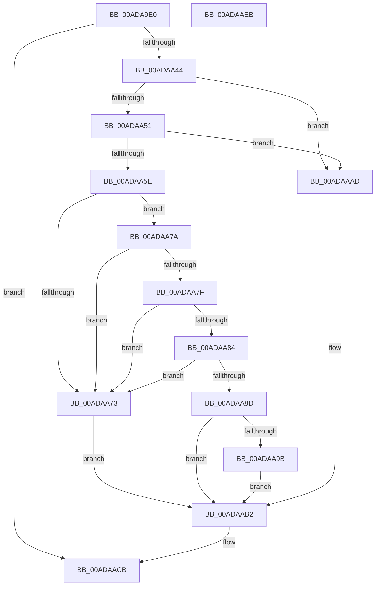

# PiCMSetDeviceProblem

- RVA: `0x00ADA9E0`–`0x00ADAAEC` (길이 `268` bytes)
- VA: `0x0000000140ADA9E0`
- 실행 섹션: `PAGE`
- PDB 이름 있음: `예`; PDB Function 태그: `아니요`
- unwind 정보 RVA: `0x000BF4D8`
- 디코드: `76`개 명령, `268/268` bytes 표시
- 미해석 바이트: `0` (있으면 어셈블리에 `.byte`로 보존)

> 이 문서는 커널 이미지의 기계어와 PDB 기호를 분석해 생성했습니다. 4번과 5번은 함수 원형과 자료형을 바이너리 사용 방식에서 추정한 C 해석이며 원본 소스 복구 결과는 아닙니다.

## 1. Dependencies

- 직접 호출 지점: **8**; 고유 호출 대상: **8**
- 직접 호출자로 확인된 함수: **1**
- RIP 상대 이미지 참조: **1**

### Outgoing calls
- `0x00ADAA22` → [memset](../../text/6C/memset_function_006C6C40.md) (function, `0x006C6C40`)
- `0x00ADAA37` → [PiCMCaptureProblemInputData](../70/PiCMCaptureProblemInputData_function_00704E10.md) (function, `0x00704E10`)
- `0x00ADAA48` → [PiAuDoesClientHaveAccess](../96/PiAuDoesClientHaveAccess_function_00962940.md) (function, `0x00962940`)
- `0x00ADAA55` → [PiAuDoesClientHavePrivilege](../96/PiAuDoesClientHavePrivilege_function_00964ADC.md) (function, `0x00964ADC`)
- `0x00ADAA92` → [CmValidateDeviceName](../8F/CmValidateDeviceName_function_008F3CF0.md) (function, `0x008F3CF0`)
- `0x00ADAAA6` → [PiCMSetProblem](../73/PiCMSetProblem_function_0073B9E4.md) (function, `0x0073B9E4`)
- `0x00ADAAC6` → [PiCMReturnBasicResultData](../8E/PiCMReturnBasicResultData_function_008E86E8.md) (function, `0x008E86E8`)
- `0x00ADAAD6` → [_security_check_cookie](../../text/6A/_security_check_cookie_function_006AC640.md) (function, `0x006AC640`)

### Direct callers
- [PiCMHandleIoctl](../8E/PiCMHandleIoctl_function_008EB880.md) at `0x008EC1F9`

### Static image references
- `0x00ADA9F0` → RVA `0x00E0A740` (`.data`; read)

## 2. Other-region calls and transfers

- 다른 실행 섹션으로 향하는 call: **2**
  - `0x00ADAA22` → [memset](../../text/6C/memset_function_006C6C40.md) (`PAGE` → `.text`)
  - `0x00ADAAD6` → [_security_check_cookie](../../text/6A/_security_check_cookie_function_006AC640.md) (`PAGE` → `.text`)
- 별도 외부 분기/꼬리 이동을 확인하지 못했습니다.

## 3. Assembly (complete function range)

```asm
00ADA9E0  40 53                           push rbx
00ADA9E2  55                              push rbp
00ADA9E3  56                              push rsi
00ADA9E4  57                              push rdi
00ADA9E5  41 56                           push r14
00ADA9E7  41 57                           push r15
00ADA9E9  48 81 EC E8 01 00 00            sub rsp, 0x1e8
00ADA9F0  48 8B 05 49 FD 32 00            mov rax, qword ptr [rip + 0x32fd49]
00ADA9F7  48 33 C4                        xor rax, rsp
00ADA9FA  48 89 84 24 D0 01 00 00         mov qword ptr [rsp + 0x1d0], rax
00ADAA02  4C 8B B4 24 48 02 00 00         mov r14, qword ptr [rsp + 0x248]
00ADAA0A  49 8B F0                        mov rsi, r8
00ADAA0D  8B FA                           mov edi, edx
00ADAA0F  48 8B D9                        mov rbx, rcx
00ADAA12  33 D2                           xor edx, edx
00ADAA14  48 8D 4C 24 30                  lea rcx, [rsp + 0x30]
00ADAA19  41 B8 A0 01 00 00               mov r8d, 0x1a0
00ADAA1F  41 8B E9                        mov ebp, r9d
00ADAA22  E8 19 C2 BE FF                  call 0x1406c6c40
00ADAA27  45 33 FF                        xor r15d, r15d
00ADAA2A  4C 8D 4C 24 30                  lea r9, [rsp + 0x30]
00ADAA2F  8B D7                           mov edx, edi
00ADAA31  45 89 3E                        mov dword ptr [r14], r15d
00ADAA34  48 8B CB                        mov rcx, rbx
00ADAA37  E8 D4 A3 C2 FF                  call 0x140704e10
00ADAA3C  85 C0                           test eax, eax
00ADAA3E  0F 88 87 00 00 00               js 0x140adaacb
00ADAA44  41 8D 4F 04                     lea ecx, [r15 + 4]
00ADAA48  E8 F3 7E E8 FF                  call 0x140962940
00ADAA4D  84 C0                           test al, al
00ADAA4F  74 5C                           je 0x140adaaad
00ADAA51  41 8D 4F 0A                     lea ecx, [r15 + 0xa]
00ADAA55  E8 82 A0 E8 FF                  call 0x140964adc
00ADAA5A  84 C0                           test al, al
00ADAA5C  74 4F                           je 0x140adaaad
00ADAA5E  44 8B 9C 24 C8 01 00 00         mov r11d, dword ptr [rsp + 0x1c8]
00ADAA66  44 8B 54 24 34                  mov r10d, dword ptr [rsp + 0x34]
00ADAA6B  66 44 39 7C 24 38               cmp word ptr [rsp + 0x38], r15w
00ADAA71  75 07                           jne 0x140adaa7a
00ADAA73  B8 0D 00 00 C0                  mov eax, 0xc000000d
00ADAA78  EB 38                           jmp 0x140adaab2
00ADAA7A  48 85 F6                        test rsi, rsi
00ADAA7D  74 F4                           je 0x140adaa73
00ADAA7F  83 FD 08                        cmp ebp, 8
00ADAA82  72 EF                           jb 0x140adaa73
00ADAA84  41 8D 42 FF                     lea eax, [r10 - 1]
00ADAA88  83 F8 01                        cmp eax, 1
00ADAA8B  77 E6                           ja 0x140adaa73
00ADAA8D  48 8D 54 24 38                  lea rdx, [rsp + 0x38]
00ADAA92  E8 59 92 E1 FF                  call 0x1408f3cf0
00ADAA97  85 C0                           test eax, eax
00ADAA99  78 17                           js 0x140adaab2
00ADAA9B  45 8B C2                        mov r8d, r10d
00ADAA9E  48 8D 4C 24 38                  lea rcx, [rsp + 0x38]
00ADAAA3  41 8B D3                        mov edx, r11d
00ADAAA6  E8 39 0F C6 FF                  call 0x14073b9e4
00ADAAAB  EB 05                           jmp 0x140adaab2
00ADAAAD  B8 22 00 00 C0                  mov eax, 0xc0000022
00ADAAB2  8B 94 24 CC 01 00 00            mov edx, dword ptr [rsp + 0x1cc]
00ADAAB9  44 8B CD                        mov r9d, ebp
00ADAABC  4C 8B C6                        mov r8, rsi
00ADAABF  4C 89 74 24 20                  mov qword ptr [rsp + 0x20], r14
00ADAAC4  8B C8                           mov ecx, eax
00ADAAC6  E8 1D DC E0 FF                  call 0x1408e86e8
00ADAACB  48 8B 8C 24 D0 01 00 00         mov rcx, qword ptr [rsp + 0x1d0]
00ADAAD3  48 33 CC                        xor rcx, rsp
00ADAAD6  E8 65 1B BD FF                  call 0x1406ac640
00ADAADB  48 81 C4 E8 01 00 00            add rsp, 0x1e8
00ADAAE2  41 5F                           pop r15
00ADAAE4  41 5E                           pop r14
00ADAAE6  5F                              pop rdi
00ADAAE7  5E                              pop rsi
00ADAAE8  5D                              pop rbp
00ADAAE9  5B                              pop rbx
00ADAAEA  C3                              ret
00ADAAEB  CC                              int3
```

## 4. C-style interpretation (structured pseudocode)

```c
__int64 __fastcall PiCMSetDeviceProblem(__int64 a1, int a2, __int64 a3, int a4, __int64 a5, __int64 a6)
{
    __int64 result;
    __int64 v_r15;
    __int64 v_rsp;
    unsigned __int16 v_stack_m1E0;
    unsigned int v_stack_m1E4;
    unsigned __int64 v_stack_m1E8;
    unsigned __int64 v_stack_m1F8;
    unsigned __int64 v_stack_m48;
    unsigned int v_stack_m4C;
    unsigned int v_stack_m50;

    v_rsp = (v_rsp) - (488);
    result = (*(unsigned __int64 *)(v_rip + 3341641)) ^ (v_rsp);
    v_stack_m48 = result;
    a2 = 0;
    result = memset(v_stack_m1E8, a2, 416, a4);
    v_r15 = 0;
    *(unsigned int *)(a6) = 0;
    result = PiCMCaptureProblemInputData(a1, (unsigned int)((unsigned int)((unsigned int)(a2))), 416, v_stack_m1E8);
    if (sign_flag) goto loc_00ADAACB;
    result = PiAuDoesClientHaveAccess(v_r15 + 4, (unsigned int)((unsigned int)((unsigned int)(a2))), 416, v_stack_m1E8);
    if ((unsigned __int8)(result) == 0) goto loc_00ADAAAD;
    result = PiAuDoesClientHavePrivilege(v_r15 + 10, (unsigned int)((unsigned int)((unsigned int)(a2))), 416, v_stack_m1E8);
    if ((unsigned __int8)(result) == 0) goto loc_00ADAAAD;
    if (v_stack_m1E0 != 0) goto loc_00ADAA7A;
loc_00ADAA73:
    goto loc_00ADAAB2;
loc_00ADAA7A:
    if (a3 == 0) goto loc_00ADAA73;
    if (((unsigned int)((unsigned int)(a4))) < 8) goto loc_00ADAA73;
    if (((unsigned int)((unsigned int)(v_stack_m1E4) - 1)) > 1) goto loc_00ADAA73;
    result = CmValidateDeviceName(v_r15 + 10, v_stack_m1E0, 416, v_stack_m1E8);
    if (sign_flag) goto loc_00ADAAB2;
    result = PiCMSetProblem(v_stack_m1E0, (unsigned int)((unsigned int)((unsigned int)(v_stack_m50))), (unsigned int)((unsigned int)((unsigned int)(v_stack_m1E4))), v_stack_m1E8);
    goto loc_00ADAAB2;
loc_00ADAAAD:
loc_00ADAAB2:
    v_stack_m1F8 = a6;
    result = PiCMReturnBasicResultData((unsigned int)((unsigned int)((unsigned int)(0xC0000022ULL))), (unsigned int)(v_stack_m4C), a3, (unsigned int)((unsigned int)((unsigned int)(a4))));
loc_00ADAACB:
    a1 = (v_stack_m48) ^ (v_rsp);
    result = _security_check_cookie(a1, (unsigned int)(v_stack_m4C), a3, (unsigned int)((unsigned int)((unsigned int)(a4))));
    v_rsp = (v_rsp) + (488);
    return result;
}
```

## 5. (Beta) C Style

```c
int64_t PiCMSetDeviceProblem(int64_t Arg1, int32_t Arg2, int64_t Arg3, int32_t Arg4, uint64_t Arg5, void *Arg6)
{
    uint8_t *arg6 = (uint8_t *)Arg6;

    int64_t result;
    int64_t local_r15;
    int64_t local_rsp;
    uint16_t v_stack_m1E0;
    uint32_t v_stack_m1E4;
    uint64_t v_stack_m1E8;
    uint64_t v_stack_m1F8;
    uint64_t v_stack_m48;
    uint32_t v_stack_m4C;
    uint32_t v_stack_m50;

    local_rsp = (local_rsp) - (488);
    result = (*(uint64_t *)(v_rip + 0x32FD49)) ^ (local_rsp);
    v_stack_m48 = result;
    Arg2 = 0;
    result = memset(v_stack_m1E8, Arg2, 416, Arg4);
    local_r15 = 0;
    *(uint32_t *)(arg6) = 0;
    result = PiCMCaptureProblemInputData(Arg1, (uint32_t)((uint32_t)((uint32_t)(Arg2))), 416, v_stack_m1E8);
    if (sign_flag) goto loc_00ADAACB;
    result = PiAuDoesClientHaveAccess(local_r15 + 4, (uint32_t)((uint32_t)((uint32_t)(Arg2))), 416, v_stack_m1E8);
    if ((uint8_t)(result) == 0) goto loc_00ADAAAD;
    result = PiAuDoesClientHavePrivilege(local_r15 + 10, (uint32_t)((uint32_t)((uint32_t)(Arg2))), 416, v_stack_m1E8);
    if ((uint8_t)(result) == 0) goto loc_00ADAAAD;
    if (v_stack_m1E0 != 0) goto loc_00ADAA7A;
loc_00ADAA73:
    goto loc_00ADAAB2;
loc_00ADAA7A:
    if (Arg3 == 0) goto loc_00ADAA73;
    if (((uint32_t)((uint32_t)(Arg4))) < 8) goto loc_00ADAA73;
    if (((uint32_t)((uint32_t)(v_stack_m1E4) - 1)) > 1) goto loc_00ADAA73;
    result = CmValidateDeviceName(local_r15 + 10, v_stack_m1E0, 416, v_stack_m1E8);
    if (sign_flag) goto loc_00ADAAB2;
    result = PiCMSetProblem(v_stack_m1E0, (uint32_t)((uint32_t)((uint32_t)(v_stack_m50))), (uint32_t)((uint32_t)((uint32_t)(v_stack_m1E4))), v_stack_m1E8);
    goto loc_00ADAAB2;
loc_00ADAAAD:
loc_00ADAAB2:
    v_stack_m1F8 = Arg6;
    result = PiCMReturnBasicResultData((uint32_t)((uint32_t)((uint32_t)(0xC0000022ULL))), (uint32_t)(v_stack_m4C), Arg3, (uint32_t)((uint32_t)((uint32_t)(Arg4))));
loc_00ADAACB:
    Arg1 = (v_stack_m48) ^ (local_rsp);
    result = _security_check_cookie(Arg1, (uint32_t)(v_stack_m4C), Arg3, (uint32_t)((uint32_t)((uint32_t)(Arg4))));
    local_rsp = (local_rsp) + (488);
    return result;
}
```

### 관측된 메모리 오프셋

구조체 형식이 확인되지 않은 접근은 인자 기준의 오프셋으로만 기록했습니다.

| 기준 인자 | 오프셋 표현 | 폭 (bit) | 접근 |
|---|---:|---:|---|
| `Arg6` | `+ 0x0` | `32` | `W` |

## 6. Execution-region graph

[열기: 2D/3D 그래프와 함수 탐색 컨트롤 패널](../../../control-panel.html?section=page&rva=0x00ADA9E0&view=graph)

- 2D 그래프는 위에서 아래로 흐르고, 3D 그래프는 빈 공간을 드래그해 회전합니다. Shift+드래그는 이동, 휠은 확대·축소, 함수 노드 선택은 대상 보고서 이동입니다.

### Static fallback


