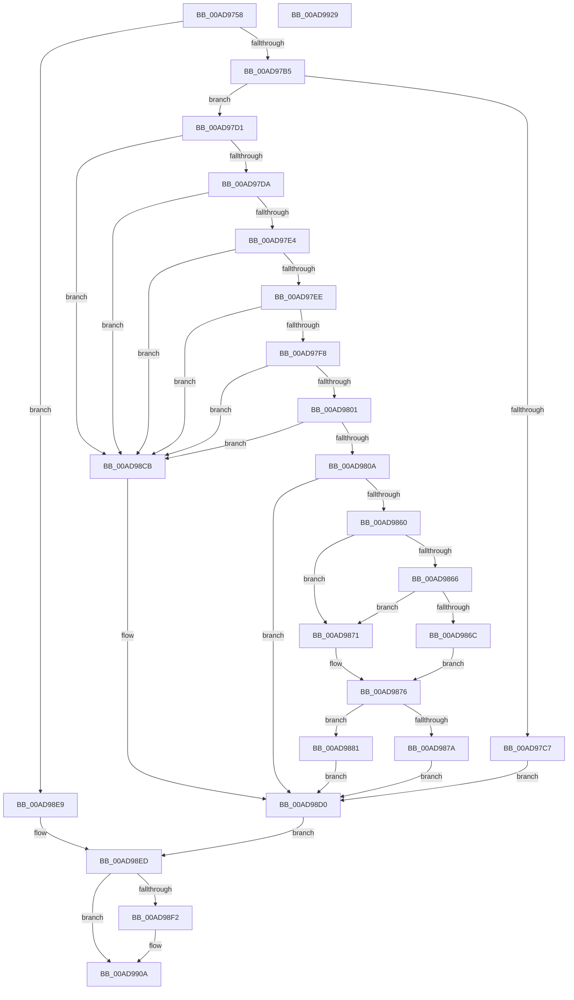

# PiCMUnregisterDeviceInterface

- RVA: `0x00AD9758`–`0x00AD992A` (길이 `466` bytes)
- VA: `0x0000000140AD9758`
- 실행 섹션: `PAGE`
- PDB 이름 있음: `예`; PDB Function 태그: `아니요`
- unwind 정보 RVA: `0x000BF340`
- 디코드: `120`개 명령, `466/466` bytes 표시
- 미해석 바이트: `0` (있으면 어셈블리에 `.byte`로 보존)

> 이 문서는 커널 이미지의 기계어와 PDB 기호를 분석해 생성했습니다. 4번과 5번은 함수 원형과 자료형을 바이너리 사용 방식에서 추정한 C 해석이며 원본 소스 복구 결과는 아닙니다.

## 1. Dependencies

- 직접 호출 지점: **9**; 고유 호출 대상: **9**
- 직접 호출자로 확인된 함수: **1**
- RIP 상대 이미지 참조: **3**

### Outgoing calls
- `0x00AD97A6` → [PiCMCaptureObjectInputData](../8E/PiCMCaptureObjectInputData_function_008E8220.md) (function, `0x008E8220`)
- `0x00AD97BA` → [PiAuDoesClientHaveAccess](../96/PiAuDoesClientHaveAccess_function_00962940.md) (function, `0x00962940`)
- `0x00AD9855` → [PnpGetObjectProperty](../8E/PnpGetObjectProperty_function_008E2180.md) (function, `0x008E2180`)
- `0x00AD989B` → [ExAcquireResourceExclusiveLite](../../text/21/ExAcquireResourceExclusiveLite_function_00214E20.md) (function, `0x00214E20`)
- `0x00AD98B1` → [CmDeleteDeviceInterface](../A0/CmDeleteDeviceInterface_function_00A09E98.md) (function, `0x00A09E98`)
- `0x00AD98BF` → [ExReleaseResourceLite](../../text/25/ExReleaseResourceLite_function_0025FA10.md) (function, `0x0025FA10`)
- `0x00AD98C4` → [KeLeaveCriticalRegion](../../text/25/KeLeaveCriticalRegion_function_0025D8B0.md) (function, `0x0025D8B0`)
- `0x00AD98E0` → [PiCMReturnBasicResultData](../8E/PiCMReturnBasicResultData_function_008E86E8.md) (function, `0x008E86E8`)
- `0x00AD9905` → [PiControlFreeUserModeCallersBuffer](../../text/44/PiControlFreeUserModeCallersBuffer_function_00448990.md) (function, `0x00448990`)

### Direct callers
- [PiCMHandleIoctl](../8E/PiCMHandleIoctl_function_008EB880.md) at `0x008EC253`

### Static image references
- `0x00AD9813` → RVA `0x00E66398` (`.data`; read)
- `0x00AD9843` → RVA `0x000114D0` (`.rdata`; read)
- `0x00AD988A` → RVA `0x00F8C600` (`.data`; read)

## 2. Other-region calls and transfers

- 다른 실행 섹션으로 향하는 call: **4**
  - `0x00AD989B` → [ExAcquireResourceExclusiveLite](../../text/21/ExAcquireResourceExclusiveLite_function_00214E20.md) (`PAGE` → `.text`)
  - `0x00AD98BF` → [ExReleaseResourceLite](../../text/25/ExReleaseResourceLite_function_0025FA10.md) (`PAGE` → `.text`)
  - `0x00AD98C4` → [KeLeaveCriticalRegion](../../text/25/KeLeaveCriticalRegion_function_0025D8B0.md) (`PAGE` → `.text`)
  - `0x00AD9905` → [PiControlFreeUserModeCallersBuffer](../../text/44/PiControlFreeUserModeCallersBuffer_function_00448990.md) (`PAGE` → `.text`)
- 별도 외부 분기/꼬리 이동을 확인하지 못했습니다.

## 3. Assembly (complete function range)

```asm
00AD9758  48 8B C4                        mov rax, rsp
00AD975B  48 89 58 08                     mov qword ptr [rax + 8], rbx
00AD975F  48 89 70 10                     mov qword ptr [rax + 0x10], rsi
00AD9763  48 89 78 18                     mov qword ptr [rax + 0x18], rdi
00AD9767  55                              push rbp
00AD9768  41 56                           push r14
00AD976A  41 57                           push r15
00AD976C  48 8D 68 B1                     lea rbp, [rax - 0x4f]
00AD9770  48 81 EC 90 00 00 00            sub rsp, 0x90
00AD9777  4C 8B 7D 7F                     mov r15, qword ptr [rbp + 0x7f]
00AD977B  33 C0                           xor eax, eax
00AD977D  21 45 07                        and dword ptr [rbp + 7], eax
00AD9780  0F 57 C0                        xorps xmm0, xmm0
00AD9783  21 45 0B                        and dword ptr [rbp + 0xb], eax
00AD9786  41 8B F1                        mov esi, r9d
00AD9789  4D 8B F0                        mov r14, r8
00AD978C  48 89 45 2F                     mov qword ptr [rbp + 0x2f], rax
00AD9790  44 8B 45 77                     mov r8d, dword ptr [rbp + 0x77]
00AD9794  4C 8D 4D 0F                     lea r9, [rbp + 0xf]
00AD9798  41 21 07                        and dword ptr [r15], eax
00AD979B  0F 11 45 0F                     movups xmmword ptr [rbp + 0xf], xmm0
00AD979F  88 45 7F                        mov byte ptr [rbp + 0x7f], al
00AD97A2  0F 11 45 1F                     movups xmmword ptr [rbp + 0x1f], xmm0
00AD97A6  E8 75 EA E0 FF                  call 0x1408e8220
00AD97AB  8B D8                           mov ebx, eax
00AD97AD  85 C0                           test eax, eax
00AD97AF  0F 88 34 01 00 00               js 0x140ad98e9
00AD97B5  B9 02 00 00 00                  mov ecx, 2
00AD97BA  E8 81 91 E8 FF                  call 0x140962940
00AD97BF  48 8B 7D 1F                     mov rdi, qword ptr [rbp + 0x1f]
00AD97C3  84 C0                           test al, al
00AD97C5  75 0A                           jne 0x140ad97d1
00AD97C7  BB 22 00 00 C0                  mov ebx, 0xc0000022
00AD97CC  E9 FF 00 00 00                  jmp 0x140ad98d0
00AD97D1  48 85 FF                        test rdi, rdi
00AD97D4  0F 84 F1 00 00 00               je 0x140ad98cb
00AD97DA  83 7D 13 00                     cmp dword ptr [rbp + 0x13], 0
00AD97DE  0F 85 E7 00 00 00               jne 0x140ad98cb
00AD97E4  83 7D 17 04                     cmp dword ptr [rbp + 0x17], 4
00AD97E8  0F 85 DD 00 00 00               jne 0x140ad98cb
00AD97EE  83 7D 2B 00                     cmp dword ptr [rbp + 0x2b], 0
00AD97F2  0F 85 D3 00 00 00               jne 0x140ad98cb
00AD97F8  4D 85 F6                        test r14, r14
00AD97FB  0F 84 CA 00 00 00               je 0x140ad98cb
00AD9801  83 FE 08                        cmp esi, 8
00AD9804  0F 82 C1 00 00 00               jb 0x140ad98cb
00AD980A  83 64 24 50 00                  and dword ptr [rsp + 0x50], 0
00AD980F  48 8D 45 0B                     lea rax, [rbp + 0xb]
00AD9813  48 8B 0D 7E CB 38 00            mov rcx, qword ptr [rip + 0x38cb7e]
00AD981A  45 33 C9                        xor r9d, r9d
00AD981D  48 89 44 24 48                  mov qword ptr [rsp + 0x48], rax
00AD9822  48 8B D7                        mov rdx, rdi
00AD9825  C7 44 24 40 01 00 00 00         mov dword ptr [rsp + 0x40], 1
00AD982D  48 8D 45 7F                     lea rax, [rbp + 0x7f]
00AD9831  48 89 44 24 38                  mov qword ptr [rsp + 0x38], rax
00AD9836  48 8D 45 07                     lea rax, [rbp + 7]
00AD983A  48 89 44 24 30                  mov qword ptr [rsp + 0x30], rax
00AD983F  45 8D 41 03                     lea r8d, [r9 + 3]
00AD9843  48 8D 05 86 7C 53 FF            lea rax, [rip - 0xac837a]
00AD984A  48 89 44 24 28                  mov qword ptr [rsp + 0x28], rax
00AD984F  48 83 64 24 20 00               and qword ptr [rsp + 0x20], 0
00AD9855  E8 26 89 E0 FF                  call 0x1408e2180
00AD985A  8B D8                           mov ebx, eax
00AD985C  85 C0                           test eax, eax
00AD985E  78 70                           js 0x140ad98d0
00AD9860  83 7D 07 11                     cmp dword ptr [rbp + 7], 0x11
00AD9864  75 0B                           jne 0x140ad9871
00AD9866  83 7D 0B 01                     cmp dword ptr [rbp + 0xb], 1
00AD986A  75 05                           jne 0x140ad9871
00AD986C  8A 45 7F                        mov al, byte ptr [rbp + 0x7f]
00AD986F  EB 05                           jmp 0x140ad9876
00AD9871  32 C0                           xor al, al
00AD9873  88 45 7F                        mov byte ptr [rbp + 0x7f], al
00AD9876  3C FF                           cmp al, 0xff
00AD9878  75 07                           jne 0x140ad9881
00AD987A  BB 08 07 00 C0                  mov ebx, 0xc0000708
00AD987F  EB 4F                           jmp 0x140ad98d0
00AD9881  65 48 8B 04 25 88 01 00 00      mov rax, qword ptr gs:[0x188]
00AD988A  48 8D 0D 6F 2D 4B 00            lea rcx, [rip + 0x4b2d6f]
00AD9891  B2 01                           mov dl, 1
00AD9893  66 FF 88 E4 01 00 00            dec word ptr [rax + 0x1e4]
00AD989A  90                              nop
00AD989B  E8 80 B5 73 FF                  call 0x140214e20
00AD98A0  48 8B 7D 1F                     mov rdi, qword ptr [rbp + 0x1f]
00AD98A4  45 33 C0                        xor r8d, r8d
00AD98A7  48 8B 0D EA CA 38 00            mov rcx, qword ptr [rip + 0x38caea]
00AD98AE  48 8B D7                        mov rdx, rdi
00AD98B1  E8 E2 05 F3 FF                  call 0x140a09e98
00AD98B6  48 8D 0D 43 2D 4B 00            lea rcx, [rip + 0x4b2d43]
00AD98BD  8B D8                           mov ebx, eax
00AD98BF  E8 4C 61 78 FF                  call 0x14025fa10
00AD98C4  E8 E7 3F 78 FF                  call 0x14025d8b0
00AD98C9  EB 05                           jmp 0x140ad98d0
00AD98CB  BB 0D 00 00 C0                  mov ebx, 0xc000000d
00AD98D0  8B 55 2F                        mov edx, dword ptr [rbp + 0x2f]
00AD98D3  44 8B CE                        mov r9d, esi
00AD98D6  4D 8B C6                        mov r8, r14
00AD98D9  4C 89 7C 24 20                  mov qword ptr [rsp + 0x20], r15
00AD98DE  8B CB                           mov ecx, ebx
00AD98E0  E8 03 EE E0 FF                  call 0x1408e86e8
00AD98E5  8B D8                           mov ebx, eax
00AD98E7  EB 04                           jmp 0x140ad98ed
00AD98E9  48 8B 7D 1F                     mov rdi, qword ptr [rbp + 0x1f]
00AD98ED  48 85 FF                        test rdi, rdi
00AD98F0  74 18                           je 0x140ad990a
00AD98F2  65 48 8B 0C 25 88 01 00 00      mov rcx, qword ptr gs:[0x188]
00AD98FB  48 8B 55 1F                     mov rdx, qword ptr [rbp + 0x1f]
00AD98FF  8A 89 32 02 00 00               mov cl, byte ptr [rcx + 0x232]
00AD9905  E8 86 F0 96 FF                  call 0x140448990
00AD990A  4C 8D 9C 24 90 00 00 00         lea r11, [rsp + 0x90]
00AD9912  8B C3                           mov eax, ebx
00AD9914  49 8B 5B 20                     mov rbx, qword ptr [r11 + 0x20]
00AD9918  49 8B 73 28                     mov rsi, qword ptr [r11 + 0x28]
00AD991C  49 8B 7B 30                     mov rdi, qword ptr [r11 + 0x30]
00AD9920  49 8B E3                        mov rsp, r11
00AD9923  41 5F                           pop r15
00AD9925  41 5E                           pop r14
00AD9927  5D                              pop rbp
00AD9928  C3                              ret
00AD9929  CC                              int3
```

## 4. C-style interpretation (structured pseudocode)

```c
__int64 __fastcall PiCMUnregisterDeviceInterface(__int64 a1, __int64 a2, __int64 a3, int a4)
{
    __int64 result;
    __int64 v_rsp;
    unsigned __int64 v_stack_m18;
    unsigned int v_stack_m58;
    unsigned __int64 v_stack_m60;
    unsigned int v_stack_m68;
    unsigned __int64 v_stack_m70;
    unsigned __int64 v_stack_m78;
    unsigned __int64 v_stack_m80;
    unsigned __int64 v_stack_m88;

    *(unsigned __int64 *)(v_rsp + 8) = v_rbx;
    *(unsigned __int64 *)(v_rsp + 16) = v_rsi;
    *(unsigned __int64 *)(v_rsp + 24) = v_rdi;
    v_rsp = (v_rsp) - (144);
    result = 0;
    *(unsigned __int64 *)(v_rsp - 79 + 47) = 0;
    *(unsigned __int64 *)(v_rsp - 79 + 15) = v_xmm0;
    *(unsigned __int8 *)(v_rsp - 79 + 127) = 0;
    *(unsigned __int64 *)(v_rsp - 79 + 31) = v_xmm0;
    result = PiCMCaptureObjectInputData(a1, a2, (unsigned int)(*(unsigned int *)(v_rsp - 79 + 119)), v_rsp - 79 + 15);
    if (sign_flag) goto loc_00AD98E9;
    result = PiAuDoesClientHaveAccess(2, a2, (unsigned int)(*(unsigned int *)(v_rsp - 79 + 119)), v_rsp - 79 + 15);
    if ((unsigned __int8)(result) != 0) goto loc_00AD97D1;
    goto loc_00AD98D0;
loc_00AD97D1:
    if (*(unsigned __int64 *)(v_rsp - 79 + 31) == 0) goto loc_00AD98CB;
    if ((*(unsigned int *)(v_rsp - 79 + 19)) != 0) goto loc_00AD98CB;
    if ((*(unsigned int *)(v_rsp - 79 + 23)) != 4) goto loc_00AD98CB;
    if ((*(unsigned int *)(v_rsp - 79 + 43)) != 0) goto loc_00AD98CB;
    if (a3 == 0) goto loc_00AD98CB;
    if (((unsigned int)((unsigned int)(a4))) < 8) goto loc_00AD98CB;
    a4 = 0;
    v_stack_m60 = v_rsp - 79 + 11;
    v_stack_m68 = 1;
    v_stack_m70 = v_rsp - 79 + 127;
    v_stack_m78 = v_rsp - 79 + 7;
    v_stack_m80 = v_rip - 11305850;
    result = PnpGetObjectProperty(*(unsigned __int64 *)(v_rip + 3722110), *(unsigned __int64 *)(v_rsp - 79 + 31), a4 + 3, a4);
    if (sign_flag) goto loc_00AD98D0;
    if ((*(unsigned int *)(v_rsp - 79 + 7)) != 17) goto loc_00AD9871;
    if ((*(unsigned int *)(v_rsp - 79 + 11)) != 1) goto loc_00AD9871;
    goto loc_00AD9876;
loc_00AD9871:
    result = 0;
    *(unsigned __int8 *)(v_rsp - 79 + 127) = 0;
loc_00AD9876:
    if (0 != 255) goto loc_00AD9881;
    goto loc_00AD98D0;
loc_00AD9881:
    result = ExAcquireResourceExclusiveLite(v_rip + 4926831, 1, a4 + 3, a4);
    a3 = 0;
    result = CmDeleteDeviceInterface(*(unsigned __int64 *)(v_rip + 3721962), *(unsigned __int64 *)(v_rsp - 79 + 31), a3, a4);
    result = ExReleaseResourceLite(v_rip + 4926787, *(unsigned __int64 *)(v_rsp - 79 + 31), a3, a4);
    result = KeLeaveCriticalRegion(v_rip + 4926787, *(unsigned __int64 *)(v_rsp - 79 + 31), a3, a4);
    goto loc_00AD98D0;
loc_00AD98CB:
loc_00AD98D0:
    v_stack_m88 = *(unsigned __int64 *)(v_rsp - 79 + 127);
    result = PiCMReturnBasicResultData((unsigned int)((unsigned int)((unsigned int)(0xC000000DULL))), (unsigned int)(*(unsigned int *)(v_rsp - 79 + 47)), 0, (unsigned int)((unsigned int)((unsigned int)(a4))));
    goto loc_00AD98ED;
loc_00AD98E9:
loc_00AD98ED:
    if (*(unsigned __int64 *)(v_rsp - 79 + 31) != 0) {
        a1 = *(unsigned __int64 *)(gs_base + (0 + 392));
        a2 = *(unsigned __int64 *)(v_rsp - 79 + 31);
        a1 = *(unsigned __int8 *)(a1 + 562);
        result = PiControlFreeUserModeCallersBuffer(a1, a2, 0, (unsigned int)((unsigned int)((unsigned int)(a4))));
    }
    return (unsigned int)((unsigned int)((unsigned int)((unsigned int)(result))));
}
```

## 5. (Beta) C Style

```c
int64_t PiCMUnregisterDeviceInterface(int64_t Arg1, int64_t Arg2, int64_t Arg3, int32_t Arg4)
{
    int64_t result;
    int64_t local_rsp;
    uint64_t v_stack_m18;
    uint32_t v_stack_m58;
    uint64_t v_stack_m60;
    uint32_t v_stack_m68;
    uint64_t v_stack_m70;
    uint64_t v_stack_m78;
    uint64_t v_stack_m80;
    uint64_t v_stack_m88;

    *(uint64_t *)(local_rsp + 0x8) = local_rbx;
    *(uint64_t *)(local_rsp + 0x10) = local_rsi;
    *(uint64_t *)(local_rsp + 0x18) = local_rdi;
    local_rsp = (local_rsp) - (144);
    result = 0;
    *(uint64_t *)(local_rsp - 0x4F + 0x2F) = 0;
    *(uint64_t *)(local_rsp - 0x4F + 0xF) = v_xmm0;
    *(uint8_t *)(local_rsp - 0x4F + 0x7F) = 0;
    *(uint64_t *)(local_rsp - 0x4F + 0x1F) = v_xmm0;
    result = PiCMCaptureObjectInputData(Arg1, Arg2, (uint32_t)(*(uint32_t *)(local_rsp - 0x4F + 0x77)), local_rsp - 79 + 15);
    if (sign_flag) goto loc_00AD98E9;
    result = PiAuDoesClientHaveAccess(2, Arg2, (uint32_t)(*(uint32_t *)(local_rsp - 0x4F + 0x77)), local_rsp - 79 + 15);
    if ((uint8_t)(result) != 0) goto loc_00AD97D1;
    goto loc_00AD98D0;
loc_00AD97D1:
    if (*(uint64_t *)(local_rsp - 0x4F + 0x1F) == 0) goto loc_00AD98CB;
    if ((*(uint32_t *)(local_rsp - 0x4F + 0x13)) != 0) goto loc_00AD98CB;
    if ((*(uint32_t *)(local_rsp - 0x4F + 0x17)) != 4) goto loc_00AD98CB;
    if ((*(uint32_t *)(local_rsp - 0x4F + 0x2B)) != 0) goto loc_00AD98CB;
    if (Arg3 == 0) goto loc_00AD98CB;
    if (((uint32_t)((uint32_t)(Arg4))) < 8) goto loc_00AD98CB;
    Arg4 = 0;
    v_stack_m60 = local_rsp - 79 + 11;
    v_stack_m68 = 1;
    v_stack_m70 = local_rsp - 79 + 127;
    v_stack_m78 = local_rsp - 79 + 7;
    v_stack_m80 = v_rip - 11305850;
    result = PnpGetObjectProperty(*(uint64_t *)(v_rip + 0x38CB7E), *(uint64_t *)(local_rsp - 0x4F + 0x1F), Arg4 + 3, Arg4);
    if (sign_flag) goto loc_00AD98D0;
    if ((*(uint32_t *)(local_rsp - 0x4F + 0x7)) != 17) goto loc_00AD9871;
    if ((*(uint32_t *)(local_rsp - 0x4F + 0xB)) != 1) goto loc_00AD9871;
    goto loc_00AD9876;
loc_00AD9871:
    result = 0;
    *(uint8_t *)(local_rsp - 0x4F + 0x7F) = 0;
loc_00AD9876:
    if (0 != 255) goto loc_00AD9881;
    goto loc_00AD98D0;
loc_00AD9881:
    result = ExAcquireResourceExclusiveLite(v_rip + 4926831, 1, Arg4 + 3, Arg4);
    Arg3 = 0;
    result = CmDeleteDeviceInterface(*(uint64_t *)(v_rip + 0x38CAEA), *(uint64_t *)(local_rsp - 0x4F + 0x1F), Arg3, Arg4);
    result = ExReleaseResourceLite(v_rip + 4926787, *(uint64_t *)(local_rsp - 0x4F + 0x1F), Arg3, Arg4);
    result = KeLeaveCriticalRegion(v_rip + 4926787, *(uint64_t *)(local_rsp - 0x4F + 0x1F), Arg3, Arg4);
    goto loc_00AD98D0;
loc_00AD98CB:
loc_00AD98D0:
    v_stack_m88 = *(uint64_t *)(local_rsp - 0x4F + 0x7F);
    result = PiCMReturnBasicResultData((uint32_t)((uint32_t)((uint32_t)(0xC000000DULL))), (uint32_t)(*(uint32_t *)(local_rsp - 0x4F + 0x2F)), 0, (uint32_t)((uint32_t)((uint32_t)(Arg4))));
    goto loc_00AD98ED;
loc_00AD98E9:
loc_00AD98ED:
    if (*(uint64_t *)(local_rsp - 0x4F + 0x1F) != 0) {
        Arg1 = *(uint64_t *)(gs_base + (0 + 0x188));
        Arg2 = *(uint64_t *)(local_rsp - 0x4F + 0x1F);
        Arg1 = *(uint8_t *)(Arg1 + 0x232);
        result = PiControlFreeUserModeCallersBuffer(Arg1, Arg2, 0, (uint32_t)((uint32_t)((uint32_t)(Arg4))));
    }
    return (uint32_t)((uint32_t)((uint32_t)((uint32_t)(result))));
}
```

## 6. Execution-region graph

[열기: 2D/3D 그래프와 함수 탐색 컨트롤 패널](../../../control-panel.html?section=page&rva=0x00AD9758&view=graph)

- 2D 그래프는 위에서 아래로 흐르고, 3D 그래프는 빈 공간을 드래그해 회전합니다. Shift+드래그는 이동, 휠은 확대·축소, 함수 노드 선택은 대상 보고서 이동입니다.

### Static fallback


