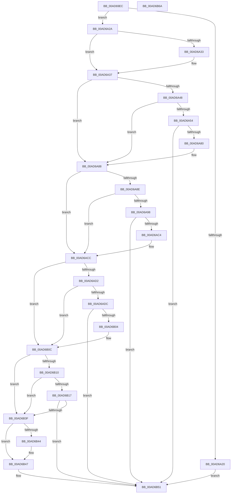

# PiDqConvertQueryFlagsToString

- RVA: `0x00AD69EC`–`0x00AD6B6B` (길이 `383` bytes)
- VA: `0x0000000140AD69EC`
- 실행 섹션: `PAGE`
- PDB 이름 있음: `예`; PDB Function 태그: `아니요`
- unwind 정보 RVA: `0x000BD44C`
- 디코드: `105`개 명령, `383/383` bytes 표시
- 미해석 바이트: `0` (있으면 어셈블리에 `.byte`로 보존)

> 이 문서는 커널 이미지의 기계어와 PDB 기호를 분석해 생성했습니다. 4번과 5번은 함수 원형과 자료형을 바이너리 사용 방식에서 추정한 C 해석이며 원본 소스 복구 결과는 아닙니다.

## 1. Dependencies

- 직접 호출 지점: **4**; 고유 호출 대상: **1**
- 직접 호출자로 확인된 함수: **1**
- RIP 상대 이미지 참조: **4**

### Outgoing calls
- `0x00AD6A73` → [RtlStringCbCopyExW](../../text/45/RtlStringCbCopyExW_function_0045488C.md) (function, `0x0045488C`)
- `0x00AD6AB7` → [RtlStringCbCopyExW](../../text/45/RtlStringCbCopyExW_function_0045488C.md) (function, `0x0045488C`)
- `0x00AD6AFB` → [RtlStringCbCopyExW](../../text/45/RtlStringCbCopyExW_function_0045488C.md) (function, `0x0045488C`)
- `0x00AD6B36` → [RtlStringCbCopyExW](../../text/45/RtlStringCbCopyExW_function_0045488C.md) (function, `0x0045488C`)

### Direct callers
- [sub_00B1C93A](../B1/Unknown_function_00B1C93A.md) at `0x00B1CA51`
- [sub_00B1C93A](../B1/Unknown_function_00B1C93A.md) at `0x00B1CA94`

### Static image references
- `0x00AD6A69` → RVA `0x00AFE750` (` ?? ::NNGAKEGL::`string'`; read)
- `0x00AD6AAD` → RVA `0x00AFE790` (` ?? ::NNGAKEGL::`string'`; read)
- `0x00AD6AF1` → RVA `0x00AFE7D0` (` ?? ::NNGAKEGL::`string'`; read)
- `0x00AD6B2C` → RVA `0x00AFE710` (` ?? ::NNGAKEGL::`string'`; read)

## 2. Other-region calls and transfers

- 다른 실행 섹션으로 향하는 call: **4**
  - `0x00AD6A73` → [RtlStringCbCopyExW](../../text/45/RtlStringCbCopyExW_function_0045488C.md) (`PAGE` → `.text`)
  - `0x00AD6AB7` → [RtlStringCbCopyExW](../../text/45/RtlStringCbCopyExW_function_0045488C.md) (`PAGE` → `.text`)
  - `0x00AD6AFB` → [RtlStringCbCopyExW](../../text/45/RtlStringCbCopyExW_function_0045488C.md) (`PAGE` → `.text`)
  - `0x00AD6B36` → [RtlStringCbCopyExW](../../text/45/RtlStringCbCopyExW_function_0045488C.md) (`PAGE` → `.text`)
- 별도 외부 분기/꼬리 이동을 확인하지 못했습니다.

## 3. Assembly (complete function range)

```asm
00AD69EC  48 89 5C 24 08                  mov qword ptr [rsp + 8], rbx
00AD69F1  48 89 74 24 10                  mov qword ptr [rsp + 0x10], rsi
00AD69F6  48 89 7C 24 18                  mov qword ptr [rsp + 0x18], rdi
00AD69FB  55                              push rbp
00AD69FC  41 56                           push r14
00AD69FE  41 57                           push r15
00AD6A00  48 8B EC                        mov rbp, rsp
00AD6A03  48 83 EC 40                     sub rsp, 0x40
00AD6A07  45 33 FF                        xor r15d, r15d
00AD6A0A  41 8B F0                        mov esi, r8d
00AD6A0D  4D 8B F1                        mov r14, r9
00AD6A10  4C 8B D2                        mov r10, rdx
00AD6A13  8B F9                           mov edi, ecx
00AD6A15  41 8B C7                        mov eax, r15d
00AD6A18  F7 C1 F8 FF FF FF               test ecx, 0xfffffff8
00AD6A1E  74 0A                           je 0x140ad6a2a
00AD6A20  B8 0D 00 00 C0                  mov eax, 0xc000000d
00AD6A25  E9 27 01 00 00                  jmp 0x140ad6b51
00AD6A2A  BB 02 00 00 00                  mov ebx, 2
00AD6A2F  3B F3                           cmp esi, ebx
00AD6A31  72 04                           jb 0x140ad6a37
00AD6A33  66 44 89 3A                     mov word ptr [rdx], r15w
00AD6A37  4C 89 55 F8                     mov qword ptr [rbp - 8], r10
00AD6A3B  48 8B D6                        mov rdx, rsi
00AD6A3E  48 89 55 F0                     mov qword ptr [rbp - 0x10], rdx
00AD6A42  40 F6 C7 01                     test dil, 1
00AD6A46  74 40                           je 0x140ad6a88
00AD6A48  83 E7 FE                        and edi, 0xfffffffe
00AD6A4B  BB 36 00 00 00                  mov ebx, 0x36
00AD6A50  3B F3                           cmp esi, ebx
00AD6A52  72 34                           jb 0x140ad6a88
00AD6A54  48 8D 45 F0                     lea rax, [rbp - 0x10]
00AD6A58  C7 44 24 28 00 04 00 00         mov dword ptr [rsp + 0x28], 0x400
00AD6A60  4C 8D 4D F8                     lea r9, [rbp - 8]
00AD6A64  48 89 44 24 20                  mov qword ptr [rsp + 0x20], rax
00AD6A69  4C 8D 05 E0 7C 02 00            lea r8, [rip + 0x27ce0]
00AD6A70  49 8B CA                        mov rcx, r10
00AD6A73  E8 14 DE 97 FF                  call 0x14045488c
00AD6A78  85 C0                           test eax, eax
00AD6A7A  0F 88 D1 00 00 00               js 0x140ad6b51
00AD6A80  4C 8B 55 F8                     mov r10, qword ptr [rbp - 8]
00AD6A84  48 8B 55 F0                     mov rdx, qword ptr [rbp - 0x10]
00AD6A88  40 F6 C7 02                     test dil, 2
00AD6A8C  74 3E                           je 0x140ad6acc
00AD6A8E  83 E7 FD                        and edi, 0xfffffffd
00AD6A91  83 C3 34                        add ebx, 0x34
00AD6A94  3B DE                           cmp ebx, esi
00AD6A96  77 34                           ja 0x140ad6acc
00AD6A98  48 8D 45 F0                     lea rax, [rbp - 0x10]
00AD6A9C  C7 44 24 28 00 04 00 00         mov dword ptr [rsp + 0x28], 0x400
00AD6AA4  4C 8D 4D F8                     lea r9, [rbp - 8]
00AD6AA8  48 89 44 24 20                  mov qword ptr [rsp + 0x20], rax
00AD6AAD  4C 8D 05 DC 7C 02 00            lea r8, [rip + 0x27cdc]
00AD6AB4  49 8B CA                        mov rcx, r10
00AD6AB7  E8 D0 DD 97 FF                  call 0x14045488c
00AD6ABC  85 C0                           test eax, eax
00AD6ABE  0F 88 8D 00 00 00               js 0x140ad6b51
00AD6AC4  4C 8B 55 F8                     mov r10, qword ptr [rbp - 8]
00AD6AC8  48 8B 55 F0                     mov rdx, qword ptr [rbp - 0x10]
00AD6ACC  40 F6 C7 04                     test dil, 4
00AD6AD0  74 3A                           je 0x140ad6b0c
00AD6AD2  83 E7 FB                        and edi, 0xfffffffb
00AD6AD5  83 C3 2A                        add ebx, 0x2a
00AD6AD8  3B DE                           cmp ebx, esi
00AD6ADA  77 30                           ja 0x140ad6b0c
00AD6ADC  48 8D 45 F0                     lea rax, [rbp - 0x10]
00AD6AE0  C7 44 24 28 00 04 00 00         mov dword ptr [rsp + 0x28], 0x400
00AD6AE8  4C 8D 4D F8                     lea r9, [rbp - 8]
00AD6AEC  48 89 44 24 20                  mov qword ptr [rsp + 0x20], rax
00AD6AF1  4C 8D 05 D8 7C 02 00            lea r8, [rip + 0x27cd8]
00AD6AF8  49 8B CA                        mov rcx, r10
00AD6AFB  E8 8C DD 97 FF                  call 0x14045488c
00AD6B00  85 C0                           test eax, eax
00AD6B02  78 4D                           js 0x140ad6b51
00AD6B04  4C 8B 55 F8                     mov r10, qword ptr [rbp - 8]
00AD6B08  48 8B 55 F0                     mov rdx, qword ptr [rbp - 0x10]
00AD6B0C  85 FF                           test edi, edi
00AD6B0E  74 2F                           je 0x140ad6b3f
00AD6B10  83 C3 18                        add ebx, 0x18
00AD6B13  3B DE                           cmp ebx, esi
00AD6B15  77 28                           ja 0x140ad6b3f
00AD6B17  48 8D 45 F0                     lea rax, [rbp - 0x10]
00AD6B1B  C7 44 24 28 00 04 00 00         mov dword ptr [rsp + 0x28], 0x400
00AD6B23  4C 8D 4D F8                     lea r9, [rbp - 8]
00AD6B27  48 89 44 24 20                  mov qword ptr [rsp + 0x20], rax
00AD6B2C  4C 8D 05 DD 7B 02 00            lea r8, [rip + 0x27bdd]
00AD6B33  49 8B CA                        mov rcx, r10
00AD6B36  E8 51 DD 97 FF                  call 0x14045488c
00AD6B3B  85 C0                           test eax, eax
00AD6B3D  78 12                           js 0x140ad6b51
00AD6B3F  4D 85 F6                        test r14, r14
00AD6B42  74 03                           je 0x140ad6b47
00AD6B44  41 89 1E                        mov dword ptr [r14], ebx
00AD6B47  3B DE                           cmp ebx, esi
00AD6B49  B9 23 00 00 C0                  mov ecx, 0xc0000023
00AD6B4E  0F 42 C1                        cmovb eax, ecx
00AD6B51  48 8B 5C 24 60                  mov rbx, qword ptr [rsp + 0x60]
00AD6B56  48 8B 74 24 68                  mov rsi, qword ptr [rsp + 0x68]
00AD6B5B  48 8B 7C 24 70                  mov rdi, qword ptr [rsp + 0x70]
00AD6B60  48 83 C4 40                     add rsp, 0x40
00AD6B64  41 5F                           pop r15
00AD6B66  41 5E                           pop r14
00AD6B68  5D                              pop rbp
00AD6B69  C3                              ret
00AD6B6A  CC                              int3
```

## 4. C-style interpretation (structured pseudocode)

```c
__int64 __fastcall PiDqConvertQueryFlagsToString(int a1, __int64 a2, int a3, __int64 a4)
{
    __int64 result;
    __int64 v_r15;
    __int64 v_rbx;
    __int64 v_rdi;
    __int64 v_rsp;
    unsigned __int64 v_stack_m20;
    unsigned __int64 v_stack_m28;
    unsigned int v_stack_m30;
    unsigned __int64 v_stack_m38;
    unsigned __int64 v_stack_p10;
    unsigned __int64 v_stack_p18;
    unsigned __int64 v_stack_p8;

    v_stack_p8 = v_rbx;
    v_stack_p10 = v_rsi;
    v_stack_p18 = v_rdi;
    v_rsp = (v_rsp) - (64);
    v_r15 = 0;
    if (((a1) & (0xFFFFFFF8ULL)) == 0) goto loc_00AD6A2A;
    goto loc_00AD6B51;
loc_00AD6A2A:
    if (((unsigned int)((unsigned int)(a3))) >= 2) {
        *(unsigned __int16 *)(a2) = 0;
    }
    v_stack_m20 = a2;
    v_stack_m28 = (unsigned int)(a3);
    if ((((unsigned __int8)((unsigned int)(a1))) & (1)) == 0) goto loc_00AD6A88;
    v_rdi = (unsigned int)(((unsigned int)(a1)) & (0xFFFFFFFEULL));
    if (((unsigned int)((unsigned int)(a3))) < 54) goto loc_00AD6A88;
    v_stack_m30 = 0x400ULL;
    v_stack_m38 = v_stack_m28;
    result = RtlStringCbCopyExW(a2, (unsigned int)(a3), v_rip + 163040, v_stack_m20);
    if (sign_flag) goto loc_00AD6B51;
loc_00AD6A88:
    if ((((unsigned __int8)(v_rdi)) & (2)) == 0) goto loc_00AD6ACC;
    v_rdi = (unsigned int)((v_rdi) & (0xFFFFFFFDULL));
    v_rbx = (unsigned int)((54) + (52));
    if (((unsigned int)(v_rbx)) > ((unsigned int)((unsigned int)(a3)))) goto loc_00AD6ACC;
    v_stack_m30 = 0x400ULL;
    v_stack_m38 = v_stack_m28;
    result = RtlStringCbCopyExW(v_stack_m20, v_stack_m28, v_rip + 163036, v_stack_m20);
    if (sign_flag) goto loc_00AD6B51;
loc_00AD6ACC:
    if ((((unsigned __int8)(v_rdi)) & (4)) == 0) goto loc_00AD6B0C;
    v_rdi = (unsigned int)((v_rdi) & (0xFFFFFFFBULL));
    v_rbx = (unsigned int)((v_rbx) + (42));
    if (((unsigned int)(v_rbx)) > ((unsigned int)((unsigned int)(a3)))) goto loc_00AD6B0C;
    v_stack_m30 = 0x400ULL;
    v_stack_m38 = v_stack_m28;
    result = RtlStringCbCopyExW(v_stack_m20, v_stack_m28, v_rip + 163032, v_stack_m20);
    if (sign_flag) goto loc_00AD6B51;
loc_00AD6B0C:
    if ((unsigned int)(v_rdi) == 0) goto loc_00AD6B3F;
    v_rbx = (unsigned int)((v_rbx) + (24));
    if (((unsigned int)(v_rbx)) > ((unsigned int)((unsigned int)(a3)))) goto loc_00AD6B3F;
    v_stack_m30 = 0x400ULL;
    v_stack_m38 = v_stack_m28;
    result = RtlStringCbCopyExW(v_stack_m20, v_stack_m28, v_rip + 162781, v_stack_m20);
    if (sign_flag) goto loc_00AD6B51;
loc_00AD6B3F:
    if (a4 != 0) {
        *(unsigned int *)(a4) = (unsigned int)(v_rbx);
    }
    if (((unsigned int)(v_rbx)) < ((unsigned int)((unsigned int)(a3)))) { result = (unsigned int)((unsigned int)(0xC0000023ULL)); }
loc_00AD6B51:
    v_rsp = (v_rsp) + (64);
    return result;
}
```

## 5. (Beta) C Style

```c
int64_t PiDqConvertQueryFlagsToString(int32_t Arg1, void *Arg2, int32_t Arg3, int64_t Arg4)
{
    uint8_t *arg2 = (uint8_t *)Arg2;

    int64_t result;
    int64_t local_r15;
    int64_t local_rbx;
    int64_t local_rdi;
    int64_t local_rsp;
    uint64_t v_stack_m20;
    uint64_t v_stack_m28;
    uint32_t v_stack_m30;
    uint64_t v_stack_m38;
    uint64_t v_stack_p10;
    uint64_t v_stack_p18;
    uint64_t v_stack_p8;

    v_stack_p8 = local_rbx;
    v_stack_p10 = local_rsi;
    v_stack_p18 = local_rdi;
    local_rsp = (local_rsp) - (64);
    local_r15 = 0;
    if (((Arg1) & (0xFFFFFFF8ULL)) == 0) goto loc_00AD6A2A;
    goto loc_00AD6B51;
loc_00AD6A2A:
    if (((uint32_t)((uint32_t)(Arg3))) >= 2) {
        *(uint16_t *)(arg2) = 0;
    }
    v_stack_m20 = Arg2;
    v_stack_m28 = (uint32_t)(Arg3);
    if ((((uint8_t)((uint32_t)(Arg1))) & (1)) == 0) goto loc_00AD6A88;
    local_rdi = (uint32_t)(((uint32_t)(Arg1)) & (0xFFFFFFFEULL));
    if (((uint32_t)((uint32_t)(Arg3))) < 54) goto loc_00AD6A88;
    v_stack_m30 = 0x400ULL;
    v_stack_m38 = v_stack_m28;
    result = RtlStringCbCopyExW(Arg2, (uint32_t)(Arg3), v_rip + 163040, v_stack_m20);
    if (sign_flag) goto loc_00AD6B51;
loc_00AD6A88:
    if ((((uint8_t)(local_rdi)) & (2)) == 0) goto loc_00AD6ACC;
    local_rdi = (uint32_t)((local_rdi) & (0xFFFFFFFDULL));
    local_rbx = (uint32_t)((54) + (52));
    if (((uint32_t)(local_rbx)) > ((uint32_t)((uint32_t)(Arg3)))) goto loc_00AD6ACC;
    v_stack_m30 = 0x400ULL;
    v_stack_m38 = v_stack_m28;
    result = RtlStringCbCopyExW(v_stack_m20, v_stack_m28, v_rip + 163036, v_stack_m20);
    if (sign_flag) goto loc_00AD6B51;
loc_00AD6ACC:
    if ((((uint8_t)(local_rdi)) & (4)) == 0) goto loc_00AD6B0C;
    local_rdi = (uint32_t)((local_rdi) & (0xFFFFFFFBULL));
    local_rbx = (uint32_t)((local_rbx) + (42));
    if (((uint32_t)(local_rbx)) > ((uint32_t)((uint32_t)(Arg3)))) goto loc_00AD6B0C;
    v_stack_m30 = 0x400ULL;
    v_stack_m38 = v_stack_m28;
    result = RtlStringCbCopyExW(v_stack_m20, v_stack_m28, v_rip + 163032, v_stack_m20);
    if (sign_flag) goto loc_00AD6B51;
loc_00AD6B0C:
    if ((uint32_t)(local_rdi) == 0) goto loc_00AD6B3F;
    local_rbx = (uint32_t)((local_rbx) + (24));
    if (((uint32_t)(local_rbx)) > ((uint32_t)((uint32_t)(Arg3)))) goto loc_00AD6B3F;
    v_stack_m30 = 0x400ULL;
    v_stack_m38 = v_stack_m28;
    result = RtlStringCbCopyExW(v_stack_m20, v_stack_m28, v_rip + 162781, v_stack_m20);
    if (sign_flag) goto loc_00AD6B51;
loc_00AD6B3F:
    if (Arg4 != 0) {
        *(uint32_t *)(Arg4) = (uint32_t)(local_rbx);
    }
    if (((uint32_t)(local_rbx)) < ((uint32_t)((uint32_t)(Arg3)))) { result = (uint32_t)((uint32_t)(0xC0000023ULL)); }
loc_00AD6B51:
    local_rsp = (local_rsp) + (64);
    return result;
}
```

### 관측된 메모리 오프셋

구조체 형식이 확인되지 않은 접근은 인자 기준의 오프셋으로만 기록했습니다.

| 기준 인자 | 오프셋 표현 | 폭 (bit) | 접근 |
|---|---:|---:|---|
| `Arg2` | `+ 0x0` | `16` | `W` |

## 6. Execution-region graph

[열기: 2D/3D 그래프와 함수 탐색 컨트롤 패널](../../../control-panel.html?section=page&rva=0x00AD69EC&view=graph)

- 2D 그래프는 위에서 아래로 흐르고, 3D 그래프는 빈 공간을 드래그해 회전합니다. Shift+드래그는 이동, 휠은 확대·축소, 함수 노드 선택은 대상 보고서 이동입니다.

### Static fallback


