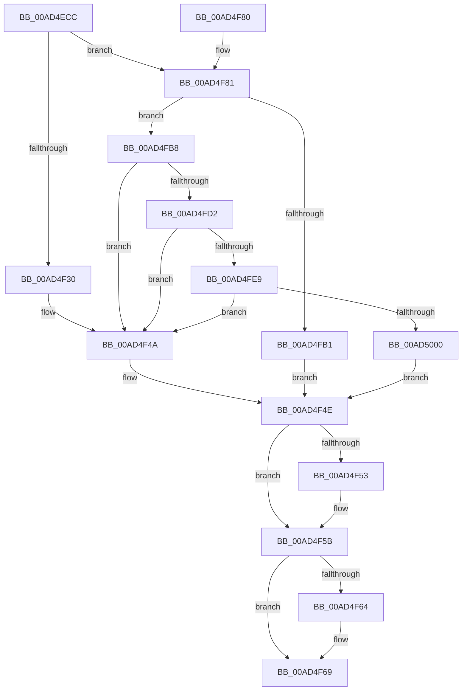

# PiDrvDbMountNode

- RVA: `0x00AD4ECC`–`0x00AD5026` (길이 `346` bytes)
- VA: `0x0000000140AD4ECC`
- 실행 섹션: `PAGE`
- PDB 이름 있음: `예`; PDB Function 태그: `아니요`
- unwind 정보 RVA: `0x000BED24`
- 디코드: `97`개 명령, `346/346` bytes 표시
- 미해석 바이트: `0` (있으면 어셈블리에 `.byte`로 보존)

> 이 문서는 커널 이미지의 기계어와 PDB 기호를 분석해 생성했습니다. 4번과 5번은 함수 원형과 자료형을 바이너리 사용 방식에서 추정한 C 해석이며 원본 소스 복구 결과는 아닙니다.

## 1. Dependencies

- 직접 호출 지점: **11**; 고유 호출 대상: **8**
- 직접 호출자로 확인된 함수: **1**
- RIP 상대 이미지 참조: **1**

### Outgoing calls
- `0x00AD4F03` → [RtlInitUnicodeString](../../text/42/RtlInitUnicodeString_function_0042A780.md) (function, `0x0042A780`)
- `0x00AD4F0E` → [RtlInitUnicodeString](../../text/42/RtlInitUnicodeString_function_0042A780.md) (function, `0x0042A780`)
- `0x00AD4F1A` → [RtlInitUnicodeString](../../text/42/RtlInitUnicodeString_function_0042A780.md) (function, `0x0042A780`)
- `0x00AD4F27` → [PiDrvDbFindNode](../../text/4F/PiDrvDbFindNode_function_004F8E60.md) (function, `0x004F8E60`)
- `0x00AD4F56` → [ExFreePool](../../poolcode/B8/ExFreePool_function_00B82850.md) (function, `0x00B82850`)
- `0x00AD4F64` → [ExFreePool](../../poolcode/B8/ExFreePool_function_00B82850.md) (function, `0x00B82850`)
- `0x00AD4FA0` → [ExAllocatePool2](../../poolcode/B8/ExAllocatePool2_function_00B820F0.md) (function, `0x00B820F0`)
- `0x00AD4FC3` → [RtlAppendUnicodeToString](../../text/40/RtlAppendUnicodeToString_function_0040F990.md) (function, `0x0040F990`)
- `0x00AD4FDA` → [RtlAppendUnicodeStringToString](../../text/40/RtlAppendUnicodeStringToString_function_0040FA50.md) (function, `0x0040FA50`)
- `0x00AD4FF1` → [PiDrvDbQueryHiveFileName](../74/PiDrvDbQueryHiveFileName_function_00741DDC.md) (function, `0x00741DDC`)
- `0x00AD501A` → [PiDrvDbRegisterNode](../74/PiDrvDbRegisterNode_function_00742658.md) (function, `0x00742658`)

### Direct callers
- [sub_008E369D](../8E/Unknown_function_008E369D.md) at `0x008E36EC`

### Static image references
- `0x00AD4FB8` → RVA `0x00B003E0` (` ?? ::NNGAKEGL::`string'`; read)

## 2. Other-region calls and transfers

- 다른 실행 섹션으로 향하는 call: **9**
  - `0x00AD4F03` → [RtlInitUnicodeString](../../text/42/RtlInitUnicodeString_function_0042A780.md) (`PAGE` → `.text`)
  - `0x00AD4F0E` → [RtlInitUnicodeString](../../text/42/RtlInitUnicodeString_function_0042A780.md) (`PAGE` → `.text`)
  - `0x00AD4F1A` → [RtlInitUnicodeString](../../text/42/RtlInitUnicodeString_function_0042A780.md) (`PAGE` → `.text`)
  - `0x00AD4F27` → [PiDrvDbFindNode](../../text/4F/PiDrvDbFindNode_function_004F8E60.md) (`PAGE` → `.text`)
  - `0x00AD4F56` → [ExFreePool](../../poolcode/B8/ExFreePool_function_00B82850.md) (`PAGE` → `POOLCODE`)
  - `0x00AD4F64` → [ExFreePool](../../poolcode/B8/ExFreePool_function_00B82850.md) (`PAGE` → `POOLCODE`)
  - `0x00AD4FA0` → [ExAllocatePool2](../../poolcode/B8/ExAllocatePool2_function_00B820F0.md) (`PAGE` → `POOLCODE`)
  - `0x00AD4FC3` → [RtlAppendUnicodeToString](../../text/40/RtlAppendUnicodeToString_function_0040F990.md) (`PAGE` → `.text`)
  - `0x00AD4FDA` → [RtlAppendUnicodeStringToString](../../text/40/RtlAppendUnicodeStringToString_function_0040FA50.md) (`PAGE` → `.text`)
- 별도 외부 분기/꼬리 이동을 확인하지 못했습니다.

## 3. Assembly (complete function range)

```asm
00AD4ECC  48 89 5C 24 08                  mov qword ptr [rsp + 8], rbx
00AD4ED1  48 89 74 24 18                  mov qword ptr [rsp + 0x18], rsi
00AD4ED6  55                              push rbp
00AD4ED7  57                              push rdi
00AD4ED8  41 56                           push r14
00AD4EDA  48 8B EC                        mov rbp, rsp
00AD4EDD  48 83 EC 60                     sub rsp, 0x60
00AD4EE1  0F 57 C0                        xorps xmm0, xmm0
00AD4EE4  48 8B F1                        mov rsi, rcx
00AD4EE7  0F 57 C9                        xorps xmm1, xmm1
00AD4EEA  48 8D 4D D0                     lea rcx, [rbp - 0x30]
00AD4EEE  45 33 F6                        xor r14d, r14d
00AD4EF1  33 D2                           xor edx, edx
00AD4EF3  0F 11 45 E0                     movups xmmword ptr [rbp - 0x20], xmm0
00AD4EF7  4C 89 75 28                     mov qword ptr [rbp + 0x28], r14
00AD4EFB  0F 11 45 D0                     movups xmmword ptr [rbp - 0x30], xmm0
00AD4EFF  0F 11 4D F0                     movups xmmword ptr [rbp - 0x10], xmm1
00AD4F03  E8 78 58 95 FF                  call 0x14042a780
00AD4F08  33 D2                           xor edx, edx
00AD4F0A  48 8D 4D F0                     lea rcx, [rbp - 0x10]
00AD4F0E  E8 6D 58 95 FF                  call 0x14042a780
00AD4F13  48 8B D6                        mov rdx, rsi
00AD4F16  48 8D 4D E0                     lea rcx, [rbp - 0x20]
00AD4F1A  E8 61 58 95 FF                  call 0x14042a780
00AD4F1F  48 8D 55 28                     lea rdx, [rbp + 0x28]
00AD4F23  48 8D 4D E0                     lea rcx, [rbp - 0x20]
00AD4F27  E8 34 3F A2 FF                  call 0x1404f8e60
00AD4F2C  85 C0                           test eax, eax
00AD4F2E  78 51                           js 0x140ad4f81
00AD4F30  48 8B 45 28                     mov rax, qword ptr [rbp + 0x28]
00AD4F34  8B 48 40                        mov ecx, dword ptr [rax + 0x40]
00AD4F37  80 E1 01                        and cl, 1
00AD4F3A  F6 D9                           neg cl
00AD4F3C  1B DB                           sbb ebx, ebx
00AD4F3E  81 E3 22 00 00 80               and ebx, 0x80000022
00AD4F44  81 C3 00 00 00 40               add ebx, 0x40000000
00AD4F4A  48 8B 7D D8                     mov rdi, qword ptr [rbp - 0x28]
00AD4F4E  48 85 FF                        test rdi, rdi
00AD4F51  74 08                           je 0x140ad4f5b
00AD4F53  48 8B CF                        mov rcx, rdi
00AD4F56  E8 F5 D8 0A 00                  call 0x140b82850
00AD4F5B  48 8B 4D F8                     mov rcx, qword ptr [rbp - 8]
00AD4F5F  48 85 C9                        test rcx, rcx
00AD4F62  74 05                           je 0x140ad4f69
00AD4F64  E8 E7 D8 0A 00                  call 0x140b82850
00AD4F69  4C 8D 5C 24 60                  lea r11, [rsp + 0x60]
00AD4F6E  8B C3                           mov eax, ebx
00AD4F70  49 8B 5B 20                     mov rbx, qword ptr [r11 + 0x20]
00AD4F74  49 8B 73 30                     mov rsi, qword ptr [r11 + 0x30]
00AD4F78  49 8B E3                        mov rsp, r11
00AD4F7B  41 5E                           pop r14
00AD4F7D  5F                              pop rdi
00AD4F7E  5D                              pop rbp
00AD4F7F  C3                              ret
00AD4F80  CC                              int3
00AD4F81  0F B7 45 E0                     movzx eax, word ptr [rbp - 0x20]
00AD4F85  B9 00 01 00 00                  mov ecx, 0x100
00AD4F8A  66 83 C0 26                     add ax, 0x26
00AD4F8E  66 44 89 75 D0                  mov word ptr [rbp - 0x30], r14w
00AD4F93  0F B7 D0                        movzx edx, ax
00AD4F96  41 B8 53 74 72 67               mov r8d, 0x67727453
00AD4F9C  66 89 55 D2                     mov word ptr [rbp - 0x2e], dx
00AD4FA0  E8 4B D1 0A 00                  call 0x140b820f0
00AD4FA5  48 89 45 D8                     mov qword ptr [rbp - 0x28], rax
00AD4FA9  48 8B F8                        mov rdi, rax
00AD4FAC  48 85 C0                        test rax, rax
00AD4FAF  75 07                           jne 0x140ad4fb8
00AD4FB1  BB 9A 00 00 C0                  mov ebx, 0xc000009a
00AD4FB6  EB 96                           jmp 0x140ad4f4e
00AD4FB8  48 8D 15 21 B4 02 00            lea rdx, [rip + 0x2b421]
00AD4FBF  48 8D 4D D0                     lea rcx, [rbp - 0x30]
00AD4FC3  E8 C8 A9 93 FF                  call 0x14040f990
00AD4FC8  8B D8                           mov ebx, eax
00AD4FCA  85 C0                           test eax, eax
00AD4FCC  0F 88 78 FF FF FF               js 0x140ad4f4a
00AD4FD2  48 8D 55 E0                     lea rdx, [rbp - 0x20]
00AD4FD6  48 8D 4D D0                     lea rcx, [rbp - 0x30]
00AD4FDA  E8 71 AA 93 FF                  call 0x14040fa50
00AD4FDF  8B D8                           mov ebx, eax
00AD4FE1  85 C0                           test eax, eax
00AD4FE3  0F 88 61 FF FF FF               js 0x140ad4f4a
00AD4FE9  48 8D 55 F0                     lea rdx, [rbp - 0x10]
00AD4FED  48 8D 4D D0                     lea rcx, [rbp - 0x30]
00AD4FF1  E8 E6 CD C6 FF                  call 0x140741ddc
00AD4FF6  8B D8                           mov ebx, eax
00AD4FF8  85 C0                           test eax, eax
00AD4FFA  0F 88 4A FF FF FF               js 0x140ad4f4a
00AD5000  48 8B 45 F8                     mov rax, qword ptr [rbp - 8]
00AD5004  45 33 C0                        xor r8d, r8d
00AD5007  48 8B 7D D8                     mov rdi, qword ptr [rbp - 0x28]
00AD500B  48 8B CE                        mov rcx, rsi
00AD500E  4C 8B CF                        mov r9, rdi
00AD5011  48 89 44 24 20                  mov qword ptr [rsp + 0x20], rax
00AD5016  41 8D 50 18                     lea edx, [r8 + 0x18]
00AD501A  E8 39 D6 C6 FF                  call 0x140742658
00AD501F  8B D8                           mov ebx, eax
00AD5021  E9 28 FF FF FF                  jmp 0x140ad4f4e
```

## 4. C-style interpretation (structured pseudocode)

```c
__int64 __fastcall PiDrvDbMountNode(__int64 a1, int a2)
{
    __int64 result;
    __int64 v_r14;
    __int64 v_rbx;
    __int64 v_rsp;
    unsigned __int64 v_stack_m18;
    unsigned __int64 v_stack_m20;
    unsigned __int64 v_stack_m28;
    unsigned __int64 v_stack_m38;
    unsigned __int64 v_stack_m40;
    unsigned __int16 v_stack_m46;
    unsigned __int64 v_stack_m48;
    unsigned __int64 v_stack_p10;
    unsigned __int64 v_stack_p18;
    unsigned __int64 v_stack_p8;

    v_stack_p8 = v_rbx;
    v_stack_p18 = v_rsi;
    v_rsp = (v_rsp) - (96);
    v_r14 = 0;
    a2 = 0;
    v_stack_m38 = v_xmm0;
    v_stack_p10 = 0;
    v_stack_m48 = v_xmm0;
    v_stack_m28 = v_xmm1;
    result = RtlInitUnicodeString(v_stack_m48, a2, a3, a4);
    a2 = 0;
    result = RtlInitUnicodeString(v_stack_m28, a2, a3, a4);
    result = RtlInitUnicodeString(v_stack_m38, a1, a3, a4);
    result = PiDrvDbFindNode(v_stack_m38, v_stack_p10, a3, a4);
    if (sign_flag) goto loc_00AD4F81;
    a1 = (unsigned __int8)(((unsigned int)(*(unsigned int *)(v_stack_p10 + 64))) & (1));
    a1 = (unsigned __int8)(-(a1));
    v_rbx = (unsigned int)((v_rbx) & (0x80000022ULL));
    v_rbx = (unsigned int)((v_rbx) + (0x40000000ULL));
loc_00AD4F4A:
loc_00AD4F4E:
    result = v_stack_p10;
    if (v_stack_m40 != 0) {
        a1 = v_stack_m40;
        result = ExFreePool(a1, v_stack_p10, a3, a4);
    }
    if (v_stack_m20 != 0) {
        result = ExFreePool(v_stack_m20, v_stack_p10, a3, a4);
    }
    return (unsigned int)((unsigned int)(v_rbx));
loc_00AD4F81:
    result = (unsigned __int16)((v_stack_m38) + (38));
    v_stack_m48 = 0;
    v_stack_m46 = (unsigned __int16)((unsigned __int16)(result));
    result = ExAllocatePool2(256, (unsigned __int16)(result), (unsigned int)(0x67727453ULL), a4);
    v_stack_m40 = result;
    if (result != 0) goto loc_00AD4FB8;
    goto loc_00AD4F4E;
loc_00AD4FB8:
    result = RtlAppendUnicodeToString(v_stack_m48, v_rip + 177185, (unsigned int)(0x67727453ULL), a4);
    if (sign_flag) goto loc_00AD4F4A;
    result = RtlAppendUnicodeStringToString(v_stack_m48, v_stack_m38, (unsigned int)(0x67727453ULL), a4);
    if (sign_flag) goto loc_00AD4F4A;
    result = PiDrvDbQueryHiveFileName(v_stack_m48, v_stack_m28, (unsigned int)(0x67727453ULL), a4);
    if (sign_flag) goto loc_00AD4F4A;
    a3 = 0;
    v_stack_m40 = v_stack_m20;
    result = PiDrvDbRegisterNode(*(unsigned __int64 *)(v_stack_m18 + 48), a3 + 24, a3, v_stack_m40);
    goto loc_00AD4F4E;
}
```

## 5. (Beta) C Style

```c
int64_t PiDrvDbMountNode(int64_t Arg1, int32_t Arg2)
{
    int64_t result;
    int64_t local_r14;
    int64_t local_rbx;
    int64_t local_rsp;
    uint64_t v_stack_m18;
    uint64_t v_stack_m20;
    uint64_t v_stack_m28;
    uint64_t v_stack_m38;
    uint64_t v_stack_m40;
    uint16_t v_stack_m46;
    uint64_t v_stack_m48;
    uint64_t v_stack_p10;
    uint64_t v_stack_p18;
    uint64_t v_stack_p8;

    v_stack_p8 = local_rbx;
    v_stack_p18 = local_rsi;
    local_rsp = (local_rsp) - (96);
    local_r14 = 0;
    Arg2 = 0;
    v_stack_m38 = v_xmm0;
    v_stack_p10 = 0;
    v_stack_m48 = v_xmm0;
    v_stack_m28 = v_xmm1;
    result = RtlInitUnicodeString(v_stack_m48, Arg2, a3, a4);
    Arg2 = 0;
    result = RtlInitUnicodeString(v_stack_m28, Arg2, a3, a4);
    result = RtlInitUnicodeString(v_stack_m38, Arg1, a3, a4);
    result = PiDrvDbFindNode(v_stack_m38, v_stack_p10, a3, a4);
    if (sign_flag) goto loc_00AD4F81;
    Arg1 = (uint8_t)(((uint32_t)(*(uint32_t *)(v_stack_p10 + 0x40))) & (1));
    Arg1 = (uint8_t)(-(Arg1));
    local_rbx = (uint32_t)((local_rbx) & (0x80000022ULL));
    local_rbx = (uint32_t)((local_rbx) + (0x40000000ULL));
loc_00AD4F4A:
loc_00AD4F4E:
    result = v_stack_p10;
    if (v_stack_m40 != 0) {
        Arg1 = v_stack_m40;
        result = ExFreePool(Arg1, v_stack_p10, a3, a4);
    }
    if (v_stack_m20 != 0) {
        result = ExFreePool(v_stack_m20, v_stack_p10, a3, a4);
    }
    return (uint32_t)((uint32_t)(local_rbx));
loc_00AD4F81:
    result = (uint16_t)((v_stack_m38) + (38));
    v_stack_m48 = 0;
    v_stack_m46 = (uint16_t)((uint16_t)(result));
    result = ExAllocatePool2(256, (uint16_t)(result), (uint32_t)(0x67727453ULL), a4);
    v_stack_m40 = result;
    if (result != 0) goto loc_00AD4FB8;
    goto loc_00AD4F4E;
loc_00AD4FB8:
    result = RtlAppendUnicodeToString(v_stack_m48, v_rip + 177185, (uint32_t)(0x67727453ULL), a4);
    if (sign_flag) goto loc_00AD4F4A;
    result = RtlAppendUnicodeStringToString(v_stack_m48, v_stack_m38, (uint32_t)(0x67727453ULL), a4);
    if (sign_flag) goto loc_00AD4F4A;
    result = PiDrvDbQueryHiveFileName(v_stack_m48, v_stack_m28, (uint32_t)(0x67727453ULL), a4);
    if (sign_flag) goto loc_00AD4F4A;
    a3 = 0;
    v_stack_m40 = v_stack_m20;
    result = PiDrvDbRegisterNode(*(uint64_t *)(v_stack_m18 + 0x30), a3 + 24, a3, v_stack_m40);
    goto loc_00AD4F4E;
}
```

## 6. Execution-region graph

[열기: 2D/3D 그래프와 함수 탐색 컨트롤 패널](../../../control-panel.html?section=page&rva=0x00AD4ECC&view=graph)

- 2D 그래프는 위에서 아래로 흐르고, 3D 그래프는 빈 공간을 드래그해 회전합니다. Shift+드래그는 이동, 휠은 확대·축소, 함수 노드 선택은 대상 보고서 이동입니다.

### Static fallback


