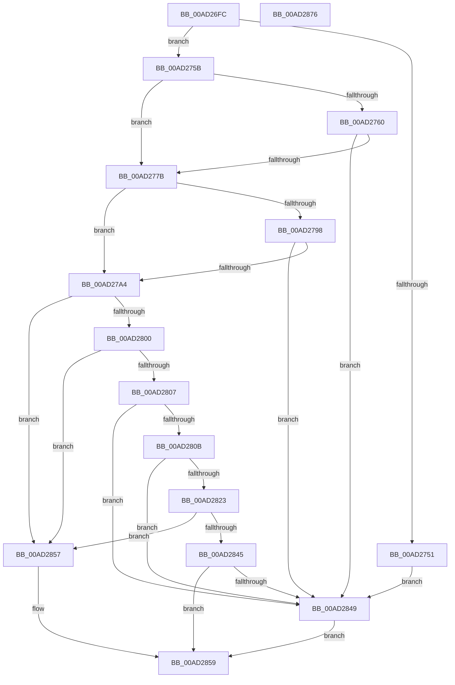

# PiPnpRtlGatherInstallerClassChangeInfo

- RVA: `0x00AD26FC`–`0x00AD2877` (길이 `379` bytes)
- VA: `0x0000000140AD26FC`
- 실행 섹션: `PAGE`
- PDB 이름 있음: `예`; PDB Function 태그: `아니요`
- unwind 정보 RVA: `0x000BEABC`
- 디코드: `97`개 명령, `379/379` bytes 표시
- 미해석 바이트: `0` (있으면 어셈블리에 `.byte`로 보존)

> 이 문서는 커널 이미지의 기계어와 PDB 기호를 분석해 생성했습니다. 4번과 5번은 함수 원형과 자료형을 바이너리 사용 방식에서 추정한 C 해석이며 원본 소스 복구 결과는 아닙니다.

## 1. Dependencies

- 직접 호출 지점: **8**; 고유 호출 대상: **7**
- 직접 호출자로 확인된 함수: **1**
- RIP 상대 이미지 참조: **3**

### Outgoing calls
- `0x00AD2744` → [ExAllocatePool2](../../poolcode/B8/ExAllocatePool2_function_00B820F0.md) (function, `0x00B820F0`)
- `0x00AD276C` → [PiDmAddCacheReferenceForObject](../95/PiDmAddCacheReferenceForObject_function_00950FB4.md) (function, `0x00950FB4`)
- `0x00AD2786` → [PiDmGetObject](../8D/PiDmGetObject_function_008DFAE0.md) (function, `0x008DFAE0`)
- `0x00AD27F2` → [PnpGetObjectProperty](../8E/PnpGetObjectProperty_function_008E2180.md) (function, `0x008E2180`)
- `0x00AD2818` → [PnpStringFromGuid](../8F/PnpStringFromGuid_function_008F5A2C.md) (function, `0x008F5A2C`)
- `0x00AD2837` → [PiDmGetObject](../8D/PiDmGetObject_function_008DFAE0.md) (function, `0x008DFAE0`)
- `0x00AD284C` → [PiPnpRtlFreeInstallerClassChangeInfo](../70/PiPnpRtlFreeInstallerClassChangeInfo_function_00704564.md) (function, `0x00704564`)
- `0x00AD2866` → [_security_check_cookie](../../text/6A/_security_check_cookie_function_006AC640.md) (function, `0x006AC640`)

### Direct callers
- [sub_00B1DC0E](../B1/Unknown_function_00B1DC0E.md) at `0x00B1DC48`

### Static image references
- `0x00AD2707` → RVA `0x00E0A740` (`.data`; read)
- `0x00AD27AE` → RVA `0x00E66398` (`.data`; read)
- `0x00AD27E0` → RVA `0x00011688` (`.rdata`; read)

## 2. Other-region calls and transfers

- 다른 실행 섹션으로 향하는 call: **2**
  - `0x00AD2744` → [ExAllocatePool2](../../poolcode/B8/ExAllocatePool2_function_00B820F0.md) (`PAGE` → `POOLCODE`)
  - `0x00AD2866` → [_security_check_cookie](../../text/6A/_security_check_cookie_function_006AC640.md) (`PAGE` → `.text`)
- 별도 외부 분기/꼬리 이동을 확인하지 못했습니다.

## 3. Assembly (complete function range)

```asm
00AD26FC  40 53                           push rbx
00AD26FE  56                              push rsi
00AD26FF  57                              push rdi
00AD2700  48 81 EC E0 00 00 00            sub rsp, 0xe0
00AD2707  48 8B 05 32 80 33 00            mov rax, qword ptr [rip + 0x338032]
00AD270E  48 33 C4                        xor rax, rsp
00AD2711  48 89 84 24 D0 00 00 00         mov qword ptr [rsp + 0xd0], rax
00AD2719  83 64 24 64 00                  and dword ptr [rsp + 0x64], 0
00AD271E  49 8B F8                        mov rdi, r8
00AD2721  83 64 24 60 00                  and dword ptr [rsp + 0x60], 0
00AD2726  48 8B DA                        mov rbx, rdx
00AD2729  48 8B F1                        mov rsi, rcx
00AD272C  0F 57 C0                        xorps xmm0, xmm0
00AD272F  BA 18 00 00 00                  mov edx, 0x18
00AD2734  B9 00 01 00 00                  mov ecx, 0x100
00AD2739  41 B8 50 6E 70 47               mov r8d, 0x47706e50
00AD273F  0F 11 44 24 68                  movups xmmword ptr [rsp + 0x68], xmm0
00AD2744  E8 A7 F9 0A 00                  call 0x140b820f0
00AD2749  48 89 07                        mov qword ptr [rdi], rax
00AD274C  48 85 C0                        test rax, rax
00AD274F  75 0A                           jne 0x140ad275b
00AD2751  BB 9A 00 00 C0                  mov ebx, 0xc000009a
00AD2756  E9 EE 00 00 00                  jmp 0x140ad2849
00AD275B  48 85 DB                        test rbx, rbx
00AD275E  74 1B                           je 0x140ad277b
00AD2760  4C 8D 40 10                     lea r8, [rax + 0x10]
00AD2764  48 8B D3                        mov rdx, rbx
00AD2767  B9 02 00 00 00                  mov ecx, 2
00AD276C  E8 43 E8 E7 FF                  call 0x140950fb4
00AD2771  8B D8                           mov ebx, eax
00AD2773  85 C0                           test eax, eax
00AD2775  0F 88 CE 00 00 00               js 0x140ad2849
00AD277B  4C 8B 07                        mov r8, qword ptr [rdi]
00AD277E  48 8B D6                        mov rdx, rsi
00AD2781  B9 01 00 00 00                  mov ecx, 1
00AD2786  E8 55 D3 E0 FF                  call 0x1408dfae0
00AD278B  B9 00 00 00 80                  mov ecx, 0x80000000
00AD2790  8B D8                           mov ebx, eax
00AD2792  03 C1                           add eax, ecx
00AD2794  85 C1                           test ecx, eax
00AD2796  75 0C                           jne 0x140ad27a4
00AD2798  81 FB 34 00 00 C0               cmp ebx, 0xc0000034
00AD279E  0F 85 A5 00 00 00               jne 0x140ad2849
00AD27A4  83 64 24 50 00                  and dword ptr [rsp + 0x50], 0
00AD27A9  48 8D 44 24 60                  lea rax, [rsp + 0x60]
00AD27AE  48 8B 0D E3 3B 39 00            mov rcx, qword ptr [rip + 0x393be3]
00AD27B5  45 33 C9                        xor r9d, r9d
00AD27B8  48 89 44 24 48                  mov qword ptr [rsp + 0x48], rax
00AD27BD  48 8B D6                        mov rdx, rsi
00AD27C0  C7 44 24 40 10 00 00 00         mov dword ptr [rsp + 0x40], 0x10
00AD27C8  48 8D 44 24 68                  lea rax, [rsp + 0x68]
00AD27CD  48 89 44 24 38                  mov qword ptr [rsp + 0x38], rax
00AD27D2  48 8D 44 24 64                  lea rax, [rsp + 0x64]
00AD27D7  48 89 44 24 30                  mov qword ptr [rsp + 0x30], rax
00AD27DC  45 8D 41 01                     lea r8d, [r9 + 1]
00AD27E0  48 8D 05 A1 EE 53 FF            lea rax, [rip - 0xac115f]
00AD27E7  48 89 44 24 28                  mov qword ptr [rsp + 0x28], rax
00AD27EC  48 83 64 24 20 00               and qword ptr [rsp + 0x20], 0
00AD27F2  E8 89 F9 E0 FF                  call 0x1408e2180
00AD27F7  8B D8                           mov ebx, eax
00AD27F9  3D 34 00 00 C0                  cmp eax, 0xc0000034
00AD27FE  74 57                           je 0x140ad2857
00AD2800  3D 25 02 00 C0                  cmp eax, 0xc0000225
00AD2805  74 50                           je 0x140ad2857
00AD2807  85 C0                           test eax, eax
00AD2809  78 3E                           js 0x140ad2849
00AD280B  48 8D 94 24 80 00 00 00         lea rdx, [rsp + 0x80]
00AD2813  48 8D 4C 24 68                  lea rcx, [rsp + 0x68]
00AD2818  E8 0F 32 E2 FF                  call 0x1408f5a2c
00AD281D  8B D8                           mov ebx, eax
00AD281F  85 C0                           test eax, eax
00AD2821  78 26                           js 0x140ad2849
00AD2823  4C 8B 07                        mov r8, qword ptr [rdi]
00AD2826  48 8D 94 24 80 00 00 00         lea rdx, [rsp + 0x80]
00AD282E  49 83 C0 08                     add r8, 8
00AD2832  B9 02 00 00 00                  mov ecx, 2
00AD2837  E8 A4 D2 E0 FF                  call 0x1408dfae0
00AD283C  8B D8                           mov ebx, eax
00AD283E  3D 34 00 00 C0                  cmp eax, 0xc0000034
00AD2843  74 12                           je 0x140ad2857
00AD2845  85 C0                           test eax, eax
00AD2847  79 10                           jns 0x140ad2859
00AD2849  48 8B 0F                        mov rcx, qword ptr [rdi]
00AD284C  E8 13 1D C3 FF                  call 0x140704564
00AD2851  48 83 27 00                     and qword ptr [rdi], 0
00AD2855  EB 02                           jmp 0x140ad2859
00AD2857  33 DB                           xor ebx, ebx
00AD2859  8B C3                           mov eax, ebx
00AD285B  48 8B 8C 24 D0 00 00 00         mov rcx, qword ptr [rsp + 0xd0]
00AD2863  48 33 CC                        xor rcx, rsp
00AD2866  E8 D5 9D BD FF                  call 0x1406ac640
00AD286B  48 81 C4 E0 00 00 00            add rsp, 0xe0
00AD2872  5F                              pop rdi
00AD2873  5E                              pop rsi
00AD2874  5B                              pop rbx
00AD2875  C3                              ret
00AD2876  CC                              int3
```

## 4. C-style interpretation (structured pseudocode)

```c
__int64 __fastcall PiPnpRtlGatherInstallerClassChangeInfo(__int64 a1, __int64 a2, __int64 a3, int a4)
{
    __int64 result;
    __int64 v_rbx;
    __int64 v_rsp;
    unsigned __int64 v_stack_m28;
    unsigned __int64 v_stack_m78;
    unsigned __int64 v_stack_m90;
    unsigned int v_stack_m94;
    unsigned int v_stack_m98;
    unsigned int v_stack_mA8;
    unsigned __int64 v_stack_mB0;
    unsigned int v_stack_mB8;
    unsigned __int64 v_stack_mC0;
    unsigned __int64 v_stack_mC8;
    unsigned __int64 v_stack_mD0;
    unsigned __int64 v_stack_mD8;

    v_rsp = (v_rsp) - (224);
    result = (*(unsigned __int64 *)(v_rip + 3375154)) ^ (v_rsp);
    v_stack_m28 = result;
    v_stack_m90 = v_xmm0;
    result = ExAllocatePool2(256, 24, (unsigned int)(0x47706E50ULL), a4);
    *(unsigned __int64 *)(a3) = result;
    if (result != 0) goto loc_00AD275B;
    goto loc_00AD2849;
loc_00AD275B:
    if ((unsigned int)(0xC000009AULL) == 0) goto loc_00AD277B;
    result = PiDmAddCacheReferenceForObject(2, (unsigned int)(0xC000009AULL), result + 16, a4);
    if (sign_flag) goto loc_00AD2849;
loc_00AD277B:
    result = PiDmGetObject(1, a1, *(unsigned __int64 *)(a3), a4);
    result = (unsigned int)((result) + ((unsigned int)((unsigned int)(0x80000000ULL))));
    if ((((unsigned int)((unsigned int)(0x80000000ULL))) & ((unsigned int)(result))) != 0) goto loc_00AD27A4;
    if (((unsigned int)((unsigned int)((unsigned int)(result)))) != 0xC0000034ULL) goto loc_00AD2849;
loc_00AD27A4:
    a4 = 0;
    v_stack_mB0 = v_stack_m98;
    v_stack_mB8 = 16;
    v_stack_mC0 = v_stack_m90;
    v_stack_mC8 = v_stack_m94;
    v_stack_mD0 = v_rip - 11276639;
    result = PnpGetObjectProperty(*(unsigned __int64 *)(v_rip + 3750883), a1, a4 + 1, a4);
    if (((unsigned int)(result)) == 0xC0000034ULL) goto loc_00AD2857;
    if (((unsigned int)(result)) == 0xC0000225ULL) goto loc_00AD2857;
    if (sign_flag) goto loc_00AD2849;
    result = PnpStringFromGuid(v_stack_m90, v_stack_m78, a4 + 1, a4);
    if (sign_flag) goto loc_00AD2849;
    a3 = (*(unsigned __int64 *)(a3)) + (8);
    result = PiDmGetObject(2, v_stack_m78, a3, a4);
    if (((unsigned int)(result)) == 0xC0000034ULL) goto loc_00AD2857;
    if (!sign_flag) goto loc_00AD2859;
loc_00AD2849:
    result = PiPnpRtlFreeInstallerClassChangeInfo(*(unsigned __int64 *)(a3), v_stack_m78, a3, a4);
    goto loc_00AD2859;
loc_00AD2857:
    v_rbx = 0;
loc_00AD2859:
    a1 = (v_stack_m28) ^ (v_rsp);
    result = _security_check_cookie(a1, v_stack_m78, a3, a4);
    v_rsp = (v_rsp) + (224);
    return result;
}
```

## 5. (Beta) C Style

```c
int64_t PiPnpRtlGatherInstallerClassChangeInfo(int64_t Arg1, int64_t Arg2, void *Arg3, int32_t Arg4)
{
    uint8_t *arg3 = (uint8_t *)Arg3;

    int64_t result;
    int64_t local_rbx;
    int64_t local_rsp;
    uint64_t v_stack_m28;
    uint64_t v_stack_m78;
    uint64_t v_stack_m90;
    uint32_t v_stack_m94;
    uint32_t v_stack_m98;
    uint32_t v_stack_mA8;
    uint64_t v_stack_mB0;
    uint32_t v_stack_mB8;
    uint64_t v_stack_mC0;
    uint64_t v_stack_mC8;
    uint64_t v_stack_mD0;
    uint64_t v_stack_mD8;

    local_rsp = (local_rsp) - (224);
    result = (*(uint64_t *)(v_rip + 0x338032)) ^ (local_rsp);
    v_stack_m28 = result;
    v_stack_m90 = v_xmm0;
    result = ExAllocatePool2(256, 24, (uint32_t)(0x47706E50ULL), Arg4);
    *(uint64_t *)(arg3) = result;
    if (result != 0) goto loc_00AD275B;
    goto loc_00AD2849;
loc_00AD275B:
    if ((uint32_t)(0xC000009AULL) == 0) goto loc_00AD277B;
    result = PiDmAddCacheReferenceForObject(2, (uint32_t)(0xC000009AULL), result + 16, Arg4);
    if (sign_flag) goto loc_00AD2849;
loc_00AD277B:
    result = PiDmGetObject(1, Arg1, *(uint64_t *)(arg3), Arg4);
    result = (uint32_t)((result) + ((uint32_t)((uint32_t)(0x80000000ULL))));
    if ((((uint32_t)((uint32_t)(0x80000000ULL))) & ((uint32_t)(result))) != 0) goto loc_00AD27A4;
    if (((uint32_t)((uint32_t)((uint32_t)(result)))) != 0xC0000034ULL) goto loc_00AD2849;
loc_00AD27A4:
    Arg4 = 0;
    v_stack_mB0 = v_stack_m98;
    v_stack_mB8 = 16;
    v_stack_mC0 = v_stack_m90;
    v_stack_mC8 = v_stack_m94;
    v_stack_mD0 = v_rip - 11276639;
    result = PnpGetObjectProperty(*(uint64_t *)(v_rip + 0x393BE3), Arg1, Arg4 + 1, Arg4);
    if (((uint32_t)(result)) == 0xC0000034ULL) goto loc_00AD2857;
    if (((uint32_t)(result)) == 0xC0000225ULL) goto loc_00AD2857;
    if (sign_flag) goto loc_00AD2849;
    result = PnpStringFromGuid(v_stack_m90, v_stack_m78, Arg4 + 1, Arg4);
    if (sign_flag) goto loc_00AD2849;
    Arg3 = (*(uint64_t *)(arg3)) + (8);
    result = PiDmGetObject(2, v_stack_m78, Arg3, Arg4);
    if (((uint32_t)(result)) == 0xC0000034ULL) goto loc_00AD2857;
    if (!sign_flag) goto loc_00AD2859;
loc_00AD2849:
    result = PiPnpRtlFreeInstallerClassChangeInfo(*(uint64_t *)(arg3), v_stack_m78, Arg3, Arg4);
    goto loc_00AD2859;
loc_00AD2857:
    local_rbx = 0;
loc_00AD2859:
    Arg1 = (v_stack_m28) ^ (local_rsp);
    result = _security_check_cookie(Arg1, v_stack_m78, Arg3, Arg4);
    local_rsp = (local_rsp) + (224);
    return result;
}
```

### 관측된 메모리 오프셋

구조체 형식이 확인되지 않은 접근은 인자 기준의 오프셋으로만 기록했습니다.

| 기준 인자 | 오프셋 표현 | 폭 (bit) | 접근 |
|---|---:|---:|---|
| `Arg3` | `+ 0x0` | `64` | `R` |
| `Arg3` | `+ 0x0` | `64` | `R/W` |
| `Arg3` | `+ 0x0` | `64` | `W` |

## 6. Execution-region graph

[열기: 2D/3D 그래프와 함수 탐색 컨트롤 패널](../../../control-panel.html?section=page&rva=0x00AD26FC&view=graph)

- 2D 그래프는 위에서 아래로 흐르고, 3D 그래프는 빈 공간을 드래그해 회전합니다. Shift+드래그는 이동, 휠은 확대·축소, 함수 노드 선택은 대상 보고서 이동입니다.

### Static fallback


