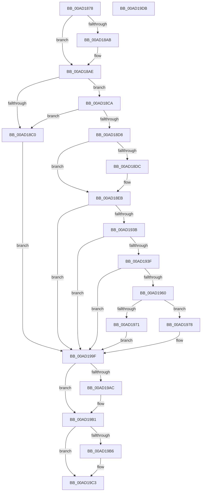

# PiQueueDeviceRequest

- RVA: `0x00AD1878`–`0x00AD19DC` (길이 `356` bytes)
- VA: `0x0000000140AD1878`
- 실행 섹션: `PAGE`
- PDB 이름 있음: `예`; PDB Function 태그: `아니요`
- unwind 정보 RVA: `0x000BE9D0`
- 디코드: `102`개 명령, `356/356` bytes 표시
- 미해석 바이트: `0` (있으면 어셈블리에 `.byte`로 보존)

> 이 문서는 커널 이미지의 기계어와 PDB 기호를 분석해 생성했습니다. 4번과 5번은 함수 원형과 자료형을 바이너리 사용 방식에서 추정한 C 해석이며 원본 소스 복구 결과는 아닙니다.

## 1. Dependencies

- 직접 호출 지점: **9**; 고유 호출 대상: **8**
- 직접 호출자로 확인된 함수: **2**
- RIP 상대 이미지 참조: **0**

### Outgoing calls
- `0x00AD18B3` → [PnpDeviceObjectFromDeviceInstanceWithTag](../8E/PnpDeviceObjectFromDeviceInstanceWithTag_function_008E7490.md) (function, `0x008E7490`)
- `0x00AD18E6` → [KeInitializeEvent](../../text/40/KeInitializeEvent_function_0040DD10.md) (function, `0x0040DD10`)
- `0x00AD1930` → [PnpRequestDeviceAction](../../text/47/PnpRequestDeviceAction_function_00477FF8.md) (function, `0x00477FF8`)
- `0x00AD1952` → [KeWaitForSingleObject](../../text/20/KeWaitForSingleObject_function_0020E6B0.md) (function, `0x0020E6B0`)
- `0x00AD1968` → [PnpRemoveDeviceActionRequestFromQueue](../../text/5A/PnpRemoveDeviceActionRequestFromQueue_function_005A83E0.md) (function, `0x005A83E0`)
- `0x00AD1980` → [PnpCancelDeviceActionRequest](../../text/5A/PnpCancelDeviceActionRequest_function_005A8330.md) (function, `0x005A8330`)
- `0x00AD1998` → [KeWaitForSingleObject](../../text/20/KeWaitForSingleObject_function_0020E6B0.md) (function, `0x0020E6B0`)
- `0x00AD19AC` → [PnpDeleteDeviceActionRequest](../95/PnpDeleteDeviceActionRequest_function_00955284.md) (function, `0x00955284`)
- `0x00AD19BE` → [ObfDereferenceObjectWithTag](../../text/2F/ObfDereferenceObjectWithTag_function_002F78E0.md) (function, `0x002F78E0`)

### Direct callers
- [PiCMDeleteDeviceWorker](../73/PiCMDeleteDeviceWorker_function_0073B420.md) at `0x0073B659`
- [sub_00B284C0](../B2/Unknown_function_00B284C0.md) at `0x00B28539`
- [sub_00B284C0](../B2/Unknown_function_00B284C0.md) at `0x00B286BB`

### Static image references
- 디코드된 RIP-relative 메모리 참조가 없습니다.

## 2. Other-region calls and transfers

- 다른 실행 섹션으로 향하는 call: **7**
  - `0x00AD18E6` → [KeInitializeEvent](../../text/40/KeInitializeEvent_function_0040DD10.md) (`PAGE` → `.text`)
  - `0x00AD1930` → [PnpRequestDeviceAction](../../text/47/PnpRequestDeviceAction_function_00477FF8.md) (`PAGE` → `.text`)
  - `0x00AD1952` → [KeWaitForSingleObject](../../text/20/KeWaitForSingleObject_function_0020E6B0.md) (`PAGE` → `.text`)
  - `0x00AD1968` → [PnpRemoveDeviceActionRequestFromQueue](../../text/5A/PnpRemoveDeviceActionRequestFromQueue_function_005A83E0.md) (`PAGE` → `.text`)
  - `0x00AD1980` → [PnpCancelDeviceActionRequest](../../text/5A/PnpCancelDeviceActionRequest_function_005A8330.md) (`PAGE` → `.text`)
  - `0x00AD1998` → [KeWaitForSingleObject](../../text/20/KeWaitForSingleObject_function_0020E6B0.md) (`PAGE` → `.text`)
  - `0x00AD19BE` → [ObfDereferenceObjectWithTag](../../text/2F/ObfDereferenceObjectWithTag_function_002F78E0.md) (`PAGE` → `.text`)
- 별도 외부 분기/꼬리 이동을 확인하지 못했습니다.

## 3. Assembly (complete function range)

```asm
00AD1878  4C 8B DC                        mov r11, rsp
00AD187B  49 89 5B 08                     mov qword ptr [r11 + 8], rbx
00AD187F  49 89 6B 10                     mov qword ptr [r11 + 0x10], rbp
00AD1883  49 89 73 18                     mov qword ptr [r11 + 0x18], rsi
00AD1887  57                              push rdi
00AD1888  48 83 EC 60                     sub rsp, 0x60
00AD188C  33 C0                           xor eax, eax
00AD188E  0F 57 C0                        xorps xmm0, xmm0
00AD1891  49 21 43 20                     and qword ptr [r11 + 0x20], rax
00AD1895  49 8B D9                        mov rbx, r9
00AD1898  41 8B F0                        mov esi, r8d
00AD189B  8B EA                           mov ebp, edx
00AD189D  0F 11 44 24 40                  movups xmmword ptr [rsp + 0x40], xmm0
00AD18A2  49 89 43 E8                     mov qword ptr [r11 - 0x18], rax
00AD18A6  4D 85 C9                        test r9, r9
00AD18A9  74 03                           je 0x140ad18ae
00AD18AB  41 21 01                        and dword ptr [r9], eax
00AD18AE  BA 50 6E 70 43                  mov edx, 0x43706e50
00AD18B3  E8 D8 5B E1 FF                  call 0x1408e7490
00AD18B8  48 8B F8                        mov rdi, rax
00AD18BB  48 85 C0                        test rax, rax
00AD18BE  75 0A                           jne 0x140ad18ca
00AD18C0  BB 0E 00 00 C0                  mov ebx, 0xc000000e
00AD18C5  E9 D5 00 00 00                  jmp 0x140ad199f
00AD18CA  48 8B 80 38 01 00 00            mov rax, qword ptr [rax + 0x138]
00AD18D1  48 83 78 28 00                  cmp qword ptr [rax + 0x28], 0
00AD18D6  74 E8                           je 0x140ad18c0
00AD18D8  85 F6                           test esi, esi
00AD18DA  74 0F                           je 0x140ad18eb
00AD18DC  45 33 C0                        xor r8d, r8d
00AD18DF  48 8D 4C 24 40                  lea rcx, [rsp + 0x40]
00AD18E4  33 D2                           xor edx, edx
00AD18E6  E8 25 C4 93 FF                  call 0x14040dd10
00AD18EB  8B C6                           mov eax, esi
00AD18ED  F7 D8                           neg eax
00AD18EF  48 8D 84 24 88 00 00 00         lea rax, [rsp + 0x88]
00AD18F7  4D 1B C0                        sbb r8, r8
00AD18FA  4C 23 C0                        and r8, rax
00AD18FD  8B C6                           mov eax, esi
00AD18FF  F7 D8                           neg eax
00AD1901  4C 89 44 24 30                  mov qword ptr [rsp + 0x30], r8
00AD1906  8B C6                           mov eax, esi
00AD1908  48 1B D2                        sbb rdx, rdx
00AD190B  48 23 D3                        and rdx, rbx
00AD190E  F7 D8                           neg eax
00AD1910  48 89 54 24 28                  mov qword ptr [rsp + 0x28], rdx
00AD1915  48 8D 44 24 40                  lea rax, [rsp + 0x40]
00AD191A  8B D5                           mov edx, ebp
00AD191C  48 1B C9                        sbb rcx, rcx
00AD191F  45 33 C9                        xor r9d, r9d
00AD1922  48 23 C8                        and rcx, rax
00AD1925  45 33 C0                        xor r8d, r8d
00AD1928  48 89 4C 24 20                  mov qword ptr [rsp + 0x20], rcx
00AD192D  48 8B CF                        mov rcx, rdi
00AD1930  E8 C3 66 9A FF                  call 0x140477ff8
00AD1935  8B D8                           mov ebx, eax
00AD1937  85 C0                           test eax, eax
00AD1939  78 64                           js 0x140ad199f
00AD193B  85 F6                           test esi, esi
00AD193D  74 60                           je 0x140ad199f
00AD193F  48 83 64 24 20 00               and qword ptr [rsp + 0x20], 0
00AD1945  48 8D 4C 24 40                  lea rcx, [rsp + 0x40]
00AD194A  41 B1 01                        mov r9b, 1
00AD194D  45 33 C0                        xor r8d, r8d
00AD1950  33 D2                           xor edx, edx
00AD1952  E8 59 CD 73 FF                  call 0x14020e6b0
00AD1957  8B D8                           mov ebx, eax
00AD1959  3D 01 01 00 00                  cmp eax, 0x101
00AD195E  75 3F                           jne 0x140ad199f
00AD1960  48 8B 8C 24 88 00 00 00         mov rcx, qword ptr [rsp + 0x88]
00AD1968  E8 73 6A AD FF                  call 0x1405a83e0
00AD196D  85 C0                           test eax, eax
00AD196F  74 07                           je 0x140ad1978
00AD1971  BB 20 01 00 C0                  mov ebx, 0xc0000120
00AD1976  EB 27                           jmp 0x140ad199f
00AD1978  48 8B 8C 24 88 00 00 00         mov rcx, qword ptr [rsp + 0x88]
00AD1980  E8 AB 69 AD FF                  call 0x1405a8330
00AD1985  48 83 64 24 20 00               and qword ptr [rsp + 0x20], 0
00AD198B  48 8D 4C 24 40                  lea rcx, [rsp + 0x40]
00AD1990  45 33 C9                        xor r9d, r9d
00AD1993  45 33 C0                        xor r8d, r8d
00AD1996  33 D2                           xor edx, edx
00AD1998  E8 13 CD 73 FF                  call 0x14020e6b0
00AD199D  8B D8                           mov ebx, eax
00AD199F  48 8B 8C 24 88 00 00 00         mov rcx, qword ptr [rsp + 0x88]
00AD19A7  48 85 C9                        test rcx, rcx
00AD19AA  74 05                           je 0x140ad19b1
00AD19AC  E8 D3 38 E8 FF                  call 0x140955284
00AD19B1  48 85 FF                        test rdi, rdi
00AD19B4  74 0D                           je 0x140ad19c3
00AD19B6  BA 50 6E 70 43                  mov edx, 0x43706e50
00AD19BB  48 8B CF                        mov rcx, rdi
00AD19BE  E8 1D 5F 82 FF                  call 0x1402f78e0
00AD19C3  4C 8D 5C 24 60                  lea r11, [rsp + 0x60]
00AD19C8  8B C3                           mov eax, ebx
00AD19CA  49 8B 5B 10                     mov rbx, qword ptr [r11 + 0x10]
00AD19CE  49 8B 6B 18                     mov rbp, qword ptr [r11 + 0x18]
00AD19D2  49 8B 73 20                     mov rsi, qword ptr [r11 + 0x20]
00AD19D6  49 8B E3                        mov rsp, r11
00AD19D9  5F                              pop rdi
00AD19DA  C3                              ret
00AD19DB  CC                              int3
```

## 4. C-style interpretation (structured pseudocode)

```c
__int64 __fastcall PiQueueDeviceRequest(__int64 a1, int a2, int a3, __int64 a4)
{
    __int64 result;
    __int64 v_rsp;
    unsigned __int64 v_stack_m28;
    unsigned __int64 v_stack_m38;
    unsigned __int64 v_stack_m40;
    unsigned __int64 v_stack_m48;
    unsigned __int64 v_stack_m8;
    unsigned __int64 v_stack_p20;

    *(unsigned __int64 *)(v_rsp + 8) = v_rbx;
    *(unsigned __int64 *)(v_rsp + 16) = v_rbp;
    *(unsigned __int64 *)(v_rsp + 24) = v_rsi;
    v_rsp = (v_rsp) - (96);
    result = 0;
    v_stack_m28 = v_xmm0;
    *(unsigned __int64 *)(v_rsp - 24) = 0;
    if (a4 != 0) {
    }
    result = PnpDeviceObjectFromDeviceInstanceWithTag(a1, (unsigned int)(0x43706E50ULL), a3, a4);
    if (result != 0) goto loc_00AD18CA;
loc_00AD18C0:
    goto loc_00AD199F;
loc_00AD18CA:
    if ((*(unsigned __int64 *)(*(unsigned __int64 *)(result + 312) + 40)) == 0) goto loc_00AD18C0;
    result = *(unsigned __int64 *)(result + 312);
    if ((unsigned int)((unsigned int)(a3)) != 0) {
        a3 = 0;
        a1 = v_stack_m28;
        a2 = 0;
        result = KeInitializeEvent(a1, a2, a3, a4);
    }
    result = (unsigned int)(-((unsigned int)((unsigned int)((unsigned int)(a3)))));
    a3 = (a3) & (v_stack_p20);
    result = (unsigned int)(-((unsigned int)((unsigned int)((unsigned int)(a3)))));
    v_stack_m38 = a3;
    a2 = (a2) & ((unsigned int)(0xC000000EULL));
    result = (unsigned int)(-((unsigned int)((unsigned int)((unsigned int)(a3)))));
    v_stack_m40 = a2;
    a4 = 0;
    a1 = (a1) & (v_stack_m28);
    a3 = 0;
    v_stack_m48 = a1;
    result = PnpRequestDeviceAction(result, (unsigned int)((unsigned int)((unsigned int)(a2))), a3, a4);
    if (sign_flag) goto loc_00AD199F;
    if ((unsigned int)((unsigned int)(a3)) == 0) goto loc_00AD199F;
    a3 = 0;
    a2 = 0;
    result = KeWaitForSingleObject(v_stack_m28, a2, a3, 1);
    if (((unsigned int)(result)) != 257) goto loc_00AD199F;
    result = PnpRemoveDeviceActionRequestFromQueue(v_stack_p20, a2, a3, 1);
    if ((unsigned int)(result) == 0) goto loc_00AD1978;
    goto loc_00AD199F;
loc_00AD1978:
    result = PnpCancelDeviceActionRequest(v_stack_p20, a2, a3, 1);
    a4 = 0;
    a3 = 0;
    a2 = 0;
    result = KeWaitForSingleObject(v_stack_m28, a2, a3, a4);
loc_00AD199F:
    if (v_stack_p20 != 0) {
        result = PnpDeleteDeviceActionRequest(v_stack_p20, a2, a3, a4);
    }
    if (result != 0) {
        a2 = 0x43706E50ULL;
        a1 = result;
        result = ObfDereferenceObjectWithTag(a1, a2, a3, a4);
    }
    return (unsigned int)((unsigned int)((unsigned int)((unsigned int)(result))));
}
```

## 5. (Beta) C Style

```c
int64_t PiQueueDeviceRequest(int64_t Arg1, int32_t Arg2, int32_t Arg3, int64_t Arg4)
{
    int64_t result;
    int64_t local_rsp;
    uint64_t v_stack_m28;
    uint64_t v_stack_m38;
    uint64_t v_stack_m40;
    uint64_t v_stack_m48;
    uint64_t v_stack_m8;
    uint64_t v_stack_p20;

    *(uint64_t *)(local_rsp + 0x8) = local_rbx;
    *(uint64_t *)(local_rsp + 0x10) = local_rbp;
    *(uint64_t *)(local_rsp + 0x18) = local_rsi;
    local_rsp = (local_rsp) - (96);
    result = 0;
    v_stack_m28 = v_xmm0;
    *(uint64_t *)(local_rsp - 0x18) = 0;
    if (Arg4 != 0) {
    }
    result = PnpDeviceObjectFromDeviceInstanceWithTag(Arg1, (uint32_t)(0x43706E50ULL), Arg3, Arg4);
    if (result != 0) goto loc_00AD18CA;
loc_00AD18C0:
    goto loc_00AD199F;
loc_00AD18CA:
    if ((*(uint64_t *)(*(uint64_t *)(result + 0x138) + 0x28)) == 0) goto loc_00AD18C0;
    result = *(uint64_t *)(result + 0x138);
    if ((uint32_t)((uint32_t)(Arg3)) != 0) {
        Arg3 = 0;
        Arg1 = v_stack_m28;
        Arg2 = 0;
        result = KeInitializeEvent(Arg1, Arg2, Arg3, Arg4);
    }
    result = (uint32_t)(-((uint32_t)((uint32_t)((uint32_t)(Arg3)))));
    Arg3 = (Arg3) & (v_stack_p20);
    result = (uint32_t)(-((uint32_t)((uint32_t)((uint32_t)(Arg3)))));
    v_stack_m38 = Arg3;
    Arg2 = (Arg2) & ((uint32_t)(0xC000000EULL));
    result = (uint32_t)(-((uint32_t)((uint32_t)((uint32_t)(Arg3)))));
    v_stack_m40 = Arg2;
    Arg4 = 0;
    Arg1 = (Arg1) & (v_stack_m28);
    Arg3 = 0;
    v_stack_m48 = Arg1;
    result = PnpRequestDeviceAction(result, (uint32_t)((uint32_t)((uint32_t)(Arg2))), Arg3, Arg4);
    if (sign_flag) goto loc_00AD199F;
    if ((uint32_t)((uint32_t)(Arg3)) == 0) goto loc_00AD199F;
    Arg3 = 0;
    Arg2 = 0;
    result = KeWaitForSingleObject(v_stack_m28, Arg2, Arg3, 1);
    if (((uint32_t)(result)) != 257) goto loc_00AD199F;
    result = PnpRemoveDeviceActionRequestFromQueue(v_stack_p20, Arg2, Arg3, 1);
    if ((uint32_t)(result) == 0) goto loc_00AD1978;
    goto loc_00AD199F;
loc_00AD1978:
    result = PnpCancelDeviceActionRequest(v_stack_p20, Arg2, Arg3, 1);
    Arg4 = 0;
    Arg3 = 0;
    Arg2 = 0;
    result = KeWaitForSingleObject(v_stack_m28, Arg2, Arg3, Arg4);
loc_00AD199F:
    if (v_stack_p20 != 0) {
        result = PnpDeleteDeviceActionRequest(v_stack_p20, Arg2, Arg3, Arg4);
    }
    if (result != 0) {
        Arg2 = 0x43706E50ULL;
        Arg1 = result;
        result = ObfDereferenceObjectWithTag(Arg1, Arg2, Arg3, Arg4);
    }
    return (uint32_t)((uint32_t)((uint32_t)((uint32_t)(result))));
}
```

## 6. Execution-region graph

[열기: 2D/3D 그래프와 함수 탐색 컨트롤 패널](../../../control-panel.html?section=page&rva=0x00AD1878&view=graph)

- 2D 그래프는 위에서 아래로 흐르고, 3D 그래프는 빈 공간을 드래그해 회전합니다. Shift+드래그는 이동, 휠은 확대·축소, 함수 노드 선택은 대상 보고서 이동입니다.

### Static fallback


