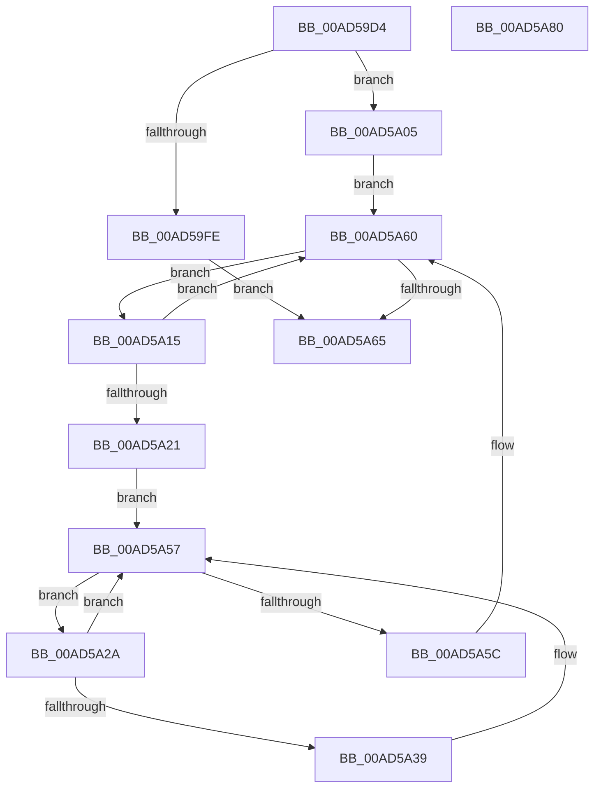

# PipConvertResolutionsToReservations

- RVA: `0x00AD59D4`–`0x00AD5A81` (길이 `173` bytes)
- VA: `0x0000000140AD59D4`
- 실행 섹션: `PAGE`
- PDB 이름 있음: `예`; PDB Function 태그: `아니요`
- unwind 정보 RVA: `0x00084C9C`
- 디코드: `55`개 명령, `173/173` bytes 표시
- 미해석 바이트: `0` (있으면 어셈블리에 `.byte`로 보존)

> 이 문서는 커널 이미지의 기계어와 PDB 기호를 분석해 생성했습니다. 4번과 5번은 함수 원형과 자료형을 바이너리 사용 방식에서 추정한 C 해석이며 원본 소스 복구 결과는 아닙니다.

## 1. Dependencies

- 직접 호출 지점: **2**; 고유 호출 대상: **2**
- 직접 호출자로 확인된 함수: **2**
- RIP 상대 이미지 참조: **0**

### Outgoing calls
- `0x00AD5A07` → [PipDeleteBindingIds](../AB/PipDeleteBindingIds_function_00AB6538.md) (function, `0x00AB6538`)
- `0x00AD5A50` → [PipSetDependency](../72/PipSetDependency_function_00727F24.md) (function, `0x00727F24`)

### Direct callers
- [PipDeleteAllDependencyRelations](../A0/PipDeleteAllDependencyRelations_function_00A06950.md) at `0x00A0698F`
- [PnpSurpriseRemovedDeviceNodeDependencyCheck](../A0/PnpSurpriseRemovedDeviceNodeDependencyCheck_function_00A0861C.md) at `0x00A0866D`

### Static image references
- 디코드된 RIP-relative 메모리 참조가 없습니다.

## 2. Other-region calls and transfers

- 다른 실행 섹션으로 향하는 call: **0**
- 별도 외부 분기/꼬리 이동을 확인하지 못했습니다.

## 3. Assembly (complete function range)

```asm
00AD59D4  4C 8B DC                        mov r11, rsp
00AD59D7  49 89 5B 08                     mov qword ptr [r11 + 8], rbx
00AD59DB  49 89 6B 10                     mov qword ptr [r11 + 0x10], rbp
00AD59DF  49 89 73 18                     mov qword ptr [r11 + 0x18], rsi
00AD59E3  57                              push rdi
00AD59E4  41 56                           push r14
00AD59E6  41 57                           push r15
00AD59E8  48 83 EC 30                     sub rsp, 0x30
00AD59EC  33 C0                           xor eax, eax
00AD59EE  48 8B D9                        mov rbx, rcx
00AD59F1  49 89 43 DC                     mov qword ptr [r11 - 0x24], rax
00AD59F5  49 89 43 D8                     mov qword ptr [r11 - 0x28], rax
00AD59F9  48 85 C9                        test rcx, rcx
00AD59FC  75 07                           jne 0x140ad5a05
00AD59FE  BD 0D 00 00 C0                  mov ebp, 0xc000000d
00AD5A03  EB 60                           jmp 0x140ad5a65
00AD5A05  33 ED                           xor ebp, ebp
00AD5A07  E8 2C 0B FE FF                  call 0x140ab6538
00AD5A0C  4C 8D 73 20                     lea r14, [rbx + 0x20]
00AD5A10  49 8B 1E                        mov rbx, qword ptr [r14]
00AD5A13  EB 4B                           jmp 0x140ad5a60
00AD5A15  48 8D 33                        lea rsi, [rbx]
00AD5A18  48 8B 1B                        mov rbx, qword ptr [rbx]
00AD5A1B  80 7E 38 00                     cmp byte ptr [rsi + 0x38], 0
00AD5A1F  75 3F                           jne 0x140ad5a60
00AD5A21  4C 8D 7E 28                     lea r15, [rsi + 0x28]
00AD5A25  49 8B 3F                        mov rdi, qword ptr [r15]
00AD5A28  EB 2D                           jmp 0x140ad5a57
00AD5A2A  48 8B D7                        mov rdx, rdi
00AD5A2D  48 8B 3F                        mov rdi, qword ptr [rdi]
00AD5A30  48 83 C2 10                     add rdx, 0x10
00AD5A34  83 3A 01                        cmp dword ptr [rdx], 1
00AD5A37  75 1E                           jne 0x140ad5a57
00AD5A39  48 8B 46 18                     mov rax, qword ptr [rsi + 0x18]
00AD5A3D  83 64 24 20 00                  and dword ptr [rsp + 0x20], 0
00AD5A42  48 8B 48 30                     mov rcx, qword ptr [rax + 0x30]
00AD5A46  48 89 4C 24 28                  mov qword ptr [rsp + 0x28], rcx
00AD5A4B  48 8D 4C 24 20                  lea rcx, [rsp + 0x20]
00AD5A50  E8 CF 24 C5 FF                  call 0x140727f24
00AD5A55  8B E8                           mov ebp, eax
00AD5A57  49 3B FF                        cmp rdi, r15
00AD5A5A  75 CE                           jne 0x140ad5a2a
00AD5A5C  C6 46 38 01                     mov byte ptr [rsi + 0x38], 1
00AD5A60  49 3B DE                        cmp rbx, r14
00AD5A63  75 B0                           jne 0x140ad5a15
00AD5A65  48 8B 5C 24 50                  mov rbx, qword ptr [rsp + 0x50]
00AD5A6A  8B C5                           mov eax, ebp
00AD5A6C  48 8B 6C 24 58                  mov rbp, qword ptr [rsp + 0x58]
00AD5A71  48 8B 74 24 60                  mov rsi, qword ptr [rsp + 0x60]
00AD5A76  48 83 C4 30                     add rsp, 0x30
00AD5A7A  41 5F                           pop r15
00AD5A7C  41 5E                           pop r14
00AD5A7E  5F                              pop rdi
00AD5A7F  C3                              ret
00AD5A80  CC                              int3
```

## 4. C-style interpretation (structured pseudocode)

```c
__int64 __fastcall PipConvertResolutionsToReservations(__int64 a1)
{
    __int64 result;
    __int64 v_rbp;
    __int64 v_rsp;
    unsigned __int64 v_stack_m20;
    unsigned int v_stack_m28;
    unsigned __int64 v_stack_p10;
    unsigned __int64 v_stack_p18;
    unsigned __int64 v_stack_p8;

    *(unsigned __int64 *)(v_rsp + 8) = v_rbx;
    *(unsigned __int64 *)(v_rsp + 16) = v_rbp;
    *(unsigned __int64 *)(v_rsp + 24) = v_rsi;
    v_rsp = (v_rsp) - (48);
    result = 0;
    *(unsigned __int64 *)(v_rsp - 36) = 0;
    *(unsigned __int64 *)(v_rsp - 40) = 0;
    if (a1 != 0) goto loc_00AD5A05;
    goto loc_00AD5A65;
loc_00AD5A05:
    v_rbp = 0;
    result = PipDeleteBindingIds(a1, a2, a3, a4);
    goto loc_00AD5A60;
loc_00AD5A15:
    if ((*(unsigned __int8 *)(*(unsigned __int64 *)(a1 + 32) + 56)) != 0) goto loc_00AD5A60;
    goto loc_00AD5A57;
loc_00AD5A2A:
    a2 = (*(unsigned __int64 *)(*(unsigned __int64 *)(a1 + 32) + 40)) + (16);
    if ((*(unsigned int *)(a2)) == 1) {
        result = *(unsigned __int64 *)(*(unsigned __int64 *)(a1 + 32) + 24);
        a1 = *(unsigned __int64 *)(result + 48);
        v_stack_m20 = a1;
        a1 = v_stack_m28;
        result = PipSetDependency(a1, a2, a3, a4);
        v_rbp = (unsigned int)(result);
    }
    if ((*(unsigned __int64 *)(*(unsigned __int64 *)(*(unsigned __int64 *)(a1 + 32) + 40))) != (*(unsigned __int64 *)(a1 + 32) + 40)) goto loc_00AD5A2A;
    *(unsigned __int8 *)(*(unsigned __int64 *)(a1 + 32) + 56) = 1;
loc_00AD5A60:
    if ((*(unsigned __int64 *)(*(unsigned __int64 *)(a1 + 32))) != (a1 + 32)) goto loc_00AD5A15;
loc_00AD5A65:
    v_rsp = (v_rsp) + (48);
    return (unsigned int)((unsigned int)(v_rbp));
}
```

## 5. (Beta) C Style

```c
int64_t PipConvertResolutionsToReservations(void *Arg1)
{
    uint8_t *arg1 = (uint8_t *)Arg1;

    int64_t result;
    int64_t local_rbp;
    int64_t local_rsp;
    uint64_t v_stack_m20;
    uint32_t v_stack_m28;
    uint64_t v_stack_p10;
    uint64_t v_stack_p18;
    uint64_t v_stack_p8;

    *(uint64_t *)(local_rsp + 0x8) = local_rbx;
    *(uint64_t *)(local_rsp + 0x10) = local_rbp;
    *(uint64_t *)(local_rsp + 0x18) = local_rsi;
    local_rsp = (local_rsp) - (48);
    result = 0;
    *(uint64_t *)(local_rsp - 0x24) = 0;
    *(uint64_t *)(local_rsp - 0x28) = 0;
    if (Arg1 != NULL) goto loc_00AD5A05;
    goto loc_00AD5A65;
loc_00AD5A05:
    local_rbp = 0;
    result = PipDeleteBindingIds(Arg1, a2, a3, a4);
    goto loc_00AD5A60;
loc_00AD5A15:
    if ((*(uint8_t *)(*(uint64_t *)(arg1 + 0x20) + 0x38)) != 0) goto loc_00AD5A60;
    goto loc_00AD5A57;
loc_00AD5A2A:
    a2 = (*(uint64_t *)(*(uint64_t *)(arg1 + 0x20) + 0x28)) + (16);
    if ((*(uint32_t *)(a2)) == 1) {
        result = *(uint64_t *)(*(uint64_t *)(arg1 + 0x20) + 0x18);
        Arg1 = *(uint64_t *)(result + 0x30);
        v_stack_m20 = Arg1;
        Arg1 = v_stack_m28;
        result = PipSetDependency(Arg1, a2, a3, a4);
        local_rbp = (uint32_t)(result);
    }
    if ((*(uint64_t *)(*(uint64_t *)(*(uint64_t *)(arg1 + 0x20) + 0x28))) != (*(uint64_t *)(arg1 + 0x20) + 40)) goto loc_00AD5A2A;
    *(uint8_t *)(*(uint64_t *)(arg1 + 0x20) + 0x38) = 1;
loc_00AD5A60:
    if ((*(uint64_t *)(*(uint64_t *)(arg1 + 0x20))) != (Arg1 + 32)) goto loc_00AD5A15;
loc_00AD5A65:
    local_rsp = (local_rsp) + (48);
    return (uint32_t)((uint32_t)(local_rbp));
}
```

### 관측된 메모리 오프셋

구조체 형식이 확인되지 않은 접근은 인자 기준의 오프셋으로만 기록했습니다.

| 기준 인자 | 오프셋 표현 | 폭 (bit) | 접근 |
|---|---:|---:|---|
| `Arg1` | `+ 0x0` | `64` | `R` |
| `Arg1` | `+ 0x20` | `64` | `R` |

## 6. Execution-region graph

[열기: 2D/3D 그래프와 함수 탐색 컨트롤 패널](../../../control-panel.html?section=page&rva=0x00AD59D4&view=graph)

- 2D 그래프는 위에서 아래로 흐르고, 3D 그래프는 빈 공간을 드래그해 회전합니다. Shift+드래그는 이동, 휠은 확대·축소, 함수 노드 선택은 대상 보고서 이동입니다.

### Static fallback


