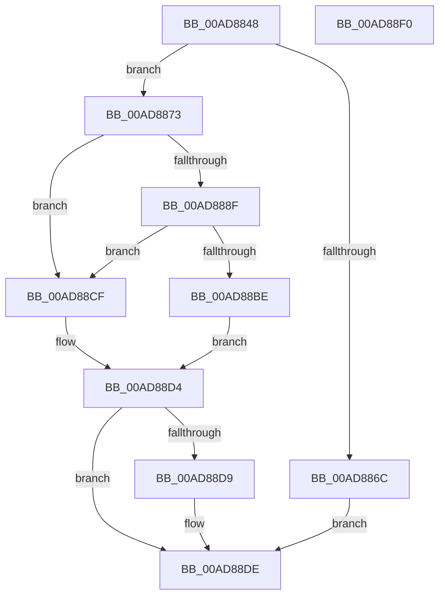

# PipHardwareConfigOpenKey

- RVA: `0x00AD8848`–`0x00AD88F1` (길이 `169` bytes)
- VA: `0x0000000140AD8848`
- 실행 섹션: `PAGE`
- PDB 이름 있음: `예`; PDB Function 태그: `아니요`
- unwind 정보 RVA: `0x000718AC`
- 디코드: `47`개 명령, `169/169` bytes 표시
- 미해석 바이트: `0` (있으면 어셈블리에 `.byte`로 보존)

> 이 문서는 커널 이미지의 기계어와 PDB 기호를 분석해 생성했습니다. 4번과 5번은 함수 원형과 자료형을 바이너리 사용 방식에서 추정한 C 해석이며 원본 소스 복구 결과는 아닙니다.

## 1. Dependencies

- 직접 호출 지점: **3**; 고유 호출 대상: **3**
- 직접 호출자로 확인된 함수: **6**
- RIP 상대 이미지 참조: **2**

### Outgoing calls
- `0x00AD8884` → [_PnpCtxGetCachedContextBaseKey](../8E/_PnpCtxGetCachedContextBaseKey_function_008EFB2C.md) (function, `0x008EFB2C`)
- `0x00AD88B3` → [PnpCtxRegOpenKey](../8E/PnpCtxRegOpenKey_function_008EF7B8.md) (function, `0x008EF7B8`)
- `0x00AD88D9` → [ZwClose](../../text/6A/ZwClose_function_006AD2B0.md) (function, `0x006AD2B0`)

### Direct callers
- [PipCheckComputerSupported](../72/PipCheckComputerSupported_function_007232B0.md) at `0x007232FE`
- [PipHardwareConfigGetIndex](../72/PipHardwareConfigGetIndex_function_007235B8.md) at `0x007235EA`
- [PnpHardwareConfigCreateBootDriverFlags](../72/PnpHardwareConfigCreateBootDriverFlags_function_00723B88.md) at `0x00723C11`
- [PipHardwareConfigGetLastUseTime](../A2/PipHardwareConfigGetLastUseTime_function_00A28238.md) at `0x00A2826A`
- [PipCheckSystemFirmwareUpdated](../../init/C3/PipCheckSystemFirmwareUpdated_function_00C3048C.md) at `0x00C30508`
- [PipInitComputerIds](../../init/C7/PipInitComputerIds_function_00C74734.md) at `0x00C747E5`

### Static image references
- `0x00AD8873` → RVA `0x00E66398` (`.data`; read)
- `0x00AD88A0` → RVA `0x00AFD370` (` ?? ::NNGAKEGL::`string'`; read)

## 2. Other-region calls and transfers

- 다른 실행 섹션으로 향하는 call: **1**
  - `0x00AD88D9` → [ZwClose](../../text/6A/ZwClose_function_006AD2B0.md) (`PAGE` → `.text`)
- 별도 외부 분기/꼬리 이동을 확인하지 못했습니다.

## 3. Assembly (complete function range)

```asm
00AD8848  48 8B C4                        mov rax, rsp
00AD884B  48 89 58 08                     mov qword ptr [rax + 8], rbx
00AD884F  48 89 70 10                     mov qword ptr [rax + 0x10], rsi
00AD8853  57                              push rdi
00AD8854  48 83 EC 40                     sub rsp, 0x40
00AD8858  48 83 60 E8 00                  and qword ptr [rax - 0x18], 0
00AD885D  49 8B F8                        mov rdi, r8
00AD8860  48 83 60 F0 00                  and qword ptr [rax - 0x10], 0
00AD8865  8B F2                           mov esi, edx
00AD8867  4D 85 C0                        test r8, r8
00AD886A  75 07                           jne 0x140ad8873
00AD886C  BB 0D 00 00 C0                  mov ebx, 0xc000000d
00AD8871  EB 6B                           jmp 0x140ad88de
00AD8873  48 8B 0D 1E DB 38 00            mov rcx, qword ptr [rip + 0x38db1e]
00AD887A  4C 8D 44 24 38                  lea r8, [rsp + 0x38]
00AD887F  BA 0F 00 00 00                  mov edx, 0xf
00AD8884  E8 A3 72 E1 FF                  call 0x1408efb2c
00AD8889  8B D8                           mov ebx, eax
00AD888B  85 C0                           test eax, eax
00AD888D  78 40                           js 0x140ad88cf
00AD888F  48 8B 54 24 38                  mov rdx, qword ptr [rsp + 0x38]
00AD8894  48 8D 44 24 30                  lea rax, [rsp + 0x30]
00AD8899  48 8B 0D F8 DA 38 00            mov rcx, qword ptr [rip + 0x38daf8]
00AD88A0  4C 8D 05 C9 4A 02 00            lea r8, [rip + 0x24ac9]
00AD88A7  48 89 44 24 28                  mov qword ptr [rsp + 0x28], rax
00AD88AC  45 33 C9                        xor r9d, r9d
00AD88AF  89 74 24 20                     mov dword ptr [rsp + 0x20], esi
00AD88B3  E8 00 6F E1 FF                  call 0x1408ef7b8
00AD88B8  8B D8                           mov ebx, eax
00AD88BA  85 C0                           test eax, eax
00AD88BC  78 11                           js 0x140ad88cf
00AD88BE  48 8B 44 24 30                  mov rax, qword ptr [rsp + 0x30]
00AD88C3  33 C9                           xor ecx, ecx
00AD88C5  48 89 07                        mov qword ptr [rdi], rax
00AD88C8  48 89 4C 24 30                  mov qword ptr [rsp + 0x30], rcx
00AD88CD  EB 05                           jmp 0x140ad88d4
00AD88CF  48 8B 4C 24 30                  mov rcx, qword ptr [rsp + 0x30]
00AD88D4  48 85 C9                        test rcx, rcx
00AD88D7  74 05                           je 0x140ad88de
00AD88D9  E8 D2 49 BD FF                  call 0x1406ad2b0
00AD88DE  48 8B 74 24 58                  mov rsi, qword ptr [rsp + 0x58]
00AD88E3  8B C3                           mov eax, ebx
00AD88E5  48 8B 5C 24 50                  mov rbx, qword ptr [rsp + 0x50]
00AD88EA  48 83 C4 40                     add rsp, 0x40
00AD88EE  5F                              pop rdi
00AD88EF  C3                              ret
00AD88F0  CC                              int3
```

## 4. C-style interpretation (structured pseudocode)

```c
__int64 __fastcall PipHardwareConfigOpenKey(__int64 a1, int a2, __int64 a3, int a4)
{
    __int64 result;
    __int64 v_rsp;
    unsigned __int64 v_stack_m10;
    unsigned __int64 v_stack_m18;
    unsigned __int64 v_stack_m20;
    unsigned int v_stack_m28;
    unsigned __int64 v_stack_p10;
    unsigned __int64 v_stack_p8;

    *(unsigned __int64 *)(v_rsp + 8) = v_rbx;
    *(unsigned __int64 *)(v_rsp + 16) = v_rsi;
    v_rsp = (v_rsp) - (64);
    if (a3 != 0) goto loc_00AD8873;
    goto loc_00AD88DE;
loc_00AD8873:
    result = _PnpCtxGetCachedContextBaseKey(*(unsigned __int64 *)(v_rip + 3726110), 15, v_stack_m10, a4);
    if (sign_flag) goto loc_00AD88CF;
    v_stack_m20 = v_stack_m18;
    a4 = 0;
    v_stack_m28 = (unsigned int)((unsigned int)(a2));
    result = PnpCtxRegOpenKey(*(unsigned __int64 *)(v_rip + 3726072), v_stack_m10, v_rip + 150217, a4);
    if (sign_flag) goto loc_00AD88CF;
    a1 = 0;
    *(unsigned __int64 *)(a3) = v_stack_m18;
    v_stack_m18 = 0;
    goto loc_00AD88D4;
loc_00AD88CF:
loc_00AD88D4:
    result = v_stack_m18;
    if (v_stack_m18 != 0) {
        result = ZwClose(v_stack_m18, v_stack_m10, v_rip + 150217, a4);
    }
    v_rsp = (v_rsp) + (64);
    return (unsigned int)((unsigned int)((unsigned int)((unsigned int)(result))));
}
```

## 5. (Beta) C Style

```c
int64_t PipHardwareConfigOpenKey(int64_t Arg1, int32_t Arg2, void *Arg3, int32_t Arg4)
{
    uint8_t *arg3 = (uint8_t *)Arg3;

    int64_t result;
    int64_t local_rsp;
    uint64_t v_stack_m10;
    uint64_t v_stack_m18;
    uint64_t v_stack_m20;
    uint32_t v_stack_m28;
    uint64_t v_stack_p10;
    uint64_t v_stack_p8;

    *(uint64_t *)(local_rsp + 0x8) = local_rbx;
    *(uint64_t *)(local_rsp + 0x10) = local_rsi;
    local_rsp = (local_rsp) - (64);
    if (Arg3 != NULL) goto loc_00AD8873;
    goto loc_00AD88DE;
loc_00AD8873:
    result = _PnpCtxGetCachedContextBaseKey(*(uint64_t *)(v_rip + 0x38DB1E), 15, v_stack_m10, Arg4);
    if (sign_flag) goto loc_00AD88CF;
    v_stack_m20 = v_stack_m18;
    Arg4 = 0;
    v_stack_m28 = (uint32_t)((uint32_t)(Arg2));
    result = PnpCtxRegOpenKey(*(uint64_t *)(v_rip + 0x38DAF8), v_stack_m10, v_rip + 150217, Arg4);
    if (sign_flag) goto loc_00AD88CF;
    Arg1 = 0;
    *(uint64_t *)(arg3) = v_stack_m18;
    v_stack_m18 = 0;
    goto loc_00AD88D4;
loc_00AD88CF:
loc_00AD88D4:
    result = v_stack_m18;
    if (v_stack_m18 != 0) {
        result = ZwClose(v_stack_m18, v_stack_m10, v_rip + 150217, Arg4);
    }
    local_rsp = (local_rsp) + (64);
    return (uint32_t)((uint32_t)((uint32_t)((uint32_t)(result))));
}
```

### 관측된 메모리 오프셋

구조체 형식이 확인되지 않은 접근은 인자 기준의 오프셋으로만 기록했습니다.

| 기준 인자 | 오프셋 표현 | 폭 (bit) | 접근 |
|---|---:|---:|---|
| `Arg3` | `+ 0x0` | `64` | `W` |

## 6. Execution-region graph

[열기: 2D/3D 그래프와 함수 탐색 컨트롤 패널](../../../control-panel.html?section=page&rva=0x00AD8848&view=graph)

- 2D 그래프는 위에서 아래로 흐르고, 3D 그래프는 빈 공간을 드래그해 회전합니다. Shift+드래그는 이동, 휠은 확대·축소, 함수 노드 선택은 대상 보고서 이동입니다.

### Static fallback


