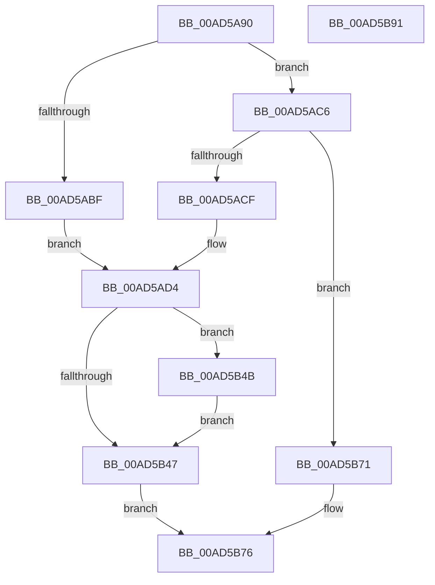

# PnpGetDeviceInstanceRegistryValue

- RVA: `0x00AD5A90`–`0x00AD5B92` (길이 `258` bytes)
- VA: `0x0000000140AD5A90`
- 실행 섹션: `PAGE`
- PDB 이름 있음: `예`; PDB Function 태그: `아니요`
- unwind 정보 RVA: `0x00091ECC`
- 디코드: `64`개 명령, `258/258` bytes 표시
- 미해석 바이트: `0` (있으면 어셈블리에 `.byte`로 보존)

> 이 문서는 커널 이미지의 기계어와 PDB 기호를 분석해 생성했습니다. 4번과 5번은 함수 원형과 자료형을 바이너리 사용 방식에서 추정한 C 해석이며 원본 소스 복구 결과는 아닙니다.

## 1. Dependencies

- 직접 호출 지점: **6**; 고유 호출 대상: **6**
- 직접 호출자로 확인된 함수: **0**
- RIP 상대 이미지 참조: **2**

### Outgoing calls
- `0x00AD5AEC` → [ExAcquireResourceExclusiveLite](../../text/21/ExAcquireResourceExclusiveLite_function_00214E20.md) (function, `0x00214E20`)
- `0x00AD5B2B` → [_CmOpenDeviceRegKey](../8E/_CmOpenDeviceRegKey_function_008EE540.md) (function, `0x008EE540`)
- `0x00AD5B39` → [ExReleaseResourceLite](../../text/25/ExReleaseResourceLite_function_0025FA10.md) (function, `0x0025FA10`)
- `0x00AD5B3E` → [KeLeaveCriticalRegion](../../text/25/KeLeaveCriticalRegion_function_0025D8B0.md) (function, `0x0025D8B0`)
- `0x00AD5B5E` → [IopGetRegistryValue](../99/IopGetRegistryValue_function_009990EC.md) (function, `0x009990EC`)
- `0x00AD5B6A` → [ZwClose](../../text/6A/ZwClose_function_006AD2B0.md) (function, `0x006AD2B0`)

### Direct callers
- 이 함수 시작 RVA로 연결되는 직접 call은 확인되지 않았습니다. 간접 호출은 완전히 역산할 수 없습니다.

### Static image references
- `0x00AD5ADD` → RVA `0x00F8C600` (`.data`; read)
- `0x00AD5AF1` → RVA `0x00E66398` (`.data`; read)

## 2. Other-region calls and transfers

- 다른 실행 섹션으로 향하는 call: **4**
  - `0x00AD5AEC` → [ExAcquireResourceExclusiveLite](../../text/21/ExAcquireResourceExclusiveLite_function_00214E20.md) (`PAGE` → `.text`)
  - `0x00AD5B39` → [ExReleaseResourceLite](../../text/25/ExReleaseResourceLite_function_0025FA10.md) (`PAGE` → `.text`)
  - `0x00AD5B3E` → [KeLeaveCriticalRegion](../../text/25/KeLeaveCriticalRegion_function_0025D8B0.md) (`PAGE` → `.text`)
  - `0x00AD5B6A` → [ZwClose](../../text/6A/ZwClose_function_006AD2B0.md) (`PAGE` → `.text`)
- 별도 외부 분기/꼬리 이동을 확인하지 못했습니다.

## 3. Assembly (complete function range)

```asm
00AD5A90  48 8B C4                        mov rax, rsp
00AD5A93  48 89 58 08                     mov qword ptr [rax + 8], rbx
00AD5A97  48 89 68 10                     mov qword ptr [rax + 0x10], rbp
00AD5A9B  48 89 70 18                     mov qword ptr [rax + 0x18], rsi
00AD5A9F  48 89 78 20                     mov qword ptr [rax + 0x20], rdi
00AD5AA3  41 56                           push r14
00AD5AA5  48 83 EC 50                     sub rsp, 0x50
00AD5AA9  48 83 60 E8 00                  and qword ptr [rax - 0x18], 0
00AD5AAE  8B DA                           mov ebx, edx
00AD5AB0  B2 01                           mov dl, 1
00AD5AB2  41 8B F1                        mov esi, r9d
00AD5AB5  49 8B E8                        mov rbp, r8
00AD5AB8  4C 8B F1                        mov r14, rcx
00AD5ABB  84 DA                           test dl, bl
00AD5ABD  74 07                           je 0x140ad5ac6
00AD5ABF  BF 11 00 00 00                  mov edi, 0x11
00AD5AC4  EB 0E                           jmp 0x140ad5ad4
00AD5AC6  F6 C3 02                        test bl, 2
00AD5AC9  0F 84 A2 00 00 00               je 0x140ad5b71
00AD5ACF  BF 12 00 00 00                  mov edi, 0x12
00AD5AD4  65 48 8B 04 25 88 01 00 00      mov rax, qword ptr gs:[0x188]
00AD5ADD  48 8D 0D 1C 6B 4B 00            lea rcx, [rip + 0x4b6b1c]
00AD5AE4  66 FF 88 E4 01 00 00            dec word ptr [rax + 0x1e4]
00AD5AEB  90                              nop
00AD5AEC  E8 2F F3 73 FF                  call 0x140214e20
00AD5AF1  48 8B 0D A0 08 39 00            mov rcx, qword ptr [rip + 0x3908a0]
00AD5AF8  48 8D 44 24 40                  lea rax, [rsp + 0x40]
00AD5AFD  44 8B C7                        mov r8d, edi
00AD5B00  49 8B D6                        mov rdx, r14
00AD5B03  41 0F BA E8 09                  bts r8d, 9
00AD5B08  0F BA E3 02                     bt ebx, 2
00AD5B0C  44 0F 43 C7                     cmovae r8d, edi
00AD5B10  48 83 64 24 38 00               and qword ptr [rsp + 0x38], 0
00AD5B16  48 89 44 24 30                  mov qword ptr [rsp + 0x30], rax
00AD5B1B  45 33 C9                        xor r9d, r9d
00AD5B1E  C6 44 24 28 00                  mov byte ptr [rsp + 0x28], 0
00AD5B23  C7 44 24 20 19 00 02 00         mov dword ptr [rsp + 0x20], 0x20019
00AD5B2B  E8 10 8A E1 FF                  call 0x1408ee540
00AD5B30  48 8D 0D C9 6A 4B 00            lea rcx, [rip + 0x4b6ac9]
00AD5B37  8B D8                           mov ebx, eax
00AD5B39  E8 D2 9E 78 FF                  call 0x14025fa10
00AD5B3E  E8 6D 7D 78 FF                  call 0x14025d8b0
00AD5B43  85 DB                           test ebx, ebx
00AD5B45  79 04                           jns 0x140ad5b4b
00AD5B47  8B C3                           mov eax, ebx
00AD5B49  EB 2B                           jmp 0x140ad5b76
00AD5B4B  4C 8B 8C 24 80 00 00 00         mov r9, qword ptr [rsp + 0x80]
00AD5B53  44 8B C6                        mov r8d, esi
00AD5B56  48 8B 4C 24 40                  mov rcx, qword ptr [rsp + 0x40]
00AD5B5B  48 8B D5                        mov rdx, rbp
00AD5B5E  E8 89 35 EC FF                  call 0x1409990ec
00AD5B63  48 8B 4C 24 40                  mov rcx, qword ptr [rsp + 0x40]
00AD5B68  8B D8                           mov ebx, eax
00AD5B6A  E8 41 77 BD FF                  call 0x1406ad2b0
00AD5B6F  EB D6                           jmp 0x140ad5b47
00AD5B71  B8 0D 00 00 C0                  mov eax, 0xc000000d
00AD5B76  48 8B 5C 24 60                  mov rbx, qword ptr [rsp + 0x60]
00AD5B7B  48 8B 6C 24 68                  mov rbp, qword ptr [rsp + 0x68]
00AD5B80  48 8B 74 24 70                  mov rsi, qword ptr [rsp + 0x70]
00AD5B85  48 8B 7C 24 78                  mov rdi, qword ptr [rsp + 0x78]
00AD5B8A  48 83 C4 50                     add rsp, 0x50
00AD5B8E  41 5E                           pop r14
00AD5B90  C3                              ret
00AD5B91  CC                              int3
```

## 4. C-style interpretation (structured pseudocode)

```c
__int64 __fastcall PnpGetDeviceInstanceRegistryValue(__int64 a1, int a2, __int64 a3, int a4, __int64 a5)
{
    __int64 result;
    __int64 v_rsp;
    unsigned __int64 v_stack_m18;
    unsigned __int64 v_stack_m20;
    unsigned __int64 v_stack_m28;
    unsigned __int8 v_stack_m30;
    unsigned int v_stack_m38;
    unsigned __int64 v_stack_p10;
    unsigned __int64 v_stack_p18;
    unsigned __int64 v_stack_p20;
    unsigned __int64 v_stack_p8;

    *(unsigned __int64 *)(v_rsp + 8) = v_rbx;
    *(unsigned __int64 *)(v_rsp + 16) = v_rbp;
    *(unsigned __int64 *)(v_rsp + 24) = v_rsi;
    *(unsigned __int64 *)(v_rsp + 32) = v_rdi;
    v_rsp = (v_rsp) - (80);
    if (((1) & ((unsigned __int8)((unsigned int)(a2)))) == 0) goto loc_00AD5AC6;
    goto loc_00AD5AD4;
loc_00AD5AC6:
    if ((((unsigned __int8)((unsigned int)(a2))) & (2)) == 0) goto loc_00AD5B71;
loc_00AD5AD4:
    result = ExAcquireResourceExclusiveLite(v_rip + 4942620, 1, a3, a4);
    a3 = 18;
    if (condition_is_above_or_equal) { a3 = 18; }
    v_stack_m28 = v_stack_m18;
    a4 = 0;
    v_stack_m30 = 0;
    v_stack_m38 = 0x20019ULL;
    result = _CmOpenDeviceRegKey(*(unsigned __int64 *)(v_rip + 3737760), a1, a3, a4);
    result = ExReleaseResourceLite(v_rip + 4942537, a1, a3, a4);
    result = KeLeaveCriticalRegion(v_rip + 4942537, a1, a3, a4);
    if (!sign_flag) goto loc_00AD5B4B;
loc_00AD5B47:
    goto loc_00AD5B76;
loc_00AD5B4B:
    result = IopGetRegistryValue(v_stack_m18, a3, (unsigned int)((unsigned int)((unsigned int)(a4))), a5);
    result = ZwClose(v_stack_m18, a3, (unsigned int)((unsigned int)((unsigned int)(a4))), a5);
    goto loc_00AD5B47;
loc_00AD5B71:
loc_00AD5B76:
    v_rsp = (v_rsp) + (80);
    return (unsigned int)(0xC000000DULL);
}
```

## 5. (Beta) C Style

```c
int64_t PnpGetDeviceInstanceRegistryValue(int64_t Arg1, int32_t Arg2, int64_t Arg3, int32_t Arg4, int64_t Arg5)
{
    int64_t result;
    int64_t local_rsp;
    uint64_t v_stack_m18;
    uint64_t v_stack_m20;
    uint64_t v_stack_m28;
    uint8_t v_stack_m30;
    uint32_t v_stack_m38;
    uint64_t v_stack_p10;
    uint64_t v_stack_p18;
    uint64_t v_stack_p20;
    uint64_t v_stack_p8;

    *(uint64_t *)(local_rsp + 0x8) = local_rbx;
    *(uint64_t *)(local_rsp + 0x10) = local_rbp;
    *(uint64_t *)(local_rsp + 0x18) = local_rsi;
    *(uint64_t *)(local_rsp + 0x20) = local_rdi;
    local_rsp = (local_rsp) - (80);
    if (((1) & ((uint8_t)((uint32_t)(Arg2)))) == 0) goto loc_00AD5AC6;
    goto loc_00AD5AD4;
loc_00AD5AC6:
    if ((((uint8_t)((uint32_t)(Arg2))) & (2)) == 0) goto loc_00AD5B71;
loc_00AD5AD4:
    result = ExAcquireResourceExclusiveLite(v_rip + 4942620, 1, Arg3, Arg4);
    Arg3 = 18;
    if (condition_is_above_or_equal) { Arg3 = 18; }
    v_stack_m28 = v_stack_m18;
    Arg4 = 0;
    v_stack_m30 = 0;
    v_stack_m38 = 0x20019ULL;
    result = _CmOpenDeviceRegKey(*(uint64_t *)(v_rip + 0x3908A0), Arg1, Arg3, Arg4);
    result = ExReleaseResourceLite(v_rip + 4942537, Arg1, Arg3, Arg4);
    result = KeLeaveCriticalRegion(v_rip + 4942537, Arg1, Arg3, Arg4);
    if (!sign_flag) goto loc_00AD5B4B;
loc_00AD5B47:
    goto loc_00AD5B76;
loc_00AD5B4B:
    result = IopGetRegistryValue(v_stack_m18, Arg3, (uint32_t)((uint32_t)((uint32_t)(Arg4))), Arg5);
    result = ZwClose(v_stack_m18, Arg3, (uint32_t)((uint32_t)((uint32_t)(Arg4))), Arg5);
    goto loc_00AD5B47;
loc_00AD5B71:
loc_00AD5B76:
    local_rsp = (local_rsp) + (80);
    return (uint32_t)(0xC000000DULL);
}
```

## 6. Execution-region graph

[열기: 2D/3D 그래프와 함수 탐색 컨트롤 패널](../../../control-panel.html?section=page&rva=0x00AD5A90&view=graph)

- 2D 그래프는 위에서 아래로 흐르고, 3D 그래프는 빈 공간을 드래그해 회전합니다. Shift+드래그는 이동, 휠은 확대·축소, 함수 노드 선택은 대상 보고서 이동입니다.

### Static fallback


