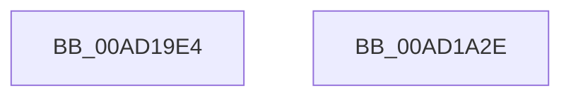

# PnpPowerStateTransitionWatchdogPopRecord

- RVA: `0x00AD19E4`–`0x00AD1A2F` (길이 `75` bytes)
- VA: `0x0000000140AD19E4`
- 실행 섹션: `PAGE`
- PDB 이름 있음: `예`; PDB Function 태그: `아니요`
- unwind 정보 RVA: `0x000BCD28`
- 디코드: `18`개 명령, `75/75` bytes 표시
- 미해석 바이트: `0` (있으면 어셈블리에 `.byte`로 보존)

> 이 문서는 커널 이미지의 기계어와 PDB 기호를 분석해 생성했습니다. 4번과 5번은 함수 원형과 자료형을 바이너리 사용 방식에서 추정한 C 해석이며 원본 소스 복구 결과는 아닙니다.

## 1. Dependencies

- 직접 호출 지점: **1**; 고유 호출 대상: **1**
- 직접 호출자로 확인된 함수: **2**
- RIP 상대 이미지 참조: **0**

### Outgoing calls
- `0x00AD1A24` → [ZwPowerInformation](../../text/6A/ZwPowerInformation_function_006ADCB0.md) (function, `0x006ADCB0`)

### Direct callers
- [PnpSurpriseFailUnsafeDmaDevices](../A9/PnpSurpriseFailUnsafeDmaDevices_function_00A95B90.md) at `0x00A95C92`
- [PnpSurpriseFailUnsafeDmaDevices](../A9/PnpSurpriseFailUnsafeDmaDevices_function_00A95B90.md) at `0x00A95C9C`
- [IoBuildPoDeviceNotifyList](../../pagelk/B7/IoBuildPoDeviceNotifyList_function_00B78B0C.md) at `0x00B790ED`

### Static image references
- 디코드된 RIP-relative 메모리 참조가 없습니다.

## 2. Other-region calls and transfers

- 다른 실행 섹션으로 향하는 call: **1**
  - `0x00AD1A24` → [ZwPowerInformation](../../text/6A/ZwPowerInformation_function_006ADCB0.md) (`PAGE` → `.text`)
- 별도 외부 분기/꼬리 이동을 확인하지 못했습니다.

## 3. Assembly (complete function range)

```asm
00AD19E4  48 83 EC 78                     sub rsp, 0x78
00AD19E8  33 C0                           xor eax, eax
00AD19EA  48 8D 54 24 30                  lea rdx, [rsp + 0x30]
00AD19EF  21 44 24 20                     and dword ptr [rsp + 0x20], eax
00AD19F3  0F 57 C0                        xorps xmm0, xmm0
00AD19F6  0F 11 44 24 30                  movups xmmword ptr [rsp + 0x30], xmm0
00AD19FB  45 33 C9                        xor r9d, r9d
00AD19FE  48 89 44 24 60                  mov qword ptr [rsp + 0x60], rax
00AD1A03  44 8D 40 38                     lea r8d, [rax + 0x38]
00AD1A07  C7 44 24 30 58 00 00 00         mov dword ptr [rsp + 0x30], 0x58
00AD1A0F  8D 48 57                        lea ecx, [rax + 0x57]
00AD1A12  C7 44 24 38 01 00 00 00         mov dword ptr [rsp + 0x38], 1
00AD1A1A  0F 11 44 24 40                  movups xmmword ptr [rsp + 0x40], xmm0
00AD1A1F  0F 11 44 24 50                  movups xmmword ptr [rsp + 0x50], xmm0
00AD1A24  E8 87 C2 BD FF                  call 0x1406adcb0
00AD1A29  48 83 C4 78                     add rsp, 0x78
00AD1A2D  C3                              ret
00AD1A2E  CC                              int3
```

## 4. C-style interpretation (structured pseudocode)

```c
__int64 __fastcall PnpPowerStateTransitionWatchdogPopRecord(__int64 a1, __int64 a2, __int64 a3, int a4)
{
    __int64 result;
    __int64 v_rsp;
    unsigned __int64 v_stack_m18;
    unsigned __int64 v_stack_m28;
    unsigned __int64 v_stack_m38;
    unsigned int v_stack_m40;
    unsigned __int64 v_stack_m48;
    unsigned int v_stack_m58;

    v_rsp = (v_rsp) - (120);
    result = 0;
    v_stack_m48 = v_xmm0;
    a4 = 0;
    v_stack_m18 = 0;
    v_stack_m48 = 88;
    v_stack_m40 = 1;
    v_stack_m38 = v_xmm0;
    v_stack_m28 = v_xmm0;
    result = ZwPowerInformation(result + 87, v_stack_m48, result + 56, a4);
    v_rsp = (v_rsp) + (120);
    return result;
}
```

## 5. (Beta) C Style

```c
int64_t PnpPowerStateTransitionWatchdogPopRecord(int64_t Arg1, int64_t Arg2, int64_t Arg3, int32_t Arg4)
{
    int64_t result;
    int64_t local_rsp;
    uint64_t v_stack_m18;
    uint64_t v_stack_m28;
    uint64_t v_stack_m38;
    uint32_t v_stack_m40;
    uint64_t v_stack_m48;
    uint32_t v_stack_m58;

    local_rsp = (local_rsp) - (120);
    result = 0;
    v_stack_m48 = v_xmm0;
    Arg4 = 0;
    v_stack_m18 = 0;
    v_stack_m48 = 88;
    v_stack_m40 = 1;
    v_stack_m38 = v_xmm0;
    v_stack_m28 = v_xmm0;
    result = ZwPowerInformation(result + 87, v_stack_m48, result + 56, Arg4);
    local_rsp = (local_rsp) + (120);
    return result;
}
```

## 6. Execution-region graph

[열기: 2D/3D 그래프와 함수 탐색 컨트롤 패널](../../../control-panel.html?section=page&rva=0x00AD19E4&view=graph)

- 2D 그래프는 위에서 아래로 흐르고, 3D 그래프는 빈 공간을 드래그해 회전합니다. Shift+드래그는 이동, 휠은 확대·축소, 함수 노드 선택은 대상 보고서 이동입니다.

### Static fallback


