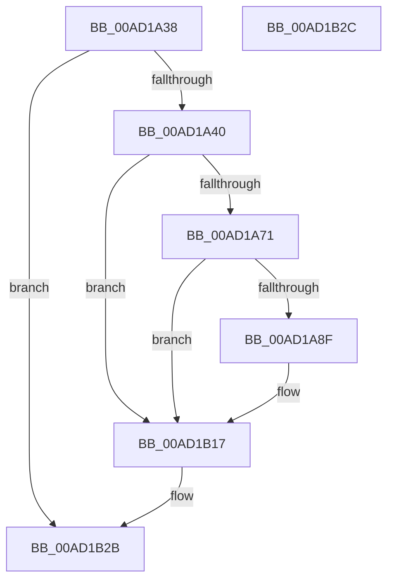

# PnpTraceDmaGuardDevicePolicy

- RVA: `0x00AD1A38`–`0x00AD1B2D` (길이 `245` bytes)
- VA: `0x0000000140AD1A38`
- 실행 섹션: `PAGE`
- PDB 이름 있음: `예`; PDB Function 태그: `아니요`
- unwind 정보 RVA: `0x000BEA04`
- 디코드: `51`개 명령, `245/245` bytes 표시
- 미해석 바이트: `0` (있으면 어셈블리에 `.byte`로 보존)

> 이 문서는 커널 이미지의 기계어와 PDB 기호를 분석해 생성했습니다. 4번과 5번은 함수 원형과 자료형을 바이너리 사용 방식에서 추정한 C 해석이며 원본 소스 복구 결과는 아닙니다.

## 1. Dependencies

- 직접 호출 지점: **3**; 고유 호출 대상: **3**
- 직접 호출자로 확인된 함수: **1**
- RIP 상대 이미지 참조: **3**

### Outgoing calls
- `0x00AD1A82` → [tlgKeywordOn](../../text/42/tlgKeywordOn_function_0042EAA0.md) (function, `0x0042EAA0`)
- `0x00AD1B12` → [tlgWriteAgg](../../text/2F/tlgWriteAgg_function_002F0F7C.md) (function, `0x002F0F7C`)
- `0x00AD1B1E` → [_security_check_cookie](../../text/6A/_security_check_cookie_function_006AC640.md) (function, `0x006AC640`)

### Direct callers
- [PipDmgSaveDeviceDmarPolicy](../73/PipDmgSaveDeviceDmarPolicy_function_0073C630.md) at `0x0073C6C3`

### Static image references
- `0x00AD1A4D` → RVA `0x00E0A740` (`.data`; read)
- `0x00AD1A61` → RVA `0x00E06F90` (`.data`; read)
- `0x00AD1A9F` → RVA `0x00047126` (`.rdata`; read)

## 2. Other-region calls and transfers

- 다른 실행 섹션으로 향하는 call: **3**
  - `0x00AD1A82` → [tlgKeywordOn](../../text/42/tlgKeywordOn_function_0042EAA0.md) (`PAGE` → `.text`)
  - `0x00AD1B12` → [tlgWriteAgg](../../text/2F/tlgWriteAgg_function_002F0F7C.md) (`PAGE` → `.text`)
  - `0x00AD1B1E` → [_security_check_cookie](../../text/6A/_security_check_cookie_function_006AC640.md) (`PAGE` → `.text`)
- 별도 외부 분기/꼬리 이동을 확인하지 못했습니다.

## 3. Assembly (complete function range)

```asm
00AD1A38  85 D2                           test edx, edx
00AD1A3A  0F 84 EB 00 00 00               je 0x140ad1b2b
00AD1A40  55                              push rbp
00AD1A41  48 8D 6C 24 A9                  lea rbp, [rsp - 0x57]
00AD1A46  48 81 EC D0 00 00 00            sub rsp, 0xd0
00AD1A4D  48 8B 05 EC 8C 33 00            mov rax, qword ptr [rip + 0x338cec]
00AD1A54  48 33 C4                        xor rax, rsp
00AD1A57  48 89 45 47                     mov qword ptr [rbp + 0x47], rax
00AD1A5B  45 33 D2                        xor r10d, r10d
00AD1A5E  44 8B C2                        mov r8d, edx
00AD1A61  83 3D 28 55 33 00 05            cmp dword ptr [rip + 0x335528], 5
00AD1A68  4C 8B C9                        mov r9, rcx
00AD1A6B  0F 86 A6 00 00 00               jbe 0x140ad1b17
00AD1A71  48 BA 00 00 00 00 00 40 00 00   movabs rdx, 0x400000000000
00AD1A7B  48 8D 0D 0E 55 33 00            lea rcx, [rip + 0x33550e]
00AD1A82  E8 19 D0 95 FF                  call 0x14042eaa0
00AD1A87  84 C0                           test al, al
00AD1A89  0F 84 88 00 00 00               je 0x140ad1b17
00AD1A8F  48 8D 45 BF                     lea rax, [rbp - 0x41]
00AD1A93  48 C7 45 BF 01 00 00 00         mov qword ptr [rbp - 0x41], 1
00AD1A9B  48 89 45 F7                     mov qword ptr [rbp - 9], rax
00AD1A9F  48 8D 15 80 56 57 FF            lea rdx, [rip - 0xa8a980]
00AD1AA6  48 8D 45 1F                     lea rax, [rbp + 0x1f]
00AD1AAA  48 C7 45 FF 08 00 00 00         mov qword ptr [rbp - 1], 8
00AD1AB2  48 89 45 07                     mov qword ptr [rbp + 7], rax
00AD1AB6  48 8D 0D D3 54 33 00            lea rcx, [rip + 0x3354d3]
00AD1ABD  49 8B 41 30                     mov rax, qword ptr [r9 + 0x30]
00AD1AC1  48 89 45 17                     mov qword ptr [rbp + 0x17], rax
00AD1AC5  41 0F B7 41 28                  movzx eax, word ptr [r9 + 0x28]
00AD1ACA  45 8D 4A 07                     lea r9d, [r10 + 7]
00AD1ACE  89 45 1F                        mov dword ptr [rbp + 0x1f], eax
00AD1AD1  48 8D 45 B7                     lea rax, [rbp - 0x49]
00AD1AD5  48 89 45 27                     mov qword ptr [rbp + 0x27], rax
00AD1AD9  48 8D 45 C7                     lea rax, [rbp - 0x39]
00AD1ADD  48 89 45 37                     mov qword ptr [rbp + 0x37], rax
00AD1AE1  48 8D 45 D7                     lea rax, [rbp - 0x29]
00AD1AE5  48 89 44 24 20                  mov qword ptr [rsp + 0x20], rax
00AD1AEA  48 C7 45 0F 02 00 00 00         mov qword ptr [rbp + 0xf], 2
00AD1AF2  44 89 55 23                     mov dword ptr [rbp + 0x23], r10d
00AD1AF6  44 89 45 B7                     mov dword ptr [rbp - 0x49], r8d
00AD1AFA  48 C7 45 2F 04 00 00 00         mov qword ptr [rbp + 0x2f], 4
00AD1B02  48 C7 45 C7 00 08 00 00         mov qword ptr [rbp - 0x39], 0x800
00AD1B0A  48 C7 45 3F 08 00 00 00         mov qword ptr [rbp + 0x3f], 8
00AD1B12  E8 65 F4 81 FF                  call 0x1402f0f7c
00AD1B17  48 8B 4D 47                     mov rcx, qword ptr [rbp + 0x47]
00AD1B1B  48 33 CC                        xor rcx, rsp
00AD1B1E  E8 1D AB BD FF                  call 0x1406ac640
00AD1B23  48 81 C4 D0 00 00 00            add rsp, 0xd0
00AD1B2A  5D                              pop rbp
00AD1B2B  C3                              ret
00AD1B2C  CC                              int3
```

## 4. C-style interpretation (structured pseudocode)

```c
__int64 __fastcall PnpTraceDmaGuardDevicePolicy(__int64 a1, int a2)
{
    __int64 result;
    __int64 v_r10;
    __int64 v_rsp;
    unsigned __int64 v_stack_m18;
    unsigned __int64 v_stack_m20;
    unsigned __int64 v_stack_m28;
    unsigned __int64 v_stack_m30;
    unsigned __int64 v_stack_m38;
    unsigned int v_stack_m3C;
    unsigned __int64 v_stack_m40;
    unsigned __int64 v_stack_m48;
    unsigned __int64 v_stack_m50;
    unsigned __int64 v_stack_m58;
    unsigned __int64 v_stack_m5F;
    unsigned __int64 v_stack_m60;
    unsigned __int64 v_stack_m68;
    unsigned __int64 v_stack_m88;
    unsigned __int64 v_stack_m98;
    unsigned __int64 v_stack_mA0;
    unsigned __int64 v_stack_mA8;
    unsigned __int64 v_stack_mB8;

    if (a2 == 0) goto loc_00AD1B2B;
    v_rsp = (v_rsp) - (208);
    result = (*(unsigned __int64 *)(v_rip + 3378412)) ^ (v_rsp);
    v_stack_m18 = result;
    v_r10 = 0;
    if ((*(unsigned int *)(v_rip + 3364136)) <= 5) goto loc_00AD1B17;
    result = tlgKeywordOn(v_rip + 3364110, a2, (unsigned int)(a2), a1);
    if ((unsigned __int8)(result) != 0) {
        result = v_stack_mA0;
        v_stack_mA0 = 1;
        v_stack_m68 = result;
        a2 = v_rip - 11053440;
        result = v_stack_m40;
        v_stack_m60 = 8;
        v_stack_m58 = result;
        a1 = v_rip + 3364051;
        result = *(unsigned __int64 *)(a1 + 48);
        v_stack_m48 = result;
        result = *(unsigned __int16 *)(a1 + 40);
        a4 = v_r10 + 7;
        v_stack_m40 = (unsigned int)(result);
        result = v_stack_mA8;
        v_stack_m38 = result;
        result = v_stack_m98;
        v_stack_m28 = result;
        result = v_stack_m88;
        v_stack_mB8 = result;
        v_stack_m50 = 2;
        v_stack_m3C = 0;
        v_stack_mA8 = (unsigned int)((unsigned int)(a2));
        v_stack_m30 = 4;
        v_stack_m98 = 0x800ULL;
        v_stack_m20 = 8;
        result = tlgWriteAgg(a1, a2, (unsigned int)(a2), a4);
    }
    a1 = (v_stack_m18) ^ (v_rsp);
    result = _security_check_cookie(a1, a2, (unsigned int)(a2), a4);
    v_rsp = (v_rsp) + (208);
loc_00AD1B2B:
    return result;
}
```

## 5. (Beta) C Style

```c
int64_t PnpTraceDmaGuardDevicePolicy(int64_t Arg1, int32_t Arg2)
{
    int64_t result;
    int64_t local_r10;
    int64_t local_rsp;
    uint64_t v_stack_m18;
    uint64_t v_stack_m20;
    uint64_t v_stack_m28;
    uint64_t v_stack_m30;
    uint64_t v_stack_m38;
    uint32_t v_stack_m3C;
    uint64_t v_stack_m40;
    uint64_t v_stack_m48;
    uint64_t v_stack_m50;
    uint64_t v_stack_m58;
    uint64_t v_stack_m5F;
    uint64_t v_stack_m60;
    uint64_t v_stack_m68;
    uint64_t v_stack_m88;
    uint64_t v_stack_m98;
    uint64_t v_stack_mA0;
    uint64_t v_stack_mA8;
    uint64_t v_stack_mB8;

    if (Arg2 == 0) goto loc_00AD1B2B;
    local_rsp = (local_rsp) - (208);
    result = (*(uint64_t *)(v_rip + 0x338CEC)) ^ (local_rsp);
    v_stack_m18 = result;
    local_r10 = 0;
    if ((*(uint32_t *)(v_rip + 0x335528)) <= 5) goto loc_00AD1B17;
    result = tlgKeywordOn(v_rip + 3364110, Arg2, (uint32_t)(Arg2), Arg1);
    if ((uint8_t)(result) != 0) {
        result = v_stack_mA0;
        v_stack_mA0 = 1;
        v_stack_m68 = result;
        Arg2 = v_rip - 11053440;
        result = v_stack_m40;
        v_stack_m60 = 8;
        v_stack_m58 = result;
        Arg1 = v_rip + 3364051;
        result = *(uint64_t *)(Arg1 + 0x30);
        v_stack_m48 = result;
        result = *(uint16_t *)(Arg1 + 0x28);
        a4 = local_r10 + 7;
        v_stack_m40 = (uint32_t)(result);
        result = v_stack_mA8;
        v_stack_m38 = result;
        result = v_stack_m98;
        v_stack_m28 = result;
        result = v_stack_m88;
        v_stack_mB8 = result;
        v_stack_m50 = 2;
        v_stack_m3C = 0;
        v_stack_mA8 = (uint32_t)((uint32_t)(Arg2));
        v_stack_m30 = 4;
        v_stack_m98 = 0x800ULL;
        v_stack_m20 = 8;
        result = tlgWriteAgg(Arg1, Arg2, (uint32_t)(Arg2), a4);
    }
    Arg1 = (v_stack_m18) ^ (local_rsp);
    result = _security_check_cookie(Arg1, Arg2, (uint32_t)(Arg2), a4);
    local_rsp = (local_rsp) + (208);
loc_00AD1B2B:
    return result;
}
```

## 6. Execution-region graph

[열기: 2D/3D 그래프와 함수 탐색 컨트롤 패널](../../../control-panel.html?section=page&rva=0x00AD1A38&view=graph)

- 2D 그래프는 위에서 아래로 흐르고, 3D 그래프는 빈 공간을 드래그해 회전합니다. Shift+드래그는 이동, 휠은 확대·축소, 함수 노드 선택은 대상 보고서 이동입니다.

### Static fallback


