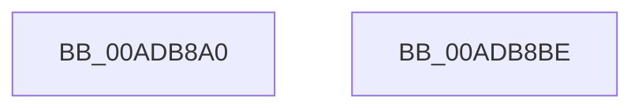

# PoUnblockConsoleSwitch

- RVA: `0x00ADB8A0`–`0x00ADB8BF` (길이 `31` bytes)
- VA: `0x0000000140ADB8A0`
- 실행 섹션: `PAGE`
- PDB 이름 있음: `예`; PDB Function 태그: `아니요`
- unwind 정보 RVA: `0x000AB2D8`
- 디코드: `8`개 명령, `31/31` bytes 표시
- 미해석 바이트: `0` (있으면 어셈블리에 `.byte`로 보존)

> 이 문서는 커널 이미지의 기계어와 PDB 기호를 분석해 생성했습니다. 4번과 5번은 함수 원형과 자료형을 바이너리 사용 방식에서 추정한 C 해석이며 원본 소스 복구 결과는 아닙니다.

## 1. Dependencies

- 직접 호출 지점: **1**; 고유 호출 대상: **1**
- 직접 호출자로 확인된 함수: **2**
- RIP 상대 이미지 참조: **0**

### Outgoing calls
- `0x00ADB8B4` → [PopDispatchStateCallout](../91/PopDispatchStateCallout_function_0091248C.md) (function, `0x0091248C`)

### Direct callers
- [PoPowerOffMonitor](../../text/4D/PoPowerOffMonitor_function_004D63C0.md) at `0x004D6420`
- [PnprWakeDevices](../../pagelk/B6/PnprWakeDevices_function_00B65614.md) at `0x00B65664`

### Static image references
- 디코드된 RIP-relative 메모리 참조가 없습니다.

## 2. Other-region calls and transfers

- 다른 실행 섹션으로 향하는 call: **0**
- 별도 외부 분기/꼬리 이동을 확인하지 못했습니다.

## 3. Assembly (complete function range)

```asm
00ADB8A0  89 54 24 10                     mov dword ptr [rsp + 0x10], edx
00ADB8A4  48 83 EC 28                     sub rsp, 0x28
00ADB8A8  48 8D 54 24 38                  lea rdx, [rsp + 0x38]
00ADB8AD  C7 41 20 07 00 00 00            mov dword ptr [rcx + 0x20], 7
00ADB8B4  E8 D3 6B E3 FF                  call 0x14091248c
00ADB8B9  48 83 C4 28                     add rsp, 0x28
00ADB8BD  C3                              ret
00ADB8BE  CC                              int3
```

## 4. C-style interpretation (structured pseudocode)

```c
__int64 __fastcall PoUnblockConsoleSwitch(__int64 a1, int a2)
{
    __int64 result;
    __int64 v_rsp;
    unsigned int v_stack_p10;

    v_stack_p10 = a2;
    v_rsp = (v_rsp) - (40);
    *(unsigned int *)(a1 + 32) = 7;
    result = PopDispatchStateCallout(a1, v_stack_p10, a3, a4);
    v_rsp = (v_rsp) + (40);
    return result;
}
```

## 5. (Beta) C Style

```c
int64_t PoUnblockConsoleSwitch(void *Arg1, int32_t Arg2)
{
    uint8_t *arg1 = (uint8_t *)Arg1;

    int64_t result;
    int64_t local_rsp;
    uint32_t v_stack_p10;

    v_stack_p10 = Arg2;
    local_rsp = (local_rsp) - (40);
    *(uint32_t *)(arg1 + 0x20) = 7;
    result = PopDispatchStateCallout(Arg1, v_stack_p10, a3, a4);
    local_rsp = (local_rsp) + (40);
    return result;
}
```

### 관측된 메모리 오프셋

구조체 형식이 확인되지 않은 접근은 인자 기준의 오프셋으로만 기록했습니다.

| 기준 인자 | 오프셋 표현 | 폭 (bit) | 접근 |
|---|---:|---:|---|
| `Arg1` | `+ 0x20` | `32` | `W` |

## 6. Execution-region graph

[열기: 2D/3D 그래프와 함수 탐색 컨트롤 패널](../../../control-panel.html?section=page&rva=0x00ADB8A0&view=graph)

- 2D 그래프는 위에서 아래로 흐르고, 3D 그래프는 빈 공간을 드래그해 회전합니다. Shift+드래그는 이동, 휠은 확대·축소, 함수 노드 선택은 대상 보고서 이동입니다.

### Static fallback


