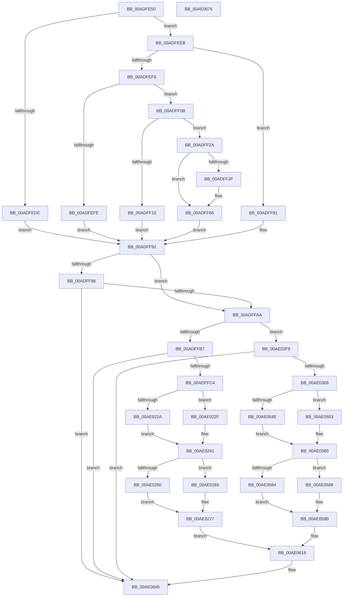

# PopAccountBatteryEnergyChange

- RVA: `0x00ADFE50`–`0x00AE0677` (길이 `2,087` bytes)
- VA: `0x0000000140ADFE50`
- 실행 섹션: `PAGE`
- PDB 이름 있음: `예`; PDB Function 태그: `아니요`
- unwind 정보 RVA: `0x000CCF38`
- 디코드: `441`개 명령, `2,087/2,087` bytes 표시
- 미해석 바이트: `0` (있으면 어셈블리에 `.byte`로 보존)

> 이 문서는 커널 이미지의 기계어와 PDB 기호를 분석해 생성했습니다. 4번과 5번은 함수 원형과 자료형을 바이너리 사용 방식에서 추정한 C 해석이며 원본 소스 복구 결과는 아닙니다.

## 1. Dependencies

- 직접 호출 지점: **30**; 고유 호출 대상: **4**
- 직접 호출자로 확인된 함수: **1**
- RIP 상대 이미지 참조: **23**

### Outgoing calls
- `0x00ADFFAA` → [Feature_BatteryChargeLimitV2Support__private_IsEnabledDeviceUsageNoInline](../../text/5D/Feature_BatteryChargeLimitV2Support__private_IsEnabledDeviceUsageNoInline_function_005D9484.md) (function, `0x005D9484`)
- `0x00AE0024` → [tlgCreate1Sz_char](../../text/42/tlgCreate1Sz_char_function_00427304.md) (function, `0x00427304`)
- `0x00AE0041` → [tlgCreate1Sz_char](../../text/42/tlgCreate1Sz_char_function_00427304.md) (function, `0x00427304`)
- `0x00AE005E` → [tlgCreate1Sz_char](../../text/42/tlgCreate1Sz_char_function_00427304.md) (function, `0x00427304`)
- `0x00AE007B` → [tlgCreate1Sz_char](../../text/42/tlgCreate1Sz_char_function_00427304.md) (function, `0x00427304`)
- `0x00AE00FC` → [tlgCreate1Sz_char](../../text/42/tlgCreate1Sz_char_function_00427304.md) (function, `0x00427304`)
- `0x00AE0119` → [tlgCreate1Sz_char](../../text/42/tlgCreate1Sz_char_function_00427304.md) (function, `0x00427304`)
- `0x00AE0136` → [tlgCreate1Sz_char](../../text/42/tlgCreate1Sz_char_function_00427304.md) (function, `0x00427304`)
- `0x00AE0156` → [tlgCreate1Sz_char](../../text/42/tlgCreate1Sz_char_function_00427304.md) (function, `0x00427304`)
- `0x00AE0176` → [tlgCreate1Sz_char](../../text/42/tlgCreate1Sz_char_function_00427304.md) (function, `0x00427304`)
- `0x00AE0196` → [tlgCreate1Sz_char](../../text/42/tlgCreate1Sz_char_function_00427304.md) (function, `0x00427304`)
- `0x00AE01B6` → [tlgCreate1Sz_char](../../text/42/tlgCreate1Sz_char_function_00427304.md) (function, `0x00427304`)
- `0x00AE01D6` → [tlgCreate1Sz_char](../../text/42/tlgCreate1Sz_char_function_00427304.md) (function, `0x00427304`)
- `0x00AE01F4` → [tlgCreate1Sz_char](../../text/42/tlgCreate1Sz_char_function_00427304.md) (function, `0x00427304`)
- `0x00AE0212` → [tlgCreate1Sz_char](../../text/42/tlgCreate1Sz_char_function_00427304.md) (function, `0x00427304`)
- `0x00AE0366` → [tlgCreate1Sz_char](../../text/42/tlgCreate1Sz_char_function_00427304.md) (function, `0x00427304`)
- `0x00AE0383` → [tlgCreate1Sz_char](../../text/42/tlgCreate1Sz_char_function_00427304.md) (function, `0x00427304`)
- `0x00AE03A0` → [tlgCreate1Sz_char](../../text/42/tlgCreate1Sz_char_function_00427304.md) (function, `0x00427304`)
- `0x00AE03BD` → [tlgCreate1Sz_char](../../text/42/tlgCreate1Sz_char_function_00427304.md) (function, `0x00427304`)
- `0x00AE043E` → [tlgCreate1Sz_char](../../text/42/tlgCreate1Sz_char_function_00427304.md) (function, `0x00427304`)
- `0x00AE045B` → [tlgCreate1Sz_char](../../text/42/tlgCreate1Sz_char_function_00427304.md) (function, `0x00427304`)
- `0x00AE0478` → [tlgCreate1Sz_char](../../text/42/tlgCreate1Sz_char_function_00427304.md) (function, `0x00427304`)
- `0x00AE0498` → [tlgCreate1Sz_char](../../text/42/tlgCreate1Sz_char_function_00427304.md) (function, `0x00427304`)
- `0x00AE04B8` → [tlgCreate1Sz_char](../../text/42/tlgCreate1Sz_char_function_00427304.md) (function, `0x00427304`)
- `0x00AE04D8` → [tlgCreate1Sz_char](../../text/42/tlgCreate1Sz_char_function_00427304.md) (function, `0x00427304`)
- `0x00AE04F8` → [tlgCreate1Sz_char](../../text/42/tlgCreate1Sz_char_function_00427304.md) (function, `0x00427304`)
- `0x00AE0518` → [tlgCreate1Sz_char](../../text/42/tlgCreate1Sz_char_function_00427304.md) (function, `0x00427304`)
- `0x00AE0536` → [tlgCreate1Sz_char](../../text/42/tlgCreate1Sz_char_function_00427304.md) (function, `0x00427304`)
- `0x00AE0641` → [tlgWriteTransfer_EtwWriteTransfer](../../text/42/tlgWriteTransfer_EtwWriteTransfer_function_004260E0.md) (function, `0x004260E0`)
- `0x00AE0650` → [_security_check_cookie](../../text/6A/_security_check_cookie_function_006AC640.md) (function, `0x006AC640`)

### Direct callers
- [PopBatteryWorker](../AE/PopBatteryWorker_function_00AE1650.md) at `0x00AE1A58`

### Static image references
- `0x00ADFE76` → RVA `0x00E0A740` (`.data`; read)
- `0x00ADFFB7` → RVA `0x00E07748` (`.data`; read)
- `0x00ADFFD4` → RVA `0x00B028B0` (` ?? ::NNGAKEGL::`string'`; read)
- `0x00ADFFDF` → RVA `0x00B02C00` (` ?? ::NNGAKEGL::`string'`; read)
- `0x00AE002F` → RVA `0x00B02A00` (` ?? ::NNGAKEGL::`string'`; read)
- `0x00AE004C` → RVA `0x00B02C70` (` ?? ::NNGAKEGL::`string'`; read)
- `0x00AE0069` → RVA `0x00B02C50` (` ?? ::NNGAKEGL::`string'`; read)
- `0x00AE008E` → RVA `0x00B02A20` (` ?? ::NNGAKEGL::`string'`; read)
- `0x00AE00BD` → RVA `0x00F0C034` (`.data`; read)
- `0x00AE00D8` → RVA `0x00B02A60` (` ?? ::NNGAKEGL::`string'`; read)
- `0x00AE0107` → RVA `0x00B02A40` (` ?? ::NNGAKEGL::`string'`; read)
- `0x00AE0124` → RVA `0x00B02A90` (` ?? ::NNGAKEGL::`string'`; read)
- `0x00AE0144` → RVA `0x00B02A70` (` ?? ::NNGAKEGL::`string'`; read)
- `0x00AE0161` → RVA `0x00B02AE0` (` ?? ::NNGAKEGL::`string'`; read)
- `0x00AE0181` → RVA `0x00B02AB0` (` ?? ::NNGAKEGL::`string'`; read)
- `0x00AE01A1` → RVA `0x00B02990` (` ?? ::NNGAKEGL::`string'`; read)
- `0x00AE01C1` → RVA `0x00B02970` (` ?? ::NNGAKEGL::`string'`; read)
- `0x00AE01DB` → RVA `0x00F0C2C0` (`.data`; read)
- `0x00AE01E2` → RVA `0x00B029D0` (` ?? ::NNGAKEGL::`string'`; read)
- `0x00AE01F9` → RVA `0x00F0C2C1` (`.data`; read)
- `0x00AE0200` → RVA `0x00B029B0` (` ?? ::NNGAKEGL::`string'`; read)
- `0x00AE027B` → RVA `0x0004D240` (`.rdata`; read)
- `0x00AE059F` → RVA `0x0004CB83` (`.rdata`; read)

## 2. Other-region calls and transfers

- 다른 실행 섹션으로 향하는 call: **30**
  - `0x00ADFFAA` → [Feature_BatteryChargeLimitV2Support__private_IsEnabledDeviceUsageNoInline](../../text/5D/Feature_BatteryChargeLimitV2Support__private_IsEnabledDeviceUsageNoInline_function_005D9484.md) (`PAGE` → `.text`)
  - `0x00AE0024` → [tlgCreate1Sz_char](../../text/42/tlgCreate1Sz_char_function_00427304.md) (`PAGE` → `.text`)
  - `0x00AE0041` → [tlgCreate1Sz_char](../../text/42/tlgCreate1Sz_char_function_00427304.md) (`PAGE` → `.text`)
  - `0x00AE005E` → [tlgCreate1Sz_char](../../text/42/tlgCreate1Sz_char_function_00427304.md) (`PAGE` → `.text`)
  - `0x00AE007B` → [tlgCreate1Sz_char](../../text/42/tlgCreate1Sz_char_function_00427304.md) (`PAGE` → `.text`)
  - `0x00AE00FC` → [tlgCreate1Sz_char](../../text/42/tlgCreate1Sz_char_function_00427304.md) (`PAGE` → `.text`)
  - `0x00AE0119` → [tlgCreate1Sz_char](../../text/42/tlgCreate1Sz_char_function_00427304.md) (`PAGE` → `.text`)
  - `0x00AE0136` → [tlgCreate1Sz_char](../../text/42/tlgCreate1Sz_char_function_00427304.md) (`PAGE` → `.text`)
  - `0x00AE0156` → [tlgCreate1Sz_char](../../text/42/tlgCreate1Sz_char_function_00427304.md) (`PAGE` → `.text`)
  - `0x00AE0176` → [tlgCreate1Sz_char](../../text/42/tlgCreate1Sz_char_function_00427304.md) (`PAGE` → `.text`)
  - `0x00AE0196` → [tlgCreate1Sz_char](../../text/42/tlgCreate1Sz_char_function_00427304.md) (`PAGE` → `.text`)
  - `0x00AE01B6` → [tlgCreate1Sz_char](../../text/42/tlgCreate1Sz_char_function_00427304.md) (`PAGE` → `.text`)
  - `0x00AE01D6` → [tlgCreate1Sz_char](../../text/42/tlgCreate1Sz_char_function_00427304.md) (`PAGE` → `.text`)
  - `0x00AE01F4` → [tlgCreate1Sz_char](../../text/42/tlgCreate1Sz_char_function_00427304.md) (`PAGE` → `.text`)
  - `0x00AE0212` → [tlgCreate1Sz_char](../../text/42/tlgCreate1Sz_char_function_00427304.md) (`PAGE` → `.text`)
  - `0x00AE0366` → [tlgCreate1Sz_char](../../text/42/tlgCreate1Sz_char_function_00427304.md) (`PAGE` → `.text`)
  - `0x00AE0383` → [tlgCreate1Sz_char](../../text/42/tlgCreate1Sz_char_function_00427304.md) (`PAGE` → `.text`)
  - `0x00AE03A0` → [tlgCreate1Sz_char](../../text/42/tlgCreate1Sz_char_function_00427304.md) (`PAGE` → `.text`)
  - `0x00AE03BD` → [tlgCreate1Sz_char](../../text/42/tlgCreate1Sz_char_function_00427304.md) (`PAGE` → `.text`)
  - `0x00AE043E` → [tlgCreate1Sz_char](../../text/42/tlgCreate1Sz_char_function_00427304.md) (`PAGE` → `.text`)
  - `0x00AE045B` → [tlgCreate1Sz_char](../../text/42/tlgCreate1Sz_char_function_00427304.md) (`PAGE` → `.text`)
  - `0x00AE0478` → [tlgCreate1Sz_char](../../text/42/tlgCreate1Sz_char_function_00427304.md) (`PAGE` → `.text`)
  - `0x00AE0498` → [tlgCreate1Sz_char](../../text/42/tlgCreate1Sz_char_function_00427304.md) (`PAGE` → `.text`)
  - `0x00AE04B8` → [tlgCreate1Sz_char](../../text/42/tlgCreate1Sz_char_function_00427304.md) (`PAGE` → `.text`)
  - `0x00AE04D8` → [tlgCreate1Sz_char](../../text/42/tlgCreate1Sz_char_function_00427304.md) (`PAGE` → `.text`)
  - `0x00AE04F8` → [tlgCreate1Sz_char](../../text/42/tlgCreate1Sz_char_function_00427304.md) (`PAGE` → `.text`)
  - `0x00AE0518` → [tlgCreate1Sz_char](../../text/42/tlgCreate1Sz_char_function_00427304.md) (`PAGE` → `.text`)
  - `0x00AE0536` → [tlgCreate1Sz_char](../../text/42/tlgCreate1Sz_char_function_00427304.md) (`PAGE` → `.text`)
  - `0x00AE0641` → [tlgWriteTransfer_EtwWriteTransfer](../../text/42/tlgWriteTransfer_EtwWriteTransfer_function_004260E0.md) (`PAGE` → `.text`)
  - `0x00AE0650` → [_security_check_cookie](../../text/6A/_security_check_cookie_function_006AC640.md) (`PAGE` → `.text`)
- 별도 외부 분기/꼬리 이동을 확인하지 못했습니다.

## 3. Assembly (complete function range)

```asm
00ADFE50  48 8B C4                        mov rax, rsp
00ADFE53  48 89 58 10                     mov qword ptr [rax + 0x10], rbx
00ADFE57  48 89 70 18                     mov qword ptr [rax + 0x18], rsi
00ADFE5B  48 89 78 20                     mov qword ptr [rax + 0x20], rdi
00ADFE5F  55                              push rbp
00ADFE60  41 54                           push r12
00ADFE62  41 55                           push r13
00ADFE64  41 56                           push r14
00ADFE66  41 57                           push r15
00ADFE68  48 8D A8 78 FE FF FF            lea rbp, [rax - 0x188]
00ADFE6F  48 81 EC 60 02 00 00            sub rsp, 0x260
00ADFE76  48 8B 05 C3 A8 32 00            mov rax, qword ptr [rip + 0x32a8c3]
00ADFE7D  48 33 C4                        xor rax, rsp
00ADFE80  48 89 85 50 01 00 00            mov qword ptr [rbp + 0x150], rax
00ADFE87  0F 10 81 00 01 00 00            movups xmm0, xmmword ptr [rcx + 0x100]
00ADFE8E  44 8B B9 10 01 00 00            mov r15d, dword ptr [rcx + 0x110]
00ADFE95  45 33 E4                        xor r12d, r12d
00ADFE98  44 8B B1 14 01 00 00            mov r14d, dword ptr [rcx + 0x114]
00ADFE9F  48 8B D9                        mov rbx, rcx
00ADFEA2  44 8B 89 A8 00 00 00            mov r9d, dword ptr [rcx + 0xa8]
00ADFEA9  41 8B F4                        mov esi, r12d
00ADFEAC  44 8B 81 80 00 00 00            mov r8d, dword ptr [rcx + 0x80]
00ADFEB3  41 8B FF                        mov edi, r15d
00ADFEB6  44 89 A1 00 01 00 00            mov dword ptr [rcx + 0x100], r12d
00ADFEBD  45 8D 54 24 01                  lea r10d, [r12 + 1]
00ADFEC2  F7 43 70 00 00 00 40            test dword ptr [rbx + 0x70], 0x40000000
00ADFEC9  41 8D 4C 24 08                  lea ecx, [r12 + 8]
00ADFECE  8D 51 FA                        lea edx, [rcx - 6]
00ADFED1  F3 0F 7F 44 24 60               movdqu xmmword ptr [rsp + 0x60], xmm0
00ADFED7  45 8D 6C 24 04                  lea r13d, [r12 + 4]
00ADFEDC  74 0D                           je 0x140adfeeb
00ADFEDE  89 93 00 01 00 00               mov dword ptr [rbx + 0x100], edx
00ADFEE4  8B C2                           mov eax, edx
00ADFEE6  E9 A7 00 00 00                  jmp 0x140adff92
00ADFEEB  41 8D 40 FF                     lea eax, [r8 - 1]
00ADFEEF  83 F8 FD                        cmp eax, -3
00ADFEF2  0F 87 89 00 00 00               ja 0x140adff81
00ADFEF8  41 83 F9 FF                     cmp r9d, -1
00ADFEFC  75 0D                           jne 0x140adff0b
00ADFEFE  89 8B 00 01 00 00               mov dword ptr [rbx + 0x100], ecx
00ADFF04  8B C1                           mov eax, ecx
00ADFF06  E9 87 00 00 00                  jmp 0x140adff92
00ADFF0B  45 85 F6                        test r14d, r14d
00ADFF0E  75 1A                           jne 0x140adff2a
00ADFF10  44 89 83 14 01 00 00            mov dword ptr [rbx + 0x114], r8d
00ADFF17  41 8B C2                        mov eax, r10d
00ADFF1A  44 89 8B 10 01 00 00            mov dword ptr [rbx + 0x110], r9d
00ADFF21  44 89 93 00 01 00 00            mov dword ptr [rbx + 0x100], r10d
00ADFF28  EB 68                           jmp 0x140adff92
00ADFF2A  45 3B F0                        cmp r14d, r8d
00ADFF2D  74 37                           je 0x140adff66
00ADFF2F  33 D2                           xor edx, edx
00ADFF31  44 89 83 14 01 00 00            mov dword ptr [rbx + 0x114], r8d
00ADFF38  49 69 C7 A0 86 01 00            imul rax, r15, 0x186a0
00ADFF3F  49 F7 F6                        div r14
00ADFF42  8B C8                           mov ecx, eax
00ADFF44  48 B8 09 E1 D1 C6 11 6B F1 29   movabs rax, 0x29f16b11c6d1e109
00ADFF4E  49 0F AF C8                     imul rcx, r8
00ADFF52  48 F7 E9                        imul rcx
00ADFF55  48 8B FA                        mov rdi, rdx
00ADFF58  48 C1 FF 0E                     sar rdi, 0xe
00ADFF5C  48 8B C7                        mov rax, rdi
00ADFF5F  48 C1 E8 3F                     shr rax, 0x3f
00ADFF63  48 03 F8                        add rdi, rax
00ADFF66  8B C7                           mov eax, edi
00ADFF68  49 8B F1                        mov rsi, r9
00ADFF6B  48 2B F0                        sub rsi, rax
00ADFF6E  44 89 8B 10 01 00 00            mov dword ptr [rbx + 0x110], r9d
00ADFF75  48 01 B3 08 01 00 00            add qword ptr [rbx + 0x108], rsi
00ADFF7C  41 8B C4                        mov eax, r12d
00ADFF7F  EB 11                           jmp 0x140adff92
00ADFF81  4C 89 A3 10 01 00 00            mov qword ptr [rbx + 0x110], r12
00ADFF88  41 8B C5                        mov eax, r13d
00ADFF8B  44 89 AB 00 01 00 00            mov dword ptr [rbx + 0x100], r13d
00ADFF92  3B 44 24 60                     cmp eax, dword ptr [rsp + 0x60]
00ADFF96  75 12                           jne 0x140adffaa
00ADFF98  48 8B 44 24 68                  mov rax, qword ptr [rsp + 0x68]
00ADFF9D  48 39 83 08 01 00 00            cmp qword ptr [rbx + 0x108], rax
00ADFFA4  0F 84 9C 06 00 00               je 0x140ae0646
00ADFFAA  E8 D5 94 AF FF                  call 0x1405d9484
00ADFFAF  85 C0                           test eax, eax
00ADFFB1  0F 84 42 03 00 00               je 0x140ae02f9
00ADFFB7  83 3D 8A 77 32 00 05            cmp dword ptr [rip + 0x32778a], 5
00ADFFBE  0F 86 82 06 00 00               jbe 0x140ae0646
00ADFFC4  48 8D 45 A8                     lea rax, [rbp - 0x58]
00ADFFC8  48 C7 45 98 02 00 00 00         mov qword ptr [rbp - 0x68], 2
00ADFFD0  48 89 45 90                     mov qword ptr [rbp - 0x70], rax
00ADFFD4  4C 8D 05 D5 28 02 00            lea r8, [rip + 0x228d5]
00ADFFDB  48 8B 43 28                     mov rax, qword ptr [rbx + 0x28]
00ADFFDF  48 8D 15 1A 2C 02 00            lea rdx, [rip + 0x22c1a]
00ADFFE6  48 89 45 A0                     mov qword ptr [rbp - 0x60], rax
00ADFFEA  48 8D 4D C0                     lea rcx, [rbp - 0x40]
00ADFFEE  0F B7 43 20                     movzx eax, word ptr [rbx + 0x20]
00ADFFF2  41 B9 08 00 00 00               mov r9d, 8
00ADFFF8  89 45 A8                        mov dword ptr [rbp - 0x58], eax
00ADFFFB  48 8B 83 08 01 00 00            mov rax, qword ptr [rbx + 0x108]
00AE0002  48 89 44 24 58                  mov qword ptr [rsp + 0x58], rax
00AE0007  48 8D 44 24 58                  lea rax, [rsp + 0x58]
00AE000C  48 89 45 B0                     mov qword ptr [rbp - 0x50], rax
00AE0010  8B 83 00 01 00 00               mov eax, dword ptr [rbx + 0x100]
00AE0016  A8 01                           test al, 1
00AE0018  44 89 65 AC                     mov dword ptr [rbp - 0x54], r12d
00AE001C  49 0F 44 D0                     cmove rdx, r8
00AE0020  4C 89 4D B8                     mov qword ptr [rbp - 0x48], r9
00AE0024  E8 DB 72 94 FF                  call 0x140427304
00AE0029  8B 8B 00 01 00 00               mov ecx, dword ptr [rbx + 0x100]
00AE002F  48 8D 15 CA 29 02 00            lea rdx, [rip + 0x229ca]
00AE0036  F6 C1 02                        test cl, 2
00AE0039  48 8D 4D D0                     lea rcx, [rbp - 0x30]
00AE003D  49 0F 44 D0                     cmove rdx, r8
00AE0041  E8 BE 72 94 FF                  call 0x140427304
00AE0046  8B 8B 00 01 00 00               mov ecx, dword ptr [rbx + 0x100]
00AE004C  48 8D 15 1D 2C 02 00            lea rdx, [rip + 0x22c1d]
00AE0053  41 84 CD                        test r13b, cl
00AE0056  48 8D 4D E0                     lea rcx, [rbp - 0x20]
00AE005A  49 0F 44 D0                     cmove rdx, r8
00AE005E  E8 A1 72 94 FF                  call 0x140427304
00AE0063  8B 8B 00 01 00 00               mov ecx, dword ptr [rbx + 0x100]
00AE0069  48 8D 15 E0 2B 02 00            lea rdx, [rip + 0x22be0]
00AE0070  41 84 C9                        test r9b, cl
00AE0073  48 8D 4D F0                     lea rcx, [rbp - 0x10]
00AE0077  49 0F 44 D0                     cmove rdx, r8
00AE007B  E8 84 72 94 FF                  call 0x140427304
00AE0080  48 8D 44 24 60                  lea rax, [rsp + 0x60]
00AE0085  48 89 74 24 60                  mov qword ptr [rsp + 0x60], rsi
00AE008A  48 89 45 00                     mov qword ptr [rbp], rax
00AE008E  48 8D 15 8B 29 02 00            lea rdx, [rip + 0x2298b]
00AE0095  48 8D 44 24 30                  lea rax, [rsp + 0x30]
00AE009A  4C 89 4D 08                     mov qword ptr [rbp + 8], r9
00AE009E  48 89 45 10                     mov qword ptr [rbp + 0x10], rax
00AE00A2  48 8D 4D 50                     lea rcx, [rbp + 0x50]
00AE00A6  48 8D 44 24 34                  lea rax, [rsp + 0x34]
00AE00AB  44 89 7C 24 30                  mov dword ptr [rsp + 0x30], r15d
00AE00B0  48 89 45 20                     mov qword ptr [rbp + 0x20], rax
00AE00B4  48 8D 44 24 38                  lea rax, [rsp + 0x38]
00AE00B9  48 89 45 30                     mov qword ptr [rbp + 0x30], rax
00AE00BD  8B 05 71 BF 42 00               mov eax, dword ptr [rip + 0x42bf71]
00AE00C3  89 44 24 3C                     mov dword ptr [rsp + 0x3c], eax
00AE00C7  48 8D 44 24 3C                  lea rax, [rsp + 0x3c]
00AE00CC  48 89 45 40                     mov qword ptr [rbp + 0x40], rax
00AE00D0  8B 83 A4 00 00 00               mov eax, dword ptr [rbx + 0xa4]
00AE00D6  A8 01                           test al, 1
00AE00D8  48 8D 05 81 29 02 00            lea rax, [rip + 0x22981]
00AE00DF  4C 89 6D 18                     mov qword ptr [rbp + 0x18], r13
00AE00E3  48 0F 44 D0                     cmove rdx, rax
00AE00E7  89 7C 24 34                     mov dword ptr [rsp + 0x34], edi
00AE00EB  4C 89 6D 28                     mov qword ptr [rbp + 0x28], r13
00AE00EF  44 89 74 24 38                  mov dword ptr [rsp + 0x38], r14d
00AE00F4  4C 89 6D 38                     mov qword ptr [rbp + 0x38], r13
00AE00F8  4C 89 6D 48                     mov qword ptr [rbp + 0x48], r13
00AE00FC  E8 03 72 94 FF                  call 0x140427304
00AE0101  8B 8B A4 00 00 00               mov ecx, dword ptr [rbx + 0xa4]
00AE0107  48 8D 15 32 29 02 00            lea rdx, [rip + 0x22932]
00AE010E  F6 C1 02                        test cl, 2
00AE0111  48 8D 4D 60                     lea rcx, [rbp + 0x60]
00AE0115  49 0F 44 D0                     cmove rdx, r8
00AE0119  E8 E6 71 94 FF                  call 0x140427304
00AE011E  8B 8B A4 00 00 00               mov ecx, dword ptr [rbx + 0xa4]
00AE0124  48 8D 15 65 29 02 00            lea rdx, [rip + 0x22965]
00AE012B  41 84 CD                        test r13b, cl
00AE012E  48 8D 4D 70                     lea rcx, [rbp + 0x70]
00AE0132  49 0F 44 D0                     cmove rdx, r8
00AE0136  E8 C9 71 94 FF                  call 0x140427304
00AE013B  8B 8B A4 00 00 00               mov ecx, dword ptr [rbx + 0xa4]
00AE0141  41 84 C9                        test r9b, cl
00AE0144  48 8D 15 25 29 02 00            lea rdx, [rip + 0x22925]
00AE014B  49 0F 44 D0                     cmove rdx, r8
00AE014F  48 8D 8D 80 00 00 00            lea rcx, [rbp + 0x80]
00AE0156  E8 A9 71 94 FF                  call 0x140427304
00AE015B  8B 8B A4 00 00 00               mov ecx, dword ptr [rbx + 0xa4]
00AE0161  48 8D 15 78 29 02 00            lea rdx, [rip + 0x22978]
00AE0168  F6 C1 10                        test cl, 0x10
00AE016B  48 8D 8D 90 00 00 00            lea rcx, [rbp + 0x90]
00AE0172  49 0F 44 D0                     cmove rdx, r8
00AE0176  E8 89 71 94 FF                  call 0x140427304
00AE017B  8B 8B A4 00 00 00               mov ecx, dword ptr [rbx + 0xa4]
00AE0181  48 8D 15 28 29 02 00            lea rdx, [rip + 0x22928]
00AE0188  F6 C1 20                        test cl, 0x20
00AE018B  48 8D 8D A0 00 00 00            lea rcx, [rbp + 0xa0]
00AE0192  49 0F 44 D0                     cmove rdx, r8
00AE0196  E8 69 71 94 FF                  call 0x140427304
00AE019B  8B 8B A4 00 00 00               mov ecx, dword ptr [rbx + 0xa4]
00AE01A1  48 8D 15 E8 27 02 00            lea rdx, [rip + 0x227e8]
00AE01A8  F6 C1 40                        test cl, 0x40
00AE01AB  48 8D 8D B0 00 00 00            lea rcx, [rbp + 0xb0]
00AE01B2  49 0F 44 D0                     cmove rdx, r8
00AE01B6  E8 49 71 94 FF                  call 0x140427304
00AE01BB  8B 8B A4 00 00 00               mov ecx, dword ptr [rbx + 0xa4]
00AE01C1  48 8D 15 A8 27 02 00            lea rdx, [rip + 0x227a8]
00AE01C8  F6 C1 80                        test cl, 0x80
00AE01CB  48 8D 8D C0 00 00 00            lea rcx, [rbp + 0xc0]
00AE01D2  49 0F 44 D0                     cmove rdx, r8
00AE01D6  E8 29 71 94 FF                  call 0x140427304
00AE01DB  F6 05 DE C0 42 00 01            test byte ptr [rip + 0x42c0de], 1
00AE01E2  48 8D 15 E7 27 02 00            lea rdx, [rip + 0x227e7]
00AE01E9  48 8D 8D D0 00 00 00            lea rcx, [rbp + 0xd0]
00AE01F0  49 0F 44 D0                     cmove rdx, r8
00AE01F4  E8 0B 71 94 FF                  call 0x140427304
00AE01F9  F6 05 C1 C0 42 00 01            test byte ptr [rip + 0x42c0c1], 1
00AE0200  48 8D 15 A9 27 02 00            lea rdx, [rip + 0x227a9]
00AE0207  48 8D 8D E0 00 00 00            lea rcx, [rbp + 0xe0]
00AE020E  49 0F 44 D0                     cmove rdx, r8
00AE0212  E8 ED 70 94 FF                  call 0x140427304
00AE0217  44 8B 8B 80 00 00 00            mov r9d, dword ptr [rbx + 0x80]
00AE021E  44 8B 83 A8 00 00 00            mov r8d, dword ptr [rbx + 0xa8]
00AE0225  45 85 C9                        test r9d, r9d
00AE0228  75 05                           jne 0x140ae022f
00AE022A  41 8B CC                        mov ecx, r12d
00AE022D  EB 12                           jmp 0x140ae0241
00AE022F  41 6B C8 64                     imul ecx, r8d, 0x64
00AE0233  41 8B C1                        mov eax, r9d
00AE0236  D1 E8                           shr eax, 1
00AE0238  33 D2                           xor edx, edx
00AE023A  03 C1                           add eax, ecx
00AE023C  41 F7 F1                        div r9d
00AE023F  8B C8                           mov ecx, eax
00AE0241  89 4C 24 40                     mov dword ptr [rsp + 0x40], ecx
00AE0245  48 8D 4C 24 40                  lea rcx, [rsp + 0x40]
00AE024A  48 89 8D F0 00 00 00            mov qword ptr [rbp + 0xf0], rcx
00AE0251  41 8B C0                        mov eax, r8d
00AE0254  4C 89 AD F8 00 00 00            mov qword ptr [rbp + 0xf8], r13
00AE025B  45 85 C9                        test r9d, r9d
00AE025E  75 05                           jne 0x140ae0265
00AE0260  41 8B CC                        mov ecx, r12d
00AE0263  EB 12                           jmp 0x140ae0277
00AE0265  49 69 C0 A0 86 01 00            imul rax, r8, 0x186a0
00AE026C  33 D2                           xor edx, edx
00AE026E  49 F7 F1                        div r9
00AE0271  48 8B C8                        mov rcx, rax
00AE0274  41 8B C0                        mov eax, r8d
00AE0277  89 44 24 48                     mov dword ptr [rsp + 0x48], eax
00AE027B  48 8D 15 BE CF 56 FF            lea rdx, [rip - 0xa93042]
00AE0282  48 8D 44 24 48                  lea rax, [rsp + 0x48]
00AE0287  89 4C 24 44                     mov dword ptr [rsp + 0x44], ecx
00AE028B  48 89 85 10 01 00 00            mov qword ptr [rbp + 0x110], rax
00AE0292  48 8D 4C 24 44                  lea rcx, [rsp + 0x44]
00AE0297  48 8D 44 24 4C                  lea rax, [rsp + 0x4c]
00AE029C  48 89 8D 00 01 00 00            mov qword ptr [rbp + 0x100], rcx
00AE02A3  48 89 85 20 01 00 00            mov qword ptr [rbp + 0x120], rax
00AE02AA  8B 83 AC 00 00 00               mov eax, dword ptr [rbx + 0xac]
00AE02B0  89 44 24 50                     mov dword ptr [rsp + 0x50], eax
00AE02B4  48 8D 44 24 50                  lea rax, [rsp + 0x50]
00AE02B9  48 89 85 30 01 00 00            mov qword ptr [rbp + 0x130], rax
00AE02C0  8B 83 B0 00 00 00               mov eax, dword ptr [rbx + 0xb0]
00AE02C6  89 44 24 54                     mov dword ptr [rsp + 0x54], eax
00AE02CA  48 8D 44 24 54                  lea rax, [rsp + 0x54]
00AE02CF  48 89 85 40 01 00 00            mov qword ptr [rbp + 0x140], rax
00AE02D6  48 8D 44 24 70                  lea rax, [rsp + 0x70]
00AE02DB  48 89 44 24 28                  mov qword ptr [rsp + 0x28], rax
00AE02E0  C7 44 24 20 1E 00 00 00         mov dword ptr [rsp + 0x20], 0x1e
00AE02E8  44 89 4C 24 4C                  mov dword ptr [rsp + 0x4c], r9d
00AE02ED  4C 89 AD 48 01 00 00            mov qword ptr [rbp + 0x148], r13
00AE02F4  E9 1F 03 00 00                  jmp 0x140ae0618
00AE02F9  83 3D 48 74 32 00 05            cmp dword ptr [rip + 0x327448], 5
00AE0300  0F 86 40 03 00 00               jbe 0x140ae0646
00AE0306  48 8D 45 A8                     lea rax, [rbp - 0x58]
00AE030A  48 C7 45 98 02 00 00 00         mov qword ptr [rbp - 0x68], 2
00AE0312  48 89 45 90                     mov qword ptr [rbp - 0x70], rax
00AE0316  4C 8D 05 93 25 02 00            lea r8, [rip + 0x22593]
00AE031D  48 8B 43 28                     mov rax, qword ptr [rbx + 0x28]
00AE0321  48 8D 15 D8 28 02 00            lea rdx, [rip + 0x228d8]
00AE0328  48 89 45 A0                     mov qword ptr [rbp - 0x60], rax
00AE032C  48 8D 4D C0                     lea rcx, [rbp - 0x40]
00AE0330  0F B7 43 20                     movzx eax, word ptr [rbx + 0x20]
00AE0334  41 B9 08 00 00 00               mov r9d, 8
00AE033A  89 45 A8                        mov dword ptr [rbp - 0x58], eax
00AE033D  48 8B 83 08 01 00 00            mov rax, qword ptr [rbx + 0x108]
00AE0344  48 89 44 24 60                  mov qword ptr [rsp + 0x60], rax
00AE0349  48 8D 44 24 60                  lea rax, [rsp + 0x60]
00AE034E  48 89 45 B0                     mov qword ptr [rbp - 0x50], rax
00AE0352  8B 83 00 01 00 00               mov eax, dword ptr [rbx + 0x100]
00AE0358  A8 01                           test al, 1
00AE035A  44 89 65 AC                     mov dword ptr [rbp - 0x54], r12d
00AE035E  49 0F 44 D0                     cmove rdx, r8
00AE0362  4C 89 4D B8                     mov qword ptr [rbp - 0x48], r9
00AE0366  E8 99 6F 94 FF                  call 0x140427304
00AE036B  8B 8B 00 01 00 00               mov ecx, dword ptr [rbx + 0x100]
00AE0371  48 8D 15 88 26 02 00            lea rdx, [rip + 0x22688]
00AE0378  F6 C1 02                        test cl, 2
00AE037B  48 8D 4D D0                     lea rcx, [rbp - 0x30]
00AE037F  49 0F 44 D0                     cmove rdx, r8
00AE0383  E8 7C 6F 94 FF                  call 0x140427304
00AE0388  8B 8B 00 01 00 00               mov ecx, dword ptr [rbx + 0x100]
00AE038E  48 8D 15 DB 28 02 00            lea rdx, [rip + 0x228db]
00AE0395  41 84 CD                        test r13b, cl
00AE0398  48 8D 4D E0                     lea rcx, [rbp - 0x20]
00AE039C  49 0F 44 D0                     cmove rdx, r8
00AE03A0  E8 5F 6F 94 FF                  call 0x140427304
00AE03A5  8B 8B 00 01 00 00               mov ecx, dword ptr [rbx + 0x100]
00AE03AB  48 8D 15 9E 28 02 00            lea rdx, [rip + 0x2289e]
00AE03B2  41 84 C9                        test r9b, cl
00AE03B5  48 8D 4D F0                     lea rcx, [rbp - 0x10]
00AE03B9  49 0F 44 D0                     cmove rdx, r8
00AE03BD  E8 42 6F 94 FF                  call 0x140427304
00AE03C2  48 8D 44 24 58                  lea rax, [rsp + 0x58]
00AE03C7  48 89 74 24 58                  mov qword ptr [rsp + 0x58], rsi
00AE03CC  48 89 45 00                     mov qword ptr [rbp], rax
00AE03D0  48 8D 15 49 26 02 00            lea rdx, [rip + 0x22649]
00AE03D7  48 8D 44 24 54                  lea rax, [rsp + 0x54]
00AE03DC  4C 89 4D 08                     mov qword ptr [rbp + 8], r9
00AE03E0  48 89 45 10                     mov qword ptr [rbp + 0x10], rax
00AE03E4  48 8D 4D 50                     lea rcx, [rbp + 0x50]
00AE03E8  48 8D 44 24 50                  lea rax, [rsp + 0x50]
00AE03ED  44 89 7C 24 54                  mov dword ptr [rsp + 0x54], r15d
00AE03F2  48 89 45 20                     mov qword ptr [rbp + 0x20], rax
00AE03F6  48 8D 44 24 4C                  lea rax, [rsp + 0x4c]
00AE03FB  48 89 45 30                     mov qword ptr [rbp + 0x30], rax
00AE03FF  8B 05 2F BC 42 00               mov eax, dword ptr [rip + 0x42bc2f]
00AE0405  89 44 24 48                     mov dword ptr [rsp + 0x48], eax
00AE0409  48 8D 44 24 48                  lea rax, [rsp + 0x48]
00AE040E  48 89 45 40                     mov qword ptr [rbp + 0x40], rax
00AE0412  8B 83 A4 00 00 00               mov eax, dword ptr [rbx + 0xa4]
00AE0418  A8 01                           test al, 1
00AE041A  48 8D 05 3F 26 02 00            lea rax, [rip + 0x2263f]
00AE0421  4C 89 6D 18                     mov qword ptr [rbp + 0x18], r13
00AE0425  48 0F 44 D0                     cmove rdx, rax
00AE0429  89 7C 24 50                     mov dword ptr [rsp + 0x50], edi
00AE042D  4C 89 6D 28                     mov qword ptr [rbp + 0x28], r13
00AE0431  44 89 74 24 4C                  mov dword ptr [rsp + 0x4c], r14d
00AE0436  4C 89 6D 38                     mov qword ptr [rbp + 0x38], r13
00AE043A  4C 89 6D 48                     mov qword ptr [rbp + 0x48], r13
00AE043E  E8 C1 6E 94 FF                  call 0x140427304
00AE0443  8B 8B A4 00 00 00               mov ecx, dword ptr [rbx + 0xa4]
00AE0449  48 8D 15 F0 25 02 00            lea rdx, [rip + 0x225f0]
00AE0450  F6 C1 02                        test cl, 2
00AE0453  48 8D 4D 60                     lea rcx, [rbp + 0x60]
00AE0457  49 0F 44 D0                     cmove rdx, r8
00AE045B  E8 A4 6E 94 FF                  call 0x140427304
00AE0460  8B 8B A4 00 00 00               mov ecx, dword ptr [rbx + 0xa4]
00AE0466  48 8D 15 23 26 02 00            lea rdx, [rip + 0x22623]
00AE046D  41 84 CD                        test r13b, cl
00AE0470  48 8D 4D 70                     lea rcx, [rbp + 0x70]
00AE0474  49 0F 44 D0                     cmove rdx, r8
00AE0478  E8 87 6E 94 FF                  call 0x140427304
00AE047D  8B 8B A4 00 00 00               mov ecx, dword ptr [rbx + 0xa4]
00AE0483  41 84 C9                        test r9b, cl
00AE0486  48 8D 15 E3 25 02 00            lea rdx, [rip + 0x225e3]
00AE048D  49 0F 44 D0                     cmove rdx, r8
00AE0491  48 8D 8D 80 00 00 00            lea rcx, [rbp + 0x80]
00AE0498  E8 67 6E 94 FF                  call 0x140427304
00AE049D  8B 8B A4 00 00 00               mov ecx, dword ptr [rbx + 0xa4]
00AE04A3  48 8D 15 36 26 02 00            lea rdx, [rip + 0x22636]
00AE04AA  F6 C1 10                        test cl, 0x10
00AE04AD  48 8D 8D 90 00 00 00            lea rcx, [rbp + 0x90]
00AE04B4  49 0F 44 D0                     cmove rdx, r8
00AE04B8  E8 47 6E 94 FF                  call 0x140427304
00AE04BD  8B 8B A4 00 00 00               mov ecx, dword ptr [rbx + 0xa4]
00AE04C3  48 8D 15 E6 25 02 00            lea rdx, [rip + 0x225e6]
00AE04CA  F6 C1 20                        test cl, 0x20
00AE04CD  48 8D 8D A0 00 00 00            lea rcx, [rbp + 0xa0]
00AE04D4  49 0F 44 D0                     cmove rdx, r8
00AE04D8  E8 27 6E 94 FF                  call 0x140427304
00AE04DD  8B 8B A4 00 00 00               mov ecx, dword ptr [rbx + 0xa4]
00AE04E3  48 8D 15 A6 24 02 00            lea rdx, [rip + 0x224a6]
00AE04EA  F6 C1 40                        test cl, 0x40
00AE04ED  48 8D 8D B0 00 00 00            lea rcx, [rbp + 0xb0]
00AE04F4  49 0F 44 D0                     cmove rdx, r8
00AE04F8  E8 07 6E 94 FF                  call 0x140427304
00AE04FD  8B 8B A4 00 00 00               mov ecx, dword ptr [rbx + 0xa4]
00AE0503  48 8D 15 66 24 02 00            lea rdx, [rip + 0x22466]
00AE050A  F6 C1 80                        test cl, 0x80
00AE050D  48 8D 8D C0 00 00 00            lea rcx, [rbp + 0xc0]
00AE0514  49 0F 44 D0                     cmove rdx, r8
00AE0518  E8 E7 6D 94 FF                  call 0x140427304
00AE051D  F6 05 9C BD 42 00 01            test byte ptr [rip + 0x42bd9c], 1
00AE0524  48 8D 15 A5 24 02 00            lea rdx, [rip + 0x224a5]
00AE052B  48 8D 8D D0 00 00 00            lea rcx, [rbp + 0xd0]
00AE0532  49 0F 44 D0                     cmove rdx, r8
00AE0536  E8 C9 6D 94 FF                  call 0x140427304
00AE053B  44 8B 8B 80 00 00 00            mov r9d, dword ptr [rbx + 0x80]
00AE0542  44 8B 83 A8 00 00 00            mov r8d, dword ptr [rbx + 0xa8]
00AE0549  45 85 C9                        test r9d, r9d
00AE054C  75 05                           jne 0x140ae0553
00AE054E  41 8B CC                        mov ecx, r12d
00AE0551  EB 12                           jmp 0x140ae0565
00AE0553  41 6B C0 64                     imul eax, r8d, 0x64
00AE0557  41 8B C9                        mov ecx, r9d
00AE055A  D1 E9                           shr ecx, 1
00AE055C  33 D2                           xor edx, edx
00AE055E  03 C1                           add eax, ecx
00AE0560  41 F7 F1                        div r9d
00AE0563  8B C8                           mov ecx, eax
00AE0565  89 4C 24 44                     mov dword ptr [rsp + 0x44], ecx
00AE0569  48 8D 4C 24 44                  lea rcx, [rsp + 0x44]
00AE056E  48 89 8D E0 00 00 00            mov qword ptr [rbp + 0xe0], rcx
00AE0575  41 8B C0                        mov eax, r8d
00AE0578  4C 89 AD E8 00 00 00            mov qword ptr [rbp + 0xe8], r13
00AE057F  45 85 C9                        test r9d, r9d
00AE0582  75 05                           jne 0x140ae0589
00AE0584  41 8B CC                        mov ecx, r12d
00AE0587  EB 12                           jmp 0x140ae059b
00AE0589  49 69 C0 A0 86 01 00            imul rax, r8, 0x186a0
00AE0590  33 D2                           xor edx, edx
00AE0592  49 F7 F1                        div r9
00AE0595  48 8B C8                        mov rcx, rax
00AE0598  41 8B C0                        mov eax, r8d
00AE059B  89 44 24 3C                     mov dword ptr [rsp + 0x3c], eax
00AE059F  48 8D 15 DD C5 56 FF            lea rdx, [rip - 0xa93a23]
00AE05A6  48 8D 44 24 3C                  lea rax, [rsp + 0x3c]
00AE05AB  89 4C 24 40                     mov dword ptr [rsp + 0x40], ecx
00AE05AF  48 89 85 00 01 00 00            mov qword ptr [rbp + 0x100], rax
00AE05B6  48 8D 4C 24 40                  lea rcx, [rsp + 0x40]
00AE05BB  48 8D 44 24 38                  lea rax, [rsp + 0x38]
00AE05C0  48 89 8D F0 00 00 00            mov qword ptr [rbp + 0xf0], rcx
00AE05C7  48 89 85 10 01 00 00            mov qword ptr [rbp + 0x110], rax
00AE05CE  8B 83 AC 00 00 00               mov eax, dword ptr [rbx + 0xac]
00AE05D4  89 44 24 34                     mov dword ptr [rsp + 0x34], eax
00AE05D8  48 8D 44 24 34                  lea rax, [rsp + 0x34]
00AE05DD  48 89 85 20 01 00 00            mov qword ptr [rbp + 0x120], rax
00AE05E4  8B 83 B0 00 00 00               mov eax, dword ptr [rbx + 0xb0]
00AE05EA  89 44 24 30                     mov dword ptr [rsp + 0x30], eax
00AE05EE  48 8D 44 24 30                  lea rax, [rsp + 0x30]
00AE05F3  48 89 85 30 01 00 00            mov qword ptr [rbp + 0x130], rax
00AE05FA  48 8D 44 24 70                  lea rax, [rsp + 0x70]
00AE05FF  48 89 44 24 28                  mov qword ptr [rsp + 0x28], rax
00AE0604  C7 44 24 20 1D 00 00 00         mov dword ptr [rsp + 0x20], 0x1d
00AE060C  4C 89 AD F8 00 00 00            mov qword ptr [rbp + 0xf8], r13
00AE0613  44 89 4C 24 38                  mov dword ptr [rsp + 0x38], r9d
00AE0618  45 33 C9                        xor r9d, r9d
00AE061B  4C 89 AD 08 01 00 00            mov qword ptr [rbp + 0x108], r13
00AE0622  45 33 C0                        xor r8d, r8d
00AE0625  4C 89 AD 18 01 00 00            mov qword ptr [rbp + 0x118], r13
00AE062C  48 8D 0D 15 71 32 00            lea rcx, [rip + 0x327115]
00AE0633  4C 89 AD 28 01 00 00            mov qword ptr [rbp + 0x128], r13
00AE063A  4C 89 AD 38 01 00 00            mov qword ptr [rbp + 0x138], r13
00AE0641  E8 9A 5A 94 FF                  call 0x1404260e0
00AE0646  48 8B 8D 50 01 00 00            mov rcx, qword ptr [rbp + 0x150]
00AE064D  48 33 CC                        xor rcx, rsp
00AE0650  E8 EB BF BC FF                  call 0x1406ac640
00AE0655  4C 8D 9C 24 60 02 00 00         lea r11, [rsp + 0x260]
00AE065D  49 8B 5B 38                     mov rbx, qword ptr [r11 + 0x38]
00AE0661  49 8B 73 40                     mov rsi, qword ptr [r11 + 0x40]
00AE0665  49 8B 7B 48                     mov rdi, qword ptr [r11 + 0x48]
00AE0669  49 8B E3                        mov rsp, r11
00AE066C  41 5F                           pop r15
00AE066E  41 5E                           pop r14
00AE0670  41 5D                           pop r13
00AE0672  41 5C                           pop r12
00AE0674  5D                              pop rbp
00AE0675  C3                              ret
00AE0676  CC                              int3
```

## 4. C-style interpretation (structured pseudocode)

```c
__int64 __fastcall PopAccountBatteryEnergyChange(__int64 a1)
{
    __int64 result;
    __int64 v_r12;
    __int64 v_rdi;
    __int64 v_rsi;
    __int64 v_rsp;
    unsigned __int64 v_stack_m218;
    unsigned __int64 v_stack_m220;
    unsigned __int64 v_stack_m228;
    unsigned __int64 v_stack_m230;
    unsigned int v_stack_m234;
    unsigned int v_stack_m238;
    unsigned __int64 v_stack_m23C;
    unsigned int v_stack_m240;
    unsigned int v_stack_m244;
    unsigned int v_stack_m248;
    unsigned int v_stack_m24C;
    unsigned __int64 v_stack_m250;
    unsigned __int64 v_stack_m254;
    unsigned __int64 v_stack_m258;
    unsigned __int64 v_stack_m260;
    unsigned int v_stack_m268;
    unsigned __int64 v_stack_m28;

    *(unsigned __int64 *)(v_rsp + 16) = v_rbx;
    *(unsigned __int64 *)(v_rsp + 24) = v_rsi;
    *(unsigned __int64 *)(v_rsp + 32) = v_rdi;
    v_rsp = (v_rsp) - (608);
    result = (*(unsigned __int64 *)(v_rip + 3320003)) ^ (v_rsp);
    *(unsigned __int64 *)(v_rsp - 392 + 336) = result;
    v_r12 = 0;
    *(unsigned int *)(a1 + 256) = 0;
    v_stack_m228 = v_xmm0;
    if (((*(unsigned int *)(a1 + 112)) & (0x40000000ULL)) == 0) goto loc_00ADFEEB;
    *(unsigned int *)(a1 + 256) = (unsigned int)(v_r12 + 8 - 6);
    goto loc_00ADFF92;
loc_00ADFEEB:
    if (((unsigned int)((unsigned int)(*(unsigned int *)(a1 + 128)) - 1)) > -3) goto loc_00ADFF81;
    if (((unsigned int)((unsigned int)(*(unsigned int *)(a1 + 168)))) != -1) goto loc_00ADFF0B;
    *(unsigned int *)(a1 + 256) = (unsigned int)(v_r12 + 8);
    goto loc_00ADFF92;
loc_00ADFF0B:
    if ((unsigned int)((unsigned int)(*(unsigned int *)(a1 + 276))) != 0) goto loc_00ADFF2A;
    *(unsigned int *)(a1 + 276) = (unsigned int)((unsigned int)(*(unsigned int *)(a1 + 128)));
    *(unsigned int *)(a1 + 272) = (unsigned int)((unsigned int)(*(unsigned int *)(a1 + 168)));
    *(unsigned int *)(a1 + 256) = (unsigned int)(v_r12 + 1);
    goto loc_00ADFF92;
loc_00ADFF2A:
    result = (unsigned int)((unsigned int)(v_r12 + 1));
    v_rdi = (unsigned int)((unsigned int)((unsigned int)(*(unsigned int *)(a1 + 272))));
    if (((unsigned int)((unsigned int)(*(unsigned int *)(a1 + 276)))) != ((unsigned int)((unsigned int)(*(unsigned int *)(a1 + 128))))) {
        a2 = 0;
        *(unsigned int *)(a1 + 276) = (unsigned int)((unsigned int)(*(unsigned int *)(a1 + 128)));
        result = ((unsigned int)((unsigned int)(v_r12 + 1))) * ((unsigned int)(*(unsigned int *)(a1 + 272)));
        a1 = (unsigned int)(result);
        a1 = (a1) * ((unsigned int)(*(unsigned int *)(a1 + 128)));
        v_rdi = 0;
        v_rdi = (v_rdi) >> (14);
        result = v_rdi;
        result = (result) >> (63);
        v_rdi = (v_rdi) + (result);
    }
    v_rsi = ((unsigned int)(*(unsigned int *)(a1 + 168))) - ((unsigned int)((unsigned int)(v_rdi)));
    *(unsigned int *)(a1 + 272) = (unsigned int)((unsigned int)(*(unsigned int *)(a1 + 168)));
    goto loc_00ADFF92;
loc_00ADFF81:
    *(unsigned __int64 *)(a1 + 272) = 0;
    *(unsigned int *)(a1 + 256) = (unsigned int)(v_r12 + 4);
loc_00ADFF92:
    if (((unsigned int)((unsigned int)((unsigned int)(v_r12 + 4)))) != v_stack_m228) goto loc_00ADFFAA;
    if ((*(unsigned __int64 *)(a1 + 264)) == v_stack_m220) goto loc_00AE0646;
loc_00ADFFAA:
    result = Feature_BatteryChargeLimitV2Support__private_IsEnabledDeviceUsageNoInline(a1, a2, (unsigned int)(*(unsigned int *)(a1 + 128)), (unsigned int)(*(unsigned int *)(a1 + 168)));
    if ((unsigned int)(result) == 0) goto loc_00AE02F9;
    if ((*(unsigned int *)(v_rip + 3307402)) <= 5) goto loc_00AE0646;
    *(unsigned __int64 *)(v_rsp - 392 - 104) = 2;
    *(unsigned __int64 *)(v_rsp - 392 - 112) = v_rsp - 392 - 88;
    *(unsigned __int64 *)(v_rsp - 392 - 96) = *(unsigned __int64 *)(a1 + 40);
    *(unsigned int *)(v_rsp - 392 - 88) = (unsigned int)(*(unsigned __int16 *)(a1 + 32));
    v_stack_m230 = *(unsigned __int64 *)(a1 + 264);
    *(unsigned __int64 *)(v_rsp - 392 - 80) = v_stack_m230;
    *(unsigned int *)(v_rsp - 392 - 84) = 0;
    a2 = v_rip + 142362;
    if ((((unsigned __int8)((unsigned int)(*(unsigned int *)(a1 + 256)))) & (1)) == 0) { a2 = v_rip + 141525; }
    *(unsigned __int64 *)(v_rsp - 392 - 72) = 8;
    result = tlgCreate1Sz_char(v_rsp - 392 - 64, a2, v_rip + 141525, 8);
    a2 = v_rip + 141770;
    if ((((unsigned __int8)((unsigned int)(*(unsigned int *)(a1 + 256)))) & (2)) == 0) { a2 = v_rip + 141525; }
    result = tlgCreate1Sz_char(v_rsp - 392 - 48, a2, v_rip + 141525, 8);
    a2 = v_rip + 142365;
    if ((((unsigned __int8)(v_r12 + 4)) & ((unsigned __int8)((unsigned int)(*(unsigned int *)(a1 + 256))))) == 0) { a2 = v_rip + 141525; }
    result = tlgCreate1Sz_char(v_rsp - 392 - 32, a2, v_rip + 141525, 8);
    a2 = v_rip + 142304;
    if (((8) & ((unsigned __int8)((unsigned int)(*(unsigned int *)(a1 + 256))))) == 0) { a2 = v_rip + 141525; }
    result = tlgCreate1Sz_char(v_rsp - 392 - 16, a2, v_rip + 141525, 8);
    v_stack_m228 = v_rsi;
    *(unsigned __int64 *)(v_rsp - 392) = v_stack_m228;
    *(unsigned __int64 *)(v_rsp - 392 + 8) = 8;
    *(unsigned __int64 *)(v_rsp - 392 + 16) = v_stack_m258;
    v_stack_m258 = (unsigned int)((unsigned int)(*(unsigned int *)(a1 + 272)));
    *(unsigned __int64 *)(v_rsp - 392 + 32) = v_stack_m254;
    *(unsigned __int64 *)(v_rsp - 392 + 48) = v_stack_m250;
    v_stack_m24C = (unsigned int)((unsigned int)(*(unsigned int *)(v_rip + 4374385)));
    *(unsigned __int64 *)(v_rsp - 392 + 64) = v_stack_m24C;
    *(unsigned __int64 *)(v_rsp - 392 + 24) = v_r12 + 4;
    a2 = v_rip + 141707;
    if ((((unsigned __int8)((unsigned int)(*(unsigned int *)(a1 + 164)))) & (1)) == 0) { a2 = v_rip + 141697; }
    v_stack_m254 = (unsigned int)(v_rdi);
    *(unsigned __int64 *)(v_rsp - 392 + 40) = v_r12 + 4;
    v_stack_m250 = (unsigned int)((unsigned int)(*(unsigned int *)(a1 + 276)));
    *(unsigned __int64 *)(v_rsp - 392 + 56) = v_r12 + 4;
    *(unsigned __int64 *)(v_rsp - 392 + 72) = v_r12 + 4;
    result = tlgCreate1Sz_char(v_rsp - 392 + 80, a2, v_rip + 141525, 8);
    a2 = v_rip + 141618;
    if ((((unsigned __int8)((unsigned int)(*(unsigned int *)(a1 + 164)))) & (2)) == 0) { a2 = v_rip + 141525; }
    result = tlgCreate1Sz_char(v_rsp - 392 + 96, a2, v_rip + 141525, 8);
    a2 = v_rip + 141669;
    if ((((unsigned __int8)(v_r12 + 4)) & ((unsigned __int8)((unsigned int)(*(unsigned int *)(a1 + 164))))) == 0) { a2 = v_rip + 141525; }
    result = tlgCreate1Sz_char(v_rsp - 392 + 112, a2, v_rip + 141525, 8);
    a2 = v_rip + 141605;
    if (((8) & ((unsigned __int8)((unsigned int)(*(unsigned int *)(a1 + 164))))) == 0) { a2 = v_rip + 141525; }
    result = tlgCreate1Sz_char(v_rsp - 392 + 128, a2, v_rip + 141525, 8);
    a2 = v_rip + 141688;
    if ((((unsigned __int8)((unsigned int)(*(unsigned int *)(a1 + 164)))) & (16)) == 0) { a2 = v_rip + 141525; }
    result = tlgCreate1Sz_char(v_rsp - 392 + 144, a2, v_rip + 141525, 8);
    a2 = v_rip + 141608;
    if ((((unsigned __int8)((unsigned int)(*(unsigned int *)(a1 + 164)))) & (32)) == 0) { a2 = v_rip + 141525; }
    result = tlgCreate1Sz_char(v_rsp - 392 + 160, a2, v_rip + 141525, 8);
    a2 = v_rip + 141288;
    if ((((unsigned __int8)((unsigned int)(*(unsigned int *)(a1 + 164)))) & (64)) == 0) { a2 = v_rip + 141525; }
    result = tlgCreate1Sz_char(v_rsp - 392 + 176, a2, v_rip + 141525, 8);
    a2 = v_rip + 141224;
    if ((((unsigned __int8)((unsigned int)(*(unsigned int *)(a1 + 164)))) & (128)) == 0) { a2 = v_rip + 141525; }
    result = tlgCreate1Sz_char(v_rsp - 392 + 192, a2, v_rip + 141525, 8);
    a2 = v_rip + 141287;
    if (((*(unsigned __int8 *)(v_rip + 4374750)) & (1)) == 0) { a2 = v_rip + 141525; }
    result = tlgCreate1Sz_char(v_rsp - 392 + 208, a2, v_rip + 141525, 8);
    a2 = v_rip + 141225;
    if (((*(unsigned __int8 *)(v_rip + 4374721)) & (1)) == 0) { a2 = v_rip + 141525; }
    result = tlgCreate1Sz_char(v_rsp - 392 + 224, a2, v_rip + 141525, 8);
    if ((unsigned int)((unsigned int)(*(unsigned int *)(a1 + 128))) != 0) goto loc_00AE022F;
    goto loc_00AE0241;
loc_00AE022F:
    a1 = (unsigned int)((0) * ((unsigned int)((unsigned int)(*(unsigned int *)(a1 + 168)))));
    result = (unsigned int)(((unsigned int)((unsigned int)((unsigned int)(*(unsigned int *)(a1 + 128))))) >> (1));
    a2 = 0;
    result = (unsigned int)((result) + ((unsigned int)(a1)));
loc_00AE0241:
    v_stack_m248 = (unsigned int)((unsigned int)((unsigned int)(result)));
    *(unsigned __int64 *)(v_rsp - 392 + 240) = v_stack_m248;
    *(unsigned __int64 *)(v_rsp - 392 + 248) = v_r12 + 4;
    if ((unsigned int)((unsigned int)(*(unsigned int *)(a1 + 128))) != 0) goto loc_00AE0265;
    goto loc_00AE0277;
loc_00AE0265:
    result = ((unsigned int)((unsigned int)((unsigned int)(*(unsigned int *)(a1 + 168))))) * ((unsigned int)(*(unsigned int *)(a1 + 168)));
    a2 = 0;
loc_00AE0277:
    v_stack_m240 = (unsigned int)((unsigned int)((unsigned int)((unsigned int)(*(unsigned int *)(a1 + 168)))));
    v_stack_m244 = (unsigned int)(result);
    *(unsigned __int64 *)(v_rsp - 392 + 272) = v_stack_m240;
    *(unsigned __int64 *)(v_rsp - 392 + 256) = v_stack_m244;
    *(unsigned __int64 *)(v_rsp - 392 + 288) = v_stack_m23C;
    v_stack_m238 = (unsigned int)((unsigned int)(*(unsigned int *)(a1 + 172)));
    *(unsigned __int64 *)(v_rsp - 392 + 304) = v_stack_m238;
    v_stack_m234 = (unsigned int)((unsigned int)(*(unsigned int *)(a1 + 176)));
    *(unsigned __int64 *)(v_rsp - 392 + 320) = v_stack_m234;
    v_stack_m260 = v_stack_m218;
    v_stack_m268 = 30;
    v_stack_m23C = (unsigned int)((unsigned int)(*(unsigned int *)(a1 + 128)));
    *(unsigned __int64 *)(v_rsp - 392 + 328) = v_r12 + 4;
    goto loc_00AE0618;
loc_00AE02F9:
    if ((*(unsigned int *)(v_rip + 3306568)) <= 5) goto loc_00AE0646;
    *(unsigned __int64 *)(v_rsp - 392 - 104) = 2;
    *(unsigned __int64 *)(v_rsp - 392 - 112) = v_rsp - 392 - 88;
    *(unsigned __int64 *)(v_rsp - 392 - 96) = *(unsigned __int64 *)(a1 + 40);
    *(unsigned int *)(v_rsp - 392 - 88) = (unsigned int)(*(unsigned __int16 *)(a1 + 32));
    v_stack_m228 = *(unsigned __int64 *)(a1 + 264);
    *(unsigned __int64 *)(v_rsp - 392 - 80) = v_stack_m228;
    *(unsigned int *)(v_rsp - 392 - 84) = 0;
    a2 = v_rip + 141528;
    if ((((unsigned __int8)((unsigned int)(*(unsigned int *)(a1 + 256)))) & (1)) == 0) { a2 = v_rip + 140691; }
    *(unsigned __int64 *)(v_rsp - 392 - 72) = 8;
    result = tlgCreate1Sz_char(v_rsp - 392 - 64, a2, v_rip + 140691, 8);
    a2 = v_rip + 140936;
    if ((((unsigned __int8)((unsigned int)(*(unsigned int *)(a1 + 256)))) & (2)) == 0) { a2 = v_rip + 140691; }
    result = tlgCreate1Sz_char(v_rsp - 392 - 48, a2, v_rip + 140691, 8);
    a2 = v_rip + 141531;
    if ((((unsigned __int8)(v_r12 + 4)) & ((unsigned __int8)((unsigned int)(*(unsigned int *)(a1 + 256))))) == 0) { a2 = v_rip + 140691; }
    result = tlgCreate1Sz_char(v_rsp - 392 - 32, a2, v_rip + 140691, 8);
    a2 = v_rip + 141470;
    if (((8) & ((unsigned __int8)((unsigned int)(*(unsigned int *)(a1 + 256))))) == 0) { a2 = v_rip + 140691; }
    result = tlgCreate1Sz_char(v_rsp - 392 - 16, a2, v_rip + 140691, 8);
    v_stack_m230 = v_rsi;
    *(unsigned __int64 *)(v_rsp - 392) = v_stack_m230;
    *(unsigned __int64 *)(v_rsp - 392 + 8) = 8;
    *(unsigned __int64 *)(v_rsp - 392 + 16) = v_stack_m234;
    v_stack_m234 = (unsigned int)((unsigned int)(*(unsigned int *)(a1 + 272)));
    *(unsigned __int64 *)(v_rsp - 392 + 32) = v_stack_m238;
    *(unsigned __int64 *)(v_rsp - 392 + 48) = v_stack_m23C;
    v_stack_m240 = (unsigned int)((unsigned int)(*(unsigned int *)(v_rip + 4373551)));
    *(unsigned __int64 *)(v_rsp - 392 + 64) = v_stack_m240;
    *(unsigned __int64 *)(v_rsp - 392 + 24) = v_r12 + 4;
    a2 = v_rip + 140873;
    if ((((unsigned __int8)((unsigned int)(*(unsigned int *)(a1 + 164)))) & (1)) == 0) { a2 = v_rip + 140863; }
    v_stack_m238 = (unsigned int)(v_rdi);
    *(unsigned __int64 *)(v_rsp - 392 + 40) = v_r12 + 4;
    v_stack_m23C = (unsigned int)((unsigned int)(*(unsigned int *)(a1 + 276)));
    *(unsigned __int64 *)(v_rsp - 392 + 56) = v_r12 + 4;
    *(unsigned __int64 *)(v_rsp - 392 + 72) = v_r12 + 4;
    result = tlgCreate1Sz_char(v_rsp - 392 + 80, a2, v_rip + 140691, 8);
    a2 = v_rip + 140784;
    if ((((unsigned __int8)((unsigned int)(*(unsigned int *)(a1 + 164)))) & (2)) == 0) { a2 = v_rip + 140691; }
    result = tlgCreate1Sz_char(v_rsp - 392 + 96, a2, v_rip + 140691, 8);
    a2 = v_rip + 140835;
    if ((((unsigned __int8)(v_r12 + 4)) & ((unsigned __int8)((unsigned int)(*(unsigned int *)(a1 + 164))))) == 0) { a2 = v_rip + 140691; }
    result = tlgCreate1Sz_char(v_rsp - 392 + 112, a2, v_rip + 140691, 8);
    a2 = v_rip + 140771;
    if (((8) & ((unsigned __int8)((unsigned int)(*(unsigned int *)(a1 + 164))))) == 0) { a2 = v_rip + 140691; }
    result = tlgCreate1Sz_char(v_rsp - 392 + 128, a2, v_rip + 140691, 8);
    a2 = v_rip + 140854;
    if ((((unsigned __int8)((unsigned int)(*(unsigned int *)(a1 + 164)))) & (16)) == 0) { a2 = v_rip + 140691; }
    result = tlgCreate1Sz_char(v_rsp - 392 + 144, a2, v_rip + 140691, 8);
    a2 = v_rip + 140774;
    if ((((unsigned __int8)((unsigned int)(*(unsigned int *)(a1 + 164)))) & (32)) == 0) { a2 = v_rip + 140691; }
    result = tlgCreate1Sz_char(v_rsp - 392 + 160, a2, v_rip + 140691, 8);
    a2 = v_rip + 140454;
    if ((((unsigned __int8)((unsigned int)(*(unsigned int *)(a1 + 164)))) & (64)) == 0) { a2 = v_rip + 140691; }
    result = tlgCreate1Sz_char(v_rsp - 392 + 176, a2, v_rip + 140691, 8);
    a2 = v_rip + 140390;
    if ((((unsigned __int8)((unsigned int)(*(unsigned int *)(a1 + 164)))) & (128)) == 0) { a2 = v_rip + 140691; }
    result = tlgCreate1Sz_char(v_rsp - 392 + 192, a2, v_rip + 140691, 8);
    a2 = v_rip + 140453;
    if (((*(unsigned __int8 *)(v_rip + 4373916)) & (1)) == 0) { a2 = v_rip + 140691; }
    result = tlgCreate1Sz_char(v_rsp - 392 + 208, a2, v_rip + 140691, 8);
    if ((unsigned int)((unsigned int)(*(unsigned int *)(a1 + 128))) != 0) goto loc_00AE0553;
    goto loc_00AE0565;
loc_00AE0553:
    result = (unsigned int)((result) * ((unsigned int)((unsigned int)(*(unsigned int *)(a1 + 168)))));
    a1 = (unsigned int)(((unsigned int)((unsigned int)((unsigned int)(*(unsigned int *)(a1 + 128))))) >> (1));
    a2 = 0;
    result = (unsigned int)((result) + ((unsigned int)(a1)));
loc_00AE0565:
    v_stack_m244 = (unsigned int)((unsigned int)((unsigned int)(result)));
    *(unsigned __int64 *)(v_rsp - 392 + 224) = v_stack_m244;
    *(unsigned __int64 *)(v_rsp - 392 + 232) = v_r12 + 4;
    if ((unsigned int)((unsigned int)(*(unsigned int *)(a1 + 128))) != 0) goto loc_00AE0589;
    goto loc_00AE059B;
loc_00AE0589:
    result = ((unsigned int)((unsigned int)((unsigned int)(*(unsigned int *)(a1 + 168))))) * ((unsigned int)(*(unsigned int *)(a1 + 168)));
    a2 = 0;
loc_00AE059B:
    v_stack_m24C = (unsigned int)((unsigned int)((unsigned int)((unsigned int)(*(unsigned int *)(a1 + 168)))));
    v_stack_m248 = (unsigned int)(result);
    *(unsigned __int64 *)(v_rsp - 392 + 256) = v_stack_m24C;
    *(unsigned __int64 *)(v_rsp - 392 + 240) = v_stack_m248;
    *(unsigned __int64 *)(v_rsp - 392 + 272) = v_stack_m250;
    v_stack_m254 = (unsigned int)((unsigned int)(*(unsigned int *)(a1 + 172)));
    *(unsigned __int64 *)(v_rsp - 392 + 288) = v_stack_m254;
    v_stack_m258 = (unsigned int)((unsigned int)(*(unsigned int *)(a1 + 176)));
    *(unsigned __int64 *)(v_rsp - 392 + 304) = v_stack_m258;
    v_stack_m260 = v_stack_m218;
    v_stack_m268 = 29;
    *(unsigned __int64 *)(v_rsp - 392 + 248) = v_r12 + 4;
    v_stack_m250 = (unsigned int)((unsigned int)(*(unsigned int *)(a1 + 128)));
loc_00AE0618:
    a4 = 0;
    *(unsigned __int64 *)(v_rsp - 392 + 264) = v_r12 + 4;
    a3 = 0;
    *(unsigned __int64 *)(v_rsp - 392 + 280) = v_r12 + 4;
    *(unsigned __int64 *)(v_rsp - 392 + 296) = v_r12 + 4;
    *(unsigned __int64 *)(v_rsp - 392 + 312) = v_r12 + 4;
    result = tlgWriteTransfer_EtwWriteTransfer(v_rip + 3305749, v_rip - 11090467, a3, a4);
loc_00AE0646:
    a1 = (*(unsigned __int64 *)(v_rsp - 392 + 336)) ^ (v_rsp);
    result = _security_check_cookie(a1, v_rip - 11090467, a3, a4);
    return result;
}
```

## 5. (Beta) C Style

```c
int64_t PopAccountBatteryEnergyChange(void *Arg1)
{
    uint8_t *arg1 = (uint8_t *)Arg1;

    int64_t result;
    int64_t local_r12;
    int64_t local_rdi;
    int64_t local_rsi;
    int64_t local_rsp;
    uint64_t v_stack_m218;
    uint64_t v_stack_m220;
    uint64_t v_stack_m228;
    uint64_t v_stack_m230;
    uint32_t v_stack_m234;
    uint32_t v_stack_m238;
    uint64_t v_stack_m23C;
    uint32_t v_stack_m240;
    uint32_t v_stack_m244;
    uint32_t v_stack_m248;
    uint32_t v_stack_m24C;
    uint64_t v_stack_m250;
    uint64_t v_stack_m254;
    uint64_t v_stack_m258;
    uint64_t v_stack_m260;
    uint32_t v_stack_m268;
    uint64_t v_stack_m28;

    *(uint64_t *)(local_rsp + 0x10) = local_rbx;
    *(uint64_t *)(local_rsp + 0x18) = local_rsi;
    *(uint64_t *)(local_rsp + 0x20) = local_rdi;
    local_rsp = (local_rsp) - (608);
    result = (*(uint64_t *)(v_rip + 0x32A8C3)) ^ (local_rsp);
    *(uint64_t *)(local_rsp - 0x188 + 0x150) = result;
    local_r12 = 0;
    *(uint32_t *)(arg1 + 0x100) = 0;
    v_stack_m228 = v_xmm0;
    if (((*(uint32_t *)(arg1 + 0x70)) & (0x40000000ULL)) == 0) goto loc_00ADFEEB;
    *(uint32_t *)(arg1 + 0x100) = (uint32_t)(local_r12 + 8 - 6);
    goto loc_00ADFF92;
loc_00ADFEEB:
    if (((uint32_t)((uint32_t)(*(uint32_t *)(arg1 + 0x80)) - 1)) > -3) goto loc_00ADFF81;
    if (((uint32_t)((uint32_t)(*(uint32_t *)(arg1 + 0xA8)))) != -1) goto loc_00ADFF0B;
    *(uint32_t *)(arg1 + 0x100) = (uint32_t)(local_r12 + 8);
    goto loc_00ADFF92;
loc_00ADFF0B:
    if ((uint32_t)((uint32_t)(*(uint32_t *)(arg1 + 0x114))) != 0) goto loc_00ADFF2A;
    *(uint32_t *)(arg1 + 0x114) = (uint32_t)((uint32_t)(*(uint32_t *)(arg1 + 0x80)));
    *(uint32_t *)(arg1 + 0x110) = (uint32_t)((uint32_t)(*(uint32_t *)(arg1 + 0xA8)));
    *(uint32_t *)(arg1 + 0x100) = (uint32_t)(local_r12 + 1);
    goto loc_00ADFF92;
loc_00ADFF2A:
    result = (uint32_t)((uint32_t)(local_r12 + 1));
    local_rdi = (uint32_t)((uint32_t)((uint32_t)(*(uint32_t *)(arg1 + 0x110))));
    if (((uint32_t)((uint32_t)(*(uint32_t *)(arg1 + 0x114)))) != ((uint32_t)((uint32_t)(*(uint32_t *)(arg1 + 0x80))))) {
        a2 = 0;
        *(uint32_t *)(arg1 + 0x114) = (uint32_t)((uint32_t)(*(uint32_t *)(arg1 + 0x80)));
        result = ((uint32_t)((uint32_t)(local_r12 + 1))) * ((uint32_t)(*(uint32_t *)(arg1 + 0x110)));
        Arg1 = (uint32_t)(result);
        Arg1 = (Arg1) * ((uint32_t)(*(uint32_t *)(arg1 + 0x80)));
        local_rdi = 0;
        local_rdi = (local_rdi) >> (14);
        result = local_rdi;
        result = (result) >> (63);
        local_rdi = (local_rdi) + (result);
    }
    local_rsi = ((uint32_t)(*(uint32_t *)(arg1 + 0xA8))) - ((uint32_t)((uint32_t)(local_rdi)));
    *(uint32_t *)(arg1 + 0x110) = (uint32_t)((uint32_t)(*(uint32_t *)(arg1 + 0xA8)));
    goto loc_00ADFF92;
loc_00ADFF81:
    *(uint64_t *)(arg1 + 0x110) = 0;
    *(uint32_t *)(arg1 + 0x100) = (uint32_t)(local_r12 + 4);
loc_00ADFF92:
    if (((uint32_t)((uint32_t)((uint32_t)(local_r12 + 4)))) != v_stack_m228) goto loc_00ADFFAA;
    if ((*(uint64_t *)(arg1 + 0x108)) == v_stack_m220) goto loc_00AE0646;
loc_00ADFFAA:
    result = Feature_BatteryChargeLimitV2Support__private_IsEnabledDeviceUsageNoInline(Arg1, a2, (uint32_t)(*(uint32_t *)(arg1 + 0x80)), (uint32_t)(*(uint32_t *)(arg1 + 0xA8)));
    if ((uint32_t)(result) == 0) goto loc_00AE02F9;
    if ((*(uint32_t *)(v_rip + 0x32778A)) <= 5) goto loc_00AE0646;
    *(uint64_t *)(local_rsp - 0x188 - 0x68) = 2;
    *(uint64_t *)(local_rsp - 0x188 - 0x70) = local_rsp - 392 - 88;
    *(uint64_t *)(local_rsp - 0x188 - 0x60) = *(uint64_t *)(arg1 + 0x28);
    *(uint32_t *)(local_rsp - 0x188 - 0x58) = (uint32_t)(*(uint16_t *)(arg1 + 0x20));
    v_stack_m230 = *(uint64_t *)(arg1 + 0x108);
    *(uint64_t *)(local_rsp - 0x188 - 0x50) = v_stack_m230;
    *(uint32_t *)(local_rsp - 0x188 - 0x54) = 0;
    a2 = v_rip + 142362;
    if ((((uint8_t)((uint32_t)(*(uint32_t *)(arg1 + 0x100)))) & (1)) == 0) { a2 = v_rip + 141525; }
    *(uint64_t *)(local_rsp - 0x188 - 0x48) = 8;
    result = tlgCreate1Sz_char(local_rsp - 392 - 64, a2, v_rip + 141525, 8);
    a2 = v_rip + 141770;
    if ((((uint8_t)((uint32_t)(*(uint32_t *)(arg1 + 0x100)))) & (2)) == 0) { a2 = v_rip + 141525; }
    result = tlgCreate1Sz_char(local_rsp - 392 - 48, a2, v_rip + 141525, 8);
    a2 = v_rip + 142365;
    if ((((uint8_t)(local_r12 + 4)) & ((uint8_t)((uint32_t)(*(uint32_t *)(arg1 + 0x100))))) == 0) { a2 = v_rip + 141525; }
    result = tlgCreate1Sz_char(local_rsp - 392 - 32, a2, v_rip + 141525, 8);
    a2 = v_rip + 142304;
    if (((8) & ((uint8_t)((uint32_t)(*(uint32_t *)(arg1 + 0x100))))) == 0) { a2 = v_rip + 141525; }
    result = tlgCreate1Sz_char(local_rsp - 392 - 16, a2, v_rip + 141525, 8);
    v_stack_m228 = local_rsi;
    *(uint64_t *)(local_rsp - 0x188) = v_stack_m228;
    *(uint64_t *)(local_rsp - 0x188 + 0x8) = 8;
    *(uint64_t *)(local_rsp - 0x188 + 0x10) = v_stack_m258;
    v_stack_m258 = (uint32_t)((uint32_t)(*(uint32_t *)(arg1 + 0x110)));
    *(uint64_t *)(local_rsp - 0x188 + 0x20) = v_stack_m254;
    *(uint64_t *)(local_rsp - 0x188 + 0x30) = v_stack_m250;
    v_stack_m24C = (uint32_t)((uint32_t)(*(uint32_t *)(v_rip + 0x42BF71)));
    *(uint64_t *)(local_rsp - 0x188 + 0x40) = v_stack_m24C;
    *(uint64_t *)(local_rsp - 0x188 + 0x18) = local_r12 + 4;
    a2 = v_rip + 141707;
    if ((((uint8_t)((uint32_t)(*(uint32_t *)(arg1 + 0xA4)))) & (1)) == 0) { a2 = v_rip + 141697; }
    v_stack_m254 = (uint32_t)(local_rdi);
    *(uint64_t *)(local_rsp - 0x188 + 0x28) = local_r12 + 4;
    v_stack_m250 = (uint32_t)((uint32_t)(*(uint32_t *)(arg1 + 0x114)));
    *(uint64_t *)(local_rsp - 0x188 + 0x38) = local_r12 + 4;
    *(uint64_t *)(local_rsp - 0x188 + 0x48) = local_r12 + 4;
    result = tlgCreate1Sz_char(local_rsp - 392 + 80, a2, v_rip + 141525, 8);
    a2 = v_rip + 141618;
    if ((((uint8_t)((uint32_t)(*(uint32_t *)(arg1 + 0xA4)))) & (2)) == 0) { a2 = v_rip + 141525; }
    result = tlgCreate1Sz_char(local_rsp - 392 + 96, a2, v_rip + 141525, 8);
    a2 = v_rip + 141669;
    if ((((uint8_t)(local_r12 + 4)) & ((uint8_t)((uint32_t)(*(uint32_t *)(arg1 + 0xA4))))) == 0) { a2 = v_rip + 141525; }
    result = tlgCreate1Sz_char(local_rsp - 392 + 112, a2, v_rip + 141525, 8);
    a2 = v_rip + 141605;
    if (((8) & ((uint8_t)((uint32_t)(*(uint32_t *)(arg1 + 0xA4))))) == 0) { a2 = v_rip + 141525; }
    result = tlgCreate1Sz_char(local_rsp - 392 + 128, a2, v_rip + 141525, 8);
    a2 = v_rip + 141688;
    if ((((uint8_t)((uint32_t)(*(uint32_t *)(arg1 + 0xA4)))) & (16)) == 0) { a2 = v_rip + 141525; }
    result = tlgCreate1Sz_char(local_rsp - 392 + 144, a2, v_rip + 141525, 8);
    a2 = v_rip + 141608;
    if ((((uint8_t)((uint32_t)(*(uint32_t *)(arg1 + 0xA4)))) & (32)) == 0) { a2 = v_rip + 141525; }
    result = tlgCreate1Sz_char(local_rsp - 392 + 160, a2, v_rip + 141525, 8);
    a2 = v_rip + 141288;
    if ((((uint8_t)((uint32_t)(*(uint32_t *)(arg1 + 0xA4)))) & (64)) == 0) { a2 = v_rip + 141525; }
    result = tlgCreate1Sz_char(local_rsp - 392 + 176, a2, v_rip + 141525, 8);
    a2 = v_rip + 141224;
    if ((((uint8_t)((uint32_t)(*(uint32_t *)(arg1 + 0xA4)))) & (128)) == 0) { a2 = v_rip + 141525; }
    result = tlgCreate1Sz_char(local_rsp - 392 + 192, a2, v_rip + 141525, 8);
    a2 = v_rip + 141287;
    if (((*(uint8_t *)(v_rip + 0x42C0DE)) & (1)) == 0) { a2 = v_rip + 141525; }
    result = tlgCreate1Sz_char(local_rsp - 392 + 208, a2, v_rip + 141525, 8);
    a2 = v_rip + 141225;
    if (((*(uint8_t *)(v_rip + 0x42C0C1)) & (1)) == 0) { a2 = v_rip + 141525; }
    result = tlgCreate1Sz_char(local_rsp - 392 + 224, a2, v_rip + 141525, 8);
    if ((uint32_t)((uint32_t)(*(uint32_t *)(arg1 + 0x80))) != 0) goto loc_00AE022F;
    goto loc_00AE0241;
loc_00AE022F:
    Arg1 = (uint32_t)((0) * ((uint32_t)((uint32_t)(*(uint32_t *)(arg1 + 0xA8)))));
    result = (uint32_t)(((uint32_t)((uint32_t)((uint32_t)(*(uint32_t *)(arg1 + 0x80))))) >> (1));
    a2 = 0;
    result = (uint32_t)((result) + ((uint32_t)(Arg1)));
loc_00AE0241:
    v_stack_m248 = (uint32_t)((uint32_t)((uint32_t)(result)));
    *(uint64_t *)(local_rsp - 0x188 + 0xF0) = v_stack_m248;
    *(uint64_t *)(local_rsp - 0x188 + 0xF8) = local_r12 + 4;
    if ((uint32_t)((uint32_t)(*(uint32_t *)(arg1 + 0x80))) != 0) goto loc_00AE0265;
    goto loc_00AE0277;
loc_00AE0265:
    result = ((uint32_t)((uint32_t)((uint32_t)(*(uint32_t *)(arg1 + 0xA8))))) * ((uint32_t)(*(uint32_t *)(arg1 + 0xA8)));
    a2 = 0;
loc_00AE0277:
    v_stack_m240 = (uint32_t)((uint32_t)((uint32_t)((uint32_t)(*(uint32_t *)(arg1 + 0xA8)))));
    v_stack_m244 = (uint32_t)(result);
    *(uint64_t *)(local_rsp - 0x188 + 0x110) = v_stack_m240;
    *(uint64_t *)(local_rsp - 0x188 + 0x100) = v_stack_m244;
    *(uint64_t *)(local_rsp - 0x188 + 0x120) = v_stack_m23C;
    v_stack_m238 = (uint32_t)((uint32_t)(*(uint32_t *)(arg1 + 0xAC)));
    *(uint64_t *)(local_rsp - 0x188 + 0x130) = v_stack_m238;
    v_stack_m234 = (uint32_t)((uint32_t)(*(uint32_t *)(arg1 + 0xB0)));
    *(uint64_t *)(local_rsp - 0x188 + 0x140) = v_stack_m234;
    v_stack_m260 = v_stack_m218;
    v_stack_m268 = 30;
    v_stack_m23C = (uint32_t)((uint32_t)(*(uint32_t *)(arg1 + 0x80)));
    *(uint64_t *)(local_rsp - 0x188 + 0x148) = local_r12 + 4;
    goto loc_00AE0618;
loc_00AE02F9:
    if ((*(uint32_t *)(v_rip + 0x327448)) <= 5) goto loc_00AE0646;
    *(uint64_t *)(local_rsp - 0x188 - 0x68) = 2;
    *(uint64_t *)(local_rsp - 0x188 - 0x70) = local_rsp - 392 - 88;
    *(uint64_t *)(local_rsp - 0x188 - 0x60) = *(uint64_t *)(arg1 + 0x28);
    *(uint32_t *)(local_rsp - 0x188 - 0x58) = (uint32_t)(*(uint16_t *)(arg1 + 0x20));
    v_stack_m228 = *(uint64_t *)(arg1 + 0x108);
    *(uint64_t *)(local_rsp - 0x188 - 0x50) = v_stack_m228;
    *(uint32_t *)(local_rsp - 0x188 - 0x54) = 0;
    a2 = v_rip + 141528;
    if ((((uint8_t)((uint32_t)(*(uint32_t *)(arg1 + 0x100)))) & (1)) == 0) { a2 = v_rip + 140691; }
    *(uint64_t *)(local_rsp - 0x188 - 0x48) = 8;
    result = tlgCreate1Sz_char(local_rsp - 392 - 64, a2, v_rip + 140691, 8);
    a2 = v_rip + 140936;
    if ((((uint8_t)((uint32_t)(*(uint32_t *)(arg1 + 0x100)))) & (2)) == 0) { a2 = v_rip + 140691; }
    result = tlgCreate1Sz_char(local_rsp - 392 - 48, a2, v_rip + 140691, 8);
    a2 = v_rip + 141531;
    if ((((uint8_t)(local_r12 + 4)) & ((uint8_t)((uint32_t)(*(uint32_t *)(arg1 + 0x100))))) == 0) { a2 = v_rip + 140691; }
    result = tlgCreate1Sz_char(local_rsp - 392 - 32, a2, v_rip + 140691, 8);
    a2 = v_rip + 141470;
    if (((8) & ((uint8_t)((uint32_t)(*(uint32_t *)(arg1 + 0x100))))) == 0) { a2 = v_rip + 140691; }
    result = tlgCreate1Sz_char(local_rsp - 392 - 16, a2, v_rip + 140691, 8);
    v_stack_m230 = local_rsi;
    *(uint64_t *)(local_rsp - 0x188) = v_stack_m230;
    *(uint64_t *)(local_rsp - 0x188 + 0x8) = 8;
    *(uint64_t *)(local_rsp - 0x188 + 0x10) = v_stack_m234;
    v_stack_m234 = (uint32_t)((uint32_t)(*(uint32_t *)(arg1 + 0x110)));
    *(uint64_t *)(local_rsp - 0x188 + 0x20) = v_stack_m238;
    *(uint64_t *)(local_rsp - 0x188 + 0x30) = v_stack_m23C;
    v_stack_m240 = (uint32_t)((uint32_t)(*(uint32_t *)(v_rip + 0x42BC2F)));
    *(uint64_t *)(local_rsp - 0x188 + 0x40) = v_stack_m240;
    *(uint64_t *)(local_rsp - 0x188 + 0x18) = local_r12 + 4;
    a2 = v_rip + 140873;
    if ((((uint8_t)((uint32_t)(*(uint32_t *)(arg1 + 0xA4)))) & (1)) == 0) { a2 = v_rip + 140863; }
    v_stack_m238 = (uint32_t)(local_rdi);
    *(uint64_t *)(local_rsp - 0x188 + 0x28) = local_r12 + 4;
    v_stack_m23C = (uint32_t)((uint32_t)(*(uint32_t *)(arg1 + 0x114)));
    *(uint64_t *)(local_rsp - 0x188 + 0x38) = local_r12 + 4;
    *(uint64_t *)(local_rsp - 0x188 + 0x48) = local_r12 + 4;
    result = tlgCreate1Sz_char(local_rsp - 392 + 80, a2, v_rip + 140691, 8);
    a2 = v_rip + 140784;
    if ((((uint8_t)((uint32_t)(*(uint32_t *)(arg1 + 0xA4)))) & (2)) == 0) { a2 = v_rip + 140691; }
    result = tlgCreate1Sz_char(local_rsp - 392 + 96, a2, v_rip + 140691, 8);
    a2 = v_rip + 140835;
    if ((((uint8_t)(local_r12 + 4)) & ((uint8_t)((uint32_t)(*(uint32_t *)(arg1 + 0xA4))))) == 0) { a2 = v_rip + 140691; }
    result = tlgCreate1Sz_char(local_rsp - 392 + 112, a2, v_rip + 140691, 8);
    a2 = v_rip + 140771;
    if (((8) & ((uint8_t)((uint32_t)(*(uint32_t *)(arg1 + 0xA4))))) == 0) { a2 = v_rip + 140691; }
    result = tlgCreate1Sz_char(local_rsp - 392 + 128, a2, v_rip + 140691, 8);
    a2 = v_rip + 140854;
    if ((((uint8_t)((uint32_t)(*(uint32_t *)(arg1 + 0xA4)))) & (16)) == 0) { a2 = v_rip + 140691; }
    result = tlgCreate1Sz_char(local_rsp - 392 + 144, a2, v_rip + 140691, 8);
    a2 = v_rip + 140774;
    if ((((uint8_t)((uint32_t)(*(uint32_t *)(arg1 + 0xA4)))) & (32)) == 0) { a2 = v_rip + 140691; }
    result = tlgCreate1Sz_char(local_rsp - 392 + 160, a2, v_rip + 140691, 8);
    a2 = v_rip + 140454;
    if ((((uint8_t)((uint32_t)(*(uint32_t *)(arg1 + 0xA4)))) & (64)) == 0) { a2 = v_rip + 140691; }
    result = tlgCreate1Sz_char(local_rsp - 392 + 176, a2, v_rip + 140691, 8);
    a2 = v_rip + 140390;
    if ((((uint8_t)((uint32_t)(*(uint32_t *)(arg1 + 0xA4)))) & (128)) == 0) { a2 = v_rip + 140691; }
    result = tlgCreate1Sz_char(local_rsp - 392 + 192, a2, v_rip + 140691, 8);
    a2 = v_rip + 140453;
    if (((*(uint8_t *)(v_rip + 0x42BD9C)) & (1)) == 0) { a2 = v_rip + 140691; }
    result = tlgCreate1Sz_char(local_rsp - 392 + 208, a2, v_rip + 140691, 8);
    if ((uint32_t)((uint32_t)(*(uint32_t *)(arg1 + 0x80))) != 0) goto loc_00AE0553;
    goto loc_00AE0565;
loc_00AE0553:
    result = (uint32_t)((result) * ((uint32_t)((uint32_t)(*(uint32_t *)(arg1 + 0xA8)))));
    Arg1 = (uint32_t)(((uint32_t)((uint32_t)((uint32_t)(*(uint32_t *)(arg1 + 0x80))))) >> (1));
    a2 = 0;
    result = (uint32_t)((result) + ((uint32_t)(Arg1)));
loc_00AE0565:
    v_stack_m244 = (uint32_t)((uint32_t)((uint32_t)(result)));
    *(uint64_t *)(local_rsp - 0x188 + 0xE0) = v_stack_m244;
    *(uint64_t *)(local_rsp - 0x188 + 0xE8) = local_r12 + 4;
    if ((uint32_t)((uint32_t)(*(uint32_t *)(arg1 + 0x80))) != 0) goto loc_00AE0589;
    goto loc_00AE059B;
loc_00AE0589:
    result = ((uint32_t)((uint32_t)((uint32_t)(*(uint32_t *)(arg1 + 0xA8))))) * ((uint32_t)(*(uint32_t *)(arg1 + 0xA8)));
    a2 = 0;
loc_00AE059B:
    v_stack_m24C = (uint32_t)((uint32_t)((uint32_t)((uint32_t)(*(uint32_t *)(arg1 + 0xA8)))));
    v_stack_m248 = (uint32_t)(result);
    *(uint64_t *)(local_rsp - 0x188 + 0x100) = v_stack_m24C;
    *(uint64_t *)(local_rsp - 0x188 + 0xF0) = v_stack_m248;
    *(uint64_t *)(local_rsp - 0x188 + 0x110) = v_stack_m250;
    v_stack_m254 = (uint32_t)((uint32_t)(*(uint32_t *)(arg1 + 0xAC)));
    *(uint64_t *)(local_rsp - 0x188 + 0x120) = v_stack_m254;
    v_stack_m258 = (uint32_t)((uint32_t)(*(uint32_t *)(arg1 + 0xB0)));
    *(uint64_t *)(local_rsp - 0x188 + 0x130) = v_stack_m258;
    v_stack_m260 = v_stack_m218;
    v_stack_m268 = 29;
    *(uint64_t *)(local_rsp - 0x188 + 0xF8) = local_r12 + 4;
    v_stack_m250 = (uint32_t)((uint32_t)(*(uint32_t *)(arg1 + 0x80)));
loc_00AE0618:
    a4 = 0;
    *(uint64_t *)(local_rsp - 0x188 + 0x108) = local_r12 + 4;
    a3 = 0;
    *(uint64_t *)(local_rsp - 0x188 + 0x118) = local_r12 + 4;
    *(uint64_t *)(local_rsp - 0x188 + 0x128) = local_r12 + 4;
    *(uint64_t *)(local_rsp - 0x188 + 0x138) = local_r12 + 4;
    result = tlgWriteTransfer_EtwWriteTransfer(v_rip + 3305749, v_rip - 11090467, a3, a4);
loc_00AE0646:
    Arg1 = (*(uint64_t *)(local_rsp - 0x188 + 0x150)) ^ (local_rsp);
    result = _security_check_cookie(Arg1, v_rip - 11090467, a3, a4);
    return result;
}
```

### 관측된 메모리 오프셋

구조체 형식이 확인되지 않은 접근은 인자 기준의 오프셋으로만 기록했습니다.

| 기준 인자 | 오프셋 표현 | 폭 (bit) | 접근 |
|---|---:|---:|---|
| `Arg1` | `+ 0x20` | `16` | `R` |
| `Arg1` | `+ 0x28` | `64` | `R` |
| `Arg1` | `+ 0x70` | `32` | `R` |
| `Arg1` | `+ 0x80` | `32` | `R` |
| `Arg1` | `+ 0xA4` | `32` | `R` |
| `Arg1` | `+ 0xA8` | `32` | `R` |
| `Arg1` | `+ 0xAC` | `32` | `R` |
| `Arg1` | `+ 0xB0` | `32` | `R` |
| `Arg1` | `+ 0x100` | `32` | `R` |
| `Arg1` | `+ 0x100` | `32` | `W` |
| `Arg1` | `+ 0x100` | `128` | `R` |
| `Arg1` | `+ 0x108` | `64` | `R` |
| `Arg1` | `+ 0x108` | `64` | `R/W` |
| `Arg1` | `+ 0x110` | `32` | `R` |
| `Arg1` | `+ 0x110` | `32` | `W` |
| `Arg1` | `+ 0x110` | `64` | `W` |
| `Arg1` | `+ 0x114` | `32` | `R` |
| `Arg1` | `+ 0x114` | `32` | `W` |

## 6. Execution-region graph

[열기: 2D/3D 그래프와 함수 탐색 컨트롤 패널](../../../control-panel.html?section=page&rva=0x00ADFE50&view=graph)

- 2D 그래프는 위에서 아래로 흐르고, 3D 그래프는 빈 공간을 드래그해 회전합니다. Shift+드래그는 이동, 휠은 확대·축소, 함수 노드 선택은 대상 보고서 이동입니다.

### Static fallback


