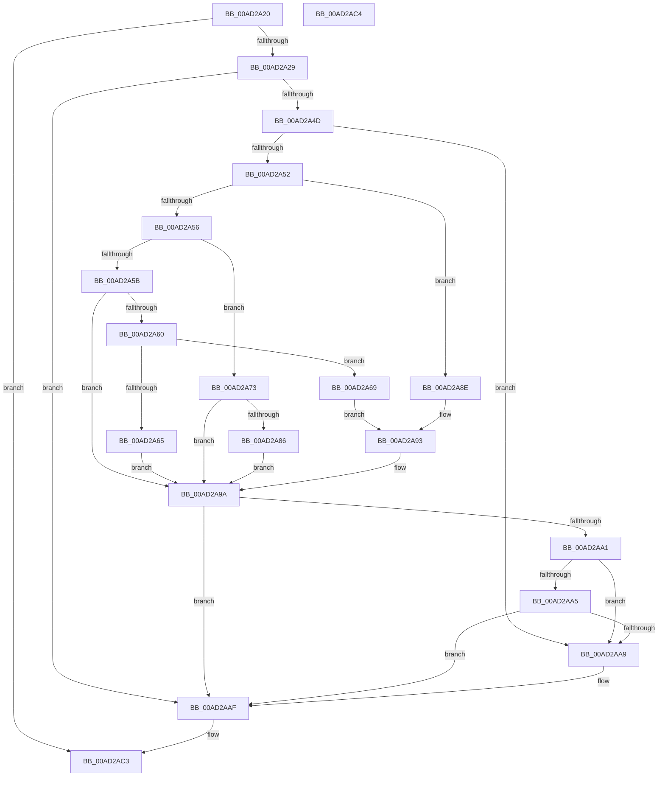

# PopAdvanceSystemPowerState

- RVA: `0x00AD2A20`–`0x00AD2AC5` (길이 `165` bytes)
- VA: `0x0000000140AD2A20`
- 실행 섹션: `PAGE`
- PDB 이름 있음: `예`; PDB Function 태그: `아니요`
- unwind 정보 RVA: `0x000BEAEC`
- 디코드: `55`개 명령, `165/165` bytes 표시
- 미해석 바이트: `0` (있으면 어셈블리에 `.byte`로 보존)

> 이 문서는 커널 이미지의 기계어와 PDB 기호를 분석해 생성했습니다. 4번과 5번은 함수 원형과 자료형을 바이너리 사용 방식에서 추정한 C 해석이며 원본 소스 복구 결과는 아닙니다.

## 1. Dependencies

- 직접 호출 지점: **2**; 고유 호출 대상: **1**
- 직접 호출자로 확인된 함수: **1**
- RIP 상대 이미지 참조: **0**

### Outgoing calls
- `0x00AD2A7D` → [PopVerifySystemPowerState](../A9/PopVerifySystemPowerState_function_00A9537C.md) (function, `0x00A9537C`)
- `0x00AD2A95` → [PopVerifySystemPowerState](../A9/PopVerifySystemPowerState_function_00A9537C.md) (function, `0x00A9537C`)

### Direct callers
- [PopTransitionSystemPowerStateEx](../../pagelk/B7/PopTransitionSystemPowerStateEx_function_00B7E8C0.md) at `0x00B7ECB1`

### Static image references
- 디코드된 RIP-relative 메모리 참조가 없습니다.

## 2. Other-region calls and transfers

- 다른 실행 섹션으로 향하는 call: **0**
- 별도 외부 분기/꼬리 이동을 확인하지 못했습니다.

## 3. Assembly (complete function range)

```asm
00AD2A20  48 85 C9                        test rcx, rcx
00AD2A23  0F 84 9A 00 00 00               je 0x140ad2ac3
00AD2A29  48 89 5C 24 08                  mov qword ptr [rsp + 8], rbx
00AD2A2E  48 89 6C 24 10                  mov qword ptr [rsp + 0x10], rbp
00AD2A33  48 89 74 24 18                  mov qword ptr [rsp + 0x18], rsi
00AD2A38  57                              push rdi
00AD2A39  48 83 EC 20                     sub rsp, 0x20
00AD2A3D  8B 39                           mov edi, dword ptr [rcx]
00AD2A3F  41 8B F1                        mov esi, r9d
00AD2A42  41 8B E8                        mov ebp, r8d
00AD2A45  48 8B D9                        mov rbx, rcx
00AD2A48  83 FF 02                        cmp edi, 2
00AD2A4B  7C 62                           jl 0x140ad2aaf
00AD2A4D  83 FF 06                        cmp edi, 6
00AD2A50  7D 57                           jge 0x140ad2aa9
00AD2A52  85 D2                           test edx, edx
00AD2A54  74 38                           je 0x140ad2a8e
00AD2A56  83 EA 01                        sub edx, 1
00AD2A59  74 18                           je 0x140ad2a73
00AD2A5B  83 FA 01                        cmp edx, 1
00AD2A5E  75 3A                           jne 0x140ad2a9a
00AD2A60  83 FF 05                        cmp edi, 5
00AD2A63  75 04                           jne 0x140ad2a69
00AD2A65  89 11                           mov dword ptr [rcx], edx
00AD2A67  EB 31                           jmp 0x140ad2a9a
00AD2A69  8D 47 01                        lea eax, [rdi + 1]
00AD2A6C  BA 02 00 00 00                  mov edx, 2
00AD2A71  EB 20                           jmp 0x140ad2a93
00AD2A73  8D 47 FF                        lea eax, [rdi - 1]
00AD2A76  BA 01 00 00 00                  mov edx, 1
00AD2A7B  89 01                           mov dword ptr [rcx], eax
00AD2A7D  E8 FA 28 FC FF                  call 0x140a9537c
00AD2A82  39 3B                           cmp dword ptr [rbx], edi
00AD2A84  75 14                           jne 0x140ad2a9a
00AD2A86  C7 03 01 00 00 00               mov dword ptr [rbx], 1
00AD2A8C  EB 0C                           jmp 0x140ad2a9a
00AD2A8E  8D 47 FF                        lea eax, [rdi - 1]
00AD2A91  33 D2                           xor edx, edx
00AD2A93  89 01                           mov dword ptr [rcx], eax
00AD2A95  E8 E2 28 FC FF                  call 0x140a9537c
00AD2A9A  8B 03                           mov eax, dword ptr [rbx]
00AD2A9C  83 F8 01                        cmp eax, 1
00AD2A9F  74 0E                           je 0x140ad2aaf
00AD2AA1  3B C5                           cmp eax, ebp
00AD2AA3  7C 04                           jl 0x140ad2aa9
00AD2AA5  3B C6                           cmp eax, esi
00AD2AA7  7E 06                           jle 0x140ad2aaf
00AD2AA9  C7 03 01 00 00 00               mov dword ptr [rbx], 1
00AD2AAF  48 8B 5C 24 30                  mov rbx, qword ptr [rsp + 0x30]
00AD2AB4  48 8B 6C 24 38                  mov rbp, qword ptr [rsp + 0x38]
00AD2AB9  48 8B 74 24 40                  mov rsi, qword ptr [rsp + 0x40]
00AD2ABE  48 83 C4 20                     add rsp, 0x20
00AD2AC2  5F                              pop rdi
00AD2AC3  C3                              ret
00AD2AC4  CC                              int3
```

## 4. C-style interpretation (structured pseudocode)

```c
__int64 __fastcall PopAdvanceSystemPowerState(__int64 a1, int a2, int a3, int a4)
{
    __int64 result;
    __int64 v_rsp;
    unsigned __int64 v_stack_p10;
    unsigned __int64 v_stack_p18;
    unsigned __int64 v_stack_p8;

    if (a1 == 0) goto loc_00AD2AC3;
    v_stack_p8 = v_rbx;
    v_stack_p10 = v_rbp;
    v_stack_p18 = v_rsi;
    v_rsp = (v_rsp) - (32);
    if (((unsigned int)((unsigned int)(*(unsigned int *)(a1)))) < 2) goto loc_00AD2AAF;
    if (((unsigned int)((unsigned int)(*(unsigned int *)(a1)))) >= 6) goto loc_00AD2AA9;
    if (a2 == 0) goto loc_00AD2A8E;
    a2 = (unsigned int)((a2) - (1));
    if (condition_is_equal) goto loc_00AD2A73;
    if (a2 != 1) goto loc_00AD2A9A;
    if (((unsigned int)((unsigned int)(*(unsigned int *)(a1)))) != 5) goto loc_00AD2A69;
    *(unsigned int *)(a1) = a2;
    goto loc_00AD2A9A;
loc_00AD2A69:
    goto loc_00AD2A93;
loc_00AD2A73:
    *(unsigned int *)(a1) = (unsigned int)((unsigned int)(*(unsigned int *)(a1)) - 1);
    result = PopVerifySystemPowerState(a1, 1, a3, a4);
    if ((*(unsigned int *)(a1)) != ((unsigned int)((unsigned int)(*(unsigned int *)(a1))))) goto loc_00AD2A9A;
    *(unsigned int *)(a1) = 1;
    goto loc_00AD2A9A;
loc_00AD2A8E:
    a2 = 0;
loc_00AD2A93:
    *(unsigned int *)(a1) = (unsigned int)((unsigned int)(*(unsigned int *)(a1)) - 1);
    result = PopVerifySystemPowerState(a1, a2, a3, a4);
loc_00AD2A9A:
    if (((unsigned int)((unsigned int)(*(unsigned int *)(a1)))) == 1) goto loc_00AD2AAF;
    if (((unsigned int)((unsigned int)(*(unsigned int *)(a1)))) < ((unsigned int)((unsigned int)(a3)))) goto loc_00AD2AA9;
    if (((unsigned int)((unsigned int)(*(unsigned int *)(a1)))) >= = ((unsigned int)((unsigned int)(a4)))) {
        *(unsigned int *)(a1) = 1;
    }
    v_rsp = (v_rsp) + (32);
loc_00AD2AC3:
    return (unsigned int)(*(unsigned int *)(a1));
}
```

## 5. (Beta) C Style

```c
int64_t PopAdvanceSystemPowerState(int64_t Arg1, int32_t Arg2, int32_t Arg3, int32_t Arg4)
{
    int64_t result;
    int64_t local_rsp;
    uint64_t v_stack_p10;
    uint64_t v_stack_p18;
    uint64_t v_stack_p8;

    if (Arg1 == 0) goto loc_00AD2AC3;
    v_stack_p8 = local_rbx;
    v_stack_p10 = local_rbp;
    v_stack_p18 = local_rsi;
    local_rsp = (local_rsp) - (32);
    if (((uint32_t)((uint32_t)(*(uint32_t *)(Arg1)))) < 2) goto loc_00AD2AAF;
    if (((uint32_t)((uint32_t)(*(uint32_t *)(Arg1)))) >= 6) goto loc_00AD2AA9;
    if (Arg2 == 0) goto loc_00AD2A8E;
    Arg2 = (uint32_t)((Arg2) - (1));
    if (condition_is_equal) goto loc_00AD2A73;
    if (Arg2 != 1) goto loc_00AD2A9A;
    if (((uint32_t)((uint32_t)(*(uint32_t *)(Arg1)))) != 5) goto loc_00AD2A69;
    *(uint32_t *)(Arg1) = Arg2;
    goto loc_00AD2A9A;
loc_00AD2A69:
    goto loc_00AD2A93;
loc_00AD2A73:
    *(uint32_t *)(Arg1) = (uint32_t)((uint32_t)(*(uint32_t *)(Arg1)) - 1);
    result = PopVerifySystemPowerState(Arg1, 1, Arg3, Arg4);
    if ((*(uint32_t *)(Arg1)) != ((uint32_t)((uint32_t)(*(uint32_t *)(Arg1))))) goto loc_00AD2A9A;
    *(uint32_t *)(Arg1) = 1;
    goto loc_00AD2A9A;
loc_00AD2A8E:
    Arg2 = 0;
loc_00AD2A93:
    *(uint32_t *)(Arg1) = (uint32_t)((uint32_t)(*(uint32_t *)(Arg1)) - 1);
    result = PopVerifySystemPowerState(Arg1, Arg2, Arg3, Arg4);
loc_00AD2A9A:
    if (((uint32_t)((uint32_t)(*(uint32_t *)(Arg1)))) == 1) goto loc_00AD2AAF;
    if (((uint32_t)((uint32_t)(*(uint32_t *)(Arg1)))) < ((uint32_t)((uint32_t)(Arg3)))) goto loc_00AD2AA9;
    if (((uint32_t)((uint32_t)(*(uint32_t *)(Arg1)))) >= = ((uint32_t)((uint32_t)(Arg4)))) {
        *(uint32_t *)(Arg1) = 1;
    }
    local_rsp = (local_rsp) + (32);
loc_00AD2AC3:
    return (uint32_t)(*(uint32_t *)(Arg1));
}
```

## 6. Execution-region graph

[열기: 2D/3D 그래프와 함수 탐색 컨트롤 패널](../../../control-panel.html?section=page&rva=0x00AD2A20&view=graph)

- 2D 그래프는 위에서 아래로 흐르고, 3D 그래프는 빈 공간을 드래그해 회전합니다. Shift+드래그는 이동, 휠은 확대·축소, 함수 노드 선택은 대상 보고서 이동입니다.

### Static fallback


