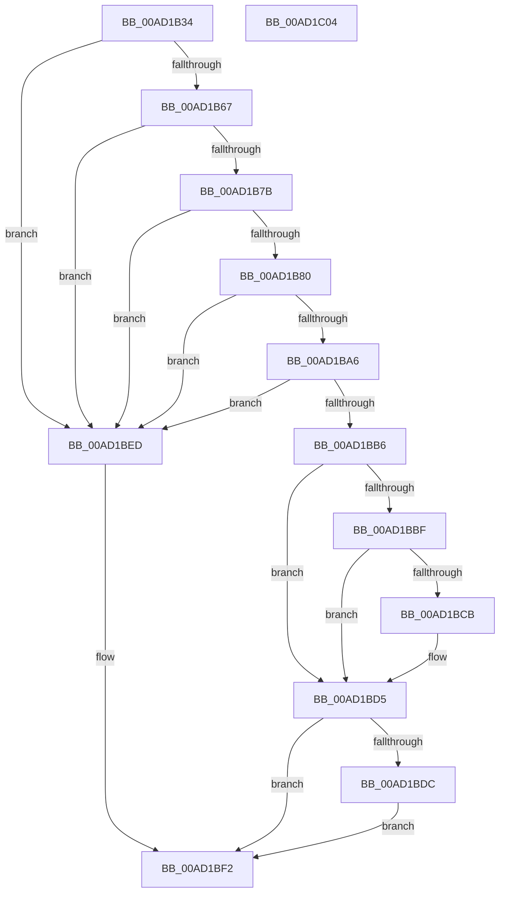

# PopApplyAdminPolicy

- RVA: `0x00AD1B34`–`0x00AD1C05` (길이 `209` bytes)
- VA: `0x0000000140AD1B34`
- 실행 섹션: `PAGE`
- PDB 이름 있음: `예`; PDB Function 태그: `아니요`
- unwind 정보 RVA: `0x0008C108`
- 디코드: `54`개 명령, `209/209` bytes 표시
- 미해석 바이트: `0` (있으면 어셈블리에 `.byte`로 보존)

> 이 문서는 커널 이미지의 기계어와 PDB 기호를 분석해 생성했습니다. 4번과 5번은 함수 원형과 자료형을 바이너리 사용 방식에서 추정한 C 해석이며 원본 소스 복구 결과는 아닙니다.

## 1. Dependencies

- 직접 호출 지점: **1**; 고유 호출 대상: **1**
- 직접 호출자로 확인된 함수: **1**
- RIP 상대 이미지 참조: **5**

### Outgoing calls
- `0x00AD1BFA` → [_security_check_cookie](../../text/6A/_security_check_cookie_function_006AC640.md) (function, `0x006AC640`)

### Direct callers
- [NtPowerInformation](../95/NtPowerInformation_function_00955D80.md) at `0x00956653`

### Static image references
- `0x00AD1B38` → RVA `0x00E0A740` (`.data`; read)
- `0x00AD1BB6` → RVA `0x00F0CD00` (`.data`; read)
- `0x00AD1BC2` → RVA `0x00F0CD08` (`.data`; read)
- `0x00AD1BCE` → RVA `0x00F0CD10` (`.data`; read)
- `0x00AD1BE3` → RVA `0x00F0CD10` (`.data`; write)

## 2. Other-region calls and transfers

- 다른 실행 섹션으로 향하는 call: **1**
  - `0x00AD1BFA` → [_security_check_cookie](../../text/6A/_security_check_cookie_function_006AC640.md) (`PAGE` → `.text`)
- 별도 외부 분기/꼬리 이동을 확인하지 못했습니다.

## 3. Assembly (complete function range)

```asm
00AD1B34  48 83 EC 28                     sub rsp, 0x28
00AD1B38  48 8B 05 01 8C 33 00            mov rax, qword ptr [rip + 0x338c01]
00AD1B3F  48 33 C4                        xor rax, rsp
00AD1B42  48 89 44 24 18                  mov qword ptr [rsp + 0x18], rax
00AD1B47  0F 10 0A                        movups xmm1, xmmword ptr [rdx]
00AD1B4A  F2 0F 10 52 10                  movsd xmm2, qword ptr [rdx + 0x10]
00AD1B4F  66 41 0F 7E C8                  movd r8d, xmm1
00AD1B54  F2 0F 11 54 24 10               movsd qword ptr [rsp + 0x10], xmm2
00AD1B5A  41 8D 40 FE                     lea eax, [r8 - 2]
00AD1B5E  83 F8 03                        cmp eax, 3
00AD1B61  0F 87 86 00 00 00               ja 0x140ad1bed
00AD1B67  66 48 0F 7E CA                  movq rdx, xmm1
00AD1B6C  48 8B CA                        mov rcx, rdx
00AD1B6F  48 C1 E9 20                     shr rcx, 0x20
00AD1B73  8D 41 FE                        lea eax, [rcx - 2]
00AD1B76  83 F8 03                        cmp eax, 3
00AD1B79  77 72                           ja 0x140ad1bed
00AD1B7B  44 3B C1                        cmp r8d, ecx
00AD1B7E  7F 6D                           jg 0x140ad1bed
00AD1B80  66 0F 6F C1                     movdqa xmm0, xmm1
00AD1B84  66 0F 73 D8 08                  psrldq xmm0, 8
00AD1B89  66 49 0F 7E C0                  movq r8, xmm0
00AD1B8E  66 0F 6F C1                     movdqa xmm0, xmm1
00AD1B92  66 0F 73 D8 08                  psrldq xmm0, 8
00AD1B97  49 8B C8                        mov rcx, r8
00AD1B9A  66 0F 7E C0                     movd eax, xmm0
00AD1B9E  48 C1 E9 20                     shr rcx, 0x20
00AD1BA2  3B C1                           cmp eax, ecx
00AD1BA4  77 47                           ja 0x140ad1bed
00AD1BA6  48 8B 4C 24 10                  mov rcx, qword ptr [rsp + 0x10]
00AD1BAB  48 8B C1                        mov rax, rcx
00AD1BAE  48 C1 E8 20                     shr rax, 0x20
00AD1BB2  3B C8                           cmp ecx, eax
00AD1BB4  77 37                           ja 0x140ad1bed
00AD1BB6  48 2B 15 43 B1 43 00            sub rdx, qword ptr [rip + 0x43b143]
00AD1BBD  75 16                           jne 0x140ad1bd5
00AD1BBF  49 8B D0                        mov rdx, r8
00AD1BC2  48 2B 15 3F B1 43 00            sub rdx, qword ptr [rip + 0x43b13f]
00AD1BC9  75 0A                           jne 0x140ad1bd5
00AD1BCB  48 8B D1                        mov rdx, rcx
00AD1BCE  48 2B 15 3B B1 43 00            sub rdx, qword ptr [rip + 0x43b13b]
00AD1BD5  33 C0                           xor eax, eax
00AD1BD7  48 85 D2                        test rdx, rdx
00AD1BDA  74 16                           je 0x140ad1bf2
00AD1BDC  0F 11 0D 1D B1 43 00            movups xmmword ptr [rip + 0x43b11d], xmm1
00AD1BE3  F2 0F 11 15 25 B1 43 00         movsd qword ptr [rip + 0x43b125], xmm2
00AD1BEB  EB 05                           jmp 0x140ad1bf2
00AD1BED  B8 0D 00 00 C0                  mov eax, 0xc000000d
00AD1BF2  48 8B 4C 24 18                  mov rcx, qword ptr [rsp + 0x18]
00AD1BF7  48 33 CC                        xor rcx, rsp
00AD1BFA  E8 41 AA BD FF                  call 0x1406ac640
00AD1BFF  48 83 C4 28                     add rsp, 0x28
00AD1C03  C3                              ret
00AD1C04  CC                              int3
```

## 4. C-style interpretation (structured pseudocode)

```c
__int64 __fastcall PopApplyAdminPolicy(__int64 a1, __int64 a2)
{
    __int64 result;
    __int64 v_rsp;
    unsigned __int64 v_stack_m10;
    unsigned __int64 v_stack_m18;

    v_rsp = (v_rsp) - (40);
    result = (*(unsigned __int64 *)(v_rip + 3378177)) ^ (v_rsp);
    v_stack_m10 = result;
    v_stack_m18 = v_xmm2;
    if (((unsigned int)(a3 - 2)) > 3) goto loc_00AD1BED;
    a1 = (a2) >> (32);
    if (((unsigned int)(a1 - 2)) > 3) goto loc_00AD1BED;
    if (((unsigned int)(a3)) > ((unsigned int)(a1))) goto loc_00AD1BED;
    a1 = (a3) >> (32);
    if (((unsigned int)(a1 - 2)) > ((unsigned int)(a1))) goto loc_00AD1BED;
    result = (v_stack_m18) >> (32);
    if (((unsigned int)(v_stack_m18)) > ((unsigned int)(result))) goto loc_00AD1BED;
    a2 = (a2) - (*(unsigned __int64 *)(v_rip + 4436291));
    if (condition_is_not_equal) goto loc_00AD1BD5;
    a2 = (a3) - (*(unsigned __int64 *)(v_rip + 4436287));
    if (!(condition_is_not_equal)) {
        a2 = v_stack_m18;
        a2 = (a2) - (*(unsigned __int64 *)(v_rip + 4436283));
    }
    result = 0;
    if (a2 == 0) goto loc_00AD1BF2;
    *(unsigned __int64 *)(v_rip + 4436253) = v_xmm1;
    *(unsigned __int64 *)(v_rip + 4436261) = v_xmm2;
    goto loc_00AD1BF2;
loc_00AD1BED:
loc_00AD1BF2:
    a1 = (v_stack_m10) ^ (v_rsp);
    result = _security_check_cookie(a1, a2, a3, a4);
    v_rsp = (v_rsp) + (40);
    return result;
}
```

## 5. (Beta) C Style

```c
int64_t PopApplyAdminPolicy(int64_t Arg1, void *Arg2)
{
    uint8_t *arg2 = (uint8_t *)Arg2;

    int64_t result;
    int64_t local_rsp;
    uint64_t v_stack_m10;
    uint64_t v_stack_m18;

    local_rsp = (local_rsp) - (40);
    result = (*(uint64_t *)(v_rip + 0x338C01)) ^ (local_rsp);
    v_stack_m10 = result;
    v_stack_m18 = v_xmm2;
    if (((uint32_t)(a3 - 2)) > 3) goto loc_00AD1BED;
    Arg1 = (Arg2) >> (32);
    if (((uint32_t)(Arg1 - 2)) > 3) goto loc_00AD1BED;
    if (((uint32_t)(a3)) > ((uint32_t)(Arg1))) goto loc_00AD1BED;
    Arg1 = (a3) >> (32);
    if (((uint32_t)(Arg1 - 2)) > ((uint32_t)(Arg1))) goto loc_00AD1BED;
    result = (v_stack_m18) >> (32);
    if (((uint32_t)(v_stack_m18)) > ((uint32_t)(result))) goto loc_00AD1BED;
    Arg2 = (Arg2) - (*(uint64_t *)(v_rip + 0x43B143));
    if (condition_is_not_equal) goto loc_00AD1BD5;
    Arg2 = (a3) - (*(uint64_t *)(v_rip + 0x43B13F));
    if (!(condition_is_not_equal)) {
        Arg2 = v_stack_m18;
        Arg2 = (Arg2) - (*(uint64_t *)(v_rip + 0x43B13B));
    }
    result = 0;
    if (Arg2 == NULL) goto loc_00AD1BF2;
    *(uint64_t *)(v_rip + 0x43B11D) = v_xmm1;
    *(uint64_t *)(v_rip + 0x43B125) = v_xmm2;
    goto loc_00AD1BF2;
loc_00AD1BED:
loc_00AD1BF2:
    Arg1 = (v_stack_m10) ^ (local_rsp);
    result = _security_check_cookie(Arg1, Arg2, a3, a4);
    local_rsp = (local_rsp) + (40);
    return result;
}
```

### 관측된 메모리 오프셋

구조체 형식이 확인되지 않은 접근은 인자 기준의 오프셋으로만 기록했습니다.

| 기준 인자 | 오프셋 표현 | 폭 (bit) | 접근 |
|---|---:|---:|---|
| `Arg2` | `+ 0x0` | `128` | `R` |
| `Arg2` | `+ 0x10` | `64` | `R` |

## 6. Execution-region graph

[열기: 2D/3D 그래프와 함수 탐색 컨트롤 패널](../../../control-panel.html?section=page&rva=0x00AD1B34&view=graph)

- 2D 그래프는 위에서 아래로 흐르고, 3D 그래프는 빈 공간을 드래그해 회전합니다. Shift+드래그는 이동, 휠은 확대·축소, 함수 노드 선택은 대상 보고서 이동입니다.

### Static fallback


