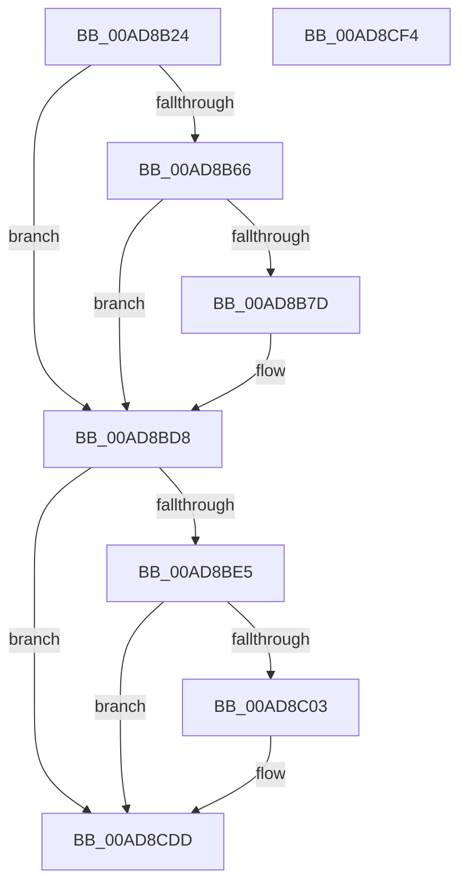

# PopBatteryTracePercentageRemaining

- RVA: `0x00AD8B24`–`0x00AD8CF5` (길이 `465` bytes)
- VA: `0x0000000140AD8B24`
- 실행 섹션: `PAGE`
- PDB 이름 있음: `예`; PDB Function 태그: `아니요`
- unwind 정보 RVA: `0x000BF17C`
- 디코드: `108`개 명령, `465/465` bytes 표시
- 미해석 바이트: `0` (있으면 어셈블리에 `.byte`로 보존)

> 이 문서는 커널 이미지의 기계어와 PDB 기호를 분석해 생성했습니다. 4번과 5번은 함수 원형과 자료형을 바이너리 사용 방식에서 추정한 C 해석이며 원본 소스 복구 결과는 아닙니다.

## 1. Dependencies

- 직접 호출 지점: **5**; 고유 호출 대상: **5**
- 직접 호출자로 확인된 함수: **1**
- RIP 상대 이미지 참조: **10**

### Outgoing calls
- `0x00AD8B74` → [EtwEventEnabled](../../text/39/EtwEventEnabled_function_00392450.md) (function, `0x00392450`)
- `0x00AD8BD3` → [EtwWrite](../../text/41/EtwWrite_function_0041C720.md) (function, `0x0041C720`)
- `0x00AD8BF6` → [tlgKeywordOn](../../text/42/tlgKeywordOn_function_0042EAA0.md) (function, `0x0042EAA0`)
- `0x00AD8CD8` → [tlgWriteTransfer_EtwWriteTransfer](../../text/42/tlgWriteTransfer_EtwWriteTransfer_function_004260E0.md) (function, `0x004260E0`)
- `0x00AD8CE4` → [_security_check_cookie](../../text/6A/_security_check_cookie_function_006AC640.md) (function, `0x006AC640`)

### Direct callers
- [PopBatteryApplyCompositeState](../AE/PopBatteryApplyCompositeState_function_00AE0CD0.md) at `0x00AE0EF2`

### Static image references
- `0x00AD8B3F` → RVA `0x00E0A740` (`.data`; read)
- `0x00AD8B57` → RVA `0x00E678A8` (`.data`; read)
- `0x00AD8B66` → RVA `0x00F09050` (`.data`; read)
- `0x00AD8B6D` → RVA `0x0002A850` (`.rdata`; read)
- `0x00AD8BD8` → RVA `0x00E07748` (`.data`; read)
- `0x00AD8C06` → RVA `0x0004D850` (`.rdata`; read)
- `0x00AD8C5F` → RVA `0x00F0C064` (`.data`; read)
- `0x00AD8C72` → RVA `0x00F0C254` (`.data`; read)
- `0x00AD8C85` → RVA `0x00F0C0A0` (`.data`; read)
- `0x00AD8C98` → RVA `0x00F0C250` (`.data`; read)

## 2. Other-region calls and transfers

- 다른 실행 섹션으로 향하는 call: **5**
  - `0x00AD8B74` → [EtwEventEnabled](../../text/39/EtwEventEnabled_function_00392450.md) (`PAGE` → `.text`)
  - `0x00AD8BD3` → [EtwWrite](../../text/41/EtwWrite_function_0041C720.md) (`PAGE` → `.text`)
  - `0x00AD8BF6` → [tlgKeywordOn](../../text/42/tlgKeywordOn_function_0042EAA0.md) (`PAGE` → `.text`)
  - `0x00AD8CD8` → [tlgWriteTransfer_EtwWriteTransfer](../../text/42/tlgWriteTransfer_EtwWriteTransfer_function_004260E0.md) (`PAGE` → `.text`)
  - `0x00AD8CE4` → [_security_check_cookie](../../text/6A/_security_check_cookie_function_006AC640.md) (`PAGE` → `.text`)
- 별도 외부 분기/꼬리 이동을 확인하지 못했습니다.

## 3. Assembly (complete function range)

```asm
00AD8B24  48 8B C4                        mov rax, rsp
00AD8B27  44 89 48 20                     mov dword ptr [rax + 0x20], r9d
00AD8B2B  89 50 10                        mov dword ptr [rax + 0x10], edx
00AD8B2E  89 48 08                        mov dword ptr [rax + 8], ecx
00AD8B31  55                              push rbp
00AD8B32  53                              push rbx
00AD8B33  57                              push rdi
00AD8B34  48 8D 68 98                     lea rbp, [rax - 0x68]
00AD8B38  48 81 EC 50 01 00 00            sub rsp, 0x150
00AD8B3F  48 8B 05 FA 1B 33 00            mov rax, qword ptr [rip + 0x331bfa]
00AD8B46  48 33 C4                        xor rax, rsp
00AD8B49  48 89 45 40                     mov qword ptr [rbp + 0x40], rax
00AD8B4D  33 DB                           xor ebx, ebx
00AD8B4F  45 85 C0                        test r8d, r8d
00AD8B52  8B C3                           mov eax, ebx
00AD8B54  0F 94 C0                        sete al
00AD8B57  38 1D 4B ED 38 00               cmp byte ptr [rip + 0x38ed4b], bl
00AD8B5D  89 44 24 30                     mov dword ptr [rsp + 0x30], eax
00AD8B61  8D 7B 04                        lea edi, [rbx + 4]
00AD8B64  74 72                           je 0x140ad8bd8
00AD8B66  48 8B 0D E3 04 43 00            mov rcx, qword ptr [rip + 0x4304e3]
00AD8B6D  48 8D 15 DC 1C 55 FF            lea rdx, [rip - 0xaae324]
00AD8B74  E8 D7 98 8B FF                  call 0x140392450
00AD8B79  84 C0                           test al, al
00AD8B7B  74 5B                           je 0x140ad8bd8
00AD8B7D  48 8B 0D CC 04 43 00            mov rcx, qword ptr [rip + 0x4304cc]
00AD8B84  48 8D 45 70                     lea rax, [rbp + 0x70]
00AD8B88  48 89 44 24 60                  mov qword ptr [rsp + 0x60], rax
00AD8B8D  48 8D 15 BC 1C 55 FF            lea rdx, [rip - 0xaae344]
00AD8B94  48 8D 45 78                     lea rax, [rbp + 0x78]
00AD8B98  48 89 7C 24 68                  mov qword ptr [rsp + 0x68], rdi
00AD8B9D  48 89 44 24 70                  mov qword ptr [rsp + 0x70], rax
00AD8BA2  44 8B CF                        mov r9d, edi
00AD8BA5  48 8D 44 24 30                  lea rax, [rsp + 0x30]
00AD8BAA  48 89 7C 24 78                  mov qword ptr [rsp + 0x78], rdi
00AD8BAF  48 89 45 80                     mov qword ptr [rbp - 0x80], rax
00AD8BB3  45 33 C0                        xor r8d, r8d
00AD8BB6  48 8D 85 88 00 00 00            lea rax, [rbp + 0x88]
00AD8BBD  48 89 7D 88                     mov qword ptr [rbp - 0x78], rdi
00AD8BC1  48 89 45 90                     mov qword ptr [rbp - 0x70], rax
00AD8BC5  48 8D 44 24 60                  lea rax, [rsp + 0x60]
00AD8BCA  48 89 44 24 20                  mov qword ptr [rsp + 0x20], rax
00AD8BCF  48 89 7D 98                     mov qword ptr [rbp - 0x68], rdi
00AD8BD3  E8 48 3B 94 FF                  call 0x14041c720
00AD8BD8  83 3D 69 EB 32 00 05            cmp dword ptr [rip + 0x32eb69], 5
00AD8BDF  0F 86 F8 00 00 00               jbe 0x140ad8cdd
00AD8BE5  48 BA 00 00 00 00 00 40 00 00   movabs rdx, 0x400000000000
00AD8BEF  48 8D 0D 52 EB 32 00            lea rcx, [rip + 0x32eb52]
00AD8BF6  E8 A5 5E 95 FF                  call 0x14042eaa0
00AD8BFB  84 C0                           test al, al
00AD8BFD  0F 84 DA 00 00 00               je 0x140ad8cdd
00AD8C03  8B 45 70                        mov eax, dword ptr [rbp + 0x70]
00AD8C06  48 8D 15 43 4C 57 FF            lea rdx, [rip - 0xa8b3bd]
00AD8C0D  89 44 24 34                     mov dword ptr [rsp + 0x34], eax
00AD8C11  48 8D 0D 30 EB 32 00            lea rcx, [rip + 0x32eb30]
00AD8C18  48 8D 44 24 34                  lea rax, [rsp + 0x34]
00AD8C1D  48 89 7D C8                     mov qword ptr [rbp - 0x38], rdi
00AD8C21  48 89 45 C0                     mov qword ptr [rbp - 0x40], rax
00AD8C25  45 33 C9                        xor r9d, r9d
00AD8C28  8B 45 78                        mov eax, dword ptr [rbp + 0x78]
00AD8C2B  45 33 C0                        xor r8d, r8d
00AD8C2E  89 44 24 38                     mov dword ptr [rsp + 0x38], eax
00AD8C32  48 8D 44 24 38                  lea rax, [rsp + 0x38]
00AD8C37  48 89 45 D0                     mov qword ptr [rbp - 0x30], rax
00AD8C3B  8B 44 24 30                     mov eax, dword ptr [rsp + 0x30]
00AD8C3F  89 44 24 3C                     mov dword ptr [rsp + 0x3c], eax
00AD8C43  48 8D 44 24 3C                  lea rax, [rsp + 0x3c]
00AD8C48  48 89 45 E0                     mov qword ptr [rbp - 0x20], rax
00AD8C4C  8B 85 88 00 00 00               mov eax, dword ptr [rbp + 0x88]
00AD8C52  89 44 24 40                     mov dword ptr [rsp + 0x40], eax
00AD8C56  48 8D 44 24 40                  lea rax, [rsp + 0x40]
00AD8C5B  48 89 45 F0                     mov qword ptr [rbp - 0x10], rax
00AD8C5F  8B 05 FF 33 43 00               mov eax, dword ptr [rip + 0x4333ff]
00AD8C65  89 44 24 44                     mov dword ptr [rsp + 0x44], eax
00AD8C69  48 8D 44 24 44                  lea rax, [rsp + 0x44]
00AD8C6E  48 89 45 00                     mov qword ptr [rbp], rax
00AD8C72  8B 05 DC 35 43 00               mov eax, dword ptr [rip + 0x4335dc]
00AD8C78  89 44 24 48                     mov dword ptr [rsp + 0x48], eax
00AD8C7C  48 8D 44 24 48                  lea rax, [rsp + 0x48]
00AD8C81  48 89 45 10                     mov qword ptr [rbp + 0x10], rax
00AD8C85  8B 05 15 34 43 00               mov eax, dword ptr [rip + 0x433415]
00AD8C8B  89 44 24 4C                     mov dword ptr [rsp + 0x4c], eax
00AD8C8F  48 8D 44 24 4C                  lea rax, [rsp + 0x4c]
00AD8C94  48 89 45 20                     mov qword ptr [rbp + 0x20], rax
00AD8C98  8B 05 B2 35 43 00               mov eax, dword ptr [rip + 0x4335b2]
00AD8C9E  89 44 24 50                     mov dword ptr [rsp + 0x50], eax
00AD8CA2  48 8D 44 24 50                  lea rax, [rsp + 0x50]
00AD8CA7  48 89 45 30                     mov qword ptr [rbp + 0x30], rax
00AD8CAB  48 8D 45 A0                     lea rax, [rbp - 0x60]
00AD8CAF  48 89 44 24 28                  mov qword ptr [rsp + 0x28], rax
00AD8CB4  C7 44 24 20 0A 00 00 00         mov dword ptr [rsp + 0x20], 0xa
00AD8CBC  48 89 7D D8                     mov qword ptr [rbp - 0x28], rdi
00AD8CC0  48 89 7D E8                     mov qword ptr [rbp - 0x18], rdi
00AD8CC4  48 89 7D F8                     mov qword ptr [rbp - 8], rdi
00AD8CC8  48 89 7D 08                     mov qword ptr [rbp + 8], rdi
00AD8CCC  48 89 7D 18                     mov qword ptr [rbp + 0x18], rdi
00AD8CD0  48 89 7D 28                     mov qword ptr [rbp + 0x28], rdi
00AD8CD4  48 89 7D 38                     mov qword ptr [rbp + 0x38], rdi
00AD8CD8  E8 03 D4 94 FF                  call 0x1404260e0
00AD8CDD  48 8B 4D 40                     mov rcx, qword ptr [rbp + 0x40]
00AD8CE1  48 33 CC                        xor rcx, rsp
00AD8CE4  E8 57 39 BD FF                  call 0x1406ac640
00AD8CE9  48 81 C4 50 01 00 00            add rsp, 0x150
00AD8CF0  5F                              pop rdi
00AD8CF1  5B                              pop rbx
00AD8CF2  5D                              pop rbp
00AD8CF3  C3                              ret
00AD8CF4  CC                              int3
```

## 4. C-style interpretation (structured pseudocode)

```c
__int64 __fastcall PopBatteryTracePercentageRemaining(int a1, int a2, int a3, int a4)
{
    __int64 result;
    __int64 v_rbx;
    __int64 v_rsp;
    unsigned __int64 v_stack_m100;
    unsigned __int64 v_stack_m108;
    unsigned int v_stack_m118;
    unsigned int v_stack_m11C;
    unsigned int v_stack_m120;
    unsigned int v_stack_m124;
    unsigned int v_stack_m128;
    unsigned int v_stack_m12C;
    unsigned int v_stack_m130;
    unsigned int v_stack_m134;
    unsigned int v_stack_m138;
    unsigned __int64 v_stack_m140;
    unsigned __int64 v_stack_m148;
    unsigned __int64 v_stack_mF0;
    unsigned __int64 v_stack_mF8;

    *(unsigned int *)(v_rsp + 32) = a4;
    *(unsigned int *)(v_rsp + 16) = a2;
    *(unsigned int *)(v_rsp + 8) = a1;
    v_rsp = (v_rsp) - (336);
    result = (*(unsigned __int64 *)(v_rip + 3349498)) ^ (v_rsp);
    *(unsigned __int64 *)(v_rsp - 104 + 64) = result;
    v_rbx = 0;
    result = (a3 == 0) ? 1 : 0;
    v_stack_m138 = (unsigned int)(result);
    if ((*(unsigned __int8 *)(v_rip + 3730763)) == 0) goto loc_00AD8BD8;
    result = EtwEventEnabled(*(unsigned __int64 *)(v_rip + 4392163), v_rip - 11199268, a3, a4);
    if ((unsigned __int8)(result) != 0) {
        a1 = *(unsigned __int64 *)(v_rip + 4392140);
        result = v_rsp - 104 + 112;
        v_stack_m108 = result;
        a2 = v_rip - 11199300;
        result = v_rsp - 104 + 120;
        v_stack_m100 = v_rbx + 4;
        v_stack_mF8 = result;
        a4 = (unsigned int)(v_rbx + 4);
        result = v_stack_m138;
        v_stack_mF0 = v_rbx + 4;
        *(unsigned __int64 *)(v_rsp - 104 - 128) = result;
        a3 = 0;
        result = v_rsp - 104 + 136;
        *(unsigned __int64 *)(v_rsp - 104 - 120) = v_rbx + 4;
        *(unsigned __int64 *)(v_rsp - 104 - 112) = result;
        result = v_stack_m108;
        v_stack_m148 = result;
        *(unsigned __int64 *)(v_rsp - 104 - 104) = v_rbx + 4;
        result = EtwWrite(a1, a2, a3, a4);
    }
    if ((*(unsigned int *)(v_rip + 3337065)) <= 5) goto loc_00AD8CDD;
    result = tlgKeywordOn(v_rip + 3337042, a2, a3, a4);
    if ((unsigned __int8)(result) != 0) {
        result = *(unsigned int *)(v_rsp - 104 + 112);
        a2 = v_rip - 11056061;
        v_stack_m134 = (unsigned int)(result);
        a1 = v_rip + 3337008;
        result = v_stack_m134;
        *(unsigned __int64 *)(v_rsp - 104 - 56) = v_rbx + 4;
        *(unsigned __int64 *)(v_rsp - 104 - 64) = result;
        a4 = 0;
        result = *(unsigned int *)(v_rsp - 104 + 120);
        a3 = 0;
        v_stack_m130 = (unsigned int)(result);
        result = v_stack_m130;
        *(unsigned __int64 *)(v_rsp - 104 - 48) = result;
        result = v_stack_m138;
        v_stack_m12C = (unsigned int)(result);
        result = v_stack_m12C;
        *(unsigned __int64 *)(v_rsp - 104 - 32) = result;
        result = *(unsigned int *)(v_rsp - 104 + 136);
        v_stack_m128 = (unsigned int)(result);
        result = v_stack_m128;
        *(unsigned __int64 *)(v_rsp - 104 - 16) = result;
        result = *(unsigned int *)(v_rip + 4404223);
        v_stack_m124 = (unsigned int)(result);
        result = v_stack_m124;
        *(unsigned __int64 *)(v_rsp - 104) = result;
        result = *(unsigned int *)(v_rip + 4404700);
        v_stack_m120 = (unsigned int)(result);
        result = v_stack_m120;
        *(unsigned __int64 *)(v_rsp - 104 + 16) = result;
        result = *(unsigned int *)(v_rip + 4404245);
        v_stack_m11C = (unsigned int)(result);
        result = v_stack_m11C;
        *(unsigned __int64 *)(v_rsp - 104 + 32) = result;
        result = *(unsigned int *)(v_rip + 4404658);
        v_stack_m118 = (unsigned int)(result);
        result = v_stack_m118;
        *(unsigned __int64 *)(v_rsp - 104 + 48) = result;
        result = v_rsp - 104 - 96;
        v_stack_m140 = result;
        v_stack_m148 = 10;
        *(unsigned __int64 *)(v_rsp - 104 - 40) = v_rbx + 4;
        *(unsigned __int64 *)(v_rsp - 104 - 24) = v_rbx + 4;
        *(unsigned __int64 *)(v_rsp - 104 - 8) = v_rbx + 4;
        *(unsigned __int64 *)(v_rsp - 104 + 8) = v_rbx + 4;
        *(unsigned __int64 *)(v_rsp - 104 + 24) = v_rbx + 4;
        *(unsigned __int64 *)(v_rsp - 104 + 40) = v_rbx + 4;
        *(unsigned __int64 *)(v_rsp - 104 + 56) = v_rbx + 4;
        result = tlgWriteTransfer_EtwWriteTransfer(a1, a2, a3, a4);
    }
    a1 = (*(unsigned __int64 *)(v_rsp - 104 + 64)) ^ (v_rsp);
    result = _security_check_cookie(a1, a2, a3, a4);
    v_rsp = (v_rsp) + (336);
    return result;
}
```

## 5. (Beta) C Style

```c
int64_t PopBatteryTracePercentageRemaining(int32_t Arg1, int32_t Arg2, int32_t Arg3, int32_t Arg4)
{
    int64_t result;
    int64_t local_rbx;
    int64_t local_rsp;
    uint64_t v_stack_m100;
    uint64_t v_stack_m108;
    uint32_t v_stack_m118;
    uint32_t v_stack_m11C;
    uint32_t v_stack_m120;
    uint32_t v_stack_m124;
    uint32_t v_stack_m128;
    uint32_t v_stack_m12C;
    uint32_t v_stack_m130;
    uint32_t v_stack_m134;
    uint32_t v_stack_m138;
    uint64_t v_stack_m140;
    uint64_t v_stack_m148;
    uint64_t v_stack_mF0;
    uint64_t v_stack_mF8;

    *(uint32_t *)(local_rsp + 0x20) = Arg4;
    *(uint32_t *)(local_rsp + 0x10) = Arg2;
    *(uint32_t *)(local_rsp + 0x8) = Arg1;
    local_rsp = (local_rsp) - (336);
    result = (*(uint64_t *)(v_rip + 0x331BFA)) ^ (local_rsp);
    *(uint64_t *)(local_rsp - 0x68 + 0x40) = result;
    local_rbx = 0;
    result = (Arg3 == 0) ? 1 : 0;
    v_stack_m138 = (uint32_t)(result);
    if ((*(uint8_t *)(v_rip + 0x38ED4B)) == 0) goto loc_00AD8BD8;
    result = EtwEventEnabled(*(uint64_t *)(v_rip + 0x4304E3), v_rip - 11199268, Arg3, Arg4);
    if ((uint8_t)(result) != 0) {
        Arg1 = *(uint64_t *)(v_rip + 0x4304CC);
        result = local_rsp - 104 + 112;
        v_stack_m108 = result;
        Arg2 = v_rip - 11199300;
        result = local_rsp - 104 + 120;
        v_stack_m100 = local_rbx + 4;
        v_stack_mF8 = result;
        Arg4 = (uint32_t)(local_rbx + 4);
        result = v_stack_m138;
        v_stack_mF0 = local_rbx + 4;
        *(uint64_t *)(local_rsp - 0x68 - 0x80) = result;
        Arg3 = 0;
        result = local_rsp - 104 + 136;
        *(uint64_t *)(local_rsp - 0x68 - 0x78) = local_rbx + 4;
        *(uint64_t *)(local_rsp - 0x68 - 0x70) = result;
        result = v_stack_m108;
        v_stack_m148 = result;
        *(uint64_t *)(local_rsp - 0x68 - 0x68) = local_rbx + 4;
        result = EtwWrite(Arg1, Arg2, Arg3, Arg4);
    }
    if ((*(uint32_t *)(v_rip + 0x32EB69)) <= 5) goto loc_00AD8CDD;
    result = tlgKeywordOn(v_rip + 3337042, Arg2, Arg3, Arg4);
    if ((uint8_t)(result) != 0) {
        result = *(uint32_t *)(local_rsp - 0x68 + 0x70);
        Arg2 = v_rip - 11056061;
        v_stack_m134 = (uint32_t)(result);
        Arg1 = v_rip + 3337008;
        result = v_stack_m134;
        *(uint64_t *)(local_rsp - 0x68 - 0x38) = local_rbx + 4;
        *(uint64_t *)(local_rsp - 0x68 - 0x40) = result;
        Arg4 = 0;
        result = *(uint32_t *)(local_rsp - 0x68 + 0x78);
        Arg3 = 0;
        v_stack_m130 = (uint32_t)(result);
        result = v_stack_m130;
        *(uint64_t *)(local_rsp - 0x68 - 0x30) = result;
        result = v_stack_m138;
        v_stack_m12C = (uint32_t)(result);
        result = v_stack_m12C;
        *(uint64_t *)(local_rsp - 0x68 - 0x20) = result;
        result = *(uint32_t *)(local_rsp - 0x68 + 0x88);
        v_stack_m128 = (uint32_t)(result);
        result = v_stack_m128;
        *(uint64_t *)(local_rsp - 0x68 - 0x10) = result;
        result = *(uint32_t *)(v_rip + 0x4333FF);
        v_stack_m124 = (uint32_t)(result);
        result = v_stack_m124;
        *(uint64_t *)(local_rsp - 0x68) = result;
        result = *(uint32_t *)(v_rip + 0x4335DC);
        v_stack_m120 = (uint32_t)(result);
        result = v_stack_m120;
        *(uint64_t *)(local_rsp - 0x68 + 0x10) = result;
        result = *(uint32_t *)(v_rip + 0x433415);
        v_stack_m11C = (uint32_t)(result);
        result = v_stack_m11C;
        *(uint64_t *)(local_rsp - 0x68 + 0x20) = result;
        result = *(uint32_t *)(v_rip + 0x4335B2);
        v_stack_m118 = (uint32_t)(result);
        result = v_stack_m118;
        *(uint64_t *)(local_rsp - 0x68 + 0x30) = result;
        result = local_rsp - 104 - 96;
        v_stack_m140 = result;
        v_stack_m148 = 10;
        *(uint64_t *)(local_rsp - 0x68 - 0x28) = local_rbx + 4;
        *(uint64_t *)(local_rsp - 0x68 - 0x18) = local_rbx + 4;
        *(uint64_t *)(local_rsp - 0x68 - 0x8) = local_rbx + 4;
        *(uint64_t *)(local_rsp - 0x68 + 0x8) = local_rbx + 4;
        *(uint64_t *)(local_rsp - 0x68 + 0x18) = local_rbx + 4;
        *(uint64_t *)(local_rsp - 0x68 + 0x28) = local_rbx + 4;
        *(uint64_t *)(local_rsp - 0x68 + 0x38) = local_rbx + 4;
        result = tlgWriteTransfer_EtwWriteTransfer(Arg1, Arg2, Arg3, Arg4);
    }
    Arg1 = (*(uint64_t *)(local_rsp - 0x68 + 0x40)) ^ (local_rsp);
    result = _security_check_cookie(Arg1, Arg2, Arg3, Arg4);
    local_rsp = (local_rsp) + (336);
    return result;
}
```

## 6. Execution-region graph

[열기: 2D/3D 그래프와 함수 탐색 컨트롤 패널](../../../control-panel.html?section=page&rva=0x00AD8B24&view=graph)

- 2D 그래프는 위에서 아래로 흐르고, 3D 그래프는 빈 공간을 드래그해 회전합니다. Shift+드래그는 이동, 휠은 확대·축소, 함수 노드 선택은 대상 보고서 이동입니다.

### Static fallback


