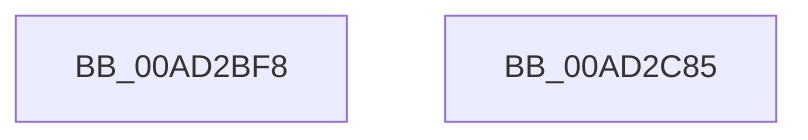

# PopBatteryWaitTag

- RVA: `0x00AD2BF8`–`0x00AD2C86` (길이 `142` bytes)
- VA: `0x0000000140AD2BF8`
- 실행 섹션: `PAGE`
- PDB 이름 있음: `예`; PDB Function 태그: `아니요`
- unwind 정보 RVA: `0x00060BC4`
- 디코드: `34`개 명령, `142/142` bytes 표시
- 미해석 바이트: `0` (있으면 어셈블리에 `.byte`로 보존)

> 이 문서는 커널 이미지의 기계어와 PDB 기호를 분석해 생성했습니다. 4번과 5번은 함수 원형과 자료형을 바이너리 사용 방식에서 추정한 C 해석이며 원본 소스 복구 결과는 아닙니다.

## 1. Dependencies

- 직접 호출 지점: **2**; 고유 호출 대상: **2**
- 직접 호출자로 확인된 함수: **3**
- RIP 상대 이미지 참조: **1**

### Outgoing calls
- `0x00AD2C24` → [IoReuseIrp](../../text/24/IoReuseIrp_function_0024DD70.md) (function, `0x0024DD70`)
- `0x00AD2C70` → [IofCallDriver](../../text/29/IofCallDriver_function_0029B4B0.md) (function, `0x0029B4B0`)

### Direct callers
- [PopBatteryAdd](../76/PopBatteryAdd_function_00766580.md) at `0x00766639`
- [PopBatteryUpdateTestExempt](../76/PopBatteryUpdateTestExempt_function_00766F54.md) at `0x00767196`
- [PopBatteryWorker](../AE/PopBatteryWorker_function_00AE1650.md) at `0x00AE191D`
- [PopBatteryWorker](../AE/PopBatteryWorker_function_00AE1650.md) at `0x00AE1976`

### Static image references
- `0x00AD2C55` → RVA `0x004AE360` (`PopBatteryIrpComplete`; read)

## 2. Other-region calls and transfers

- 다른 실행 섹션으로 향하는 call: **2**
  - `0x00AD2C24` → [IoReuseIrp](../../text/24/IoReuseIrp_function_0024DD70.md) (`PAGE` → `.text`)
  - `0x00AD2C70` → [IofCallDriver](../../text/29/IofCallDriver_function_0029B4B0.md) (`PAGE` → `.text`)
- 별도 외부 분기/꼬리 이동을 확인하지 못했습니다.

## 3. Assembly (complete function range)

```asm
00AD2BF8  48 89 5C 24 08                  mov qword ptr [rsp + 8], rbx
00AD2BFD  48 89 74 24 10                  mov qword ptr [rsp + 0x10], rsi
00AD2C02  57                              push rdi
00AD2C03  48 83 EC 20                     sub rsp, 0x20
00AD2C07  48 8B 59 38                     mov rbx, qword ptr [rcx + 0x38]
00AD2C0B  48 8D B9 D4 00 00 00            lea rdi, [rcx + 0xd4]
00AD2C12  83 61 68 00                     and dword ptr [rcx + 0x68], 0
00AD2C16  48 8B F1                        mov rsi, rcx
00AD2C19  83 0F FF                        or dword ptr [rdi], 0xffffffff
00AD2C1C  48 8B CB                        mov rcx, rbx
00AD2C1F  BA BB 00 00 C0                  mov edx, 0xc00000bb
00AD2C24  E8 47 B1 77 FF                  call 0x14024dd70
00AD2C29  48 8B 83 B8 00 00 00            mov rax, qword ptr [rbx + 0xb8]
00AD2C30  B9 04 00 00 00                  mov ecx, 4
00AD2C35  C6 40 B8 0E                     mov byte ptr [rax - 0x48], 0xe
00AD2C39  C7 40 D0 40 40 29 00            mov dword ptr [rax - 0x30], 0x294040
00AD2C40  89 48 C8                        mov dword ptr [rax - 0x38], ecx
00AD2C43  89 48 C0                        mov dword ptr [rax - 0x40], ecx
00AD2C46  48 89 7B 18                     mov qword ptr [rbx + 0x18], rdi
00AD2C4A  48 8B 46 38                     mov rax, qword ptr [rsi + 0x38]
00AD2C4E  48 8B 88 B8 00 00 00            mov rcx, qword ptr [rax + 0xb8]
00AD2C55  48 8D 05 04 B7 9D FF            lea rax, [rip - 0x6248fc]
00AD2C5C  48 89 41 F0                     mov qword ptr [rcx - 0x10], rax
00AD2C60  48 89 71 F8                     mov qword ptr [rcx - 8], rsi
00AD2C64  C6 41 BB E0                     mov byte ptr [rcx - 0x45], 0xe0
00AD2C68  48 8B 56 38                     mov rdx, qword ptr [rsi + 0x38]
00AD2C6C  48 8B 4E 30                     mov rcx, qword ptr [rsi + 0x30]
00AD2C70  E8 3B 88 7C FF                  call 0x14029b4b0
00AD2C75  48 8B 5C 24 30                  mov rbx, qword ptr [rsp + 0x30]
00AD2C7A  48 8B 74 24 38                  mov rsi, qword ptr [rsp + 0x38]
00AD2C7F  48 83 C4 20                     add rsp, 0x20
00AD2C83  5F                              pop rdi
00AD2C84  C3                              ret
00AD2C85  CC                              int3
```

## 4. C-style interpretation (structured pseudocode)

```c
__int64 __fastcall PopBatteryWaitTag(__int64 a1)
{
    __int64 result;
    __int64 v_rsp;
    unsigned __int64 v_stack_p10;
    unsigned __int64 v_stack_p8;

    v_stack_p8 = v_rbx;
    v_stack_p10 = v_rsi;
    v_rsp = (v_rsp) - (32);
    result = IoReuseIrp(*(unsigned __int64 *)(a1 + 56), (unsigned int)(0xC00000BBULL), a3, a4);
    *(unsigned __int8 *)(*(unsigned __int64 *)(*(unsigned __int64 *)(a1 + 56) + 184) - 72) = 14;
    *(unsigned int *)(*(unsigned __int64 *)(*(unsigned __int64 *)(a1 + 56) + 184) - 48) = 0x294040ULL;
    *(unsigned int *)(*(unsigned __int64 *)(*(unsigned __int64 *)(a1 + 56) + 184) - 56) = 4;
    *(unsigned int *)(*(unsigned __int64 *)(*(unsigned __int64 *)(a1 + 56) + 184) - 64) = 4;
    *(unsigned __int64 *)(*(unsigned __int64 *)(a1 + 56) + 24) = a1 + 212;
    *(unsigned __int64 *)(*(unsigned __int64 *)(*(unsigned __int64 *)(a1 + 56) + 184) - 16) = v_rip - 6441212;
    *(unsigned __int64 *)(*(unsigned __int64 *)(*(unsigned __int64 *)(a1 + 56) + 184) - 8) = a1;
    *(unsigned __int8 *)(*(unsigned __int64 *)(*(unsigned __int64 *)(a1 + 56) + 184) - 69) = 224;
    result = IofCallDriver(*(unsigned __int64 *)(a1 + 48), *(unsigned __int64 *)(a1 + 56), a3, a4);
    v_rsp = (v_rsp) + (32);
    return result;
}
```

## 5. (Beta) C Style

```c
int64_t PopBatteryWaitTag(void *Arg1)
{
    uint8_t *arg1 = (uint8_t *)Arg1;

    int64_t result;
    int64_t local_rsp;
    uint64_t v_stack_p10;
    uint64_t v_stack_p8;

    v_stack_p8 = local_rbx;
    v_stack_p10 = local_rsi;
    local_rsp = (local_rsp) - (32);
    result = IoReuseIrp(*(uint64_t *)(arg1 + 0x38), (uint32_t)(0xC00000BBULL), a3, a4);
    *(uint8_t *)(*(uint64_t *)(*(uint64_t *)(arg1 + 0x38) + 0xB8) - 0x48) = 14;
    *(uint32_t *)(*(uint64_t *)(*(uint64_t *)(arg1 + 0x38) + 0xB8) - 0x30) = 0x294040ULL;
    *(uint32_t *)(*(uint64_t *)(*(uint64_t *)(arg1 + 0x38) + 0xB8) - 0x38) = 4;
    *(uint32_t *)(*(uint64_t *)(*(uint64_t *)(arg1 + 0x38) + 0xB8) - 0x40) = 4;
    *(void **)(*(uint64_t *)(arg1 + 0x38) + 0x18) = Arg1 + 212;
    *(uint64_t *)(*(uint64_t *)(*(uint64_t *)(arg1 + 0x38) + 0xB8) - 0x10) = v_rip - 6441212;
    *(void **)(*(uint64_t *)(*(uint64_t *)(arg1 + 0x38) + 0xB8) - 0x8) = Arg1;
    *(uint8_t *)(*(uint64_t *)(*(uint64_t *)(arg1 + 0x38) + 0xB8) - 0x45) = 224;
    result = IofCallDriver(*(uint64_t *)(arg1 + 0x30), *(uint64_t *)(arg1 + 0x38), a3, a4);
    local_rsp = (local_rsp) + (32);
    return result;
}
```

### 관측된 메모리 오프셋

구조체 형식이 확인되지 않은 접근은 인자 기준의 오프셋으로만 기록했습니다.

| 기준 인자 | 오프셋 표현 | 폭 (bit) | 접근 |
|---|---:|---:|---|
| `Arg1` | `+ 0x0` | `32` | `R/W` |
| `Arg1` | `+ 0x30` | `64` | `R` |
| `Arg1` | `+ 0x38` | `64` | `R` |
| `Arg1` | `+ 0x68` | `32` | `R/W` |
| `Arg1` | `+ 0xD4` | `64` | `R` |

## 6. Execution-region graph

[열기: 2D/3D 그래프와 함수 탐색 컨트롤 패널](../../../control-panel.html?section=page&rva=0x00AD2BF8&view=graph)

- 2D 그래프는 위에서 아래로 흐르고, 3D 그래프는 빈 공간을 드래그해 회전합니다. Shift+드래그는 이동, 휠은 확대·축소, 함수 노드 선택은 대상 보고서 이동입니다.

### Static fallback


