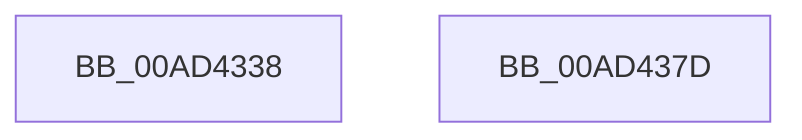

# PopCancelIgnoreBatteryStatusChange

- RVA: `0x00AD4338`–`0x00AD437E` (길이 `70` bytes)
- VA: `0x0000000140AD4338`
- 실행 섹션: `PAGE`
- PDB 이름 있음: `예`; PDB Function 태그: `아니요`
- unwind 정보 RVA: `0x0005D2F4`
- 디코드: `15`개 명령, `70/70` bytes 표시
- 미해석 바이트: `0` (있으면 어셈블리에 `.byte`로 보존)

> 이 문서는 커널 이미지의 기계어와 PDB 기호를 분석해 생성했습니다. 4번과 5번은 함수 원형과 자료형을 바이너리 사용 방식에서 추정한 C 해석이며 원본 소스 복구 결과는 아닙니다.

## 1. Dependencies

- 직접 호출 지점: **2**; 고유 호출 대상: **2**
- 직접 호출자로 확인된 함수: **2**
- RIP 상대 이미지 참조: **4**

### Outgoing calls
- `0x00AD4343` → [KeResetEvent](../../text/24/KeResetEvent_function_00248350.md) (function, `0x00248350`)
- `0x00AD4373` → [KiSetTimerEx](../../text/23/KiSetTimerEx_function_00232CB0.md) (function, `0x00232CB0`)

### Direct callers
- [CmCompleteRegistryInitialization](../7D/CmCompleteRegistryInitialization_function_007DF1EC.md) at `0x007DF373`
- [PopTransitionSystemPowerStateEx](../../pagelk/B7/PopTransitionSystemPowerStateEx_function_00B7E8C0.md) at `0x00B7F866`

### Static image references
- `0x00AD433C` → RVA `0x00F0C148` (`.data`; read)
- `0x00AD434D` → RVA `0x00F0C0C8` (`.data`; read)
- `0x00AD4354` → RVA `0x00F0C0C0` (`.data`; read/write)
- `0x00AD435A` → RVA `0x00F0C108` (`.data`; read)

## 2. Other-region calls and transfers

- 다른 실행 섹션으로 향하는 call: **2**
  - `0x00AD4343` → [KeResetEvent](../../text/24/KeResetEvent_function_00248350.md) (`PAGE` → `.text`)
  - `0x00AD4373` → [KiSetTimerEx](../../text/23/KiSetTimerEx_function_00232CB0.md) (`PAGE` → `.text`)
- 별도 외부 분기/꼬리 이동을 확인하지 못했습니다.

## 3. Assembly (complete function range)

```asm
00AD4338  48 83 EC 38                     sub rsp, 0x38
00AD433C  48 8D 0D 05 7E 43 00            lea rcx, [rip + 0x437e05]
00AD4343  E8 08 40 77 FF                  call 0x140248350
00AD4348  B8 01 00 00 00                  mov eax, 1
00AD434D  48 8D 0D 74 7D 43 00            lea rcx, [rip + 0x437d74]
00AD4354  87 05 66 7D 43 00               xchg dword ptr [rip + 0x437d66], eax
00AD435A  48 8D 05 A7 7D 43 00            lea rax, [rip + 0x437da7]
00AD4361  45 33 C9                        xor r9d, r9d
00AD4364  45 33 C0                        xor r8d, r8d
00AD4367  48 89 44 24 20                  mov qword ptr [rsp + 0x20], rax
00AD436C  48 C7 C2 00 5D 1E EE            mov rdx, 0xffffffffee1e5d00
00AD4373  E8 38 E9 75 FF                  call 0x140232cb0
00AD4378  48 83 C4 38                     add rsp, 0x38
00AD437C  C3                              ret
00AD437D  CC                              int3
```

## 4. C-style interpretation (structured pseudocode)

```c
__int64 __fastcall PopCancelIgnoreBatteryStatusChange(__int64 a1, __int64 a2, int a3, int a4)
{
    __int64 result;
    __int64 v_rsp;
    unsigned __int64 v_stack_m18;

    v_rsp = (v_rsp) - (56);
    result = KeResetEvent(v_rip + 4423173, a2, a3, a4);
    a4 = 0;
    a3 = 0;
    v_stack_m18 = v_rip + 4423079;
    result = KiSetTimerEx(v_rip + 4423028, 0xFFFFFFFFEE1E5D00ULL, a3, a4);
    v_rsp = (v_rsp) + (56);
    return result;
}
```

## 5. (Beta) C Style

```c
int64_t PopCancelIgnoreBatteryStatusChange(int64_t Arg1, int64_t Arg2, int32_t Arg3, int32_t Arg4)
{
    int64_t result;
    int64_t local_rsp;
    uint64_t v_stack_m18;

    local_rsp = (local_rsp) - (56);
    result = KeResetEvent(v_rip + 4423173, Arg2, Arg3, Arg4);
    Arg4 = 0;
    Arg3 = 0;
    v_stack_m18 = v_rip + 4423079;
    result = KiSetTimerEx(v_rip + 4423028, 0xFFFFFFFFEE1E5D00ULL, Arg3, Arg4);
    local_rsp = (local_rsp) + (56);
    return result;
}
```

## 6. Execution-region graph

[열기: 2D/3D 그래프와 함수 탐색 컨트롤 패널](../../../control-panel.html?section=page&rva=0x00AD4338&view=graph)

- 2D 그래프는 위에서 아래로 흐르고, 3D 그래프는 빈 공간을 드래그해 회전합니다. Shift+드래그는 이동, 휠은 확대·축소, 함수 노드 선택은 대상 보고서 이동입니다.

### Static fallback


