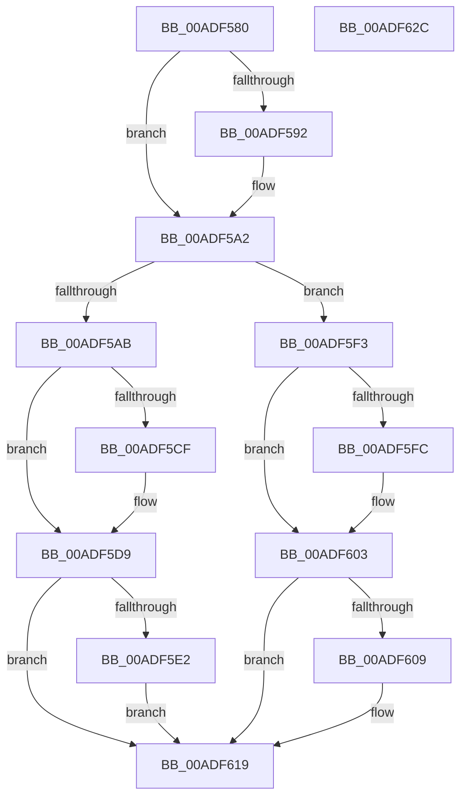

# PopCleanCoolingExtension

- RVA: `0x00ADF580`–`0x00ADF62D` (길이 `173` bytes)
- VA: `0x0000000140ADF580`
- 실행 섹션: `PAGE`
- PDB 이름 있음: `예`; PDB Function 태그: `아니요`
- unwind 정보 RVA: `0x0005CF00`
- 디코드: `46`개 명령, `173/173` bytes 표시
- 미해석 바이트: `0` (있으면 어셈블리에 `.byte`로 보존)

> 이 문서는 커널 이미지의 기계어와 PDB 기호를 분석해 생성했습니다. 4번과 5번은 함수 원형과 자료형을 바이너리 사용 방식에서 추정한 C 해석이며 원본 소스 복구 결과는 아닙니다.

## 1. Dependencies

- 직접 호출 지점: **11**; 고유 호출 대상: **8**
- 직접 호출자로 확인된 함수: **2**
- RIP 상대 이미지 참조: **0**

### Outgoing calls
- `0x00ADF589` → [Feature_Servicing_CoolingFrameworkDeviceCleanupFix__private_IsEnabledDeviceUsageNoInline](../../text/5D/Feature_Servicing_CoolingFrameworkDeviceCleanupFix__private_IsEnabledDeviceUsageNoInline_function_005D1004.md) (function, `0x005D1004`)
- `0x00ADF595` → [PopUnregisterCoolingNotification](../75/PopUnregisterCoolingNotification_function_00757854.md) (function, `0x00757854`)
- `0x00ADF59D` → [PopDisableCoolingExtension](../75/PopDisableCoolingExtension_function_00757208.md) (function, `0x00757208`)
- `0x00ADF5A2` → [Feature_Servicing_CoolingFrameworkDeviceCleanupFix__private_IsEnabledDeviceUsageNoInline](../../text/5D/Feature_Servicing_CoolingFrameworkDeviceCleanupFix__private_IsEnabledDeviceUsageNoInline_function_005D1004.md) (function, `0x005D1004`)
- `0x00ADF5B2` → [RtlFreeAnsiString](../9C/RtlFreeAnsiString_function_009C0800.md) (function, `0x009C0800`)
- `0x00ADF5BE` → [RtlFreeAnsiString](../9C/RtlFreeAnsiString_function_009C0800.md) (function, `0x009C0800`)
- `0x00ADF5D4` → [ExFreePoolWithTag](../../poolcode/B8/ExFreePoolWithTag_function_00B82870.md) (function, `0x00B82870`)
- `0x00ADF5E7` → [ObfDereferenceObjectWithTag](../../text/2F/ObfDereferenceObjectWithTag_function_002F78E0.md) (function, `0x002F78E0`)
- `0x00ADF5FE` → [PnpUnregisterPlugPlayNotification](../../text/47/PnpUnregisterPlugPlayNotification_function_0047AFAC.md) (function, `0x0047AFAC`)
- `0x00ADF614` → [guard_dispatch_icall](../../text/6B/guard_dispatch_icall_function_006BAAD0.md) (function, `0x006BAAD0`)
- `0x00ADF621` → [ExFreePoolWithTag](../../poolcode/B8/ExFreePoolWithTag_function_00B82870.md) (function, `0x00B82870`)

### Direct callers
- [PopAssociateThermalRequest](../75/PopAssociateThermalRequest_function_00756E78.md) at `0x007570D6`
- [PopDeactiveThermalRequest](PopDeactiveThermalRequest_function_00ADF634.md) at `0x00ADF7FA`

### Static image references
- 디코드된 RIP-relative 메모리 참조가 없습니다.

## 2. Other-region calls and transfers

- 다른 실행 섹션으로 향하는 call: **7**
  - `0x00ADF589` → [Feature_Servicing_CoolingFrameworkDeviceCleanupFix__private_IsEnabledDeviceUsageNoInline](../../text/5D/Feature_Servicing_CoolingFrameworkDeviceCleanupFix__private_IsEnabledDeviceUsageNoInline_function_005D1004.md) (`PAGE` → `.text`)
  - `0x00ADF5A2` → [Feature_Servicing_CoolingFrameworkDeviceCleanupFix__private_IsEnabledDeviceUsageNoInline](../../text/5D/Feature_Servicing_CoolingFrameworkDeviceCleanupFix__private_IsEnabledDeviceUsageNoInline_function_005D1004.md) (`PAGE` → `.text`)
  - `0x00ADF5D4` → [ExFreePoolWithTag](../../poolcode/B8/ExFreePoolWithTag_function_00B82870.md) (`PAGE` → `POOLCODE`)
  - `0x00ADF5E7` → [ObfDereferenceObjectWithTag](../../text/2F/ObfDereferenceObjectWithTag_function_002F78E0.md) (`PAGE` → `.text`)
  - `0x00ADF5FE` → [PnpUnregisterPlugPlayNotification](../../text/47/PnpUnregisterPlugPlayNotification_function_0047AFAC.md) (`PAGE` → `.text`)
  - `0x00ADF614` → [guard_dispatch_icall](../../text/6B/guard_dispatch_icall_function_006BAAD0.md) (`PAGE` → `.text`)
  - `0x00ADF621` → [ExFreePoolWithTag](../../poolcode/B8/ExFreePoolWithTag_function_00B82870.md) (`PAGE` → `POOLCODE`)
- 별도 외부 분기/꼬리 이동을 확인하지 못했습니다.

## 3. Assembly (complete function range)

```asm
00ADF580  40 53                           push rbx
00ADF582  48 83 EC 20                     sub rsp, 0x20
00ADF586  48 8B D9                        mov rbx, rcx
00ADF589  E8 76 1A AF FF                  call 0x1405d1004
00ADF58E  85 C0                           test eax, eax
00ADF590  74 10                           je 0x140adf5a2
00ADF592  48 8B CB                        mov rcx, rbx
00ADF595  E8 BA 82 C7 FF                  call 0x140757854
00ADF59A  48 8B CB                        mov rcx, rbx
00ADF59D  E8 66 7C C7 FF                  call 0x140757208
00ADF5A2  E8 5D 1A AF FF                  call 0x1405d1004
00ADF5A7  85 C0                           test eax, eax
00ADF5A9  74 48                           je 0x140adf5f3
00ADF5AB  48 8D 8B A0 00 00 00            lea rcx, [rbx + 0xa0]
00ADF5B2  E8 49 12 EE FF                  call 0x1409c0800
00ADF5B7  48 8D 8B B0 00 00 00            lea rcx, [rbx + 0xb0]
00ADF5BE  E8 3D 12 EE FF                  call 0x1409c0800
00ADF5C3  48 8B 8B C8 00 00 00            mov rcx, qword ptr [rbx + 0xc8]
00ADF5CA  48 85 C9                        test rcx, rcx
00ADF5CD  74 0A                           je 0x140adf5d9
00ADF5CF  BA 50 43 6F 6C                  mov edx, 0x6c6f4350
00ADF5D4  E8 97 32 0A 00                  call 0x140b82870
00ADF5D9  48 8B 4B 40                     mov rcx, qword ptr [rbx + 0x40]
00ADF5DD  48 85 C9                        test rcx, rcx
00ADF5E0  74 37                           je 0x140adf619
00ADF5E2  BA 50 6F 44 67                  mov edx, 0x67446f50
00ADF5E7  E8 F4 82 81 FF                  call 0x1402f78e0
00ADF5EC  48 83 63 40 00                  and qword ptr [rbx + 0x40], 0
00ADF5F1  EB 26                           jmp 0x140adf619
00ADF5F3  48 8B 4B 48                     mov rcx, qword ptr [rbx + 0x48]
00ADF5F7  48 85 C9                        test rcx, rcx
00ADF5FA  74 07                           je 0x140adf603
00ADF5FC  B2 01                           mov dl, 1
00ADF5FE  E8 A9 B9 99 FF                  call 0x14047afac
00ADF603  80 7B 50 00                     cmp byte ptr [rbx + 0x50], 0
00ADF607  74 10                           je 0x140adf619
00ADF609  48 8B 83 80 00 00 00            mov rax, qword ptr [rbx + 0x80]
00ADF610  48 8B 4B 70                     mov rcx, qword ptr [rbx + 0x70]
00ADF614  E8 B7 B4 BD FF                  call 0x1406baad0
00ADF619  BA 50 43 6F 6C                  mov edx, 0x6c6f4350
00ADF61E  48 8B CB                        mov rcx, rbx
00ADF621  E8 4A 32 0A 00                  call 0x140b82870
00ADF626  48 83 C4 20                     add rsp, 0x20
00ADF62A  5B                              pop rbx
00ADF62B  C3                              ret
00ADF62C  CC                              int3
```

## 4. C-style interpretation (structured pseudocode)

```c
__int64 __fastcall PopCleanCoolingExtension(__int64 a1)
{
    __int64 result;
    __int64 v_rsp;

    v_rsp = (v_rsp) - (32);
    result = Feature_Servicing_CoolingFrameworkDeviceCleanupFix__private_IsEnabledDeviceUsageNoInline(a1, a2, a3, a4);
    if ((unsigned int)(result) != 0) {
        a1 = a1;
        result = PopUnregisterCoolingNotification(a1, a2, a3, a4);
        a1 = a1;
        result = PopDisableCoolingExtension(a1, a2, a3, a4);
    }
    result = Feature_Servicing_CoolingFrameworkDeviceCleanupFix__private_IsEnabledDeviceUsageNoInline(a1, a2, a3, a4);
    if ((unsigned int)(result) == 0) goto loc_00ADF5F3;
    result = RtlFreeAnsiString(a1 + 160, a2, a3, a4);
    result = RtlFreeAnsiString(a1 + 176, a2, a3, a4);
    if (*(unsigned __int64 *)(a1 + 200) != 0) {
        a2 = 0x6C6F4350ULL;
        result = ExFreePoolWithTag(*(unsigned __int64 *)(a1 + 200), a2, a3, a4);
    }
    if (*(unsigned __int64 *)(a1 + 64) == 0) goto loc_00ADF619;
    result = ObfDereferenceObjectWithTag(*(unsigned __int64 *)(a1 + 64), (unsigned int)(0x67446F50ULL), a3, a4);
    goto loc_00ADF619;
loc_00ADF5F3:
    if (*(unsigned __int64 *)(a1 + 72) != 0) {
        a2 = 1;
        result = PnpUnregisterPlugPlayNotification(*(unsigned __int64 *)(a1 + 72), a2, a3, a4);
    }
    if ((*(unsigned __int8 *)(a1 + 80)) != 0) {
        result = *(unsigned __int64 *)(a1 + 128);
        a1 = *(unsigned __int64 *)(a1 + 112);
        result = guard_dispatch_icall(a1, a2, a3, a4);
    }
    result = ExFreePoolWithTag(a1, (unsigned int)(0x6C6F4350ULL), a3, a4);
    v_rsp = (v_rsp) + (32);
    return result;
}
```

## 5. (Beta) C Style

```c
int64_t PopCleanCoolingExtension(void *Arg1)
{
    uint8_t *arg1 = (uint8_t *)Arg1;

    int64_t result;
    int64_t local_rsp;

    local_rsp = (local_rsp) - (32);
    result = Feature_Servicing_CoolingFrameworkDeviceCleanupFix__private_IsEnabledDeviceUsageNoInline(Arg1, a2, a3, a4);
    if ((uint32_t)(result) != 0) {
        Arg1 = Arg1;
        result = PopUnregisterCoolingNotification(Arg1, a2, a3, a4);
        Arg1 = Arg1;
        result = PopDisableCoolingExtension(Arg1, a2, a3, a4);
    }
    result = Feature_Servicing_CoolingFrameworkDeviceCleanupFix__private_IsEnabledDeviceUsageNoInline(Arg1, a2, a3, a4);
    if ((uint32_t)(result) == 0) goto loc_00ADF5F3;
    result = RtlFreeAnsiString(Arg1 + 160, a2, a3, a4);
    result = RtlFreeAnsiString(Arg1 + 176, a2, a3, a4);
    if (*(uint64_t *)(arg1 + 0xC8) != 0) {
        a2 = 0x6C6F4350ULL;
        result = ExFreePoolWithTag(*(uint64_t *)(arg1 + 0xC8), a2, a3, a4);
    }
    if (*(uint64_t *)(arg1 + 0x40) == 0) goto loc_00ADF619;
    result = ObfDereferenceObjectWithTag(*(uint64_t *)(arg1 + 0x40), (uint32_t)(0x67446F50ULL), a3, a4);
    goto loc_00ADF619;
loc_00ADF5F3:
    if (*(uint64_t *)(arg1 + 0x48) != 0) {
        a2 = 1;
        result = PnpUnregisterPlugPlayNotification(*(uint64_t *)(arg1 + 0x48), a2, a3, a4);
    }
    if ((*(uint8_t *)(arg1 + 0x50)) != 0) {
        result = *(uint64_t *)(arg1 + 0x80);
        Arg1 = *(uint64_t *)(arg1 + 0x70);
        result = guard_dispatch_icall(Arg1, a2, a3, a4);
    }
    result = ExFreePoolWithTag(Arg1, (uint32_t)(0x6C6F4350ULL), a3, a4);
    local_rsp = (local_rsp) + (32);
    return result;
}
```

### 관측된 메모리 오프셋

구조체 형식이 확인되지 않은 접근은 인자 기준의 오프셋으로만 기록했습니다.

| 기준 인자 | 오프셋 표현 | 폭 (bit) | 접근 |
|---|---:|---:|---|
| `Arg1` | `+ 0x40` | `64` | `R` |
| `Arg1` | `+ 0x40` | `64` | `R/W` |
| `Arg1` | `+ 0x48` | `64` | `R` |
| `Arg1` | `+ 0x50` | `8` | `R` |
| `Arg1` | `+ 0x70` | `64` | `R` |
| `Arg1` | `+ 0x80` | `64` | `R` |
| `Arg1` | `+ 0xA0` | `64` | `R` |
| `Arg1` | `+ 0xB0` | `64` | `R` |
| `Arg1` | `+ 0xC8` | `64` | `R` |

## 6. Execution-region graph

[열기: 2D/3D 그래프와 함수 탐색 컨트롤 패널](../../../control-panel.html?section=page&rva=0x00ADF580&view=graph)

- 2D 그래프는 위에서 아래로 흐르고, 3D 그래프는 빈 공간을 드래그해 회전합니다. Shift+드래그는 이동, 휠은 확대·축소, 함수 노드 선택은 대상 보고서 이동입니다.

### Static fallback


