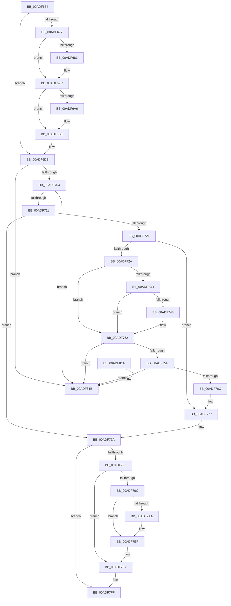

# PopDeactiveThermalRequest

- RVA: `0x00ADF634`–`0x00ADF822` (길이 `494` bytes)
- VA: `0x0000000140ADF634`
- 실행 섹션: `PAGE`
- PDB 이름 있음: `예`; PDB Function 태그: `아니요`
- unwind 정보 RVA: `0x000CC028`
- 디코드: `127`개 명령, `494/494` bytes 표시
- 미해석 바이트: `0` (있으면 어셈블리에 `.byte`로 보존)

> 이 문서는 커널 이미지의 기계어와 PDB 기호를 분석해 생성했습니다. 4번과 5번은 함수 원형과 자료형을 바이너리 사용 방식에서 추정한 C 해석이며 원본 소스 복구 결과는 아닙니다.

## 1. Dependencies

- 직접 호출 지점: **24**; 고유 호출 대상: **15**
- 직접 호출자로 확인된 함수: **1**
- RIP 상대 이미지 참조: **3**

### Outgoing calls
- `0x00ADF66C` → [PopAcquireRwLockExclusive](../../text/43/PopAcquireRwLockExclusive_function_00430B44.md) (function, `0x00430B44`)
- `0x00ADF688` → [PopThermalUpdatePassiveTimeTracking](../AA/PopThermalUpdatePassiveTimeTracking_function_00AA15EC.md) (function, `0x00AA15EC`)
- `0x00ADF690` → [PopTraceThermalRequestPassiveHistogram](../../text/42/PopTraceThermalRequestPassiveHistogram_function_0042FFB4.md) (function, `0x0042FFB4`)
- `0x00ADF697` → [PopThermalUpdateTelemetryClientCount](../../text/5D/PopThermalUpdateTelemetryClientCount_function_005D58C4.md) (function, `0x005D58C4`)
- `0x00ADF6B1` → [PopThermalUpdateActiveTimeTracking](../AB/PopThermalUpdateActiveTimeTracking_function_00ABA79C.md) (function, `0x00ABA79C`)
- `0x00ADF6B9` → [PopTraceThermalRequestActiveActivity](../../text/4E/PopTraceThermalRequestActiveActivity_function_004E9104.md) (function, `0x004E9104`)
- `0x00ADF6C8` → [PopDiagTraceThermalRequest](PopDiagTraceThermalRequest_function_00ADF828.md) (function, `0x00ADF828`)
- `0x00ADF6D6` → [PopPropogateCoolingChange](../../text/4E/PopPropogateCoolingChange_function_004E8FA0.md) (function, `0x004E8FA0`)
- `0x00ADF6DE` → [PopReleaseRwLock](../../text/2D/PopReleaseRwLock_function_002DFBBC.md) (function, `0x002DFBBC`)
- `0x00ADF6EA` → [PopAcquireRwLockExclusive](../../text/43/PopAcquireRwLockExclusive_function_00430B44.md) (function, `0x00430B44`)
- `0x00ADF6F2` → [PopAcquireRwLockExclusive](../../text/43/PopAcquireRwLockExclusive_function_00430B44.md) (function, `0x00430B44`)
- `0x00ADF72A` → [PopGetDope](../../text/4C/PopGetDope_function_004CB77C.md) (function, `0x004CB77C`)
- `0x00ADF734` → [Feature_Servicing_CoolingFrameworkDeviceCleanupFix__private_IsEnabledDeviceUsageNoInline](../../text/5D/Feature_Servicing_CoolingFrameworkDeviceCleanupFix__private_IsEnabledDeviceUsageNoInline_function_005D1004.md) (function, `0x005D1004`)
- `0x00ADF74D` → [PopDiagTraceCoolingExtension](../A3/PopDiagTraceCoolingExtension_function_00A39C28.md) (function, `0x00A39C28`)
- `0x00ADF77D` → [PopReleaseRwLock](../../text/2D/PopReleaseRwLock_function_002DFBBC.md) (function, `0x002DFBBC`)
- `0x00ADF789` → [PopReleaseRwLock](../../text/2D/PopReleaseRwLock_function_002DFBBC.md) (function, `0x002DFBBC`)
- `0x00ADF793` → [Feature_Servicing_CoolingFrameworkDeviceCleanupFix__private_IsEnabledDeviceUsageNoInline](../../text/5D/Feature_Servicing_CoolingFrameworkDeviceCleanupFix__private_IsEnabledDeviceUsageNoInline_function_005D1004.md) (function, `0x005D1004`)
- `0x00ADF79F` → [PopAcquireRwLockExclusive](../../text/43/PopAcquireRwLockExclusive_function_00430B44.md) (function, `0x00430B44`)
- `0x00ADF7B4` → [KeInitializeEvent](../../text/40/KeInitializeEvent_function_0040DD10.md) (function, `0x0040DD10`)
- `0x00ADF7C5` → [PopReleaseRwLock](../../text/2D/PopReleaseRwLock_function_002DFBBC.md) (function, `0x002DFBBC`)
- `0x00ADF7DD` → [KeWaitForSingleObject](../../text/20/KeWaitForSingleObject_function_0020E6B0.md) (function, `0x0020E6B0`)
- `0x00ADF7E5` → [PopAcquireRwLockExclusive](../../text/43/PopAcquireRwLockExclusive_function_00430B44.md) (function, `0x00430B44`)
- `0x00ADF7F2` → [PopReleaseRwLock](../../text/2D/PopReleaseRwLock_function_002DFBBC.md) (function, `0x002DFBBC`)
- `0x00ADF7FA` → [PopCleanCoolingExtension](PopCleanCoolingExtension_function_00ADF580.md) (function, `0x00ADF580`)

### Direct callers
- [PoDeleteThermalRequest](../75/PoDeleteThermalRequest_function_00756D00.md) at `0x00756D09`

### Static image references
- `0x00ADF6BE` → RVA `0x00022050` (`.rdata`; read)
- `0x00ADF6E3` → RVA `0x00F0BB30` (`.data`; read)
- `0x00ADF743` → RVA `0x000211E8` (`.rdata`; read)

## 2. Other-region calls and transfers

- 다른 실행 섹션으로 향하는 call: **19**
  - `0x00ADF66C` → [PopAcquireRwLockExclusive](../../text/43/PopAcquireRwLockExclusive_function_00430B44.md) (`PAGE` → `.text`)
  - `0x00ADF690` → [PopTraceThermalRequestPassiveHistogram](../../text/42/PopTraceThermalRequestPassiveHistogram_function_0042FFB4.md) (`PAGE` → `.text`)
  - `0x00ADF697` → [PopThermalUpdateTelemetryClientCount](../../text/5D/PopThermalUpdateTelemetryClientCount_function_005D58C4.md) (`PAGE` → `.text`)
  - `0x00ADF6B9` → [PopTraceThermalRequestActiveActivity](../../text/4E/PopTraceThermalRequestActiveActivity_function_004E9104.md) (`PAGE` → `.text`)
  - `0x00ADF6D6` → [PopPropogateCoolingChange](../../text/4E/PopPropogateCoolingChange_function_004E8FA0.md) (`PAGE` → `.text`)
  - `0x00ADF6DE` → [PopReleaseRwLock](../../text/2D/PopReleaseRwLock_function_002DFBBC.md) (`PAGE` → `.text`)
  - `0x00ADF6EA` → [PopAcquireRwLockExclusive](../../text/43/PopAcquireRwLockExclusive_function_00430B44.md) (`PAGE` → `.text`)
  - `0x00ADF6F2` → [PopAcquireRwLockExclusive](../../text/43/PopAcquireRwLockExclusive_function_00430B44.md) (`PAGE` → `.text`)
  - `0x00ADF72A` → [PopGetDope](../../text/4C/PopGetDope_function_004CB77C.md) (`PAGE` → `.text`)
  - `0x00ADF734` → [Feature_Servicing_CoolingFrameworkDeviceCleanupFix__private_IsEnabledDeviceUsageNoInline](../../text/5D/Feature_Servicing_CoolingFrameworkDeviceCleanupFix__private_IsEnabledDeviceUsageNoInline_function_005D1004.md) (`PAGE` → `.text`)
  - `0x00ADF77D` → [PopReleaseRwLock](../../text/2D/PopReleaseRwLock_function_002DFBBC.md) (`PAGE` → `.text`)
  - `0x00ADF789` → [PopReleaseRwLock](../../text/2D/PopReleaseRwLock_function_002DFBBC.md) (`PAGE` → `.text`)
  - `0x00ADF793` → [Feature_Servicing_CoolingFrameworkDeviceCleanupFix__private_IsEnabledDeviceUsageNoInline](../../text/5D/Feature_Servicing_CoolingFrameworkDeviceCleanupFix__private_IsEnabledDeviceUsageNoInline_function_005D1004.md) (`PAGE` → `.text`)
  - `0x00ADF79F` → [PopAcquireRwLockExclusive](../../text/43/PopAcquireRwLockExclusive_function_00430B44.md) (`PAGE` → `.text`)
  - `0x00ADF7B4` → [KeInitializeEvent](../../text/40/KeInitializeEvent_function_0040DD10.md) (`PAGE` → `.text`)
  - `0x00ADF7C5` → [PopReleaseRwLock](../../text/2D/PopReleaseRwLock_function_002DFBBC.md) (`PAGE` → `.text`)
  - `0x00ADF7DD` → [KeWaitForSingleObject](../../text/20/KeWaitForSingleObject_function_0020E6B0.md) (`PAGE` → `.text`)
  - `0x00ADF7E5` → [PopAcquireRwLockExclusive](../../text/43/PopAcquireRwLockExclusive_function_00430B44.md) (`PAGE` → `.text`)
  - `0x00ADF7F2` → [PopReleaseRwLock](../../text/2D/PopReleaseRwLock_function_002DFBBC.md) (`PAGE` → `.text`)
- 별도 외부 분기/꼬리 이동을 확인하지 못했습니다.

## 3. Assembly (complete function range)

```asm
00ADF634  4C 8B DC                        mov r11, rsp
00ADF637  49 89 5B 08                     mov qword ptr [r11 + 8], rbx
00ADF63B  49 89 6B 10                     mov qword ptr [r11 + 0x10], rbp
00ADF63F  49 89 73 18                     mov qword ptr [r11 + 0x18], rsi
00ADF643  49 89 7B 20                     mov qword ptr [r11 + 0x20], rdi
00ADF647  41 56                           push r14
00ADF649  48 83 EC 50                     sub rsp, 0x50
00ADF64D  48 8B 59 20                     mov rbx, qword ptr [rcx + 0x20]
00ADF651  0F 57 C0                        xorps xmm0, xmm0
00ADF654  48 8B F9                        mov rdi, rcx
00ADF657  33 C0                           xor eax, eax
00ADF659  0F 11 44 24 30                  movups xmmword ptr [rsp + 0x30], xmm0
00ADF65E  49 89 43 E8                     mov qword ptr [r11 - 0x18], rax
00ADF662  45 32 F6                        xor r14b, r14b
00ADF665  48 8D 73 20                     lea rsi, [rbx + 0x20]
00ADF669  48 8B CE                        mov rcx, rsi
00ADF66C  E8 D3 14 95 FF                  call 0x140430b44
00ADF671  44 38 77 12                     cmp byte ptr [rdi + 0x12], r14b
00ADF675  74 64                           je 0x140adf6db
00ADF677  48 83 BB 98 00 00 00 00         cmp qword ptr [rbx + 0x98], 0
00ADF67F  74 1B                           je 0x140adf69c
00ADF681  8A 57 10                        mov dl, byte ptr [rdi + 0x10]
00ADF684  48 8D 4F 28                     lea rcx, [rdi + 0x28]
00ADF688  E8 5F 1F FC FF                  call 0x140aa15ec
00ADF68D  48 8B CF                        mov rcx, rdi
00ADF690  E8 1F 09 95 FF                  call 0x14042ffb4
00ADF695  33 C9                           xor ecx, ecx
00ADF697  E8 28 62 AF FF                  call 0x1405d58c4
00ADF69C  48 83 BB 90 00 00 00 00         cmp qword ptr [rbx + 0x90], 0
00ADF6A4  74 18                           je 0x140adf6be
00ADF6A6  44 38 77 11                     cmp byte ptr [rdi + 0x11], r14b
00ADF6AA  48 8D 4F 28                     lea rcx, [rdi + 0x28]
00ADF6AE  0F 94 C2                        sete dl
00ADF6B1  E8 E6 B0 FD FF                  call 0x140aba79c
00ADF6B6  48 8B CF                        mov rcx, rdi
00ADF6B9  E8 46 9A A0 FF                  call 0x1404e9104
00ADF6BE  48 8D 15 8B 29 54 FF            lea rdx, [rip - 0xabd675]
00ADF6C5  48 8B CF                        mov rcx, rdi
00ADF6C8  E8 5B 01 00 00                  call 0x140adf828
00ADF6CD  33 D2                           xor edx, edx
00ADF6CF  44 88 77 12                     mov byte ptr [rdi + 0x12], r14b
00ADF6D3  48 8B CB                        mov rcx, rbx
00ADF6D6  E8 C5 98 A0 FF                  call 0x1404e8fa0
00ADF6DB  48 8B CE                        mov rcx, rsi
00ADF6DE  E8 D9 04 80 FF                  call 0x1402dfbbc
00ADF6E3  48 8D 0D 46 C4 42 00            lea rcx, [rip + 0x42c446]
00ADF6EA  E8 55 14 95 FF                  call 0x140430b44
00ADF6EF  48 8B CE                        mov rcx, rsi
00ADF6F2  E8 4D 14 95 FF                  call 0x140430b44
00ADF6F7  48 8B 0F                        mov rcx, qword ptr [rdi]
00ADF6FA  48 39 79 08                     cmp qword ptr [rcx + 8], rdi
00ADF6FE  0F 85 17 01 00 00               jne 0x140adf81b
00ADF704  48 8B 47 08                     mov rax, qword ptr [rdi + 8]
00ADF708  48 39 38                        cmp qword ptr [rax], rdi
00ADF70B  0F 85 0A 01 00 00               jne 0x140adf81b
00ADF711  48 89 08                        mov qword ptr [rax], rcx
00ADF714  48 89 41 08                     mov qword ptr [rcx + 8], rax
00ADF718  48 8D 43 10                     lea rax, [rbx + 0x10]
00ADF71C  48 39 00                        cmp qword ptr [rax], rax
00ADF71F  75 59                           jne 0x140adf77a
00ADF721  48 8B 4B 40                     mov rcx, qword ptr [rbx + 0x40]
00ADF725  48 85 C9                        test rcx, rcx
00ADF728  74 4D                           je 0x140adf777
00ADF72A  E8 4D C0 9E FF                  call 0x1404cb77c
00ADF72F  48 83 60 40 00                  and qword ptr [rax + 0x40], 0
00ADF734  E8 CB 18 AF FF                  call 0x1405d1004
00ADF739  85 C0                           test eax, eax
00ADF73B  75 15                           jne 0x140adf752
00ADF73D  44 38 73 50                     cmp byte ptr [rbx + 0x50], r14b
00ADF741  74 0F                           je 0x140adf752
00ADF743  48 8D 15 9E 1A 54 FF            lea rdx, [rip - 0xabe562]
00ADF74A  48 8B CB                        mov rcx, rbx
00ADF74D  E8 D6 A4 F5 FF                  call 0x140a39c28
00ADF752  48 8B 13                        mov rdx, qword ptr [rbx]
00ADF755  48 39 5A 08                     cmp qword ptr [rdx + 8], rbx
00ADF759  0F 85 BC 00 00 00               jne 0x140adf81b
00ADF75F  48 8B 43 08                     mov rax, qword ptr [rbx + 8]
00ADF763  48 39 18                        cmp qword ptr [rax], rbx
00ADF766  0F 85 AF 00 00 00               jne 0x140adf81b
00ADF76C  48 89 10                        mov qword ptr [rax], rdx
00ADF76F  48 89 42 08                     mov qword ptr [rdx + 8], rax
00ADF773  48 83 23 00                     and qword ptr [rbx], 0
00ADF777  41 B6 01                        mov r14b, 1
00ADF77A  48 8B CE                        mov rcx, rsi
00ADF77D  E8 3A 04 80 FF                  call 0x1402dfbbc
00ADF782  48 8D 0D A7 C3 42 00            lea rcx, [rip + 0x42c3a7]
00ADF789  E8 2E 04 80 FF                  call 0x1402dfbbc
00ADF78E  45 84 F6                        test r14b, r14b
00ADF791  74 6C                           je 0x140adf7ff
00ADF793  E8 6C 18 AF FF                  call 0x1405d1004
00ADF798  85 C0                           test eax, eax
00ADF79A  75 5B                           jne 0x140adf7f7
00ADF79C  48 8B CE                        mov rcx, rsi
00ADF79F  E8 A0 13 95 FF                  call 0x140430b44
00ADF7A4  80 7B 53 00                     cmp byte ptr [rbx + 0x53], 0
00ADF7A8  74 45                           je 0x140adf7ef
00ADF7AA  45 33 C0                        xor r8d, r8d
00ADF7AD  48 8D 4C 24 30                  lea rcx, [rsp + 0x30]
00ADF7B2  33 D2                           xor edx, edx
00ADF7B4  E8 57 E5 92 FF                  call 0x14040dd10
00ADF7B9  48 8D 44 24 30                  lea rax, [rsp + 0x30]
00ADF7BE  48 8B CE                        mov rcx, rsi
00ADF7C1  48 89 43 58                     mov qword ptr [rbx + 0x58], rax
00ADF7C5  E8 F2 03 80 FF                  call 0x1402dfbbc
00ADF7CA  48 83 64 24 20 00               and qword ptr [rsp + 0x20], 0
00ADF7D0  48 8D 4C 24 30                  lea rcx, [rsp + 0x30]
00ADF7D5  45 33 C9                        xor r9d, r9d
00ADF7D8  45 33 C0                        xor r8d, r8d
00ADF7DB  33 D2                           xor edx, edx
00ADF7DD  E8 CE EE 72 FF                  call 0x14020e6b0
00ADF7E2  48 8B CE                        mov rcx, rsi
00ADF7E5  E8 5A 13 95 FF                  call 0x140430b44
00ADF7EA  48 83 63 58 00                  and qword ptr [rbx + 0x58], 0
00ADF7EF  48 8B CE                        mov rcx, rsi
00ADF7F2  E8 C5 03 80 FF                  call 0x1402dfbbc
00ADF7F7  48 8B CB                        mov rcx, rbx
00ADF7FA  E8 81 FD FF FF                  call 0x140adf580
00ADF7FF  48 8B 5C 24 60                  mov rbx, qword ptr [rsp + 0x60]
00ADF804  48 8B 6C 24 68                  mov rbp, qword ptr [rsp + 0x68]
00ADF809  48 8B 74 24 70                  mov rsi, qword ptr [rsp + 0x70]
00ADF80E  48 8B 7C 24 78                  mov rdi, qword ptr [rsp + 0x78]
00ADF813  48 83 C4 50                     add rsp, 0x50
00ADF817  41 5E                           pop r14
00ADF819  C3                              ret
00ADF81A  CC                              int3
00ADF81B  B9 03 00 00 00                  mov ecx, 3
00ADF820  CD 29                           int 0x29
```

## 4. C-style interpretation (structured pseudocode)

```c
__int64 __fastcall PopDeactiveThermalRequest(__int64 a1, __int64 a2, int a3, int a4)
{
    __int64 result;
    __int64 v_r14;
    __int64 v_rsp;
    unsigned __int64 v_stack_m28;
    unsigned __int64 v_stack_m38;
    unsigned __int64 v_stack_p10;
    unsigned __int64 v_stack_p18;
    unsigned __int64 v_stack_p20;
    unsigned __int64 v_stack_p8;

    *(unsigned __int64 *)(v_rsp + 8) = v_rbx;
    *(unsigned __int64 *)(v_rsp + 16) = v_rbp;
    *(unsigned __int64 *)(v_rsp + 24) = v_rsi;
    *(unsigned __int64 *)(v_rsp + 32) = v_rdi;
    v_rsp = (v_rsp) - (80);
    result = 0;
    v_stack_m28 = v_xmm0;
    *(unsigned __int64 *)(v_rsp - 24) = 0;
    v_r14 = 0;
    result = PopAcquireRwLockExclusive(*(unsigned __int64 *)(a1 + 32) + 32, a2, a3, a4);
    if ((*(unsigned __int8 *)(a1 + 18)) == 0) goto loc_00ADF6DB;
    if ((*(unsigned __int64 *)(*(unsigned __int64 *)(a1 + 32) + 152)) != 0) {
        a2 = *(unsigned __int8 *)(a1 + 16);
        a1 = a1 + 40;
        result = PopThermalUpdatePassiveTimeTracking(a1, a2, a3, a4);
        a1 = a1;
        result = PopTraceThermalRequestPassiveHistogram(a1, a2, a3, a4);
        a1 = 0;
        result = PopThermalUpdateTelemetryClientCount(a1, a2, a3, a4);
    }
    if ((*(unsigned __int64 *)(*(unsigned __int64 *)(a1 + 32) + 144)) != 0) {
        a1 = a1 + 40;
        a2 = ((*(unsigned __int8 *)(a1 + 17)) == 0) ? 1 : 0;
        result = PopThermalUpdateActiveTimeTracking(a1, a2, a3, a4);
        a1 = a1;
        result = PopTraceThermalRequestActiveActivity(a1, a2, a3, a4);
    }
    result = PopDiagTraceThermalRequest(a1, v_rip - 11261557, a3, a4);
    a2 = 0;
    *(unsigned __int8 *)(a1 + 18) = 0;
    result = PopPropogateCoolingChange(*(unsigned __int64 *)(a1 + 32), a2, a3, a4);
loc_00ADF6DB:
    result = PopReleaseRwLock(*(unsigned __int64 *)(a1 + 32) + 32, a2, a3, a4);
    result = PopAcquireRwLockExclusive(v_rip + 4375622, a2, a3, a4);
    result = PopAcquireRwLockExclusive(*(unsigned __int64 *)(a1 + 32) + 32, a2, a3, a4);
    if ((*(unsigned __int64 *)(*(unsigned __int64 *)(a1) + 8)) != a1) goto loc_00ADF81B;
    if ((*(unsigned __int64 *)(*(unsigned __int64 *)(a1 + 8))) != a1) goto loc_00ADF81B;
    *(unsigned __int64 *)(*(unsigned __int64 *)(a1 + 8)) = *(unsigned __int64 *)(a1);
    *(unsigned __int64 *)(*(unsigned __int64 *)(a1) + 8) = *(unsigned __int64 *)(a1 + 8);
    if ((*(unsigned __int64 *)(*(unsigned __int64 *)(a1 + 32) + 16)) != (*(unsigned __int64 *)(a1 + 32) + 16)) goto loc_00ADF77A;
    if (*(unsigned __int64 *)(*(unsigned __int64 *)(a1 + 32) + 64) == 0) goto loc_00ADF777;
    result = PopGetDope(*(unsigned __int64 *)(*(unsigned __int64 *)(a1 + 32) + 64), a2, a3, a4);
    result = Feature_Servicing_CoolingFrameworkDeviceCleanupFix__private_IsEnabledDeviceUsageNoInline(*(unsigned __int64 *)(*(unsigned __int64 *)(a1 + 32) + 64), a2, a3, a4);
    if ((unsigned int)(result) != 0) goto loc_00ADF752;
    if ((*(unsigned __int8 *)(*(unsigned __int64 *)(a1 + 32) + 80)) != 0) {
        a2 = v_rip - 11265378;
        a1 = *(unsigned __int64 *)(a1 + 32);
        result = PopDiagTraceCoolingExtension(a1, a2, a3, a4);
    }
    if ((*(unsigned __int64 *)(*(unsigned __int64 *)(*(unsigned __int64 *)(a1 + 32)) + 8)) != (*(unsigned __int64 *)(a1 + 32))) goto loc_00ADF81B;
    if ((*(unsigned __int64 *)(*(unsigned __int64 *)(*(unsigned __int64 *)(a1 + 32) + 8))) != (*(unsigned __int64 *)(a1 + 32))) goto loc_00ADF81B;
    *(unsigned __int64 *)(*(unsigned __int64 *)(*(unsigned __int64 *)(a1 + 32) + 8)) = *(unsigned __int64 *)(*(unsigned __int64 *)(a1 + 32));
    *(unsigned __int64 *)(*(unsigned __int64 *)(*(unsigned __int64 *)(a1 + 32)) + 8) = *(unsigned __int64 *)(*(unsigned __int64 *)(a1 + 32) + 8);
loc_00ADF777:
loc_00ADF77A:
    result = PopReleaseRwLock(*(unsigned __int64 *)(a1 + 32) + 32, *(unsigned __int64 *)(*(unsigned __int64 *)(a1 + 32)), a3, a4);
    result = PopReleaseRwLock(v_rip + 4375463, *(unsigned __int64 *)(*(unsigned __int64 *)(a1 + 32)), a3, a4);
    if (1 == 0) goto loc_00ADF7FF;
    result = Feature_Servicing_CoolingFrameworkDeviceCleanupFix__private_IsEnabledDeviceUsageNoInline(v_rip + 4375463, *(unsigned __int64 *)(*(unsigned __int64 *)(a1 + 32)), a3, a4);
    if ((unsigned int)(result) != 0) goto loc_00ADF7F7;
    result = PopAcquireRwLockExclusive(*(unsigned __int64 *)(a1 + 32) + 32, *(unsigned __int64 *)(*(unsigned __int64 *)(a1 + 32)), a3, a4);
    if ((*(unsigned __int8 *)(*(unsigned __int64 *)(a1 + 32) + 83)) != 0) {
        a3 = 0;
        a1 = v_stack_m28;
        a2 = 0;
        result = KeInitializeEvent(a1, a2, a3, a4);
        result = v_stack_m28;
        a1 = *(unsigned __int64 *)(a1 + 32) + 32;
        *(unsigned __int64 *)(*(unsigned __int64 *)(a1 + 32) + 88) = result;
        result = PopReleaseRwLock(a1, a2, a3, a4);
        a1 = v_stack_m28;
        a4 = 0;
        a3 = 0;
        a2 = 0;
        result = KeWaitForSingleObject(a1, a2, a3, a4);
        a1 = *(unsigned __int64 *)(a1 + 32) + 32;
        result = PopAcquireRwLockExclusive(a1, a2, a3, a4);
    }
    result = PopReleaseRwLock(*(unsigned __int64 *)(a1 + 32) + 32, a2, a3, a4);
loc_00ADF7F7:
    result = PopCleanCoolingExtension(*(unsigned __int64 *)(a1 + 32), a2, a3, a4);
loc_00ADF7FF:
    v_rsp = (v_rsp) + (80);
    return result;
loc_00ADF81B:
    return result;
}
```

## 5. (Beta) C Style

```c
int64_t PopDeactiveThermalRequest(void *Arg1, int64_t Arg2, int32_t Arg3, int32_t Arg4)
{
    uint8_t *arg1 = (uint8_t *)Arg1;

    int64_t result;
    int64_t local_r14;
    int64_t local_rsp;
    uint64_t v_stack_m28;
    uint64_t v_stack_m38;
    uint64_t v_stack_p10;
    uint64_t v_stack_p18;
    uint64_t v_stack_p20;
    uint64_t v_stack_p8;

    *(uint64_t *)(local_rsp + 0x8) = local_rbx;
    *(uint64_t *)(local_rsp + 0x10) = local_rbp;
    *(uint64_t *)(local_rsp + 0x18) = local_rsi;
    *(uint64_t *)(local_rsp + 0x20) = local_rdi;
    local_rsp = (local_rsp) - (80);
    result = 0;
    v_stack_m28 = v_xmm0;
    *(uint64_t *)(local_rsp - 0x18) = 0;
    local_r14 = 0;
    result = PopAcquireRwLockExclusive(*(uint64_t *)(arg1 + 0x20) + 32, Arg2, Arg3, Arg4);
    if ((*(uint8_t *)(arg1 + 0x12)) == 0) goto loc_00ADF6DB;
    if ((*(uint64_t *)(*(uint64_t *)(arg1 + 0x20) + 0x98)) != 0) {
        Arg2 = *(uint8_t *)(arg1 + 0x10);
        Arg1 = Arg1 + 40;
        result = PopThermalUpdatePassiveTimeTracking(Arg1, Arg2, Arg3, Arg4);
        Arg1 = Arg1;
        result = PopTraceThermalRequestPassiveHistogram(Arg1, Arg2, Arg3, Arg4);
        Arg1 = 0;
        result = PopThermalUpdateTelemetryClientCount(Arg1, Arg2, Arg3, Arg4);
    }
    if ((*(uint64_t *)(*(uint64_t *)(arg1 + 0x20) + 0x90)) != 0) {
        Arg1 = Arg1 + 40;
        Arg2 = ((*(uint8_t *)(arg1 + 0x11)) == 0) ? 1 : 0;
        result = PopThermalUpdateActiveTimeTracking(Arg1, Arg2, Arg3, Arg4);
        Arg1 = Arg1;
        result = PopTraceThermalRequestActiveActivity(Arg1, Arg2, Arg3, Arg4);
    }
    result = PopDiagTraceThermalRequest(Arg1, v_rip - 11261557, Arg3, Arg4);
    Arg2 = 0;
    *(uint8_t *)(arg1 + 0x12) = 0;
    result = PopPropogateCoolingChange(*(uint64_t *)(arg1 + 0x20), Arg2, Arg3, Arg4);
loc_00ADF6DB:
    result = PopReleaseRwLock(*(uint64_t *)(arg1 + 0x20) + 32, Arg2, Arg3, Arg4);
    result = PopAcquireRwLockExclusive(v_rip + 4375622, Arg2, Arg3, Arg4);
    result = PopAcquireRwLockExclusive(*(uint64_t *)(arg1 + 0x20) + 32, Arg2, Arg3, Arg4);
    if ((*(uint64_t *)(*(uint64_t *)(arg1) + 0x8)) != Arg1) goto loc_00ADF81B;
    if ((*(uint64_t *)(*(uint64_t *)(arg1 + 0x8))) != Arg1) goto loc_00ADF81B;
    *(uint64_t *)(*(uint64_t *)(arg1 + 0x8)) = *(uint64_t *)(arg1);
    *(uint64_t *)(*(uint64_t *)(arg1) + 0x8) = *(uint64_t *)(arg1 + 0x8);
    if ((*(uint64_t *)(*(uint64_t *)(arg1 + 0x20) + 0x10)) != (*(uint64_t *)(arg1 + 0x20) + 16)) goto loc_00ADF77A;
    if (*(uint64_t *)(*(uint64_t *)(arg1 + 0x20) + 0x40) == 0) goto loc_00ADF777;
    result = PopGetDope(*(uint64_t *)(*(uint64_t *)(arg1 + 0x20) + 0x40), Arg2, Arg3, Arg4);
    result = Feature_Servicing_CoolingFrameworkDeviceCleanupFix__private_IsEnabledDeviceUsageNoInline(*(uint64_t *)(*(uint64_t *)(arg1 + 0x20) + 0x40), Arg2, Arg3, Arg4);
    if ((uint32_t)(result) != 0) goto loc_00ADF752;
    if ((*(uint8_t *)(*(uint64_t *)(arg1 + 0x20) + 0x50)) != 0) {
        Arg2 = v_rip - 11265378;
        Arg1 = *(uint64_t *)(arg1 + 0x20);
        result = PopDiagTraceCoolingExtension(Arg1, Arg2, Arg3, Arg4);
    }
    if ((*(uint64_t *)(*(uint64_t *)(*(uint64_t *)(arg1 + 0x20)) + 0x8)) != (*(uint64_t *)(arg1 + 0x20))) goto loc_00ADF81B;
    if ((*(uint64_t *)(*(uint64_t *)(*(uint64_t *)(arg1 + 0x20) + 0x8))) != (*(uint64_t *)(arg1 + 0x20))) goto loc_00ADF81B;
    *(uint64_t *)(*(uint64_t *)(*(uint64_t *)(arg1 + 0x20) + 0x8)) = *(uint64_t *)(*(uint64_t *)(arg1 + 0x20));
    *(uint64_t *)(*(uint64_t *)(*(uint64_t *)(arg1 + 0x20)) + 0x8) = *(uint64_t *)(*(uint64_t *)(arg1 + 0x20) + 0x8);
loc_00ADF777:
loc_00ADF77A:
    result = PopReleaseRwLock(*(uint64_t *)(arg1 + 0x20) + 32, *(uint64_t *)(*(uint64_t *)(arg1 + 0x20)), Arg3, Arg4);
    result = PopReleaseRwLock(v_rip + 4375463, *(uint64_t *)(*(uint64_t *)(arg1 + 0x20)), Arg3, Arg4);
    if (1 == 0) goto loc_00ADF7FF;
    result = Feature_Servicing_CoolingFrameworkDeviceCleanupFix__private_IsEnabledDeviceUsageNoInline(v_rip + 4375463, *(uint64_t *)(*(uint64_t *)(arg1 + 0x20)), Arg3, Arg4);
    if ((uint32_t)(result) != 0) goto loc_00ADF7F7;
    result = PopAcquireRwLockExclusive(*(uint64_t *)(arg1 + 0x20) + 32, *(uint64_t *)(*(uint64_t *)(arg1 + 0x20)), Arg3, Arg4);
    if ((*(uint8_t *)(*(uint64_t *)(arg1 + 0x20) + 0x53)) != 0) {
        Arg3 = 0;
        Arg1 = v_stack_m28;
        Arg2 = 0;
        result = KeInitializeEvent(Arg1, Arg2, Arg3, Arg4);
        result = v_stack_m28;
        Arg1 = *(uint64_t *)(arg1 + 0x20) + 32;
        *(uint64_t *)(*(uint64_t *)(arg1 + 0x20) + 0x58) = result;
        result = PopReleaseRwLock(Arg1, Arg2, Arg3, Arg4);
        Arg1 = v_stack_m28;
        Arg4 = 0;
        Arg3 = 0;
        Arg2 = 0;
        result = KeWaitForSingleObject(Arg1, Arg2, Arg3, Arg4);
        Arg1 = *(uint64_t *)(arg1 + 0x20) + 32;
        result = PopAcquireRwLockExclusive(Arg1, Arg2, Arg3, Arg4);
    }
    result = PopReleaseRwLock(*(uint64_t *)(arg1 + 0x20) + 32, Arg2, Arg3, Arg4);
loc_00ADF7F7:
    result = PopCleanCoolingExtension(*(uint64_t *)(arg1 + 0x20), Arg2, Arg3, Arg4);
loc_00ADF7FF:
    local_rsp = (local_rsp) + (80);
    return result;
loc_00ADF81B:
    return result;
}
```

### 관측된 메모리 오프셋

구조체 형식이 확인되지 않은 접근은 인자 기준의 오프셋으로만 기록했습니다.

| 기준 인자 | 오프셋 표현 | 폭 (bit) | 접근 |
|---|---:|---:|---|
| `Arg1` | `+ 0x0` | `64` | `R` |
| `Arg1` | `+ 0x8` | `64` | `R` |
| `Arg1` | `+ 0x10` | `8` | `R` |
| `Arg1` | `+ 0x11` | `8` | `R` |
| `Arg1` | `+ 0x12` | `8` | `R` |
| `Arg1` | `+ 0x12` | `8` | `W` |
| `Arg1` | `+ 0x20` | `64` | `R` |
| `Arg1` | `+ 0x28` | `64` | `R` |

## 6. Execution-region graph

[열기: 2D/3D 그래프와 함수 탐색 컨트롤 패널](../../../control-panel.html?section=page&rva=0x00ADF634&view=graph)

- 2D 그래프는 위에서 아래로 흐르고, 3D 그래프는 빈 공간을 드래그해 회전합니다. Shift+드래그는 이동, 휠은 확대·축소, 함수 노드 선택은 대상 보고서 이동입니다.

### Static fallback


