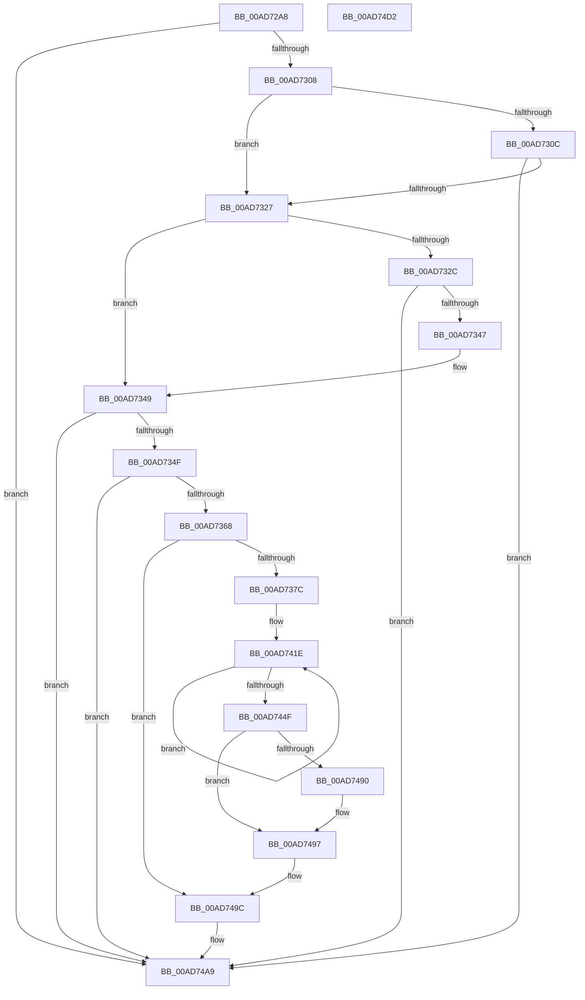

# PopDiagTraceActiveCooling

- RVA: `0x00AD72A8`–`0x00AD74D3` (길이 `555` bytes)
- VA: `0x0000000140AD72A8`
- 실행 섹션: `PAGE`
- PDB 이름 있음: `예`; PDB Function 태그: `아니요`
- unwind 정보 RVA: `0x000BF0C4`
- 디코드: `126`개 명령, `555/555` bytes 표시
- 미해석 바이트: `0` (있으면 어셈블리에 `.byte`로 보존)

> 이 문서는 커널 이미지의 기계어와 PDB 기호를 분석해 생성했습니다. 4번과 5번은 함수 원형과 자료형을 바이너리 사용 방식에서 추정한 C 해석이며 원본 소스 복구 결과는 아닙니다.

## 1. Dependencies

- 직접 호출 지점: **7**; 고유 호출 대상: **6**
- 직접 호출자로 확인된 함수: **1**
- RIP 상대 이미지 참조: **5**

### Outgoing calls
- `0x00AD731A` → [EtwEventEnabled](../../text/39/EtwEventEnabled_function_00392450.md) (function, `0x00392450`)
- `0x00AD733A` → [EtwEventEnabled](../../text/39/EtwEventEnabled_function_00392450.md) (function, `0x00392450`)
- `0x00AD7357` → [IoGetDeviceAttachmentBaseRefWithTag](../../text/27/IoGetDeviceAttachmentBaseRefWithTag_function_00272788.md) (function, `0x00272788`)
- `0x00AD73D4` → [ExSystemTimeToLocalTime](../../text/2F/ExSystemTimeToLocalTime_function_002FE1C0.md) (function, `0x002FE1C0`)
- `0x00AD7497` → [EtwWrite](../../text/41/EtwWrite_function_0041C720.md) (function, `0x0041C720`)
- `0x00AD74A4` → [ObfDereferenceObjectWithTag](../../text/2F/ObfDereferenceObjectWithTag_function_002F78E0.md) (function, `0x002F78E0`)
- `0x00AD74B0` → [_security_check_cookie](../../text/6A/_security_check_cookie_function_006AC640.md) (function, `0x006AC640`)

### Direct callers
- [sub_00B3BE18](../B3/Unknown_function_00B3BE18.md) at `0x00B3BF17`
- [sub_00B3BE18](../B3/Unknown_function_00B3BE18.md) at `0x00B3BF2C`
- [sub_00B3BE18](../B3/Unknown_function_00B3BE18.md) at `0x00B3BF4B`
- [sub_00B3BE18](../B3/Unknown_function_00B3BE18.md) at `0x00B3BF60`

### Static image references
- `0x00AD72C8` → RVA `0x00E0A740` (`.data`; read)
- `0x00AD72DC` → RVA `0x00E67858` (`.data`; read)
- `0x00AD730C` → RVA `0x00F0B408` (`.data`; read)
- `0x00AD7313` → RVA `0x00022A68` (`.rdata`; read)
- `0x00AD7333` → RVA `0x00023548` (`.rdata`; read)

## 2. Other-region calls and transfers

- 다른 실행 섹션으로 향하는 call: **7**
  - `0x00AD731A` → [EtwEventEnabled](../../text/39/EtwEventEnabled_function_00392450.md) (`PAGE` → `.text`)
  - `0x00AD733A` → [EtwEventEnabled](../../text/39/EtwEventEnabled_function_00392450.md) (`PAGE` → `.text`)
  - `0x00AD7357` → [IoGetDeviceAttachmentBaseRefWithTag](../../text/27/IoGetDeviceAttachmentBaseRefWithTag_function_00272788.md) (`PAGE` → `.text`)
  - `0x00AD73D4` → [ExSystemTimeToLocalTime](../../text/2F/ExSystemTimeToLocalTime_function_002FE1C0.md) (`PAGE` → `.text`)
  - `0x00AD7497` → [EtwWrite](../../text/41/EtwWrite_function_0041C720.md) (`PAGE` → `.text`)
  - `0x00AD74A4` → [ObfDereferenceObjectWithTag](../../text/2F/ObfDereferenceObjectWithTag_function_002F78E0.md) (`PAGE` → `.text`)
  - `0x00AD74B0` → [_security_check_cookie](../../text/6A/_security_check_cookie_function_006AC640.md) (`PAGE` → `.text`)
- 별도 외부 분기/꼬리 이동을 확인하지 못했습니다.

## 3. Assembly (complete function range)

```asm
00AD72A8  48 89 5C 24 08                  mov qword ptr [rsp + 8], rbx
00AD72AD  48 89 74 24 18                  mov qword ptr [rsp + 0x18], rsi
00AD72B2  48 89 7C 24 20                  mov qword ptr [rsp + 0x20], rdi
00AD72B7  55                              push rbp
00AD72B8  41 54                           push r12
00AD72BA  41 56                           push r14
00AD72BC  48 8D 6C 24 90                  lea rbp, [rsp - 0x70]
00AD72C1  48 81 EC 70 01 00 00            sub rsp, 0x170
00AD72C8  48 8B 05 71 34 33 00            mov rax, qword ptr [rip + 0x333471]
00AD72CF  48 33 C4                        xor rax, rsp
00AD72D2  48 89 45 68                     mov qword ptr [rbp + 0x68], rax
00AD72D6  45 33 E4                        xor r12d, r12d
00AD72D9  41 8B D9                        mov ebx, r9d
00AD72DC  44 38 25 75 05 39 00            cmp byte ptr [rip + 0x390575], r12b
00AD72E3  45 8A F0                        mov r14b, r8b
00AD72E6  48 8B FA                        mov rdi, rdx
00AD72E9  66 44 89 64 24 34               mov word ptr [rsp + 0x34], r12w
00AD72EF  48 8B F1                        mov rsi, rcx
00AD72F2  44 89 64 24 38                  mov dword ptr [rsp + 0x38], r12d
00AD72F7  66 44 89 64 24 30               mov word ptr [rsp + 0x30], r12w
00AD72FD  4C 89 64 24 40                  mov qword ptr [rsp + 0x40], r12
00AD7302  0F 84 A1 01 00 00               je 0x140ad74a9
00AD7308  85 DB                           test ebx, ebx
00AD730A  75 1B                           jne 0x140ad7327
00AD730C  48 8B 0D F5 40 43 00            mov rcx, qword ptr [rip + 0x4340f5]
00AD7313  48 8D 15 4E B7 54 FF            lea rdx, [rip - 0xab48b2]
00AD731A  E8 31 B1 8B FF                  call 0x140392450
00AD731F  84 C0                           test al, al
00AD7321  0F 84 82 01 00 00               je 0x140ad74a9
00AD7327  83 FB 01                        cmp ebx, 1
00AD732A  75 1D                           jne 0x140ad7349
00AD732C  48 8B 0D D5 40 43 00            mov rcx, qword ptr [rip + 0x4340d5]
00AD7333  48 8D 15 0E C2 54 FF            lea rdx, [rip - 0xab3df2]
00AD733A  E8 11 B1 8B FF                  call 0x140392450
00AD733F  84 C0                           test al, al
00AD7341  0F 84 62 01 00 00               je 0x140ad74a9
00AD7347  3B DB                           cmp ebx, ebx
00AD7349  0F 87 5A 01 00 00               ja 0x140ad74a9
00AD734F  BA 50 6F 44 67                  mov edx, 0x67446f50
00AD7354  48 8B CF                        mov rcx, rdi
00AD7357  E8 2C B4 79 FF                  call 0x140272788
00AD735C  48 8B F8                        mov rdi, rax
00AD735F  48 85 C0                        test rax, rax
00AD7362  0F 84 41 01 00 00               je 0x140ad74a9
00AD7368  48 8B 88 38 01 00 00            mov rcx, qword ptr [rax + 0x138]
00AD736F  48 8B 41 28                     mov rax, qword ptr [rcx + 0x28]
00AD7373  48 85 C0                        test rax, rax
00AD7376  0F 84 20 01 00 00               je 0x140ad749c
00AD737C  0F B7 88 80 00 00 00            movzx ecx, word ptr [rax + 0x80]
00AD7383  66 D1 E9                        shr cx, 1
00AD7386  0F B7 D1                        movzx edx, cx
00AD7389  48 8D 4C 24 30                  lea rcx, [rsp + 0x30]
00AD738E  66 89 54 24 30                  mov word ptr [rsp + 0x30], dx
00AD7393  03 D2                           add edx, edx
00AD7395  48 89 4C 24 50                  mov qword ptr [rsp + 0x50], rcx
00AD739A  48 8D 4C 24 48                  lea rcx, [rsp + 0x48]
00AD739F  48 C7 44 24 58 02 00 00 00      mov qword ptr [rsp + 0x58], 2
00AD73A8  48 8B 80 88 00 00 00            mov rax, qword ptr [rax + 0x88]
00AD73AF  48 89 44 24 60                  mov qword ptr [rsp + 0x60], rax
00AD73B4  48 B8 14 00 00 00 80 F7 FF FF   movabs rax, 0xfffff78000000014
00AD73BE  89 54 24 68                     mov dword ptr [rsp + 0x68], edx
00AD73C2  48 8D 54 24 40                  lea rdx, [rsp + 0x40]
00AD73C7  44 89 64 24 6C                  mov dword ptr [rsp + 0x6c], r12d
00AD73CC  48 8B 00                        mov rax, qword ptr [rax]
00AD73CF  48 89 44 24 48                  mov qword ptr [rsp + 0x48], rax
00AD73D4  E8 E7 6D 82 FF                  call 0x1402fe1c0
00AD73D9  48 8D 44 24 40                  lea rax, [rsp + 0x40]
00AD73DE  48 C7 44 24 78 08 00 00 00      mov qword ptr [rsp + 0x78], 8
00AD73E7  48 89 44 24 70                  mov qword ptr [rsp + 0x70], rax
00AD73EC  4C 8D 4D 9C                     lea r9, [rbp - 0x64]
00AD73F0  41 8B C4                        mov eax, r12d
00AD73F3  48 C7 45 88 02 00 00 00         mov qword ptr [rbp - 0x78], 2
00AD73FB  45 84 F6                        test r14b, r14b
00AD73FE  45 8B D4                        mov r10d, r12d
00AD7401  41 BB 0A 00 00 00               mov r11d, 0xa
00AD7407  41 BE CD CC CC CC               mov r14d, 0xcccccccd
00AD740D  0F 95 C0                        setne al
00AD7410  66 89 44 24 34                  mov word ptr [rsp + 0x34], ax
00AD7415  48 8D 44 24 34                  lea rax, [rsp + 0x34]
00AD741A  48 89 45 80                     mov qword ptr [rbp - 0x80], rax
00AD741E  41 8B CA                        mov ecx, r10d
00AD7421  4C 8D 45 40                     lea r8, [rbp + 0x40]
00AD7425  41 8B C6                        mov eax, r14d
00AD7428  49 C7 41 FC 04 00 00 00         mov qword ptr [r9 - 4], 4
00AD7430  41 FF C2                        inc r10d
00AD7433  4D 8D 49 10                     lea r9, [r9 + 0x10]
00AD7437  F7 64 8E 24                     mul dword ptr [rsi + rcx*4 + 0x24]
00AD743B  4D 8D 04 88                     lea r8, [r8 + rcx*4]
00AD743F  C1 EA 03                        shr edx, 3
00AD7442  4D 89 41 E4                     mov qword ptr [r9 - 0x1c], r8
00AD7446  41 89 10                        mov dword ptr [r8], edx
00AD7449  49 83 EB 01                     sub r11, 1
00AD744D  75 CF                           jne 0x140ad741e
00AD744F  48 8B 0D B2 3F 43 00            mov rcx, qword ptr [rip + 0x433fb2]
00AD7456  45 8D 4B 0F                     lea r9d, [r11 + 0xf]
00AD745A  41 8B C6                        mov eax, r14d
00AD745D  48 C7 45 38 04 00 00 00         mov qword ptr [rbp + 0x38], 4
00AD7465  F7 66 10                        mul dword ptr [rsi + 0x10]
00AD7468  48 8D 44 24 38                  lea rax, [rsp + 0x38]
00AD746D  45 33 C0                        xor r8d, r8d
00AD7470  C1 EA 03                        shr edx, 3
00AD7473  48 89 45 30                     mov qword ptr [rbp + 0x30], rax
00AD7477  48 8D 44 24 50                  lea rax, [rsp + 0x50]
00AD747C  89 54 24 38                     mov dword ptr [rsp + 0x38], edx
00AD7480  48 8D 15 E1 B5 54 FF            lea rdx, [rip - 0xab4a1f]
00AD7487  48 89 44 24 20                  mov qword ptr [rsp + 0x20], rax
00AD748C  85 DB                           test ebx, ebx
00AD748E  74 07                           je 0x140ad7497
00AD7490  48 8D 15 B1 C0 54 FF            lea rdx, [rip - 0xab3f4f]
00AD7497  E8 84 52 94 FF                  call 0x14041c720
00AD749C  BA 50 6F 44 67                  mov edx, 0x67446f50
00AD74A1  48 8B CF                        mov rcx, rdi
00AD74A4  E8 37 04 82 FF                  call 0x1402f78e0
00AD74A9  48 8B 4D 68                     mov rcx, qword ptr [rbp + 0x68]
00AD74AD  48 33 CC                        xor rcx, rsp
00AD74B0  E8 8B 51 BD FF                  call 0x1406ac640
00AD74B5  4C 8D 9C 24 70 01 00 00         lea r11, [rsp + 0x170]
00AD74BD  49 8B 5B 20                     mov rbx, qword ptr [r11 + 0x20]
00AD74C1  49 8B 73 30                     mov rsi, qword ptr [r11 + 0x30]
00AD74C5  49 8B 7B 38                     mov rdi, qword ptr [r11 + 0x38]
00AD74C9  49 8B E3                        mov rsp, r11
00AD74CC  41 5E                           pop r14
00AD74CE  41 5C                           pop r12
00AD74D0  5D                              pop rbp
00AD74D1  C3                              ret
00AD74D2  CC                              int3
```

## 4. C-style interpretation (structured pseudocode)

```c
__int64 __fastcall PopDiagTraceActiveCooling(__int64 a1, __int64 a2, unsigned __int8 a3, int a4)
{
    __int64 result;
    __int64 v_r10;
    __int64 v_r11;
    __int64 v_r12;
    __int64 v_rsp;
    unsigned __int64 v_stack_m100;
    unsigned __int64 v_stack_m108;
    unsigned __int64 v_stack_m110;
    unsigned __int64 v_stack_m118;
    unsigned int v_stack_m11C;
    unsigned int v_stack_m120;
    unsigned __int64 v_stack_m128;
    unsigned __int64 v_stack_m130;
    unsigned __int64 v_stack_m138;
    unsigned __int64 v_stack_m140;
    unsigned __int64 v_stack_m148;
    unsigned int v_stack_m150;
    unsigned __int16 v_stack_m154;
    unsigned __int16 v_stack_m158;
    unsigned __int64 v_stack_m168;
    unsigned __int64 v_stack_m18;
    unsigned __int64 v_stack_m20;
    unsigned __int64 v_stack_m48;
    unsigned __int64 v_stack_m50;
    unsigned __int64 v_stack_m58;
    unsigned __int64 v_stack_m88;
    unsigned __int64 v_stack_mEC;
    unsigned __int64 v_stack_p18;
    unsigned __int64 v_stack_p20;
    unsigned __int64 v_stack_p8;

    v_stack_p8 = v_rbx;
    v_stack_p18 = v_rsi;
    v_stack_p20 = v_rdi;
    v_rsp = (v_rsp) - (368);
    result = (*(unsigned __int64 *)(v_rip + 3355761)) ^ (v_rsp);
    v_stack_m20 = result;
    v_r12 = 0;
    v_stack_m154 = 0;
    v_stack_m150 = 0;
    v_stack_m158 = 0;
    v_stack_m148 = 0;
    if ((*(unsigned __int8 *)(v_rip + 3736949)) == 0) goto loc_00AD74A9;
    if ((unsigned int)((unsigned int)(a4)) != 0) goto loc_00AD7327;
    result = EtwEventEnabled(*(unsigned __int64 *)(v_rip + 4407541), v_rip - 11225266, a3, a4);
    if ((unsigned __int8)(result) == 0) goto loc_00AD74A9;
loc_00AD7327:
    if (((unsigned int)((unsigned int)(a4))) != 1) goto loc_00AD7349;
    result = EtwEventEnabled(*(unsigned __int64 *)(v_rip + 4407509), v_rip - 11222514, a3, a4);
    if ((unsigned __int8)(result) == 0) goto loc_00AD74A9;
loc_00AD7349:
    if (((unsigned int)((unsigned int)(a4))) > ((unsigned int)((unsigned int)(a4)))) goto loc_00AD74A9;
    result = IoGetDeviceAttachmentBaseRefWithTag(a2, (unsigned int)(0x67446F50ULL), a3, a4);
    if (result == 0) goto loc_00AD74A9;
    if (*(unsigned __int64 *)(*(unsigned __int64 *)(result + 312) + 40) == 0) goto loc_00AD749C;
    a1 = (unsigned __int16)((*(unsigned __int16 *)(*(unsigned __int64 *)(*(unsigned __int64 *)(result + 312) + 40) + 128)) >> (1));
    v_stack_m158 = (unsigned __int16)((unsigned __int16)(a1));
    a2 = (unsigned int)(((unsigned __int16)(a1)) + ((unsigned int)((unsigned __int16)(a1))));
    v_stack_m138 = v_stack_m158;
    v_stack_m130 = 2;
    v_stack_m128 = *(unsigned __int64 *)(*(unsigned __int64 *)(*(unsigned __int64 *)(result + 312) + 40) + 136);
    v_stack_m120 = (unsigned int)(a2);
    v_stack_m11C = 0;
    v_stack_m140 = *(unsigned __int64 *)(*(unsigned __int64 *)(*(unsigned __int64 *)(*(unsigned __int64 *)(result + 312) + 40) + 136));
    result = ExSystemTimeToLocalTime(v_stack_m140, v_stack_m148, a3, a4);
    v_stack_m110 = 8;
    v_stack_m118 = v_stack_m148;
    v_stack_m100 = 2;
    result = (a3 != 0) ? 1 : 0;
    v_stack_m154 = (unsigned __int16)(result);
    v_stack_m108 = v_stack_m154;
loc_00AD741E:
    *(unsigned __int64 *)(v_stack_mEC - 4) = 4;
    v_r10 = (unsigned int)((0) + 1);
    a2 = (unsigned int)((v_stack_m148) >> (3));
    *(unsigned __int64 *)(v_stack_mEC + 16 - 28) = v_stack_m48 + 0 * 4;
    *(unsigned int *)(v_stack_m48 + 0 * 4) = (unsigned int)(a2);
    v_r11 = (10) - (1);
    if (condition_is_not_equal) goto loc_00AD741E;
    v_stack_m50 = 4;
    a3 = 0;
    a2 = (unsigned int)((a2) >> (3));
    v_stack_m58 = v_stack_m150;
    v_stack_m150 = (unsigned int)(a2);
    v_stack_m168 = v_stack_m138;
    if ((unsigned int)((unsigned int)(a4)) != 0) {
        a2 = v_rip - 11222863;
    }
    result = EtwWrite(*(unsigned __int64 *)(v_rip + 4407218), a2, a3, v_r11 + 15);
loc_00AD749C:
    result = ObfDereferenceObjectWithTag(result, (unsigned int)(0x67446F50ULL), a3, v_r11 + 15);
loc_00AD74A9:
    a1 = (v_stack_m20) ^ (v_rsp);
    result = _security_check_cookie(a1, (unsigned int)(0x67446F50ULL), a3, v_r11 + 15);
    return result;
}
```

## 5. (Beta) C Style

```c
int64_t PopDiagTraceActiveCooling(void *Arg1, int64_t Arg2, uint8_t Arg3, int32_t Arg4)
{
    uint8_t *arg1 = (uint8_t *)Arg1;

    int64_t result;
    int64_t local_r10;
    int64_t local_r11;
    int64_t local_r12;
    int64_t local_rsp;
    uint64_t v_stack_m100;
    uint64_t v_stack_m108;
    uint64_t v_stack_m110;
    uint64_t v_stack_m118;
    uint32_t v_stack_m11C;
    uint32_t v_stack_m120;
    uint64_t v_stack_m128;
    uint64_t v_stack_m130;
    uint64_t v_stack_m138;
    uint64_t v_stack_m140;
    uint64_t v_stack_m148;
    uint32_t v_stack_m150;
    uint16_t v_stack_m154;
    uint16_t v_stack_m158;
    uint64_t v_stack_m168;
    uint64_t v_stack_m18;
    uint64_t v_stack_m20;
    uint64_t v_stack_m48;
    uint64_t v_stack_m50;
    uint64_t v_stack_m58;
    uint64_t v_stack_m88;
    uint64_t v_stack_mEC;
    uint64_t v_stack_p18;
    uint64_t v_stack_p20;
    uint64_t v_stack_p8;

    v_stack_p8 = local_rbx;
    v_stack_p18 = local_rsi;
    v_stack_p20 = local_rdi;
    local_rsp = (local_rsp) - (368);
    result = (*(uint64_t *)(v_rip + 0x333471)) ^ (local_rsp);
    v_stack_m20 = result;
    local_r12 = 0;
    v_stack_m154 = 0;
    v_stack_m150 = 0;
    v_stack_m158 = 0;
    v_stack_m148 = 0;
    if ((*(uint8_t *)(v_rip + 0x390575)) == 0) goto loc_00AD74A9;
    if ((uint32_t)((uint32_t)(Arg4)) != 0) goto loc_00AD7327;
    result = EtwEventEnabled(*(uint64_t *)(v_rip + 0x4340F5), v_rip - 11225266, Arg3, Arg4);
    if ((uint8_t)(result) == 0) goto loc_00AD74A9;
loc_00AD7327:
    if (((uint32_t)((uint32_t)(Arg4))) != 1) goto loc_00AD7349;
    result = EtwEventEnabled(*(uint64_t *)(v_rip + 0x4340D5), v_rip - 11222514, Arg3, Arg4);
    if ((uint8_t)(result) == 0) goto loc_00AD74A9;
loc_00AD7349:
    if (((uint32_t)((uint32_t)(Arg4))) > ((uint32_t)((uint32_t)(Arg4)))) goto loc_00AD74A9;
    result = IoGetDeviceAttachmentBaseRefWithTag(Arg2, (uint32_t)(0x67446F50ULL), Arg3, Arg4);
    if (result == 0) goto loc_00AD74A9;
    if (*(uint64_t *)(*(uint64_t *)(result + 0x138) + 0x28) == 0) goto loc_00AD749C;
    Arg1 = (uint16_t)((*(uint16_t *)(*(uint64_t *)(*(uint64_t *)(result + 0x138) + 0x28) + 0x80)) >> (1));
    v_stack_m158 = (uint16_t)((uint16_t)(Arg1));
    Arg2 = (uint32_t)(((uint16_t)(Arg1)) + ((uint32_t)((uint16_t)(Arg1))));
    v_stack_m138 = v_stack_m158;
    v_stack_m130 = 2;
    v_stack_m128 = *(uint64_t *)(*(uint64_t *)(*(uint64_t *)(result + 0x138) + 0x28) + 0x88);
    v_stack_m120 = (uint32_t)(Arg2);
    v_stack_m11C = 0;
    v_stack_m140 = *(uint64_t *)(*(uint64_t *)(*(uint64_t *)(*(uint64_t *)(result + 0x138) + 0x28) + 0x88));
    result = ExSystemTimeToLocalTime(v_stack_m140, v_stack_m148, Arg3, Arg4);
    v_stack_m110 = 8;
    v_stack_m118 = v_stack_m148;
    v_stack_m100 = 2;
    result = (Arg3 != 0) ? 1 : 0;
    v_stack_m154 = (uint16_t)(result);
    v_stack_m108 = v_stack_m154;
loc_00AD741E:
    *(uint64_t *)(v_stack_mEC - 0x4) = 4;
    local_r10 = (uint32_t)((0) + 1);
    Arg2 = (uint32_t)((v_stack_m148) >> (3));
    *(uint64_t *)(v_stack_mEC + 0x10 - 0x1C) = v_stack_m48 + 0 * 4;
    *(uint32_t *)(v_stack_m48 + 0x0 * 4) = (uint32_t)(Arg2);
    local_r11 = (10) - (1);
    if (condition_is_not_equal) goto loc_00AD741E;
    v_stack_m50 = 4;
    Arg3 = 0;
    Arg2 = (uint32_t)((Arg2) >> (3));
    v_stack_m58 = v_stack_m150;
    v_stack_m150 = (uint32_t)(Arg2);
    v_stack_m168 = v_stack_m138;
    if ((uint32_t)((uint32_t)(Arg4)) != 0) {
        Arg2 = v_rip - 11222863;
    }
    result = EtwWrite(*(uint64_t *)(v_rip + 0x433FB2), Arg2, Arg3, local_r11 + 15);
loc_00AD749C:
    result = ObfDereferenceObjectWithTag(result, (uint32_t)(0x67446F50ULL), Arg3, local_r11 + 15);
loc_00AD74A9:
    Arg1 = (v_stack_m20) ^ (local_rsp);
    result = _security_check_cookie(Arg1, (uint32_t)(0x67446F50ULL), Arg3, local_r11 + 15);
    return result;
}
```

### 관측된 메모리 오프셋

구조체 형식이 확인되지 않은 접근은 인자 기준의 오프셋으로만 기록했습니다.

| 기준 인자 | 오프셋 표현 | 폭 (bit) | 접근 |
|---|---:|---:|---|
| `Arg1` | `+ 0x10` | `32` | `R` |
| `Arg1` | `+ 0x24 + rcx*4` | `32` | `R` |

## 6. Execution-region graph

[열기: 2D/3D 그래프와 함수 탐색 컨트롤 패널](../../../control-panel.html?section=page&rva=0x00AD72A8&view=graph)

- 2D 그래프는 위에서 아래로 흐르고, 3D 그래프는 빈 공간을 드래그해 회전합니다. Shift+드래그는 이동, 휠은 확대·축소, 함수 노드 선택은 대상 보고서 이동입니다.

### Static fallback


