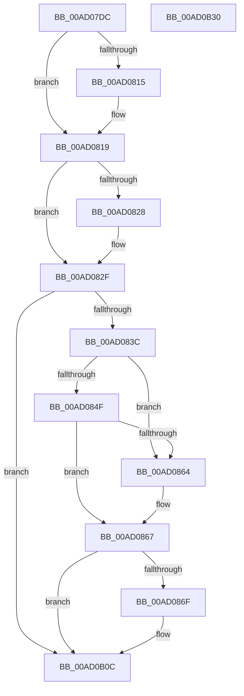

# PopDiagTraceCsResiliencyStats

- RVA: `0x00AD07DC`–`0x00AD0B31` (길이 `853` bytes)
- VA: `0x0000000140AD07DC`
- 실행 섹션: `PAGE`
- PDB 이름 있음: `예`; PDB Function 태그: `아니요`
- unwind 정보 RVA: `0x000BE928`
- 디코드: `159`개 명령, `853/853` bytes 표시
- 미해석 바이트: `0` (있으면 어셈블리에 `.byte`로 보존)

> 이 문서는 커널 이미지의 기계어와 PDB 기호를 분석해 생성했습니다. 4번과 5번은 함수 원형과 자료형을 바이너리 사용 방식에서 추정한 C 해석이며 원본 소스 복구 결과는 아닙니다.

## 1. Dependencies

- 직접 호출 지점: **2**; 고유 호출 대상: **2**
- 직접 호출자로 확인된 함수: **1**
- RIP 상대 이미지 참조: **6**

### Outgoing calls
- `0x00AD0B07` → [tlgWriteTransfer_EtwWriteTransfer](../../text/42/tlgWriteTransfer_EtwWriteTransfer_function_004260E0.md) (function, `0x004260E0`)
- `0x00AD0B16` → [_security_check_cookie](../../text/6A/_security_check_cookie_function_006AC640.md) (function, `0x006AC640`)

### Direct callers
- [PopSleepstudyCaptureResiliencyStatistics](PopSleepstudyCaptureResiliencyStatistics_function_00AD6B74.md) at `0x00AD6CDB`

### Static image references
- `0x00AD07F6` → RVA `0x00E0A740` (`.data`; read)
- `0x00AD082F` → RVA `0x00E07748` (`.data`; read)
- `0x00AD0846` → RVA `0x00E07758` (`.data`; read)
- `0x00AD084F` → RVA `0x00E07760` (`.data`; read)
- `0x00AD086F` → RVA `0x00F0B410` (`.data`; read)
- `0x00AD0A32` → RVA `0x000491E6` (`.rdata`; read)

## 2. Other-region calls and transfers

- 다른 실행 섹션으로 향하는 call: **2**
  - `0x00AD0B07` → [tlgWriteTransfer_EtwWriteTransfer](../../text/42/tlgWriteTransfer_EtwWriteTransfer_function_004260E0.md) (`PAGE` → `.text`)
  - `0x00AD0B16` → [_security_check_cookie](../../text/6A/_security_check_cookie_function_006AC640.md) (`PAGE` → `.text`)
- 별도 외부 분기/꼬리 이동을 확인하지 못했습니다.

## 3. Assembly (complete function range)

```asm
00AD07DC  48 89 5C 24 08                  mov qword ptr [rsp + 8], rbx
00AD07E1  48 89 7C 24 10                  mov qword ptr [rsp + 0x10], rdi
00AD07E6  55                              push rbp
00AD07E7  48 8D AC 24 A0 FE FF FF         lea rbp, [rsp - 0x160]
00AD07EF  48 81 EC 60 02 00 00            sub rsp, 0x260
00AD07F6  48 8B 05 43 9F 33 00            mov rax, qword ptr [rip + 0x339f43]
00AD07FD  48 33 C4                        xor rax, rsp
00AD0800  48 89 85 50 01 00 00            mov qword ptr [rbp + 0x150], rax
00AD0807  44 8B 49 70                     mov r9d, dword ptr [rcx + 0x70]
00AD080B  33 FF                           xor edi, edi
00AD080D  44 8B C7                        mov r8d, edi
00AD0810  45 85 C9                        test r9d, r9d
00AD0813  74 04                           je 0x140ad0819
00AD0815  4C 8B 41 60                     mov r8, qword ptr [rcx + 0x60]
00AD0819  44 8B 91 90 00 00 00            mov r10d, dword ptr [rcx + 0x90]
00AD0820  4C 8B DF                        mov r11, rdi
00AD0823  45 85 D2                        test r10d, r10d
00AD0826  74 07                           je 0x140ad082f
00AD0828  4C 8B 99 80 00 00 00            mov r11, qword ptr [rcx + 0x80]
00AD082F  83 3D 12 6F 33 00 05            cmp dword ptr [rip + 0x336f12], 5
00AD0836  0F 86 D0 02 00 00               jbe 0x140ad0b0c
00AD083C  48 BB 00 00 00 00 00 40 00 00   movabs rbx, 0x400000000000
00AD0846  48 85 1D 0B 6F 33 00            test qword ptr [rip + 0x336f0b], rbx
00AD084D  74 15                           je 0x140ad0864
00AD084F  48 8B 05 0A 6F 33 00            mov rax, qword ptr [rip + 0x336f0a]
00AD0856  48 23 C3                        and rax, rbx
00AD0859  48 3B 05 00 6F 33 00            cmp rax, qword ptr [rip + 0x336f00]
00AD0860  B0 01                           mov al, 1
00AD0862  74 03                           je 0x140ad0867
00AD0864  40 8A C7                        mov al, dil
00AD0867  84 C0                           test al, al
00AD0869  0F 84 9D 02 00 00               je 0x140ad0b0c
00AD086F  48 8B 05 9A AB 43 00            mov rax, qword ptr [rip + 0x43ab9a]
00AD0876  48 89 44 24 58                  mov qword ptr [rsp + 0x58], rax
00AD087B  48 8D 44 24 58                  lea rax, [rsp + 0x58]
00AD0880  48 89 45 E0                     mov qword ptr [rbp - 0x20], rax
00AD0884  8B 01                           mov eax, dword ptr [rcx]
00AD0886  89 44 24 30                     mov dword ptr [rsp + 0x30], eax
00AD088A  48 8D 44 24 30                  lea rax, [rsp + 0x30]
00AD088F  48 89 45 F0                     mov qword ptr [rbp - 0x10], rax
00AD0893  8B 41 20                        mov eax, dword ptr [rcx + 0x20]
00AD0896  89 44 24 34                     mov dword ptr [rsp + 0x34], eax
00AD089A  48 8D 44 24 34                  lea rax, [rsp + 0x34]
00AD089F  48 89 45 00                     mov qword ptr [rbp], rax
00AD08A3  48 8B 41 30                     mov rax, qword ptr [rcx + 0x30]
00AD08A7  48 89 44 24 60                  mov qword ptr [rsp + 0x60], rax
00AD08AC  48 8D 44 24 60                  lea rax, [rsp + 0x60]
00AD08B1  48 89 45 10                     mov qword ptr [rbp + 0x10], rax
00AD08B5  8B 41 28                        mov eax, dword ptr [rcx + 0x28]
00AD08B8  48 89 44 24 68                  mov qword ptr [rsp + 0x68], rax
00AD08BD  48 8D 44 24 68                  lea rax, [rsp + 0x68]
00AD08C2  48 89 45 20                     mov qword ptr [rbp + 0x20], rax
00AD08C6  8B 41 38                        mov eax, dword ptr [rcx + 0x38]
00AD08C9  89 44 24 38                     mov dword ptr [rsp + 0x38], eax
00AD08CD  48 8D 44 24 38                  lea rax, [rsp + 0x38]
00AD08D2  48 89 45 30                     mov qword ptr [rbp + 0x30], rax
00AD08D6  8B 41 3C                        mov eax, dword ptr [rcx + 0x3c]
00AD08D9  89 44 24 3C                     mov dword ptr [rsp + 0x3c], eax
00AD08DD  48 8D 44 24 3C                  lea rax, [rsp + 0x3c]
00AD08E2  48 89 45 40                     mov qword ptr [rbp + 0x40], rax
00AD08E6  8B 41 40                        mov eax, dword ptr [rcx + 0x40]
00AD08E9  89 44 24 40                     mov dword ptr [rsp + 0x40], eax
00AD08ED  48 8D 44 24 40                  lea rax, [rsp + 0x40]
00AD08F2  48 89 45 50                     mov qword ptr [rbp + 0x50], rax
00AD08F6  8B 41 44                        mov eax, dword ptr [rcx + 0x44]
00AD08F9  89 44 24 44                     mov dword ptr [rsp + 0x44], eax
00AD08FD  48 8D 44 24 44                  lea rax, [rsp + 0x44]
00AD0902  48 89 45 60                     mov qword ptr [rbp + 0x60], rax
00AD0906  48 8B 41 08                     mov rax, qword ptr [rcx + 8]
00AD090A  48 89 44 24 70                  mov qword ptr [rsp + 0x70], rax
00AD090F  48 8D 44 24 70                  lea rax, [rsp + 0x70]
00AD0914  48 89 45 70                     mov qword ptr [rbp + 0x70], rax
00AD0918  48 8B 41 18                     mov rax, qword ptr [rcx + 0x18]
00AD091C  48 89 44 24 78                  mov qword ptr [rsp + 0x78], rax
00AD0921  48 8D 44 24 78                  lea rax, [rsp + 0x78]
00AD0926  48 89 85 80 00 00 00            mov qword ptr [rbp + 0x80], rax
00AD092D  48 8B 41 10                     mov rax, qword ptr [rcx + 0x10]
00AD0931  48 89 45 80                     mov qword ptr [rbp - 0x80], rax
00AD0935  48 8D 45 80                     lea rax, [rbp - 0x80]
00AD0939  48 89 85 90 00 00 00            mov qword ptr [rbp + 0x90], rax
00AD0940  48 8B 41 48                     mov rax, qword ptr [rcx + 0x48]
00AD0944  48 89 45 88                     mov qword ptr [rbp - 0x78], rax
00AD0948  48 8D 45 88                     lea rax, [rbp - 0x78]
00AD094C  48 89 85 A0 00 00 00            mov qword ptr [rbp + 0xa0], rax
00AD0953  8B 41 50                        mov eax, dword ptr [rcx + 0x50]
00AD0956  89 44 24 48                     mov dword ptr [rsp + 0x48], eax
00AD095A  48 8D 44 24 48                  lea rax, [rsp + 0x48]
00AD095F  48 89 85 B0 00 00 00            mov qword ptr [rbp + 0xb0], rax
00AD0966  48 8D 45 90                     lea rax, [rbp - 0x70]
00AD096A  48 89 85 C0 00 00 00            mov qword ptr [rbp + 0xc0], rax
00AD0971  48 8B 41 58                     mov rax, qword ptr [rcx + 0x58]
00AD0975  48 89 45 98                     mov qword ptr [rbp - 0x68], rax
00AD0979  48 8D 45 98                     lea rax, [rbp - 0x68]
00AD097D  48 89 85 D0 00 00 00            mov qword ptr [rbp + 0xd0], rax
00AD0984  48 8B 41 68                     mov rax, qword ptr [rcx + 0x68]
00AD0988  48 89 45 A0                     mov qword ptr [rbp - 0x60], rax
00AD098C  48 C7 45 E8 08 00 00 00         mov qword ptr [rbp - 0x18], 8
00AD0994  48 C7 45 F8 04 00 00 00         mov qword ptr [rbp - 8], 4
00AD099C  48 C7 45 08 04 00 00 00         mov qword ptr [rbp + 8], 4
00AD09A4  48 C7 45 18 08 00 00 00         mov qword ptr [rbp + 0x18], 8
00AD09AC  48 C7 45 28 08 00 00 00         mov qword ptr [rbp + 0x28], 8
00AD09B4  48 C7 45 38 04 00 00 00         mov qword ptr [rbp + 0x38], 4
00AD09BC  48 C7 45 48 04 00 00 00         mov qword ptr [rbp + 0x48], 4
00AD09C4  48 C7 45 58 04 00 00 00         mov qword ptr [rbp + 0x58], 4
00AD09CC  48 C7 45 68 04 00 00 00         mov qword ptr [rbp + 0x68], 4
00AD09D4  48 C7 45 78 08 00 00 00         mov qword ptr [rbp + 0x78], 8
00AD09DC  48 C7 85 88 00 00 00 08 00 00 00  mov qword ptr [rbp + 0x88], 8
00AD09E7  48 C7 85 98 00 00 00 08 00 00 00  mov qword ptr [rbp + 0x98], 8
00AD09F2  48 C7 85 A8 00 00 00 08 00 00 00  mov qword ptr [rbp + 0xa8], 8
00AD09FD  48 C7 85 B8 00 00 00 04 00 00 00  mov qword ptr [rbp + 0xb8], 4
00AD0A08  4C 89 45 90                     mov qword ptr [rbp - 0x70], r8
00AD0A0C  48 C7 85 C8 00 00 00 08 00 00 00  mov qword ptr [rbp + 0xc8], 8
00AD0A17  48 C7 85 D8 00 00 00 08 00 00 00  mov qword ptr [rbp + 0xd8], 8
00AD0A22  48 8D 45 A0                     lea rax, [rbp - 0x60]
00AD0A26  44 89 4C 24 4C                  mov dword ptr [rsp + 0x4c], r9d
00AD0A2B  48 89 85 E0 00 00 00            mov qword ptr [rbp + 0xe0], rax
00AD0A32  48 8D 15 AD 87 57 FF            lea rdx, [rip - 0xa87853]
00AD0A39  48 8D 44 24 4C                  lea rax, [rsp + 0x4c]
00AD0A3E  48 C7 85 E8 00 00 00 08 00 00 00  mov qword ptr [rbp + 0xe8], 8
00AD0A49  48 89 85 F0 00 00 00            mov qword ptr [rbp + 0xf0], rax
00AD0A50  45 33 C9                        xor r9d, r9d
00AD0A53  48 8D 45 A8                     lea rax, [rbp - 0x58]
00AD0A57  48 C7 85 F8 00 00 00 04 00 00 00  mov qword ptr [rbp + 0xf8], 4
00AD0A62  48 89 85 00 01 00 00            mov qword ptr [rbp + 0x100], rax
00AD0A69  45 33 C0                        xor r8d, r8d
00AD0A6C  48 8B 41 78                     mov rax, qword ptr [rcx + 0x78]
00AD0A70  48 89 45 B0                     mov qword ptr [rbp - 0x50], rax
00AD0A74  48 8D 45 B0                     lea rax, [rbp - 0x50]
00AD0A78  48 89 85 10 01 00 00            mov qword ptr [rbp + 0x110], rax
00AD0A7F  48 8B 81 88 00 00 00            mov rax, qword ptr [rcx + 0x88]
00AD0A86  48 89 45 B8                     mov qword ptr [rbp - 0x48], rax
00AD0A8A  48 8D 45 B8                     lea rax, [rbp - 0x48]
00AD0A8E  48 89 85 20 01 00 00            mov qword ptr [rbp + 0x120], rax
00AD0A95  48 8D 44 24 50                  lea rax, [rsp + 0x50]
00AD0A9A  48 89 85 30 01 00 00            mov qword ptr [rbp + 0x130], rax
00AD0AA1  48 8D 81 98 00 00 00            lea rax, [rcx + 0x98]
00AD0AA8  48 89 85 40 01 00 00            mov qword ptr [rbp + 0x140], rax
00AD0AAF  48 8D 0D 92 6C 33 00            lea rcx, [rip + 0x336c92]
00AD0AB6  48 8D 45 C0                     lea rax, [rbp - 0x40]
00AD0ABA  4C 89 5D A8                     mov qword ptr [rbp - 0x58], r11
00AD0ABE  48 89 44 24 28                  mov qword ptr [rsp + 0x28], rax
00AD0AC3  C7 44 24 20 19 00 00 00         mov dword ptr [rsp + 0x20], 0x19
00AD0ACB  48 C7 85 08 01 00 00 08 00 00 00  mov qword ptr [rbp + 0x108], 8
00AD0AD6  48 C7 85 18 01 00 00 08 00 00 00  mov qword ptr [rbp + 0x118], 8
00AD0AE1  48 C7 85 28 01 00 00 08 00 00 00  mov qword ptr [rbp + 0x128], 8
00AD0AEC  44 89 54 24 50                  mov dword ptr [rsp + 0x50], r10d
00AD0AF1  48 C7 85 38 01 00 00 04 00 00 00  mov qword ptr [rbp + 0x138], 4
00AD0AFC  48 C7 85 48 01 00 00 58 00 00 00  mov qword ptr [rbp + 0x148], 0x58
00AD0B07  E8 D4 55 95 FF                  call 0x1404260e0
00AD0B0C  48 8B 8D 50 01 00 00            mov rcx, qword ptr [rbp + 0x150]
00AD0B13  48 33 CC                        xor rcx, rsp
00AD0B16  E8 25 BB BD FF                  call 0x1406ac640
00AD0B1B  4C 8D 9C 24 60 02 00 00         lea r11, [rsp + 0x260]
00AD0B23  49 8B 5B 10                     mov rbx, qword ptr [r11 + 0x10]
00AD0B27  49 8B 7B 18                     mov rdi, qword ptr [r11 + 0x18]
00AD0B2B  49 8B E3                        mov rsp, r11
00AD0B2E  5D                              pop rbp
00AD0B2F  C3                              ret
00AD0B30  CC                              int3
```

## 4. C-style interpretation (structured pseudocode)

```c
__int64 __fastcall PopDiagTraceCsResiliencyStats(__int64 a1)
{
    __int64 result;
    __int64 v_r11;
    __int64 v_rdi;
    __int64 v_rsp;
    unsigned __int64 v_stack_m100;
    unsigned __int64 v_stack_m108;
    unsigned __int64 v_stack_m110;
    unsigned __int64 v_stack_m118;
    unsigned __int64 v_stack_m120;
    unsigned __int64 v_stack_m128;
    unsigned __int64 v_stack_m130;
    unsigned __int64 v_stack_m138;
    unsigned __int64 v_stack_m140;
    unsigned __int64 v_stack_m148;
    unsigned __int64 v_stack_m150;
    unsigned __int64 v_stack_m158;
    unsigned __int64 v_stack_m160;
    unsigned __int64 v_stack_m168;
    unsigned __int64 v_stack_m170;
    unsigned __int64 v_stack_m178;
    unsigned __int64 v_stack_m18;
    unsigned __int64 v_stack_m180;
    unsigned __int64 v_stack_m188;
    unsigned __int64 v_stack_m1A8;
    unsigned __int64 v_stack_m1B0;
    unsigned __int64 v_stack_m1B8;
    unsigned __int64 v_stack_m1C0;
    unsigned __int64 v_stack_m1C8;
    unsigned __int64 v_stack_m1D0;
    unsigned __int64 v_stack_m1D8;
    unsigned __int64 v_stack_m1E0;
    unsigned __int64 v_stack_m1E8;
    unsigned __int64 v_stack_m1F0;
    unsigned __int64 v_stack_m1F8;
    unsigned __int64 v_stack_m20;
    unsigned __int64 v_stack_m200;
    unsigned __int64 v_stack_m208;
    unsigned __int64 v_stack_m210;
    unsigned __int64 v_stack_m218;
    unsigned int v_stack_m21C;
    unsigned int v_stack_m220;
    unsigned int v_stack_m224;
    unsigned int v_stack_m228;
    unsigned int v_stack_m22C;
    unsigned int v_stack_m230;
    unsigned int v_stack_m234;
    unsigned int v_stack_m238;
    unsigned __int64 v_stack_m240;
    unsigned int v_stack_m248;
    unsigned __int64 v_stack_m28;
    unsigned __int64 v_stack_m30;
    unsigned __int64 v_stack_m38;
    unsigned __int64 v_stack_m40;
    unsigned __int64 v_stack_m48;
    unsigned __int64 v_stack_m50;
    unsigned __int64 v_stack_m58;
    unsigned __int64 v_stack_m60;
    unsigned __int64 v_stack_m68;
    unsigned __int64 v_stack_m70;
    unsigned __int64 v_stack_m78;
    unsigned __int64 v_stack_m8;
    unsigned __int64 v_stack_m80;
    unsigned __int64 v_stack_m88;
    unsigned __int64 v_stack_m90;
    unsigned __int64 v_stack_m98;
    unsigned __int64 v_stack_mA0;
    unsigned __int64 v_stack_mA8;
    unsigned __int64 v_stack_mB0;
    unsigned __int64 v_stack_mB8;
    unsigned __int64 v_stack_mC0;
    unsigned __int64 v_stack_mC8;
    unsigned __int64 v_stack_mD0;
    unsigned __int64 v_stack_mD8;
    unsigned __int64 v_stack_mE0;
    unsigned __int64 v_stack_mE8;
    unsigned __int64 v_stack_mF0;
    unsigned __int64 v_stack_mF8;
    unsigned __int64 v_stack_p10;
    unsigned __int64 v_stack_p8;

    v_stack_p8 = v_rbx;
    v_stack_p10 = v_rdi;
    v_rsp = (v_rsp) - (608);
    result = (*(unsigned __int64 *)(v_rip + 3383107)) ^ (v_rsp);
    v_stack_m18 = result;
    v_rdi = 0;
    if ((unsigned int)((unsigned int)(*(unsigned int *)(a1 + 112))) != 0) {
        a3 = *(unsigned __int64 *)(a1 + 96);
    }
    v_r11 = 0;
    if ((unsigned int)((unsigned int)(*(unsigned int *)(a1 + 144))) != 0) {
        v_r11 = *(unsigned __int64 *)(a1 + 128);
    }
    if ((*(unsigned int *)(v_rip + 3370770)) <= 5) goto loc_00AD0B0C;
    if (((*(unsigned __int64 *)(v_rip + 3370763)) & (v_rbx)) == 0) goto loc_00AD0864;
    result = (*(unsigned __int64 *)(v_rip + 3370762)) & (v_rbx);
    result = 1;
    if (result != (*(unsigned __int64 *)(v_rip + 3370752))) {
        result = 0;
    }
    if ((unsigned __int8)(result) != 0) {
        result = *(unsigned __int64 *)(v_rip + 4434842);
        v_stack_m210 = result;
        result = v_stack_m210;
        v_stack_m188 = result;
        result = *(unsigned int *)(a1);
        v_stack_m238 = (unsigned int)(result);
        result = v_stack_m238;
        v_stack_m178 = result;
        result = *(unsigned int *)(a1 + 32);
        v_stack_m234 = (unsigned int)(result);
        result = v_stack_m234;
        v_stack_m168 = result;
        result = *(unsigned __int64 *)(a1 + 48);
        v_stack_m208 = result;
        result = v_stack_m208;
        v_stack_m158 = result;
        result = *(unsigned int *)(a1 + 40);
        v_stack_m200 = result;
        result = v_stack_m200;
        v_stack_m148 = result;
        result = *(unsigned int *)(a1 + 56);
        v_stack_m230 = (unsigned int)(result);
        result = v_stack_m230;
        v_stack_m138 = result;
        result = *(unsigned int *)(a1 + 60);
        v_stack_m22C = (unsigned int)(result);
        result = v_stack_m22C;
        v_stack_m128 = result;
        result = *(unsigned int *)(a1 + 64);
        v_stack_m228 = (unsigned int)(result);
        result = v_stack_m228;
        v_stack_m118 = result;
        result = *(unsigned int *)(a1 + 68);
        v_stack_m224 = (unsigned int)(result);
        result = v_stack_m224;
        v_stack_m108 = result;
        result = *(unsigned __int64 *)(a1 + 8);
        v_stack_m1F8 = result;
        result = v_stack_m1F8;
        v_stack_mF8 = result;
        result = *(unsigned __int64 *)(a1 + 24);
        v_stack_m1F0 = result;
        result = v_stack_m1F0;
        v_stack_mE8 = result;
        result = *(unsigned __int64 *)(a1 + 16);
        v_stack_m1E8 = result;
        result = v_stack_m1E8;
        v_stack_mD8 = result;
        result = *(unsigned __int64 *)(a1 + 72);
        v_stack_m1E0 = result;
        result = v_stack_m1E0;
        v_stack_mC8 = result;
        result = *(unsigned int *)(a1 + 80);
        v_stack_m220 = (unsigned int)(result);
        result = v_stack_m220;
        v_stack_mB8 = result;
        result = v_stack_m1D8;
        v_stack_mA8 = result;
        result = *(unsigned __int64 *)(a1 + 88);
        v_stack_m1D0 = result;
        result = v_stack_m1D0;
        v_stack_m98 = result;
        result = *(unsigned __int64 *)(a1 + 104);
        v_stack_m1C8 = result;
        v_stack_m180 = 8;
        v_stack_m170 = 4;
        v_stack_m160 = 4;
        v_stack_m150 = 8;
        v_stack_m140 = 8;
        v_stack_m130 = 4;
        v_stack_m120 = 4;
        v_stack_m110 = 4;
        v_stack_m100 = 4;
        v_stack_mF0 = 8;
        v_stack_mE0 = 8;
        v_stack_mD0 = 8;
        v_stack_mC0 = 8;
        v_stack_mB0 = 4;
        v_stack_m1D8 = a3;
        v_stack_mA0 = 8;
        v_stack_m90 = 8;
        result = v_stack_m1C8;
        v_stack_m21C = (unsigned int)((unsigned int)(*(unsigned int *)(a1 + 112)));
        v_stack_m88 = result;
        a2 = v_rip - 11040851;
        result = v_stack_m21C;
        v_stack_m80 = 8;
        v_stack_m78 = result;
        a4 = 0;
        result = v_stack_m1C0;
        v_stack_m70 = 4;
        v_stack_m68 = result;
        a3 = 0;
        result = *(unsigned __int64 *)(a1 + 120);
        v_stack_m1B8 = result;
        result = v_stack_m1B8;
        v_stack_m58 = result;
        result = *(unsigned __int64 *)(a1 + 136);
        v_stack_m1B0 = result;
        result = v_stack_m1B0;
        v_stack_m48 = result;
        result = v_stack_m218;
        v_stack_m38 = result;
        result = a1 + 152;
        v_stack_m28 = result;
        a1 = v_rip + 3370130;
        result = v_stack_m1A8;
        v_stack_m1C0 = v_r11;
        v_stack_m240 = result;
        v_stack_m248 = 25;
        v_stack_m60 = 8;
        v_stack_m50 = 8;
        v_stack_m40 = 8;
        v_stack_m218 = (unsigned int)((unsigned int)(*(unsigned int *)(a1 + 144)));
        v_stack_m30 = 4;
        v_stack_m20 = 88;
        result = tlgWriteTransfer_EtwWriteTransfer(a1, a2, a3, a4);
    }
    a1 = (v_stack_m18) ^ (v_rsp);
    result = _security_check_cookie(a1, a2, a3, a4);
    return result;
}
```

## 5. (Beta) C Style

```c
int64_t PopDiagTraceCsResiliencyStats(void *Arg1)
{
    uint8_t *arg1 = (uint8_t *)Arg1;

    int64_t result;
    int64_t local_r11;
    int64_t local_rdi;
    int64_t local_rsp;
    uint64_t v_stack_m100;
    uint64_t v_stack_m108;
    uint64_t v_stack_m110;
    uint64_t v_stack_m118;
    uint64_t v_stack_m120;
    uint64_t v_stack_m128;
    uint64_t v_stack_m130;
    uint64_t v_stack_m138;
    uint64_t v_stack_m140;
    uint64_t v_stack_m148;
    uint64_t v_stack_m150;
    uint64_t v_stack_m158;
    uint64_t v_stack_m160;
    uint64_t v_stack_m168;
    uint64_t v_stack_m170;
    uint64_t v_stack_m178;
    uint64_t v_stack_m18;
    uint64_t v_stack_m180;
    uint64_t v_stack_m188;
    uint64_t v_stack_m1A8;
    uint64_t v_stack_m1B0;
    uint64_t v_stack_m1B8;
    uint64_t v_stack_m1C0;
    uint64_t v_stack_m1C8;
    uint64_t v_stack_m1D0;
    uint64_t v_stack_m1D8;
    uint64_t v_stack_m1E0;
    uint64_t v_stack_m1E8;
    uint64_t v_stack_m1F0;
    uint64_t v_stack_m1F8;
    uint64_t v_stack_m20;
    uint64_t v_stack_m200;
    uint64_t v_stack_m208;
    uint64_t v_stack_m210;
    uint64_t v_stack_m218;
    uint32_t v_stack_m21C;
    uint32_t v_stack_m220;
    uint32_t v_stack_m224;
    uint32_t v_stack_m228;
    uint32_t v_stack_m22C;
    uint32_t v_stack_m230;
    uint32_t v_stack_m234;
    uint32_t v_stack_m238;
    uint64_t v_stack_m240;
    uint32_t v_stack_m248;
    uint64_t v_stack_m28;
    uint64_t v_stack_m30;
    uint64_t v_stack_m38;
    uint64_t v_stack_m40;
    uint64_t v_stack_m48;
    uint64_t v_stack_m50;
    uint64_t v_stack_m58;
    uint64_t v_stack_m60;
    uint64_t v_stack_m68;
    uint64_t v_stack_m70;
    uint64_t v_stack_m78;
    uint64_t v_stack_m8;
    uint64_t v_stack_m80;
    uint64_t v_stack_m88;
    uint64_t v_stack_m90;
    uint64_t v_stack_m98;
    uint64_t v_stack_mA0;
    uint64_t v_stack_mA8;
    uint64_t v_stack_mB0;
    uint64_t v_stack_mB8;
    uint64_t v_stack_mC0;
    uint64_t v_stack_mC8;
    uint64_t v_stack_mD0;
    uint64_t v_stack_mD8;
    uint64_t v_stack_mE0;
    uint64_t v_stack_mE8;
    uint64_t v_stack_mF0;
    uint64_t v_stack_mF8;
    uint64_t v_stack_p10;
    uint64_t v_stack_p8;

    v_stack_p8 = local_rbx;
    v_stack_p10 = local_rdi;
    local_rsp = (local_rsp) - (608);
    result = (*(uint64_t *)(v_rip + 0x339F43)) ^ (local_rsp);
    v_stack_m18 = result;
    local_rdi = 0;
    if ((uint32_t)((uint32_t)(*(uint32_t *)(arg1 + 0x70))) != 0) {
        a3 = *(uint64_t *)(arg1 + 0x60);
    }
    local_r11 = 0;
    if ((uint32_t)((uint32_t)(*(uint32_t *)(arg1 + 0x90))) != 0) {
        local_r11 = *(uint64_t *)(arg1 + 0x80);
    }
    if ((*(uint32_t *)(v_rip + 0x336F12)) <= 5) goto loc_00AD0B0C;
    if (((*(uint64_t *)(v_rip + 0x336F0B)) & (local_rbx)) == 0) goto loc_00AD0864;
    result = (*(uint64_t *)(v_rip + 0x336F0A)) & (local_rbx);
    result = 1;
    if (result != (*(uint64_t *)(v_rip + 0x336F00))) {
        result = 0;
    }
    if ((uint8_t)(result) != 0) {
        result = *(uint64_t *)(v_rip + 0x43AB9A);
        v_stack_m210 = result;
        result = v_stack_m210;
        v_stack_m188 = result;
        result = *(uint32_t *)(arg1);
        v_stack_m238 = (uint32_t)(result);
        result = v_stack_m238;
        v_stack_m178 = result;
        result = *(uint32_t *)(arg1 + 0x20);
        v_stack_m234 = (uint32_t)(result);
        result = v_stack_m234;
        v_stack_m168 = result;
        result = *(uint64_t *)(arg1 + 0x30);
        v_stack_m208 = result;
        result = v_stack_m208;
        v_stack_m158 = result;
        result = *(uint32_t *)(arg1 + 0x28);
        v_stack_m200 = result;
        result = v_stack_m200;
        v_stack_m148 = result;
        result = *(uint32_t *)(arg1 + 0x38);
        v_stack_m230 = (uint32_t)(result);
        result = v_stack_m230;
        v_stack_m138 = result;
        result = *(uint32_t *)(arg1 + 0x3C);
        v_stack_m22C = (uint32_t)(result);
        result = v_stack_m22C;
        v_stack_m128 = result;
        result = *(uint32_t *)(arg1 + 0x40);
        v_stack_m228 = (uint32_t)(result);
        result = v_stack_m228;
        v_stack_m118 = result;
        result = *(uint32_t *)(arg1 + 0x44);
        v_stack_m224 = (uint32_t)(result);
        result = v_stack_m224;
        v_stack_m108 = result;
        result = *(uint64_t *)(arg1 + 0x8);
        v_stack_m1F8 = result;
        result = v_stack_m1F8;
        v_stack_mF8 = result;
        result = *(uint64_t *)(arg1 + 0x18);
        v_stack_m1F0 = result;
        result = v_stack_m1F0;
        v_stack_mE8 = result;
        result = *(uint64_t *)(arg1 + 0x10);
        v_stack_m1E8 = result;
        result = v_stack_m1E8;
        v_stack_mD8 = result;
        result = *(uint64_t *)(arg1 + 0x48);
        v_stack_m1E0 = result;
        result = v_stack_m1E0;
        v_stack_mC8 = result;
        result = *(uint32_t *)(arg1 + 0x50);
        v_stack_m220 = (uint32_t)(result);
        result = v_stack_m220;
        v_stack_mB8 = result;
        result = v_stack_m1D8;
        v_stack_mA8 = result;
        result = *(uint64_t *)(arg1 + 0x58);
        v_stack_m1D0 = result;
        result = v_stack_m1D0;
        v_stack_m98 = result;
        result = *(uint64_t *)(arg1 + 0x68);
        v_stack_m1C8 = result;
        v_stack_m180 = 8;
        v_stack_m170 = 4;
        v_stack_m160 = 4;
        v_stack_m150 = 8;
        v_stack_m140 = 8;
        v_stack_m130 = 4;
        v_stack_m120 = 4;
        v_stack_m110 = 4;
        v_stack_m100 = 4;
        v_stack_mF0 = 8;
        v_stack_mE0 = 8;
        v_stack_mD0 = 8;
        v_stack_mC0 = 8;
        v_stack_mB0 = 4;
        v_stack_m1D8 = a3;
        v_stack_mA0 = 8;
        v_stack_m90 = 8;
        result = v_stack_m1C8;
        v_stack_m21C = (uint32_t)((uint32_t)(*(uint32_t *)(arg1 + 0x70)));
        v_stack_m88 = result;
        a2 = v_rip - 11040851;
        result = v_stack_m21C;
        v_stack_m80 = 8;
        v_stack_m78 = result;
        a4 = 0;
        result = v_stack_m1C0;
        v_stack_m70 = 4;
        v_stack_m68 = result;
        a3 = 0;
        result = *(uint64_t *)(arg1 + 0x78);
        v_stack_m1B8 = result;
        result = v_stack_m1B8;
        v_stack_m58 = result;
        result = *(uint64_t *)(arg1 + 0x88);
        v_stack_m1B0 = result;
        result = v_stack_m1B0;
        v_stack_m48 = result;
        result = v_stack_m218;
        v_stack_m38 = result;
        result = Arg1 + 152;
        v_stack_m28 = result;
        Arg1 = v_rip + 3370130;
        result = v_stack_m1A8;
        v_stack_m1C0 = local_r11;
        v_stack_m240 = result;
        v_stack_m248 = 25;
        v_stack_m60 = 8;
        v_stack_m50 = 8;
        v_stack_m40 = 8;
        v_stack_m218 = (uint32_t)((uint32_t)(*(uint32_t *)(arg1 + 0x90)));
        v_stack_m30 = 4;
        v_stack_m20 = 88;
        result = tlgWriteTransfer_EtwWriteTransfer(Arg1, a2, a3, a4);
    }
    Arg1 = (v_stack_m18) ^ (local_rsp);
    result = _security_check_cookie(Arg1, a2, a3, a4);
    return result;
}
```

### 관측된 메모리 오프셋

구조체 형식이 확인되지 않은 접근은 인자 기준의 오프셋으로만 기록했습니다.

| 기준 인자 | 오프셋 표현 | 폭 (bit) | 접근 |
|---|---:|---:|---|
| `Arg1` | `+ 0x0` | `32` | `R` |
| `Arg1` | `+ 0x8` | `64` | `R` |
| `Arg1` | `+ 0x10` | `64` | `R` |
| `Arg1` | `+ 0x18` | `64` | `R` |
| `Arg1` | `+ 0x20` | `32` | `R` |
| `Arg1` | `+ 0x28` | `32` | `R` |
| `Arg1` | `+ 0x30` | `64` | `R` |
| `Arg1` | `+ 0x38` | `32` | `R` |
| `Arg1` | `+ 0x3C` | `32` | `R` |
| `Arg1` | `+ 0x40` | `32` | `R` |
| `Arg1` | `+ 0x44` | `32` | `R` |
| `Arg1` | `+ 0x48` | `64` | `R` |
| `Arg1` | `+ 0x50` | `32` | `R` |
| `Arg1` | `+ 0x58` | `64` | `R` |
| `Arg1` | `+ 0x60` | `64` | `R` |
| `Arg1` | `+ 0x68` | `64` | `R` |
| `Arg1` | `+ 0x70` | `32` | `R` |
| `Arg1` | `+ 0x78` | `64` | `R` |
| `Arg1` | `+ 0x80` | `64` | `R` |
| `Arg1` | `+ 0x88` | `64` | `R` |
| `Arg1` | `+ 0x90` | `32` | `R` |
| `Arg1` | `+ 0x98` | `64` | `R` |

## 6. Execution-region graph

[열기: 2D/3D 그래프와 함수 탐색 컨트롤 패널](../../../control-panel.html?section=page&rva=0x00AD07DC&view=graph)

- 2D 그래프는 위에서 아래로 흐르고, 3D 그래프는 빈 공간을 드래그해 회전합니다. Shift+드래그는 이동, 휠은 확대·축소, 함수 노드 선택은 대상 보고서 이동입니다.

### Static fallback


