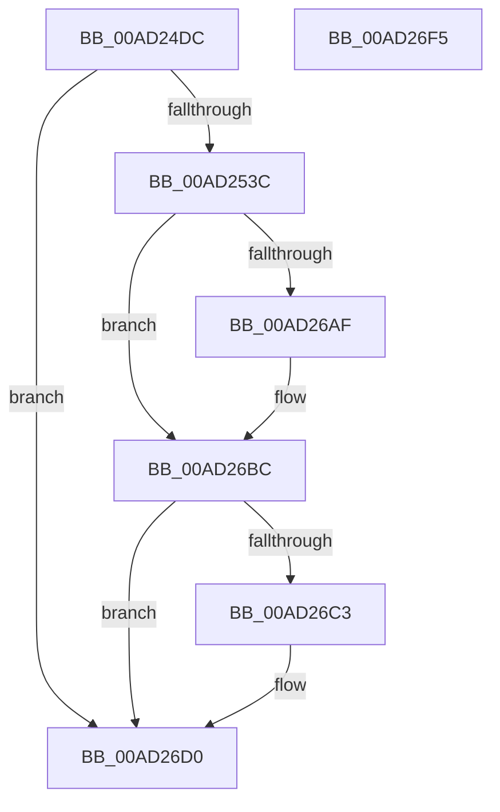

# PopDiagTracePowerTransitionEnd

- RVA: `0x00AD24DC`–`0x00AD26F6` (길이 `538` bytes)
- VA: `0x0000000140AD24DC`
- 실행 섹션: `PAGE`
- PDB 이름 있음: `예`; PDB Function 태그: `아니요`
- unwind 정보 RVA: `0x000BEA98`
- 디코드: `122`개 명령, `538/538` bytes 표시
- 미해석 바이트: `0` (있으면 어셈블리에 `.byte`로 보존)

> 이 문서는 커널 이미지의 기계어와 PDB 기호를 분석해 생성했습니다. 4번과 5번은 함수 원형과 자료형을 바이너리 사용 방식에서 추정한 C 해석이며 원본 소스 복구 결과는 아닙니다.

## 1. Dependencies

- 직접 호출 지점: **5**; 고유 호출 대상: **4**
- 직접 호출자로 확인된 함수: **1**
- RIP 상대 이미지 참조: **5**

### Outgoing calls
- `0x00AD258E` → [PopQueryMostRecentWakeSourceInfo](../75/PopQueryMostRecentWakeSourceInfo_function_0075C630.md) (function, `0x0075C630`)
- `0x00AD26A3` → [EtwWriteEndScenario](../A5/EtwWriteEndScenario_function_00A5B7F0.md) (function, `0x00A5B7F0`)
- `0x00AD26B7` → [ExFreePoolWithTag](../../poolcode/B8/ExFreePoolWithTag_function_00B82870.md) (function, `0x00B82870`)
- `0x00AD26CB` → [ExFreePoolWithTag](../../poolcode/B8/ExFreePoolWithTag_function_00B82870.md) (function, `0x00B82870`)
- `0x00AD26D7` → [_security_check_cookie](../../text/6A/_security_check_cookie_function_006AC640.md) (function, `0x006AC640`)

### Direct callers
- [PopIssueActionRequest](../A9/PopIssueActionRequest_function_00A9CE54.md) at `0x00A9D2E1`

### Static image references
- `0x00AD24FA` → RVA `0x00E0A740` (`.data`; read)
- `0x00AD250D` → RVA `0x00E67858` (`.data`; read)
- `0x00AD2636` → RVA `0x00F0B408` (`.data`; read)
- `0x00AD2640` → RVA `0x00021098` (`.rdata`; read)
- `0x00AD264B` → RVA `0x00E67870` (`.data`; read)

## 2. Other-region calls and transfers

- 다른 실행 섹션으로 향하는 call: **3**
  - `0x00AD26B7` → [ExFreePoolWithTag](../../poolcode/B8/ExFreePoolWithTag_function_00B82870.md) (`PAGE` → `POOLCODE`)
  - `0x00AD26CB` → [ExFreePoolWithTag](../../poolcode/B8/ExFreePoolWithTag_function_00B82870.md) (`PAGE` → `POOLCODE`)
  - `0x00AD26D7` → [_security_check_cookie](../../text/6A/_security_check_cookie_function_006AC640.md) (`PAGE` → `.text`)
- 별도 외부 분기/꼬리 이동을 확인하지 못했습니다.

## 3. Assembly (complete function range)

```asm
00AD24DC  48 8B C4                        mov rax, rsp
00AD24DF  48 89 58 10                     mov qword ptr [rax + 0x10], rbx
00AD24E3  48 89 70 18                     mov qword ptr [rax + 0x18], rsi
00AD24E7  48 89 78 20                     mov qword ptr [rax + 0x20], rdi
00AD24EB  89 48 08                        mov dword ptr [rax + 8], ecx
00AD24EE  55                              push rbp
00AD24EF  48 8D 68 88                     lea rbp, [rax - 0x78]
00AD24F3  48 81 EC 70 01 00 00            sub rsp, 0x170
00AD24FA  48 8B 05 3F 82 33 00            mov rax, qword ptr [rip + 0x33823f]
00AD2501  48 33 C4                        xor rax, rsp
00AD2504  48 89 45 68                     mov qword ptr [rbp + 0x68], rax
00AD2508  33 F6                           xor esi, esi
00AD250A  0F 57 C0                        xorps xmm0, xmm0
00AD250D  40 38 35 44 53 39 00            cmp byte ptr [rip + 0x395344], sil
00AD2514  0F 57 C9                        xorps xmm1, xmm1
00AD2517  40 88 74 24 41                  mov byte ptr [rsp + 0x41], sil
00AD251C  40 88 74 24 40                  mov byte ptr [rsp + 0x40], sil
00AD2521  89 74 24 5C                     mov dword ptr [rsp + 0x5c], esi
00AD2525  0F 11 45 A0                     movups xmmword ptr [rbp - 0x60], xmm0
00AD2529  0F 11 4D 90                     movups xmmword ptr [rbp - 0x70], xmm1
00AD252D  0F 11 45 80                     movups xmmword ptr [rbp - 0x80], xmm0
00AD2531  0F 11 4C 24 70                  movups xmmword ptr [rsp + 0x70], xmm1
00AD2536  0F 84 94 01 00 00               je 0x140ad26d0
00AD253C  48 B8 14 00 00 00 80 F7 FF FF   movabs rax, 0xfffff78000000014
00AD2546  4C 8D 4D 90                     lea r9, [rbp - 0x70]
00AD254A  4C 8D 45 80                     lea r8, [rbp - 0x80]
00AD254E  48 8D 54 24 70                  lea rdx, [rsp + 0x70]
00AD2553  48 8D 4C 24 58                  lea rcx, [rsp + 0x58]
00AD2558  48 8B 00                        mov rax, qword ptr [rax]
00AD255B  48 89 44 24 68                  mov qword ptr [rsp + 0x68], rax
00AD2560  48 8D 45 50                     lea rax, [rbp + 0x50]
00AD2564  48 89 44 24 60                  mov qword ptr [rsp + 0x60], rax
00AD2569  48 8D 44 24 41                  lea rax, [rsp + 0x41]
00AD256E  48 89 44 24 30                  mov qword ptr [rsp + 0x30], rax
00AD2573  48 8D 44 24 40                  lea rax, [rsp + 0x40]
00AD2578  48 89 44 24 28                  mov qword ptr [rsp + 0x28], rax
00AD257D  48 8D 45 A0                     lea rax, [rbp - 0x60]
00AD2581  48 89 44 24 20                  mov qword ptr [rsp + 0x20], rax
00AD2586  C7 44 24 58 00 00 16 00         mov dword ptr [rsp + 0x58], 0x160000
00AD258E  E8 9D A0 C8 FF                  call 0x14075c630
00AD2593  0F B7 44 24 70                  movzx eax, word ptr [rsp + 0x70]
00AD2598  48 8B 7D 98                     mov rdi, qword ptr [rbp - 0x68]
00AD259C  48 8B 5D A8                     mov rbx, qword ptr [rbp - 0x58]
00AD25A0  66 D1 E8                        shr ax, 1
00AD25A3  0F B7 C8                        movzx ecx, ax
00AD25A6  0F B7 45 80                     movzx eax, word ptr [rbp - 0x80]
00AD25AA  66 D1 E8                        shr ax, 1
00AD25AD  0F B7 D0                        movzx edx, ax
00AD25B0  0F B7 45 90                     movzx eax, word ptr [rbp - 0x70]
00AD25B4  66 D1 E8                        shr ax, 1
00AD25B7  44 0F B7 C0                     movzx r8d, ax
00AD25BB  0F B7 45 A0                     movzx eax, word ptr [rbp - 0x60]
00AD25BF  66 D1 E8                        shr ax, 1
00AD25C2  44 0F B7 C8                     movzx r9d, ax
00AD25C6  48 8D 85 80 00 00 00            lea rax, [rbp + 0x80]
00AD25CD  48 89 45 B0                     mov qword ptr [rbp - 0x50], rax
00AD25D1  48 8D 44 24 68                  lea rax, [rsp + 0x68]
00AD25D6  48 89 45 C0                     mov qword ptr [rbp - 0x40], rax
00AD25DA  48 8D 44 24 44                  lea rax, [rsp + 0x44]
00AD25DF  48 89 45 D0                     mov qword ptr [rbp - 0x30], rax
00AD25E3  48 8D 44 24 48                  lea rax, [rsp + 0x48]
00AD25E8  48 89 45 E0                     mov qword ptr [rbp - 0x20], rax
00AD25EC  48 8D 44 24 4C                  lea rax, [rsp + 0x4c]
00AD25F1  48 89 45 F0                     mov qword ptr [rbp - 0x10], rax
00AD25F5  48 8D 44 24 50                  lea rax, [rsp + 0x50]
00AD25FA  48 89 45 00                     mov qword ptr [rbp], rax
00AD25FE  48 8B 44 24 78                  mov rax, qword ptr [rsp + 0x78]
00AD2603  48 89 45 10                     mov qword ptr [rbp + 0x10], rax
00AD2607  48 8B 45 88                     mov rax, qword ptr [rbp - 0x78]
00AD260B  66 89 4C 24 44                  mov word ptr [rsp + 0x44], cx
00AD2610  03 C9                           add ecx, ecx
00AD2612  66 89 54 24 48                  mov word ptr [rsp + 0x48], dx
00AD2617  03 D2                           add edx, edx
00AD2619  66 44 89 44 24 4C               mov word ptr [rsp + 0x4c], r8w
00AD261F  45 03 C0                        add r8d, r8d
00AD2622  66 44 89 4C 24 50               mov word ptr [rsp + 0x50], r9w
00AD2628  45 03 C9                        add r9d, r9d
00AD262B  48 89 45 20                     mov qword ptr [rbp + 0x20], rax
00AD262F  48 8D 45 B0                     lea rax, [rbp - 0x50]
00AD2633  89 4D 18                        mov dword ptr [rbp + 0x18], ecx
00AD2636  48 8B 0D CB 8D 43 00            mov rcx, qword ptr [rip + 0x438dcb]
00AD263D  89 55 28                        mov dword ptr [rbp + 0x28], edx
00AD2640  48 8D 15 51 EA 54 FF            lea rdx, [rip - 0xab15af]
00AD2647  44 89 45 38                     mov dword ptr [rbp + 0x38], r8d
00AD264B  4C 8D 05 1E 52 39 00            lea r8, [rip + 0x39521e]
00AD2652  44 89 4D 48                     mov dword ptr [rbp + 0x48], r9d
00AD2656  44 8D 4E 0A                     lea r9d, [rsi + 0xa]
00AD265A  48 89 44 24 20                  mov qword ptr [rsp + 0x20], rax
00AD265F  48 C7 45 B8 04 00 00 00         mov qword ptr [rbp - 0x48], 4
00AD2667  48 C7 45 C8 08 00 00 00         mov qword ptr [rbp - 0x38], 8
00AD266F  48 C7 45 D8 02 00 00 00         mov qword ptr [rbp - 0x28], 2
00AD2677  48 C7 45 E8 02 00 00 00         mov qword ptr [rbp - 0x18], 2
00AD267F  48 C7 45 F8 02 00 00 00         mov qword ptr [rbp - 8], 2
00AD2687  48 C7 45 08 02 00 00 00         mov qword ptr [rbp + 8], 2
00AD268F  89 75 1C                        mov dword ptr [rbp + 0x1c], esi
00AD2692  89 75 2C                        mov dword ptr [rbp + 0x2c], esi
00AD2695  48 89 7D 30                     mov qword ptr [rbp + 0x30], rdi
00AD2699  89 75 3C                        mov dword ptr [rbp + 0x3c], esi
00AD269C  48 89 5D 40                     mov qword ptr [rbp + 0x40], rbx
00AD26A0  89 75 4C                        mov dword ptr [rbp + 0x4c], esi
00AD26A3  E8 48 91 F8 FF                  call 0x140a5b7f0
00AD26A8  40 38 74 24 40                  cmp byte ptr [rsp + 0x40], sil
00AD26AD  74 0D                           je 0x140ad26bc
00AD26AF  BA 50 64 69 67                  mov edx, 0x67696450
00AD26B4  48 8B CF                        mov rcx, rdi
00AD26B7  E8 B4 01 0B 00                  call 0x140b82870
00AD26BC  40 38 74 24 41                  cmp byte ptr [rsp + 0x41], sil
00AD26C1  74 0D                           je 0x140ad26d0
00AD26C3  BA 50 64 69 67                  mov edx, 0x67696450
00AD26C8  48 8B CB                        mov rcx, rbx
00AD26CB  E8 A0 01 0B 00                  call 0x140b82870
00AD26D0  48 8B 4D 68                     mov rcx, qword ptr [rbp + 0x68]
00AD26D4  48 33 CC                        xor rcx, rsp
00AD26D7  E8 64 9F BD FF                  call 0x1406ac640
00AD26DC  4C 8D 9C 24 70 01 00 00         lea r11, [rsp + 0x170]
00AD26E4  49 8B 5B 18                     mov rbx, qword ptr [r11 + 0x18]
00AD26E8  49 8B 73 20                     mov rsi, qword ptr [r11 + 0x20]
00AD26EC  49 8B 7B 28                     mov rdi, qword ptr [r11 + 0x28]
00AD26F0  49 8B E3                        mov rsp, r11
00AD26F3  5D                              pop rbp
00AD26F4  C3                              ret
00AD26F5  CC                              int3
```

## 4. C-style interpretation (structured pseudocode)

```c
__int64 __fastcall PopDiagTracePowerTransitionEnd(int a1)
{
    __int64 result;
    __int64 v_rsi;
    __int64 v_rsp;
    unsigned __int64 v_stack_m100;
    unsigned __int64 v_stack_m108;
    unsigned __int64 v_stack_m110;
    unsigned __int64 v_stack_m118;
    unsigned int v_stack_m11C;
    unsigned __int64 v_stack_m120;
    unsigned __int64 v_stack_m128;
    unsigned __int64 v_stack_m12C;
    unsigned __int64 v_stack_m130;
    unsigned __int64 v_stack_m134;
    unsigned __int8 v_stack_m137;
    unsigned __int8 v_stack_m138;
    unsigned __int64 v_stack_m148;
    unsigned __int64 v_stack_m150;
    unsigned __int64 v_stack_m158;
    unsigned __int64 v_stack_m8;

    *(unsigned __int64 *)(v_rsp + 16) = v_rbx;
    *(unsigned __int64 *)(v_rsp + 24) = v_rsi;
    *(unsigned __int64 *)(v_rsp + 32) = v_rdi;
    *(unsigned int *)(v_rsp + 8) = a1;
    v_rsp = (v_rsp) - (368);
    result = (*(unsigned __int64 *)(v_rip + 3375679)) ^ (v_rsp);
    *(unsigned __int64 *)(v_rsp - 120 + 104) = result;
    v_rsi = 0;
    v_stack_m137 = 0;
    v_stack_m138 = 0;
    v_stack_m11C = 0;
    *(unsigned __int64 *)(v_rsp - 120 - 96) = v_xmm0;
    *(unsigned __int64 *)(v_rsp - 120 - 112) = v_xmm1;
    *(unsigned __int64 *)(v_rsp - 120 - 128) = v_xmm0;
    v_stack_m108 = v_xmm1;
    if ((*(unsigned __int8 *)(v_rip + 3756868)) == 0) goto loc_00AD26D0;
    v_stack_m110 = *(unsigned __int64 *)(result);
    v_stack_m118 = v_rsp - 120 + 80;
    v_stack_m148 = v_stack_m137;
    v_stack_m150 = v_stack_m138;
    v_stack_m158 = v_rsp - 120 - 96;
    v_stack_m120 = 0x160000ULL;
    result = PopQueryMostRecentWakeSourceInfo(v_stack_m120, v_stack_m108, v_rsp - 120 - 128, v_rsp - 120 - 112);
    result = (unsigned __int16)((v_stack_m108) >> (1));
    result = (unsigned __int16)((*(unsigned __int16 *)(v_rsp - 120 - 128)) >> (1));
    result = (unsigned __int16)((*(unsigned __int16 *)(v_rsp - 120 - 112)) >> (1));
    result = (unsigned __int16)((*(unsigned __int16 *)(v_rsp - 120 - 96)) >> (1));
    *(unsigned __int64 *)(v_rsp - 120 - 80) = v_rsp - 120 + 128;
    *(unsigned __int64 *)(v_rsp - 120 - 64) = v_stack_m110;
    *(unsigned __int64 *)(v_rsp - 120 - 48) = v_stack_m134;
    *(unsigned __int64 *)(v_rsp - 120 - 32) = v_stack_m130;
    *(unsigned __int64 *)(v_rsp - 120 - 16) = v_stack_m12C;
    *(unsigned __int64 *)(v_rsp - 120) = v_stack_m128;
    *(unsigned __int64 *)(v_rsp - 120 + 16) = v_stack_m100;
    v_stack_m134 = (unsigned __int16)((unsigned __int16)(result));
    a1 = (unsigned int)(((unsigned __int16)(result)) + ((unsigned int)((unsigned __int16)(result))));
    v_stack_m130 = (unsigned __int16)((unsigned __int16)(result));
    a2 = (unsigned int)(((unsigned __int16)(result)) + ((unsigned int)((unsigned __int16)(result))));
    v_stack_m12C = (unsigned __int16)((unsigned __int16)(result));
    a3 = (unsigned int)(((unsigned __int16)(result)) + ((unsigned int)((unsigned __int16)(result))));
    v_stack_m128 = (unsigned __int16)((unsigned __int16)(result));
    a4 = (unsigned int)(((unsigned __int16)(result)) + ((unsigned int)((unsigned __int16)(result))));
    *(unsigned __int64 *)(v_rsp - 120 + 32) = *(unsigned __int64 *)(v_rsp - 120 - 120);
    *(unsigned int *)(v_rsp - 120 + 24) = a1;
    *(unsigned int *)(v_rsp - 120 + 40) = (unsigned int)(a2);
    *(unsigned int *)(v_rsp - 120 + 56) = (unsigned int)(a3);
    *(unsigned int *)(v_rsp - 120 + 72) = (unsigned int)(a4);
    v_stack_m158 = v_rsp - 120 - 80;
    *(unsigned __int64 *)(v_rsp - 120 - 72) = 4;
    *(unsigned __int64 *)(v_rsp - 120 - 56) = 8;
    *(unsigned __int64 *)(v_rsp - 120 - 40) = 2;
    *(unsigned __int64 *)(v_rsp - 120 - 24) = 2;
    *(unsigned __int64 *)(v_rsp - 120 - 8) = 2;
    *(unsigned __int64 *)(v_rsp - 120 + 8) = 2;
    *(unsigned int *)(v_rsp - 120 + 28) = 0;
    *(unsigned int *)(v_rsp - 120 + 44) = 0;
    *(unsigned __int64 *)(v_rsp - 120 + 48) = *(unsigned __int64 *)(v_rsp - 120 - 104);
    *(unsigned int *)(v_rsp - 120 + 60) = 0;
    *(unsigned __int64 *)(v_rsp - 120 + 64) = *(unsigned __int64 *)(v_rsp - 120 - 88);
    *(unsigned int *)(v_rsp - 120 + 76) = 0;
    result = EtwWriteEndScenario(*(unsigned __int64 *)(v_rip + 4427211), v_rip - 11212207, v_rip + 3756574, v_rsi + 10);
    if (v_stack_m138 != 0) {
        a2 = 0x67696450ULL;
        a1 = *(unsigned __int64 *)(v_rsp - 120 - 104);
        result = ExFreePoolWithTag(a1, a2, v_rip + 3756574, v_rsi + 10);
    }
    if (v_stack_m137 != 0) {
        a2 = 0x67696450ULL;
        a1 = *(unsigned __int64 *)(v_rsp - 120 - 88);
        result = ExFreePoolWithTag(a1, a2, v_rip + 3756574, v_rsi + 10);
    }
    a1 = (*(unsigned __int64 *)(v_rsp - 120 + 104)) ^ (v_rsp);
    result = _security_check_cookie(a1, a2, v_rip + 3756574, v_rsi + 10);
    return result;
}
```

## 5. (Beta) C Style

```c
int64_t PopDiagTracePowerTransitionEnd(int32_t Arg1)
{
    int64_t result;
    int64_t local_rsi;
    int64_t local_rsp;
    uint64_t v_stack_m100;
    uint64_t v_stack_m108;
    uint64_t v_stack_m110;
    uint64_t v_stack_m118;
    uint32_t v_stack_m11C;
    uint64_t v_stack_m120;
    uint64_t v_stack_m128;
    uint64_t v_stack_m12C;
    uint64_t v_stack_m130;
    uint64_t v_stack_m134;
    uint8_t v_stack_m137;
    uint8_t v_stack_m138;
    uint64_t v_stack_m148;
    uint64_t v_stack_m150;
    uint64_t v_stack_m158;
    uint64_t v_stack_m8;

    *(uint64_t *)(local_rsp + 0x10) = local_rbx;
    *(uint64_t *)(local_rsp + 0x18) = local_rsi;
    *(uint64_t *)(local_rsp + 0x20) = local_rdi;
    *(uint32_t *)(local_rsp + 0x8) = Arg1;
    local_rsp = (local_rsp) - (368);
    result = (*(uint64_t *)(v_rip + 0x33823F)) ^ (local_rsp);
    *(uint64_t *)(local_rsp - 0x78 + 0x68) = result;
    local_rsi = 0;
    v_stack_m137 = 0;
    v_stack_m138 = 0;
    v_stack_m11C = 0;
    *(uint64_t *)(local_rsp - 0x78 - 0x60) = v_xmm0;
    *(uint64_t *)(local_rsp - 0x78 - 0x70) = v_xmm1;
    *(uint64_t *)(local_rsp - 0x78 - 0x80) = v_xmm0;
    v_stack_m108 = v_xmm1;
    if ((*(uint8_t *)(v_rip + 0x395344)) == 0) goto loc_00AD26D0;
    v_stack_m110 = *(uint64_t *)(result);
    v_stack_m118 = local_rsp - 120 + 80;
    v_stack_m148 = v_stack_m137;
    v_stack_m150 = v_stack_m138;
    v_stack_m158 = local_rsp - 120 - 96;
    v_stack_m120 = 0x160000ULL;
    result = PopQueryMostRecentWakeSourceInfo(v_stack_m120, v_stack_m108, local_rsp - 120 - 128, local_rsp - 120 - 112);
    result = (uint16_t)((v_stack_m108) >> (1));
    result = (uint16_t)((*(uint16_t *)(local_rsp - 0x78 - 0x80)) >> (1));
    result = (uint16_t)((*(uint16_t *)(local_rsp - 0x78 - 0x70)) >> (1));
    result = (uint16_t)((*(uint16_t *)(local_rsp - 0x78 - 0x60)) >> (1));
    *(uint64_t *)(local_rsp - 0x78 - 0x50) = local_rsp - 120 + 128;
    *(uint64_t *)(local_rsp - 0x78 - 0x40) = v_stack_m110;
    *(uint64_t *)(local_rsp - 0x78 - 0x30) = v_stack_m134;
    *(uint64_t *)(local_rsp - 0x78 - 0x20) = v_stack_m130;
    *(uint64_t *)(local_rsp - 0x78 - 0x10) = v_stack_m12C;
    *(uint64_t *)(local_rsp - 0x78) = v_stack_m128;
    *(uint64_t *)(local_rsp - 0x78 + 0x10) = v_stack_m100;
    v_stack_m134 = (uint16_t)((uint16_t)(result));
    Arg1 = (uint32_t)(((uint16_t)(result)) + ((uint32_t)((uint16_t)(result))));
    v_stack_m130 = (uint16_t)((uint16_t)(result));
    a2 = (uint32_t)(((uint16_t)(result)) + ((uint32_t)((uint16_t)(result))));
    v_stack_m12C = (uint16_t)((uint16_t)(result));
    a3 = (uint32_t)(((uint16_t)(result)) + ((uint32_t)((uint16_t)(result))));
    v_stack_m128 = (uint16_t)((uint16_t)(result));
    a4 = (uint32_t)(((uint16_t)(result)) + ((uint32_t)((uint16_t)(result))));
    *(uint64_t *)(local_rsp - 0x78 + 0x20) = *(uint64_t *)(local_rsp - 0x78 - 0x78);
    *(uint32_t *)(local_rsp - 0x78 + 0x18) = Arg1;
    *(uint32_t *)(local_rsp - 0x78 + 0x28) = (uint32_t)(a2);
    *(uint32_t *)(local_rsp - 0x78 + 0x38) = (uint32_t)(a3);
    *(uint32_t *)(local_rsp - 0x78 + 0x48) = (uint32_t)(a4);
    v_stack_m158 = local_rsp - 120 - 80;
    *(uint64_t *)(local_rsp - 0x78 - 0x48) = 4;
    *(uint64_t *)(local_rsp - 0x78 - 0x38) = 8;
    *(uint64_t *)(local_rsp - 0x78 - 0x28) = 2;
    *(uint64_t *)(local_rsp - 0x78 - 0x18) = 2;
    *(uint64_t *)(local_rsp - 0x78 - 0x8) = 2;
    *(uint64_t *)(local_rsp - 0x78 + 0x8) = 2;
    *(uint32_t *)(local_rsp - 0x78 + 0x1C) = 0;
    *(uint32_t *)(local_rsp - 0x78 + 0x2C) = 0;
    *(uint64_t *)(local_rsp - 0x78 + 0x30) = *(uint64_t *)(local_rsp - 0x78 - 0x68);
    *(uint32_t *)(local_rsp - 0x78 + 0x3C) = 0;
    *(uint64_t *)(local_rsp - 0x78 + 0x40) = *(uint64_t *)(local_rsp - 0x78 - 0x58);
    *(uint32_t *)(local_rsp - 0x78 + 0x4C) = 0;
    result = EtwWriteEndScenario(*(uint64_t *)(v_rip + 0x438DCB), v_rip - 11212207, v_rip + 3756574, local_rsi + 10);
    if (v_stack_m138 != 0) {
        a2 = 0x67696450ULL;
        Arg1 = *(uint64_t *)(local_rsp - 0x78 - 0x68);
        result = ExFreePoolWithTag(Arg1, a2, v_rip + 3756574, local_rsi + 10);
    }
    if (v_stack_m137 != 0) {
        a2 = 0x67696450ULL;
        Arg1 = *(uint64_t *)(local_rsp - 0x78 - 0x58);
        result = ExFreePoolWithTag(Arg1, a2, v_rip + 3756574, local_rsi + 10);
    }
    Arg1 = (*(uint64_t *)(local_rsp - 0x78 + 0x68)) ^ (local_rsp);
    result = _security_check_cookie(Arg1, a2, v_rip + 3756574, local_rsi + 10);
    return result;
}
```

## 6. Execution-region graph

[열기: 2D/3D 그래프와 함수 탐색 컨트롤 패널](../../../control-panel.html?section=page&rva=0x00AD24DC&view=graph)

- 2D 그래프는 위에서 아래로 흐르고, 3D 그래프는 빈 공간을 드래그해 회전합니다. Shift+드래그는 이동, 휠은 확대·축소, 함수 노드 선택은 대상 보고서 이동입니다.

### Static fallback


