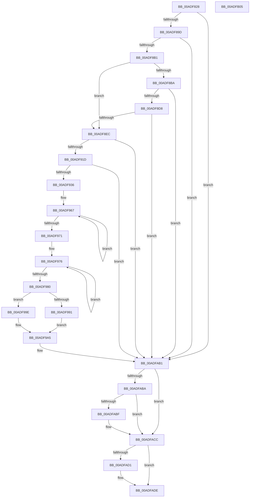

# PopDiagTraceThermalRequest

- RVA: `0x00ADF828`–`0x00ADFB06` (길이 `734` bytes)
- VA: `0x0000000140ADF828`
- 실행 섹션: `PAGE`
- PDB 이름 있음: `예`; PDB Function 태그: `아니요`
- unwind 정보 RVA: `0x000CC7C4`
- 디코드: `178`개 명령, `734/734` bytes 표시
- 미해석 바이트: `0` (있으면 어셈블리에 `.byte`로 보존)

> 이 문서는 커널 이미지의 기계어와 PDB 기호를 분석해 생성했습니다. 4번과 5번은 함수 원형과 자료형을 바이너리 사용 방식에서 추정한 C 해석이며 원본 소스 복구 결과는 아닙니다.

## 1. Dependencies

- 직접 호출 지점: **12**; 고유 호출 대상: **9**
- 직접 호출자로 확인된 함수: **4**
- RIP 상대 이미지 참조: **3**

### Outgoing calls
- `0x00ADF8A4` → [EtwEventEnabled](../../text/39/EtwEventEnabled_function_00392450.md) (function, `0x00392450`)
- `0x00ADF8B1` → [Feature_Servicing_CoolingFrameworkDeviceCleanupFix__private_IsEnabledDeviceUsageNoInline](../../text/5D/Feature_Servicing_CoolingFrameworkDeviceCleanupFix__private_IsEnabledDeviceUsageNoInline_function_005D1004.md) (function, `0x005D1004`)
- `0x00ADF8C7` → [IoGetDeviceAttachmentBaseRefWithTag](../../text/27/IoGetDeviceAttachmentBaseRefWithTag_function_00272788.md) (function, `0x00272788`)
- `0x00ADF8F7` → [PoStoreDiagnosticContext](../../text/23/PoStoreDiagnosticContext_function_0023009C.md) (function, `0x0023009C`)
- `0x00ADF90C` → [ExAllocatePool2](../../poolcode/B8/ExAllocatePool2_function_00B820F0.md) (function, `0x00B820F0`)
- `0x00ADF929` → [PoStoreDiagnosticContext](../../text/23/PoStoreDiagnosticContext_function_0023009C.md) (function, `0x0023009C`)
- `0x00ADF985` → [Feature_Servicing_CoolingFrameworkDeviceCleanupFix__private_IsEnabledDeviceUsageNoInline](../../text/5D/Feature_Servicing_CoolingFrameworkDeviceCleanupFix__private_IsEnabledDeviceUsageNoInline_function_005D1004.md) (function, `0x005D1004`)
- `0x00ADFAAC` → [EtwWrite](../../text/41/EtwWrite_function_0041C720.md) (function, `0x0041C720`)
- `0x00ADFAB1` → [Feature_Servicing_CoolingFrameworkDeviceCleanupFix__private_IsEnabledDeviceUsageNoInline](../../text/5D/Feature_Servicing_CoolingFrameworkDeviceCleanupFix__private_IsEnabledDeviceUsageNoInline_function_005D1004.md) (function, `0x005D1004`)
- `0x00ADFAC7` → [ObfDereferenceObjectWithTag](../../text/2F/ObfDereferenceObjectWithTag_function_002F78E0.md) (function, `0x002F78E0`)
- `0x00ADFAD9` → [ExFreePoolWithTag](../../poolcode/B8/ExFreePoolWithTag_function_00B82870.md) (function, `0x00B82870`)
- `0x00ADFAE5` → [_security_check_cookie](../../text/6A/_security_check_cookie_function_006AC640.md) (function, `0x006AC640`)

### Direct callers
- [PopAssociateThermalRequest](../75/PopAssociateThermalRequest_function_00756E78.md) at `0x00757070`
- [PopOrphanCoolingExtension](../75/PopOrphanCoolingExtension_function_00757474.md) at `0x00757525`
- [PopRundownThermalRequests](../A3/PopRundownThermalRequests_function_00A396B0.md) at `0x00A3975F`
- [PopDeactiveThermalRequest](PopDeactiveThermalRequest_function_00ADF634.md) at `0x00ADF6C8`

### Static image references
- `0x00ADF844` → RVA `0x00E0A740` (`.data`; read)
- `0x00ADF858` → RVA `0x00E67858` (`.data`; read)
- `0x00ADF89D` → RVA `0x00F0B408` (`.data`; read)

## 2. Other-region calls and transfers

- 다른 실행 섹션으로 향하는 call: **12**
  - `0x00ADF8A4` → [EtwEventEnabled](../../text/39/EtwEventEnabled_function_00392450.md) (`PAGE` → `.text`)
  - `0x00ADF8B1` → [Feature_Servicing_CoolingFrameworkDeviceCleanupFix__private_IsEnabledDeviceUsageNoInline](../../text/5D/Feature_Servicing_CoolingFrameworkDeviceCleanupFix__private_IsEnabledDeviceUsageNoInline_function_005D1004.md) (`PAGE` → `.text`)
  - `0x00ADF8C7` → [IoGetDeviceAttachmentBaseRefWithTag](../../text/27/IoGetDeviceAttachmentBaseRefWithTag_function_00272788.md) (`PAGE` → `.text`)
  - `0x00ADF8F7` → [PoStoreDiagnosticContext](../../text/23/PoStoreDiagnosticContext_function_0023009C.md) (`PAGE` → `.text`)
  - `0x00ADF90C` → [ExAllocatePool2](../../poolcode/B8/ExAllocatePool2_function_00B820F0.md) (`PAGE` → `POOLCODE`)
  - `0x00ADF929` → [PoStoreDiagnosticContext](../../text/23/PoStoreDiagnosticContext_function_0023009C.md) (`PAGE` → `.text`)
  - `0x00ADF985` → [Feature_Servicing_CoolingFrameworkDeviceCleanupFix__private_IsEnabledDeviceUsageNoInline](../../text/5D/Feature_Servicing_CoolingFrameworkDeviceCleanupFix__private_IsEnabledDeviceUsageNoInline_function_005D1004.md) (`PAGE` → `.text`)
  - `0x00ADFAAC` → [EtwWrite](../../text/41/EtwWrite_function_0041C720.md) (`PAGE` → `.text`)
  - `0x00ADFAB1` → [Feature_Servicing_CoolingFrameworkDeviceCleanupFix__private_IsEnabledDeviceUsageNoInline](../../text/5D/Feature_Servicing_CoolingFrameworkDeviceCleanupFix__private_IsEnabledDeviceUsageNoInline_function_005D1004.md) (`PAGE` → `.text`)
  - `0x00ADFAC7` → [ObfDereferenceObjectWithTag](../../text/2F/ObfDereferenceObjectWithTag_function_002F78E0.md) (`PAGE` → `.text`)
  - `0x00ADFAD9` → [ExFreePoolWithTag](../../poolcode/B8/ExFreePoolWithTag_function_00B82870.md) (`PAGE` → `POOLCODE`)
  - `0x00ADFAE5` → [_security_check_cookie](../../text/6A/_security_check_cookie_function_006AC640.md) (`PAGE` → `.text`)
- 별도 외부 분기/꼬리 이동을 확인하지 못했습니다.

## 3. Assembly (complete function range)

```asm
00ADF828  48 89 5C 24 18                  mov qword ptr [rsp + 0x18], rbx
00ADF82D  55                              push rbp
00ADF82E  56                              push rsi
00ADF82F  57                              push rdi
00ADF830  41 54                           push r12
00ADF832  41 55                           push r13
00ADF834  41 56                           push r14
00ADF836  41 57                           push r15
00ADF838  48 8D 6C 24 E0                  lea rbp, [rsp - 0x20]
00ADF83D  48 81 EC 20 01 00 00            sub rsp, 0x120
00ADF844  48 8B 05 F5 AE 32 00            mov rax, qword ptr [rip + 0x32aef5]
00ADF84B  48 33 C4                        xor rax, rsp
00ADF84E  48 89 45 10                     mov qword ptr [rbp + 0x10], rax
00ADF852  45 33 E4                        xor r12d, r12d
00ADF855  4C 8B EA                        mov r13, rdx
00ADF858  44 38 25 F9 7F 38 00            cmp byte ptr [rip + 0x387ff9], r12b
00ADF85F  48 8B F1                        mov rsi, rcx
00ADF862  44 89 64 24 44                  mov dword ptr [rsp + 0x44], r12d
00ADF867  41 8B FC                        mov edi, r12d
00ADF86A  66 44 89 64 24 40               mov word ptr [rsp + 0x40], r12w
00ADF870  45 8B F4                        mov r14d, r12d
00ADF873  66 44 89 64 24 34               mov word ptr [rsp + 0x34], r12w
00ADF879  41 8B DC                        mov ebx, r12d
00ADF87C  66 44 89 64 24 38               mov word ptr [rsp + 0x38], r12w
00ADF882  66 44 89 64 24 3C               mov word ptr [rsp + 0x3c], r12w
00ADF888  4C 89 64 24 48                  mov qword ptr [rsp + 0x48], r12
00ADF88D  44 88 64 24 30                  mov byte ptr [rsp + 0x30], r12b
00ADF892  4C 89 64 24 50                  mov qword ptr [rsp + 0x50], r12
00ADF897  0F 84 14 02 00 00               je 0x140adfab1
00ADF89D  48 8B 0D 64 BB 42 00            mov rcx, qword ptr [rip + 0x42bb64]
00ADF8A4  E8 A7 2B 8B FF                  call 0x140392450
00ADF8A9  84 C0                           test al, al
00ADF8AB  0F 84 00 02 00 00               je 0x140adfab1
00ADF8B1  E8 4E 17 AF FF                  call 0x1405d1004
00ADF8B6  85 C0                           test eax, eax
00ADF8B8  75 32                           jne 0x140adf8ec
00ADF8BA  48 8B 4E 20                     mov rcx, qword ptr [rsi + 0x20]
00ADF8BE  BA 50 6F 44 67                  mov edx, 0x67446f50
00ADF8C3  48 8B 49 40                     mov rcx, qword ptr [rcx + 0x40]
00ADF8C7  E8 BC 2E 79 FF                  call 0x140272788
00ADF8CC  48 8B F8                        mov rdi, rax
00ADF8CF  48 85 C0                        test rax, rax
00ADF8D2  0F 84 D9 01 00 00               je 0x140adfab1
00ADF8D8  48 8B 88 38 01 00 00            mov rcx, qword ptr [rax + 0x138]
00ADF8DF  4C 8B 71 28                     mov r14, qword ptr [rcx + 0x28]
00ADF8E3  4D 85 F6                        test r14, r14
00ADF8E6  0F 84 C5 01 00 00               je 0x140adfab1
00ADF8EC  48 8B 4E 18                     mov rcx, qword ptr [rsi + 0x18]
00ADF8F0  4C 8D 44 24 48                  lea r8, [rsp + 0x48]
00ADF8F5  33 D2                           xor edx, edx
00ADF8F7  E8 A0 07 75 FF                  call 0x14023009c
00ADF8FC  48 8B 54 24 48                  mov rdx, qword ptr [rsp + 0x48]
00ADF901  41 B8 54 56 45 50               mov r8d, 0x50455654
00ADF907  B9 00 01 00 00                  mov ecx, 0x100
00ADF90C  E8 DF 27 0A 00                  call 0x140b820f0
00ADF911  48 8B D8                        mov rbx, rax
00ADF914  48 85 C0                        test rax, rax
00ADF917  0F 84 94 01 00 00               je 0x140adfab1
00ADF91D  48 8B 4E 18                     mov rcx, qword ptr [rsi + 0x18]
00ADF921  4C 8D 44 24 48                  lea r8, [rsp + 0x48]
00ADF926  48 8B D0                        mov rdx, rax
00ADF929  E8 6E 07 75 FF                  call 0x14023009c
00ADF92E  85 C0                           test eax, eax
00ADF930  0F 88 7B 01 00 00               js 0x140adfab1
00ADF936  48 8B 43 20                     mov rax, qword ptr [rbx + 0x20]
00ADF93A  4C 8B 63 10                     mov r12, qword ptr [rbx + 0x10]
00ADF93E  48 03 C3                        add rax, rbx
00ADF941  4C 8B 7B 18                     mov r15, qword ptr [rbx + 0x18]
00ADF945  4C 03 E3                        add r12, rbx
00ADF948  48 89 44 24 58                  mov qword ptr [rsp + 0x58], rax
00ADF94D  4C 03 FB                        add r15, rbx
00ADF950  0F B7 44 24 48                  movzx eax, word ptr [rsp + 0x48]
00ADF955  66 2B 43 20                     sub ax, word ptr [rbx + 0x20]
00ADF959  66 89 44 24 3C                  mov word ptr [rsp + 0x3c], ax
00ADF95E  48 83 C8 FF                     or rax, 0xffffffffffffffff
00ADF962  48 8B C8                        mov rcx, rax
00ADF965  33 D2                           xor edx, edx
00ADF967  48 FF C1                        inc rcx
00ADF96A  66 41 39 14 4C                  cmp word ptr [r12 + rcx*2], dx
00ADF96F  75 F6                           jne 0x140adf967
00ADF971  66 89 4C 24 34                  mov word ptr [rsp + 0x34], cx
00ADF976  48 FF C0                        inc rax
00ADF979  66 41 39 14 47                  cmp word ptr [r15 + rax*2], dx
00ADF97E  75 F6                           jne 0x140adf976
00ADF980  66 89 44 24 38                  mov word ptr [rsp + 0x38], ax
00ADF985  E8 7A 16 AF FF                  call 0x1405d1004
00ADF98A  45 33 C0                        xor r8d, r8d
00ADF98D  85 C0                           test eax, eax
00ADF98F  74 0D                           je 0x140adf99e
00ADF991  48 8B 56 20                     mov rdx, qword ptr [rsi + 0x20]
00ADF995  48 81 C2 A0 00 00 00            add rdx, 0xa0
00ADF99C  EB 07                           jmp 0x140adf9a5
00ADF99E  49 8D 96 80 00 00 00            lea rdx, [r14 + 0x80]
00ADF9A5  0F B7 02                        movzx eax, word ptr [rdx]
00ADF9A8  66 D1 E8                        shr ax, 1
00ADF9AB  44 38 46 11                     cmp byte ptr [rsi + 0x11], r8b
00ADF9AF  66 89 44 24 40                  mov word ptr [rsp + 0x40], ax
00ADF9B4  41 8B C0                        mov eax, r8d
00ADF9B7  0F 95 C0                        setne al
00ADF9BA  48 89 74 24 50                  mov qword ptr [rsp + 0x50], rsi
00ADF9BF  89 44 24 44                     mov dword ptr [rsp + 0x44], eax
00ADF9C3  8A 46 10                        mov al, byte ptr [rsi + 0x10]
00ADF9C6  88 44 24 30                     mov byte ptr [rsp + 0x30], al
00ADF9CA  48 8D 44 24 30                  lea rax, [rsp + 0x30]
00ADF9CF  48 89 44 24 60                  mov qword ptr [rsp + 0x60], rax
00ADF9D4  48 8D 44 24 44                  lea rax, [rsp + 0x44]
00ADF9D9  48 89 44 24 70                  mov qword ptr [rsp + 0x70], rax
00ADF9DE  48 8D 44 24 50                  lea rax, [rsp + 0x50]
00ADF9E3  48 89 45 80                     mov qword ptr [rbp - 0x80], rax
00ADF9E7  48 8D 44 24 40                  lea rax, [rsp + 0x40]
00ADF9EC  48 89 45 90                     mov qword ptr [rbp - 0x70], rax
00ADF9F0  48 8D 44 24 34                  lea rax, [rsp + 0x34]
00ADF9F5  48 89 45 A0                     mov qword ptr [rbp - 0x60], rax
00ADF9F9  48 8D 44 24 38                  lea rax, [rsp + 0x38]
00ADF9FE  48 89 45 B0                     mov qword ptr [rbp - 0x50], rax
00ADFA02  48 8D 44 24 3C                  lea rax, [rsp + 0x3c]
00ADFA07  48 89 45 C0                     mov qword ptr [rbp - 0x40], rax
00ADFA0B  48 C7 44 24 68 01 00 00 00      mov qword ptr [rsp + 0x68], 1
00ADFA14  48 C7 44 24 78 04 00 00 00      mov qword ptr [rsp + 0x78], 4
00ADFA1D  48 C7 45 88 08 00 00 00         mov qword ptr [rbp - 0x78], 8
00ADFA25  48 C7 45 98 02 00 00 00         mov qword ptr [rbp - 0x68], 2
00ADFA2D  48 C7 45 A8 02 00 00 00         mov qword ptr [rbp - 0x58], 2
00ADFA35  48 C7 45 B8 02 00 00 00         mov qword ptr [rbp - 0x48], 2
00ADFA3D  48 C7 45 C8 02 00 00 00         mov qword ptr [rbp - 0x38], 2
00ADFA45  48 8B 42 08                     mov rax, qword ptr [rdx + 8]
00ADFA49  0F B7 0A                        movzx ecx, word ptr [rdx]
00ADFA4C  49 8B D5                        mov rdx, r13
00ADFA4F  48 89 45 D0                     mov qword ptr [rbp - 0x30], rax
00ADFA53  0F B7 44 24 34                  movzx eax, word ptr [rsp + 0x34]
00ADFA58  03 C0                           add eax, eax
00ADFA5A  4C 89 65 E0                     mov qword ptr [rbp - 0x20], r12
00ADFA5E  89 45 E8                        mov dword ptr [rbp - 0x18], eax
00ADFA61  45 33 E4                        xor r12d, r12d
00ADFA64  0F B7 44 24 38                  movzx eax, word ptr [rsp + 0x38]
00ADFA69  03 C0                           add eax, eax
00ADFA6B  89 4D D8                        mov dword ptr [rbp - 0x28], ecx
00ADFA6E  48 8B 0D 93 B9 42 00            mov rcx, qword ptr [rip + 0x42b993]
00ADFA75  89 45 F8                        mov dword ptr [rbp - 8], eax
00ADFA78  45 8D 4C 24 0B                  lea r9d, [r12 + 0xb]
00ADFA7D  48 8B 44 24 58                  mov rax, qword ptr [rsp + 0x58]
00ADFA82  48 89 45 00                     mov qword ptr [rbp], rax
00ADFA86  0F B7 44 24 3C                  movzx eax, word ptr [rsp + 0x3c]
00ADFA8B  89 45 08                        mov dword ptr [rbp + 8], eax
00ADFA8E  48 8D 44 24 60                  lea rax, [rsp + 0x60]
00ADFA93  48 89 44 24 20                  mov qword ptr [rsp + 0x20], rax
00ADFA98  44 89 45 DC                     mov dword ptr [rbp - 0x24], r8d
00ADFA9C  44 89 65 EC                     mov dword ptr [rbp - 0x14], r12d
00ADFAA0  4C 89 7D F0                     mov qword ptr [rbp - 0x10], r15
00ADFAA4  44 89 65 FC                     mov dword ptr [rbp - 4], r12d
00ADFAA8  44 89 65 0C                     mov dword ptr [rbp + 0xc], r12d
00ADFAAC  E8 6F CC 93 FF                  call 0x14041c720
00ADFAB1  E8 4E 15 AF FF                  call 0x1405d1004
00ADFAB6  85 C0                           test eax, eax
00ADFAB8  75 12                           jne 0x140adfacc
00ADFABA  48 85 FF                        test rdi, rdi
00ADFABD  74 0D                           je 0x140adfacc
00ADFABF  BA 50 6F 44 67                  mov edx, 0x67446f50
00ADFAC4  48 8B CF                        mov rcx, rdi
00ADFAC7  E8 14 7E 81 FF                  call 0x1402f78e0
00ADFACC  48 85 DB                        test rbx, rbx
00ADFACF  74 0D                           je 0x140adfade
00ADFAD1  BA 54 56 45 50                  mov edx, 0x50455654
00ADFAD6  48 8B CB                        mov rcx, rbx
00ADFAD9  E8 92 2D 0A 00                  call 0x140b82870
00ADFADE  48 8B 4D 10                     mov rcx, qword ptr [rbp + 0x10]
00ADFAE2  48 33 CC                        xor rcx, rsp
00ADFAE5  E8 56 CB BC FF                  call 0x1406ac640
00ADFAEA  48 8B 9C 24 70 01 00 00         mov rbx, qword ptr [rsp + 0x170]
00ADFAF2  48 81 C4 20 01 00 00            add rsp, 0x120
00ADFAF9  41 5F                           pop r15
00ADFAFB  41 5E                           pop r14
00ADFAFD  41 5D                           pop r13
00ADFAFF  41 5C                           pop r12
00ADFB01  5F                              pop rdi
00ADFB02  5E                              pop rsi
00ADFB03  5D                              pop rbp
00ADFB04  C3                              ret
00ADFB05  CC                              int3
```

## 4. C-style interpretation (structured pseudocode)

```c
__int64 __fastcall PopDiagTraceThermalRequest(__int64 a1, __int64 a2)
{
    __int64 result;
    __int64 v_r12;
    __int64 v_r15;
    __int64 v_rsp;
    unsigned __int64 v_stack_m100;
    unsigned __int64 v_stack_m108;
    unsigned __int64 v_stack_m110;
    unsigned int v_stack_m114;
    unsigned __int16 v_stack_m118;
    unsigned __int16 v_stack_m11C;
    unsigned __int16 v_stack_m120;
    unsigned __int16 v_stack_m124;
    unsigned __int8 v_stack_m128;
    unsigned __int64 v_stack_m138;
    unsigned __int64 v_stack_m48;
    unsigned int v_stack_m4C;
    unsigned int v_stack_m50;
    unsigned __int64 v_stack_m58;
    unsigned int v_stack_m5C;
    unsigned int v_stack_m60;
    unsigned __int64 v_stack_m68;
    unsigned int v_stack_m6C;
    unsigned int v_stack_m70;
    unsigned __int64 v_stack_m78;
    unsigned int v_stack_m7C;
    unsigned int v_stack_m80;
    unsigned __int64 v_stack_m88;
    unsigned __int64 v_stack_m90;
    unsigned __int64 v_stack_m98;
    unsigned __int64 v_stack_mA0;
    unsigned __int64 v_stack_mA8;
    unsigned __int64 v_stack_mB0;
    unsigned __int64 v_stack_mB8;
    unsigned __int64 v_stack_mC0;
    unsigned __int64 v_stack_mC8;
    unsigned __int64 v_stack_mD0;
    unsigned __int64 v_stack_mD8;
    unsigned __int64 v_stack_mE0;
    unsigned __int64 v_stack_mE8;
    unsigned __int64 v_stack_mF0;
    unsigned __int64 v_stack_mF8;
    unsigned __int64 v_stack_p18;

    v_stack_p18 = v_rbx;
    v_rsp = (v_rsp) - (288);
    result = (*(unsigned __int64 *)(v_rip + 3321589)) ^ (v_rsp);
    v_stack_m48 = result;
    v_r12 = 0;
    v_stack_m114 = 0;
    v_stack_m118 = 0;
    v_stack_m124 = 0;
    v_stack_m120 = 0;
    v_stack_m11C = 0;
    v_stack_m110 = 0;
    v_stack_m128 = 0;
    v_stack_m108 = 0;
    if ((*(unsigned __int8 *)(v_rip + 3702777)) == 0) goto loc_00ADFAB1;
    result = EtwEventEnabled(*(unsigned __int64 *)(v_rip + 4373348), a2, a3, a4);
    if ((unsigned __int8)(result) == 0) goto loc_00ADFAB1;
    result = Feature_Servicing_CoolingFrameworkDeviceCleanupFix__private_IsEnabledDeviceUsageNoInline(*(unsigned __int64 *)(v_rip + 4373348), a2, a3, a4);
    if ((unsigned int)(result) != 0) goto loc_00ADF8EC;
    result = IoGetDeviceAttachmentBaseRefWithTag(*(unsigned __int64 *)(*(unsigned __int64 *)(a1 + 32) + 64), (unsigned int)(0x67446F50ULL), a3, a4);
    if (result == 0) goto loc_00ADFAB1;
    if (*(unsigned __int64 *)(*(unsigned __int64 *)(result + 312) + 40) == 0) goto loc_00ADFAB1;
loc_00ADF8EC:
    a2 = 0;
    result = PoStoreDiagnosticContext(*(unsigned __int64 *)(a1 + 24), a2, v_stack_m110, a4);
    result = ExAllocatePool2(256, v_stack_m110, (unsigned int)(0x50455654ULL), a4);
    if (result == 0) goto loc_00ADFAB1;
    result = PoStoreDiagnosticContext(*(unsigned __int64 *)(a1 + 24), result, v_stack_m110, a4);
    if (sign_flag) goto loc_00ADFAB1;
    result = (*(unsigned __int64 *)(result + 32)) + (result);
    v_r12 = (*(unsigned __int64 *)(result + 16)) + (result);
    v_stack_m100 = result;
    v_r15 = (*(unsigned __int64 *)(result + 24)) + (result);
    result = (unsigned __int16)((v_stack_m110) - (*(unsigned __int16 *)(result + 32)));
    v_stack_m11C = (unsigned __int16)(result);
    result = (result) | (-1);
    a2 = 0;
loc_00ADF967:
    a1 = (result) + 1;
    if ((*(unsigned __int16 *)(v_r12 + a1 * 2)) != 0) goto loc_00ADF967;
    v_stack_m124 = (unsigned __int16)(a1);
loc_00ADF976:
    result = (result) + 1;
    if ((*(unsigned __int16 *)(v_r15 + result * 2)) != 0) goto loc_00ADF976;
    v_stack_m120 = (unsigned __int16)(result);
    result = Feature_Servicing_CoolingFrameworkDeviceCleanupFix__private_IsEnabledDeviceUsageNoInline(a1, a2, v_stack_m110, a4);
    a3 = 0;
    if ((unsigned int)(result) == 0) goto loc_00ADF99E;
    a2 = (*(unsigned __int64 *)(a1 + 32)) + (160);
    goto loc_00ADF9A5;
loc_00ADF99E:
loc_00ADF9A5:
    result = (unsigned __int16)((*(unsigned __int16 *)(*(unsigned __int64 *)(*(unsigned __int64 *)(result + 312) + 40) + 128)) >> (1));
    v_stack_m118 = (unsigned __int16)(result);
    result = ((*(unsigned __int8 *)(a1 + 17)) != 0) ? 1 : 0;
    v_stack_m108 = a1;
    v_stack_m114 = (unsigned int)(result);
    v_stack_m128 = (unsigned __int8)(*(unsigned __int8 *)(a1 + 16));
    v_stack_mF8 = v_stack_m128;
    v_stack_mE8 = v_stack_m114;
    v_stack_mD8 = v_stack_m108;
    v_stack_mC8 = v_stack_m118;
    v_stack_mB8 = v_stack_m124;
    v_stack_mA8 = v_stack_m120;
    v_stack_m98 = v_stack_m11C;
    v_stack_mF0 = 1;
    v_stack_mE0 = 4;
    v_stack_mD0 = 8;
    v_stack_mC0 = 2;
    v_stack_mB0 = 2;
    v_stack_mA0 = 2;
    v_stack_m90 = 2;
    v_stack_m88 = *(unsigned __int64 *)(*(unsigned __int64 *)(*(unsigned __int64 *)(result + 312) + 40) + 128 + 8);
    result = (unsigned int)((v_stack_m124) + ((unsigned int)(v_stack_m124)));
    v_stack_m78 = v_r12;
    v_stack_m70 = (unsigned int)(result);
    v_r12 = 0;
    result = (unsigned int)((v_stack_m120) + ((unsigned int)(v_stack_m120)));
    v_stack_m80 = (unsigned int)(*(unsigned __int16 *)(*(unsigned __int64 *)(*(unsigned __int64 *)(result + 312) + 40) + 128));
    v_stack_m60 = (unsigned int)(result);
    v_stack_m58 = v_stack_m100;
    v_stack_m50 = (unsigned int)(v_stack_m11C);
    v_stack_m138 = v_stack_mF8;
    v_stack_m7C = 0;
    v_stack_m6C = 0;
    v_stack_m68 = v_r15;
    v_stack_m5C = 0;
    v_stack_m4C = 0;
    result = EtwWrite(*(unsigned __int64 *)(v_rip + 4372883), a2, a3, v_r12 + 11);
loc_00ADFAB1:
    result = Feature_Servicing_CoolingFrameworkDeviceCleanupFix__private_IsEnabledDeviceUsageNoInline(*(unsigned __int64 *)(v_rip + 4372883), a2, a3, v_r12 + 11);
    if ((unsigned int)(result) != 0) goto loc_00ADFACC;
    if (result != 0) {
        a2 = 0x67446F50ULL;
        a1 = result;
        result = ObfDereferenceObjectWithTag(a1, a2, a3, v_r12 + 11);
    }
    if (result != 0) {
        a2 = 0x50455654ULL;
        a1 = result;
        result = ExFreePoolWithTag(a1, a2, a3, v_r12 + 11);
    }
    a1 = (v_stack_m48) ^ (v_rsp);
    result = _security_check_cookie(a1, a2, a3, v_r12 + 11);
    v_rsp = (v_rsp) + (288);
    return result;
}
```

## 5. (Beta) C Style

```c
int64_t PopDiagTraceThermalRequest(void *Arg1, int64_t Arg2)
{
    uint8_t *arg1 = (uint8_t *)Arg1;

    int64_t result;
    int64_t local_r12;
    int64_t local_r15;
    int64_t local_rsp;
    uint64_t v_stack_m100;
    uint64_t v_stack_m108;
    uint64_t v_stack_m110;
    uint32_t v_stack_m114;
    uint16_t v_stack_m118;
    uint16_t v_stack_m11C;
    uint16_t v_stack_m120;
    uint16_t v_stack_m124;
    uint8_t v_stack_m128;
    uint64_t v_stack_m138;
    uint64_t v_stack_m48;
    uint32_t v_stack_m4C;
    uint32_t v_stack_m50;
    uint64_t v_stack_m58;
    uint32_t v_stack_m5C;
    uint32_t v_stack_m60;
    uint64_t v_stack_m68;
    uint32_t v_stack_m6C;
    uint32_t v_stack_m70;
    uint64_t v_stack_m78;
    uint32_t v_stack_m7C;
    uint32_t v_stack_m80;
    uint64_t v_stack_m88;
    uint64_t v_stack_m90;
    uint64_t v_stack_m98;
    uint64_t v_stack_mA0;
    uint64_t v_stack_mA8;
    uint64_t v_stack_mB0;
    uint64_t v_stack_mB8;
    uint64_t v_stack_mC0;
    uint64_t v_stack_mC8;
    uint64_t v_stack_mD0;
    uint64_t v_stack_mD8;
    uint64_t v_stack_mE0;
    uint64_t v_stack_mE8;
    uint64_t v_stack_mF0;
    uint64_t v_stack_mF8;
    uint64_t v_stack_p18;

    v_stack_p18 = local_rbx;
    local_rsp = (local_rsp) - (288);
    result = (*(uint64_t *)(v_rip + 0x32AEF5)) ^ (local_rsp);
    v_stack_m48 = result;
    local_r12 = 0;
    v_stack_m114 = 0;
    v_stack_m118 = 0;
    v_stack_m124 = 0;
    v_stack_m120 = 0;
    v_stack_m11C = 0;
    v_stack_m110 = 0;
    v_stack_m128 = 0;
    v_stack_m108 = 0;
    if ((*(uint8_t *)(v_rip + 0x387FF9)) == 0) goto loc_00ADFAB1;
    result = EtwEventEnabled(*(uint64_t *)(v_rip + 0x42BB64), Arg2, a3, a4);
    if ((uint8_t)(result) == 0) goto loc_00ADFAB1;
    result = Feature_Servicing_CoolingFrameworkDeviceCleanupFix__private_IsEnabledDeviceUsageNoInline(*(uint64_t *)(v_rip + 0x42BB64), Arg2, a3, a4);
    if ((uint32_t)(result) != 0) goto loc_00ADF8EC;
    result = IoGetDeviceAttachmentBaseRefWithTag(*(uint64_t *)(*(uint64_t *)(arg1 + 0x20) + 0x40), (uint32_t)(0x67446F50ULL), a3, a4);
    if (result == 0) goto loc_00ADFAB1;
    if (*(uint64_t *)(*(uint64_t *)(result + 0x138) + 0x28) == 0) goto loc_00ADFAB1;
loc_00ADF8EC:
    Arg2 = 0;
    result = PoStoreDiagnosticContext(*(uint64_t *)(arg1 + 0x18), Arg2, v_stack_m110, a4);
    result = ExAllocatePool2(256, v_stack_m110, (uint32_t)(0x50455654ULL), a4);
    if (result == 0) goto loc_00ADFAB1;
    result = PoStoreDiagnosticContext(*(uint64_t *)(arg1 + 0x18), result, v_stack_m110, a4);
    if (sign_flag) goto loc_00ADFAB1;
    result = (*(uint64_t *)(result + 0x20)) + (result);
    local_r12 = (*(uint64_t *)(result + 0x10)) + (result);
    v_stack_m100 = result;
    local_r15 = (*(uint64_t *)(result + 0x18)) + (result);
    result = (uint16_t)((v_stack_m110) - (*(uint16_t *)(result + 0x20)));
    v_stack_m11C = (uint16_t)(result);
    result = (result) | (-1);
    Arg2 = 0;
loc_00ADF967:
    Arg1 = (result) + 1;
    if ((*(uint16_t *)(local_r12 + arg1 * 2)) != 0) goto loc_00ADF967;
    v_stack_m124 = (uint16_t)(Arg1);
loc_00ADF976:
    result = (result) + 1;
    if ((*(uint16_t *)(local_r15 + result * 2)) != 0) goto loc_00ADF976;
    v_stack_m120 = (uint16_t)(result);
    result = Feature_Servicing_CoolingFrameworkDeviceCleanupFix__private_IsEnabledDeviceUsageNoInline(Arg1, Arg2, v_stack_m110, a4);
    a3 = 0;
    if ((uint32_t)(result) == 0) goto loc_00ADF99E;
    Arg2 = (*(uint64_t *)(arg1 + 0x20)) + (160);
    goto loc_00ADF9A5;
loc_00ADF99E:
loc_00ADF9A5:
    result = (uint16_t)((*(uint16_t *)(*(uint64_t *)(*(uint64_t *)(result + 0x138) + 0x28) + 0x80)) >> (1));
    v_stack_m118 = (uint16_t)(result);
    result = ((*(uint8_t *)(arg1 + 0x11)) != 0) ? 1 : 0;
    v_stack_m108 = Arg1;
    v_stack_m114 = (uint32_t)(result);
    v_stack_m128 = (uint8_t)(*(uint8_t *)(arg1 + 0x10));
    v_stack_mF8 = v_stack_m128;
    v_stack_mE8 = v_stack_m114;
    v_stack_mD8 = v_stack_m108;
    v_stack_mC8 = v_stack_m118;
    v_stack_mB8 = v_stack_m124;
    v_stack_mA8 = v_stack_m120;
    v_stack_m98 = v_stack_m11C;
    v_stack_mF0 = 1;
    v_stack_mE0 = 4;
    v_stack_mD0 = 8;
    v_stack_mC0 = 2;
    v_stack_mB0 = 2;
    v_stack_mA0 = 2;
    v_stack_m90 = 2;
    v_stack_m88 = *(uint64_t *)(*(uint64_t *)(*(uint64_t *)(result + 0x138) + 0x28) + 0x80 + 0x8);
    result = (uint32_t)((v_stack_m124) + ((uint32_t)(v_stack_m124)));
    v_stack_m78 = local_r12;
    v_stack_m70 = (uint32_t)(result);
    local_r12 = 0;
    result = (uint32_t)((v_stack_m120) + ((uint32_t)(v_stack_m120)));
    v_stack_m80 = (uint32_t)(*(uint16_t *)(*(uint64_t *)(*(uint64_t *)(result + 0x138) + 0x28) + 0x80));
    v_stack_m60 = (uint32_t)(result);
    v_stack_m58 = v_stack_m100;
    v_stack_m50 = (uint32_t)(v_stack_m11C);
    v_stack_m138 = v_stack_mF8;
    v_stack_m7C = 0;
    v_stack_m6C = 0;
    v_stack_m68 = local_r15;
    v_stack_m5C = 0;
    v_stack_m4C = 0;
    result = EtwWrite(*(uint64_t *)(v_rip + 0x42B993), Arg2, a3, local_r12 + 11);
loc_00ADFAB1:
    result = Feature_Servicing_CoolingFrameworkDeviceCleanupFix__private_IsEnabledDeviceUsageNoInline(*(uint64_t *)(v_rip + 0x42B993), Arg2, a3, local_r12 + 11);
    if ((uint32_t)(result) != 0) goto loc_00ADFACC;
    if (result != 0) {
        Arg2 = 0x67446F50ULL;
        Arg1 = result;
        result = ObfDereferenceObjectWithTag(Arg1, Arg2, a3, local_r12 + 11);
    }
    if (result != 0) {
        Arg2 = 0x50455654ULL;
        Arg1 = result;
        result = ExFreePoolWithTag(Arg1, Arg2, a3, local_r12 + 11);
    }
    Arg1 = (v_stack_m48) ^ (local_rsp);
    result = _security_check_cookie(Arg1, Arg2, a3, local_r12 + 11);
    local_rsp = (local_rsp) + (288);
    return result;
}
```

### 관측된 메모리 오프셋

구조체 형식이 확인되지 않은 접근은 인자 기준의 오프셋으로만 기록했습니다.

| 기준 인자 | 오프셋 표현 | 폭 (bit) | 접근 |
|---|---:|---:|---|
| `Arg1` | `+ 0x10` | `8` | `R` |
| `Arg1` | `+ 0x11` | `8` | `R` |
| `Arg1` | `+ 0x18` | `64` | `R` |
| `Arg1` | `+ 0x20` | `64` | `R` |

## 6. Execution-region graph

[열기: 2D/3D 그래프와 함수 탐색 컨트롤 패널](../../../control-panel.html?section=page&rva=0x00ADF828&view=graph)

- 2D 그래프는 위에서 아래로 흐르고, 3D 그래프는 빈 공간을 드래그해 회전합니다. Shift+드래그는 이동, 휠은 확대·축소, 함수 노드 선택은 대상 보고서 이동입니다.

### Static fallback


