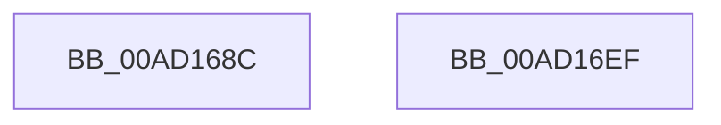

# PopEsEnterSleepShutdown

- RVA: `0x00AD168C`–`0x00AD16F0` (길이 `100` bytes)
- VA: `0x0000000140AD168C`
- 실행 섹션: `PAGE`
- PDB 이름 있음: `예`; PDB Function 태그: `아니요`
- unwind 정보 RVA: `0x00063458`
- 디코드: `19`개 명령, `100/100` bytes 표시
- 미해석 바이트: `0` (있으면 어셈블리에 `.byte`로 보존)

> 이 문서는 커널 이미지의 기계어와 PDB 기호를 분석해 생성했습니다. 4번과 5번은 함수 원형과 자료형을 바이너리 사용 방식에서 추정한 C 해석이며 원본 소스 복구 결과는 아닙니다.

## 1. Dependencies

- 직접 호출 지점: **5**; 고유 호출 대상: **4**
- 직접 호출자로 확인된 함수: **1**
- RIP 상대 이미지 참조: **5**

### Outgoing calls
- `0x00AD1697` → [PopAcquireRwLockShared](../../text/2D/PopAcquireRwLockShared_function_002D9A40.md) (function, `0x002D9A40`)
- `0x00AD16BB` → [PopReleaseRwLock](../../text/2D/PopReleaseRwLock_function_002DFBBC.md) (function, `0x002DFBBC`)
- `0x00AD16C7` → [PopAcquireRwLockExclusive](../../text/43/PopAcquireRwLockExclusive_function_00430B44.md) (function, `0x00430B44`)
- `0x00AD16D1` → [PopEsSnapTelemetry](../70/PopEsSnapTelemetry_function_00700BC0.md) (function, `0x00700BC0`)
- `0x00AD16E5` → [PopReleaseRwLock](../../text/2D/PopReleaseRwLock_function_002DFBBC.md) (function, `0x002DFBBC`)

### Direct callers
- [PopTransitionSystemPowerStateEx](../../pagelk/B7/PopTransitionSystemPowerStateEx_function_00B7E8C0.md) at `0x00B7F0C1`

### Static image references
- `0x00AD1690` → RVA `0x00F0C238` (`.data`; read)
- `0x00AD169C` → RVA `0x00F0C248` (`.data`; read)
- `0x00AD16AA` → RVA `0x00F0C258` (`.data`; read)
- `0x00AD16C0` → RVA `0x00F08440` (`.data`; read)
- `0x00AD16D6` → RVA `0x00E67A10` (`.data`; read/write)

## 2. Other-region calls and transfers

- 다른 실행 섹션으로 향하는 call: **4**
  - `0x00AD1697` → [PopAcquireRwLockShared](../../text/2D/PopAcquireRwLockShared_function_002D9A40.md) (`PAGE` → `.text`)
  - `0x00AD16BB` → [PopReleaseRwLock](../../text/2D/PopReleaseRwLock_function_002DFBBC.md) (`PAGE` → `.text`)
  - `0x00AD16C7` → [PopAcquireRwLockExclusive](../../text/43/PopAcquireRwLockExclusive_function_00430B44.md) (`PAGE` → `.text`)
  - `0x00AD16E5` → [PopReleaseRwLock](../../text/2D/PopReleaseRwLock_function_002DFBBC.md) (`PAGE` → `.text`)
- 별도 외부 분기/꼬리 이동을 확인하지 못했습니다.

## 3. Assembly (complete function range)

```asm
00AD168C  48 83 EC 48                     sub rsp, 0x48
00AD1690  48 8D 0D A1 AB 43 00            lea rcx, [rip + 0x43aba1]
00AD1697  E8 A4 83 80 FF                  call 0x1402d9a40
00AD169C  0F 10 05 A5 AB 43 00            movups xmm0, xmmword ptr [rip + 0x43aba5]
00AD16A3  48 8D 0D 8E AB 43 00            lea rcx, [rip + 0x43ab8e]
00AD16AA  0F 10 0D A7 AB 43 00            movups xmm1, xmmword ptr [rip + 0x43aba7]
00AD16B1  0F 11 44 24 20                  movups xmmword ptr [rsp + 0x20], xmm0
00AD16B6  0F 11 4C 24 30                  movups xmmword ptr [rsp + 0x30], xmm1
00AD16BB  E8 FC E4 80 FF                  call 0x1402dfbbc
00AD16C0  48 8D 0D 79 6D 43 00            lea rcx, [rip + 0x436d79]
00AD16C7  E8 78 F4 95 FF                  call 0x140430b44
00AD16CC  48 8D 4C 24 20                  lea rcx, [rsp + 0x20]
00AD16D1  E8 EA F4 C2 FF                  call 0x140700bc0
00AD16D6  48 83 25 32 63 39 00 00         and qword ptr [rip + 0x396332], 0
00AD16DE  48 8D 0D 5B 6D 43 00            lea rcx, [rip + 0x436d5b]
00AD16E5  E8 D2 E4 80 FF                  call 0x1402dfbbc
00AD16EA  48 83 C4 48                     add rsp, 0x48
00AD16EE  C3                              ret
00AD16EF  CC                              int3
```

## 4. C-style interpretation (structured pseudocode)

```c
__int64 __fastcall PopEsEnterSleepShutdown(void)
{
    __int64 result;
    __int64 v_rsp;
    unsigned __int64 v_stack_m18;
    unsigned __int64 v_stack_m28;

    v_rsp = (v_rsp) - (72);
    result = PopAcquireRwLockShared(v_rip + 4434849, a2, a3, a4);
    v_stack_m28 = v_xmm0;
    v_stack_m18 = v_xmm1;
    result = PopReleaseRwLock(v_rip + 4434830, a2, a3, a4);
    result = PopAcquireRwLockExclusive(v_rip + 4418937, a2, a3, a4);
    result = PopEsSnapTelemetry(v_stack_m28, a2, a3, a4);
    result = PopReleaseRwLock(v_rip + 4418907, a2, a3, a4);
    v_rsp = (v_rsp) + (72);
    return result;
}
```

## 5. (Beta) C Style

```c
void PopEsEnterSleepShutdown(void)
{
    int64_t result;
    int64_t local_rsp;
    uint64_t v_stack_m18;
    uint64_t v_stack_m28;

    local_rsp = (local_rsp) - (72);
    result = PopAcquireRwLockShared(v_rip + 4434849, a2, a3, a4);
    v_stack_m28 = v_xmm0;
    v_stack_m18 = v_xmm1;
    result = PopReleaseRwLock(v_rip + 4434830, a2, a3, a4);
    result = PopAcquireRwLockExclusive(v_rip + 4418937, a2, a3, a4);
    result = PopEsSnapTelemetry(v_stack_m28, a2, a3, a4);
    result = PopReleaseRwLock(v_rip + 4418907, a2, a3, a4);
    local_rsp = (local_rsp) + (72);
    return result;
}
```

## 6. Execution-region graph

[열기: 2D/3D 그래프와 함수 탐색 컨트롤 패널](../../../control-panel.html?section=page&rva=0x00AD168C&view=graph)

- 2D 그래프는 위에서 아래로 흐르고, 3D 그래프는 빈 공간을 드래그해 회전합니다. Shift+드래그는 이동, 휠은 확대·축소, 함수 노드 선택은 대상 보고서 이동입니다.

### Static fallback


