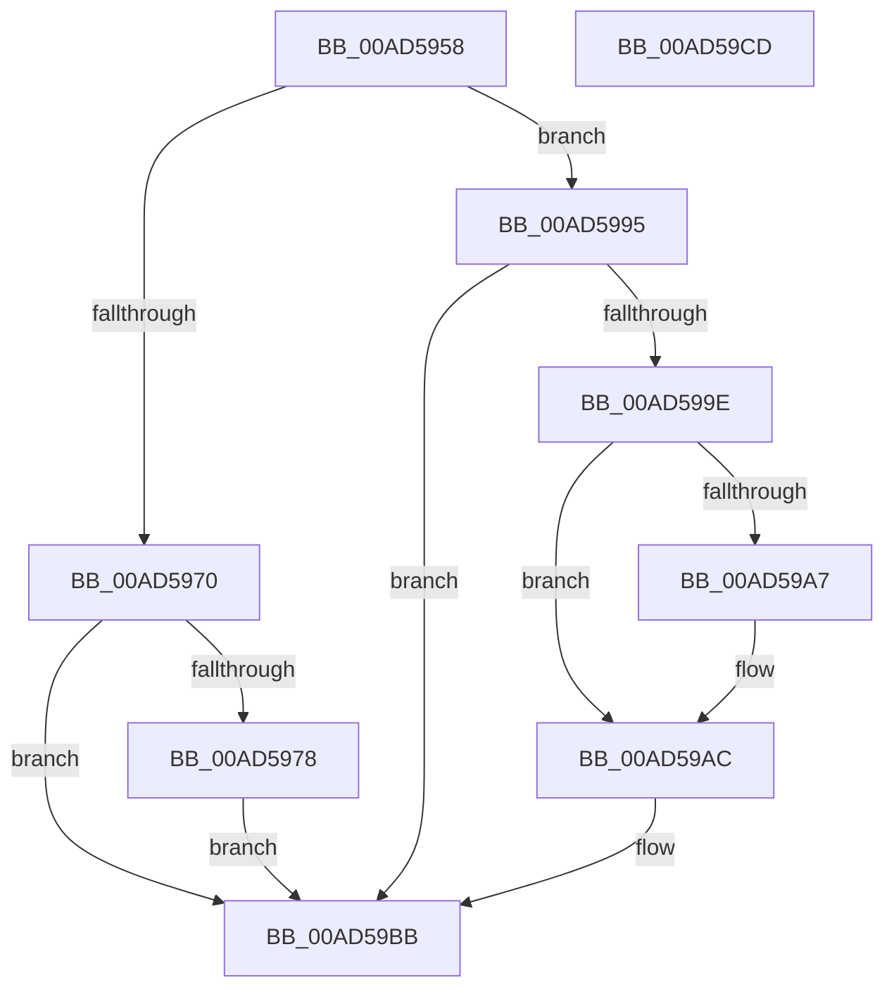

# PopFanUpdateCsState

- RVA: `0x00AD5958`–`0x00AD59CE` (길이 `118` bytes)
- VA: `0x0000000140AD5958`
- 실행 섹션: `PAGE`
- PDB 이름 있음: `예`; PDB Function 태그: `아니요`
- unwind 정보 RVA: `0x0005CF00`
- 디코드: `27`개 명령, `118/118` bytes 표시
- 미해석 바이트: `0` (있으면 어셈블리에 `.byte`로 보존)

> 이 문서는 커널 이미지의 기계어와 PDB 기호를 분석해 생성했습니다. 4번과 5번은 함수 원형과 자료형을 바이너리 사용 방식에서 추정한 C 해석이며 원본 소스 복구 결과는 아닙니다.

## 1. Dependencies

- 직접 호출 지점: **3**; 고유 호출 대상: **3**
- 직접 호출자로 확인된 함수: **1**
- RIP 상대 이미지 참조: **6**

### Outgoing calls
- `0x00AD5967` → [PopAcquireRwLockExclusive](../../text/43/PopAcquireRwLockExclusive_function_00430B44.md) (function, `0x00430B44`)
- `0x00AD59A7` → [PopFanEndCsFanPeriod](../76/PopFanEndCsFanPeriod_function_00769158.md) (function, `0x00769158`)
- `0x00AD59C2` → [PopReleaseRwLock](../../text/2D/PopReleaseRwLock_function_002DFBBC.md) (function, `0x002DFBBC`)

### Direct callers
- [PopConnectedStandbySettingCallback](../A8/PopConnectedStandbySettingCallback_function_00A8FF40.md) at `0x00A8FFBA`

### Static image references
- `0x00AD5960` → RVA `0x00F0C910` (`.data`; read)
- `0x00AD5970` → RVA `0x00F0C985` (`.data`; read)
- `0x00AD5982` → RVA `0x00F0C985` (`.data`; write)
- `0x00AD598C` → RVA `0x00F0C998` (`.data`; write)
- `0x00AD599E` → RVA `0x00F0C984` (`.data`; read)
- `0x00AD59AC` → RVA `0x00F0C998` (`.data`; read/write)

## 2. Other-region calls and transfers

- 다른 실행 섹션으로 향하는 call: **2**
  - `0x00AD5967` → [PopAcquireRwLockExclusive](../../text/43/PopAcquireRwLockExclusive_function_00430B44.md) (`PAGE` → `.text`)
  - `0x00AD59C2` → [PopReleaseRwLock](../../text/2D/PopReleaseRwLock_function_002DFBBC.md) (`PAGE` → `.text`)
- 별도 외부 분기/꼬리 이동을 확인하지 못했습니다.

## 3. Assembly (complete function range)

```asm
00AD5958  40 53                           push rbx
00AD595A  48 83 EC 20                     sub rsp, 0x20
00AD595E  8A D9                           mov bl, cl
00AD5960  48 8D 0D A9 6F 43 00            lea rcx, [rip + 0x436fa9]
00AD5967  E8 D8 B1 95 FF                  call 0x140430b44
00AD596C  84 DB                           test bl, bl
00AD596E  75 25                           jne 0x140ad5995
00AD5970  38 1D 0F 70 43 00               cmp byte ptr [rip + 0x43700f], bl
00AD5976  75 43                           jne 0x140ad59bb
00AD5978  48 B8 08 00 00 00 80 F7 FF FF   movabs rax, 0xfffff78000000008
00AD5982  C6 05 FC 6F 43 00 01            mov byte ptr [rip + 0x436ffc], 1
00AD5989  48 8B 00                        mov rax, qword ptr [rax]
00AD598C  48 89 05 05 70 43 00            mov qword ptr [rip + 0x437005], rax
00AD5993  EB 26                           jmp 0x140ad59bb
00AD5995  80 3D E9 6F 43 00 00            cmp byte ptr [rip + 0x436fe9], 0
00AD599C  74 1D                           je 0x140ad59bb
00AD599E  80 3D DF 6F 43 00 00            cmp byte ptr [rip + 0x436fdf], 0
00AD59A5  74 05                           je 0x140ad59ac
00AD59A7  E8 AC 37 C9 FF                  call 0x140769158
00AD59AC  48 83 25 E4 6F 43 00 00         and qword ptr [rip + 0x436fe4], 0
00AD59B4  C6 05 CA 6F 43 00 00            mov byte ptr [rip + 0x436fca], 0
00AD59BB  48 8D 0D 4E 6F 43 00            lea rcx, [rip + 0x436f4e]
00AD59C2  E8 F5 A1 80 FF                  call 0x1402dfbbc
00AD59C7  48 83 C4 20                     add rsp, 0x20
00AD59CB  5B                              pop rbx
00AD59CC  C3                              ret
00AD59CD  CC                              int3
```

## 4. C-style interpretation (structured pseudocode)

```c
__int64 __fastcall PopFanUpdateCsState(unsigned __int8 a1)
{
    __int64 result;
    __int64 v_rsp;

    v_rsp = (v_rsp) - (32);
    result = PopAcquireRwLockExclusive(v_rip + 4419497, a2, a3, a4);
    if (a1 != 0) goto loc_00AD5995;
    if ((*(unsigned __int8 *)(v_rip + 4419599)) != a1) goto loc_00AD59BB;
    *(unsigned __int8 *)(v_rip + 4419580) = 1;
    *(unsigned __int64 *)(v_rip + 4419589) = *(unsigned __int64 *)(result);
    goto loc_00AD59BB;
loc_00AD5995:
    if ((*(unsigned __int8 *)(v_rip + 4419561)) == 0) goto loc_00AD59BB;
    result = *(unsigned __int64 *)(result);
    if ((*(unsigned __int8 *)(v_rip + 4419551)) != 0) {
        result = PopFanEndCsFanPeriod(v_rip + 4419497, a2, a3, a4);
    }
    *(unsigned __int8 *)(v_rip + 4419530) = 0;
loc_00AD59BB:
    result = PopReleaseRwLock(v_rip + 4419406, a2, a3, a4);
    v_rsp = (v_rsp) + (32);
    return result;
}
```

## 5. (Beta) C Style

```c
int64_t PopFanUpdateCsState(uint8_t Arg1)
{
    int64_t result;
    int64_t local_rsp;

    local_rsp = (local_rsp) - (32);
    result = PopAcquireRwLockExclusive(v_rip + 4419497, a2, a3, a4);
    if (Arg1 != 0) goto loc_00AD5995;
    if ((*(uint8_t *)(v_rip + 0x43700F)) != Arg1) goto loc_00AD59BB;
    *(uint8_t *)(v_rip + 0x436FFC) = 1;
    *(uint64_t *)(v_rip + 0x437005) = *(uint64_t *)(result);
    goto loc_00AD59BB;
loc_00AD5995:
    if ((*(uint8_t *)(v_rip + 0x436FE9)) == 0) goto loc_00AD59BB;
    result = *(uint64_t *)(result);
    if ((*(uint8_t *)(v_rip + 0x436FDF)) != 0) {
        result = PopFanEndCsFanPeriod(v_rip + 4419497, a2, a3, a4);
    }
    *(uint8_t *)(v_rip + 0x436FCA) = 0;
loc_00AD59BB:
    result = PopReleaseRwLock(v_rip + 4419406, a2, a3, a4);
    local_rsp = (local_rsp) + (32);
    return result;
}
```

## 6. Execution-region graph

[열기: 2D/3D 그래프와 함수 탐색 컨트롤 패널](../../../control-panel.html?section=page&rva=0x00AD5958&view=graph)

- 2D 그래프는 위에서 아래로 흐르고, 3D 그래프는 빈 공간을 드래그해 회전합니다. Shift+드래그는 이동, 휠은 확대·축소, 함수 노드 선택은 대상 보고서 이동입니다.

### Static fallback


