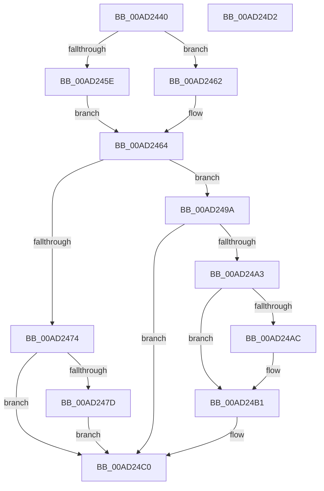

# PopFanUpdateRunningState

- RVA: `0x00AD2440`–`0x00AD24D3` (길이 `147` bytes)
- VA: `0x0000000140AD2440`
- 실행 섹션: `PAGE`
- PDB 이름 있음: `예`; PDB Function 태그: `아니요`
- unwind 정보 RVA: `0x0005CF00`
- 디코드: `35`개 명령, `147/147` bytes 표시
- 미해석 바이트: `0` (있으면 어셈블리에 `.byte`로 보존)

> 이 문서는 커널 이미지의 기계어와 PDB 기호를 분석해 생성했습니다. 4번과 5번은 함수 원형과 자료형을 바이너리 사용 방식에서 추정한 C 해석이며 원본 소스 복구 결과는 아닙니다.

## 1. Dependencies

- 직접 호출 지점: **3**; 고유 호출 대상: **3**
- 직접 호출자로 확인된 함수: **1**
- RIP 상대 이미지 참조: **8**

### Outgoing calls
- `0x00AD244F` → [PopAcquireRwLockExclusive](../../text/43/PopAcquireRwLockExclusive_function_00430B44.md) (function, `0x00430B44`)
- `0x00AD24AC` → [PopFanEndCsFanPeriod](../76/PopFanEndCsFanPeriod_function_00769158.md) (function, `0x00769158`)
- `0x00AD24C7` → [PopReleaseRwLock](../../text/2D/PopReleaseRwLock_function_002DFBBC.md) (function, `0x002DFBBC`)

### Direct callers
- [PopFanWorker](../A9/PopFanWorker_function_00A9B050.md) at `0x00A9B303`

### Static image references
- `0x00AD2448` → RVA `0x00F0C910` (`.data`; read)
- `0x00AD2454` → RVA `0x00F0C980` (`.data`; read)
- `0x00AD2464` → RVA `0x00F0C980` (`.data`; write)
- `0x00AD2474` → RVA `0x00F0C984` (`.data`; read)
- `0x00AD2487` → RVA `0x00F0C984` (`.data`; write)
- `0x00AD2491` → RVA `0x00F0C990` (`.data`; write)
- `0x00AD24A3` → RVA `0x00F0C985` (`.data`; read)
- `0x00AD24B1` → RVA `0x00F0C990` (`.data`; read/write)

## 2. Other-region calls and transfers

- 다른 실행 섹션으로 향하는 call: **2**
  - `0x00AD244F` → [PopAcquireRwLockExclusive](../../text/43/PopAcquireRwLockExclusive_function_00430B44.md) (`PAGE` → `.text`)
  - `0x00AD24C7` → [PopReleaseRwLock](../../text/2D/PopReleaseRwLock_function_002DFBBC.md) (`PAGE` → `.text`)
- 별도 외부 분기/꼬리 이동을 확인하지 못했습니다.

## 3. Assembly (complete function range)

```asm
00AD2440  40 53                           push rbx
00AD2442  48 83 EC 20                     sub rsp, 0x20
00AD2446  8A D9                           mov bl, cl
00AD2448  48 8D 0D C1 A4 43 00            lea rcx, [rip + 0x43a4c1]
00AD244F  E8 F0 E6 95 FF                  call 0x140430b44
00AD2454  8B 05 26 A5 43 00               mov eax, dword ptr [rip + 0x43a526]
00AD245A  84 DB                           test bl, bl
00AD245C  75 04                           jne 0x140ad2462
00AD245E  FF C8                           dec eax
00AD2460  EB 02                           jmp 0x140ad2464
00AD2462  FF C0                           inc eax
00AD2464  89 05 16 A5 43 00               mov dword ptr [rip + 0x43a516], eax
00AD246A  8B 05 10 A5 43 00               mov eax, dword ptr [rip + 0x43a510]
00AD2470  85 C0                           test eax, eax
00AD2472  74 26                           je 0x140ad249a
00AD2474  80 3D 09 A5 43 00 00            cmp byte ptr [rip + 0x43a509], 0
00AD247B  75 43                           jne 0x140ad24c0
00AD247D  48 B8 08 00 00 00 80 F7 FF FF   movabs rax, 0xfffff78000000008
00AD2487  C6 05 F6 A4 43 00 01            mov byte ptr [rip + 0x43a4f6], 1
00AD248E  48 8B 00                        mov rax, qword ptr [rax]
00AD2491  48 89 05 F8 A4 43 00            mov qword ptr [rip + 0x43a4f8], rax
00AD2498  EB 26                           jmp 0x140ad24c0
00AD249A  80 3D E3 A4 43 00 00            cmp byte ptr [rip + 0x43a4e3], 0
00AD24A1  74 1D                           je 0x140ad24c0
00AD24A3  80 3D DB A4 43 00 00            cmp byte ptr [rip + 0x43a4db], 0
00AD24AA  74 05                           je 0x140ad24b1
00AD24AC  E8 A7 6C C9 FF                  call 0x140769158
00AD24B1  48 83 25 D7 A4 43 00 00         and qword ptr [rip + 0x43a4d7], 0
00AD24B9  C6 05 C4 A4 43 00 00            mov byte ptr [rip + 0x43a4c4], 0
00AD24C0  48 8D 0D 49 A4 43 00            lea rcx, [rip + 0x43a449]
00AD24C7  E8 F0 D6 80 FF                  call 0x1402dfbbc
00AD24CC  48 83 C4 20                     add rsp, 0x20
00AD24D0  5B                              pop rbx
00AD24D1  C3                              ret
00AD24D2  CC                              int3
```

## 4. C-style interpretation (structured pseudocode)

```c
__int64 __fastcall PopFanUpdateRunningState(unsigned __int8 a1)
{
    __int64 result;
    __int64 v_rsp;

    v_rsp = (v_rsp) - (32);
    result = PopAcquireRwLockExclusive(v_rip + 4433089, a2, a3, a4);
    if (a1 != 0) goto loc_00AD2462;
    result = (unsigned int)(((unsigned int)(*(unsigned int *)(v_rip + 4433190))) - 1);
    goto loc_00AD2464;
loc_00AD2462:
    result = (unsigned int)((result) + 1);
loc_00AD2464:
    *(unsigned int *)(v_rip + 4433174) = (unsigned int)(result);
    if ((unsigned int)((unsigned int)(*(unsigned int *)(v_rip + 4433168))) == 0) goto loc_00AD249A;
    if ((*(unsigned __int8 *)(v_rip + 4433161)) != 0) goto loc_00AD24C0;
    *(unsigned __int8 *)(v_rip + 4433142) = 1;
    *(unsigned __int64 *)(v_rip + 4433144) = *(unsigned __int64 *)((unsigned int)(*(unsigned int *)(v_rip + 4433168)));
    goto loc_00AD24C0;
loc_00AD249A:
    if ((*(unsigned __int8 *)(v_rip + 4433123)) == 0) goto loc_00AD24C0;
    result = *(unsigned __int64 *)((unsigned int)(*(unsigned int *)(v_rip + 4433168)));
    if ((*(unsigned __int8 *)(v_rip + 4433115)) != 0) {
        result = PopFanEndCsFanPeriod(v_rip + 4433089, a2, a3, a4);
    }
    *(unsigned __int8 *)(v_rip + 4433092) = 0;
loc_00AD24C0:
    result = PopReleaseRwLock(v_rip + 4432969, a2, a3, a4);
    v_rsp = (v_rsp) + (32);
    return result;
}
```

## 5. (Beta) C Style

```c
int64_t PopFanUpdateRunningState(uint8_t Arg1)
{
    int64_t result;
    int64_t local_rsp;

    local_rsp = (local_rsp) - (32);
    result = PopAcquireRwLockExclusive(v_rip + 4433089, a2, a3, a4);
    if (Arg1 != 0) goto loc_00AD2462;
    result = (uint32_t)(((uint32_t)(*(uint32_t *)(v_rip + 0x43A526))) - 1);
    goto loc_00AD2464;
loc_00AD2462:
    result = (uint32_t)((result) + 1);
loc_00AD2464:
    *(uint32_t *)(v_rip + 0x43A516) = (uint32_t)(result);
    if ((uint32_t)((uint32_t)(*(uint32_t *)(v_rip + 0x43A510))) == 0) goto loc_00AD249A;
    if ((*(uint8_t *)(v_rip + 0x43A509)) != 0) goto loc_00AD24C0;
    *(uint8_t *)(v_rip + 0x43A4F6) = 1;
    *(uint64_t *)(v_rip + 0x43A4F8) = *(uint64_t *)((uint32_t)(*(uint32_t *)(v_rip + 0x43A510)));
    goto loc_00AD24C0;
loc_00AD249A:
    if ((*(uint8_t *)(v_rip + 0x43A4E3)) == 0) goto loc_00AD24C0;
    result = *(uint64_t *)((uint32_t)(*(uint32_t *)(v_rip + 0x43A510)));
    if ((*(uint8_t *)(v_rip + 0x43A4DB)) != 0) {
        result = PopFanEndCsFanPeriod(v_rip + 4433089, a2, a3, a4);
    }
    *(uint8_t *)(v_rip + 0x43A4C4) = 0;
loc_00AD24C0:
    result = PopReleaseRwLock(v_rip + 4432969, a2, a3, a4);
    local_rsp = (local_rsp) + (32);
    return result;
}
```

## 6. Execution-region graph

[열기: 2D/3D 그래프와 함수 탐색 컨트롤 패널](../../../control-panel.html?section=page&rva=0x00AD2440&view=graph)

- 2D 그래프는 위에서 아래로 흐르고, 3D 그래프는 빈 공간을 드래그해 회전합니다. Shift+드래그는 이동, 휠은 확대·축소, 함수 노드 선택은 대상 보고서 이동입니다.

### Static fallback


